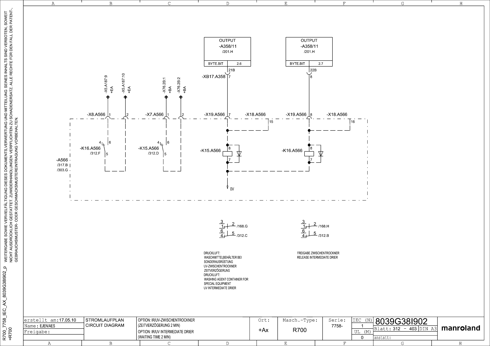

# +Ax — Sheet 312 of 403 — OPTION: IR/UV ZWISCHENTROCKNER

**(ZEITVERZÖGERUNG 2 MIN)**

> Part of the manroland **R700** printing press IEC/UL circuit diagrams.
> Drawing class: **Stromlaufplan / Circuit diagram** (DIN A3).
> Document `+Ax` covers the **Central control console** machine section.

## At a glance

| Field | Value |
|---|---|
| Document | `+Ax`  (8039G38I902) |
| Sheet | **312** of 403 |
| Section (DE) | OPTION: IR/UV ZWISCHENTROCKNER |
| Section (EN) | (ZEITVERZÖGERUNG 2 MIN) |
| Section type | CIRCUIT — Circuit diagram |
| Machine type | `R700` |
| Series | `7758` |
| Created | 17.05.10 |
| Replaces | — |
| Columns used | A, B, C, D, E, F |
| Path numbers | — |
| Labels on sheet | 84 |
| Cross-refs out | 10 |
| Cross-refs in | 20 |

**Previous:** [+Ax sheet 311](SHEET_0311.md) · **Next:** [+Ax sheet 313](SHEET_0313.md) · **Document TOC:** [_TOC.md](_TOC.md)  (+Ax) · **Master TOC:** [all sheets](../_MASTER_TOC.md)

## Sheet image (300 DPI, exact vector render)



_Rendered directly from the PDF vector layer at 300 DPI (1-bit), no OCR and no resampling. Use it to confirm anything ambiguous in the text below._

## Cross-references on this sheet

Each entry is a wire leaving this sheet. The printed token is `/sheet.column`; the link resolves to that sheet inside the same document.

| Ref | Target sheet | Col | Path | Destination on target | Target section | From col |
|---|---|---|---|---|---|---|
| `/201.H` | [+Ax sheet 201](SHEET_0201.md) | H | — | — | REFERENZMODUL | D |
| `/201.H` | [+Ax sheet 201](SHEET_0201.md) | H | — | — | REFERENZMODUL | E |
| `/312.F` | [+Ax sheet 312](SHEET_0312.md) | F | — | — | OPTION: IR/UV ZWISCHENTROCKNER | B |
| `/312.D` | [+Ax sheet 312](SHEET_0312.md) | D | — | — | OPTION: IR/UV ZWISCHENTROCKNER | C |
| `/317.B` | [+Ax sheet 317](SHEET_0317.md) | B | — | — | OPTION: "EJEKTOR" ANLAGE / SELECT AIRSTATION / | A |
| `/303.G` | [+Ax sheet 303](SHEET_0303.md) | G | — | — | SPANNUNGSVERSORGUNG: LACKMODUL | A |
| `/168.G` | [+Ax sheet 168](SHEET_0168.md) | G | — | — | ÜBERWACHUNGSRECHNER/RÜCKMELDUNG NOT AUS | D |
| `/168.H` | [+Ax sheet 168](SHEET_0168.md) | H | — | — | ÜBERWACHUNGSRECHNER/RÜCKMELDUNG NOT AUS | F |
| `/312.B` | [+Ax sheet 312](SHEET_0312.md) | B | — | — | OPTION: IR/UV ZWISCHENTROCKNER | F |
| `/312.C` | [+Ax sheet 312](SHEET_0312.md) | C | — | — | OPTION: IR/UV ZWISCHENTROCKNER | D |

### Incoming references (sheets that point here)

Every other sheet that sends a wire to this one. `Back-ref` is the token printed on *that* sheet; `Path` is its line number.

| From sheet | Cols | Back-ref | Path | Refs | What continues there |
|---|---|---|---|---|---|
| [+Ax#168](SHEET_0168.md) | F, G | `/168.F`, `/168.G` | — | 2 | — |
| [+Ax#201](SHEET_0201.md) | G, H | `/201.G`, `/201.H` | — | 2 | — |
| [+Ax#236](SHEET_0236.md) | C | `/236.C` | — | 2 | — |
| [+Ax#239](SHEET_0239.md) | B | `/239.B` | — | 2 | — |
| [+Ax#255](SHEET_0255.md) | C | `/255.C` | — | 2 | — |
| [+Ax#257](SHEET_0257.md) | C | `/257.C` | — | 2 | — |
| [+Ax#259](SHEET_0259.md) | E | `/259.E` | — | 2 | — |
| [+Ax#303](SHEET_0303.md) | G | `/303.G` | — | 1 | — |
| [+Ax#312](SHEET_0312.md) | B, C, D, F | `/312.B`, `/312.C`, `/312.D`, `/312.F` | — | 4 | — |
| [+Ax#317](SHEET_0317.md) | B | `/317.B` | — | 1 | — |


## Devices on this sheet

| Tag | Class | Class meaning (IEC) | Col | Sub | Terminal | Sign |
|---|---|---|---|---|---|---|
| `A358/11` | A | Baugruppe / assembly, module, PC board | D | 11 | — | — |
| `A566` | A | Baugruppe / assembly, module, PC board | A | — | — | — |
| `A358/11` | A | Baugruppe / assembly, module, PC board | E | 11 | — | — |
| `2.6` | — | cross-device reference | D | — | — | — |
| `XB17.A358` | — | cross-device reference | D | — | — | — |
| `X19.A566` | — | cross-device reference | D | — | — | — |
| `K15.A566` | — | cross-device reference | D | — | — | — |
| `2.7` | — | cross-device reference | F | — | — | — |
| `X19.A566` | — | cross-device reference | E | — | — | — |
| `K16.A566` | — | cross-device reference | E | — | — | — |
| `K16.A566` | — | cross-device reference | B | — | — | — |
| `K15.A566` | — | cross-device reference | C | — | — | — |
| `X7.A566` | — | cross-device reference | C | — | — | — |
| `X8.A566` | — | cross-device reference | B | — | — | — |
| `X5.A187:9` | — | cross-device reference | B | — | 9 | — |
| `X5.A187:10` | — | cross-device reference | B | — | 10 | — |
| `X18.A566` | — | cross-device reference | D | — | — | — |
| `X18.A566` | — | cross-device reference | F | — | — | — |

## Potentials / nets

| Potential | Count | Columns | Attached devices | Terminals |
|---|---|---|---|---|
| `0V` | 1 | D | — | — |


A potential such as `L24+/4` or `M24+` is a named supply/return rail; every place it appears on this sheet is electrically common.

## Wire-end annotations (grouped as printed)

A wire that continues elsewhere is annotated with a small cluster: the destination description, the path/line number `#NN`, and the `/sheet.column` cross reference. Each row below is one such cluster exactly as it is grouped on the drawing.

| Col | Y | Path | Cross-ref | Text on the wire |
|---|---|---|---|---|
| D | 94.2 | — | — | `OUTPUT` |
| E | 94.2 | — | — | `OUTPUT` |
| D | 108.0 | — | — | `A358/11` |
| E | 108.0 | — | — | `A358/11` |
| D | 121.8 | — | `/201.H` | — |
| E | 121.8 | — | `/201.H` | — |
| D | 151.4 | — | — | `BYTE.BIT 2.6` |
| E | 151.4 | — | — | `BYTE.BIT 2.7` |
| D | 166.8 | — | — | `21B` |
| E | 166.8 | — | — | `22B` |
| B | 178.3 | — | — | `X5.A187:10` |
| D | 181.7 | — | — | `XB17.A358 7` |
| B | 183.1 | — | — | `X5.A187:9` |
| E | 183.2 | — | — | `8` |
| C | 187.9 | — | — | `X76.2B:1` |
| C | 187.9 | — | — | `X76.2B:2` |
| B | 210.1 | — | — | `+EA` |
| B | 210.1 | — | — | `+EA` |
| C | 210.1 | — | — | `+BA` |
| C | 210.1 | — | — | `+BA` |
| B | 273.9 | — | — | `X8.A566 1 X7.A566 1` |
| D | 273.9 | — | — | `X19.A566 7` |
| E | 273.9 | — | — | `X18.A566 X18.A566` |
| E | 273.9 | — | — | `X19.A566 8` |
| B | 275.3 | — | — | `2` |
| C | 275.3 | — | — | `2` |
| E | 292.3 | — | — | `15` |
| F | 292.3 | — | — | `16` |
| B | 342.6 | — | — | `K16.A566 6` |
| B | 342.6 | — | — | `4` |
| C | 342.6 | — | — | `K15.A566 6` |
| C | 342.6 | — | — | `4` |
| D | 356.8 | — | — | `8` |
| E | 356.8 | — | — | `8` |
| D | 361.7 | — | — | `K15.A566` |
| E | 361.7 | — | — | `K16.A566` |
| B | 369.1 | — | `/312.F` | — |
| C | 369.1 | — | `/312.D` | — |
| B | 370.9 | — | — | `5` |
| C | 370.9 | — | — | `5` |
| A | 384.4 | — | — | `A566` |
| D | 385.1 | — | — | `7` |
| E | 385.1 | — | — | `7` |
| A | 397.5 | — | `/317.B`, `/303.G` | — |
| D | 456.5 | — | — | `0V` |
| D | 534.6 | — | — | `3 6 4 1` |
| E | 534.6 | — | — | `3 6 4 1` |
| D | 540.3 | — | — | `2` |
| E | 540.3 | — | — | `2` |
| D | 546.7 | — | `/168.G` | — |
| F | 546.7 | — | `/168.H` | — |
| D | 563.0 | — | — | `5` |
| E | 563.0 | — | — | `5` |
| F | 569.3 | — | `/312.B` | — |
| D | 569.4 | — | `/312.C` | — |
| D | 612.9 | — | — | `DRUCKLUFT:` |
| F | 612.9 | — | — | `FREIGABE ZWISCHENTROCKNER RELEASE INTERMEDIATE DRIER` |
| D | 623.5 | — | — | `UV ZWISCHENTROCKNER SONDERAUSRÜSTUNG WASCHMITTELBEHÄLTER BEI` |
| D | 655.5 | — | — | `DRUCKLUFT: ZEITVERZÖGERUNG` |
| D | 676.7 | — | — | `UV INTERMEDIATE DRIER SPECIAL EQUIPMENT WASHING AGENT CONTAINER FOR` |


## Reconstructed tables

This sheet carries tabular content (pin map / terminal assignment / index). The grid below was rebuilt from the drawing's own rule lines, so each row is exactly one physical row of the table.

### Table 1 — 3 data rows × 13 columns (at x=255.1, y=90.7)

|  |  |  |  |  |  | OUTPUT | A358/11 /201.H |  |  | OUTPUT | A358/11 /201.H |  |
|---|---|---|---|---|---|---|---|---|---|---|---|---|
|  |  |  |  |  |  | `BYTE.BIT` |  | `2.6` |  | `BYTE.BIT` |  | `2.7` |
| `X5.A187:9` | `X5.A187:10 +EA 1` | `+EA X7.A566 2` | `X76.2B:1` | `X76.2B:2 +BA 1` | `+BA 2` | `XB17.A358 X19.A566` | `21B 7 7` |  | `X18.A566 15` | `X19.A566` | `22B 8 8` |  |
| `5` | `6` | `4 K15.A566 /312.D` | `5` | `6` |  | `K15.A566` | `8 7` |  |  | `K16.A566` | `8 7` |  |


## Notes and free text on this sheet

| Text | Col | Y (pt) |
|---|---|---|
| `21B` | D | 166.82 |
| `OUTPUT` | D | 94.16 |
| `BYTE.BIT` | D | 151.43 |
| `DRUCKLUFT:` | D | 612.91 |
| `WASCHMITTELBEHÄLTER BEI` | D | 623.52 |
| `SONDERAUSRÜSTUNG` | D | 634.19 |
| `UV ZWISCHENTROCKNER` | D | 644.8 |
| `ZEITVERZÖGERUNG` | D | 655.45 |
| `WASHING AGENT CONTAINER FOR` | D | 676.7 |
| `SPECIAL EQUIPMENT` | D | 687.34 |
| `UV INTERMEDIATE DRIER` | D | 697.97 |
| `22B` | E | 166.82 |
| `OUTPUT` | E | 94.16 |
| `BYTE.BIT` | E | 151.43 |
| `FREIGABE ZWISCHENTROCKNER` | F | 612.9 |
| `RELEASE INTERMEDIATE DRIER` | F | 623.54 |
| `X76.2B:2` | C | 187.94 |
| `+BA` | C | 210.05 |
| `X76.2B:1` | C | 187.94 |
| `+EA` | B | 210.05 |

## Complete label inventory (exact text from the drawing)

Every text object inside the drawing area of this sheet, in DIN reading order (column A→H, then top→bottom). This is the authoritative list: if a string is not here it is not printed on this sheet.

| Col | Y | X | Dir | Type | Text |
|---|---|---|---|---|---|
| A | 384.4 | 136.6 | → | device tag | `A566` |
| A | 397.5 | 139.2 | → | cross-reference | `/317.B` |
| A | 409.9 | 138.6 | → | cross-reference | `/303.G` |
| B | 178.3 | 295.8 | ↕ | device ref | `X5.A187:10` |
| B | 183.1 | 253.3 | ↕ | device ref | `X5.A187:9` |
| B | 210.0 | 267.4 | ↕ | text | `+EA` |
| B | 210.0 | 309.9 | ↕ | text | `+EA` |
| B | 273.9 | 211.5 | → | device ref | `X8.A566` |
| B | 275.3 | 264.2 | → | number | `1` |
| B | 275.3 | 307.3 | → | number | `2` |
| B | 342.6 | 240.7 | → | number | `4` |
| B | 342.6 | 264.8 | → | number | `6` |
| B | 356.1 | 194.2 | → | device ref | `K16.A566` |
| B | 369.1 | 219.1 | → | cross-reference | `/312.F` |
| B | 371.0 | 257.7 | → | number | `5` |
| C | 187.9 | 395.0 | ↕ | text | `X76.2B:1` |
| C | 187.9 | 430.4 | ↕ | text | `X76.2B:2` |
| C | 210.0 | 409.1 | ↕ | text | `+BA` |
| C | 210.0 | 444.6 | ↕ | text | `+BA` |
| C | 273.9 | 353.2 | → | device ref | `X7.A566` |
| C | 275.3 | 405.9 | → | number | `1` |
| C | 275.3 | 441.9 | → | number | `2` |
| C | 342.6 | 382.4 | → | number | `4` |
| C | 342.6 | 406.5 | → | number | `6` |
| C | 356.1 | 335.9 | → | device ref | `K15.A566` |
| C | 369.1 | 360.0 | → | cross-reference | `/312.D` |
| C | 371.0 | 399.4 | → | number | `5` |
| D | 94.2 | 532.5 | → | text | `OUTPUT` |
| D | 108.0 | 532.1 | → | device tag | `A358/11` |
| D | 121.8 | 540.3 | → | cross-reference | `/201.H` |
| D | 151.4 | 506.0 | → | text | `BYTE.BIT` |
| D | 151.5 | 575.4 | → | device ref | `2.6` |
| D | 166.8 | 555.3 | → | text | `21B` |
| D | 181.7 | 490.4 | → | device ref | `XB17.A358` |
| D | 183.2 | 555.3 | → | number | `7` |
| D | 273.8 | 496.1 | → | device ref | `X19.A566` |
| D | 273.8 | 595.3 | → | device ref | `X18.A566` |
| D | 275.3 | 555.3 | → | number | `7` |
| D | 356.8 | 555.3 | → | number | `8` |
| D | 361.7 | 486.1 | → | device ref | `K15.A566` |
| D | 385.1 | 555.3 | → | number | `7` |
| D | 456.5 | 559.3 | → | potential | `0V` |
| D | 534.6 | 536.0 | → | number | `3` |
| D | 540.3 | 563.8 | → | number | `2` |
| D | 545.9 | 537.4 | → | number | `1` |
| D | 546.7 | 575.4 | → | cross-reference | `/168.G` |
| D | 557.3 | 536.0 | → | number | `6` |
| D | 562.9 | 563.5 | → | number | `5` |
| D | 568.6 | 536.0 | → | number | `4` |
| D | 569.3 | 575.4 | → | cross-reference | `/312.C` |
| D | 612.9 | 495.2 | → | text | `DRUCKLUFT:` |
| D | 623.5 | 496.1 | → | text | `WASCHMITTELBEHÄLTER BEI` |
| D | 634.2 | 495.8 | → | text | `SONDERAUSRÜSTUNG` |
| D | 644.8 | 495.2 | → | text | `UV ZWISCHENTROCKNER` |
| D | 655.4 | 496.1 | → | text | `ZEITVERZÖGERUNG` |
| D | 666.1 | 495.2 | → | text | `DRUCKLUFT:` |
| D | 676.7 | 496.1 | → | text | `WASHING AGENT CONTAINER FOR` |
| D | 687.3 | 495.8 | → | text | `SPECIAL EQUIPMENT` |
| D | 698.0 | 495.2 | → | text | `UV INTERMEDIATE DRIER` |
| E | 94.2 | 730.9 | → | text | `OUTPUT` |
| E | 108.0 | 730.5 | → | device tag | `A358/11` |
| E | 121.8 | 738.7 | → | cross-reference | `/201.H` |
| E | 151.4 | 704.4 | → | text | `BYTE.BIT` |
| E | 166.8 | 753.7 | → | text | `22B` |
| E | 183.2 | 753.7 | → | number | `8` |
| E | 273.8 | 694.5 | → | device ref | `X19.A566` |
| E | 275.3 | 753.7 | → | number | `8` |
| E | 292.3 | 654.0 | → | number | `15` |
| E | 356.8 | 753.7 | → | number | `8` |
| E | 361.7 | 684.6 | → | device ref | `K16.A566` |
| E | 385.1 | 753.7 | → | number | `7` |
| E | 534.6 | 734.5 | → | number | `3` |
| E | 540.3 | 762.2 | → | number | `2` |
| E | 545.9 | 735.9 | → | number | `1` |
| E | 557.3 | 734.5 | → | number | `6` |
| E | 562.9 | 762.0 | → | number | `5` |
| E | 568.6 | 734.5 | → | number | `4` |
| F | 151.5 | 773.9 | → | device ref | `2.7` |
| F | 273.8 | 793.7 | → | device ref | `X18.A566` |
| F | 292.3 | 852.4 | → | number | `16` |
| F | 546.7 | 773.9 | → | cross-reference | `/168.H` |
| F | 569.3 | 773.9 | → | cross-reference | `/312.B` |
| F | 612.9 | 722.0 | → | text | `FREIGABE ZWISCHENTROCKNER` |
| F | 623.5 | 722.0 | → | text | `RELEASE INTERMEDIATE DRIER` |

## Reading-order text block

The same content as a plain block, grouped by DIN column — convenient to paste or to match against a visual description.

```text
=== Column A ===
 384.4  136.6  devtag       A566
 397.5  139.2  xref         /317.B
 409.9  138.6  xref         /303.G
=== Column B ===
 178.3  295.8  devref       X5.A187:10
 183.1  253.3  devref       X5.A187:9
 210.0  267.4  text         +EA
 210.0  309.9  text         +EA
 273.9  211.5  devref       X8.A566
 275.3  264.2  numeric      1
 275.3  307.3  numeric      2
 342.6  240.7  numeric      4
 342.6  264.8  numeric      6
 356.1  194.2  devref       K16.A566
 369.1  219.1  xref         /312.F
 371.0  257.7  numeric      5
=== Column C ===
 187.9  395.0  text         X76.2B:1
 187.9  430.4  text         X76.2B:2
 210.0  409.1  text         +BA
 210.0  444.6  text         +BA
 273.9  353.2  devref       X7.A566
 275.3  405.9  numeric      1
 275.3  441.9  numeric      2
 342.6  382.4  numeric      4
 342.6  406.5  numeric      6
 356.1  335.9  devref       K15.A566
 369.1  360.0  xref         /312.D
 371.0  399.4  numeric      5
=== Column D ===
  94.2  532.5  text         OUTPUT
 108.0  532.1  devtag       A358/11
 121.8  540.3  xref         /201.H
 151.4  506.0  text         BYTE.BIT
 151.5  575.4  devref       2.6
 166.8  555.3  text         21B
 181.7  490.4  devref       XB17.A358
 183.2  555.3  numeric      7
 273.8  496.1  devref       X19.A566
 273.8  595.3  devref       X18.A566
 275.3  555.3  numeric      7
 356.8  555.3  numeric      8
 361.7  486.1  devref       K15.A566
 385.1  555.3  numeric      7
 456.5  559.3  net          0V
 534.6  536.0  numeric      3
 540.3  563.8  numeric      2
 545.9  537.4  numeric      1
 546.7  575.4  xref         /168.G
 557.3  536.0  numeric      6
 562.9  563.5  numeric      5
 568.6  536.0  numeric      4
 569.3  575.4  xref         /312.C
 612.9  495.2  text         DRUCKLUFT:
 623.5  496.1  text         WASCHMITTELBEHÄLTER BEI
 634.2  495.8  text         SONDERAUSRÜSTUNG
 644.8  495.2  text         UV ZWISCHENTROCKNER
 655.4  496.1  text         ZEITVERZÖGERUNG
 666.1  495.2  text         DRUCKLUFT:
 676.7  496.1  text         WASHING AGENT CONTAINER FOR
 687.3  495.8  text         SPECIAL EQUIPMENT
 698.0  495.2  text         UV INTERMEDIATE DRIER
=== Column E ===
  94.2  730.9  text         OUTPUT
 108.0  730.5  devtag       A358/11
 121.8  738.7  xref         /201.H
 151.4  704.4  text         BYTE.BIT
 166.8  753.7  text         22B
 183.2  753.7  numeric      8
 273.8  694.5  devref       X19.A566
 275.3  753.7  numeric      8
 292.3  654.0  numeric      15
 356.8  753.7  numeric      8
 361.7  684.6  devref       K16.A566
 385.1  753.7  numeric      7
 534.6  734.5  numeric      3
 540.3  762.2  numeric      2
 545.9  735.9  numeric      1
 557.3  734.5  numeric      6
 562.9  762.0  numeric      5
 568.6  734.5  numeric      4
=== Column F ===
 151.5  773.9  devref       2.7
 273.8  793.7  devref       X18.A566
 292.3  852.4  numeric      16
 546.7  773.9  xref         /168.H
 569.3  773.9  xref         /312.B
 612.9  722.0  text         FREIGABE ZWISCHENTROCKNER
 623.5  722.0  text         RELEASE INTERMEDIATE DRIER
```

---
_Generated from the PDF vector text layer; no OCR. Source: `R700_7758_IEC_AX_8039G38I902_p`, sheet 312._
