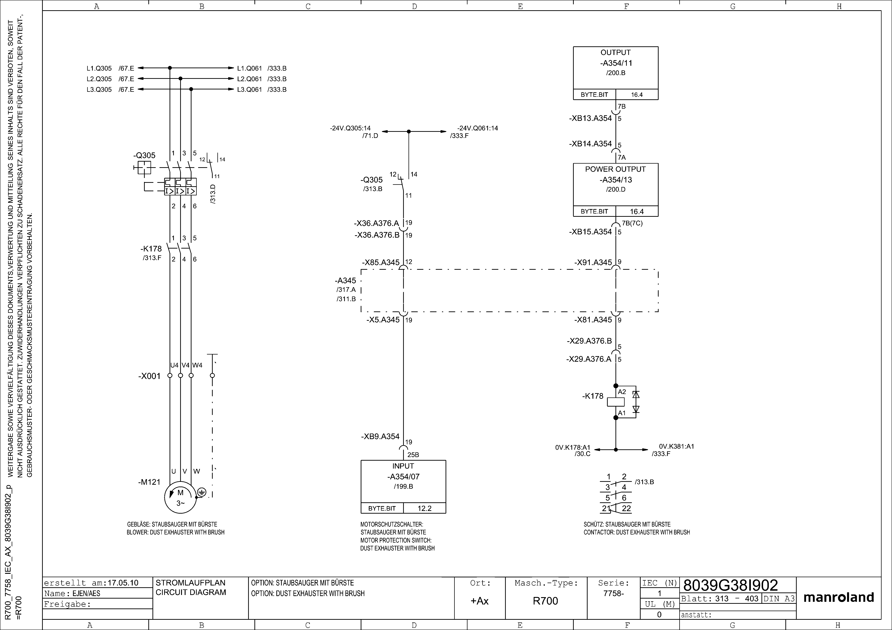

# +Ax — Sheet 313 of 403 — OPTION: STAUBSAUGER MIT BÜRSTE

**OPTION: DUST EXHAUSTER WITH BRUSH**

> Part of the manroland **R700** printing press IEC/UL circuit diagrams.
> Drawing class: **Stromlaufplan / Circuit diagram** (DIN A3).
> Document `+Ax` covers the **Central control console** machine section.

## At a glance

| Field | Value |
|---|---|
| Document | `+Ax`  (8039G38I902) |
| Sheet | **313** of 403 |
| Section (DE) | OPTION: STAUBSAUGER MIT BÜRSTE |
| Section (EN) | OPTION: DUST EXHAUSTER WITH BRUSH |
| Section type | CIRCUIT — Circuit diagram |
| Machine type | `R700` |
| Series | `7758` |
| Created | 17.05.10 |
| Replaces | — |
| Columns used | A, B, C, D, E, F |
| Path numbers | — |
| Labels on sheet | 121 |
| Cross-refs out | 19 |
| Cross-refs in | 31 |

**Previous:** [+Ax sheet 312](SHEET_0312.md) · **Next:** [+Ax sheet 314](SHEET_0314.md) · **Document TOC:** [_TOC.md](_TOC.md)  (+Ax) · **Master TOC:** [all sheets](../_MASTER_TOC.md)

## Sheet image (300 DPI, exact vector render)



_Rendered directly from the PDF vector layer at 300 DPI (1-bit), no OCR and no resampling. Use it to confirm anything ambiguous in the text below._

## Cross-references on this sheet

Each entry is a wire leaving this sheet. The printed token is `/sheet.column`; the link resolves to that sheet inside the same document.

| Ref | Target sheet | Col | Path | Destination on target | Target section | From col |
|---|---|---|---|---|---|---|
| `/67.E` | [+Ax sheet 67](SHEET_0067.md) | E | — | L1.Q305 | SAUGBÄNDERTISCH | A |
| `/333.B` | [+Ax sheet 333](SHEET_0333.md) | B | — | L1.Q061 | OPTION: GEBLÄSE BLASLUFT | C |
| `/200.B` | [+Ax sheet 200](SHEET_0200.md) | B | — | — | REFERENZMODUL | F |
| `/67.E` | [+Ax sheet 67](SHEET_0067.md) | E | — | L2.Q305 | SAUGBÄNDERTISCH | A |
| `/333.B` | [+Ax sheet 333](SHEET_0333.md) | B | — | L2.Q061 | OPTION: GEBLÄSE BLASLUFT | C |
| `/67.E` | [+Ax sheet 67](SHEET_0067.md) | E | — | L3.Q305 | SAUGBÄNDERTISCH | A |
| `/333.B` | [+Ax sheet 333](SHEET_0333.md) | B | — | L3.Q061 | OPTION: GEBLÄSE BLASLUFT | C |
| `/71.D` | [+Ax sheet 71](SHEET_0071.md) | D | — | 24V.Q305:14 | WASCHVORRICHTUNGEN DRUCKWERKE | C |
| `/333.F` | [+Ax sheet 333](SHEET_0333.md) | F | — | — | OPTION: GEBLÄSE BLASLUFT | D |
| `/313.D` | [+Ax sheet 313](SHEET_0313.md) | D | — | — | OPTION: STAUBSAUGER MIT BÜRSTE | B |
| `/313.B` | [+Ax sheet 313](SHEET_0313.md) | B | — | — | OPTION: STAUBSAUGER MIT BÜRSTE | D |
| `/200.D` | [+Ax sheet 200](SHEET_0200.md) | D | — | — | REFERENZMODUL | F |
| `/313.F` | [+Ax sheet 313](SHEET_0313.md) | F | — | — | OPTION: STAUBSAUGER MIT BÜRSTE | B |
| `/317.A` | [+Ax sheet 317](SHEET_0317.md) | A | — | — | OPTION: "EJEKTOR" ANLAGE / SELECT AIRSTATION / | C |
| `/311.B` | [+Ax sheet 311](SHEET_0311.md) | B | — | — | OPTION: IONISATIONSANLAGE ANLEGER | C |
| `/30.C` | [+Ax sheet 30](SHEET_0030.md) | C | — | 0V.K178:A1 | SPANNUNGSVERSORGUNG, SCHALTSCHRANKBELÜFTUNG | E |
| `/333.F` | [+Ax sheet 333](SHEET_0333.md) | F | — | — | OPTION: GEBLÄSE BLASLUFT | F |
| `/313.B` | [+Ax sheet 313](SHEET_0313.md) | B | — | — | OPTION: STAUBSAUGER MIT BÜRSTE | F |
| `/199.B` | [+Ax sheet 199](SHEET_0199.md) | B | — | — | REFERENZMODUL | D |

### Incoming references (sheets that point here)

Every other sheet that sends a wire to this one. `Back-ref` is the token printed on *that* sheet; `Path` is its line number.

| From sheet | Cols | Back-ref | Path | Refs | What continues there |
|---|---|---|---|---|---|
| [+Ax#30](SHEET_0030.md) | C | `/30.C` | — | 1 | — |
| [+Ax#67](SHEET_0067.md) | E | `/67.E` | — | 3 | L1.Q305; L2.Q305; L3.Q305 |
| [+Ax#71](SHEET_0071.md) | E | `/71.E` | — | 1 | — |
| [+Ax#199](SHEET_0199.md) | B | `/199.B` | — | 1 | — |
| [+Ax#200](SHEET_0200.md) | B, D | `/200.B`, `/200.D` | — | 2 | — |
| [+Ax#231](SHEET_0231.md) | A | `/231.A` | — | 1 | — |
| [+Ax#242](SHEET_0242.md) | A | `/242.A` | — | 1 | — |
| [+Ax#250](SHEET_0250.md) | B | `/250.B` | — | 1 | — |
| [+Ax#251](SHEET_0251.md) | C | `/251.C` | — | 1 | — |
| [+Ax#253](SHEET_0253.md) | B | `/253.B` | — | 1 | — |
| [+Ax#273](SHEET_0273.md) | A, B | `/273.A`, `/273.B` | — | 2 | — |
| [+Ax#279](SHEET_0279.md) | A, B | `/279.A`, `/279.B` | — | 2 | — |
| [+Ax#286](SHEET_0286.md) | E | `/286.E` | — | 1 | — |
| [+Ax#287](SHEET_0287.md) | C | `/287.C` | — | 1 | — |
| [+Ax#289](SHEET_0289.md) | E | `/289.E` | — | 1 | — |
| [+Ax#311](SHEET_0311.md) | B | `/311.B` | — | 1 | — |
| [+Ax#313](SHEET_0313.md) | B, D, F | `/313.B`, `/313.D`, `/313.F` | — | 4 | — |
| [+Ax#317](SHEET_0317.md) | A | `/317.A` | — | 1 | — |
| [+Ax#333](SHEET_0333.md) | B, C, E | `/333.B`, `/333.C`, `/333.E` | — | 5 | 0V.K381:A1; 24V.Q061:14 L3.Q061 L3.Q096; L1.Q061; L2.Q061 L2.Q096 |


## Devices on this sheet

| Tag | Class | Class meaning (IEC) | Col | Sub | Terminal | Sign |
|---|---|---|---|---|---|---|
| `U4` | U | Umrichter / frequency converter | B | — | — | — |
| `X001` | X | Klemme / terminal, plug connector | B | — | — | — |
| `K178` | K | Relais / relay, contactor | B | — | — | — |
| `Q305` | Q | Leistungsschalter / power switching device | A | — | — | — |
| `A354/13` | A | Baugruppe / assembly, module, PC board | F | 13 | — | — |
| `A2` | A | Baugruppe / assembly, module, PC board | F | — | — | — |
| `A1` | A | Baugruppe / assembly, module, PC board | F | — | — | — |
| `K178` | K | Relais / relay, contactor | F | — | — | — |
| `A354/11` | A | Baugruppe / assembly, module, PC board | F | 11 | — | — |
| `A354/07` | A | Baugruppe / assembly, module, PC board | D | 07 | — | — |
| `A345` | A | Baugruppe / assembly, module, PC board | C | — | — | — |
| `Q305` | Q | Leistungsschalter / power switching device | D | — | — | — |
| `XB14.A354` | — | cross-device reference | F | — | — | — |
| `XB15.A354` | — | cross-device reference | F | — | — | — |
| `16.4` | — | cross-device reference | F | — | — | — |
| `X29.A376.A` | — | cross-device reference | F | — | — | — |
| `X29.A376.B` | — | cross-device reference | F | — | — | — |
| `16.4` | — | cross-device reference | F | — | — | — |
| `XB13.A354` | — | cross-device reference | F | — | — | — |
| `X81.A345` | — | cross-device reference | F | — | — | — |
| `X91.A345` | — | cross-device reference | F | — | — | — |
| `XB9.A354` | — | cross-device reference | D | — | — | — |
| `12.2` | — | cross-device reference | D | — | — | — |
| `X5.A345` | — | cross-device reference | D | — | — | — |
| `X36.A376.B` | — | cross-device reference | D | — | — | — |
| `X36.A376.A` | — | cross-device reference | D | — | — | — |
| `X85.A345` | — | cross-device reference | D | — | — | — |

## Potentials / nets

| Potential | Count | Columns | Attached devices | Terminals |
|---|---|---|---|---|
| `0V` | 2 | E, F | `K178`, `K381` | `A1` |
| `24V` | 2 | C, E | `Q061`, `Q305` | `14` |
| `L1` | 2 | A, B | `Q061`, `Q305` | — |
| `L2` | 2 | A, B | `Q061`, `Q305` | — |
| `L3` | 2 | A, B | `Q061`, `Q305` | — |
| `M121` | 1 | B | — | — |


A potential such as `L24+/4` or `M24+` is a named supply/return rail; every place it appears on this sheet is electrically common.

## Wire-end annotations (grouped as printed)

A wire that continues elsewhere is annotated with a small cluster: the destination description, the path/line number `#NN`, and the `/sheet.column` cross reference. Each row below is one such cluster exactly as it is grouped on the drawing.

| Col | Y | Path | Cross-ref | Text on the wire |
|---|---|---|---|---|
| F | 65.8 | — | — | `OUTPUT` |
| F | 79.7 | — | — | `A354/11` |
| A | 87.4 | — | `/67.E` | `L1.Q305` |
| C | 87.4 | — | `/333.B` | `L1.Q061` |
| F | 93.5 | — | `/200.B` | — |
| A | 101.6 | — | `/67.E` | `L2.Q305` |
| C | 101.6 | — | `/333.B` | `L2.Q061` |
| A | 115.8 | — | `/67.E` | `L3.Q305` |
| C | 115.8 | — | `/333.B` | `L3.Q061` |
| F | 123.1 | — | — | `BYTE.BIT 16.4` |
| F | 138.5 | — | — | `7B` |
| F | 153.4 | — | — | `XB13.A354 5` |
| C | 167.5 | — | `/71.D` | `24V.Q305:14` |
| E | 167.5 | — | — | `24V.Q061:14` |
| D | 177.4 | — | `/333.F` | — |
| F | 187.4 | — | — | `XB14.A354 5` |
| B | 200.9 | — | — | `1` |
| B | 200.9 | — | — | `3` |
| B | 200.9 | — | — | `5` |
| A | 203.0 | — | — | `Q305` |
| F | 206.5 | — | — | `7A` |
| B | 209.9 | — | — | `12 14` |
| F | 221.7 | — | — | `POWER OUTPUT` |
| D | 229.2 | — | — | `Q305 14` |
| D | 229.2 | — | — | `12` |
| B | 232.6 | — | — | `11` |
| F | 235.6 | — | — | `A354/13` |
| B | 246.3 | — | `/313.D` | — |
| D | 248.7 | — | `/313.B` | — |
| F | 249.4 | — | `/200.D` | — |
| D | 257.6 | — | — | `11` |
| B | 271.7 | — | — | `2` |
| B | 271.7 | — | — | `4` |
| B | 271.7 | — | — | `6` |
| F | 278.4 | — | — | `BYTE.BIT 16.4` |
| D | 293.7 | — | — | `X36.A376.A 19` |
| F | 294.4 | — | — | `7B(7C)` |
| F | 305.0 | — | — | `XB15.A354 5` |
| D | 309.3 | — | — | `X36.A376.B 19` |
| B | 314.3 | — | — | `1` |
| B | 314.3 | — | — | `3` |
| B | 314.3 | — | — | `5` |
| B | 327.7 | — | — | `K178 6` |
| B | 340.8 | — | `/313.F` | — |
| B | 342.6 | — | — | `2` |
| B | 342.6 | — | — | `4` |
| D | 346.1 | — | — | `X85.A345 12` |
| F | 346.1 | — | — | `X91.A345 9` |
| C | 370.2 | — | — | `A345` |
| C | 383.3 | — | `/317.A`, `/311.B` | — |
| D | 422.7 | — | — | `X5.A345 19` |
| F | 422.7 | — | — | `X81.A345 9` |
| F | 451.0 | — | — | `X29.A376.B 5` |
| F | 475.1 | — | — | `X29.A376.A 5` |
| B | 483.1 | — | — | `V4 W4 '` |
| B | 484.4 | — | — | `X001 U4` |
| F | 519.7 | — | — | `A2` |
| F | 524.7 | — | — | `K178` |
| F | 548.1 | — | — | `A1` |
| D | 578.6 | — | — | `XB9.A354 19` |
| F | 592.7 | — | — | `0V.K381:A1` |
| E | 594.1 | — | `/30.C` | `0V.K178:A1` |
| F | 602.6 | — | `/333.F` | — |
| D | 604.1 | — | — | `25B` |
| D | 618.6 | — | — | `INPUT` |
| B | 624.9 | — | — | `U V W '` |
| D | 632.4 | — | — | `A354/07` |
| F | 632.4 | — | — | `21 3 5 1` |
| F | 632.4 | — | — | `2 4 6 22` |
| B | 639.5 | — | — | `M121` |
| F | 640.2 | — | `/313.B` | — |
| D | 646.2 | — | `/199.B` | — |
| B | 654.0 | — | — | `3~ M` |
| D | 675.3 | — | — | `BYTE.BIT 12.2` |
| B | 697.9 | — | — | `BLOWER: DUST EXHAUSTER WITH BRUSH GEBLÄSE: STAUBSAUGER MIT BÜRSTE` |
| D | 698.0 | — | — | `DUST EXHAUSTER WITH BRUSH MOTORSCHUTZSCHALTER: MOTOR PROTECTION SWITCH: STAUBSAUGER MIT BÜRSTE` |
| F | 698.0 | — | — | `SCHÜTZ: STAUBSAUGER MIT BÜRSTE CONTACTOR: DUST EXHAUSTER WITH BRUSH` |


## Reconstructed tables

This sheet carries tabular content (pin map / terminal assignment / index). The grid below was rebuilt from the drawing's own rule lines, so each row is exactly one physical row of the table.

### Table 1 — 1 data rows × 3 columns (at x=481.9, y=615.1)

| INPUT | A354/07 /199.B |  |
|---|---|---|
| `BYTE.BIT` |  | `12.2` |


### Table 2 — 4 data rows × 3 columns (at x=765.4, y=62.4)

| OUTPUT | A354/11 /200.B |  |
|---|---|---|
| `BYTE.BIT` |  | `16.4` |
| `XB13.A354 XB14.A354` | `7B 5 5 7A` |  |
| `POWER` | `OUTPUT A354/13 /200.D` |  |
| `BYTE.BIT` |  | `16.4` |


## Notes and free text on this sheet

| Text | Col | Y (pt) |
|---|---|---|
| `U` | B | 626.08 |
| `V` | B | 625.97 |
| `W` | B | 625.71 |
| `M` | B | 653.97 |
| `GEBLÄSE: STAUBSAUGER MIT BÜRSTE` | B | 697.94 |
| `BLOWER: DUST EXHAUSTER WITH BRUSH` | B | 708.55 |
| `V4 W4` | B | 484.11 |
| `7A` | F | 206.49 |
| `7B(7C)` | F | 294.41 |
| `POWER OUTPUT` | F | 221.66 |
| `BYTE.BIT` | F | 278.99 |
| `SCHÜTZ: STAUBSAUGER MIT BÜRSTE` | F | 697.95 |
| `CONTACTOR: DUST EXHAUSTER WITH BRUSH` | F | 708.58 |
| `7B` | F | 138.46 |
| `OUTPUT` | F | 65.81 |
| `25B` | D | 604.07 |
| `INPUT` | D | 618.59 |
| `BYTE.BIT` | D | 675.84 |
| `MOTORSCHUTZSCHALTER:` | D | 697.96 |
| `STAUBSAUGER MIT BÜRSTE` | D | 708.58 |
| `MOTOR PROTECTION SWITCH:` | D | 719.2 |
| `DUST EXHAUSTER WITH BRUSH` | D | 729.83 |

## Complete label inventory (exact text from the drawing)

Every text object inside the drawing area of this sheet, in DIN reading order (column A→H, then top→bottom). This is the authoritative list: if a string is not here it is not printed on this sheet.

| Col | Y | X | Dir | Type | Text |
|---|---|---|---|---|---|
| A | 87.4 | 158.5 | → | cross-reference | `/67.E` |
| A | 87.5 | 115.7 | → | potential | `L1.Q305` |
| A | 101.6 | 115.7 | → | potential | `L2.Q305` |
| A | 101.6 | 158.5 | → | cross-reference | `/67.E` |
| A | 115.8 | 115.7 | → | potential | `L3.Q305` |
| A | 115.8 | 158.5 | → | cross-reference | `/67.E` |
| A | 203.0 | 178.0 | → | device tag | `Q305` |
| B | 87.5 | 316.6 | → | potential | `L1.Q061` |
| B | 101.6 | 316.6 | → | potential | `L2.Q061` |
| B | 115.8 | 316.6 | → | potential | `L3.Q061` |
| B | 200.9 | 228.8 | → | number | `1` |
| B | 200.9 | 243.5 | → | number | `3` |
| B | 200.9 | 257.7 | → | number | `5` |
| B | 209.9 | 265.9 | → | number | `12` |
| B | 209.9 | 292.8 | → | number | `14` |
| B | 232.6 | 285.7 | → | number | `11` |
| B | 246.3 | 280.2 | ↕ | cross-reference | `/313.D` |
| B | 271.7 | 229.3 | → | number | `2` |
| B | 271.7 | 243.5 | → | number | `4` |
| B | 271.7 | 257.7 | → | number | `6` |
| B | 314.3 | 228.8 | → | number | `1` |
| B | 314.3 | 243.5 | → | number | `3` |
| B | 314.3 | 257.7 | → | number | `5` |
| B | 327.7 | 187.7 | → | device tag | `K178` |
| B | 340.8 | 190.8 | → | cross-reference | `/313.F` |
| B | 342.6 | 229.3 | → | number | `2` |
| B | 342.6 | 243.5 | → | number | `4` |
| B | 342.6 | 257.7 | → | number | `6` |
| B | 483.1 | 285.7 | → | other | `'` |
| B | 484.1 | 242.4 | → | text | `V4 W4` |
| B | 484.3 | 227.3 | → | device tag | `U4` |
| B | 497.5 | 184.8 | → | device tag | `X001` |
| B | 624.9 | 285.7 | → | other | `'` |
| B | 625.7 | 258.0 | → | text | `W` |
| B | 626.0 | 243.8 | → | text | `V` |
| B | 626.1 | 228.8 | → | text | `U` |
| B | 639.5 | 184.5 | → | potential | `M121` |
| B | 654.0 | 236.8 | → | text | `M` |
| B | 668.2 | 235.6 | → | other | `3~` |
| B | 697.9 | 169.8 | → | text | `GEBLÄSE: STAUBSAUGER MIT BÜRSTE` |
| B | 708.6 | 169.2 | → | text | `BLOWER: DUST EXHAUSTER WITH BRUSH` |
| C | 87.4 | 357.2 | → | cross-reference | `/333.B` |
| C | 101.6 | 357.2 | → | cross-reference | `/333.B` |
| C | 115.8 | 357.2 | → | cross-reference | `/333.B` |
| C | 167.5 | 440.5 | → | potential | `24V.Q305:14` |
| C | 370.2 | 447.0 | → | device tag | `A345` |
| C | 383.3 | 449.3 | → | cross-reference | `/317.A` |
| C | 395.7 | 449.6 | → | cross-reference | `/311.B` |
| D | 177.4 | 483.9 | → | cross-reference | `/71.D` |
| D | 177.4 | 600.9 | → | cross-reference | `/333.F` |
| D | 229.2 | 519.6 | → | number | `12` |
| D | 229.2 | 547.7 | → | number | `14` |
| D | 235.6 | 481.3 | → | device tag | `Q305` |
| D | 248.6 | 485.0 | → | cross-reference | `/313.B` |
| D | 257.6 | 540.6 | → | number | `11` |
| D | 293.7 | 472.5 | → | device ref | `X36.A376.A` |
| D | 293.7 | 540.6 | → | number | `19` |
| D | 309.3 | 473.4 | → | device ref | `X36.A376.B` |
| D | 310.7 | 540.6 | → | number | `19` |
| D | 346.1 | 483.3 | → | device ref | `X85.A345` |
| D | 346.2 | 540.6 | → | number | `12` |
| D | 422.7 | 489.3 | → | device ref | `X5.A345` |
| D | 424.1 | 540.6 | → | number | `19` |
| D | 578.6 | 482.2 | → | device ref | `XB9.A354` |
| D | 587.1 | 540.6 | → | number | `19` |
| D | 604.1 | 544.0 | → | text | `25B` |
| D | 618.6 | 523.7 | → | text | `INPUT` |
| D | 632.4 | 517.2 | → | device tag | `A354/07` |
| D | 646.2 | 526.0 | → | cross-reference | `/199.B` |
| D | 675.3 | 557.1 | → | device ref | `12.2` |
| D | 675.8 | 491.8 | → | text | `BYTE.BIT` |
| D | 698.0 | 481.3 | → | text | `MOTORSCHUTZSCHALTER:` |
| D | 708.6 | 481.6 | → | text | `STAUBSAUGER MIT BÜRSTE` |
| D | 719.2 | 481.3 | → | text | `MOTOR PROTECTION SWITCH:` |
| D | 729.8 | 481.0 | → | text | `DUST EXHAUSTER WITH BRUSH` |
| E | 167.5 | 610.6 | → | potential | `24V.Q061:14` |
| E | 594.1 | 741.3 | → | potential | `0V.K178:A1` |
| F | 65.8 | 801.8 | → | text | `OUTPUT` |
| F | 79.7 | 801.4 | → | device tag | `A354/11` |
| F | 93.5 | 809.4 | → | cross-reference | `/200.B` |
| F | 123.1 | 775.3 | → | text | `BYTE.BIT` |
| F | 123.1 | 842.2 | → | device ref | `16.4` |
| F | 138.5 | 824.6 | → | text | `7B` |
| F | 153.4 | 759.7 | → | device ref | `XB13.A354` |
| F | 154.8 | 824.6 | → | number | `5` |
| F | 187.4 | 759.7 | → | device ref | `XB14.A354` |
| F | 190.2 | 824.6 | → | number | `5` |
| F | 206.5 | 824.6 | → | text | `7A` |
| F | 221.7 | 781.2 | → | text | `POWER OUTPUT` |
| F | 235.6 | 800.6 | → | device tag | `A354/13` |
| F | 249.4 | 809.3 | → | cross-reference | `/200.D` |
| F | 278.4 | 840.6 | → | device ref | `16.4` |
| F | 279.0 | 775.3 | → | text | `BYTE.BIT` |
| F | 294.4 | 830.3 | → | text | `7B(7C)` |
| F | 305.0 | 759.7 | → | device ref | `XB15.A354` |
| F | 306.5 | 824.6 | → | number | `5` |
| F | 346.1 | 766.8 | → | device ref | `X91.A345` |
| F | 346.2 | 824.6 | → | number | `9` |
| F | 422.7 | 766.8 | → | device ref | `X81.A345` |
| F | 424.1 | 824.6 | → | number | `9` |
| F | 451.0 | 756.9 | → | device ref | `X29.A376.B` |
| F | 459.5 | 824.6 | → | number | `5` |
| F | 475.1 | 756.0 | → | device ref | `X29.A376.A` |
| F | 476.5 | 824.6 | → | number | `5` |
| F | 519.7 | 824.9 | → | device tag | `A2` |
| F | 524.7 | 777.3 | → | device tag | `K178` |
| F | 548.1 | 824.9 | → | device tag | `A1` |
| F | 592.7 | 879.9 | → | potential | `0V.K381:A1` |
| F | 602.6 | 767.3 | → | cross-reference | `/30.C` |
| F | 602.6 | 870.2 | → | cross-reference | `/333.F` |
| F | 632.4 | 809.6 | → | number | `1` |
| F | 632.4 | 830.3 | → | number | `2` |
| F | 640.2 | 847.6 | → | cross-reference | `/313.B` |
| F | 646.6 | 808.2 | → | number | `3` |
| F | 646.6 | 830.3 | → | number | `4` |
| F | 660.7 | 808.2 | → | number | `5` |
| F | 660.7 | 830.3 | → | number | `6` |
| F | 674.9 | 803.6 | → | number | `21` |
| F | 674.9 | 830.3 | → | number | `22` |
| F | 698.0 | 779.2 | → | text | `SCHÜTZ: STAUBSAUGER MIT BÜRSTE` |
| F | 708.6 | 779.2 | → | text | `CONTACTOR: DUST EXHAUSTER WITH BRUSH` |

## Reading-order text block

The same content as a plain block, grouped by DIN column — convenient to paste or to match against a visual description.

```text
=== Column A ===
  87.4  158.5  xref         /67.E
  87.5  115.7  net          L1.Q305
 101.6  115.7  net          L2.Q305
 101.6  158.5  xref         /67.E
 115.8  115.7  net          L3.Q305
 115.8  158.5  xref         /67.E
 203.0  178.0  devtag       Q305
=== Column B ===
  87.5  316.6  net          L1.Q061
 101.6  316.6  net          L2.Q061
 115.8  316.6  net          L3.Q061
 200.9  228.8  numeric      1
 200.9  243.5  numeric      3
 200.9  257.7  numeric      5
 209.9  265.9  numeric      12
 209.9  292.8  numeric      14
 232.6  285.7  numeric      11
 246.3  280.2  xref         /313.D
 271.7  229.3  numeric      2
 271.7  243.5  numeric      4
 271.7  257.7  numeric      6
 314.3  228.8  numeric      1
 314.3  243.5  numeric      3
 314.3  257.7  numeric      5
 327.7  187.7  devtag       K178
 340.8  190.8  xref         /313.F
 342.6  229.3  numeric      2
 342.6  243.5  numeric      4
 342.6  257.7  numeric      6
 483.1  285.7  other        `
 484.1  242.4  text         V4 W4
 484.3  227.3  devtag       U4
 497.5  184.8  devtag       X001
 624.9  285.7  other        `
 625.7  258.0  text         W
 626.0  243.8  text         V
 626.1  228.8  text         U
 639.5  184.5  net          M121
 654.0  236.8  text         M
 668.2  235.6  other        3~
 697.9  169.8  text         GEBLÄSE: STAUBSAUGER MIT BÜRSTE
 708.6  169.2  text         BLOWER: DUST EXHAUSTER WITH BRUSH
=== Column C ===
  87.4  357.2  xref         /333.B
 101.6  357.2  xref         /333.B
 115.8  357.2  xref         /333.B
 167.5  440.5  net          24V.Q305:14
 370.2  447.0  devtag       A345
 383.3  449.3  xref         /317.A
 395.7  449.6  xref         /311.B
=== Column D ===
 177.4  483.9  xref         /71.D
 177.4  600.9  xref         /333.F
 229.2  519.6  numeric      12
 229.2  547.7  numeric      14
 235.6  481.3  devtag       Q305
 248.6  485.0  xref         /313.B
 257.6  540.6  numeric      11
 293.7  472.5  devref       X36.A376.A
 293.7  540.6  numeric      19
 309.3  473.4  devref       X36.A376.B
 310.7  540.6  numeric      19
 346.1  483.3  devref       X85.A345
 346.2  540.6  numeric      12
 422.7  489.3  devref       X5.A345
 424.1  540.6  numeric      19
 578.6  482.2  devref       XB9.A354
 587.1  540.6  numeric      19
 604.1  544.0  text         25B
 618.6  523.7  text         INPUT
 632.4  517.2  devtag       A354/07
 646.2  526.0  xref         /199.B
 675.3  557.1  devref       12.2
 675.8  491.8  text         BYTE.BIT
 698.0  481.3  text         MOTORSCHUTZSCHALTER:
 708.6  481.6  text         STAUBSAUGER MIT BÜRSTE
 719.2  481.3  text         MOTOR PROTECTION SWITCH:
 729.8  481.0  text         DUST EXHAUSTER WITH BRUSH
=== Column E ===
 167.5  610.6  net          24V.Q061:14
 594.1  741.3  net          0V.K178:A1
=== Column F ===
  65.8  801.8  text         OUTPUT
  79.7  801.4  devtag       A354/11
  93.5  809.4  xref         /200.B
 123.1  775.3  text         BYTE.BIT
 123.1  842.2  devref       16.4
 138.5  824.6  text         7B
 153.4  759.7  devref       XB13.A354
 154.8  824.6  numeric      5
 187.4  759.7  devref       XB14.A354
 190.2  824.6  numeric      5
 206.5  824.6  text         7A
 221.7  781.2  text         POWER OUTPUT
 235.6  800.6  devtag       A354/13
 249.4  809.3  xref         /200.D
 278.4  840.6  devref       16.4
 279.0  775.3  text         BYTE.BIT
 294.4  830.3  text         7B(7C)
 305.0  759.7  devref       XB15.A354
 306.5  824.6  numeric      5
 346.1  766.8  devref       X91.A345
 346.2  824.6  numeric      9
 422.7  766.8  devref       X81.A345
 424.1  824.6  numeric      9
 451.0  756.9  devref       X29.A376.B
 459.5  824.6  numeric      5
 475.1  756.0  devref       X29.A376.A
 476.5  824.6  numeric      5
 519.7  824.9  devtag       A2
 524.7  777.3  devtag       K178
 548.1  824.9  devtag       A1
 592.7  879.9  net          0V.K381:A1
 602.6  767.3  xref         /30.C
 602.6  870.2  xref         /333.F
 632.4  809.6  numeric      1
 632.4  830.3  numeric      2
 640.2  847.6  xref         /313.B
 646.6  808.2  numeric      3
 646.6  830.3  numeric      4
 660.7  808.2  numeric      5
 660.7  830.3  numeric      6
 674.9  803.6  numeric      21
 674.9  830.3  numeric      22
 698.0  779.2  text         SCHÜTZ: STAUBSAUGER MIT BÜRSTE
 708.6  779.2  text         CONTACTOR: DUST EXHAUSTER WITH BRUSH
```

---
_Generated from the PDF vector text layer; no OCR. Source: `R700_7758_IEC_AX_8039G38I902_p`, sheet 313._
