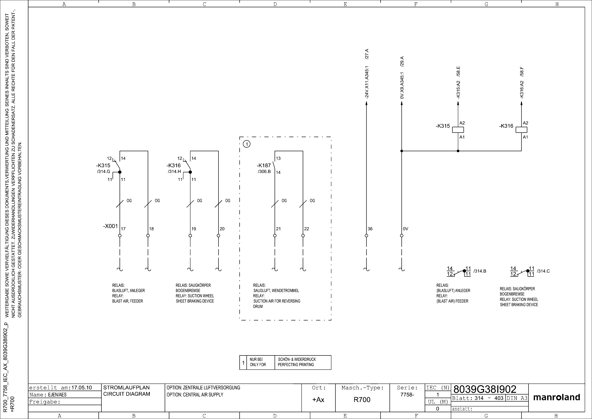

# +Ax — Sheet 314 of 403 — OPTION: ZENTRALE LUFTVERSORGUNG

**OPTION: CENTRAL AIR SUPPLY**

> Part of the manroland **R700** printing press IEC/UL circuit diagrams.
> Drawing class: **Stromlaufplan / Circuit diagram** (DIN A3).
> Document `+Ax` covers the **Central control console** machine section.

## At a glance

| Field | Value |
|---|---|
| Document | `+Ax`  (8039G38I902) |
| Sheet | **314** of 403 |
| Section (DE) | OPTION: ZENTRALE LUFTVERSORGUNG |
| Section (EN) | OPTION: CENTRAL AIR SUPPLY |
| Section type | CIRCUIT — Circuit diagram |
| Machine type | `R700` |
| Series | `7758` |
| Created | 17.05.10 |
| Replaces | — |
| Columns used | B, C, D, E, F, G, H |
| Path numbers | — |
| Labels on sheet | 80 |
| Cross-refs out | 7 |
| Cross-refs in | 7 |

**Previous:** [+Ax sheet 313](SHEET_0313.md) · **Next:** [+Ax sheet 315](SHEET_0315.md) · **Document TOC:** [_TOC.md](_TOC.md)  (+Ax) · **Master TOC:** [all sheets](../_MASTER_TOC.md)

## Sheet image (300 DPI, exact vector render)



_Rendered directly from the PDF vector layer at 300 DPI (1-bit), no OCR and no resampling. Use it to confirm anything ambiguous in the text below._

## Cross-references on this sheet

Each entry is a wire leaving this sheet. The printed token is `/sheet.column`; the link resolves to that sheet inside the same document.

| Ref | Target sheet | Col | Path | Destination on target | Target section | From col |
|---|---|---|---|---|---|---|
| `/27.A` | [+Ax sheet 27](SHEET_0027.md) | A | — | 24V.X11.A345:1 | SPANNUNGSVERSORGUNG, SCHALTSCHRANKBELÜFTUNG | E |
| `/29.A` | [+Ax sheet 29](SHEET_0029.md) | A | — | 0V.X9.A345:1 | SPANNUNGSVERSORGUNG, SCHALTSCHRANKBELÜFTUNG | F |
| `/58.E` | [+Ax sheet 58](SHEET_0058.md) | E | — | K315:A2 | LUFTVERSORGUNG | G |
| `/58.F` | [+Ax sheet 58](SHEET_0058.md) | F | — | K316:A2 | LUFTVERSORGUNG | H |
| `/306.B` | [+Ax sheet 306](SHEET_0306.md) | B | — | — | SCHÖN & WIDERDRUCK HAUPTSCHALTSCHRANK | D |
| `/314.G` | [+Ax sheet 314](SHEET_0314.md) | G | — | — | OPTION: ZENTRALE LUFTVERSORGUNG | B |
| `/314.H` | [+Ax sheet 314](SHEET_0314.md) | H | — | — | OPTION: ZENTRALE LUFTVERSORGUNG | C |

### Incoming references (sheets that point here)

Every other sheet that sends a wire to this one. `Back-ref` is the token printed on *that* sheet; `Path` is its line number.

| From sheet | Cols | Back-ref | Path | Refs | What continues there |
|---|---|---|---|---|---|
| [+Ax#27](SHEET_0027.md) | A | `/27.A` | — | 1 | — |
| [+Ax#29](SHEET_0029.md) | A | `/29.A` | — | 1 | — |
| [+Ax#58](SHEET_0058.md) | E, F | `/58.E`, `/58.F` | — | 2 | — |
| [+Ax#306](SHEET_0306.md) | B | `/306.B` | — | 1 | — |
| [+Ax#314](SHEET_0314.md) | B, C | `/314.B`, `/314.C` | — | 2 | — |


## Devices on this sheet

| Tag | Class | Class meaning (IEC) | Col | Sub | Terminal | Sign |
|---|---|---|---|---|---|---|
| `A2` | A | Baugruppe / assembly, module, PC board | G | — | — | — |
| `A1` | A | Baugruppe / assembly, module, PC board | G | — | — | — |
| `K315` | K | Relais / relay, contactor | F | — | — | — |
| `A2` | A | Baugruppe / assembly, module, PC board | H | — | — | — |
| `A1` | A | Baugruppe / assembly, module, PC board | H | — | — | — |
| `K316` | K | Relais / relay, contactor | G | — | — | — |
| `K315` | K | Relais / relay, contactor | B | — | — | — |
| `X001` | X | Klemme / terminal, plug connector | B | — | — | — |
| `K316` | K | Relais / relay, contactor | C | — | — | — |
| `K187` | K | Relais / relay, contactor | D | — | — | — |
| `K315:A2` | K | Relais / relay, contactor | G | — | A2 | — |
| `K316:A2` | K | Relais / relay, contactor | H | — | A2 | — |

## Potentials / nets

| Potential | Count | Columns | Attached devices | Terminals |
|---|---|---|---|---|
| `0V` | 2 | F | `A345`, `X9` | `1` |
| `24V` | 1 | E | `A345`, `X11` | `1` |


A potential such as `L24+/4` or `M24+` is a named supply/return rail; every place it appears on this sheet is electrically common.

## Wire-end annotations (grouped as printed)

A wire that continues elsewhere is annotated with a small cluster: the destination description, the path/line number `#NN`, and the `/sheet.column` cross reference. Each row below is one such cluster exactly as it is grouped on the drawing.

| Col | Y | Path | Cross-ref | Text on the wire |
|---|---|---|---|---|
| E | 98.4 | — | `/27.A` | `24V.X11.A345:1` |
| F | 113.2 | — | `/29.A` | `0V.X9.A345:1` |
| G | 133.1 | — | `/58.E` | `K315:A2` |
| H | 133.7 | — | `/58.F` | `K316:A2` |
| G | 243.3 | — | — | `A2` |
| H | 243.3 | — | — | `A2` |
| F | 248.3 | — | — | `K315` |
| G | 248.3 | — | — | `K316` |
| G | 271.7 | — | — | `A1` |
| H | 271.7 | — | — | `A1` |
| D | 286.1 | — | — | `1` |
| B | 314.3 | — | — | `K315 14` |
| B | 314.3 | — | — | `12` |
| C | 314.3 | — | — | `K316 14` |
| C | 314.3 | — | — | `12` |
| D | 314.3 | — | — | `13` |
| D | 327.7 | — | — | `K187 14` |
| B | 340.8 | — | `/314.G` | — |
| C | 340.8 | — | `/314.H` | — |
| D | 340.8 | — | `/306.B` | — |
| B | 356.8 | — | — | `11 11` |
| C | 356.8 | — | — | `11 11` |
| B | 400.3 | — | — | `OG OG` |
| C | 400.3 | — | — | `OG OG` |
| D | 400.3 | — | — | `OG OG` |
| B | 449.4 | — | — | `X001 17 18` |
| E | 455.9 | — | — | `21 22 36 0V` |
| C | 456.0 | — | — | `19 20` |
| G | 534.6 | — | — | `14 12 11 11 /314.B` |
| H | 534.6 | — | — | `14 12 11 11 /314.C` |
| B | 570.3 | — | — | `RELAIS: BLASLUFT, ANLEGER RELAY: BLAST AIR, FEEDER` |
| D | 570.3 | — | — | `RELAIS:` |
| G | 570.3 | — | — | `RELAIS: RELAY: (BLASLUFT) ANLEGER (BLAST AIR) FEEDER` |
| C | 570.4 | — | — | `RELAIS: SAUGKÖRPER BOGENBREMSE RELAY: SUCTION WHEEL` |
| G | 577.5 | — | — | `RELAIS: SAUGKÖRPER BOGENBREMSE RELAY: SUCTION WHEEL` |
| D | 581.0 | — | — | `RELAY: SAUGLUFT, WENDETROMMEL` |
| C | 602.3 | — | — | `SHEET BRAKING DEVICE` |
| D | 602.3 | — | — | `DRUM SUCTION AIR FOR REVERSING` |
| G | 609.4 | — | — | `SHEET BRAKING DEVICE` |
| D | 719.2 | — | — | `1 ONLY FOR PERFECTING PRINTING SCHÖN & WIDERDRUCK` |
| D | 719.2 | — | — | `NUR BEI` |


## Notes and free text on this sheet

| Text | Col | Y (pt) |
|---|---|---|
| `11 /314.B` | G | 540.97 |
| `RELAIS:` | F | 570.32 |
| `(BLASLUFT) ANLEGER` | G | 581.03 |
| `RELAY:` | F | 591.59 |
| `(BLAST AIR) FEEDER` | G | 602.28 |
| `11 /314.C` | H | 541 |
| `RELAIS: SAUGKÖRPER` | G | 577.46 |
| `BOGENBREMSE` | G | 588.1 |
| `RELAY: SUCTION WHEEL` | G | 598.72 |
| `SHEET BRAKING DEVICE` | G | 609.36 |
| `NUR BEI` | D | 719.16 |
| `ONLY FOR` | D | 729.85 |
| `SCHÖN & WIDERDRUCK` | D | 719.21 |
| `PERFECTING PRINTING` | D | 729.84 |
| `RELAIS:` | B | 570.32 |
| `BLASLUFT, ANLEGER` | B | 581.01 |
| `RELAY:` | B | 591.59 |
| `BLAST AIR, FEEDER` | B | 602.26 |
| `OG` | B | 400.27 |
| `RELAIS: SAUGKÖRPER` | C | 570.38 |
| `BOGENBREMSE` | C | 581.01 |
| `RELAY: SUCTION WHEEL` | C | 591.63 |
| `SHEET BRAKING DEVICE` | C | 602.27 |
| `OG` | C | 400.27 |
| `OG` | D | 400.27 |
| `OG` | E | 400.27 |
| `RELAIS:` | D | 570.32 |
| `SAUGLUFT, WENDETROMMEL` | D | 581.03 |
| `RELAY:` | D | 591.59 |
| `SUCTION AIR FOR REVERSING` | D | 602.29 |
| `DRUM` | D | 612.93 |

## Complete label inventory (exact text from the drawing)

Every text object inside the drawing area of this sheet, in DIN reading order (column A→H, then top→bottom). This is the authoritative list: if a string is not here it is not printed on this sheet.

| Col | Y | X | Dir | Type | Text |
|---|---|---|---|---|---|
| B | 314.3 | 214.9 | → | number | `12` |
| B | 314.3 | 242.9 | → | number | `14` |
| B | 327.7 | 193.3 | → | device tag | `K315` |
| B | 340.8 | 195.3 | → | cross-reference | `/314.G` |
| B | 356.8 | 216.0 | → | number | `11` |
| B | 356.8 | 242.9 | → | number | `11` |
| B | 400.3 | 254.8 | → | text | `OG` |
| B | 400.3 | 311.5 | → | text | `OG` |
| B | 449.4 | 207.5 | → | device tag | `X001` |
| B | 456.0 | 242.9 | → | number | `17` |
| B | 456.0 | 299.6 | → | number | `18` |
| B | 570.3 | 225.9 | → | text | `RELAIS:` |
| B | 581.0 | 225.9 | → | text | `BLASLUFT, ANLEGER` |
| B | 591.6 | 225.9 | → | text | `RELAY:` |
| B | 602.3 | 225.9 | → | text | `BLAST AIR, FEEDER` |
| C | 314.3 | 356.6 | → | number | `12` |
| C | 314.3 | 384.7 | → | number | `14` |
| C | 327.7 | 335.1 | → | device tag | `K316` |
| C | 340.8 | 337.9 | → | cross-reference | `/314.H` |
| C | 356.8 | 357.7 | → | number | `11` |
| C | 356.8 | 384.7 | → | number | `11` |
| C | 400.3 | 396.6 | → | text | `OG` |
| C | 400.3 | 453.3 | → | text | `OG` |
| C | 456.0 | 384.7 | → | number | `19` |
| C | 456.0 | 441.9 | → | number | `20` |
| C | 570.4 | 353.5 | → | text | `RELAIS: SAUGKÖRPER` |
| C | 581.0 | 353.5 | → | text | `BOGENBREMSE` |
| C | 591.6 | 353.5 | → | text | `RELAY: SUCTION WHEEL` |
| C | 602.3 | 354.0 | → | text | `SHEET BRAKING DEVICE` |
| D | 286.1 | 494.3 | → | number | `1` |
| D | 314.3 | 554.7 | → | number | `13` |
| D | 327.7 | 516.5 | → | device tag | `K187` |
| D | 340.8 | 519.0 | → | cross-reference | `/306.B` |
| D | 342.6 | 554.7 | → | number | `14` |
| D | 400.3 | 566.6 | → | text | `OG` |
| D | 456.0 | 555.3 | → | number | `21` |
| D | 456.0 | 612.0 | → | number | `22` |
| D | 570.3 | 509.4 | → | text | `RELAIS:` |
| D | 581.0 | 510.0 | → | text | `SAUGLUFT, WENDETROMMEL` |
| D | 591.6 | 509.4 | → | text | `RELAY:` |
| D | 602.3 | 510.0 | → | text | `SUCTION AIR FOR REVERSING` |
| D | 612.9 | 509.4 | → | text | `DRUM` |
| D | 719.2 | 502.3 | → | text | `NUR BEI` |
| D | 719.2 | 559.6 | → | text | `SCHÖN & WIDERDRUCK` |
| D | 724.5 | 486.4 | → | number | `1` |
| D | 729.8 | 502.9 | → | text | `ONLY FOR` |
| D | 729.8 | 559.0 | → | text | `PERFECTING PRINTING` |
| E | 98.4 | 733.7 | ↕ | cross-reference | `/27.A` |
| E | 131.8 | 733.7 | ↕ | potential | `24V.X11.A345:1` |
| E | 400.3 | 623.3 | → | text | `OG` |
| E | 456.0 | 739.6 | → | number | `36` |
| F | 113.2 | 804.6 | ↕ | cross-reference | `/29.A` |
| F | 144.3 | 804.6 | ↕ | potential | `0V.X9.A345:1` |
| F | 248.3 | 876.5 | → | device tag | `K315` |
| F | 455.9 | 810.4 | → | potential | `0V` |
| F | 534.6 | 898.6 | → | number | `14` |
| F | 545.9 | 898.6 | → | number | `12` |
| F | 570.3 | 877.9 | → | text | `RELAIS:` |
| F | 591.6 | 877.9 | → | text | `RELAY:` |
| G | 133.1 | 918.0 | ↕ | cross-reference | `/58.E` |
| G | 162.1 | 918.0 | ↕ | device tag | `K315:A2` |
| G | 243.3 | 924.1 | → | device tag | `A2` |
| G | 248.3 | 1004.0 | → | device tag | `K316` |
| G | 271.7 | 924.1 | → | device tag | `A1` |
| G | 534.6 | 935.7 | → | number | `11` |
| G | 534.6 | 1026.1 | → | number | `14` |
| G | 541.0 | 935.7 | → | text | `11 /314.B` |
| G | 545.9 | 1026.1 | → | number | `12` |
| G | 577.5 | 1005.4 | → | text | `RELAIS: SAUGKÖRPER` |
| G | 581.0 | 878.2 | → | text | `(BLASLUFT) ANLEGER` |
| G | 588.1 | 1005.4 | → | text | `BOGENBREMSE` |
| G | 598.7 | 1005.4 | → | text | `RELAY: SUCTION WHEEL` |
| G | 602.3 | 878.2 | → | text | `(BLAST AIR) FEEDER` |
| G | 609.4 | 1006.0 | → | text | `SHEET BRAKING DEVICE` |
| H | 133.7 | 1045.5 | ↕ | cross-reference | `/58.F` |
| H | 162.1 | 1045.6 | ↕ | device tag | `K316:A2` |
| H | 243.3 | 1051.7 | → | device tag | `A2` |
| H | 271.7 | 1051.7 | → | device tag | `A1` |
| H | 534.6 | 1063.3 | → | number | `11` |
| H | 541.0 | 1063.3 | → | text | `11 /314.C` |

## Reading-order text block

The same content as a plain block, grouped by DIN column — convenient to paste or to match against a visual description.

```text
=== Column B ===
 314.3  214.9  numeric      12
 314.3  242.9  numeric      14
 327.7  193.3  devtag       K315
 340.8  195.3  xref         /314.G
 356.8  216.0  numeric      11
 356.8  242.9  numeric      11
 400.3  254.8  text         OG
 400.3  311.5  text         OG
 449.4  207.5  devtag       X001
 456.0  242.9  numeric      17
 456.0  299.6  numeric      18
 570.3  225.9  text         RELAIS:
 581.0  225.9  text         BLASLUFT, ANLEGER
 591.6  225.9  text         RELAY:
 602.3  225.9  text         BLAST AIR, FEEDER
=== Column C ===
 314.3  356.6  numeric      12
 314.3  384.7  numeric      14
 327.7  335.1  devtag       K316
 340.8  337.9  xref         /314.H
 356.8  357.7  numeric      11
 356.8  384.7  numeric      11
 400.3  396.6  text         OG
 400.3  453.3  text         OG
 456.0  384.7  numeric      19
 456.0  441.9  numeric      20
 570.4  353.5  text         RELAIS: SAUGKÖRPER
 581.0  353.5  text         BOGENBREMSE
 591.6  353.5  text         RELAY: SUCTION WHEEL
 602.3  354.0  text         SHEET BRAKING DEVICE
=== Column D ===
 286.1  494.3  numeric      1
 314.3  554.7  numeric      13
 327.7  516.5  devtag       K187
 340.8  519.0  xref         /306.B
 342.6  554.7  numeric      14
 400.3  566.6  text         OG
 456.0  555.3  numeric      21
 456.0  612.0  numeric      22
 570.3  509.4  text         RELAIS:
 581.0  510.0  text         SAUGLUFT, WENDETROMMEL
 591.6  509.4  text         RELAY:
 602.3  510.0  text         SUCTION AIR FOR REVERSING
 612.9  509.4  text         DRUM
 719.2  502.3  text         NUR BEI
 719.2  559.6  text         SCHÖN & WIDERDRUCK
 724.5  486.4  numeric      1
 729.8  502.9  text         ONLY FOR
 729.8  559.0  text         PERFECTING PRINTING
=== Column E ===
  98.4  733.7  xref         /27.A
 131.8  733.7  net          24V.X11.A345:1
 400.3  623.3  text         OG
 456.0  739.6  numeric      36
=== Column F ===
 113.2  804.6  xref         /29.A
 144.3  804.6  net          0V.X9.A345:1
 248.3  876.5  devtag       K315
 455.9  810.4  net          0V
 534.6  898.6  numeric      14
 545.9  898.6  numeric      12
 570.3  877.9  text         RELAIS:
 591.6  877.9  text         RELAY:
=== Column G ===
 133.1  918.0  xref         /58.E
 162.1  918.0  devtag       K315:A2
 243.3  924.1  devtag       A2
 248.3 1004.0  devtag       K316
 271.7  924.1  devtag       A1
 534.6  935.7  numeric      11
 534.6 1026.1  numeric      14
 541.0  935.7  text         11 /314.B
 545.9 1026.1  numeric      12
 577.5 1005.4  text         RELAIS: SAUGKÖRPER
 581.0  878.2  text         (BLASLUFT) ANLEGER
 588.1 1005.4  text         BOGENBREMSE
 598.7 1005.4  text         RELAY: SUCTION WHEEL
 602.3  878.2  text         (BLAST AIR) FEEDER
 609.4 1006.0  text         SHEET BRAKING DEVICE
=== Column H ===
 133.7 1045.5  xref         /58.F
 162.1 1045.6  devtag       K316:A2
 243.3 1051.7  devtag       A2
 271.7 1051.7  devtag       A1
 534.6 1063.3  numeric      11
 541.0 1063.3  text         11 /314.C
```

---
_Generated from the PDF vector text layer; no OCR. Source: `R700_7758_IEC_AX_8039G38I902_p`, sheet 314._
