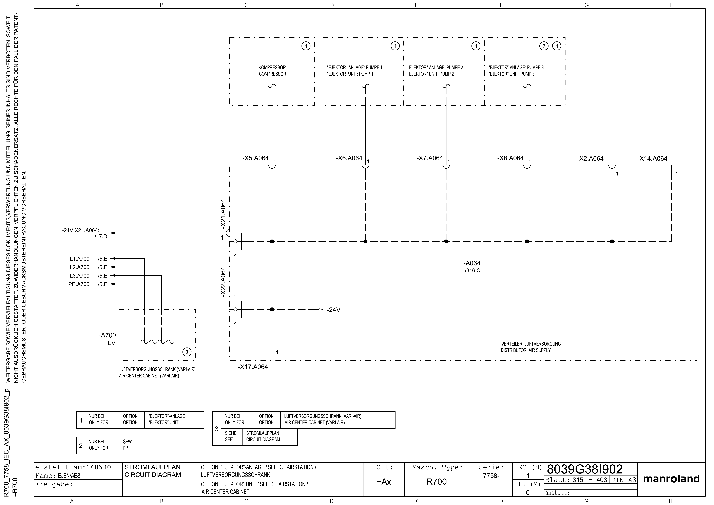

# +Ax — Sheet 315 of 403 — OPTION: "EJEKTOR" ANLAGE / SELECT AIRSTATION /

**LUFTVERSORGUNGSSCHRANK**

> Part of the manroland **R700** printing press IEC/UL circuit diagrams.
> Drawing class: **Stromlaufplan / Circuit diagram** (DIN A3).
> Document `+Ax` covers the **Central control console** machine section.

## At a glance

| Field | Value |
|---|---|
| Document | `+Ax`  (8039G38I902) |
| Sheet | **315** of 403 |
| Section (DE) | OPTION: "EJEKTOR" ANLAGE / SELECT AIRSTATION / |
| Section (EN) | LUFTVERSORGUNGSSCHRANK |
| Section type | CIRCUIT — Circuit diagram |
| Machine type | `R700` |
| Series | `7758` |
| Created | 17.05.10 |
| Replaces | — |
| Columns used | A, B, C, D, E, F, G, H |
| Path numbers | — |
| Labels on sheet | 76 |
| Cross-refs out | 6 |
| Cross-refs in | 13 |

**Previous:** [+Ax sheet 314](SHEET_0314.md) · **Next:** [+Ax sheet 316](SHEET_0316.md) · **Document TOC:** [_TOC.md](_TOC.md)  (+Ax) · **Master TOC:** [all sheets](../_MASTER_TOC.md)

## Sheet image (300 DPI, exact vector render)



_Rendered directly from the PDF vector layer at 300 DPI (1-bit), no OCR and no resampling. Use it to confirm anything ambiguous in the text below._

## Cross-references on this sheet

Each entry is a wire leaving this sheet. The printed token is `/sheet.column`; the link resolves to that sheet inside the same document.

| Ref | Target sheet | Col | Path | Destination on target | Target section | From col |
|---|---|---|---|---|---|---|
| `/17.D` | [+Ax sheet 17](SHEET_0017.md) | D | — | 24V.X21.A064:1 | SPANNUNGSVERSORGUNG, SCHALTSCHRANKBELÜFTUNG | A |
| `/5.E` | [+Ax sheet 5](SHEET_0005.md) | E | — | L1.A700 | SPANNUNGSVERSORGUNG / KUNDENZULEITUNG | A |
| `/5.E` | [+Ax sheet 5](SHEET_0005.md) | E | — | L2.A700 | SPANNUNGSVERSORGUNG / KUNDENZULEITUNG | A |
| `/316.C` | [+Ax sheet 316](SHEET_0316.md) | C | — | — | OPTION: "EJEKTOR" ANLAGE / SELECT AIRSTATION / | F |
| `/5.E` | [+Ax sheet 5](SHEET_0005.md) | E | — | L3.A700 | SPANNUNGSVERSORGUNG / KUNDENZULEITUNG | A |
| `/5.E` | [+Ax sheet 5](SHEET_0005.md) | E | — | PE.A700 | SPANNUNGSVERSORGUNG / KUNDENZULEITUNG | A |

### Incoming references (sheets that point here)

Every other sheet that sends a wire to this one. `Back-ref` is the token printed on *that* sheet; `Path` is its line number.

| From sheet | Cols | Back-ref | Path | Refs | What continues there |
|---|---|---|---|---|---|
| [+Ax#5](SHEET_0005.md) | F | `/5.F` | — | 4 | L1.A700; L2.A700; L3.A700; PE.A700 |
| [+Ax#17](SHEET_0017.md) | D | `/17.D` | — | 1 | — |
| [+Ax#217](SHEET_0217.md) | A | `/217.A` | — | 1 | — |
| [+Ax#230](SHEET_0230.md) | A | `/230.A` | — | 1 | — |
| [+Ax#233](SHEET_0233.md) | A | `/233.A` | — | 1 | — |
| [+Ax#235](SHEET_0235.md) | A | `/235.A` | — | 1 | — |
| [+Ax#237](SHEET_0237.md) | B | `/237.B` | — | 1 | — |
| [+Ax#251](SHEET_0251.md) | A | `/251.A` | — | 1 | — |
| [+Ax#255](SHEET_0255.md) | A | `/255.A` | — | 1 | — |
| [+Ax#316](SHEET_0316.md) | B | `/316.B` | — | 1 | — |


## Devices on this sheet

| Tag | Class | Class meaning (IEC) | Col | Sub | Terminal | Sign |
|---|---|---|---|---|---|---|
| `A064` | A | Baugruppe / assembly, module, PC board | F | — | — | — |
| `A700` | A | Baugruppe / assembly, module, PC board | A | — | — | — |
| `X5.A064` | — | cross-device reference | C | — | — | — |
| `X6.A064` | — | cross-device reference | D | — | — | — |
| `X7.A064` | — | cross-device reference | E | — | — | — |
| `X8.A064` | — | cross-device reference | F | — | — | — |
| `X21.A064` | — | cross-device reference | C | — | — | — |
| `X17.A064` | — | cross-device reference | C | — | — | — |
| `X14.A064` | — | cross-device reference | H | — | — | — |
| `X2.A064` | — | cross-device reference | G | — | — | — |
| `X22.A064` | — | cross-device reference | C | — | — | — |

## Potentials / nets

| Potential | Count | Columns | Attached devices | Terminals |
|---|---|---|---|---|
| `24V` | 2 | A, D | `A064`, `X21` | `1` |
| `L1` | 1 | A | `A700` | — |
| `L2` | 1 | A | `A700` | — |
| `L3` | 1 | A | `A700` | — |
| `PE` | 1 | A | `A700` | — |


A potential such as `L24+/4` or `M24+` is a named supply/return rail; every place it appears on this sheet is electrically common.

## Wire-end annotations (grouped as printed)

A wire that continues elsewhere is annotated with a small cluster: the destination description, the path/line number `#NN`, and the `/sheet.column` cross reference. Each row below is one such cluster exactly as it is grouped on the drawing.

| Col | Y | Path | Cross-ref | Text on the wire |
|---|---|---|---|---|
| E | 73.5 | — | — | `1 1 1 1` |
| F | 74.0 | — | — | `2` |
| C | 109.8 | — | — | `KOMPRESSOR` |
| D | 109.8 | — | — | `"EJEKTOR" ANLAGE: PUMPE 1 "EJEKTOR" UNIT: PUMP 1` |
| E | 109.8 | — | — | `"EJEKTOR" ANLAGE: PUMPE 2 "EJEKTOR" UNIT: PUMP 2` |
| F | 109.8 | — | — | `"EJEKTOR" ANLAGE: PUMPE 3 "EJEKTOR" UNIT: PUMP 3` |
| C | 120.4 | — | — | `COMPRESSOR` |
| E | 259.0 | — | — | `X5.A064 1 X6.A064 1 X7.A064 1 X8.A064 1` |
| G | 259.7 | — | — | `X2.A064` |
| H | 259.7 | — | — | `X14.A064` |
| G | 285.9 | — | — | `1` |
| H | 285.9 | — | — | `1` |
| C | 331.4 | — | — | `X21.A064` |
| A | 380.1 | — | `/17.D` | `24V.X21.A064:1` |
| C | 391.4 | — | — | `1` |
| C | 420.6 | — | — | `2` |
| A | 427.6 | — | `/5.E` | `L1.A700` |
| F | 434.0 | — | — | `A064` |
| A | 441.7 | — | `/5.E` | `L2.A700` |
| C | 444.8 | — | — | `X22.A064` |
| F | 447.1 | — | `/316.C` | — |
| A | 455.9 | — | `/5.E` | `L3.A700` |
| A | 470.1 | — | `/5.E` | `PE.A700` |
| C | 491.4 | — | — | `1` |
| D | 512.0 | — | — | `24V` |
| C | 534.0 | — | — | `2` |
| A | 554.5 | — | — | `A700` |
| A | 567.1 | — | — | `+LV` |
| F | 570.4 | — | — | `DISTRIBUTOR: AIR SUPPLY VERTEILER: LUFTVERSORGUNG` |
| C | 583.5 | — | — | `1` |
| B | 584.2 | — | — | `3` |
| C | 606.9 | — | — | `X17.A064` |
| B | 612.9 | — | — | `LUFTVERSORGUNGSSCHRANK (VARI AIR)` |
| B | 623.5 | — | — | `AIR CENTER CABINET (VARI AIR)` |
| A | 690.8 | — | — | `1 ONLY FOR OPTION OPTION` |
| A | 690.8 | — | — | `NUR BEI` |
| C | 690.8 | — | — | `NUR BEI` |
| C | 690.8 | — | — | `OPTION OPTION` |
| B | 690.9 | — | — | `"EJEKTOR" ANLAGE "EJEKTOR" UNIT` |
| D | 690.9 | — | — | `LUFTVERSORGUNGSSCHRANK (VARI AIR)` |
| C | 701.5 | — | — | `ONLY FOR` |
| D | 701.5 | — | — | `AIR CENTER CABINET (VARI AIR)` |
| C | 710.4 | — | — | `3` |
| C | 719.2 | — | — | `SIEHE SEE` |
| C | 719.2 | — | — | `STROMLAUFPLAN CIRCUIT DIAGRAM` |
| A | 733.2 | — | — | `2 ONLY FOR PP S+W` |
| A | 733.3 | — | — | `NUR BEI` |


## Notes and free text on this sheet

| Text | Col | Y (pt) |
|---|---|---|
| `VERTEILER: LUFTVERSORGUNG` | F | 570.4 |
| `DISTRIBUTOR: AIR SUPPLY` | F | 581.01 |
| `+LV` | A | 567.15 |
| `LUFTVERSORGUNGSSCHRANK (VARI AIR)` | B | 612.92 |
| `AIR CENTER CABINET (VARI AIR)` | B | 623.54 |
| `"EJEKTOR" ANLAGE: PUMPE 1` | D | 109.75 |
| `"EJEKTOR" UNIT: PUMP 1` | D | 120.37 |
| `"EJEKTOR" ANLAGE: PUMPE 2` | E | 109.76 |
| `"EJEKTOR" UNIT: PUMP 2` | E | 120.39 |
| `"EJEKTOR" ANLAGE: PUMPE 3` | F | 109.76 |
| `"EJEKTOR" UNIT: PUMP 3` | F | 120.39 |
| `KOMPRESSOR` | C | 109.76 |
| `COMPRESSOR` | C | 120.41 |
| `NUR BEI` | A | 733.33 |
| `ONLY FOR` | A | 744.02 |
| `S+W` | B | 733.24 |
| `PP` | B | 743.87 |
| `OPTION` | B | 690.83 |
| `"EJEKTOR" ANLAGE` | B | 690.86 |
| `"EJEKTOR" UNIT` | B | 701.49 |
| `NUR BEI` | C | 690.82 |
| `ONLY FOR` | C | 701.5 |
| `OPTION` | C | 690.83 |
| `LUFTVERSORGUNGSSCHRANK (VARI AIR)` | D | 690.87 |
| `AIR CENTER CABINET (VARI AIR)` | D | 701.5 |
| `SIEHE` | C | 719.16 |
| `SEE` | C | 729.76 |
| `STROMLAUFPLAN` | C | 719.22 |
| `CIRCUIT DIAGRAM` | C | 729.85 |

## Complete label inventory (exact text from the drawing)

Every text object inside the drawing area of this sheet, in DIN reading order (column A→H, then top→bottom). This is the authoritative list: if a string is not here it is not printed on this sheet.

| Col | Y | X | Dir | Type | Text |
|---|---|---|---|---|---|
| A | 380.1 | 103.5 | → | potential | `24V.X21.A064:1` |
| A | 390.0 | 157.9 | → | cross-reference | `/17.D` |
| A | 427.5 | 163.3 | → | cross-reference | `/5.E` |
| A | 427.6 | 116.5 | → | potential | `L1.A700` |
| A | 441.7 | 163.3 | → | cross-reference | `/5.E` |
| A | 441.8 | 116.5 | → | potential | `L2.A700` |
| A | 455.9 | 163.3 | → | cross-reference | `/5.E` |
| A | 456.0 | 116.5 | → | potential | `L3.A700` |
| A | 470.1 | 114.2 | → | potential | `PE.A700` |
| A | 470.1 | 163.3 | → | cross-reference | `/5.E` |
| A | 554.5 | 165.0 | → | device tag | `A700` |
| A | 567.1 | 173.5 | → | text | `+LV` |
| A | 690.8 | 148.0 | → | text | `NUR BEI` |
| A | 696.2 | 132.1 | → | number | `1` |
| A | 701.5 | 148.5 | → | text | `ONLY FOR` |
| A | 733.3 | 148.0 | → | text | `NUR BEI` |
| A | 738.7 | 131.8 | → | number | `2` |
| A | 744.0 | 148.5 | → | text | `ONLY FOR` |
| B | 584.2 | 309.8 | → | number | `3` |
| B | 612.9 | 197.6 | → | text | `LUFTVERSORGUNGSSCHRANK (VARI AIR)` |
| B | 623.5 | 198.4 | → | text | `AIR CENTER CABINET (VARI AIR)` |
| B | 690.8 | 205.2 | → | text | `OPTION` |
| B | 690.9 | 247.7 | → | text | `"EJEKTOR" ANLAGE` |
| B | 701.5 | 205.2 | → | text | `OPTION` |
| B | 701.5 | 247.7 | → | text | `"EJEKTOR" UNIT` |
| B | 733.2 | 205.2 | → | text | `S+W` |
| B | 743.9 | 204.7 | → | text | `PP` |
| C | 109.8 | 431.4 | → | text | `KOMPRESSOR` |
| C | 120.4 | 432.0 | → | text | `COMPRESSOR` |
| C | 259.0 | 404.2 | → | device ref | `X5.A064` |
| C | 265.4 | 455.5 | → | number | `1` |
| C | 331.4 | 367.4 | ↕ | device ref | `X21.A064` |
| C | 391.5 | 367.4 | → | number | `1` |
| C | 420.6 | 389.5 | → | number | `2` |
| C | 444.8 | 367.4 | ↕ | device ref | `X22.A064` |
| C | 491.4 | 388.9 | → | number | `1` |
| C | 533.9 | 389.5 | → | number | `2` |
| C | 583.6 | 459.8 | → | number | `1` |
| C | 606.9 | 396.9 | → | device ref | `X17.A064` |
| C | 690.8 | 374.7 | → | text | `NUR BEI` |
| C | 690.8 | 432.0 | → | text | `OPTION` |
| C | 701.5 | 375.3 | → | text | `ONLY FOR` |
| C | 701.5 | 432.0 | → | text | `OPTION` |
| C | 710.3 | 358.4 | → | number | `3` |
| C | 719.2 | 375.3 | → | text | `SIEHE` |
| C | 719.2 | 410.7 | → | text | `STROMLAUFPLAN` |
| C | 729.8 | 375.3 | → | text | `SEE` |
| C | 729.9 | 410.7 | → | text | `CIRCUIT DIAGRAM` |
| D | 73.5 | 508.5 | → | number | `1` |
| D | 109.7 | 545.4 | → | text | `"EJEKTOR" ANLAGE: PUMPE 1` |
| D | 120.4 | 545.4 | → | text | `"EJEKTOR" UNIT: PUMP 1` |
| D | 259.0 | 560.1 | → | device ref | `X6.A064` |
| D | 265.4 | 611.4 | → | number | `1` |
| D | 512.0 | 545.4 | → | potential | `24V` |
| D | 690.9 | 474.0 | → | text | `LUFTVERSORGUNGSSCHRANK (VARI AIR)` |
| D | 701.5 | 474.8 | → | text | `AIR CENTER CABINET (VARI AIR)` |
| E | 73.5 | 657.3 | → | number | `1` |
| E | 109.8 | 680.0 | → | text | `"EJEKTOR" ANLAGE: PUMPE 2` |
| E | 120.4 | 680.0 | → | text | `"EJEKTOR" UNIT: PUMP 2` |
| E | 259.0 | 694.8 | → | device ref | `X7.A064` |
| E | 265.4 | 746.1 | → | number | `1` |
| F | 73.5 | 791.9 | → | number | `1` |
| F | 74.0 | 905.1 | → | number | `2` |
| F | 109.8 | 814.7 | → | text | `"EJEKTOR" ANLAGE: PUMPE 3` |
| F | 120.4 | 814.7 | → | text | `"EJEKTOR" UNIT: PUMP 3` |
| F | 259.0 | 829.4 | → | device ref | `X8.A064` |
| F | 265.4 | 880.7 | → | number | `1` |
| F | 434.0 | 773.0 | → | device tag | `A064` |
| F | 447.1 | 775.3 | → | cross-reference | `/316.C` |
| F | 570.4 | 836.2 | → | text | `VERTEILER: LUFTVERSORGUNG` |
| F | 581.0 | 835.4 | → | text | `DISTRIBUTOR: AIR SUPPLY` |
| G | 73.5 | 926.6 | → | number | `1` |
| G | 259.7 | 962.6 | → | device ref | `X2.A064` |
| G | 285.9 | 1026.7 | → | number | `1` |
| H | 259.7 | 1063.0 | → | device ref | `X14.A064` |
| H | 285.9 | 1125.9 | → | number | `1` |

## Reading-order text block

The same content as a plain block, grouped by DIN column — convenient to paste or to match against a visual description.

```text
=== Column A ===
 380.1  103.5  net          24V.X21.A064:1
 390.0  157.9  xref         /17.D
 427.5  163.3  xref         /5.E
 427.6  116.5  net          L1.A700
 441.7  163.3  xref         /5.E
 441.8  116.5  net          L2.A700
 455.9  163.3  xref         /5.E
 456.0  116.5  net          L3.A700
 470.1  114.2  net          PE.A700
 470.1  163.3  xref         /5.E
 554.5  165.0  devtag       A700
 567.1  173.5  text         +LV
 690.8  148.0  text         NUR BEI
 696.2  132.1  numeric      1
 701.5  148.5  text         ONLY FOR
 733.3  148.0  text         NUR BEI
 738.7  131.8  numeric      2
 744.0  148.5  text         ONLY FOR
=== Column B ===
 584.2  309.8  numeric      3
 612.9  197.6  text         LUFTVERSORGUNGSSCHRANK (VARI AIR)
 623.5  198.4  text         AIR CENTER CABINET (VARI AIR)
 690.8  205.2  text         OPTION
 690.9  247.7  text         "EJEKTOR" ANLAGE
 701.5  205.2  text         OPTION
 701.5  247.7  text         "EJEKTOR" UNIT
 733.2  205.2  text         S+W
 743.9  204.7  text         PP
=== Column C ===
 109.8  431.4  text         KOMPRESSOR
 120.4  432.0  text         COMPRESSOR
 259.0  404.2  devref       X5.A064
 265.4  455.5  numeric      1
 331.4  367.4  devref       X21.A064
 391.5  367.4  numeric      1
 420.6  389.5  numeric      2
 444.8  367.4  devref       X22.A064
 491.4  388.9  numeric      1
 533.9  389.5  numeric      2
 583.6  459.8  numeric      1
 606.9  396.9  devref       X17.A064
 690.8  374.7  text         NUR BEI
 690.8  432.0  text         OPTION
 701.5  375.3  text         ONLY FOR
 701.5  432.0  text         OPTION
 710.3  358.4  numeric      3
 719.2  375.3  text         SIEHE
 719.2  410.7  text         STROMLAUFPLAN
 729.8  375.3  text         SEE
 729.9  410.7  text         CIRCUIT DIAGRAM
=== Column D ===
  73.5  508.5  numeric      1
 109.7  545.4  text         "EJEKTOR" ANLAGE: PUMPE 1
 120.4  545.4  text         "EJEKTOR" UNIT: PUMP 1
 259.0  560.1  devref       X6.A064
 265.4  611.4  numeric      1
 512.0  545.4  net          24V
 690.9  474.0  text         LUFTVERSORGUNGSSCHRANK (VARI AIR)
 701.5  474.8  text         AIR CENTER CABINET (VARI AIR)
=== Column E ===
  73.5  657.3  numeric      1
 109.8  680.0  text         "EJEKTOR" ANLAGE: PUMPE 2
 120.4  680.0  text         "EJEKTOR" UNIT: PUMP 2
 259.0  694.8  devref       X7.A064
 265.4  746.1  numeric      1
=== Column F ===
  73.5  791.9  numeric      1
  74.0  905.1  numeric      2
 109.8  814.7  text         "EJEKTOR" ANLAGE: PUMPE 3
 120.4  814.7  text         "EJEKTOR" UNIT: PUMP 3
 259.0  829.4  devref       X8.A064
 265.4  880.7  numeric      1
 434.0  773.0  devtag       A064
 447.1  775.3  xref         /316.C
 570.4  836.2  text         VERTEILER: LUFTVERSORGUNG
 581.0  835.4  text         DISTRIBUTOR: AIR SUPPLY
=== Column G ===
  73.5  926.6  numeric      1
 259.7  962.6  devref       X2.A064
 285.9 1026.7  numeric      1
=== Column H ===
 259.7 1063.0  devref       X14.A064
 285.9 1125.9  numeric      1
```

---
_Generated from the PDF vector text layer; no OCR. Source: `R700_7758_IEC_AX_8039G38I902_p`, sheet 315._
