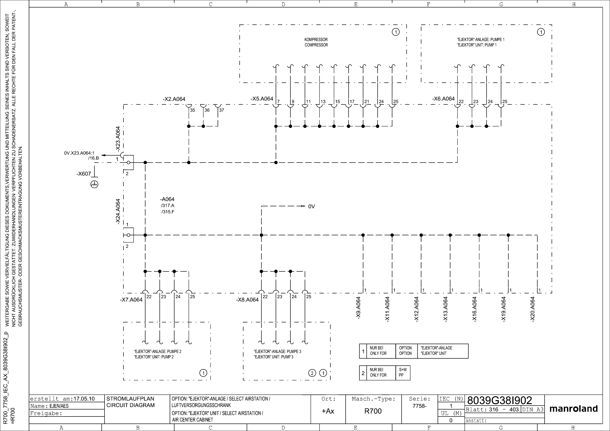

# +Ax — Sheet 316 of 403 — OPTION: "EJEKTOR" ANLAGE / SELECT AIRSTATION /

**LUFTVERSORGUNGSSCHRANK**

> Part of the manroland **R700** printing press IEC/UL circuit diagrams.
> Drawing class: **Stromlaufplan / Circuit diagram** (DIN A3).
> Document `+Ax` covers the **Central control console** machine section.

## At a glance

| Field | Value |
|---|---|
| Document | `+Ax`  (8039G38I902) |
| Sheet | **316** of 403 |
| Section (DE) | OPTION: "EJEKTOR" ANLAGE / SELECT AIRSTATION / |
| Section (EN) | LUFTVERSORGUNGSSCHRANK |
| Section type | CIRCUIT — Circuit diagram |
| Machine type | `R700` |
| Series | `7758` |
| Created | 17.05.10 |
| Replaces | — |
| Columns used | A, B, C, D, E, F, G, H |
| Path numbers | — |
| Labels on sheet | 81 |
| Cross-refs out | 3 |
| Cross-refs in | 34 |

**Previous:** [+Ax sheet 315](SHEET_0315.md) · **Next:** [+Ax sheet 317](SHEET_0317.md) · **Document TOC:** [_TOC.md](_TOC.md)  (+Ax) · **Master TOC:** [all sheets](../_MASTER_TOC.md)

## Sheet image (300 DPI, exact vector render)



_Rendered directly from the PDF vector layer at 300 DPI (1-bit), no OCR and no resampling. Use it to confirm anything ambiguous in the text below._

## Cross-references on this sheet

Each entry is a wire leaving this sheet. The printed token is `/sheet.column`; the link resolves to that sheet inside the same document.

| Ref | Target sheet | Col | Path | Destination on target | Target section | From col |
|---|---|---|---|---|---|---|
| `/16.B` | [+Ax sheet 16](SHEET_0016.md) | B | — | 0V.X23.A064:1 | SPANNUNGSVERSORGUNG, SCHALTSCHRANKBELÜFTUNG | A |
| `/317.A` | [+Ax sheet 317](SHEET_0317.md) | A | — | — | OPTION: "EJEKTOR" ANLAGE / SELECT AIRSTATION / | B |
| `/315.F` | [+Ax sheet 315](SHEET_0315.md) | F | — | — | OPTION: "EJEKTOR" ANLAGE / SELECT AIRSTATION / | B |

### Incoming references (sheets that point here)

Every other sheet that sends a wire to this one. `Back-ref` is the token printed on *that* sheet; `Path` is its line number.

| From sheet | Cols | Back-ref | Path | Refs | What continues there |
|---|---|---|---|---|---|
| [+Ax#16](SHEET_0016.md) | B | `/16.B` | — | 1 | — |
| [+Ax#217](SHEET_0217.md) | A | `/217.A` | — | 3 | — |
| [+Ax#230](SHEET_0230.md) | A | `/230.A` | — | 9 | — |
| [+Ax#233](SHEET_0233.md) | A | `/233.A` | — | 4 | — |
| [+Ax#235](SHEET_0235.md) | A | `/235.A` | — | 4 | — |
| [+Ax#237](SHEET_0237.md) | B | `/237.B` | — | 4 | — |
| [+Ax#240](SHEET_0240.md) | A | `/240.A` | — | 1 | — |
| [+Ax#246](SHEET_0246.md) | A | `/246.A` | — | 1 | — |
| [+Ax#248](SHEET_0248.md) | A | `/248.A` | — | 1 | — |
| [+Ax#249](SHEET_0249.md) | F | `/249.F` | — | 1 | — |
| [+Ax#254](SHEET_0254.md) | A | `/254.A` | — | 1 | — |
| [+Ax#258](SHEET_0258.md) | C | `/258.C` | — | 1 | — |
| [+Ax#260](SHEET_0260.md) | A | `/260.A` | — | 1 | — |
| [+Ax#315](SHEET_0315.md) | F | `/315.F` | — | 1 | — |
| [+Ax#317](SHEET_0317.md) | A | `/317.A` | — | 1 | — |


## Devices on this sheet

| Tag | Class | Class meaning (IEC) | Col | Sub | Terminal | Sign |
|---|---|---|---|---|---|---|
| `A064` | A | Baugruppe / assembly, module, PC board | B | — | — | — |
| `X607` | X | Klemme / terminal, plug connector | A | — | — | — |
| `X5.A064` | — | cross-device reference | D | — | — | — |
| `X6.A064` | — | cross-device reference | F | — | — | — |
| `X7.A064` | — | cross-device reference | B | — | — | — |
| `X8.A064` | — | cross-device reference | D | — | — | — |
| `X23.A064` | — | cross-device reference | B | — | — | — |
| `X2.A064` | — | cross-device reference | B | — | — | — |
| `X9.A064` | — | cross-device reference | E | — | — | — |
| `X11.A064` | — | cross-device reference | E | — | — | — |
| `X12.A064` | — | cross-device reference | F | — | — | — |
| `X13.A064` | — | cross-device reference | F | — | — | — |
| `X16.A064` | — | cross-device reference | G | — | — | — |
| `X19.A064` | — | cross-device reference | G | — | — | — |
| `X20.A064` | — | cross-device reference | G | — | — | — |
| `X24.A064` | — | cross-device reference | B | — | — | — |

## Potentials / nets

| Potential | Count | Columns | Attached devices | Terminals |
|---|---|---|---|---|
| `0V` | 2 | A, D | `A064`, `X23` | `1` |


A potential such as `L24+/4` or `M24+` is a named supply/return rail; every place it appears on this sheet is electrically common.

## Wire-end annotations (grouped as printed)

A wire that continues elsewhere is annotated with a small cluster: the destination description, the path/line number `#NN`, and the `/sheet.column` cross reference. Each row below is one such cluster exactly as it is grouped on the drawing.

| Col | Y | Path | Cross-ref | Text on the wire |
|---|---|---|---|---|
| G | 59.3 | — | — | `1 1` |
| F | 74.3 | — | — | `KOMPRESSOR "EJEKTOR" ANLAGE: PUMPE 1 "EJEKTOR" UNIT: PUMP 1` |
| D | 85.0 | — | — | `COMPRESSOR` |
| E | 188.1 | — | — | `X5.A064 7 9 11 13 15 17 21 24 25 X6.A064 22 23 24 25` |
| B | 188.8 | — | — | `X2.A064` |
| C | 211.5 | — | — | `35 36 37` |
| B | 246.3 | — | — | `X23.A064` |
| A | 295.1 | — | `/16.B` | `0V.X23.A064:1` |
| B | 306.4 | — | — | `1` |
| A | 334.8 | — | — | `X607` |
| B | 335.5 | — | — | `2` |
| B | 384.4 | — | — | `A064` |
| B | 388.1 | — | — | `X24.A064` |
| B | 397.5 | — | `/317.A` | — |
| D | 398.6 | — | — | `0V` |
| B | 409.9 | — | `/315.F` | — |
| B | 434.7 | — | — | `1` |
| B | 477.2 | — | — | `2` |
| F | 563.0 | — | — | `1 1 1 1 1 1 1` |
| C | 575.8 | — | — | `X7.A064 22 23 24 25 X8.A064 22 23 24 25` |
| E | 579.1 | — | — | `X9.A064` |
| E | 579.1 | — | — | `X11.A064` |
| F | 579.1 | — | — | `X12.A064` |
| F | 579.1 | — | — | `X13.A064` |
| G | 579.1 | — | — | `X16.A064` |
| G | 579.1 | — | — | `X19.A064` |
| G | 579.1 | — | — | `X20.A064` |
| E | 676.6 | — | — | `NUR BEI` |
| E | 676.7 | — | — | `1 ONLY FOR OPTION OPTION` |
| F | 676.7 | — | — | `"EJEKTOR" ANLAGE "EJEKTOR" UNIT` |
| B | 683.8 | — | — | `"EJEKTOR" ANLAGE: PUMPE 2 "EJEKTOR" UNIT: PUMP 2` |
| D | 683.8 | — | — | `"EJEKTOR" ANLAGE: PUMPE 3 "EJEKTOR" UNIT: PUMP 3` |
| E | 719.1 | — | — | `2 ONLY FOR PP S+W` |
| E | 719.2 | — | — | `NUR BEI` |
| D | 725.5 | — | — | `1 2 1` |


## Reconstructed tables

This sheet carries tabular content (pin map / terminal assignment / index). The grid below was rebuilt from the drawing's own rule lines, so each row is exactly one physical row of the table.

### Table 1 — 2 data rows × 1 columns (at x=311.8, y=246.6)

| C1 |
|---|
| `A064 /317.A` |
| `/315.F` |


## Notes and free text on this sheet

| Text | Col | Y (pt) |
|---|---|---|
| `"EJEKTOR" ANLAGE: PUMPE 1` | G | 74.31 |
| `"EJEKTOR" UNIT: PUMP 1` | G | 84.94 |
| `KOMPRESSOR` | D | 74.32 |
| `COMPRESSOR` | D | 84.98 |
| `"EJEKTOR" ANLAGE: PUMPE 2` | B | 683.77 |
| `"EJEKTOR" UNIT: PUMP 2` | B | 694.4 |
| `"EJEKTOR" ANLAGE: PUMPE 3` | D | 683.78 |
| `"EJEKTOR" UNIT: PUMP 3` | D | 694.41 |
| `NUR BEI` | E | 719.16 |
| `ONLY FOR` | E | 729.85 |
| `S+W` | F | 719.07 |
| `PP` | F | 729.7 |
| `OPTION` | F | 676.66 |
| `"EJEKTOR" ANLAGE` | F | 676.68 |
| `"EJEKTOR" UNIT` | F | 687.31 |

## Complete label inventory (exact text from the drawing)

Every text object inside the drawing area of this sheet, in DIN reading order (column A→H, then top→bottom). This is the authoritative list: if a string is not here it is not printed on this sheet.

| Col | Y | X | Dir | Type | Text |
|---|---|---|---|---|---|
| A | 295.1 | 125.3 | → | potential | `0V.X23.A064:1` |
| A | 305.0 | 172.3 | → | cross-reference | `/16.B` |
| A | 334.8 | 149.4 | → | device tag | `X607` |
| B | 188.8 | 317.8 | → | device ref | `X2.A064` |
| B | 246.3 | 225.7 | ↕ | device ref | `X23.A064` |
| B | 306.4 | 225.6 | → | number | `1` |
| B | 335.5 | 245.8 | → | number | `2` |
| B | 384.4 | 312.4 | → | device tag | `A064` |
| B | 388.1 | 225.7 | ↕ | device ref | `X24.A064` |
| B | 397.5 | 314.6 | → | cross-reference | `/317.A` |
| B | 409.9 | 315.5 | → | cross-reference | `/315.F` |
| B | 434.7 | 246.0 | → | number | `1` |
| B | 477.3 | 245.8 | → | number | `2` |
| B | 575.8 | 286.0 | → | number | `22` |
| B | 575.8 | 314.4 | → | number | `23` |
| B | 580.7 | 234.1 | → | device ref | `X7.A064` |
| B | 683.8 | 261.9 | → | text | `"EJEKTOR" ANLAGE: PUMPE 2` |
| B | 694.4 | 261.9 | → | text | `"EJEKTOR" UNIT: PUMP 2` |
| C | 211.5 | 371.1 | → | number | `35` |
| C | 211.5 | 399.4 | → | number | `36` |
| C | 211.5 | 427.7 | → | number | `37` |
| C | 575.8 | 342.7 | → | number | `24` |
| C | 575.8 | 371.1 | → | number | `25` |
| C | 725.4 | 395.1 | → | number | `1` |
| D | 74.3 | 594.4 | → | text | `KOMPRESSOR` |
| D | 85.0 | 595.0 | → | text | `COMPRESSOR` |
| D | 188.1 | 489.3 | → | device ref | `X5.A064` |
| D | 194.5 | 541.1 | → | number | `7` |
| D | 194.5 | 569.5 | → | number | `9` |
| D | 194.5 | 597.3 | → | number | `11` |
| D | 398.6 | 601.8 | → | potential | `0V` |
| D | 575.8 | 512.8 | → | number | `22` |
| D | 575.8 | 541.1 | → | number | `23` |
| D | 575.8 | 569.5 | → | number | `24` |
| D | 575.8 | 597.8 | → | number | `25` |
| D | 580.7 | 460.9 | → | device ref | `X8.A064` |
| D | 683.8 | 495.8 | → | text | `"EJEKTOR" ANLAGE: PUMPE 3` |
| D | 694.4 | 495.8 | → | text | `"EJEKTOR" UNIT: PUMP 3` |
| D | 726.0 | 607.5 | → | number | `2` |
| E | 194.5 | 625.6 | → | number | `13` |
| E | 194.5 | 654.0 | → | number | `15` |
| E | 194.5 | 682.3 | → | number | `17` |
| E | 194.5 | 711.2 | → | number | `21` |
| E | 194.5 | 739.6 | → | number | `24` |
| E | 563.0 | 710.6 | → | number | `1` |
| E | 579.1 | 694.8 | ↕ | device ref | `X9.A064` |
| E | 579.1 | 751.5 | ↕ | device ref | `X11.A064` |
| E | 676.6 | 722.0 | → | text | `NUR BEI` |
| E | 682.0 | 706.1 | → | number | `1` |
| E | 687.3 | 722.6 | → | text | `ONLY FOR` |
| E | 719.2 | 722.0 | → | text | `NUR BEI` |
| E | 724.5 | 705.8 | → | number | `2` |
| E | 725.4 | 629.0 | → | number | `1` |
| E | 729.8 | 722.6 | → | text | `ONLY FOR` |
| F | 59.3 | 770.7 | → | number | `1` |
| F | 188.1 | 843.6 | → | device ref | `X6.A064` |
| F | 194.5 | 767.9 | → | number | `25` |
| F | 194.5 | 895.5 | → | number | `22` |
| F | 563.0 | 767.3 | → | number | `1` |
| F | 563.0 | 824.0 | → | number | `1` |
| F | 563.0 | 880.7 | → | number | `1` |
| F | 579.1 | 808.2 | ↕ | device ref | `X12.A064` |
| F | 579.1 | 864.9 | ↕ | device ref | `X13.A064` |
| F | 676.7 | 779.2 | → | text | `OPTION` |
| F | 676.7 | 821.8 | → | text | `"EJEKTOR" ANLAGE` |
| F | 687.3 | 779.2 | → | text | `OPTION` |
| F | 687.3 | 821.8 | → | text | `"EJEKTOR" UNIT` |
| F | 719.1 | 779.2 | → | text | `S+W` |
| F | 729.7 | 778.7 | → | text | `PP` |
| G | 74.3 | 892.6 | → | text | `"EJEKTOR" ANLAGE: PUMPE 1` |
| G | 84.9 | 892.6 | → | text | `"EJEKTOR" UNIT: PUMP 1` |
| G | 194.5 | 923.8 | → | number | `23` |
| G | 194.5 | 952.2 | → | number | `24` |
| G | 194.5 | 980.5 | → | number | `25` |
| G | 563.0 | 937.4 | → | number | `1` |
| G | 563.0 | 994.1 | → | number | `1` |
| G | 579.1 | 921.6 | ↕ | device ref | `X16.A064` |
| G | 579.1 | 978.3 | ↕ | device ref | `X19.A064` |
| G | 579.1 | 1035.0 | ↕ | device ref | `X20.A064` |
| H | 59.3 | 1054.1 | → | number | `1` |
| H | 563.0 | 1050.8 | → | number | `1` |

## Reading-order text block

The same content as a plain block, grouped by DIN column — convenient to paste or to match against a visual description.

```text
=== Column A ===
 295.1  125.3  net          0V.X23.A064:1
 305.0  172.3  xref         /16.B
 334.8  149.4  devtag       X607
=== Column B ===
 188.8  317.8  devref       X2.A064
 246.3  225.7  devref       X23.A064
 306.4  225.6  numeric      1
 335.5  245.8  numeric      2
 384.4  312.4  devtag       A064
 388.1  225.7  devref       X24.A064
 397.5  314.6  xref         /317.A
 409.9  315.5  xref         /315.F
 434.7  246.0  numeric      1
 477.3  245.8  numeric      2
 575.8  286.0  numeric      22
 575.8  314.4  numeric      23
 580.7  234.1  devref       X7.A064
 683.8  261.9  text         "EJEKTOR" ANLAGE: PUMPE 2
 694.4  261.9  text         "EJEKTOR" UNIT: PUMP 2
=== Column C ===
 211.5  371.1  numeric      35
 211.5  399.4  numeric      36
 211.5  427.7  numeric      37
 575.8  342.7  numeric      24
 575.8  371.1  numeric      25
 725.4  395.1  numeric      1
=== Column D ===
  74.3  594.4  text         KOMPRESSOR
  85.0  595.0  text         COMPRESSOR
 188.1  489.3  devref       X5.A064
 194.5  541.1  numeric      7
 194.5  569.5  numeric      9
 194.5  597.3  numeric      11
 398.6  601.8  net          0V
 575.8  512.8  numeric      22
 575.8  541.1  numeric      23
 575.8  569.5  numeric      24
 575.8  597.8  numeric      25
 580.7  460.9  devref       X8.A064
 683.8  495.8  text         "EJEKTOR" ANLAGE: PUMPE 3
 694.4  495.8  text         "EJEKTOR" UNIT: PUMP 3
 726.0  607.5  numeric      2
=== Column E ===
 194.5  625.6  numeric      13
 194.5  654.0  numeric      15
 194.5  682.3  numeric      17
 194.5  711.2  numeric      21
 194.5  739.6  numeric      24
 563.0  710.6  numeric      1
 579.1  694.8  devref       X9.A064
 579.1  751.5  devref       X11.A064
 676.6  722.0  text         NUR BEI
 682.0  706.1  numeric      1
 687.3  722.6  text         ONLY FOR
 719.2  722.0  text         NUR BEI
 724.5  705.8  numeric      2
 725.4  629.0  numeric      1
 729.8  722.6  text         ONLY FOR
=== Column F ===
  59.3  770.7  numeric      1
 188.1  843.6  devref       X6.A064
 194.5  767.9  numeric      25
 194.5  895.5  numeric      22
 563.0  767.3  numeric      1
 563.0  824.0  numeric      1
 563.0  880.7  numeric      1
 579.1  808.2  devref       X12.A064
 579.1  864.9  devref       X13.A064
 676.7  779.2  text         OPTION
 676.7  821.8  text         "EJEKTOR" ANLAGE
 687.3  779.2  text         OPTION
 687.3  821.8  text         "EJEKTOR" UNIT
 719.1  779.2  text         S+W
 729.7  778.7  text         PP
=== Column G ===
  74.3  892.6  text         "EJEKTOR" ANLAGE: PUMPE 1
  84.9  892.6  text         "EJEKTOR" UNIT: PUMP 1
 194.5  923.8  numeric      23
 194.5  952.2  numeric      24
 194.5  980.5  numeric      25
 563.0  937.4  numeric      1
 563.0  994.1  numeric      1
 579.1  921.6  devref       X16.A064
 579.1  978.3  devref       X19.A064
 579.1 1035.0  devref       X20.A064
=== Column H ===
  59.3 1054.1  numeric      1
 563.0 1050.8  numeric      1
```

---
_Generated from the PDF vector text layer; no OCR. Source: `R700_7758_IEC_AX_8039G38I902_p`, sheet 316._
