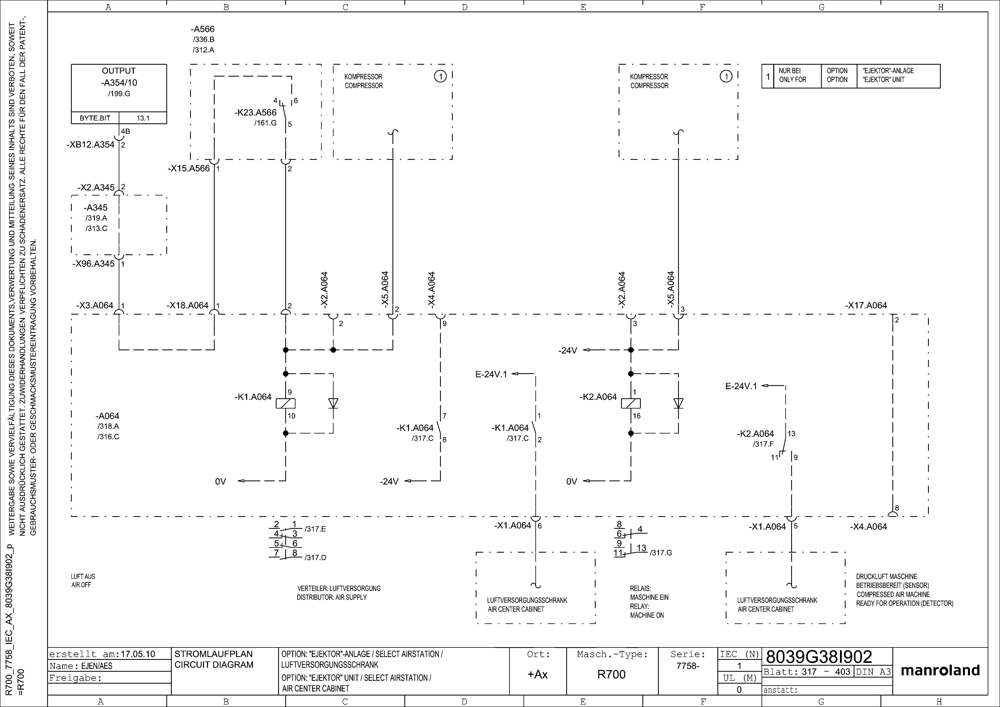

# +Ax — Sheet 317 of 403 — OPTION: "EJEKTOR" ANLAGE / SELECT AIRSTATION /

**LUFTVERSORGUNGSSCHRANK**

> Part of the manroland **R700** printing press IEC/UL circuit diagrams.
> Drawing class: **Stromlaufplan / Circuit diagram** (DIN A3).
> Document `+Ax` covers the **Central control console** machine section.

## At a glance

| Field | Value |
|---|---|
| Document | `+Ax`  (8039G38I902) |
| Sheet | **317** of 403 |
| Section (DE) | OPTION: "EJEKTOR" ANLAGE / SELECT AIRSTATION / |
| Section (EN) | LUFTVERSORGUNGSSCHRANK |
| Section type | CIRCUIT — Circuit diagram |
| Machine type | `R700` |
| Series | `7758` |
| Created | 17.05.10 |
| Replaces | — |
| Columns used | A, B, C, D, E, F, G, H |
| Path numbers | — |
| Labels on sheet | 123 |
| Cross-refs out | 14 |
| Cross-refs in | 31 |

**Previous:** [+Ax sheet 316](SHEET_0316.md) · **Next:** [+Ax sheet 318](SHEET_0318.md) · **Document TOC:** [_TOC.md](_TOC.md)  (+Ax) · **Master TOC:** [all sheets](../_MASTER_TOC.md)

## Sheet image (300 DPI, exact vector render)



_Rendered directly from the PDF vector layer at 300 DPI (1-bit), no OCR and no resampling. Use it to confirm anything ambiguous in the text below._

## Cross-references on this sheet

Each entry is a wire leaving this sheet. The printed token is `/sheet.column`; the link resolves to that sheet inside the same document.

| Ref | Target sheet | Col | Path | Destination on target | Target section | From col |
|---|---|---|---|---|---|---|
| `/336.B` | [+Ax sheet 336](SHEET_0336.md) | B | — | — | OPTION: LOGISTIK ANLEGER / | B |
| `/312.A` | [+Ax sheet 312](SHEET_0312.md) | A | — | — | OPTION: IR/UV ZWISCHENTROCKNER | B |
| `/199.G` | [+Ax sheet 199](SHEET_0199.md) | G | — | — | REFERENZMODUL | A |
| `/161.G` | [+Ax sheet 161](SHEET_0161.md) | G | — | — | ÜBERWACHUNGSRECHNER/ANSTEUERUNG NOT AUS | B |
| `/319.A` | [+Ax sheet 319](SHEET_0319.md) | A | — | — | OPTION: "EJEKTOR" ANLAGE / SELECT AIRSTATION / | A |
| `/313.C` | [+Ax sheet 313](SHEET_0313.md) | C | — | — | OPTION: STAUBSAUGER MIT BÜRSTE | A |
| `/318.A` | [+Ax sheet 318](SHEET_0318.md) | A | — | — | OPTION: "EJEKTOR" ANLAGE / SELECT AIRSTATION / | A |
| `/316.C` | [+Ax sheet 316](SHEET_0316.md) | C | — | — | OPTION: "EJEKTOR" ANLAGE / SELECT AIRSTATION / | A |
| `/317.C` | [+Ax sheet 317](SHEET_0317.md) | C | — | — | OPTION: "EJEKTOR" ANLAGE / SELECT AIRSTATION / | D |
| `/317.C` | [+Ax sheet 317](SHEET_0317.md) | C | — | — | OPTION: "EJEKTOR" ANLAGE / SELECT AIRSTATION / | D |
| `/317.F` | [+Ax sheet 317](SHEET_0317.md) | F | — | — | OPTION: "EJEKTOR" ANLAGE / SELECT AIRSTATION / | G |
| `/317.E` | [+Ax sheet 317](SHEET_0317.md) | E | — | — | OPTION: "EJEKTOR" ANLAGE / SELECT AIRSTATION / | C |
| `/317.G` | [+Ax sheet 317](SHEET_0317.md) | G | — | — | OPTION: "EJEKTOR" ANLAGE / SELECT AIRSTATION / | F |
| `/317.D` | [+Ax sheet 317](SHEET_0317.md) | D | — | — | OPTION: "EJEKTOR" ANLAGE / SELECT AIRSTATION / | C |

### Incoming references (sheets that point here)

Every other sheet that sends a wire to this one. `Back-ref` is the token printed on *that* sheet; `Path` is its line number.

| From sheet | Cols | Back-ref | Path | Refs | What continues there |
|---|---|---|---|---|---|
| [+Ax#161](SHEET_0161.md) | G | `/161.G` | — | 1 | — |
| [+Ax#199](SHEET_0199.md) | G | `/199.G` | — | 1 | — |
| [+Ax#206](SHEET_0206.md) | A | `/206.A` | — | 2 | — |
| [+Ax#217](SHEET_0217.md) | A, H | `/217.A`, `/217.H` | — | 3 | — |
| [+Ax#222](SHEET_0222.md) | A | `/222.A` | — | 1 | — |
| [+Ax#226](SHEET_0226.md) | A | `/226.A` | — | 2 | — |
| [+Ax#230](SHEET_0230.md) | A | `/230.A` | — | 2 | — |
| [+Ax#248](SHEET_0248.md) | F | `/248.F` | — | 1 | — |
| [+Ax#253](SHEET_0253.md) | F | `/253.F` | — | 2 | — |
| [+Ax#255](SHEET_0255.md) | A | `/255.A` | — | 1 | — |
| [+Ax#256](SHEET_0256.md) | A | `/256.A` | — | 2 | — |
| [+Ax#290](SHEET_0290.md) | B | `/290.B` | — | 1 | — |
| [+Ax#312](SHEET_0312.md) | A | `/312.A` | — | 1 | — |
| [+Ax#313](SHEET_0313.md) | C | `/313.C` | — | 1 | — |
| [+Ax#316](SHEET_0316.md) | B | `/316.B` | — | 1 | — |
| [+Ax#317](SHEET_0317.md) | C, D, F, G | `/317.C`, `/317.D`, `/317.F`, `/317.G` | — | 6 | — |
| [+Ax#318](SHEET_0318.md) | A | `/318.A` | — | 1 | — |
| [+Ax#319](SHEET_0319.md) | A | `/319.A` | — | 1 | — |
| [+Ax#336](SHEET_0336.md) | B | `/336.B` | — | 1 | — |


## Devices on this sheet

| Tag | Class | Class meaning (IEC) | Col | Sub | Terminal | Sign |
|---|---|---|---|---|---|---|
| `A354/10` | A | Baugruppe / assembly, module, PC board | A | 10 | — | — |
| `A566` | A | Baugruppe / assembly, module, PC board | B | — | — | — |
| `A064` | A | Baugruppe / assembly, module, PC board | A | — | — | — |
| `A345` | A | Baugruppe / assembly, module, PC board | A | — | — | — |
| `13.1` | — | cross-device reference | A | — | — | — |
| `XB12.A354` | — | cross-device reference | A | — | — | — |
| `X15.A566` | — | cross-device reference | B | — | — | — |
| `X3.A064` | — | cross-device reference | A | — | — | — |
| `X18.A064` | — | cross-device reference | B | — | — | — |
| `X2.A345` | — | cross-device reference | A | — | — | — |
| `X96.A345` | — | cross-device reference | A | — | — | — |
| `K23.A566` | — | cross-device reference | B | — | — | — |
| `K1.A064` | — | cross-device reference | B | — | — | — |
| `X5.A064` | — | cross-device reference | C | — | — | — |
| `K1.A064` | — | cross-device reference | D | — | — | — |
| `K1.A064` | — | cross-device reference | D | — | — | — |
| `X1.A064` | — | cross-device reference | D | — | — | — |
| `K2.A064` | — | cross-device reference | F | — | — | — |
| `X1.A064` | — | cross-device reference | G | — | — | — |
| `X5.A064` | — | cross-device reference | F | — | — | — |
| `K2.A064` | — | cross-device reference | E | — | — | — |
| `X2.A064` | — | cross-device reference | C | — | — | — |
| `X4.A064` | — | cross-device reference | D | — | — | — |
| `X2.A064` | — | cross-device reference | E | — | — | — |
| `X4.A064` | — | cross-device reference | G | — | — | — |
| `X17.A064` | — | cross-device reference | G | — | — | — |

## Potentials / nets

| Potential | Count | Columns | Attached devices | Terminals |
|---|---|---|---|---|
| `0V` | 2 | B, E | — | — |
| `24V` | 2 | C, E | — | — |


A potential such as `L24+/4` or `M24+` is a named supply/return rail; every place it appears on this sheet is electrically common.

## Wire-end annotations (grouped as printed)

A wire that continues elsewhere is annotated with a small cluster: the destination description, the path/line number `#NN`, and the `/sheet.column` cross reference. Each row below is one such cluster exactly as it is grouped on the drawing.

| Col | Y | Path | Cross-ref | Text on the wire |
|---|---|---|---|---|
| B | 30.1 | — | — | `A566` |
| B | 43.1 | — | `/336.B`, `/312.A` | — |
| A | 80.0 | — | — | `OUTPUT` |
| G | 81.4 | — | — | `1 NUR BEI` |
| G | 81.4 | — | — | `1 ONLY FOR OPTION OPTION` |
| H | 81.4 | — | — | `"EJEKTOR" ANLAGE "EJEKTOR" UNIT` |
| D | 87.7 | — | — | `1` |
| C | 88.5 | — | — | `KOMPRESSOR` |
| F | 88.5 | — | — | `KOMPRESSOR` |
| A | 93.8 | — | — | `A354/10` |
| C | 99.2 | — | — | `COMPRESSOR` |
| F | 99.2 | — | — | `COMPRESSOR` |
| A | 107.6 | — | `/199.G` | — |
| B | 115.8 | — | — | `K23.A566 6` |
| B | 115.8 | — | — | `4` |
| A | 137.3 | — | — | `BYTE.BIT 13.1` |
| B | 142.4 | — | `/161.G` | — |
| C | 144.2 | — | — | `5` |
| A | 152.6 | — | — | `4B` |
| A | 167.6 | — | — | `XB12.A354 2` |
| B | 195.9 | — | — | `X15.A566 1` |
| C | 197.3 | — | — | `2` |
| A | 218.6 | — | — | `X2.A345 2` |
| A | 242.7 | — | — | `A345` |
| A | 255.7 | — | `/319.A`, `/313.C` | — |
| A | 309.3 | — | — | `X96.A345 1` |
| C | 322.4 | — | — | `X5.A064` |
| F | 322.4 | — | — | `X5.A064` |
| C | 323.1 | — | — | `X2.A064` |
| D | 323.1 | — | — | `X4.A064` |
| E | 323.1 | — | — | `X2.A064` |
| A | 358.9 | — | — | `X3.A064 1` |
| B | 358.9 | — | — | `X18.A064 1` |
| G | 358.9 | — | — | `X17.A064` |
| C | 360.3 | — | — | `2` |
| C | 364.6 | — | — | `2` |
| G | 364.6 | — | — | `3 2` |
| C | 381.6 | — | — | `2` |
| D | 381.6 | — | — | `9` |
| E | 381.6 | — | — | `3` |
| E | 412.8 | — | — | `24V` |
| D | 441.1 | — | — | `E 24V.1` |
| F | 455.3 | — | — | `E 24V.1` |
| C | 463.1 | — | — | `9` |
| E | 463.1 | — | — | `1` |
| B | 468.0 | — | — | `K1.A064` |
| E | 468.0 | — | — | `K2.A064` |
| A | 490.7 | — | — | `A064` |
| C | 491.4 | — | — | `10` |
| D | 491.4 | — | — | `7` |
| E | 491.4 | — | — | `1` |
| E | 491.4 | — | — | `16` |
| A | 503.8 | — | `/318.A`, `/316.C` | — |
| D | 504.9 | — | — | `K1.A064 8` |
| D | 504.9 | — | — | `K1.A064 2` |
| F | 512.0 | — | — | `K2.A064` |
| G | 512.7 | — | — | `13` |
| D | 518.0 | — | `/317.C` | — |
| D | 518.0 | — | `/317.C` | — |
| G | 525.0 | — | `/317.F` | — |
| G | 541.0 | — | — | `11` |
| G | 541.0 | — | — | `9` |
| B | 568.6 | — | — | `0V` |
| E | 568.6 | — | — | `0V` |
| C | 568.7 | — | — | `24V` |
| H | 601.3 | — | — | `8` |
| B | 619.6 | — | — | `2 4 5 7 1 3 8 6` |
| E | 619.6 | — | — | `11 8 6 9 13` |
| D | 621.1 | — | — | `X1.A064 6` |
| G | 622.5 | — | — | `X1.A064 5` |
| G | 622.5 | — | — | `X4.A064` |
| E | 625.3 | — | — | `4` |
| C | 626.0 | — | `/317.E` | — |
| F | 654.4 | — | `/317.G` | — |
| C | 660.0 | — | `/317.D` | — |
| H | 683.8 | — | — | `DRUCKLUFT MASCHINE BETRIEBSBEREIT (SENSOR)` |
| A | 683.9 | — | — | `LUFT AUS` |
| A | 693.9 | — | — | `AIR OFF` |
| F | 697.9 | — | — | `RELAIS: RELAY: MASCHINE EIN MACHINE ON` |
| C | 698.0 | — | — | `DISTRIBUTOR: AIR SUPPLY VERTEILER: LUFTVERSORGUNG` |
| H | 705.0 | — | — | `READY FOR OPERATION (DETECTOR) COMPRESSED AIR MACHINE` |
| E | 712.1 | — | — | `LUFTVERSORGUNGSSCHRANK` |
| G | 712.1 | — | — | `LUFTVERSORGUNGSSCHRANK` |
| D | 722.8 | — | — | `AIR CENTER CABINET` |
| G | 722.8 | — | — | `AIR CENTER CABINET` |


## Reconstructed tables

This sheet carries tabular content (pin map / terminal assignment / index). The grid below was rebuilt from the drawing's own rule lines, so each row is exactly one physical row of the table.

### Table 1 — 4 data rows × 8 columns (at x=85.0, y=76.5) — **OUTPUT**

|  | A354/10 /199.G |  | 4 |  | 6 | KOMPRESSOR COMPRESSOR |  |
|---|---|---|---|---|---|---|---|
| `BYTE.BIT` | `13.1` |  | `K23.A566 /161.G` |  |  |  |  |
| `XB12.A354 X2.A345 A345 /319.A /313.C X96.A345 X3.A064` | `4B 2 2 1 1` | `X15.A566 X18.A064` | `1 1` | `5 2 2` | `X2.A064` | `X5.A064 2` | `X4.A064 2` |
| `A064 /318.A` |  |  | `K1.A064` | `9 10` |  |  | `K1.A064` |
| `/316.C` |  |  |  |  |  |  | `/317.C` |


## Notes and free text on this sheet

| Text | Col | Y (pt) |
|---|---|---|
| `4B` | A | 152.63 |
| `OUTPUT` | A | 79.98 |
| `BYTE.BIT` | A | 137.26 |
| `LUFT AUS` | A | 683.88 |
| `AIR OFF` | A | 693.89 |
| `VERTEILER: LUFTVERSORGUNG` | C | 697.96 |
| `DISTRIBUTOR: AIR SUPPLY` | C | 708.57 |
| `KOMPRESSOR` | C | 88.5 |
| `COMPRESSOR` | C | 99.15 |
| `E 24V.1` | D | 441.1 |
| `LUFTVERSORGUNGSSCHRANK` | E | 712.14 |
| `AIR CENTER CABINET` | D | 722.75 |
| `E 24V.1` | F | 455.28 |
| `LUFTVERSORGUNGSSCHRANK` | G | 712.14 |
| `AIR CENTER CABINET` | G | 722.75 |
| `RELAIS:` | E | 697.88 |
| `MASCHINE EIN` | F | 708.57 |
| `RELAY:` | E | 719.15 |
| `MACHINE ON` | F | 729.85 |
| `DRUCKLUFT MASCHINE` | H | 683.79 |
| `BETRIEBSBEREIT (SENSOR)` | H | 694.39 |
| `COMPRESSED AIR MACHINE` | H | 705.05 |
| `READY FOR OPERATION (DETECTOR)` | H | 715.68 |
| `KOMPRESSOR` | F | 88.5 |
| `COMPRESSOR` | F | 99.15 |
| `NUR BEI` | G | 81.37 |
| `ONLY FOR` | G | 92.05 |
| `OPTION` | G | 81.38 |
| `"EJEKTOR" ANLAGE` | H | 81.41 |
| `"EJEKTOR" UNIT` | H | 92.04 |

## Complete label inventory (exact text from the drawing)

Every text object inside the drawing area of this sheet, in DIN reading order (column A→H, then top→bottom). This is the authoritative list: if a string is not here it is not printed on this sheet.

| Col | Y | X | Dir | Type | Text |
|---|---|---|---|---|---|
| A | 80.0 | 121.5 | → | text | `OUTPUT` |
| A | 93.8 | 120.3 | → | device tag | `A354/10` |
| A | 107.6 | 128.8 | → | cross-reference | `/199.G` |
| A | 137.3 | 95.0 | → | text | `BYTE.BIT` |
| A | 137.3 | 162.4 | → | device ref | `13.1` |
| A | 152.6 | 144.3 | → | text | `4B` |
| A | 167.5 | 79.4 | → | device ref | `XB12.A354` |
| A | 169.0 | 144.3 | → | number | `2` |
| A | 218.6 | 92.4 | → | device ref | `X2.A345` |
| A | 218.6 | 144.3 | → | number | `2` |
| A | 242.7 | 99.8 | → | device tag | `A345` |
| A | 255.7 | 102.0 | → | cross-reference | `/319.A` |
| A | 268.2 | 102.0 | → | cross-reference | `/313.C` |
| A | 309.3 | 86.5 | → | device ref | `X96.A345` |
| A | 310.7 | 143.7 | → | number | `1` |
| A | 358.9 | 91.0 | → | device ref | `X3.A064` |
| A | 360.3 | 143.7 | → | number | `1` |
| A | 490.7 | 114.0 | → | device tag | `A064` |
| A | 503.8 | 116.2 | → | cross-reference | `/318.A` |
| A | 516.2 | 116.2 | → | cross-reference | `/316.C` |
| A | 683.9 | 84.5 | → | text | `LUFT AUS` |
| A | 693.9 | 85.3 | → | text | `AIR OFF` |
| B | 30.1 | 227.3 | → | device tag | `A566` |
| B | 43.1 | 229.9 | → | cross-reference | `/336.B` |
| B | 55.5 | 229.6 | → | cross-reference | `/312.A` |
| B | 115.8 | 325.7 | → | number | `4` |
| B | 129.3 | 279.2 | → | device ref | `K23.A566` |
| B | 142.4 | 303.0 | → | cross-reference | `/161.G` |
| B | 195.9 | 199.8 | → | device ref | `X15.A566` |
| B | 197.3 | 257.1 | → | number | `1` |
| B | 358.9 | 198.4 | → | device ref | `X18.A064` |
| B | 360.3 | 257.1 | → | number | `1` |
| B | 468.0 | 279.5 | → | device ref | `K1.A064` |
| B | 568.6 | 256.3 | → | potential | `0V` |
| B | 619.6 | 326.3 | → | number | `2` |
| B | 631.0 | 326.3 | → | number | `4` |
| B | 642.3 | 326.3 | → | number | `5` |
| B | 653.7 | 326.3 | → | number | `7` |
| C | 88.5 | 410.2 | → | text | `KOMPRESSOR` |
| C | 99.1 | 410.7 | → | text | `COMPRESSOR` |
| C | 115.8 | 349.8 | → | number | `6` |
| C | 144.2 | 342.7 | → | number | `5` |
| C | 197.3 | 342.7 | → | number | `2` |
| C | 322.4 | 453.9 | ↕ | device ref | `X5.A064` |
| C | 323.2 | 381.6 | ↕ | device ref | `X2.A064` |
| C | 360.3 | 342.7 | → | number | `2` |
| C | 364.6 | 470.3 | → | number | `2` |
| C | 381.6 | 403.7 | → | number | `2` |
| C | 463.1 | 342.7 | → | number | `9` |
| C | 491.4 | 342.1 | → | number | `10` |
| C | 568.7 | 452.4 | → | potential | `24V` |
| C | 619.6 | 347.5 | → | number | `1` |
| C | 626.0 | 362.8 | → | cross-reference | `/317.E` |
| C | 631.0 | 348.1 | → | number | `3` |
| C | 642.3 | 348.4 | → | number | `6` |
| C | 653.7 | 348.1 | → | number | `8` |
| C | 660.1 | 362.8 | → | cross-reference | `/317.D` |
| C | 698.0 | 354.3 | → | text | `VERTEILER: LUFTVERSORGUNG` |
| C | 708.6 | 353.5 | → | text | `DISTRIBUTOR: AIR SUPPLY` |
| D | 87.7 | 522.7 | → | number | `1` |
| D | 323.2 | 509.1 | ↕ | device ref | `X4.A064` |
| D | 381.6 | 527.0 | → | number | `9` |
| D | 441.1 | 566.1 | → | text | `E 24V.1` |
| D | 491.4 | 527.0 | → | number | `7` |
| D | 504.9 | 472.3 | → | device ref | `K1.A064` |
| D | 504.9 | 585.6 | → | device ref | `K1.A064` |
| D | 518.0 | 490.4 | → | cross-reference | `/317.C` |
| D | 518.0 | 603.8 | → | cross-reference | `/317.C` |
| D | 519.8 | 527.0 | → | number | `8` |
| D | 621.1 | 588.5 | → | device ref | `X1.A064` |
| D | 722.8 | 581.1 | → | text | `AIR CENTER CABINET` |
| E | 323.2 | 735.9 | ↕ | device ref | `X2.A064` |
| E | 381.6 | 753.7 | → | number | `3` |
| E | 412.8 | 665.0 | → | potential | `24V` |
| E | 463.1 | 753.2 | → | number | `1` |
| E | 468.0 | 690.5 | → | device ref | `K2.A064` |
| E | 491.4 | 639.8 | → | number | `1` |
| E | 491.4 | 753.2 | → | number | `16` |
| E | 519.8 | 640.3 | → | number | `2` |
| E | 568.6 | 674.4 | → | potential | `0V` |
| E | 619.6 | 734.5 | → | number | `8` |
| E | 622.5 | 640.3 | → | number | `6` |
| E | 625.3 | 759.4 | → | number | `4` |
| E | 631.0 | 734.5 | → | number | `6` |
| E | 642.3 | 734.5 | → | number | `9` |
| E | 648.0 | 757.7 | → | number | `13` |
| E | 653.7 | 729.9 | → | number | `11` |
| E | 697.9 | 750.3 | → | text | `RELAIS:` |
| E | 712.1 | 580.3 | → | text | `LUFTVERSORGUNGSSCHRANK` |
| E | 719.1 | 750.3 | → | text | `RELAY:` |
| F | 87.7 | 862.8 | → | number | `1` |
| F | 88.5 | 750.3 | → | text | `KOMPRESSOR` |
| F | 99.1 | 750.9 | → | text | `COMPRESSOR` |
| F | 322.4 | 794.0 | ↕ | device ref | `X5.A064` |
| F | 364.6 | 810.4 | → | number | `3` |
| F | 455.3 | 863.7 | → | text | `E 24V.1` |
| F | 512.0 | 877.6 | → | device ref | `K2.A064` |
| F | 654.4 | 773.9 | → | cross-reference | `/317.G` |
| F | 708.6 | 750.6 | → | text | `MASCHINE EIN` |
| F | 729.8 | 750.6 | → | text | `MACHINE ON` |
| G | 81.4 | 927.5 | → | text | `NUR BEI` |
| G | 81.4 | 984.8 | → | text | `OPTION` |
| G | 86.7 | 911.6 | → | number | `1` |
| G | 92.0 | 984.8 | → | text | `OPTION` |
| G | 92.1 | 928.1 | → | text | `ONLY FOR` |
| G | 358.9 | 1006.3 | → | device ref | `X17.A064` |
| G | 512.7 | 937.4 | → | number | `13` |
| G | 525.0 | 896.6 | → | cross-reference | `/317.F` |
| G | 541.0 | 917.6 | → | number | `11` |
| G | 541.0 | 945.1 | → | number | `9` |
| G | 622.5 | 891.8 | → | device ref | `X1.A064` |
| G | 622.5 | 945.1 | → | number | `5` |
| G | 622.5 | 1012.3 | → | device ref | `X4.A064` |
| G | 712.1 | 877.9 | → | text | `LUFTVERSORGUNGSSCHRANK` |
| G | 722.8 | 878.7 | → | text | `AIR CENTER CABINET` |
| H | 81.4 | 1027.3 | → | text | `"EJEKTOR" ANLAGE` |
| H | 92.0 | 1027.3 | → | text | `"EJEKTOR" UNIT` |
| H | 377.3 | 1065.5 | → | number | `2` |
| H | 601.3 | 1065.5 | → | number | `8` |
| H | 683.8 | 1019.6 | → | text | `DRUCKLUFT MASCHINE` |
| H | 694.4 | 1019.6 | → | text | `BETRIEBSBEREIT (SENSOR)` |
| H | 705.0 | 1020.2 | → | text | `COMPRESSED AIR MACHINE` |
| H | 715.7 | 1019.6 | → | text | `READY FOR OPERATION (DETECTOR)` |

## Reading-order text block

The same content as a plain block, grouped by DIN column — convenient to paste or to match against a visual description.

```text
=== Column A ===
  80.0  121.5  text         OUTPUT
  93.8  120.3  devtag       A354/10
 107.6  128.8  xref         /199.G
 137.3   95.0  text         BYTE.BIT
 137.3  162.4  devref       13.1
 152.6  144.3  text         4B
 167.5   79.4  devref       XB12.A354
 169.0  144.3  numeric      2
 218.6   92.4  devref       X2.A345
 218.6  144.3  numeric      2
 242.7   99.8  devtag       A345
 255.7  102.0  xref         /319.A
 268.2  102.0  xref         /313.C
 309.3   86.5  devref       X96.A345
 310.7  143.7  numeric      1
 358.9   91.0  devref       X3.A064
 360.3  143.7  numeric      1
 490.7  114.0  devtag       A064
 503.8  116.2  xref         /318.A
 516.2  116.2  xref         /316.C
 683.9   84.5  text         LUFT AUS
 693.9   85.3  text         AIR OFF
=== Column B ===
  30.1  227.3  devtag       A566
  43.1  229.9  xref         /336.B
  55.5  229.6  xref         /312.A
 115.8  325.7  numeric      4
 129.3  279.2  devref       K23.A566
 142.4  303.0  xref         /161.G
 195.9  199.8  devref       X15.A566
 197.3  257.1  numeric      1
 358.9  198.4  devref       X18.A064
 360.3  257.1  numeric      1
 468.0  279.5  devref       K1.A064
 568.6  256.3  net          0V
 619.6  326.3  numeric      2
 631.0  326.3  numeric      4
 642.3  326.3  numeric      5
 653.7  326.3  numeric      7
=== Column C ===
  88.5  410.2  text         KOMPRESSOR
  99.1  410.7  text         COMPRESSOR
 115.8  349.8  numeric      6
 144.2  342.7  numeric      5
 197.3  342.7  numeric      2
 322.4  453.9  devref       X5.A064
 323.2  381.6  devref       X2.A064
 360.3  342.7  numeric      2
 364.6  470.3  numeric      2
 381.6  403.7  numeric      2
 463.1  342.7  numeric      9
 491.4  342.1  numeric      10
 568.7  452.4  net          24V
 619.6  347.5  numeric      1
 626.0  362.8  xref         /317.E
 631.0  348.1  numeric      3
 642.3  348.4  numeric      6
 653.7  348.1  numeric      8
 660.1  362.8  xref         /317.D
 698.0  354.3  text         VERTEILER: LUFTVERSORGUNG
 708.6  353.5  text         DISTRIBUTOR: AIR SUPPLY
=== Column D ===
  87.7  522.7  numeric      1
 323.2  509.1  devref       X4.A064
 381.6  527.0  numeric      9
 441.1  566.1  text         E 24V.1
 491.4  527.0  numeric      7
 504.9  472.3  devref       K1.A064
 504.9  585.6  devref       K1.A064
 518.0  490.4  xref         /317.C
 518.0  603.8  xref         /317.C
 519.8  527.0  numeric      8
 621.1  588.5  devref       X1.A064
 722.8  581.1  text         AIR CENTER CABINET
=== Column E ===
 323.2  735.9  devref       X2.A064
 381.6  753.7  numeric      3
 412.8  665.0  net          24V
 463.1  753.2  numeric      1
 468.0  690.5  devref       K2.A064
 491.4  639.8  numeric      1
 491.4  753.2  numeric      16
 519.8  640.3  numeric      2
 568.6  674.4  net          0V
 619.6  734.5  numeric      8
 622.5  640.3  numeric      6
 625.3  759.4  numeric      4
 631.0  734.5  numeric      6
 642.3  734.5  numeric      9
 648.0  757.7  numeric      13
 653.7  729.9  numeric      11
 697.9  750.3  text         RELAIS:
 712.1  580.3  text         LUFTVERSORGUNGSSCHRANK
 719.1  750.3  text         RELAY:
=== Column F ===
  87.7  862.8  numeric      1
  88.5  750.3  text         KOMPRESSOR
  99.1  750.9  text         COMPRESSOR
 322.4  794.0  devref       X5.A064
 364.6  810.4  numeric      3
 455.3  863.7  text         E 24V.1
 512.0  877.6  devref       K2.A064
 654.4  773.9  xref         /317.G
 708.6  750.6  text         MASCHINE EIN
 729.8  750.6  text         MACHINE ON
=== Column G ===
  81.4  927.5  text         NUR BEI
  81.4  984.8  text         OPTION
  86.7  911.6  numeric      1
  92.0  984.8  text         OPTION
  92.1  928.1  text         ONLY FOR
 358.9 1006.3  devref       X17.A064
 512.7  937.4  numeric      13
 525.0  896.6  xref         /317.F
 541.0  917.6  numeric      11
 541.0  945.1  numeric      9
 622.5  891.8  devref       X1.A064
 622.5  945.1  numeric      5
 622.5 1012.3  devref       X4.A064
 712.1  877.9  text         LUFTVERSORGUNGSSCHRANK
 722.8  878.7  text         AIR CENTER CABINET
=== Column H ===
  81.4 1027.3  text         "EJEKTOR" ANLAGE
  92.0 1027.3  text         "EJEKTOR" UNIT
 377.3 1065.5  numeric      2
 601.3 1065.5  numeric      8
 683.8 1019.6  text         DRUCKLUFT MASCHINE
 694.4 1019.6  text         BETRIEBSBEREIT (SENSOR)
 705.0 1020.2  text         COMPRESSED AIR MACHINE
 715.7 1019.6  text         READY FOR OPERATION (DETECTOR)
```

---
_Generated from the PDF vector text layer; no OCR. Source: `R700_7758_IEC_AX_8039G38I902_p`, sheet 317._
