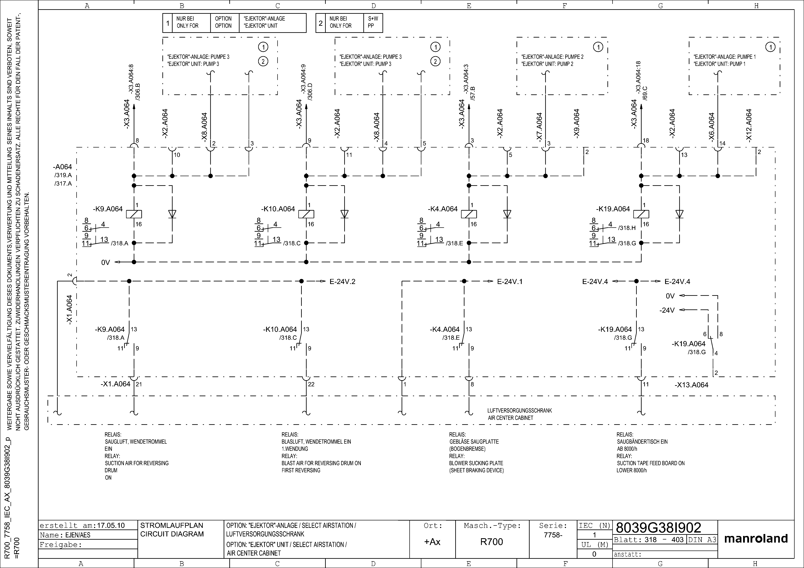

# +Ax — Sheet 318 of 403 — OPTION: "EJEKTOR" ANLAGE / SELECT AIRSTATION /

**LUFTVERSORGUNGSSCHRANK**

> Part of the manroland **R700** printing press IEC/UL circuit diagrams.
> Drawing class: **Stromlaufplan / Circuit diagram** (DIN A3).
> Document `+Ax` covers the **Central control console** machine section.

## At a glance

| Field | Value |
|---|---|
| Document | `+Ax`  (8039G38I902) |
| Sheet | **318** of 403 |
| Section (DE) | OPTION: "EJEKTOR" ANLAGE / SELECT AIRSTATION / |
| Section (EN) | LUFTVERSORGUNGSSCHRANK |
| Section type | CIRCUIT — Circuit diagram |
| Machine type | `R700` |
| Series | `7758` |
| Created | 17.05.10 |
| Replaces | — |
| Columns used | A, B, C, D, E, F, G, H |
| Path numbers | — |
| Labels on sheet | 177 |
| Cross-refs out | 16 |
| Cross-refs in | 39 |

**Previous:** [+Ax sheet 317](SHEET_0317.md) · **Next:** [+Ax sheet 319](SHEET_0319.md) · **Document TOC:** [_TOC.md](_TOC.md)  (+Ax) · **Master TOC:** [all sheets](../_MASTER_TOC.md)

## Sheet image (300 DPI, exact vector render)



_Rendered directly from the PDF vector layer at 300 DPI (1-bit), no OCR and no resampling. Use it to confirm anything ambiguous in the text below._

## Cross-references on this sheet

Each entry is a wire leaving this sheet. The printed token is `/sheet.column`; the link resolves to that sheet inside the same document.

| Ref | Target sheet | Col | Path | Destination on target | Target section | From col |
|---|---|---|---|---|---|---|
| `/69.C` | [+Ax sheet 69](SHEET_0069.md) | C | — | X3.A064:18 | SAUGBÄNDERTISCH | G |
| `/306.B` | [+Ax sheet 306](SHEET_0306.md) | B | — | X3.A064:8 | SCHÖN & WIDERDRUCK HAUPTSCHALTSCHRANK | B |
| `/306.D` | [+Ax sheet 306](SHEET_0306.md) | D | — | X3.A064:9 | SCHÖN & WIDERDRUCK HAUPTSCHALTSCHRANK | C |
| `/57.B` | [+Ax sheet 57](SHEET_0057.md) | B | — | X3.A064:3 | LUFTVERSORGUNG | E |
| `/319.A` | [+Ax sheet 319](SHEET_0319.md) | A | — | — | OPTION: "EJEKTOR" ANLAGE / SELECT AIRSTATION / | A |
| `/317.A` | [+Ax sheet 317](SHEET_0317.md) | A | — | — | OPTION: "EJEKTOR" ANLAGE / SELECT AIRSTATION / | A |
| `/318.H` | [+Ax sheet 318](SHEET_0318.md) | H | — | 4 | OPTION: "EJEKTOR" ANLAGE / SELECT AIRSTATION / | G |
| `/318.A` | [+Ax sheet 318](SHEET_0318.md) | A | — | — | OPTION: "EJEKTOR" ANLAGE / SELECT AIRSTATION / | A |
| `/318.E` | [+Ax sheet 318](SHEET_0318.md) | E | — | — | OPTION: "EJEKTOR" ANLAGE / SELECT AIRSTATION / | E |
| `/318.G` | [+Ax sheet 318](SHEET_0318.md) | G | — | — | OPTION: "EJEKTOR" ANLAGE / SELECT AIRSTATION / | G |
| `/318.C` | [+Ax sheet 318](SHEET_0318.md) | C | — | — | OPTION: "EJEKTOR" ANLAGE / SELECT AIRSTATION / | C |
| `/318.G` | [+Ax sheet 318](SHEET_0318.md) | G | — | 6 | OPTION: "EJEKTOR" ANLAGE / SELECT AIRSTATION / | G |
| `/318.A` | [+Ax sheet 318](SHEET_0318.md) | A | — | — | OPTION: "EJEKTOR" ANLAGE / SELECT AIRSTATION / | A |
| `/318.E` | [+Ax sheet 318](SHEET_0318.md) | E | — | — | OPTION: "EJEKTOR" ANLAGE / SELECT AIRSTATION / | E |
| `/318.C` | [+Ax sheet 318](SHEET_0318.md) | C | — | — | OPTION: "EJEKTOR" ANLAGE / SELECT AIRSTATION / | C |
| `/318.G` | [+Ax sheet 318](SHEET_0318.md) | G | — | — | OPTION: "EJEKTOR" ANLAGE / SELECT AIRSTATION / | G |

### Incoming references (sheets that point here)

Every other sheet that sends a wire to this one. `Back-ref` is the token printed on *that* sheet; `Path` is its line number.

| From sheet | Cols | Back-ref | Path | Refs | What continues there |
|---|---|---|---|---|---|
| [+Ax#57](SHEET_0057.md) | B | `/57.B` | — | 1 | X3.A064:3 |
| [+Ax#69](SHEET_0069.md) | C | `/69.C` | — | 1 | — |
| [+Ax#206](SHEET_0206.md) | A | `/206.A` | — | 6 | — |
| [+Ax#217](SHEET_0217.md) | A | `/217.A` | — | 4 | — |
| [+Ax#222](SHEET_0222.md) | A | `/222.A` | — | 4 | — |
| [+Ax#233](SHEET_0233.md) | A | `/233.A` | — | 1 | — |
| [+Ax#235](SHEET_0235.md) | A | `/235.A` | — | 1 | — |
| [+Ax#237](SHEET_0237.md) | B | `/237.B` | — | 4 | — |
| [+Ax#240](SHEET_0240.md) | A | `/240.A` | — | 1 | — |
| [+Ax#248](SHEET_0248.md) | A | `/248.A` | — | 1 | — |
| [+Ax#249](SHEET_0249.md) | F | `/249.F` | — | 1 | — |
| [+Ax#306](SHEET_0306.md) | B, D | `/306.B`, `/306.D` | — | 2 | X3.A064:8; X3.A064:9 |
| [+Ax#317](SHEET_0317.md) | A | `/317.A` | — | 1 | — |
| [+Ax#318](SHEET_0318.md) | A, C, E, G | `/318.A`, `/318.C`, `/318.E`, `/318.G` | — | 10 | 4; 6 |
| [+Ax#319](SHEET_0319.md) | A | `/319.A` | — | 1 | — |


## Devices on this sheet

| Tag | Class | Class meaning (IEC) | Col | Sub | Terminal | Sign |
|---|---|---|---|---|---|---|
| `A064` | A | Baugruppe / assembly, module, PC board | A | — | — | — |
| `X3.A064` | — | cross-device reference | A | — | — | — |
| `X3.A064` | — | cross-device reference | C | — | — | — |
| `X3.A064` | — | cross-device reference | E | — | — | — |
| `X3.A064` | — | cross-device reference | G | — | — | — |
| `K9.A064` | — | cross-device reference | A | — | — | — |
| `K10.A064` | — | cross-device reference | C | — | — | — |
| `K4.A064` | — | cross-device reference | E | — | — | — |
| `K19.A064` | — | cross-device reference | G | — | — | — |
| `K9.A064` | — | cross-device reference | A | — | — | — |
| `K10.A064` | — | cross-device reference | C | — | — | — |
| `K4.A064` | — | cross-device reference | E | — | — | — |
| `K19.A064` | — | cross-device reference | G | — | — | — |
| `K19.A064` | — | cross-device reference | G | — | — | — |
| `X1.A064` | — | cross-device reference | A | — | — | — |
| `X8.A064` | — | cross-device reference | B | — | — | — |
| `X8.A064` | — | cross-device reference | D | — | — | — |
| `X7.A064` | — | cross-device reference | F | — | — | — |
| `X6.A064` | — | cross-device reference | H | — | — | — |
| `X1.A064` | — | cross-device reference | A | — | — | — |
| `X3.A064:18` | — | cross-device reference | G | — | 18 | — |
| `X3.A064:9` | — | cross-device reference | C | — | 9 | — |
| `X3.A064:8` | — | cross-device reference | A | — | 8 | — |
| `X3.A064:3` | — | cross-device reference | E | — | 3 | — |
| `X2.A064` | — | cross-device reference | B | — | — | — |
| `X2.A064` | — | cross-device reference | D | — | — | — |
| `X2.A064` | — | cross-device reference | E | — | — | — |
| `X9.A064` | — | cross-device reference | F | — | — | — |
| `X2.A064` | — | cross-device reference | G | — | — | — |
| `X12.A064` | — | cross-device reference | H | — | — | — |
| `X13.A064` | — | cross-device reference | G | — | — | — |

## Potentials / nets

| Potential | Count | Columns | Attached devices | Terminals |
|---|---|---|---|---|
| `0V` | 2 | A, G | — | — |
| `24V` | 1 | G | — | — |


A potential such as `L24+/4` or `M24+` is a named supply/return rail; every place it appears on this sheet is electrically common.

## Wire-end annotations (grouped as printed)

A wire that continues elsewhere is annotated with a small cluster: the destination description, the path/line number `#NN`, and the `/sheet.column` cross reference. Each row below is one such cluster exactly as it is grouped on the drawing.

| Col | Y | Path | Cross-ref | Text on the wire |
|---|---|---|---|---|
| D | 24.6 | — | — | `2 ONLY FOR PP S+W` |
| B | 24.7 | — | — | `1 ONLY FOR OPTION OPTION` |
| B | 24.7 | — | — | `NUR BEI` |
| C | 24.7 | — | — | `"EJEKTOR" ANLAGE "EJEKTOR" UNIT` |
| D | 24.7 | — | — | `NUR BEI` |
| C | 66.4 | — | — | `1` |
| E | 66.4 | — | — | `1` |
| F | 66.4 | — | — | `1` |
| H | 66.4 | — | — | `1` |
| B | 81.4 | — | — | `"EJEKTOR" ANLAGE: PUMPE 3 "EJEKTOR" UNIT: PUMP 3` |
| D | 81.4 | — | — | `2 "EJEKTOR" ANLAGE: PUMPE 3 "EJEKTOR" UNIT: PUMP 3` |
| E | 81.4 | — | — | `2 "EJEKTOR" ANLAGE: PUMPE 2 "EJEKTOR" UNIT: PUMP 2` |
| H | 81.4 | — | — | `"EJEKTOR" ANLAGE: PUMPE 1 "EJEKTOR" UNIT: PUMP 1` |
| G | 90.4 | — | `/69.C` | `X3.A064:18` |
| B | 95.2 | — | `/306.B` | `X3.A064:8` |
| C | 95.2 | — | `/306.D` | `X3.A064:9` |
| E | 95.2 | — | `/57.B` | `X3.A064:3` |
| A | 146.8 | — | — | `X3.A064` |
| C | 146.8 | — | — | `X3.A064` |
| E | 146.8 | — | — | `X3.A064` |
| G | 146.8 | — | — | `X3.A064` |
| B | 161.0 | — | — | `X2.A064` |
| D | 161.0 | — | — | `X2.A064` |
| E | 161.0 | — | — | `X2.A064` |
| F | 161.0 | — | — | `X9.A064` |
| G | 161.0 | — | — | `X2.A064` |
| H | 161.0 | — | — | `X12.A064` |
| B | 166.5 | — | — | `X8.A064` |
| D | 166.5 | — | — | `X8.A064` |
| F | 166.5 | — | — | `X7.A064` |
| H | 166.5 | — | — | `X6.A064` |
| B | 204.4 | — | — | `8` |
| C | 204.4 | — | — | `9` |
| E | 204.4 | — | — | `3` |
| G | 204.4 | — | — | `18` |
| B | 208.7 | — | — | `2` |
| C | 208.7 | — | — | `3 4` |
| E | 208.7 | — | — | `5 3` |
| H | 208.7 | — | — | `14` |
| G | 221.4 | — | — | `2 13 2` |
| B | 225.7 | — | — | `10` |
| D | 225.7 | — | — | `11` |
| E | 225.7 | — | — | `5` |
| A | 242.7 | — | — | `A064` |
| A | 255.7 | — | `/319.A`, `/317.A` | — |
| B | 300.1 | — | — | `1` |
| C | 300.1 | — | — | `1` |
| E | 300.1 | — | — | `1` |
| G | 300.1 | — | — | `1` |
| A | 305.0 | — | — | `K9.A064` |
| C | 305.0 | — | — | `K10.A064` |
| E | 305.0 | — | — | `K4.A064` |
| G | 305.0 | — | — | `K19.A064` |
| A | 322.0 | — | — | `11 8 6 9 13` |
| C | 322.0 | — | — | `11 8 6 9 13` |
| E | 322.0 | — | — | `11 8 6 9 13` |
| F | 322.0 | — | — | `11 8 6 9 13` |
| A | 327.7 | — | — | `4` |
| C | 327.7 | — | — | `4` |
| E | 327.7 | — | — | `4` |
| G | 327.7 | — | `/318.H` | `4` |
| B | 328.4 | — | — | `16` |
| C | 328.4 | — | — | `16` |
| E | 328.4 | — | — | `16` |
| G | 328.4 | — | — | `16` |
| A | 356.7 | — | `/318.A` | — |
| E | 356.7 | — | `/318.E` | — |
| G | 356.7 | — | `/318.G` | — |
| C | 356.8 | — | `/318.C` | — |
| A | 384.4 | — | — | `0V` |
| A | 405.1 | — | — | `X1.A064 2` |
| E | 412.8 | — | — | `E 24V.2 E 24V.1 E 24V.4 E 24V.4` |
| G | 434.0 | — | — | `0V` |
| G | 455.3 | — | — | `24V` |
| A | 483.6 | — | — | `K9.A064` |
| C | 483.6 | — | — | `K10.A064` |
| E | 483.6 | — | — | `K4.A064` |
| G | 483.6 | — | — | `K19.A064` |
| A | 484.3 | — | — | `13` |
| C | 484.3 | — | — | `13` |
| E | 484.3 | — | — | `13` |
| G | 484.3 | — | — | `13` |
| G | 491.4 | — | `/318.G` | `6` |
| G | 491.4 | — | — | `K19.A064 8` |
| A | 496.7 | — | `/318.A` | — |
| C | 496.7 | — | `/318.C` | — |
| E | 496.7 | — | `/318.E` | — |
| A | 512.7 | — | — | `11` |
| B | 512.7 | — | — | `9` |
| C | 512.7 | — | — | `11` |
| C | 512.7 | — | — | `9` |
| E | 512.7 | — | — | `11` |
| E | 512.7 | — | — | `9` |
| G | 512.7 | — | — | `11` |
| G | 512.7 | — | — | `9` |
| G | 518.0 | — | `/318.G` | — |
| H | 519.8 | — | — | `4` |
| H | 548.8 | — | — | `2` |
| D | 564.4 | — | — | `X1.A064 21 22 1 8 11` |
| G | 565.8 | — | — | `X13.A064` |
| F | 605.8 | — | — | `LUFTVERSORGUNGSSCHRANK` |
| E | 616.5 | — | — | `AIR CENTER CABINET` |
| A | 641.2 | — | — | `RELAIS:` |
| C | 641.2 | — | — | `RELAIS: BLASLUFT, WENDETROMMEL EIN 1.WENDUNG RELAY: BLAST AIR FOR REVERSING DRUM ON FIRST REVERSING` |
| E | 641.2 | — | — | `RELAIS:` |
| G | 641.2 | — | — | `RELAIS:` |
| B | 651.9 | — | — | `EIN RELAY: SAUGLUFT, WENDETROMMEL` |
| E | 651.9 | — | — | `RELAY: BLOWER SUCKING PLATE (BOGENBREMSE) (SHEET BRAKING DEVICE) GEBLÄSE SAUGPLATTE` |
| G | 651.9 | — | — | `RELAY: SAUGBÄNDERTISCH EIN AB 8000/h` |
| B | 683.8 | — | — | `DRUM SUCTION AIR FOR REVERSING` |
| G | 683.8 | — | — | `LOWER 8000/h SUCTION TAPE FEED BOARD ON` |
| A | 705.0 | — | — | `ON` |


## Reconstructed tables

This sheet carries tabular content (pin map / terminal assignment / index). The grid below was rebuilt from the drawing's own rule lines, so each row is exactly one physical row of the table.

### Table 1 — 2 data rows × 2 columns (at x=85.0, y=260.8) — **/317.A**

| 8 6 9 | K9.A064 4 13 |
|---|---|
| `11` | `/318.A` |
| `2` | `0V` |


### Table 2 — 1 data rows × 2 columns (at x=368.5, y=260.8)

| 8 6 9 | K10.A064 4 13 |
|---|---|
| `11` | `/318.C` |


### Table 3 — 2 data rows × 1 columns (at x=453.5, y=260.8)

| C1 |
|---|
| `1 16` |
| `E 24V.2` |


### Table 4 — 1 data rows × 3 columns (at x=595.3, y=260.8)

|  | 8 6 9 | K4.A064 4 13 |
|---|---|---|
| `11` |  | `/318.E` |


### Table 5 — 2 data rows × 2 columns (at x=694.5, y=260.8)

| C1 | C2 |
|---|---|
| `1 16` |  |
|  | `E 24V.1` |


### Table 6 — 2 data rows × 2 columns (at x=864.6, y=260.8)

| 8 6 9 | K19.A064 4 /318.H 13 |
|---|---|
| `11` | `/318.G` |
| `E 24V.4` |  |


### Table 7 — 2 data rows × 1 columns (at x=949.6, y=260.8)

| C1 |
|---|
| `1 16` |
| `E 24V.4` |


## Notes and free text on this sheet

| Text | Col | Y (pt) |
|---|---|---|
| `"EJEKTOR" ANLAGE: PUMPE 3` | B | 81.41 |
| `"EJEKTOR" UNIT: PUMP 3` | B | 92.04 |
| `"EJEKTOR" ANLAGE: PUMPE 3` | D | 81.41 |
| `"EJEKTOR" UNIT: PUMP 3` | D | 92.04 |
| `"EJEKTOR" ANLAGE: PUMPE 2` | F | 81.41 |
| `"EJEKTOR" UNIT: PUMP 2` | F | 92.04 |
| `"EJEKTOR" ANLAGE: PUMPE 1` | H | 81.4 |
| `"EJEKTOR" UNIT: PUMP 1` | H | 92.03 |
| `NUR BEI` | B | 24.67 |
| `ONLY FOR` | B | 35.36 |
| `OPTION` | B | 24.69 |
| `"EJEKTOR" ANLAGE` | C | 24.71 |
| `"EJEKTOR" UNIT` | C | 35.35 |
| `NUR BEI` | D | 24.67 |
| `ONLY FOR` | D | 35.36 |
| `S+W` | D | 24.58 |
| `PP` | D | 35.21 |
| `E 24V.2` | D | 412.76 |
| `E 24V.1` | E | 412.76 |
| `E 24V.4` | G | 412.76 |
| `E 24V.4` | F | 412.76 |
| `LUFTVERSORGUNGSSCHRANK` | F | 605.84 |
| `AIR CENTER CABINET` | E | 616.46 |
| `RELAIS:` | A | 641.19 |
| `SAUGLUFT, WENDETROMMEL` | B | 651.89 |
| `EIN` | A | 662.38 |
| `RELAY:` | A | 673.09 |
| `SUCTION AIR FOR REVERSING` | B | 683.79 |
| `DRUM` | A | 694.43 |
| `ON` | A | 705 |
| `RELAIS:` | E | 641.19 |
| `GEBLÄSE SAUGPLATTE` | E | 651.87 |
| `(BOGENBREMSE)` | E | 662.52 |
| `RELAY:` | E | 673.09 |
| `BLOWER SUCKING PLATE` | E | 683.76 |
| `(SHEET BRAKING DEVICE)` | E | 694.41 |
| `RELAIS:` | G | 641.19 |
| `SAUGBÄNDERTISCH EIN` | G | 651.89 |
| `AB 8000/h` | G | 662.52 |
| `RELAY:` | G | 673.09 |
| `SUCTION TAPE FEED BOARD ON` | G | 683.78 |
| `LOWER 8000/h` | G | 694.38 |
| `RELAIS:` | C | 641.19 |
| `BLASLUFT, WENDETROMMEL EIN` | C | 651.88 |
| `1.WENDUNG` | C | 662.48 |
| `RELAY:` | C | 673.09 |
| `BLAST AIR FOR REVERSING DRUM ON` | C | 683.79 |
| `FIRST REVERSING` | C | 694.4 |

## Complete label inventory (exact text from the drawing)

Every text object inside the drawing area of this sheet, in DIN reading order (column A→H, then top→bottom). This is the authoritative list: if a string is not here it is not printed on this sheet.

| Col | Y | X | Dir | Type | Text |
|---|---|---|---|---|---|
| A | 95.2 | 190.2 | ↕ | device ref | `X3.A064:8` |
| A | 146.8 | 183.1 | ↕ | device ref | `X3.A064` |
| A | 242.7 | 78.5 | → | device tag | `A064` |
| A | 255.7 | 80.8 | → | cross-reference | `/319.A` |
| A | 268.1 | 80.8 | → | cross-reference | `/317.A` |
| A | 305.0 | 137.8 | → | device ref | `K9.A064` |
| A | 322.0 | 125.0 | → | number | `8` |
| A | 327.7 | 150.0 | → | number | `4` |
| A | 333.3 | 125.0 | → | number | `6` |
| A | 344.7 | 125.0 | → | number | `9` |
| A | 350.3 | 148.3 | → | number | `13` |
| A | 356.0 | 120.5 | → | number | `11` |
| A | 356.7 | 164.4 | → | cross-reference | `/318.A` |
| A | 384.4 | 150.0 | → | potential | `0V` |
| A | 405.1 | 99.5 | ↕ | number | `2` |
| A | 437.0 | 98.1 | ↕ | device ref | `X1.A064` |
| A | 483.6 | 140.6 | → | device ref | `K9.A064` |
| A | 484.3 | 193.3 | → | number | `13` |
| A | 496.7 | 158.7 | → | cross-reference | `/318.A` |
| A | 512.7 | 173.5 | → | number | `11` |
| A | 564.4 | 149.1 | → | device ref | `X1.A064` |
| A | 641.2 | 155.1 | → | text | `RELAIS:` |
| A | 662.4 | 155.1 | → | text | `EIN` |
| A | 673.1 | 155.1 | → | text | `RELAY:` |
| A | 694.4 | 155.1 | → | text | `DRUM` |
| A | 705.0 | 155.6 | → | text | `ON` |
| B | 24.7 | 261.4 | → | text | `NUR BEI` |
| B | 24.7 | 318.6 | → | text | `OPTION` |
| B | 30.0 | 245.5 | → | number | `1` |
| B | 35.3 | 318.6 | → | text | `OPTION` |
| B | 35.4 | 261.9 | → | text | `ONLY FOR` |
| B | 81.4 | 247.7 | → | text | `"EJEKTOR" ANLAGE: PUMPE 3` |
| B | 92.0 | 247.7 | → | text | `"EJEKTOR" UNIT: PUMP 3` |
| B | 123.3 | 200.1 | ↕ | cross-reference | `/306.B` |
| B | 161.0 | 239.8 | ↕ | device ref | `X2.A064` |
| B | 166.5 | 297.9 | ↕ | device ref | `X8.A064` |
| B | 204.4 | 201.0 | → | number | `8` |
| B | 208.7 | 314.4 | → | number | `2` |
| B | 225.7 | 257.1 | → | number | `10` |
| B | 300.1 | 200.4 | → | number | `1` |
| B | 328.4 | 200.4 | → | number | `16` |
| B | 512.7 | 201.0 | → | number | `9` |
| B | 565.8 | 201.0 | → | number | `21` |
| B | 651.9 | 155.6 | → | text | `SAUGLUFT, WENDETROMMEL` |
| B | 683.8 | 155.6 | → | text | `SUCTION AIR FOR REVERSING` |
| C | 24.7 | 361.1 | → | text | `"EJEKTOR" ANLAGE` |
| C | 30.0 | 472.0 | → | number | `2` |
| C | 35.3 | 361.1 | → | text | `"EJEKTOR" UNIT` |
| C | 66.4 | 388.0 | → | number | `1` |
| C | 88.2 | 387.8 | → | number | `2` |
| C | 95.2 | 445.3 | ↕ | device ref | `X3.A064:9` |
| C | 123.0 | 455.3 | ↕ | cross-reference | `/306.D` |
| C | 146.8 | 438.3 | ↕ | device ref | `X3.A064` |
| C | 204.4 | 456.1 | → | number | `9` |
| C | 208.7 | 371.1 | → | number | `3` |
| C | 300.1 | 455.5 | → | number | `1` |
| C | 305.0 | 386.9 | → | device ref | `K10.A064` |
| C | 322.0 | 380.1 | → | number | `8` |
| C | 327.7 | 405.1 | → | number | `4` |
| C | 328.4 | 455.5 | → | number | `16` |
| C | 333.3 | 380.1 | → | number | `6` |
| C | 344.7 | 380.1 | → | number | `9` |
| C | 350.3 | 403.4 | → | number | `13` |
| C | 356.0 | 375.6 | → | number | `11` |
| C | 356.7 | 419.5 | → | cross-reference | `/318.C` |
| C | 483.6 | 389.8 | → | device ref | `K10.A064` |
| C | 484.3 | 448.4 | → | number | `13` |
| C | 496.7 | 413.9 | → | cross-reference | `/318.C` |
| C | 512.7 | 428.6 | → | number | `11` |
| C | 512.7 | 456.1 | → | number | `9` |
| C | 565.8 | 456.1 | → | number | `22` |
| C | 641.2 | 417.3 | → | text | `RELAIS:` |
| C | 651.9 | 417.3 | → | text | `BLASLUFT, WENDETROMMEL EIN` |
| C | 662.5 | 417.3 | → | text | `1.WENDUNG` |
| C | 673.1 | 417.3 | → | text | `RELAY:` |
| C | 683.8 | 417.3 | → | text | `BLAST AIR FOR REVERSING DRUM ON` |
| C | 694.4 | 417.3 | → | text | `FIRST REVERSING` |
| D | 24.6 | 545.4 | → | text | `S+W` |
| D | 24.7 | 488.1 | → | text | `NUR BEI` |
| D | 35.2 | 544.8 | → | text | `PP` |
| D | 35.4 | 488.7 | → | text | `ONLY FOR` |
| D | 81.4 | 502.9 | → | text | `"EJEKTOR" ANLAGE: PUMPE 3` |
| D | 92.0 | 502.9 | → | text | `"EJEKTOR" UNIT: PUMP 3` |
| D | 161.0 | 495.0 | ↕ | device ref | `X2.A064` |
| D | 166.5 | 553.1 | ↕ | device ref | `X8.A064` |
| D | 208.7 | 569.5 | → | number | `4` |
| D | 225.7 | 512.2 | → | number | `11` |
| D | 356.0 | 616.5 | → | number | `11` |
| D | 412.8 | 488.1 | → | text | `E 24V.2` |
| D | 565.8 | 597.3 | → | number | `1` |
| E | 66.4 | 643.1 | → | number | `1` |
| E | 88.2 | 642.9 | → | number | `2` |
| E | 95.2 | 686.3 | ↕ | device ref | `X3.A064:3` |
| E | 128.1 | 696.2 | ↕ | cross-reference | `/57.B` |
| E | 146.8 | 679.2 | ↕ | device ref | `X3.A064` |
| E | 161.0 | 735.9 | ↕ | device ref | `X2.A064` |
| E | 204.4 | 697.0 | → | number | `3` |
| E | 208.7 | 626.2 | → | number | `5` |
| E | 225.7 | 753.7 | → | number | `5` |
| E | 300.1 | 696.5 | → | number | `1` |
| E | 305.0 | 633.8 | → | device ref | `K4.A064` |
| E | 322.0 | 621.1 | → | number | `8` |
| E | 327.7 | 646.0 | → | number | `4` |
| E | 328.4 | 696.5 | → | number | `16` |
| E | 333.3 | 621.1 | → | number | `6` |
| E | 344.7 | 621.1 | → | number | `9` |
| E | 350.3 | 644.3 | → | number | `13` |
| E | 356.7 | 660.5 | → | cross-reference | `/318.E` |
| E | 412.8 | 736.2 | → | text | `E 24V.1` |
| E | 483.6 | 636.7 | → | device ref | `K4.A064` |
| E | 484.3 | 689.4 | → | number | `13` |
| E | 496.7 | 655.4 | → | cross-reference | `/318.E` |
| E | 512.7 | 669.5 | → | number | `11` |
| E | 512.7 | 697.0 | → | number | `9` |
| E | 565.8 | 697.0 | → | number | `8` |
| E | 616.5 | 722.8 | → | text | `AIR CENTER CABINET` |
| E | 641.2 | 665.3 | → | text | `RELAIS:` |
| E | 651.9 | 665.9 | → | text | `GEBLÄSE SAUGPLATTE` |
| E | 662.5 | 665.6 | → | text | `(BOGENBREMSE)` |
| E | 673.1 | 665.3 | → | text | `RELAY:` |
| E | 683.8 | 665.3 | → | text | `BLOWER SUCKING PLATE` |
| E | 694.4 | 665.6 | → | text | `(SHEET BRAKING DEVICE)` |
| F | 66.4 | 884.1 | → | number | `1` |
| F | 81.4 | 772.2 | → | text | `"EJEKTOR" ANLAGE: PUMPE 2` |
| F | 92.0 | 772.2 | → | text | `"EJEKTOR" UNIT: PUMP 2` |
| F | 161.0 | 849.3 | ↕ | device ref | `X9.A064` |
| F | 166.5 | 794.0 | ↕ | device ref | `X7.A064` |
| F | 208.7 | 810.4 | → | number | `3` |
| F | 221.4 | 867.1 | → | number | `2` |
| F | 322.0 | 876.2 | → | number | `8` |
| F | 327.7 | 901.1 | → | number | `4` |
| F | 333.3 | 876.2 | → | number | `6` |
| F | 344.7 | 876.2 | → | number | `9` |
| F | 350.3 | 899.4 | → | number | `13` |
| F | 356.0 | 871.7 | → | number | `11` |
| F | 412.8 | 862.3 | → | text | `E 24V.4` |
| F | 605.8 | 722.0 | → | text | `LUFTVERSORGUNGSSCHRANK` |
| G | 90.4 | 941.4 | ↕ | device ref | `X3.A064:18` |
| G | 127.8 | 951.3 | ↕ | cross-reference | `/69.C` |
| G | 146.8 | 934.3 | ↕ | device ref | `X3.A064` |
| G | 161.0 | 991.0 | ↕ | device ref | `X2.A064` |
| G | 204.4 | 951.6 | → | number | `18` |
| G | 225.7 | 1008.3 | → | number | `13` |
| G | 300.1 | 951.6 | → | number | `1` |
| G | 305.0 | 883.0 | → | device ref | `K19.A064` |
| G | 328.4 | 951.6 | → | number | `16` |
| G | 334.1 | 915.6 | → | cross-reference | `/318.H` |
| G | 356.7 | 915.6 | → | cross-reference | `/318.G` |
| G | 412.8 | 984.2 | → | text | `E 24V.4` |
| G | 434.0 | 986.2 | → | potential | `0V` |
| G | 455.3 | 976.8 | → | potential | `24V` |
| G | 483.6 | 885.8 | → | device ref | `K19.A064` |
| G | 484.3 | 944.5 | → | number | `13` |
| G | 491.4 | 1041.4 | → | number | `6` |
| G | 496.7 | 909.6 | → | cross-reference | `/318.G` |
| G | 504.9 | 995.0 | → | device ref | `K19.A064` |
| G | 512.7 | 924.7 | → | number | `11` |
| G | 512.7 | 952.2 | → | number | `9` |
| G | 518.0 | 1018.8 | → | cross-reference | `/318.G` |
| G | 565.8 | 951.6 | → | number | `11` |
| G | 565.8 | 999.2 | → | device ref | `X13.A064` |
| G | 641.2 | 913.3 | → | text | `RELAIS:` |
| G | 651.9 | 913.9 | → | text | `SAUGBÄNDERTISCH EIN` |
| G | 662.5 | 914.2 | → | text | `AB 8000/h` |
| G | 673.1 | 913.3 | → | text | `RELAY:` |
| G | 683.8 | 913.9 | → | text | `SUCTION TAPE FEED BOARD ON` |
| G | 694.4 | 913.3 | → | text | `LOWER 8000/h` |
| H | 66.4 | 1139.2 | → | number | `1` |
| H | 81.4 | 1027.3 | → | text | `"EJEKTOR" ANLAGE: PUMPE 1` |
| H | 92.0 | 1027.3 | → | text | `"EJEKTOR" UNIT: PUMP 1` |
| H | 161.0 | 1104.4 | ↕ | device ref | `X12.A064` |
| H | 166.5 | 1049.1 | ↕ | device ref | `X6.A064` |
| H | 208.7 | 1065.0 | → | number | `14` |
| H | 221.4 | 1122.2 | → | number | `2` |
| H | 491.4 | 1065.5 | → | number | `8` |
| H | 519.8 | 1058.5 | → | number | `4` |
| H | 548.8 | 1058.5 | → | number | `2` |

## Reading-order text block

The same content as a plain block, grouped by DIN column — convenient to paste or to match against a visual description.

```text
=== Column A ===
  95.2  190.2  devref       X3.A064:8
 146.8  183.1  devref       X3.A064
 242.7   78.5  devtag       A064
 255.7   80.8  xref         /319.A
 268.1   80.8  xref         /317.A
 305.0  137.8  devref       K9.A064
 322.0  125.0  numeric      8
 327.7  150.0  numeric      4
 333.3  125.0  numeric      6
 344.7  125.0  numeric      9
 350.3  148.3  numeric      13
 356.0  120.5  numeric      11
 356.7  164.4  xref         /318.A
 384.4  150.0  net          0V
 405.1   99.5  numeric      2
 437.0   98.1  devref       X1.A064
 483.6  140.6  devref       K9.A064
 484.3  193.3  numeric      13
 496.7  158.7  xref         /318.A
 512.7  173.5  numeric      11
 564.4  149.1  devref       X1.A064
 641.2  155.1  text         RELAIS:
 662.4  155.1  text         EIN
 673.1  155.1  text         RELAY:
 694.4  155.1  text         DRUM
 705.0  155.6  text         ON
=== Column B ===
  24.7  261.4  text         NUR BEI
  24.7  318.6  text         OPTION
  30.0  245.5  numeric      1
  35.3  318.6  text         OPTION
  35.4  261.9  text         ONLY FOR
  81.4  247.7  text         "EJEKTOR" ANLAGE: PUMPE 3
  92.0  247.7  text         "EJEKTOR" UNIT: PUMP 3
 123.3  200.1  xref         /306.B
 161.0  239.8  devref       X2.A064
 166.5  297.9  devref       X8.A064
 204.4  201.0  numeric      8
 208.7  314.4  numeric      2
 225.7  257.1  numeric      10
 300.1  200.4  numeric      1
 328.4  200.4  numeric      16
 512.7  201.0  numeric      9
 565.8  201.0  numeric      21
 651.9  155.6  text         SAUGLUFT, WENDETROMMEL
 683.8  155.6  text         SUCTION AIR FOR REVERSING
=== Column C ===
  24.7  361.1  text         "EJEKTOR" ANLAGE
  30.0  472.0  numeric      2
  35.3  361.1  text         "EJEKTOR" UNIT
  66.4  388.0  numeric      1
  88.2  387.8  numeric      2
  95.2  445.3  devref       X3.A064:9
 123.0  455.3  xref         /306.D
 146.8  438.3  devref       X3.A064
 204.4  456.1  numeric      9
 208.7  371.1  numeric      3
 300.1  455.5  numeric      1
 305.0  386.9  devref       K10.A064
 322.0  380.1  numeric      8
 327.7  405.1  numeric      4
 328.4  455.5  numeric      16
 333.3  380.1  numeric      6
 344.7  380.1  numeric      9
 350.3  403.4  numeric      13
 356.0  375.6  numeric      11
 356.7  419.5  xref         /318.C
 483.6  389.8  devref       K10.A064
 484.3  448.4  numeric      13
 496.7  413.9  xref         /318.C
 512.7  428.6  numeric      11
 512.7  456.1  numeric      9
 565.8  456.1  numeric      22
 641.2  417.3  text         RELAIS:
 651.9  417.3  text         BLASLUFT, WENDETROMMEL EIN
 662.5  417.3  text         1.WENDUNG
 673.1  417.3  text         RELAY:
 683.8  417.3  text         BLAST AIR FOR REVERSING DRUM ON
 694.4  417.3  text         FIRST REVERSING
=== Column D ===
  24.6  545.4  text         S+W
  24.7  488.1  text         NUR BEI
  35.2  544.8  text         PP
  35.4  488.7  text         ONLY FOR
  81.4  502.9  text         "EJEKTOR" ANLAGE: PUMPE 3
  92.0  502.9  text         "EJEKTOR" UNIT: PUMP 3
 161.0  495.0  devref       X2.A064
 166.5  553.1  devref       X8.A064
 208.7  569.5  numeric      4
 225.7  512.2  numeric      11
 356.0  616.5  numeric      11
 412.8  488.1  text         E 24V.2
 565.8  597.3  numeric      1
=== Column E ===
  66.4  643.1  numeric      1
  88.2  642.9  numeric      2
  95.2  686.3  devref       X3.A064:3
 128.1  696.2  xref         /57.B
 146.8  679.2  devref       X3.A064
 161.0  735.9  devref       X2.A064
 204.4  697.0  numeric      3
 208.7  626.2  numeric      5
 225.7  753.7  numeric      5
 300.1  696.5  numeric      1
 305.0  633.8  devref       K4.A064
 322.0  621.1  numeric      8
 327.7  646.0  numeric      4
 328.4  696.5  numeric      16
 333.3  621.1  numeric      6
 344.7  621.1  numeric      9
 350.3  644.3  numeric      13
 356.7  660.5  xref         /318.E
 412.8  736.2  text         E 24V.1
 483.6  636.7  devref       K4.A064
 484.3  689.4  numeric      13
 496.7  655.4  xref         /318.E
 512.7  669.5  numeric      11
 512.7  697.0  numeric      9
 565.8  697.0  numeric      8
 616.5  722.8  text         AIR CENTER CABINET
 641.2  665.3  text         RELAIS:
 651.9  665.9  text         GEBLÄSE SAUGPLATTE
 662.5  665.6  text         (BOGENBREMSE)
 673.1  665.3  text         RELAY:
 683.8  665.3  text         BLOWER SUCKING PLATE
 694.4  665.6  text         (SHEET BRAKING DEVICE)
=== Column F ===
  66.4  884.1  numeric      1
  81.4  772.2  text         "EJEKTOR" ANLAGE: PUMPE 2
  92.0  772.2  text         "EJEKTOR" UNIT: PUMP 2
 161.0  849.3  devref       X9.A064
 166.5  794.0  devref       X7.A064
 208.7  810.4  numeric      3
 221.4  867.1  numeric      2
 322.0  876.2  numeric      8
 327.7  901.1  numeric      4
 333.3  876.2  numeric      6
 344.7  876.2  numeric      9
 350.3  899.4  numeric      13
 356.0  871.7  numeric      11
 412.8  862.3  text         E 24V.4
 605.8  722.0  text         LUFTVERSORGUNGSSCHRANK
=== Column G ===
  90.4  941.4  devref       X3.A064:18
 127.8  951.3  xref         /69.C
 146.8  934.3  devref       X3.A064
 161.0  991.0  devref       X2.A064
 204.4  951.6  numeric      18
 225.7 1008.3  numeric      13
 300.1  951.6  numeric      1
 305.0  883.0  devref       K19.A064
 328.4  951.6  numeric      16
 334.1  915.6  xref         /318.H
 356.7  915.6  xref         /318.G
 412.8  984.2  text         E 24V.4
 434.0  986.2  net          0V
 455.3  976.8  net          24V
 483.6  885.8  devref       K19.A064
 484.3  944.5  numeric      13
 491.4 1041.4  numeric      6
 496.7  909.6  xref         /318.G
 504.9  995.0  devref       K19.A064
 512.7  924.7  numeric      11
 512.7  952.2  numeric      9
 518.0 1018.8  xref         /318.G
 565.8  951.6  numeric      11
 565.8  999.2  devref       X13.A064
 641.2  913.3  text         RELAIS:
 651.9  913.9  text         SAUGBÄNDERTISCH EIN
 662.5  914.2  text         AB 8000/h
 673.1  913.3  text         RELAY:
 683.8  913.9  text         SUCTION TAPE FEED BOARD ON
 694.4  913.3  text         LOWER 8000/h
=== Column H ===
  66.4 1139.2  numeric      1
  81.4 1027.3  text         "EJEKTOR" ANLAGE: PUMPE 1
  92.0 1027.3  text         "EJEKTOR" UNIT: PUMP 1
 161.0 1104.4  devref       X12.A064
 166.5 1049.1  devref       X6.A064
 208.7 1065.0  numeric      14
 221.4 1122.2  numeric      2
 491.4 1065.5  numeric      8
 519.8 1058.5  numeric      4
 548.8 1058.5  numeric      2
```

---
_Generated from the PDF vector text layer; no OCR. Source: `R700_7758_IEC_AX_8039G38I902_p`, sheet 318._
