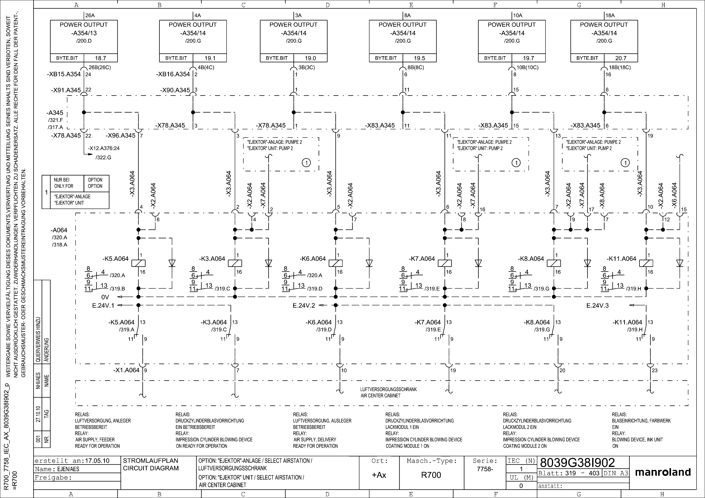

# +Ax — Sheet 319 of 403 — OPTION: "EJEKTOR" ANLAGE / SELECT AIRSTATION /

**LUFTVERSORGUNGSSCHRANK**

> Part of the manroland **R700** printing press IEC/UL circuit diagrams.
> Drawing class: **Stromlaufplan / Circuit diagram** (DIN A3).
> Document `+Ax` covers the **Central control console** machine section.

## At a glance

| Field | Value |
|---|---|
| Document | `+Ax`  (8039G38I902) |
| Sheet | **319** of 403 |
| Section (DE) | OPTION: "EJEKTOR" ANLAGE / SELECT AIRSTATION / |
| Section (EN) | LUFTVERSORGUNGSSCHRANK |
| Section type | CIRCUIT — Circuit diagram |
| Machine type | `R700` |
| Series | `7758` |
| Created | 17.05.10 |
| Replaces | — |
| Columns used | A, B, C, D, E, F, G, H |
| Path numbers | — |
| Labels on sheet | 284 |
| Cross-refs out | 25 |
| Cross-refs in | 72 |

**Previous:** [+Ax sheet 318](SHEET_0318.md) · **Next:** [+Ax sheet 320](SHEET_0320.md) · **Document TOC:** [_TOC.md](_TOC.md)  (+Ax) · **Master TOC:** [all sheets](../_MASTER_TOC.md)

## Sheet image (300 DPI, exact vector render)



_Rendered directly from the PDF vector layer at 300 DPI (1-bit), no OCR and no resampling. Use it to confirm anything ambiguous in the text below._

## Cross-references on this sheet

Each entry is a wire leaving this sheet. The printed token is `/sheet.column`; the link resolves to that sheet inside the same document.

| Ref | Target sheet | Col | Path | Destination on target | Target section | From col |
|---|---|---|---|---|---|---|
| `/200.G` | [+Ax sheet 200](SHEET_0200.md) | G | — | — | REFERENZMODUL | B |
| `/200.G` | [+Ax sheet 200](SHEET_0200.md) | G | — | — | REFERENZMODUL | D |
| `/200.G` | [+Ax sheet 200](SHEET_0200.md) | G | — | — | REFERENZMODUL | E |
| `/200.G` | [+Ax sheet 200](SHEET_0200.md) | G | — | — | REFERENZMODUL | F |
| `/200.G` | [+Ax sheet 200](SHEET_0200.md) | G | — | — | REFERENZMODUL | G |
| `/200.D` | [+Ax sheet 200](SHEET_0200.md) | D | — | — | REFERENZMODUL | A |
| `/321.F` | [+Ax sheet 321](SHEET_0321.md) | F | — | — | OPTION: "EJEKTOR" ANLAGE / SELECT AIRSTATION / | A |
| `/317.A` | [+Ax sheet 317](SHEET_0317.md) | A | — | — | OPTION: "EJEKTOR" ANLAGE / SELECT AIRSTATION / | A |
| `/322.G` | [+Ax sheet 322](SHEET_0322.md) | G | — | — | OPTION: "EJEKTOR" ANLAGE / SELECT AIRSTATION / | A |
| `/320.A` | [+Ax sheet 320](SHEET_0320.md) | A | — | — | OPTION: "EJEKTOR" ANLAGE / SELECT AIRSTATION / | A |
| `/318.A` | [+Ax sheet 318](SHEET_0318.md) | A | — | — | OPTION: "EJEKTOR" ANLAGE / SELECT AIRSTATION / | A |
| `/320.A` | [+Ax sheet 320](SHEET_0320.md) | A | — | 4 | OPTION: "EJEKTOR" ANLAGE / SELECT AIRSTATION / | A |
| `/320.A` | [+Ax sheet 320](SHEET_0320.md) | A | — | 4 | OPTION: "EJEKTOR" ANLAGE / SELECT AIRSTATION / | D |
| `/319.B` | [+Ax sheet 319](SHEET_0319.md) | B | — | — | OPTION: "EJEKTOR" ANLAGE / SELECT AIRSTATION / | A |
| `/319.E` | [+Ax sheet 319](SHEET_0319.md) | E | — | — | OPTION: "EJEKTOR" ANLAGE / SELECT AIRSTATION / | E |
| `/319.G` | [+Ax sheet 319](SHEET_0319.md) | G | — | — | OPTION: "EJEKTOR" ANLAGE / SELECT AIRSTATION / | G |
| `/319.C` | [+Ax sheet 319](SHEET_0319.md) | C | — | — | OPTION: "EJEKTOR" ANLAGE / SELECT AIRSTATION / | C |
| `/319.D` | [+Ax sheet 319](SHEET_0319.md) | D | — | — | OPTION: "EJEKTOR" ANLAGE / SELECT AIRSTATION / | D |
| `/319.H` | [+Ax sheet 319](SHEET_0319.md) | H | — | — | OPTION: "EJEKTOR" ANLAGE / SELECT AIRSTATION / | H |
| `/319.A` | [+Ax sheet 319](SHEET_0319.md) | A | — | — | OPTION: "EJEKTOR" ANLAGE / SELECT AIRSTATION / | B |
| `/319.E` | [+Ax sheet 319](SHEET_0319.md) | E | — | — | OPTION: "EJEKTOR" ANLAGE / SELECT AIRSTATION / | E |
| `/319.G` | [+Ax sheet 319](SHEET_0319.md) | G | — | — | OPTION: "EJEKTOR" ANLAGE / SELECT AIRSTATION / | G |
| `/319.C` | [+Ax sheet 319](SHEET_0319.md) | C | — | — | OPTION: "EJEKTOR" ANLAGE / SELECT AIRSTATION / | C |
| `/319.D` | [+Ax sheet 319](SHEET_0319.md) | D | — | — | OPTION: "EJEKTOR" ANLAGE / SELECT AIRSTATION / | D |
| `/319.H` | [+Ax sheet 319](SHEET_0319.md) | H | — | — | OPTION: "EJEKTOR" ANLAGE / SELECT AIRSTATION / | H |

### Incoming references (sheets that point here)

Every other sheet that sends a wire to this one. `Back-ref` is the token printed on *that* sheet; `Path` is its line number.

| From sheet | Cols | Back-ref | Path | Refs | What continues there |
|---|---|---|---|---|---|
| [+Ax#200](SHEET_0200.md) | D, F | `/200.D`, `/200.F` | — | 6 | — |
| [+Ax#206](SHEET_0206.md) | A | `/206.A` | — | 6 | — |
| [+Ax#217](SHEET_0217.md) | A | `/217.A` | — | 6 | — |
| [+Ax#222](SHEET_0222.md) | A | `/222.A` | — | 6 | — |
| [+Ax#233](SHEET_0233.md) | A | `/233.A` | — | 1 | — |
| [+Ax#235](SHEET_0235.md) | A | `/235.A` | — | 3 | — |
| [+Ax#237](SHEET_0237.md) | B | `/237.B` | — | 1 | — |
| [+Ax#253](SHEET_0253.md) | B | `/253.B` | — | 1 | — |
| [+Ax#254](SHEET_0254.md) | F | `/254.F` | — | 5 | — |
| [+Ax#286](SHEET_0286.md) | A | `/286.A` | — | 3 | — |
| [+Ax#287](SHEET_0287.md) | A | `/287.A` | — | 3 | — |
| [+Ax#289](SHEET_0289.md) | C, E | `/289.C`, `/289.E` | — | 6 | — |
| [+Ax#290](SHEET_0290.md) | B | `/290.B` | — | 6 | — |
| [+Ax#317](SHEET_0317.md) | A | `/317.A` | — | 1 | — |
| [+Ax#318](SHEET_0318.md) | A | `/318.A` | — | 1 | — |
| [+Ax#319](SHEET_0319.md) | A, B, C, D, E, G, H | `/319.A`, `/319.B`, `/319.C`, `/319.D`, `/319.E`, `/319.G`, `/319.H` | — | 12 | — |
| [+Ax#320](SHEET_0320.md) | A | `/320.A` | — | 3 | — |
| [+Ax#321](SHEET_0321.md) | F | `/321.F` | — | 1 | — |
| [+Ax#322](SHEET_0322.md) | F | `/322.F` | — | 1 | X12.A376:24 |


## Devices on this sheet

| Tag | Class | Class meaning (IEC) | Col | Sub | Terminal | Sign |
|---|---|---|---|---|---|---|
| `A064` | A | Baugruppe / assembly, module, PC board | A | — | — | — |
| `A354/14` | A | Baugruppe / assembly, module, PC board | D | 14 | — | — |
| `A354/14` | A | Baugruppe / assembly, module, PC board | E | 14 | — | — |
| `A354/14` | A | Baugruppe / assembly, module, PC board | F | 14 | — | — |
| `A354/14` | A | Baugruppe / assembly, module, PC board | B | 14 | — | — |
| `A354/14` | A | Baugruppe / assembly, module, PC board | G | 14 | — | — |
| `A354/13` | A | Baugruppe / assembly, module, PC board | A | 13 | — | — |
| `A345` | A | Baugruppe / assembly, module, PC board | A | — | — | — |
| `X3.A064` | — | cross-device reference | D | — | — | — |
| `X3.A064` | — | cross-device reference | E | — | — | — |
| `X3.A064` | — | cross-device reference | G | — | — | — |
| `X3.A064` | — | cross-device reference | C | — | — | — |
| `K3.A064` | — | cross-device reference | C | — | — | — |
| `K6.A064` | — | cross-device reference | D | — | — | — |
| `K7.A064` | — | cross-device reference | E | — | — | — |
| `K8.A064` | — | cross-device reference | F | — | — | — |
| `X3.A064` | — | cross-device reference | H | — | — | — |
| `K11.A064` | — | cross-device reference | H | — | — | — |
| `K5.A064` | — | cross-device reference | B | — | — | — |
| `K3.A064` | — | cross-device reference | C | — | — | — |
| `K6.A064` | — | cross-device reference | D | — | — | — |
| `K7.A064` | — | cross-device reference | E | — | — | — |
| `K8.A064` | — | cross-device reference | F | — | — | — |
| `K11.A064` | — | cross-device reference | H | — | — | — |
| `X1.A064` | — | cross-device reference | B | — | — | — |
| `19.0` | — | cross-device reference | D | — | — | — |
| `19.5` | — | cross-device reference | E | — | — | — |
| `19.7` | — | cross-device reference | F | — | — | — |
| `19.1` | — | cross-device reference | C | — | — | — |
| `XB16.A354` | — | cross-device reference | B | — | — | — |
| `X90.A345` | — | cross-device reference | B | — | — | — |
| `X7.A064` | — | cross-device reference | C | — | — | — |
| `X7.A064` | — | cross-device reference | F | — | — | — |
| `X7.A064` | — | cross-device reference | G | — | — | — |
| `X6.A064` | — | cross-device reference | H | — | — | — |
| `20.7` | — | cross-device reference | G | — | — | — |
| `18.7` | — | cross-device reference | A | — | — | — |
| `XB15.A354` | — | cross-device reference | A | — | — | — |
| `X91.A345` | — | cross-device reference | A | — | — | — |
| `X78.A345` | — | cross-device reference | A | — | — | — |
| `X3.A064` | — | cross-device reference | B | — | — | — |
| `K5.A064` | — | cross-device reference | A | — | — | — |
| `X96.A345` | — | cross-device reference | B | — | — | — |
| `NR.` | — | cross-device reference | A | — | — | — |
| `27.10.10` | — | cross-device reference | A | — | — | — |
| `X12.A376:24` | — | cross-device reference | A | — | 24 | — |
| `X2.A064` | — | cross-device reference | D | — | — | — |
| `X2.A064` | — | cross-device reference | F | — | — | — |
| `X2.A064` | — | cross-device reference | G | — | — | — |
| `X2.A064` | — | cross-device reference | C | — | — | — |
| `X2.A064` | — | cross-device reference | H | — | — | — |
| `X78.A345` | — | cross-device reference | B | — | — | — |
| `X78.A345` | — | cross-device reference | C | — | — | — |
| `X83.A345` | — | cross-device reference | E | — | — | — |
| `X83.A345` | — | cross-device reference | F | — | — | — |
| `X8.A064` | — | cross-device reference | G | — | — | — |
| `X83.A345` | — | cross-device reference | G | — | — | — |
| `X2.A064` | — | cross-device reference | B | — | — | — |

## Potentials / nets

| Potential | Count | Columns | Attached devices | Terminals |
|---|---|---|---|---|
| `0V` | 1 | A | — | — |


A potential such as `L24+/4` or `M24+` is a named supply/return rail; every place it appears on this sheet is electrically common.

## Wire-end annotations (grouped as printed)

A wire that continues elsewhere is annotated with a small cluster: the destination description, the path/line number `#NN`, and the `/sheet.column` cross reference. Each row below is one such cluster exactly as it is grouped on the drawing.

| Col | Y | Path | Cross-ref | Text on the wire |
|---|---|---|---|---|
| B | 22.2 | — | — | `4A` |
| D | 22.2 | — | — | `3A` |
| E | 22.2 | — | — | `8A` |
| A | 22.3 | — | — | `26A` |
| F | 22.3 | — | — | `10A` |
| G | 22.3 | — | — | `18A` |
| A | 37.4 | — | — | `POWER OUTPUT` |
| B | 37.4 | — | — | `POWER OUTPUT` |
| D | 37.4 | — | — | `POWER OUTPUT` |
| E | 37.4 | — | — | `POWER OUTPUT` |
| F | 37.4 | — | — | `POWER OUTPUT` |
| G | 37.4 | — | — | `POWER OUTPUT` |
| A | 51.3 | — | — | `A354/13` |
| B | 51.3 | — | — | `A354/14` |
| D | 51.3 | — | — | `A354/14` |
| E | 51.3 | — | — | `A354/14` |
| F | 51.3 | — | — | `A354/14` |
| G | 51.3 | — | — | `A354/14` |
| A | 65.1 | — | `/200.D` | — |
| B | 65.1 | — | `/200.G` | — |
| D | 65.1 | — | `/200.G` | — |
| E | 65.1 | — | `/200.G` | — |
| F | 65.1 | — | `/200.G` | — |
| G | 65.1 | — | `/200.G` | — |
| A | 94.2 | — | — | `BYTE.BIT 18.7` |
| B | 94.2 | — | — | `BYTE.BIT 19.1` |
| D | 94.2 | — | — | `BYTE.BIT 19.0` |
| E | 94.2 | — | — | `BYTE.BIT 19.5` |
| F | 94.2 | — | — | `BYTE.BIT 19.7` |
| G | 94.2 | — | — | `BYTE.BIT 20.7` |
| A | 110.2 | — | — | `26B(26C)` |
| C | 110.2 | — | — | `4B(4C)` |
| D | 110.2 | — | — | `3B(3C)` |
| E | 110.2 | — | — | `8B(8C)` |
| F | 110.2 | — | — | `10B(10C)` |
| G | 110.2 | — | — | `18B(18C)` |
| A | 120.8 | — | — | `XB15.A354 24` |
| B | 120.8 | — | — | `XB16.A354 2` |
| D | 122.2 | — | — | `1` |
| E | 122.2 | — | — | `6` |
| F | 122.2 | — | — | `8` |
| G | 122.2 | — | — | `16` |
| A | 147.7 | — | — | `X91.A345 22` |
| D | 147.7 | — | — | `X90.A345 3 1 11 15` |
| G | 147.7 | — | — | `6` |
| A | 186.0 | — | — | `A345` |
| A | 199.1 | — | `/321.F`, `/317.A` | — |
| D | 207.2 | — | — | `X78.A345 X78.A345 X83.A345 X83.A345` |
| G | 207.2 | — | — | `X83.A345` |
| D | 208.7 | — | — | `3 1 11 15` |
| G | 208.7 | — | — | `6` |
| A | 224.2 | — | — | `X78.A345 22` |
| B | 224.2 | — | — | `X96.A345 7` |
| E | 225.7 | — | — | `3 9 11 13` |
| H | 225.7 | — | — | `19` |
| C | 237.3 | — | — | `"EJEKTOR" ANLAGE: PUMPE 2 "EJEKTOR" UNIT: PUMP 2` |
| F | 237.3 | — | — | `"EJEKTOR" ANLAGE: PUMPE 2 "EJEKTOR" UNIT: PUMP 2` |
| G | 237.3 | — | — | `"EJEKTOR" ANLAGE: PUMPE 2 "EJEKTOR" UNIT: PUMP 2` |
| A | 246.9 | — | — | `X12.A376:24` |
| A | 262.5 | — | `/322.G` | — |
| D | 271.9 | — | — | `1` |
| F | 271.9 | — | — | `1` |
| H | 271.9 | — | — | `1` |
| B | 288.6 | — | — | `X3.A064` |
| C | 288.6 | — | — | `X3.A064` |
| D | 288.6 | — | — | `X3.A064` |
| E | 288.6 | — | — | `X3.A064` |
| G | 288.6 | — | — | `X3.A064` |
| H | 288.6 | — | — | `X3.A064` |
| A | 301.1 | — | — | `NUR BEI` |
| A | 301.1 | — | — | `OPTION OPTION` |
| C | 308.3 | — | — | `X7.A064` |
| F | 308.3 | — | — | `X7.A064` |
| G | 308.3 | — | — | `X7.A064` |
| H | 308.3 | — | — | `X6.A064` |
| B | 309.0 | — | — | `X2.A064` |
| C | 309.0 | — | — | `X2.A064` |
| D | 309.0 | — | — | `X2.A064` |
| F | 309.0 | — | — | `X2.A064` |
| G | 309.0 | — | — | `X2.A064` |
| G | 309.0 | — | — | `X8.A064` |
| H | 309.0 | — | — | `X2.A064` |
| A | 311.7 | — | — | `ONLY FOR` |
| A | 320.6 | — | — | `1` |
| A | 329.4 | — | — | `"EJEKTOR" ANLAGE "EJEKTOR" UNIT` |
| B | 346.1 | — | — | `4` |
| C | 346.1 | — | — | `2` |
| D | 346.1 | — | — | `5` |
| E | 346.1 | — | — | `6` |
| G | 346.1 | — | — | `7` |
| H | 346.1 | — | — | `10` |
| C | 350.4 | — | — | `2` |
| F | 350.4 | — | — | `16` |
| G | 350.4 | — | — | `17` |
| H | 350.4 | — | — | `15` |
| B | 367.4 | — | — | `6` |
| C | 367.4 | — | — | `4` |
| D | 367.4 | — | — | `7` |
| F | 367.4 | — | — | `8` |
| G | 367.4 | — | — | `9` |
| G | 367.4 | — | — | `7` |
| H | 367.4 | — | — | `12` |
| A | 384.4 | — | — | `A064` |
| A | 397.5 | — | `/320.A`, `/318.A` | — |
| B | 427.6 | — | — | `1` |
| C | 427.6 | — | — | `1` |
| D | 427.6 | — | — | `1` |
| E | 427.6 | — | — | `1` |
| G | 427.6 | — | — | `1` |
| H | 427.6 | — | — | `1` |
| A | 432.6 | — | — | `K5.A064` |
| C | 432.6 | — | — | `K3.A064` |
| D | 432.6 | — | — | `K6.A064` |
| E | 432.6 | — | — | `K7.A064` |
| F | 432.6 | — | — | `K8.A064` |
| H | 432.6 | — | — | `K11.A064` |
| A | 449.6 | — | — | `11 8 6 9 13` |
| B | 449.6 | — | — | `11 8 6 9 13` |
| D | 449.6 | — | — | `11 8 6 9 13` |
| E | 449.6 | — | — | `11 8 6 9 13` |
| F | 449.6 | — | — | `11 8 6 9 13` |
| G | 449.6 | — | — | `11 8 6 9 13` |
| A | 455.2 | — | `/320.A` | `4` |
| C | 455.2 | — | — | `4` |
| D | 455.2 | — | `/320.A` | `4` |
| E | 455.2 | — | — | `4` |
| F | 455.2 | — | — | `4` |
| G | 455.2 | — | — | `4` |
| B | 456.0 | — | — | `16` |
| C | 456.0 | — | — | `16` |
| D | 456.0 | — | — | `16` |
| E | 456.0 | — | — | `16` |
| G | 456.0 | — | — | `16` |
| H | 456.0 | — | — | `16` |
| A | 484.3 | — | `/319.B` | — |
| C | 484.3 | — | `/319.C` | — |
| D | 484.3 | — | `/319.D` | — |
| E | 484.3 | — | `/319.E` | — |
| G | 484.3 | — | `/319.G` | — |
| H | 484.3 | — | `/319.H` | — |
| A | 497.8 | — | — | `0V` |
| D | 512.0 | — | — | `E.24V.1 E.24V.2 E.24V.3` |
| A | 535.9 | — | — | `001 NHI/AES QUERVERWEIS HINZU 27.10.10` |
| B | 540.3 | — | — | `K5.A064` |
| C | 540.3 | — | — | `K3.A064` |
| D | 540.3 | — | — | `K6.A064` |
| E | 540.3 | — | — | `K7.A064` |
| F | 540.3 | — | — | `K8.A064` |
| H | 540.3 | — | — | `K11.A064` |
| B | 541.0 | — | — | `13` |
| C | 541.0 | — | — | `13` |
| D | 541.0 | — | — | `13` |
| E | 541.0 | — | — | `13` |
| G | 541.0 | — | — | `13` |
| H | 541.0 | — | — | `13` |
| B | 553.4 | — | `/319.A` | — |
| C | 553.4 | — | `/319.C` | — |
| D | 553.4 | — | `/319.D` | — |
| E | 553.4 | — | `/319.E` | — |
| G | 553.4 | — | `/319.G` | — |
| H | 553.4 | — | `/319.H` | — |
| B | 569.4 | — | — | `11` |
| B | 569.4 | — | — | `9` |
| C | 569.4 | — | — | `11` |
| C | 569.4 | — | — | `9` |
| D | 569.4 | — | — | `11` |
| D | 569.4 | — | — | `9` |
| E | 569.4 | — | — | `11` |
| E | 569.4 | — | — | `9` |
| G | 569.4 | — | — | `11` |
| G | 569.4 | — | — | `9` |
| H | 569.4 | — | — | `11` |
| H | 569.4 | — | — | `9` |
| A | 571.4 | — | — | `NR. NAME TAG ÄNDERUNG` |
| E | 621.1 | — | — | `X1.A064 9 7 10 19 20 23` |
| E | 655.5 | — | — | `LUFTVERSORGUNGSSCHRANK` |
| E | 666.1 | — | — | `AIR CENTER CABINET` |
| A | 697.9 | — | — | `RELAIS: LUFTVERSORGUNG, ANLEGER BETRIEBSBEREIT RELAY:` |
| C | 697.9 | — | — | `RELAIS: DRUCKZYLINDERBLASVORRICHTUNG EIN BETRIEBSBEREIT RELAY: IMPRESSION CYLINDER BLOWING DEVICE` |
| D | 697.9 | — | — | `RELAIS: LUFTVERSORGUNG, AUSLEGER BETRIEBSBEREIT RELAY:` |
| E | 697.9 | — | — | `RELAIS: DRUCKZYLINDERBLASVORRICHTUNG LACKMODUL 1 EIN RELAY: IMPRESSION CYLINDER BLOWING DEVICE` |
| G | 697.9 | — | — | `RELAIS: DRUCKZYLINDERBLASVORRICHTUNG LACKMODUL 2 EIN RELAY: IMPRESSION CYLINDER BLOWING DEVICE` |
| H | 697.9 | — | — | `RELAIS: BLASEINRICHTUNG, FARBWERK EIN RELAY: BLOWING DEVICE, INK UNIT` |
| A | 740.5 | — | — | `READY FOR OPERATION AIR SUPPLY, FEEDER` |
| D | 740.5 | — | — | `READY FOR OPERATION AIR SUPPLY, DELIVERY` |
| C | 751.1 | — | — | `ON READY FOR OPERATION` |
| E | 751.1 | — | — | `COATING MODULE 1 ON` |
| F | 751.1 | — | — | `COATING MODULE 2 ON` |
| G | 751.1 | — | — | `ON` |


## Reconstructed tables

This sheet carries tabular content (pin map / terminal assignment / index). The grid below was rebuilt from the drawing's own rule lines, so each row is exactly one physical row of the table.

### Table 1 — 7 data rows × 11 columns (at x=85.0, y=34.0)

| POWER | OUTPUT A354/13 /200.D |  |  |  |  |  | POWER | A354/14 /200.G | OUTPUT |  |
|---|---|---|---|---|---|---|---|---|---|---|
| `BYTE.BIT` |  | `18.7` |  |  |  |  | `BYTE.BIT` |  | `19.1` |  |
| `XB15.A354 X91.A345` | `24 22` | `26B(26C)` |  |  |  |  | `XB16.A354 X90.A345` | `2 3` | `4B(4C)` |  |
| `A345 /321.F /317.A X78.A345 NUR BEI ONLY FOR "EJEKTOR" ANLAGE "EJEKTOR" UNIT` | `22 OPTION OPTION` | `X12.A376:24 /322.G` | `X96.A345 X3.A064` | `7 4` | `X2.A064 6` | `X78.A345` |  | `3` |  | `X3.A064` |
| `A064 /320.A` |  |  |  |  |  |  |  |  |  |  |
| `/318.A` | `8 6 9` | `K5.A064 4 13` | `/320.A` | `1 16` |  |  |  | `8 6 9` | `K3.A064 4 13` |  |
|  | `11` |  | `/319.B` |  |  |  | `11` |  | `/319.C` |  |
|  |  | `0V` |  |  |  |  |  |  |  |  |


### Table 2 — 5 data rows × 26 columns (at x=396.9, y=34.0)

|  |  | POWER | OUTPUT A354/14 /200.G |  |  |  | POWER | A354/14 /200.G | OUTPUT |  |  |  | POWER | A354/14 /200.G | OUTPUT |  |  |  |  | POWER | A354/14 /200.G | OUTPUT |  |  |  |
|---|---|---|---|---|---|---|---|---|---|---|---|---|---|---|---|---|---|---|---|---|---|---|---|---|---|
|  |  | `BYTE.BIT` | `19.0` |  |  |  | `BYTE.BIT` |  | `19.5` |  |  |  | `BYTE.BIT` |  | `19.7` |  |  |  | `BYTE.BIT` |  |  | `20.7` |  |  |  |
|  |  |  | `3B(3C) 1 1` |  |  |  |  | `6 11` | `8B(8C)` |  |  |  |  | `8 15` | `10B(10C)` |  |  |  |  |  | `16 6` | `18B(18C)` |  |  |  |
| `3 "EJEKTOR" X2.A064 2 4` | `"EJEKTOR" ANLAGE: X7.A064` | `X78.A345 PUMPE UNIT: PUMP 2 2` | `1 2 1` | `X3.A064` | `9 5` | `X2.A064 7` | `X83.A345` | `11` |  | `X3.A064` | `11 6` | `"EJEKTOR" ANLAGE: "EJEKTOR" X7.A064 X2.A064 8` | `X83.A345 PUMPE 2 UNIT: PUMP 2 16` | `15 1` |  | `X3.A064` | `13 7` | `X2.A064` | `X83.A345 "EJEKTOR" ANLAGE: "EJEKTOR" X7.A064 9` | `UNIT: PUMP X8.A064 17` | `6 PUMPE 2 7` | `2 1` | `X3.A064` | `19 10` | `X6.A064 X2.A064 12` |
| `1 16` |  | `8 6 9` | `K6.A064 4 /320.A 13` |  | `1 16` |  |  | `8 6 9` | `K7.A064 4 13` |  | `1 16` |  |  | `8 6 9` | `K8.A064 4 13` |  | `1 16` |  |  |  | `8 6 9` | `K11.A064 4 13` |  | `1 16` |  |
|  |  | `11` | `/319.D` |  |  |  | `11` |  | `/319.E` |  |  |  | `11` |  | `/319.G` |  |  |  |  | `11` |  | `/319.H` |  |  |  |


## Notes and free text on this sheet

| Text | Col | Y (pt) |
|---|---|---|
| `3A` | D | 22.24 |
| `3B(3C)` | D | 110.16 |
| `POWER OUTPUT` | D | 37.41 |
| `BYTE.BIT` | C | 94.74 |
| `RELAIS:` | D | 697.88 |
| `LUFTVERSORGUNG, AUSLEGER` | D | 708.59 |
| `BETRIEBSBEREIT` | D | 719.18 |
| `RELAY:` | D | 729.78 |
| `AIR SUPPLY, DELIVERY` | D | 740.47 |
| `READY FOR OPERATION` | D | 751.1 |
| `8A` | E | 22.24 |
| `8B(8C)` | E | 110.16 |
| `POWER OUTPUT` | E | 37.41 |
| `BYTE.BIT` | E | 94.74 |
| `RELAIS:` | E | 697.88 |
| `DRUCKZYLINDERBLASVORRICHTUNG` | E | 708.6 |
| `LACKMODUL 1 EIN` | E | 719.21 |
| `RELAY:` | E | 729.78 |
| `IMPRESSION CYLINDER BLOWING DEVICE` | E | 740.47 |
| `COATING MODULE 1 ON` | E | 751.13 |
| `10A` | F | 22.26 |
| `10B(10C)` | F | 110.16 |
| `POWER OUTPUT` | F | 37.41 |
| `BYTE.BIT` | F | 94.74 |
| `RELAIS:` | F | 697.88 |
| `DRUCKZYLINDERBLASVORRICHTUNG` | G | 708.6 |
| `LACKMODUL 2 EIN` | F | 719.21 |
| `RELAY:` | F | 729.78 |
| `IMPRESSION CYLINDER BLOWING DEVICE` | G | 740.47 |
| `COATING MODULE 2 ON` | F | 751.13 |
| `4A` | B | 22.24 |
| `4B(4C)` | C | 110.16 |
| `POWER OUTPUT` | B | 37.41 |
| `BYTE.BIT` | B | 94.74 |
| `RELAIS:` | B | 697.88 |
| `DRUCKZYLINDERBLASVORRICHTUNG` | C | 708.6 |
| `EIN BETRIEBSBEREIT` | B | 719.18 |
| `RELAY:` | B | 729.78 |
| `IMPRESSION CYLINDER BLOWING DEVICE` | C | 740.47 |
| `ON READY FOR OPERATION` | C | 751.11 |
| `18A` | G | 22.26 |
| `18B(18C)` | G | 110.16 |
| `POWER OUTPUT` | G | 37.41 |
| `BYTE.BIT` | G | 94.74 |
| `RELAIS:` | G | 697.88 |
| `BLASEINRICHTUNG, FARBWERK` | H | 708.57 |
| `EIN` | G | 719.08 |
| `RELAY:` | G | 729.78 |
| `BLOWING DEVICE, INK UNIT` | H | 740.45 |
| `ON` | G | 751.06 |
| `26A` | A | 22.26 |
| `26B(26C)` | A | 110.16 |
| `POWER OUTPUT` | A | 37.41 |
| `BYTE.BIT` | A | 94.74 |
| `RELAIS:` | A | 697.88 |
| `LUFTVERSORGUNG, ANLEGER` | A | 708.59 |
| `BETRIEBSBEREIT` | A | 719.18 |
| `RELAY:` | A | 729.78 |
| `AIR SUPPLY, FEEDER` | A | 740.47 |
| `READY FOR OPERATION` | A | 751.1 |
| `TAG` | A | 692.75 |
| `NAME` | A | 633.34 |
| `ÄNDERUNG` | A | 571.36 |
| `NHI/AES` | A | 629.51 |
| `QUERVERWEIS HINZU` | A | 535.86 |
| `E.24V.2` | D | 511.97 |
| `E.24V.3` | G | 511.97 |
| `E.24V.1` | A | 511.97 |
| `LUFTVERSORGUNGSSCHRANK` | E | 655.45 |
| `AIR CENTER CABINET` | E | 666.06 |
| `"EJEKTOR" ANLAGE: PUMPE 2` | C | 237.32 |
| `"EJEKTOR" UNIT: PUMP 2` | C | 247.95 |
| `"EJEKTOR" ANLAGE: PUMPE 2` | F | 237.32 |
| `"EJEKTOR" UNIT: PUMP 2` | F | 247.95 |
| `"EJEKTOR" ANLAGE: PUMPE 2` | G | 237.32 |
| `"EJEKTOR" UNIT: PUMP 2` | G | 247.95 |
| `NUR BEI` | A | 301.05 |
| `ONLY FOR` | A | 311.74 |
| `OPTION` | A | 301.07 |
| `"EJEKTOR" ANLAGE` | A | 329.44 |
| `"EJEKTOR" UNIT` | A | 340.07 |

## Complete label inventory (exact text from the drawing)

Every text object inside the drawing area of this sheet, in DIN reading order (column A→H, then top→bottom). This is the authoritative list: if a string is not here it is not printed on this sheet.

| Col | Y | X | Dir | Type | Text |
|---|---|---|---|---|---|
| A | 22.3 | 144.3 | → | text | `26A` |
| A | 37.4 | 100.9 | → | text | `POWER OUTPUT` |
| A | 51.3 | 120.3 | → | device tag | `A354/13` |
| A | 65.1 | 129.0 | → | cross-reference | `/200.D` |
| A | 94.2 | 160.3 | → | device ref | `18.7` |
| A | 94.7 | 95.0 | → | text | `BYTE.BIT` |
| A | 110.2 | 150.0 | → | text | `26B(26C)` |
| A | 120.8 | 79.4 | → | device ref | `XB15.A354` |
| A | 122.2 | 144.3 | → | number | `24` |
| A | 147.7 | 86.5 | → | device ref | `X91.A345` |
| A | 147.7 | 144.3 | → | number | `22` |
| A | 186.0 | 78.5 | → | device tag | `A345` |
| A | 199.1 | 81.6 | → | cross-reference | `/321.F` |
| A | 211.4 | 80.8 | → | cross-reference | `/317.A` |
| A | 224.2 | 86.5 | → | device ref | `X78.A345` |
| A | 225.7 | 144.3 | → | number | `22` |
| A | 246.9 | 148.5 | → | device ref | `X12.A376:24` |
| A | 262.5 | 161.6 | → | cross-reference | `/322.G` |
| A | 301.1 | 91.3 | → | text | `NUR BEI` |
| A | 301.1 | 148.5 | → | text | `OPTION` |
| A | 311.7 | 91.8 | → | text | `ONLY FOR` |
| A | 311.7 | 148.5 | → | text | `OPTION` |
| A | 320.6 | 75.4 | → | number | `1` |
| A | 329.4 | 91.8 | → | text | `"EJEKTOR" ANLAGE` |
| A | 340.1 | 91.8 | → | text | `"EJEKTOR" UNIT` |
| A | 384.4 | 85.6 | → | device tag | `A064` |
| A | 397.5 | 87.9 | → | cross-reference | `/320.A` |
| A | 409.9 | 87.9 | → | cross-reference | `/318.A` |
| A | 432.6 | 173.2 | → | device ref | `K5.A064` |
| A | 449.6 | 146.3 | → | number | `8` |
| A | 455.2 | 171.2 | → | number | `4` |
| A | 460.9 | 146.3 | → | number | `6` |
| A | 461.6 | 185.7 | → | cross-reference | `/320.A` |
| A | 472.2 | 146.3 | → | number | `9` |
| A | 477.9 | 169.5 | → | number | `13` |
| A | 483.6 | 141.7 | → | number | `11` |
| A | 484.3 | 185.7 | → | cross-reference | `/319.B` |
| A | 497.8 | 171.2 | → | potential | `0V` |
| A | 512.0 | 155.6 | → | text | `E.24V.1` |
| A | 535.9 | 61.3 | ↕ | text | `QUERVERWEIS HINZU` |
| A | 571.4 | 75.5 | ↕ | text | `ÄNDERUNG` |
| A | 629.5 | 61.3 | ↕ | text | `NHI/AES` |
| A | 633.3 | 75.4 | ↕ | text | `NAME` |
| A | 686.6 | 61.3 | ↕ | device ref | `27.10.10` |
| A | 692.7 | 75.5 | ↕ | text | `TAG` |
| A | 697.9 | 126.7 | → | text | `RELAIS:` |
| A | 708.6 | 126.7 | → | text | `LUFTVERSORGUNG, ANLEGER` |
| A | 719.2 | 126.7 | → | text | `BETRIEBSBEREIT` |
| A | 729.8 | 126.7 | → | text | `RELAY:` |
| A | 735.8 | 61.2 | ↕ | number | `001` |
| A | 736.2 | 75.3 | ↕ | device ref | `NR.` |
| A | 740.5 | 127.6 | → | text | `AIR SUPPLY, FEEDER` |
| A | 751.1 | 126.7 | → | text | `READY FOR OPERATION` |
| B | 22.2 | 328.5 | → | text | `4A` |
| B | 37.4 | 285.2 | → | text | `POWER OUTPUT` |
| B | 51.3 | 304.6 | → | device tag | `A354/14` |
| B | 65.1 | 313.1 | → | cross-reference | `/200.G` |
| B | 94.7 | 279.2 | → | text | `BYTE.BIT` |
| B | 120.8 | 263.6 | → | device ref | `XB16.A354` |
| B | 122.2 | 328.5 | → | number | `2` |
| B | 147.7 | 270.7 | → | device ref | `X90.A345` |
| B | 147.7 | 328.5 | → | number | `3` |
| B | 207.2 | 262.2 | → | device ref | `X78.A345` |
| B | 208.7 | 328.5 | → | number | `3` |
| B | 224.2 | 178.6 | → | device ref | `X96.A345` |
| B | 225.7 | 236.4 | → | number | `7` |
| B | 288.6 | 218.6 | ↕ | device ref | `X3.A064` |
| B | 309.0 | 254.0 | ↕ | device ref | `X2.A064` |
| B | 346.2 | 236.4 | → | number | `4` |
| B | 367.4 | 264.8 | → | number | `6` |
| B | 427.6 | 235.8 | → | number | `1` |
| B | 449.6 | 323.4 | → | number | `8` |
| B | 456.0 | 235.8 | → | number | `16` |
| B | 460.9 | 323.4 | → | number | `6` |
| B | 472.2 | 323.4 | → | number | `9` |
| B | 483.6 | 318.9 | → | number | `11` |
| B | 540.3 | 183.1 | → | device ref | `K5.A064` |
| B | 541.0 | 235.8 | → | number | `13` |
| B | 553.4 | 201.3 | → | cross-reference | `/319.A` |
| B | 569.4 | 216.0 | → | number | `11` |
| B | 569.4 | 243.5 | → | number | `9` |
| B | 621.1 | 191.6 | → | device ref | `X1.A064` |
| B | 622.5 | 243.5 | → | number | `9` |
| B | 697.9 | 296.8 | → | text | `RELAIS:` |
| B | 719.2 | 296.8 | → | text | `EIN BETRIEBSBEREIT` |
| B | 729.8 | 296.8 | → | text | `RELAY:` |
| C | 94.2 | 345.4 | → | device ref | `19.1` |
| C | 94.7 | 449.3 | → | text | `BYTE.BIT` |
| C | 110.2 | 334.2 | → | text | `4B(4C)` |
| C | 207.2 | 432.3 | → | device ref | `X78.A345` |
| C | 225.7 | 399.4 | → | number | `3` |
| C | 237.3 | 417.8 | → | text | `"EJEKTOR" ANLAGE: PUMPE 2` |
| C | 247.9 | 417.8 | → | text | `"EJEKTOR" UNIT: PUMP 2` |
| C | 288.6 | 381.6 | ↕ | device ref | `X3.A064` |
| C | 308.3 | 439.7 | ↕ | device ref | `X7.A064` |
| C | 309.0 | 417.0 | ↕ | device ref | `X2.A064` |
| C | 346.2 | 399.4 | → | number | `2` |
| C | 350.4 | 456.1 | → | number | `2` |
| C | 367.4 | 427.7 | → | number | `4` |
| C | 427.6 | 398.8 | → | number | `1` |
| C | 432.6 | 336.2 | → | device ref | `K3.A064` |
| C | 455.2 | 348.4 | → | number | `4` |
| C | 456.0 | 398.8 | → | number | `16` |
| C | 477.9 | 346.7 | → | number | `13` |
| C | 483.6 | 474.8 | → | number | `11` |
| C | 484.3 | 362.8 | → | cross-reference | `/319.C` |
| C | 540.3 | 339.0 | → | device ref | `K3.A064` |
| C | 541.0 | 391.7 | → | number | `13` |
| C | 553.4 | 357.2 | → | cross-reference | `/319.C` |
| C | 569.4 | 371.9 | → | number | `11` |
| C | 569.4 | 399.4 | → | number | `9` |
| C | 622.5 | 399.4 | → | number | `7` |
| C | 708.6 | 296.8 | → | text | `DRUCKZYLINDERBLASVORRICHTUNG` |
| C | 740.5 | 296.8 | → | text | `IMPRESSION CYLINDER BLOWING DEVICE` |
| C | 751.1 | 297.4 | → | text | `ON READY FOR OPERATION` |
| D | 22.2 | 498.6 | → | text | `3A` |
| D | 37.4 | 455.2 | → | text | `POWER OUTPUT` |
| D | 51.3 | 474.7 | → | device tag | `A354/14` |
| D | 65.1 | 483.2 | → | cross-reference | `/200.G` |
| D | 94.2 | 514.6 | → | device ref | `19.0` |
| D | 110.2 | 504.3 | → | text | `3B(3C)` |
| D | 122.2 | 498.0 | → | number | `1` |
| D | 147.7 | 498.0 | → | number | `1` |
| D | 208.7 | 498.0 | → | number | `1` |
| D | 225.7 | 569.5 | → | number | `9` |
| D | 271.9 | 515.6 | → | number | `1` |
| D | 288.6 | 551.6 | ↕ | device ref | `X3.A064` |
| D | 309.0 | 587.1 | ↕ | device ref | `X2.A064` |
| D | 346.2 | 569.5 | → | number | `5` |
| D | 367.4 | 597.8 | → | number | `7` |
| D | 427.6 | 568.9 | → | number | `1` |
| D | 432.6 | 506.3 | → | device ref | `K6.A064` |
| D | 449.6 | 479.3 | → | number | `8` |
| D | 455.2 | 504.3 | → | number | `4` |
| D | 456.0 | 568.9 | → | number | `16` |
| D | 460.9 | 479.3 | → | number | `6` |
| D | 461.6 | 518.7 | → | cross-reference | `/320.A` |
| D | 472.2 | 479.3 | → | number | `9` |
| D | 477.9 | 502.6 | → | number | `13` |
| D | 484.3 | 518.7 | → | cross-reference | `/319.D` |
| D | 512.0 | 494.4 | → | text | `E.24V.2` |
| D | 540.3 | 516.2 | → | device ref | `K6.A064` |
| D | 541.0 | 568.9 | → | number | `13` |
| D | 553.4 | 534.3 | → | cross-reference | `/319.D` |
| D | 569.4 | 549.1 | → | number | `11` |
| D | 569.4 | 576.6 | → | number | `9` |
| D | 622.5 | 576.0 | → | number | `10` |
| D | 697.9 | 495.2 | → | text | `RELAIS:` |
| D | 708.6 | 495.2 | → | text | `LUFTVERSORGUNG, AUSLEGER` |
| D | 719.2 | 495.2 | → | text | `BETRIEBSBEREIT` |
| D | 729.8 | 495.2 | → | text | `RELAY:` |
| D | 740.5 | 496.1 | → | text | `AIR SUPPLY, DELIVERY` |
| D | 751.1 | 495.2 | → | text | `READY FOR OPERATION` |
| E | 22.2 | 682.9 | → | text | `8A` |
| E | 37.4 | 639.5 | → | text | `POWER OUTPUT` |
| E | 51.3 | 658.9 | → | device tag | `A354/14` |
| E | 65.1 | 667.4 | → | cross-reference | `/200.G` |
| E | 94.2 | 698.9 | → | device ref | `19.5` |
| E | 94.7 | 633.5 | → | text | `BYTE.BIT` |
| E | 110.2 | 688.5 | → | text | `8B(8C)` |
| E | 122.2 | 682.9 | → | number | `6` |
| E | 147.7 | 682.3 | → | number | `11` |
| E | 207.2 | 616.5 | → | device ref | `X83.A345` |
| E | 208.7 | 682.3 | → | number | `11` |
| E | 225.7 | 753.2 | → | number | `11` |
| E | 288.6 | 735.9 | ↕ | device ref | `X3.A064` |
| E | 346.2 | 753.7 | → | number | `6` |
| E | 427.6 | 753.2 | → | number | `1` |
| E | 432.6 | 690.5 | → | device ref | `K7.A064` |
| E | 449.6 | 677.8 | → | number | `8` |
| E | 455.2 | 702.7 | → | number | `4` |
| E | 456.0 | 753.2 | → | number | `16` |
| E | 460.9 | 677.8 | → | number | `6` |
| E | 472.2 | 677.8 | → | number | `9` |
| E | 477.9 | 701.0 | → | number | `13` |
| E | 483.6 | 673.2 | → | number | `11` |
| E | 484.3 | 717.2 | → | cross-reference | `/319.E` |
| E | 540.3 | 700.4 | → | device ref | `K7.A064` |
| E | 541.0 | 753.2 | → | number | `13` |
| E | 553.4 | 719.1 | → | cross-reference | `/319.E` |
| E | 569.4 | 733.3 | → | number | `11` |
| E | 569.4 | 760.8 | → | number | `9` |
| E | 622.5 | 760.3 | → | number | `19` |
| E | 655.4 | 608.6 | → | text | `LUFTVERSORGUNGSSCHRANK` |
| E | 666.1 | 609.4 | → | text | `AIR CENTER CABINET` |
| E | 697.9 | 651.1 | → | text | `RELAIS:` |
| E | 708.6 | 651.1 | → | text | `DRUCKZYLINDERBLASVORRICHTUNG` |
| E | 719.2 | 651.1 | → | text | `LACKMODUL 1 EIN` |
| E | 729.8 | 651.1 | → | text | `RELAY:` |
| E | 740.5 | 651.1 | → | text | `IMPRESSION CYLINDER BLOWING DEVICE` |
| E | 751.1 | 651.7 | → | text | `COATING MODULE 1 ON` |
| F | 22.3 | 866.6 | → | text | `10A` |
| F | 37.4 | 823.7 | → | text | `POWER OUTPUT` |
| F | 51.3 | 843.2 | → | device tag | `A354/14` |
| F | 65.1 | 851.7 | → | cross-reference | `/200.G` |
| F | 94.2 | 883.1 | → | device ref | `19.7` |
| F | 94.7 | 817.8 | → | text | `BYTE.BIT` |
| F | 110.2 | 872.2 | → | text | `10B(10C)` |
| F | 122.2 | 867.1 | → | number | `8` |
| F | 147.7 | 866.6 | → | number | `15` |
| F | 207.2 | 807.9 | → | device ref | `X83.A345` |
| F | 208.7 | 866.6 | → | number | `15` |
| F | 237.3 | 772.2 | → | text | `"EJEKTOR" ANLAGE: PUMPE 2` |
| F | 247.9 | 772.2 | → | text | `"EJEKTOR" UNIT: PUMP 2` |
| F | 271.9 | 869.9 | → | number | `1` |
| F | 308.3 | 794.0 | ↕ | device ref | `X7.A064` |
| F | 309.0 | 771.3 | ↕ | device ref | `X2.A064` |
| F | 350.4 | 809.9 | → | number | `16` |
| F | 367.4 | 782.1 | → | number | `8` |
| F | 432.6 | 874.8 | → | device ref | `K8.A064` |
| F | 449.6 | 862.0 | → | number | `8` |
| F | 455.2 | 887.0 | → | number | `4` |
| F | 460.9 | 862.0 | → | number | `6` |
| F | 472.2 | 862.0 | → | number | `9` |
| F | 477.9 | 885.3 | → | number | `13` |
| F | 483.6 | 857.5 | → | number | `11` |
| F | 540.3 | 884.7 | → | device ref | `K8.A064` |
| F | 697.9 | 849.5 | → | text | `RELAIS:` |
| F | 719.2 | 849.5 | → | text | `LACKMODUL 2 EIN` |
| F | 729.8 | 849.5 | → | text | `RELAY:` |
| F | 751.1 | 850.1 | → | text | `COATING MODULE 2 ON` |
| G | 22.3 | 1022.5 | → | text | `18A` |
| G | 37.4 | 979.7 | → | text | `POWER OUTPUT` |
| G | 51.3 | 999.1 | → | device tag | `A354/14` |
| G | 65.1 | 1007.6 | → | cross-reference | `/200.G` |
| G | 94.2 | 1039.3 | → | device ref | `20.7` |
| G | 94.7 | 973.7 | → | text | `BYTE.BIT` |
| G | 110.2 | 1028.1 | → | text | `18B(18C)` |
| G | 122.2 | 1022.5 | → | number | `16` |
| G | 147.7 | 1023.0 | → | number | `6` |
| G | 207.2 | 963.8 | → | device ref | `X83.A345` |
| G | 208.7 | 1023.0 | → | number | `6` |
| G | 225.7 | 937.4 | → | number | `13` |
| G | 237.3 | 956.4 | → | text | `"EJEKTOR" ANLAGE: PUMPE 2` |
| G | 247.9 | 956.4 | → | text | `"EJEKTOR" UNIT: PUMP 2` |
| G | 288.6 | 920.2 | ↕ | device ref | `X3.A064` |
| G | 308.3 | 978.3 | ↕ | device ref | `X7.A064` |
| G | 309.0 | 955.6 | ↕ | device ref | `X2.A064` |
| G | 309.0 | 1012.3 | ↕ | device ref | `X8.A064` |
| G | 346.2 | 938.0 | → | number | `7` |
| G | 350.4 | 994.1 | → | number | `17` |
| G | 367.4 | 966.3 | → | number | `9` |
| G | 367.4 | 1023.0 | → | number | `7` |
| G | 427.6 | 937.4 | → | number | `1` |
| G | 449.6 | 1017.9 | → | number | `8` |
| G | 455.2 | 1042.9 | → | number | `4` |
| G | 456.0 | 937.4 | → | number | `16` |
| G | 460.9 | 1017.9 | → | number | `6` |
| G | 472.2 | 1017.9 | → | number | `9` |
| G | 477.9 | 1041.2 | → | number | `13` |
| G | 483.6 | 1013.4 | → | number | `11` |
| G | 484.3 | 901.4 | → | cross-reference | `/319.G` |
| G | 512.0 | 990.4 | → | text | `E.24V.3` |
| G | 541.0 | 937.4 | → | number | `13` |
| G | 553.4 | 902.6 | → | cross-reference | `/319.G` |
| G | 569.4 | 917.6 | → | number | `11` |
| G | 569.4 | 945.1 | → | number | `9` |
| G | 622.5 | 945.1 | → | number | `20` |
| G | 697.9 | 1033.8 | → | text | `RELAIS:` |
| G | 708.6 | 849.5 | → | text | `DRUCKZYLINDERBLASVORRICHTUNG` |
| G | 719.1 | 1033.8 | → | text | `EIN` |
| G | 729.8 | 1033.8 | → | text | `RELAY:` |
| G | 740.5 | 849.5 | → | text | `IMPRESSION CYLINDER BLOWING DEVICE` |
| G | 751.1 | 1034.4 | → | text | `ON` |
| H | 225.7 | 1093.3 | → | number | `19` |
| H | 271.9 | 1054.1 | → | number | `1` |
| H | 288.6 | 1076.1 | ↕ | device ref | `X3.A064` |
| H | 308.3 | 1134.2 | ↕ | device ref | `X6.A064` |
| H | 309.0 | 1111.5 | ↕ | device ref | `X2.A064` |
| H | 346.2 | 1093.3 | → | number | `10` |
| H | 350.4 | 1150.0 | → | number | `15` |
| H | 367.4 | 1121.7 | → | number | `12` |
| H | 427.6 | 1093.3 | → | number | `1` |
| H | 432.6 | 1024.7 | → | device ref | `K11.A064` |
| H | 456.0 | 1093.3 | → | number | `16` |
| H | 484.3 | 1057.3 | → | cross-reference | `/319.H` |
| H | 540.3 | 1034.6 | → | device ref | `K11.A064` |
| H | 541.0 | 1093.3 | → | number | `13` |
| H | 553.4 | 1059.3 | → | cross-reference | `/319.H` |
| H | 569.4 | 1073.5 | → | number | `11` |
| H | 569.4 | 1101.0 | → | number | `9` |
| H | 622.5 | 1101.0 | → | number | `23` |
| H | 708.6 | 1033.8 | → | text | `BLASEINRICHTUNG, FARBWERK` |
| H | 740.5 | 1033.8 | → | text | `BLOWING DEVICE, INK UNIT` |

## Reading-order text block

The same content as a plain block, grouped by DIN column — convenient to paste or to match against a visual description.

```text
=== Column A ===
  22.3  144.3  text         26A
  37.4  100.9  text         POWER OUTPUT
  51.3  120.3  devtag       A354/13
  65.1  129.0  xref         /200.D
  94.2  160.3  devref       18.7
  94.7   95.0  text         BYTE.BIT
 110.2  150.0  text         26B(26C)
 120.8   79.4  devref       XB15.A354
 122.2  144.3  numeric      24
 147.7   86.5  devref       X91.A345
 147.7  144.3  numeric      22
 186.0   78.5  devtag       A345
 199.1   81.6  xref         /321.F
 211.4   80.8  xref         /317.A
 224.2   86.5  devref       X78.A345
 225.7  144.3  numeric      22
 246.9  148.5  devref       X12.A376:24
 262.5  161.6  xref         /322.G
 301.1   91.3  text         NUR BEI
 301.1  148.5  text         OPTION
 311.7   91.8  text         ONLY FOR
 311.7  148.5  text         OPTION
 320.6   75.4  numeric      1
 329.4   91.8  text         "EJEKTOR" ANLAGE
 340.1   91.8  text         "EJEKTOR" UNIT
 384.4   85.6  devtag       A064
 397.5   87.9  xref         /320.A
 409.9   87.9  xref         /318.A
 432.6  173.2  devref       K5.A064
 449.6  146.3  numeric      8
 455.2  171.2  numeric      4
 460.9  146.3  numeric      6
 461.6  185.7  xref         /320.A
 472.2  146.3  numeric      9
 477.9  169.5  numeric      13
 483.6  141.7  numeric      11
 484.3  185.7  xref         /319.B
 497.8  171.2  net          0V
 512.0  155.6  text         E.24V.1
 535.9   61.3  text         QUERVERWEIS HINZU
 571.4   75.5  text         ÄNDERUNG
 629.5   61.3  text         NHI/AES
 633.3   75.4  text         NAME
 686.6   61.3  devref       27.10.10
 692.7   75.5  text         TAG
 697.9  126.7  text         RELAIS:
 708.6  126.7  text         LUFTVERSORGUNG, ANLEGER
 719.2  126.7  text         BETRIEBSBEREIT
 729.8  126.7  text         RELAY:
 735.8   61.2  numeric      001
 736.2   75.3  devref       NR.
 740.5  127.6  text         AIR SUPPLY, FEEDER
 751.1  126.7  text         READY FOR OPERATION
=== Column B ===
  22.2  328.5  text         4A
  37.4  285.2  text         POWER OUTPUT
  51.3  304.6  devtag       A354/14
  65.1  313.1  xref         /200.G
  94.7  279.2  text         BYTE.BIT
 120.8  263.6  devref       XB16.A354
 122.2  328.5  numeric      2
 147.7  270.7  devref       X90.A345
 147.7  328.5  numeric      3
 207.2  262.2  devref       X78.A345
 208.7  328.5  numeric      3
 224.2  178.6  devref       X96.A345
 225.7  236.4  numeric      7
 288.6  218.6  devref       X3.A064
 309.0  254.0  devref       X2.A064
 346.2  236.4  numeric      4
 367.4  264.8  numeric      6
 427.6  235.8  numeric      1
 449.6  323.4  numeric      8
 456.0  235.8  numeric      16
 460.9  323.4  numeric      6
 472.2  323.4  numeric      9
 483.6  318.9  numeric      11
 540.3  183.1  devref       K5.A064
 541.0  235.8  numeric      13
 553.4  201.3  xref         /319.A
 569.4  216.0  numeric      11
 569.4  243.5  numeric      9
 621.1  191.6  devref       X1.A064
 622.5  243.5  numeric      9
 697.9  296.8  text         RELAIS:
 719.2  296.8  text         EIN BETRIEBSBEREIT
 729.8  296.8  text         RELAY:
=== Column C ===
  94.2  345.4  devref       19.1
  94.7  449.3  text         BYTE.BIT
 110.2  334.2  text         4B(4C)
 207.2  432.3  devref       X78.A345
 225.7  399.4  numeric      3
 237.3  417.8  text         "EJEKTOR" ANLAGE: PUMPE 2
 247.9  417.8  text         "EJEKTOR" UNIT: PUMP 2
 288.6  381.6  devref       X3.A064
 308.3  439.7  devref       X7.A064
 309.0  417.0  devref       X2.A064
 346.2  399.4  numeric      2
 350.4  456.1  numeric      2
 367.4  427.7  numeric      4
 427.6  398.8  numeric      1
 432.6  336.2  devref       K3.A064
 455.2  348.4  numeric      4
 456.0  398.8  numeric      16
 477.9  346.7  numeric      13
 483.6  474.8  numeric      11
 484.3  362.8  xref         /319.C
 540.3  339.0  devref       K3.A064
 541.0  391.7  numeric      13
 553.4  357.2  xref         /319.C
 569.4  371.9  numeric      11
 569.4  399.4  numeric      9
 622.5  399.4  numeric      7
 708.6  296.8  text         DRUCKZYLINDERBLASVORRICHTUNG
 740.5  296.8  text         IMPRESSION CYLINDER BLOWING DEVICE
 751.1  297.4  text         ON READY FOR OPERATION
=== Column D ===
  22.2  498.6  text         3A
  37.4  455.2  text         POWER OUTPUT
  51.3  474.7  devtag       A354/14
  65.1  483.2  xref         /200.G
  94.2  514.6  devref       19.0
 110.2  504.3  text         3B(3C)
 122.2  498.0  numeric      1
 147.7  498.0  numeric      1
 208.7  498.0  numeric      1
 225.7  569.5  numeric      9
 271.9  515.6  numeric      1
 288.6  551.6  devref       X3.A064
 309.0  587.1  devref       X2.A064
 346.2  569.5  numeric      5
 367.4  597.8  numeric      7
 427.6  568.9  numeric      1
 432.6  506.3  devref       K6.A064
 449.6  479.3  numeric      8
 455.2  504.3  numeric      4
 456.0  568.9  numeric      16
 460.9  479.3  numeric      6
 461.6  518.7  xref         /320.A
 472.2  479.3  numeric      9
 477.9  502.6  numeric      13
 484.3  518.7  xref         /319.D
 512.0  494.4  text         E.24V.2
 540.3  516.2  devref       K6.A064
 541.0  568.9  numeric      13
 553.4  534.3  xref         /319.D
 569.4  549.1  numeric      11
 569.4  576.6  numeric      9
 622.5  576.0  numeric      10
 697.9  495.2  text         RELAIS:
 708.6  495.2  text         LUFTVERSORGUNG, AUSLEGER
 719.2  495.2  text         BETRIEBSBEREIT
 729.8  495.2  text         RELAY:
 740.5  496.1  text         AIR SUPPLY, DELIVERY
 751.1  495.2  text         READY FOR OPERATION
=== Column E ===
  22.2  682.9  text         8A
  37.4  639.5  text         POWER OUTPUT
  51.3  658.9  devtag       A354/14
  65.1  667.4  xref         /200.G
  94.2  698.9  devref       19.5
  94.7  633.5  text         BYTE.BIT
 110.2  688.5  text         8B(8C)
 122.2  682.9  numeric      6
 147.7  682.3  numeric      11
 207.2  616.5  devref       X83.A345
 208.7  682.3  numeric      11
 225.7  753.2  numeric      11
 288.6  735.9  devref       X3.A064
 346.2  753.7  numeric      6
 427.6  753.2  numeric      1
 432.6  690.5  devref       K7.A064
 449.6  677.8  numeric      8
 455.2  702.7  numeric      4
 456.0  753.2  numeric      16
 460.9  677.8  numeric      6
 472.2  677.8  numeric      9
 477.9  701.0  numeric      13
 483.6  673.2  numeric      11
 484.3  717.2  xref         /319.E
 540.3  700.4  devref       K7.A064
 541.0  753.2  numeric      13
 553.4  719.1  xref         /319.E
 569.4  733.3  numeric      11
 569.4  760.8  numeric      9
 622.5  760.3  numeric      19
 655.4  608.6  text         LUFTVERSORGUNGSSCHRANK
 666.1  609.4  text         AIR CENTER CABINET
 697.9  651.1  text         RELAIS:
 708.6  651.1  text         DRUCKZYLINDERBLASVORRICHTUNG
 719.2  651.1  text         LACKMODUL 1 EIN
 729.8  651.1  text         RELAY:
 740.5  651.1  text         IMPRESSION CYLINDER BLOWING DEVICE
 751.1  651.7  text         COATING MODULE 1 ON
=== Column F ===
  22.3  866.6  text         10A
  37.4  823.7  text         POWER OUTPUT
  51.3  843.2  devtag       A354/14
  65.1  851.7  xref         /200.G
  94.2  883.1  devref       19.7
  94.7  817.8  text         BYTE.BIT
 110.2  872.2  text         10B(10C)
 122.2  867.1  numeric      8
 147.7  866.6  numeric      15
 207.2  807.9  devref       X83.A345
 208.7  866.6  numeric      15
 237.3  772.2  text         "EJEKTOR" ANLAGE: PUMPE 2
 247.9  772.2  text         "EJEKTOR" UNIT: PUMP 2
 271.9  869.9  numeric      1
 308.3  794.0  devref       X7.A064
 309.0  771.3  devref       X2.A064
 350.4  809.9  numeric      16
 367.4  782.1  numeric      8
 432.6  874.8  devref       K8.A064
 449.6  862.0  numeric      8
 455.2  887.0  numeric      4
 460.9  862.0  numeric      6
 472.2  862.0  numeric      9
 477.9  885.3  numeric      13
 483.6  857.5  numeric      11
 540.3  884.7  devref       K8.A064
 697.9  849.5  text         RELAIS:
 719.2  849.5  text         LACKMODUL 2 EIN
 729.8  849.5  text         RELAY:
 751.1  850.1  text         COATING MODULE 2 ON
=== Column G ===
  22.3 1022.5  text         18A
  37.4  979.7  text         POWER OUTPUT
  51.3  999.1  devtag       A354/14
  65.1 1007.6  xref         /200.G
  94.2 1039.3  devref       20.7
  94.7  973.7  text         BYTE.BIT
 110.2 1028.1  text         18B(18C)
 122.2 1022.5  numeric      16
 147.7 1023.0  numeric      6
 207.2  963.8  devref       X83.A345
 208.7 1023.0  numeric      6
 225.7  937.4  numeric      13
 237.3  956.4  text         "EJEKTOR" ANLAGE: PUMPE 2
 247.9  956.4  text         "EJEKTOR" UNIT: PUMP 2
 288.6  920.2  devref       X3.A064
 308.3  978.3  devref       X7.A064
 309.0  955.6  devref       X2.A064
 309.0 1012.3  devref       X8.A064
 346.2  938.0  numeric      7
 350.4  994.1  numeric      17
 367.4  966.3  numeric      9
 367.4 1023.0  numeric      7
 427.6  937.4  numeric      1
 449.6 1017.9  numeric      8
 455.2 1042.9  numeric      4
 456.0  937.4  numeric      16
 460.9 1017.9  numeric      6
 472.2 1017.9  numeric      9
 477.9 1041.2  numeric      13
 483.6 1013.4  numeric      11
 484.3  901.4  xref         /319.G
 512.0  990.4  text         E.24V.3
 541.0  937.4  numeric      13
 553.4  902.6  xref         /319.G
 569.4  917.6  numeric      11
 569.4  945.1  numeric      9
 622.5  945.1  numeric      20
 697.9 1033.8  text         RELAIS:
 708.6  849.5  text         DRUCKZYLINDERBLASVORRICHTUNG
 719.1 1033.8  text         EIN
 729.8 1033.8  text         RELAY:
 740.5  849.5  text         IMPRESSION CYLINDER BLOWING DEVICE
 751.1 1034.4  text         ON
=== Column H ===
 225.7 1093.3  numeric      19
 271.9 1054.1  numeric      1
 288.6 1076.1  devref       X3.A064
 308.3 1134.2  devref       X6.A064
 309.0 1111.5  devref       X2.A064
 346.2 1093.3  numeric      10
 350.4 1150.0  numeric      15
 367.4 1121.7  numeric      12
 427.6 1093.3  numeric      1
 432.6 1024.7  devref       K11.A064
 456.0 1093.3  numeric      16
 484.3 1057.3  xref         /319.H
 540.3 1034.6  devref       K11.A064
 541.0 1093.3  numeric      13
 553.4 1059.3  xref         /319.H
 569.4 1073.5  numeric      11
 569.4 1101.0  numeric      9
 622.5 1101.0  numeric      23
 708.6 1033.8  text         BLASEINRICHTUNG, FARBWERK
 740.5 1033.8  text         BLOWING DEVICE, INK UNIT
```

---
_Generated from the PDF vector text layer; no OCR. Source: `R700_7758_IEC_AX_8039G38I902_p`, sheet 319._
