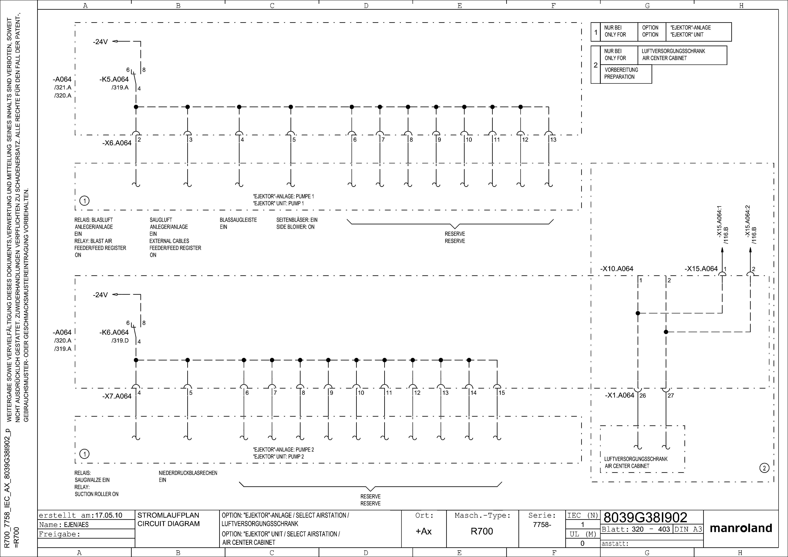

# +Ax — Sheet 320 of 403 — OPTION: "EJEKTOR" ANLAGE / SELECT AIRSTATION /

**LUFTVERSORGUNGSSCHRANK**

> Part of the manroland **R700** printing press IEC/UL circuit diagrams.
> Drawing class: **Stromlaufplan / Circuit diagram** (DIN A3).
> Document `+Ax` covers the **Central control console** machine section.

## At a glance

| Field | Value |
|---|---|
| Document | `+Ax`  (8039G38I902) |
| Sheet | **320** of 403 |
| Section (DE) | OPTION: "EJEKTOR" ANLAGE / SELECT AIRSTATION / |
| Section (EN) | LUFTVERSORGUNGSSCHRANK |
| Section type | CIRCUIT — Circuit diagram |
| Machine type | `R700` |
| Series | `7758` |
| Created | 17.05.10 |
| Replaces | — |
| Columns used | A, B, C, D, E, F, G, H |
| Path numbers | — |
| Labels on sheet | 106 |
| Cross-refs out | 8 |
| Cross-refs in | 38 |

**Previous:** [+Ax sheet 319](SHEET_0319.md) · **Next:** [+Ax sheet 321](SHEET_0321.md) · **Document TOC:** [_TOC.md](_TOC.md)  (+Ax) · **Master TOC:** [all sheets](../_MASTER_TOC.md)

## Sheet image (300 DPI, exact vector render)



_Rendered directly from the PDF vector layer at 300 DPI (1-bit), no OCR and no resampling. Use it to confirm anything ambiguous in the text below._

## Cross-references on this sheet

Each entry is a wire leaving this sheet. The printed token is `/sheet.column`; the link resolves to that sheet inside the same document.

| Ref | Target sheet | Col | Path | Destination on target | Target section | From col |
|---|---|---|---|---|---|---|
| `/321.A` | [+Ax sheet 321](SHEET_0321.md) | A | — | — | OPTION: "EJEKTOR" ANLAGE / SELECT AIRSTATION / | A |
| `/320.A` | [+Ax sheet 320](SHEET_0320.md) | A | — | — | OPTION: "EJEKTOR" ANLAGE / SELECT AIRSTATION / | A |
| `/319.A` | [+Ax sheet 319](SHEET_0319.md) | A | — | — | OPTION: "EJEKTOR" ANLAGE / SELECT AIRSTATION / | A |
| `/116.B` | [+Ax sheet 116](SHEET_0116.md) | B | — | X15.A064:1 | REALTIMERECHNER 20mA SCHLEIFE | H |
| `/116.B` | [+Ax sheet 116](SHEET_0116.md) | B | — | X15.A064:2 | REALTIMERECHNER 20mA SCHLEIFE | H |
| `/320.A` | [+Ax sheet 320](SHEET_0320.md) | A | — | — | OPTION: "EJEKTOR" ANLAGE / SELECT AIRSTATION / | A |
| `/319.A` | [+Ax sheet 319](SHEET_0319.md) | A | — | — | OPTION: "EJEKTOR" ANLAGE / SELECT AIRSTATION / | A |
| `/319.D` | [+Ax sheet 319](SHEET_0319.md) | D | — | — | OPTION: "EJEKTOR" ANLAGE / SELECT AIRSTATION / | A |

### Incoming references (sheets that point here)

Every other sheet that sends a wire to this one. `Back-ref` is the token printed on *that* sheet; `Path` is its line number.

| From sheet | Cols | Back-ref | Path | Refs | What continues there |
|---|---|---|---|---|---|
| [+Ax#116](SHEET_0116.md) | B | `/116.B` | — | 2 | X15.A064:2 |
| [+Ax#206](SHEET_0206.md) | A | `/206.A` | — | 2 | — |
| [+Ax#233](SHEET_0233.md) | A | `/233.A` | — | 12 | — |
| [+Ax#235](SHEET_0235.md) | A | `/235.A` | — | 12 | — |
| [+Ax#243](SHEET_0243.md) | F | `/243.F` | — | 2 | — |
| [+Ax#252](SHEET_0252.md) | C | `/252.C` | — | 2 | — |
| [+Ax#319](SHEET_0319.md) | A, D | `/319.A`, `/319.D` | — | 3 | 4 |
| [+Ax#320](SHEET_0320.md) | A | `/320.A` | — | 2 | — |
| [+Ax#321](SHEET_0321.md) | A | `/321.A` | — | 1 | — |


## Devices on this sheet

| Tag | Class | Class meaning (IEC) | Col | Sub | Terminal | Sign |
|---|---|---|---|---|---|---|
| `A064` | A | Baugruppe / assembly, module, PC board | A | — | — | — |
| `A064` | A | Baugruppe / assembly, module, PC board | A | — | — | — |
| `X15.A064` | — | cross-device reference | H | — | — | — |
| `K5.A064` | — | cross-device reference | A | — | — | — |
| `X6.A064` | — | cross-device reference | A | — | — | — |
| `X1.A064` | — | cross-device reference | G | — | — | — |
| `K6.A064` | — | cross-device reference | A | — | — | — |
| `X7.A064` | — | cross-device reference | A | — | — | — |
| `X15.A064:2` | — | cross-device reference | H | — | 2 | — |
| `X15.A064:1` | — | cross-device reference | H | — | 1 | — |
| `X10.A064` | — | cross-device reference | G | — | — | — |

## Potentials / nets

| Potential | Count | Columns | Attached devices | Terminals |
|---|---|---|---|---|
| `24V` | 2 | A | — | — |


A potential such as `L24+/4` or `M24+` is a named supply/return rail; every place it appears on this sheet is electrically common.

## Wire-end annotations (grouped as printed)

A wire that continues elsewhere is annotated with a small cluster: the destination description, the path/line number `#NN`, and the `/sheet.column` cross reference. Each row below is one such cluster exactly as it is grouped on the drawing.

| Col | Y | Path | Cross-ref | Text on the wire |
|---|---|---|---|---|
| G | 38.9 | — | — | `1 ONLY FOR OPTION OPTION` |
| G | 38.9 | — | — | `NUR BEI` |
| G | 38.9 | — | — | `"EJEKTOR" ANLAGE "EJEKTOR" UNIT` |
| A | 58.4 | — | — | `24V` |
| G | 74.3 | — | — | `NUR BEI` |
| G | 74.3 | — | — | `LUFTVERSORGUNGSSCHRANK` |
| G | 85.0 | — | — | `2 AIR CENTER CABINET` |
| G | 85.0 | — | — | `ONLY FOR` |
| A | 101.7 | — | — | `K5.A064 8` |
| A | 101.7 | — | — | `6` |
| G | 102.7 | — | — | `PREPARATION VORBEREITUNG` |
| A | 115.1 | — | — | `A064` |
| A | 128.2 | — | `/321.A`, `/320.A` | — |
| A | 128.2 | — | `/319.A` | — |
| B | 130.0 | — | — | `4` |
| D | 207.2 | — | — | `X6.A064 2 3 4 5 6 7 8 9 10 11 12 13` |
| B | 294.0 | — | — | `1 "EJEKTOR" ANLAGE: PUMPE 1 "EJEKTOR" UNIT: PUMP 1` |
| H | 310.1 | — | `/116.B` | `X15.A064:1` |
| H | 310.1 | — | `/116.B` | `X15.A064:2` |
| A | 329.4 | — | — | `RELAIS: BLASLUFT` |
| B | 329.4 | — | — | `EIN EXTERNAL CABLES FEEDER/FEED REGISTER SAUGLUFT ANLEGER/ANLAGE` |
| C | 329.4 | — | — | `BLASSAUGLEISTE EIN` |
| C | 329.4 | — | — | `SEITENBLÄSER: EIN SIDE BLOWER: ON` |
| A | 340.1 | — | — | `EIN RELAY: BLAST AIR FEEDER/FEED REGISTER ANLEGER/ANLAGE` |
| E | 350.7 | — | — | `RESERVE RESERVE` |
| A | 382.6 | — | — | `ON` |
| B | 382.6 | — | — | `ON` |
| G | 401.4 | — | — | `X10.A064` |
| H | 401.4 | — | — | `X15.A064 1 2` |
| G | 419.9 | — | — | `1 2` |
| A | 441.1 | — | — | `24V` |
| A | 484.3 | — | — | `K6.A064 8` |
| A | 484.3 | — | — | `6` |
| A | 497.8 | — | — | `A064` |
| A | 510.9 | — | `/320.A`, `/319.A` | — |
| A | 510.9 | — | `/319.D` | — |
| B | 512.7 | — | — | `4` |
| C | 589.9 | — | — | `X7.A064 4 5 6 7 8 9 10 11 12 13 14 15` |
| G | 592.8 | — | — | `X1.A064 26 27` |
| C | 676.7 | — | — | `"EJEKTOR" ANLAGE: PUMPE 2 "EJEKTOR" UNIT: PUMP 2` |
| A | 682.9 | — | — | `1` |
| G | 690.9 | — | — | `LUFTVERSORGUNGSSCHRANK` |
| G | 701.5 | — | — | `AIR CENTER CABINET 2` |
| A | 712.0 | — | — | `RELAIS:` |
| B | 712.1 | — | — | `NIEDERDRUCKBLASRECHEN EIN` |
| A | 722.7 | — | — | `RELAY: SAUGWALZE EIN` |
| A | 744.0 | — | — | `SUCTION ROLLER ON` |
| D | 747.5 | — | — | `RESERVE RESERVE` |


## Reconstructed tables

This sheet carries tabular content (pin map / terminal assignment / index). The grid below was rebuilt from the drawing's own rule lines, so each row is exactly one physical row of the table.

### Table 1 — 2 data rows × 22 columns (at x=205.5, y=161.6)

| 2 | SAUGLUFT | 3 BLASSAUGLEISTE | 4 | "EJEKTOR" | "EJEKTOR" ANLAGE: UNIT: | 5 PUMP SEITENBLÄSER: | PUMPE 1 1 EIN |  | 6 |  | 7 |  | 8 |  | 9 |  | 10 |  | 11 |  | 12 |
|---|---|---|---|---|---|---|---|---|---|---|---|---|---|---|---|---|---|---|---|---|---|
| `4` | `ANLEGER/ANLAGE EIN EXTERNAL CABLES FEEDER/FEED ON 8` | `EIN REGISTER` |  |  | `SIDE` | `BLOWER:` | `ON` |  |  |  |  |  |  |  |  | `RESERVE RESERVE` |  |  |  |  |  |
| `4` | `EIN` | `5 NIEDERDRUCKBLASRECHEN` |  | `6 "EJEKTOR"` | `7 "EJEKTOR" ANLAGE: UNIT:` | `PUMP` | `8 PUMPE 2 2` | `9` |  | `10` |  | `11` |  | `12` |  | `13` |  | `14` |  | `15` |  |


## Notes and free text on this sheet

| Text | Col | Y (pt) |
|---|---|---|
| `RELAIS: BLASLUFT` | A | 329.43 |
| `ANLEGER/ANLAGE` | A | 340.08 |
| `EIN` | A | 350.57 |
| `RELAY: BLAST AIR` | A | 361.31 |
| `FEEDER/FEED REGISTER` | A | 371.96 |
| `ON` | A | 382.55 |
| `SAUGLUFT` | B | 329.45 |
| `ANLEGER/ANLAGE` | B | 340.08 |
| `EIN` | B | 350.57 |
| `EXTERNAL CABLES` | B | 361.32 |
| `FEEDER/FEED REGISTER` | B | 371.96 |
| `ON` | B | 382.55 |
| `BLASSAUGLEISTE` | C | 329.42 |
| `SEITENBLÄSER: EIN` | C | 329.42 |
| `SIDE BLOWER: ON` | C | 340.04 |
| `RESERVE` | E | 350.66 |
| `"EJEKTOR" ANLAGE: PUMPE 1` | C | 294 |
| `"EJEKTOR" UNIT: PUMP 1` | C | 304.63 |
| `LUFTVERSORGUNGSSCHRANK` | G | 690.88 |
| `AIR CENTER CABINET` | G | 701.49 |
| `RESERVE` | D | 747.51 |
| `RELAIS:` | A | 712.05 |
| `SAUGWALZE EIN` | A | 722.71 |
| `RELAY:` | A | 733.32 |
| `SUCTION ROLLER ON` | A | 744.03 |
| `NIEDERDRUCKBLASRECHEN` | B | 712.13 |
| `"EJEKTOR" ANLAGE: PUMPE 2` | C | 676.69 |
| `"EJEKTOR" UNIT: PUMP 2` | C | 687.32 |
| `NUR BEI` | G | 38.85 |
| `ONLY FOR` | G | 49.53 |
| `OPTION` | G | 38.87 |
| `"EJEKTOR" ANLAGE` | G | 38.89 |
| `"EJEKTOR" UNIT` | G | 49.52 |
| `VORBEREITUNG` | G | 102.68 |
| `PREPARATION` | G | 113.28 |

## Complete label inventory (exact text from the drawing)

Every text object inside the drawing area of this sheet, in DIN reading order (column A→H, then top→bottom). This is the authoritative list: if a string is not here it is not printed on this sheet.

| Col | Y | X | Dir | Type | Text |
|---|---|---|---|---|---|
| A | 58.4 | 140.6 | → | potential | `24V` |
| A | 101.7 | 191.1 | → | number | `6` |
| A | 115.1 | 79.9 | → | device tag | `A064` |
| A | 115.1 | 150.5 | → | device ref | `K5.A064` |
| A | 128.2 | 82.2 | → | cross-reference | `/321.A` |
| A | 128.2 | 168.7 | → | cross-reference | `/319.A` |
| A | 140.6 | 82.2 | → | cross-reference | `/320.A` |
| A | 211.5 | 154.8 | → | device ref | `X6.A064` |
| A | 300.2 | 125.8 | → | number | `1` |
| A | 329.4 | 112.5 | → | text | `RELAIS: BLASLUFT` |
| A | 340.1 | 113.4 | → | text | `ANLEGER/ANLAGE` |
| A | 350.6 | 112.5 | → | text | `EIN` |
| A | 361.3 | 112.5 | → | text | `RELAY: BLAST AIR` |
| A | 372.0 | 112.5 | → | text | `FEEDER/FEED REGISTER` |
| A | 382.6 | 113.1 | → | text | `ON` |
| A | 441.1 | 140.6 | → | potential | `24V` |
| A | 484.3 | 191.1 | → | number | `6` |
| A | 497.8 | 79.9 | → | device tag | `A064` |
| A | 497.8 | 150.5 | → | device ref | `K6.A064` |
| A | 510.9 | 82.2 | → | cross-reference | `/320.A` |
| A | 510.9 | 168.7 | → | cross-reference | `/319.D` |
| A | 523.3 | 82.2 | → | cross-reference | `/319.A` |
| A | 594.2 | 154.8 | → | device ref | `X7.A064` |
| A | 682.9 | 125.8 | → | number | `1` |
| A | 712.1 | 112.5 | → | text | `RELAIS:` |
| A | 722.7 | 113.1 | → | text | `SAUGWALZE EIN` |
| A | 733.3 | 112.5 | → | text | `RELAY:` |
| A | 744.0 | 113.1 | → | text | `SUCTION ROLLER ON` |
| B | 101.7 | 215.1 | → | number | `8` |
| B | 130.0 | 208.1 | → | number | `4` |
| B | 207.3 | 208.1 | → | number | `2` |
| B | 207.3 | 286.0 | → | number | `3` |
| B | 329.5 | 226.5 | → | text | `SAUGLUFT` |
| B | 339.9 | 332.2 | → | text | `EIN` |
| B | 340.1 | 226.8 | → | text | `ANLEGER/ANLAGE` |
| B | 350.6 | 225.9 | → | text | `EIN` |
| B | 361.3 | 225.9 | → | text | `EXTERNAL CABLES` |
| B | 372.0 | 225.9 | → | text | `FEEDER/FEED REGISTER` |
| B | 382.6 | 226.5 | → | text | `ON` |
| B | 484.3 | 215.1 | → | number | `8` |
| B | 512.7 | 208.1 | → | number | `4` |
| B | 589.9 | 208.1 | → | number | `4` |
| B | 589.9 | 286.0 | → | number | `5` |
| B | 712.1 | 240.1 | → | text | `NIEDERDRUCKBLASRECHEN` |
| B | 722.6 | 240.1 | → | text | `EIN` |
| C | 207.3 | 364.0 | → | number | `4` |
| C | 207.3 | 441.9 | → | number | `5` |
| C | 294.0 | 382.4 | → | text | `"EJEKTOR" ANLAGE: PUMPE 1` |
| C | 304.6 | 382.4 | → | text | `"EJEKTOR" UNIT: PUMP 1` |
| C | 329.4 | 332.2 | → | text | `BLASSAUGLEISTE` |
| C | 329.4 | 417.8 | → | text | `SEITENBLÄSER: EIN` |
| C | 340.0 | 417.8 | → | text | `SIDE BLOWER: ON` |
| C | 589.9 | 371.1 | → | number | `6` |
| C | 589.9 | 413.6 | → | number | `7` |
| C | 589.9 | 456.1 | → | number | `8` |
| C | 676.7 | 382.4 | → | text | `"EJEKTOR" ANLAGE: PUMPE 2` |
| C | 687.3 | 382.4 | → | text | `"EJEKTOR" UNIT: PUMP 2` |
| D | 207.3 | 534.0 | → | number | `6` |
| D | 207.3 | 576.6 | → | number | `7` |
| D | 207.3 | 619.1 | → | number | `8` |
| D | 589.9 | 498.6 | → | number | `9` |
| D | 589.9 | 540.6 | → | number | `10` |
| D | 589.9 | 583.1 | → | number | `11` |
| D | 747.5 | 544.8 | → | text | `RESERVE` |
| D | 758.1 | 544.8 | → | text | `RESERVE` |
| E | 207.3 | 661.6 | → | number | `9` |
| E | 207.3 | 703.6 | → | number | `10` |
| E | 207.3 | 746.1 | → | number | `11` |
| E | 350.7 | 672.4 | → | text | `RESERVE` |
| E | 361.3 | 672.4 | → | text | `RESERVE` |
| E | 589.9 | 625.6 | → | number | `12` |
| E | 589.9 | 668.1 | → | number | `13` |
| E | 589.9 | 710.6 | → | number | `14` |
| E | 589.9 | 753.2 | → | number | `15` |
| F | 44.2 | 897.4 | → | number | `1` |
| F | 93.8 | 897.2 | → | number | `2` |
| F | 207.3 | 788.6 | → | number | `12` |
| F | 207.3 | 831.1 | → | number | `13` |
| G | 38.8 | 913.3 | → | text | `NUR BEI` |
| G | 38.9 | 970.6 | → | text | `OPTION` |
| G | 38.9 | 1013.1 | → | text | `"EJEKTOR" ANLAGE` |
| G | 49.5 | 913.9 | → | text | `ONLY FOR` |
| G | 49.5 | 970.6 | → | text | `OPTION` |
| G | 49.5 | 1013.1 | → | text | `"EJEKTOR" UNIT` |
| G | 74.3 | 913.3 | → | text | `NUR BEI` |
| G | 74.3 | 970.0 | → | text | `LUFTVERSORGUNGSSCHRANK` |
| G | 85.0 | 913.9 | → | text | `ONLY FOR` |
| G | 85.0 | 970.9 | → | text | `AIR CENTER CABINET` |
| G | 102.7 | 914.2 | → | text | `VORBEREITUNG` |
| G | 113.3 | 913.3 | → | text | `PREPARATION` |
| G | 401.4 | 907.1 | → | device ref | `X10.A064` |
| G | 419.9 | 965.8 | → | number | `1` |
| G | 419.9 | 1008.9 | → | number | `2` |
| G | 592.8 | 914.5 | → | device ref | `X1.A064` |
| G | 594.2 | 966.3 | → | number | `26` |
| G | 594.2 | 1008.9 | → | number | `27` |
| G | 690.9 | 913.3 | → | text | `LUFTVERSORGUNGSSCHRANK` |
| G | 701.5 | 914.2 | → | text | `AIR CENTER CABINET` |
| H | 310.1 | 1083.1 | ↕ | device ref | `X15.A064:1` |
| H | 310.1 | 1125.6 | ↕ | device ref | `X15.A064:2` |
| H | 343.0 | 1093.0 | ↕ | cross-reference | `/116.B` |
| H | 343.0 | 1135.5 | ↕ | cross-reference | `/116.B` |
| H | 401.4 | 1034.6 | → | device ref | `X15.A064` |
| H | 402.8 | 1093.3 | → | number | `1` |
| H | 402.8 | 1136.4 | → | number | `2` |
| H | 704.7 | 1153.1 | → | number | `2` |

## Reading-order text block

The same content as a plain block, grouped by DIN column — convenient to paste or to match against a visual description.

```text
=== Column A ===
  58.4  140.6  net          24V
 101.7  191.1  numeric      6
 115.1   79.9  devtag       A064
 115.1  150.5  devref       K5.A064
 128.2   82.2  xref         /321.A
 128.2  168.7  xref         /319.A
 140.6   82.2  xref         /320.A
 211.5  154.8  devref       X6.A064
 300.2  125.8  numeric      1
 329.4  112.5  text         RELAIS: BLASLUFT
 340.1  113.4  text         ANLEGER/ANLAGE
 350.6  112.5  text         EIN
 361.3  112.5  text         RELAY: BLAST AIR
 372.0  112.5  text         FEEDER/FEED REGISTER
 382.6  113.1  text         ON
 441.1  140.6  net          24V
 484.3  191.1  numeric      6
 497.8   79.9  devtag       A064
 497.8  150.5  devref       K6.A064
 510.9   82.2  xref         /320.A
 510.9  168.7  xref         /319.D
 523.3   82.2  xref         /319.A
 594.2  154.8  devref       X7.A064
 682.9  125.8  numeric      1
 712.1  112.5  text         RELAIS:
 722.7  113.1  text         SAUGWALZE EIN
 733.3  112.5  text         RELAY:
 744.0  113.1  text         SUCTION ROLLER ON
=== Column B ===
 101.7  215.1  numeric      8
 130.0  208.1  numeric      4
 207.3  208.1  numeric      2
 207.3  286.0  numeric      3
 329.5  226.5  text         SAUGLUFT
 339.9  332.2  text         EIN
 340.1  226.8  text         ANLEGER/ANLAGE
 350.6  225.9  text         EIN
 361.3  225.9  text         EXTERNAL CABLES
 372.0  225.9  text         FEEDER/FEED REGISTER
 382.6  226.5  text         ON
 484.3  215.1  numeric      8
 512.7  208.1  numeric      4
 589.9  208.1  numeric      4
 589.9  286.0  numeric      5
 712.1  240.1  text         NIEDERDRUCKBLASRECHEN
 722.6  240.1  text         EIN
=== Column C ===
 207.3  364.0  numeric      4
 207.3  441.9  numeric      5
 294.0  382.4  text         "EJEKTOR" ANLAGE: PUMPE 1
 304.6  382.4  text         "EJEKTOR" UNIT: PUMP 1
 329.4  332.2  text         BLASSAUGLEISTE
 329.4  417.8  text         SEITENBLÄSER: EIN
 340.0  417.8  text         SIDE BLOWER: ON
 589.9  371.1  numeric      6
 589.9  413.6  numeric      7
 589.9  456.1  numeric      8
 676.7  382.4  text         "EJEKTOR" ANLAGE: PUMPE 2
 687.3  382.4  text         "EJEKTOR" UNIT: PUMP 2
=== Column D ===
 207.3  534.0  numeric      6
 207.3  576.6  numeric      7
 207.3  619.1  numeric      8
 589.9  498.6  numeric      9
 589.9  540.6  numeric      10
 589.9  583.1  numeric      11
 747.5  544.8  text         RESERVE
 758.1  544.8  text         RESERVE
=== Column E ===
 207.3  661.6  numeric      9
 207.3  703.6  numeric      10
 207.3  746.1  numeric      11
 350.7  672.4  text         RESERVE
 361.3  672.4  text         RESERVE
 589.9  625.6  numeric      12
 589.9  668.1  numeric      13
 589.9  710.6  numeric      14
 589.9  753.2  numeric      15
=== Column F ===
  44.2  897.4  numeric      1
  93.8  897.2  numeric      2
 207.3  788.6  numeric      12
 207.3  831.1  numeric      13
=== Column G ===
  38.8  913.3  text         NUR BEI
  38.9  970.6  text         OPTION
  38.9 1013.1  text         "EJEKTOR" ANLAGE
  49.5  913.9  text         ONLY FOR
  49.5  970.6  text         OPTION
  49.5 1013.1  text         "EJEKTOR" UNIT
  74.3  913.3  text         NUR BEI
  74.3  970.0  text         LUFTVERSORGUNGSSCHRANK
  85.0  913.9  text         ONLY FOR
  85.0  970.9  text         AIR CENTER CABINET
 102.7  914.2  text         VORBEREITUNG
 113.3  913.3  text         PREPARATION
 401.4  907.1  devref       X10.A064
 419.9  965.8  numeric      1
 419.9 1008.9  numeric      2
 592.8  914.5  devref       X1.A064
 594.2  966.3  numeric      26
 594.2 1008.9  numeric      27
 690.9  913.3  text         LUFTVERSORGUNGSSCHRANK
 701.5  914.2  text         AIR CENTER CABINET
=== Column H ===
 310.1 1083.1  devref       X15.A064:1
 310.1 1125.6  devref       X15.A064:2
 343.0 1093.0  xref         /116.B
 343.0 1135.5  xref         /116.B
 401.4 1034.6  devref       X15.A064
 402.8 1093.3  numeric      1
 402.8 1136.4  numeric      2
 704.7 1153.1  numeric      2
```

---
_Generated from the PDF vector text layer; no OCR. Source: `R700_7758_IEC_AX_8039G38I902_p`, sheet 320._
