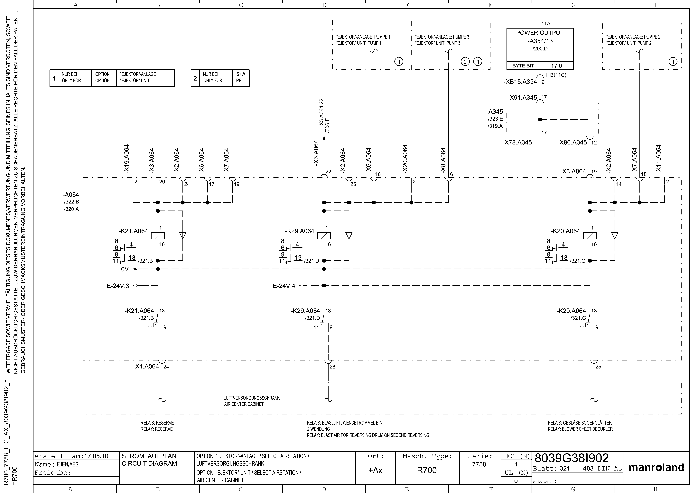

# +Ax — Sheet 321 of 403 — OPTION: "EJEKTOR" ANLAGE / SELECT AIRSTATION /

**LUFTVERSORGUNGSSCHRANK**

> Part of the manroland **R700** printing press IEC/UL circuit diagrams.
> Drawing class: **Stromlaufplan / Circuit diagram** (DIN A3).
> Document `+Ax` covers the **Central control console** machine section.

## At a glance

| Field | Value |
|---|---|
| Document | `+Ax`  (8039G38I902) |
| Sheet | **321** of 403 |
| Section (DE) | OPTION: "EJEKTOR" ANLAGE / SELECT AIRSTATION / |
| Section (EN) | LUFTVERSORGUNGSSCHRANK |
| Section type | CIRCUIT — Circuit diagram |
| Machine type | `R700` |
| Series | `7758` |
| Created | 17.05.10 |
| Replaces | — |
| Columns used | A, B, C, D, E, F, G, H |
| Path numbers | — |
| Labels on sheet | 134 |
| Cross-refs out | 12 |
| Cross-refs in | 33 |

**Previous:** [+Ax sheet 320](SHEET_0320.md) · **Next:** [+Ax sheet 322](SHEET_0322.md) · **Document TOC:** [_TOC.md](_TOC.md)  (+Ax) · **Master TOC:** [all sheets](../_MASTER_TOC.md)

## Sheet image (300 DPI, exact vector render)



_Rendered directly from the PDF vector layer at 300 DPI (1-bit), no OCR and no resampling. Use it to confirm anything ambiguous in the text below._

## Cross-references on this sheet

Each entry is a wire leaving this sheet. The printed token is `/sheet.column`; the link resolves to that sheet inside the same document.

| Ref | Target sheet | Col | Path | Destination on target | Target section | From col |
|---|---|---|---|---|---|---|
| `/200.D` | [+Ax sheet 200](SHEET_0200.md) | D | — | — | REFERENZMODUL | G |
| `/306.F` | [+Ax sheet 306](SHEET_0306.md) | F | — | X3.A064:22 | SCHÖN & WIDERDRUCK HAUPTSCHALTSCHRANK | D |
| `/323.E` | [+Ax sheet 323](SHEET_0323.md) | E | — | — | OPTION: "EJEKTOR" ANLAGE / SELECT AIRSTATION / | F |
| `/319.A` | [+Ax sheet 319](SHEET_0319.md) | A | — | — | OPTION: "EJEKTOR" ANLAGE / SELECT AIRSTATION / | F |
| `/322.B` | [+Ax sheet 322](SHEET_0322.md) | B | — | — | OPTION: "EJEKTOR" ANLAGE / SELECT AIRSTATION / | A |
| `/320.A` | [+Ax sheet 320](SHEET_0320.md) | A | — | — | OPTION: "EJEKTOR" ANLAGE / SELECT AIRSTATION / | A |
| `/321.B` | [+Ax sheet 321](SHEET_0321.md) | B | — | — | OPTION: "EJEKTOR" ANLAGE / SELECT AIRSTATION / | B |
| `/321.G` | [+Ax sheet 321](SHEET_0321.md) | G | — | — | OPTION: "EJEKTOR" ANLAGE / SELECT AIRSTATION / | G |
| `/321.D` | [+Ax sheet 321](SHEET_0321.md) | D | — | — | OPTION: "EJEKTOR" ANLAGE / SELECT AIRSTATION / | D |
| `/321.B` | [+Ax sheet 321](SHEET_0321.md) | B | — | — | OPTION: "EJEKTOR" ANLAGE / SELECT AIRSTATION / | B |
| `/321.G` | [+Ax sheet 321](SHEET_0321.md) | G | — | — | OPTION: "EJEKTOR" ANLAGE / SELECT AIRSTATION / | G |
| `/321.D` | [+Ax sheet 321](SHEET_0321.md) | D | — | — | OPTION: "EJEKTOR" ANLAGE / SELECT AIRSTATION / | D |

### Incoming references (sheets that point here)

Every other sheet that sends a wire to this one. `Back-ref` is the token printed on *that* sheet; `Path` is its line number.

| From sheet | Cols | Back-ref | Path | Refs | What continues there |
|---|---|---|---|---|---|
| [+Ax#200](SHEET_0200.md) | D | `/200.D` | — | 1 | — |
| [+Ax#206](SHEET_0206.md) | A | `/206.A` | — | 3 | — |
| [+Ax#217](SHEET_0217.md) | A | `/217.A` | — | 3 | — |
| [+Ax#222](SHEET_0222.md) | A | `/222.A` | — | 3 | — |
| [+Ax#233](SHEET_0233.md) | A | `/233.A` | — | 2 | — |
| [+Ax#235](SHEET_0235.md) | A | `/235.A` | — | 2 | — |
| [+Ax#237](SHEET_0237.md) | B | `/237.B` | — | 1 | — |
| [+Ax#246](SHEET_0246.md) | A | `/246.A` | — | 1 | — |
| [+Ax#253](SHEET_0253.md) | B | `/253.B` | — | 1 | — |
| [+Ax#258](SHEET_0258.md) | C | `/258.C` | — | 1 | — |
| [+Ax#260](SHEET_0260.md) | A | `/260.A` | — | 1 | — |
| [+Ax#286](SHEET_0286.md) | A | `/286.A` | — | 1 | — |
| [+Ax#289](SHEET_0289.md) | E | `/289.E` | — | 1 | — |
| [+Ax#290](SHEET_0290.md) | B | `/290.B` | — | 1 | — |
| [+Ax#306](SHEET_0306.md) | F | `/306.F` | — | 1 | X3.A064:22 |
| [+Ax#319](SHEET_0319.md) | A | `/319.A` | — | 1 | — |
| [+Ax#320](SHEET_0320.md) | A | `/320.A` | — | 1 | — |
| [+Ax#321](SHEET_0321.md) | B, D, G | `/321.B`, `/321.D`, `/321.G` | — | 6 | — |
| [+Ax#322](SHEET_0322.md) | B | `/322.B` | — | 1 | — |
| [+Ax#323](SHEET_0323.md) | E | `/323.E` | — | 1 | — |


## Devices on this sheet

| Tag | Class | Class meaning (IEC) | Col | Sub | Terminal | Sign |
|---|---|---|---|---|---|---|
| `A064` | A | Baugruppe / assembly, module, PC board | A | — | — | — |
| `A354/13` | A | Baugruppe / assembly, module, PC board | G | 13 | — | — |
| `A345` | A | Baugruppe / assembly, module, PC board | F | — | — | — |
| `X3.A064` | — | cross-device reference | D | — | — | — |
| `X3.A064` | — | cross-device reference | G | — | — | — |
| `17.0` | — | cross-device reference | G | — | — | — |
| `XB15.A354` | — | cross-device reference | F | — | — | — |
| `K21.A064` | — | cross-device reference | B | — | — | — |
| `K29.A064` | — | cross-device reference | D | — | — | — |
| `K20.A064` | — | cross-device reference | G | — | — | — |
| `X96.A345` | — | cross-device reference | G | — | — | — |
| `X91.A345` | — | cross-device reference | F | — | — | — |
| `X6.A064` | — | cross-device reference | E | — | — | — |
| `X8.A064` | — | cross-device reference | E | — | — | — |
| `X7.A064` | — | cross-device reference | H | — | — | — |
| `K21.A064` | — | cross-device reference | B | — | — | — |
| `K29.A064` | — | cross-device reference | D | — | — | — |
| `K20.A064` | — | cross-device reference | G | — | — | — |
| `X1.A064` | — | cross-device reference | B | — | — | — |
| `X3.A064:22` | — | cross-device reference | D | — | 22 | — |
| `X2.A064` | — | cross-device reference | B | — | — | — |
| `X2.A064` | — | cross-device reference | D | — | — | — |
| `X2.A064` | — | cross-device reference | G | — | — | — |
| `X11.A064` | — | cross-device reference | H | — | — | — |
| `X78.A345` | — | cross-device reference | F | — | — | — |
| `X20.A064` | — | cross-device reference | E | — | — | — |
| `X7.A064` | — | cross-device reference | C | — | — | — |
| `X3.A064` | — | cross-device reference | B | — | — | — |
| `X6.A064` | — | cross-device reference | C | — | — | — |
| `X19.A064` | — | cross-device reference | B | — | — | — |

## Potentials / nets

| Potential | Count | Columns | Attached devices | Terminals |
|---|---|---|---|---|
| `0V` | 1 | B | — | — |


A potential such as `L24+/4` or `M24+` is a named supply/return rail; every place it appears on this sheet is electrically common.

## Wire-end annotations (grouped as printed)

A wire that continues elsewhere is annotated with a small cluster: the destination description, the path/line number `#NN`, and the `/sheet.column` cross reference. Each row below is one such cluster exactly as it is grouped on the drawing.

| Col | Y | Path | Cross-ref | Text on the wire |
|---|---|---|---|---|
| G | 36.4 | — | — | `11A` |
| G | 51.6 | — | — | `POWER OUTPUT` |
| D | 60.1 | — | — | `"EJEKTOR" ANLAGE: PUMPE 1 "EJEKTOR" UNIT: PUMP 1` |
| E | 60.1 | — | — | `"EJEKTOR" ANLAGE: PUMPE 3 "EJEKTOR" UNIT: PUMP 3` |
| H | 60.1 | — | — | `"EJEKTOR" ANLAGE: PUMPE 2 "EJEKTOR" UNIT: PUMP 2` |
| G | 65.5 | — | — | `A354/13` |
| G | 79.3 | — | `/200.D` | — |
| G | 101.8 | — | — | `1 2 1 1` |
| G | 108.3 | — | — | `BYTE.BIT 17.0` |
| C | 123.8 | — | — | `2 ONLY FOR PP S+W` |
| A | 123.9 | — | — | `1 ONLY FOR OPTION OPTION` |
| A | 123.9 | — | — | `NUR BEI` |
| B | 123.9 | — | — | `"EJEKTOR" ANLAGE "EJEKTOR" UNIT` |
| C | 123.9 | — | — | `NUR BEI` |
| G | 124.3 | — | — | `11B(11C)` |
| F | 134.9 | — | — | `XB15.A354 9` |
| F | 161.9 | — | — | `X91.A345 17` |
| D | 168.4 | — | `/306.F` | `X3.A064:22` |
| F | 186.0 | — | — | `A345` |
| F | 199.0 | — | `/323.E`, `/319.A` | — |
| G | 222.8 | — | — | `17` |
| F | 238.4 | — | — | `X78.A345` |
| G | 238.4 | — | — | `X96.A345 12` |
| D | 239.0 | — | — | `X3.A064` |
| B | 246.3 | — | — | `X19.A064` |
| E | 246.3 | — | — | `X20.A064` |
| H | 246.3 | — | — | `X11.A064` |
| E | 251.6 | — | — | `X6.A064` |
| E | 251.6 | — | — | `X8.A064` |
| H | 251.6 | — | — | `X7.A064` |
| B | 252.3 | — | — | `X3.A064` |
| B | 252.3 | — | — | `X2.A064` |
| C | 252.3 | — | — | `X6.A064` |
| C | 252.3 | — | — | `X7.A064` |
| D | 252.3 | — | — | `X2.A064` |
| G | 252.3 | — | — | `X2.A064` |
| G | 288.0 | — | — | `X3.A064 19` |
| D | 289.5 | — | — | `22` |
| E | 293.7 | — | — | `16` |
| F | 293.7 | — | — | `6` |
| H | 293.7 | — | — | `18` |
| C | 306.5 | — | — | `2 19 2` |
| C | 306.5 | — | — | `20 24 25` |
| H | 306.5 | — | — | `14 2` |
| C | 310.7 | — | — | `17` |
| A | 327.7 | — | — | `A064` |
| A | 340.8 | — | `/322.B`, `/320.A` | — |
| B | 385.1 | — | — | `1` |
| D | 385.1 | — | — | `1` |
| G | 385.1 | — | — | `1` |
| B | 390.1 | — | — | `K21.A064` |
| D | 390.1 | — | — | `K29.A064` |
| G | 390.1 | — | — | `K20.A064` |
| B | 407.0 | — | — | `11 8 6 9 13` |
| D | 407.0 | — | — | `11 8 6 9 13` |
| G | 407.0 | — | — | `11 8 6 9 13` |
| B | 412.7 | — | — | `4` |
| D | 412.7 | — | — | `4` |
| G | 412.7 | — | — | `4` |
| B | 413.5 | — | — | `16` |
| D | 413.5 | — | — | `16` |
| G | 413.5 | — | — | `16` |
| B | 441.8 | — | `/321.B` | — |
| D | 441.8 | — | `/321.D` | — |
| G | 441.8 | — | `/321.G` | — |
| B | 455.2 | — | — | `0V` |
| C | 483.6 | — | — | `E 24V.3 E 24V.4` |
| B | 526.1 | — | — | `K21.A064` |
| D | 526.1 | — | — | `K29.A064` |
| G | 526.1 | — | — | `K20.A064` |
| B | 526.9 | — | — | `13` |
| D | 526.9 | — | — | `13` |
| G | 526.9 | — | — | `13` |
| B | 539.2 | — | `/321.B` | — |
| D | 539.2 | — | `/321.D` | — |
| G | 539.2 | — | `/321.G` | — |
| B | 555.2 | — | — | `11` |
| B | 555.2 | — | — | `9` |
| D | 555.2 | — | — | `11` |
| D | 555.2 | — | — | `9` |
| G | 555.2 | — | — | `11` |
| G | 555.2 | — | — | `9` |
| E | 621.1 | — | — | `X1.A064 24 28 25` |
| C | 676.7 | — | — | `LUFTVERSORGUNGSSCHRANK` |
| C | 687.3 | — | — | `AIR CENTER CABINET` |
| B | 719.2 | — | — | `RELAIS: RESERVE RELAY: RESERVE` |
| D | 719.2 | — | — | `RELAIS: BLASLUFT, WENDETROMMEL EIN` |
| G | 719.2 | — | — | `RELAIS: GEBLÄSE BOGENGLÄTTER RELAY: BLOWER SHEET DECURLER` |
| E | 729.8 | — | — | `RELAY: BLAST AIR FOR REVERSING DRUM ON SECOND REVERSING 2.WENDUNG` |


## Reconstructed tables

This sheet carries tabular content (pin map / terminal assignment / index). The grid below was rebuilt from the drawing's own rule lines, so each row is exactly one physical row of the table.

### Table 1 — 6 data rows × 22 columns (at x=212.6, y=48.2)

|  |  |  |  |  |  |  |  |  | "EJEKTOR" | "EJEKTOR" ANLAGE: UNIT: PUMP | PUMPE 1 1 | "EJEKTOR" ANLAGE: "EJEKTOR" UNIT: | PUMPE 3 PUMP 3 | POWER | OUTPUT A354/13 /200.D |  |  |  |  | "EJEKTOR" ANLAGE: "EJEKTOR" UNIT: | PUMPE 2 PUMP 2 |
|---|---|---|---|---|---|---|---|---|---|---|---|---|---|---|---|---|---|---|---|---|---|
|  |  |  |  |  |  |  |  |  |  |  | `1` |  | `1 2` | `BYTE.BIT` | `17.0` |  |  |  |  |  |  |
| `"EJEKTOR"` | `"EJEKTOR" ANLAGE UNIT` |  |  | `NUR 2` | `BEI ONLY FOR` | `S+W PP` | `X3.A064:22` |  |  |  |  |  | `A345 /323.E` | `XB15.A354 X91.A345` | `11B(11C) 9 17` |  |  |  |  |  |  |
| `X19.A064` | `X3.A064 2` |  | `X2.A064 20` | `X6.A064 24` | `X7.A064 17` | `19` | `X3.A064` | `/306.F` | `X2.A064 22` | `X6.A064 25` | `X20.A064 16` | `X8.A064 2` | `/319.A 6` | `X78.A345` | `17` | `X96.A345 X3.A064` |  | `12 19` | `X2.A064` | `X7.A064 14` | `X11.A064 18` |
| `4 13` | `K21.A064` | `1 16` |  |  |  | `8 6 9` | `K29.A064 4 13` | `1 16` |  |  |  |  |  |  | `8 6 9` | `K20.A064 4 13` |  | `1 16` |  |  |  |
|  | `/321.B` |  |  |  |  | `11` | `/321.D` |  |  |  |  |  |  |  | `11` |  | `/321.G` |  |  |  |  |
| `0V` |  |  |  |  |  |  |  |  |  |  |  |  |  |  |  |  |  |  |  |  |  |


## Notes and free text on this sheet

| Text | Col | Y (pt) |
|---|---|---|
| `11A` | G | 36.43 |
| `11B(11C)` | G | 124.34 |
| `POWER OUTPUT` | G | 51.59 |
| `BYTE.BIT` | F | 108.91 |
| `RELAIS: GEBLÄSE BOGENGLÄTTER` | G | 719.2 |
| `RELAY: BLOWER SHEET DECURLER` | G | 729.83 |
| `"EJEKTOR" ANLAGE: PUMPE 1` | D | 60.14 |
| `"EJEKTOR" UNIT: PUMP 1` | D | 70.77 |
| `"EJEKTOR" ANLAGE: PUMPE 3` | E | 60.15 |
| `"EJEKTOR" UNIT: PUMP 3` | E | 70.78 |
| `"EJEKTOR" ANLAGE: PUMPE 2` | H | 60.15 |
| `"EJEKTOR" UNIT: PUMP 2` | H | 70.78 |
| `E 24V.3` | B | 483.62 |
| `E 24V.4` | D | 483.62 |
| `LUFTVERSORGUNGSSCHRANK` | C | 676.71 |
| `AIR CENTER CABINET` | C | 687.32 |
| `RELAIS: BLASLUFT, WENDETROMMEL EIN` | D | 719.19 |
| `2.WENDUNG` | D | 729.81 |
| `RELAY: BLAST AIR FOR REVERSING DRUM ON SECOND REVERSING` | E | 740.48 |
| `RELAIS: RESERVE` | B | 719.18 |
| `RELAY: RESERVE` | B | 729.81 |
| `NUR BEI` | A | 123.89 |
| `ONLY FOR` | A | 134.57 |
| `OPTION` | A | 123.9 |
| `"EJEKTOR" ANLAGE` | B | 123.93 |
| `"EJEKTOR" UNIT` | B | 134.56 |
| `NUR BEI` | C | 123.89 |
| `ONLY FOR` | C | 134.57 |
| `S+W` | C | 123.79 |
| `PP` | C | 134.42 |

## Complete label inventory (exact text from the drawing)

Every text object inside the drawing area of this sheet, in DIN reading order (column A→H, then top→bottom). This is the authoritative list: if a string is not here it is not printed on this sheet.

| Col | Y | X | Dir | Type | Text |
|---|---|---|---|---|---|
| A | 123.9 | 105.4 | → | text | `NUR BEI` |
| A | 123.9 | 162.7 | → | text | `OPTION` |
| A | 129.2 | 89.6 | → | number | `1` |
| A | 134.5 | 162.7 | → | text | `OPTION` |
| A | 134.6 | 106.0 | → | text | `ONLY FOR` |
| A | 327.7 | 106.9 | → | device tag | `A064` |
| A | 340.8 | 109.4 | → | cross-reference | `/322.B` |
| A | 353.2 | 109.1 | → | cross-reference | `/320.A` |
| A | 407.0 | 195.9 | → | number | `8` |
| A | 418.4 | 195.9 | → | number | `6` |
| A | 429.7 | 195.9 | → | number | `9` |
| A | 441.1 | 191.3 | → | number | `11` |
| B | 123.9 | 205.2 | → | text | `"EJEKTOR" ANLAGE` |
| B | 129.2 | 330.2 | → | number | `2` |
| B | 134.6 | 205.2 | → | text | `"EJEKTOR" UNIT` |
| B | 246.3 | 211.5 | ↕ | device ref | `X19.A064` |
| B | 252.3 | 254.0 | ↕ | device ref | `X3.A064` |
| B | 252.3 | 296.5 | ↕ | device ref | `X2.A064` |
| B | 306.5 | 229.3 | → | number | `2` |
| B | 306.5 | 271.8 | → | number | `20` |
| B | 310.7 | 314.4 | → | number | `24` |
| B | 385.1 | 271.3 | → | number | `1` |
| B | 390.1 | 202.7 | → | device ref | `K21.A064` |
| B | 412.7 | 220.8 | → | number | `4` |
| B | 413.5 | 271.3 | → | number | `16` |
| B | 435.4 | 219.1 | → | number | `13` |
| B | 441.8 | 235.3 | → | cross-reference | `/321.B` |
| B | 455.2 | 206.6 | → | potential | `0V` |
| B | 483.6 | 182.0 | → | text | `E 24V.3` |
| B | 526.1 | 212.6 | → | device ref | `K21.A064` |
| B | 526.9 | 271.3 | → | number | `13` |
| B | 539.2 | 237.0 | → | cross-reference | `/321.B` |
| B | 555.2 | 251.4 | → | number | `11` |
| B | 555.2 | 278.9 | → | number | `9` |
| B | 621.1 | 227.1 | → | device ref | `X1.A064` |
| B | 622.5 | 278.9 | → | number | `24` |
| B | 719.2 | 240.1 | → | text | `RELAIS: RESERVE` |
| B | 729.8 | 240.1 | → | text | `RELAY: RESERVE` |
| C | 123.8 | 403.7 | → | text | `S+W` |
| C | 123.9 | 346.4 | → | text | `NUR BEI` |
| C | 134.4 | 403.1 | → | text | `PP` |
| C | 134.6 | 347.0 | → | text | `ONLY FOR` |
| C | 252.3 | 339.0 | ↕ | device ref | `X6.A064` |
| C | 252.3 | 381.6 | ↕ | device ref | `X7.A064` |
| C | 310.7 | 356.3 | → | number | `17` |
| C | 310.7 | 398.8 | → | number | `19` |
| C | 441.1 | 474.8 | → | number | `11` |
| C | 676.7 | 381.8 | → | text | `LUFTVERSORGUNGSSCHRANK` |
| C | 687.3 | 382.7 | → | text | `AIR CENTER CABINET` |
| D | 60.1 | 573.7 | → | text | `"EJEKTOR" ANLAGE: PUMPE 1` |
| D | 70.8 | 573.7 | → | text | `"EJEKTOR" UNIT: PUMP 1` |
| D | 168.4 | 544.5 | ↕ | device ref | `X3.A064:22` |
| D | 201.8 | 554.4 | ↕ | cross-reference | `/306.F` |
| D | 239.0 | 534.6 | ↕ | device ref | `X3.A064` |
| D | 252.3 | 580.0 | ↕ | device ref | `X2.A064` |
| D | 289.5 | 555.3 | → | number | `22` |
| D | 310.7 | 597.8 | → | number | `25` |
| D | 385.1 | 554.7 | → | number | `1` |
| D | 390.1 | 486.1 | → | device ref | `K29.A064` |
| D | 407.0 | 479.3 | → | number | `8` |
| D | 412.7 | 504.3 | → | number | `4` |
| D | 413.5 | 554.7 | → | number | `16` |
| D | 418.4 | 479.3 | → | number | `6` |
| D | 429.7 | 479.3 | → | number | `9` |
| D | 435.4 | 502.6 | → | number | `13` |
| D | 441.8 | 518.7 | → | cross-reference | `/321.D` |
| D | 483.6 | 465.4 | → | text | `E 24V.4` |
| D | 526.1 | 496.1 | → | device ref | `K29.A064` |
| D | 526.9 | 554.7 | → | number | `13` |
| D | 539.2 | 520.2 | → | cross-reference | `/321.D` |
| D | 555.2 | 534.9 | → | number | `11` |
| D | 555.2 | 562.4 | → | number | `9` |
| D | 622.5 | 562.4 | → | number | `28` |
| D | 719.2 | 523.6 | → | text | `RELAIS: BLASLUFT, WENDETROMMEL EIN` |
| D | 729.8 | 524.1 | → | text | `2.WENDUNG` |
| E | 60.2 | 708.4 | → | text | `"EJEKTOR" ANLAGE: PUMPE 3` |
| E | 70.8 | 708.4 | → | text | `"EJEKTOR" UNIT: PUMP 3` |
| E | 101.8 | 678.6 | → | number | `1` |
| E | 246.3 | 686.3 | ↕ | device ref | `X20.A064` |
| E | 251.6 | 623.9 | ↕ | device ref | `X6.A064` |
| E | 251.6 | 751.5 | ↕ | device ref | `X8.A064` |
| E | 293.7 | 639.8 | → | number | `16` |
| E | 306.5 | 704.1 | → | number | `2` |
| E | 740.5 | 523.6 | → | text | `RELAY: BLAST AIR FOR REVERSING DRUM ON SECOND REVERSING` |
| F | 101.8 | 813.2 | → | number | `1` |
| F | 102.3 | 791.7 | → | number | `2` |
| F | 108.9 | 874.5 | → | text | `BYTE.BIT` |
| F | 134.9 | 858.9 | → | device ref | `XB15.A354` |
| F | 161.9 | 866.0 | → | device ref | `X91.A345` |
| F | 186.0 | 829.7 | → | device tag | `A345` |
| F | 199.0 | 832.5 | → | cross-reference | `/323.E` |
| F | 211.4 | 832.0 | → | cross-reference | `/319.A` |
| F | 238.4 | 857.2 | → | device ref | `X78.A345` |
| F | 293.7 | 767.9 | → | number | `6` |
| G | 36.4 | 923.2 | → | text | `11A` |
| G | 51.6 | 880.4 | → | text | `POWER OUTPUT` |
| G | 65.5 | 899.9 | → | device tag | `A354/13` |
| G | 79.3 | 908.5 | → | cross-reference | `/200.D` |
| G | 108.3 | 939.8 | → | device ref | `17.0` |
| G | 124.3 | 928.9 | → | text | `11B(11C)` |
| G | 136.4 | 923.8 | → | number | `9` |
| G | 161.9 | 923.2 | → | number | `17` |
| G | 222.8 | 923.2 | → | number | `17` |
| G | 238.4 | 951.0 | → | device ref | `X96.A345` |
| G | 239.9 | 1008.3 | → | number | `12` |
| G | 252.3 | 1033.5 | ↕ | device ref | `X2.A064` |
| G | 288.0 | 955.6 | → | device ref | `X3.A064` |
| G | 289.5 | 1008.3 | → | number | `19` |
| G | 385.1 | 1008.3 | → | number | `1` |
| G | 390.1 | 939.7 | → | device ref | `K20.A064` |
| G | 407.0 | 932.9 | → | number | `8` |
| G | 412.7 | 957.8 | → | number | `4` |
| G | 413.5 | 1008.3 | → | number | `16` |
| G | 418.4 | 932.9 | → | number | `6` |
| G | 429.7 | 932.9 | → | number | `9` |
| G | 435.4 | 956.1 | → | number | `13` |
| G | 441.1 | 928.3 | → | number | `11` |
| G | 441.8 | 972.3 | → | cross-reference | `/321.G` |
| G | 526.1 | 949.6 | → | device ref | `K20.A064` |
| G | 526.9 | 1008.3 | → | number | `13` |
| G | 539.2 | 973.4 | → | cross-reference | `/321.G` |
| G | 555.2 | 988.4 | → | number | `11` |
| G | 555.2 | 1015.9 | → | number | `9` |
| G | 622.5 | 1015.9 | → | number | `25` |
| G | 719.2 | 934.6 | → | text | `RELAIS: GEBLÄSE BOGENGLÄTTER` |
| G | 729.8 | 934.6 | → | text | `RELAY: BLOWER SHEET DECURLER` |
| H | 60.2 | 1034.4 | → | text | `"EJEKTOR" ANLAGE: PUMPE 2` |
| H | 70.8 | 1034.4 | → | text | `"EJEKTOR" UNIT: PUMP 2` |
| H | 101.8 | 1146.3 | → | number | `1` |
| H | 246.3 | 1118.6 | ↕ | device ref | `X11.A064` |
| H | 251.6 | 1077.5 | ↕ | device ref | `X7.A064` |
| H | 293.7 | 1093.3 | → | number | `18` |
| H | 306.5 | 1136.4 | → | number | `2` |
| H | 310.7 | 1050.8 | → | number | `14` |

## Reading-order text block

The same content as a plain block, grouped by DIN column — convenient to paste or to match against a visual description.

```text
=== Column A ===
 123.9  105.4  text         NUR BEI
 123.9  162.7  text         OPTION
 129.2   89.6  numeric      1
 134.5  162.7  text         OPTION
 134.6  106.0  text         ONLY FOR
 327.7  106.9  devtag       A064
 340.8  109.4  xref         /322.B
 353.2  109.1  xref         /320.A
 407.0  195.9  numeric      8
 418.4  195.9  numeric      6
 429.7  195.9  numeric      9
 441.1  191.3  numeric      11
=== Column B ===
 123.9  205.2  text         "EJEKTOR" ANLAGE
 129.2  330.2  numeric      2
 134.6  205.2  text         "EJEKTOR" UNIT
 246.3  211.5  devref       X19.A064
 252.3  254.0  devref       X3.A064
 252.3  296.5  devref       X2.A064
 306.5  229.3  numeric      2
 306.5  271.8  numeric      20
 310.7  314.4  numeric      24
 385.1  271.3  numeric      1
 390.1  202.7  devref       K21.A064
 412.7  220.8  numeric      4
 413.5  271.3  numeric      16
 435.4  219.1  numeric      13
 441.8  235.3  xref         /321.B
 455.2  206.6  net          0V
 483.6  182.0  text         E 24V.3
 526.1  212.6  devref       K21.A064
 526.9  271.3  numeric      13
 539.2  237.0  xref         /321.B
 555.2  251.4  numeric      11
 555.2  278.9  numeric      9
 621.1  227.1  devref       X1.A064
 622.5  278.9  numeric      24
 719.2  240.1  text         RELAIS: RESERVE
 729.8  240.1  text         RELAY: RESERVE
=== Column C ===
 123.8  403.7  text         S+W
 123.9  346.4  text         NUR BEI
 134.4  403.1  text         PP
 134.6  347.0  text         ONLY FOR
 252.3  339.0  devref       X6.A064
 252.3  381.6  devref       X7.A064
 310.7  356.3  numeric      17
 310.7  398.8  numeric      19
 441.1  474.8  numeric      11
 676.7  381.8  text         LUFTVERSORGUNGSSCHRANK
 687.3  382.7  text         AIR CENTER CABINET
=== Column D ===
  60.1  573.7  text         "EJEKTOR" ANLAGE: PUMPE 1
  70.8  573.7  text         "EJEKTOR" UNIT: PUMP 1
 168.4  544.5  devref       X3.A064:22
 201.8  554.4  xref         /306.F
 239.0  534.6  devref       X3.A064
 252.3  580.0  devref       X2.A064
 289.5  555.3  numeric      22
 310.7  597.8  numeric      25
 385.1  554.7  numeric      1
 390.1  486.1  devref       K29.A064
 407.0  479.3  numeric      8
 412.7  504.3  numeric      4
 413.5  554.7  numeric      16
 418.4  479.3  numeric      6
 429.7  479.3  numeric      9
 435.4  502.6  numeric      13
 441.8  518.7  xref         /321.D
 483.6  465.4  text         E 24V.4
 526.1  496.1  devref       K29.A064
 526.9  554.7  numeric      13
 539.2  520.2  xref         /321.D
 555.2  534.9  numeric      11
 555.2  562.4  numeric      9
 622.5  562.4  numeric      28
 719.2  523.6  text         RELAIS: BLASLUFT, WENDETROMMEL EIN
 729.8  524.1  text         2.WENDUNG
=== Column E ===
  60.2  708.4  text         "EJEKTOR" ANLAGE: PUMPE 3
  70.8  708.4  text         "EJEKTOR" UNIT: PUMP 3
 101.8  678.6  numeric      1
 246.3  686.3  devref       X20.A064
 251.6  623.9  devref       X6.A064
 251.6  751.5  devref       X8.A064
 293.7  639.8  numeric      16
 306.5  704.1  numeric      2
 740.5  523.6  text         RELAY: BLAST AIR FOR REVERSING DRUM ON SECOND REVERSING
=== Column F ===
 101.8  813.2  numeric      1
 102.3  791.7  numeric      2
 108.9  874.5  text         BYTE.BIT
 134.9  858.9  devref       XB15.A354
 161.9  866.0  devref       X91.A345
 186.0  829.7  devtag       A345
 199.0  832.5  xref         /323.E
 211.4  832.0  xref         /319.A
 238.4  857.2  devref       X78.A345
 293.7  767.9  numeric      6
=== Column G ===
  36.4  923.2  text         11A
  51.6  880.4  text         POWER OUTPUT
  65.5  899.9  devtag       A354/13
  79.3  908.5  xref         /200.D
 108.3  939.8  devref       17.0
 124.3  928.9  text         11B(11C)
 136.4  923.8  numeric      9
 161.9  923.2  numeric      17
 222.8  923.2  numeric      17
 238.4  951.0  devref       X96.A345
 239.9 1008.3  numeric      12
 252.3 1033.5  devref       X2.A064
 288.0  955.6  devref       X3.A064
 289.5 1008.3  numeric      19
 385.1 1008.3  numeric      1
 390.1  939.7  devref       K20.A064
 407.0  932.9  numeric      8
 412.7  957.8  numeric      4
 413.5 1008.3  numeric      16
 418.4  932.9  numeric      6
 429.7  932.9  numeric      9
 435.4  956.1  numeric      13
 441.1  928.3  numeric      11
 441.8  972.3  xref         /321.G
 526.1  949.6  devref       K20.A064
 526.9 1008.3  numeric      13
 539.2  973.4  xref         /321.G
 555.2  988.4  numeric      11
 555.2 1015.9  numeric      9
 622.5 1015.9  numeric      25
 719.2  934.6  text         RELAIS: GEBLÄSE BOGENGLÄTTER
 729.8  934.6  text         RELAY: BLOWER SHEET DECURLER
=== Column H ===
  60.2 1034.4  text         "EJEKTOR" ANLAGE: PUMPE 2
  70.8 1034.4  text         "EJEKTOR" UNIT: PUMP 2
 101.8 1146.3  numeric      1
 246.3 1118.6  devref       X11.A064
 251.6 1077.5  devref       X7.A064
 293.7 1093.3  numeric      18
 306.5 1136.4  numeric      2
 310.7 1050.8  numeric      14
```

---
_Generated from the PDF vector text layer; no OCR. Source: `R700_7758_IEC_AX_8039G38I902_p`, sheet 321._
