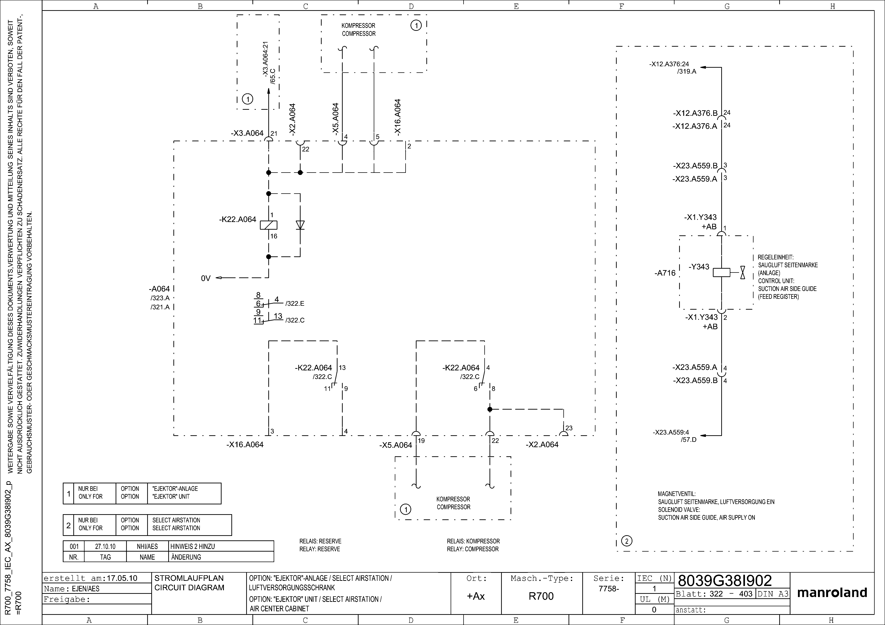

# +Ax — Sheet 322 of 403 — OPTION: "EJEKTOR" ANLAGE / SELECT AIRSTATION /

**LUFTVERSORGUNGSSCHRANK**

> Part of the manroland **R700** printing press IEC/UL circuit diagrams.
> Drawing class: **Stromlaufplan / Circuit diagram** (DIN A3).
> Document `+Ax` covers the **Central control console** machine section.

## At a glance

| Field | Value |
|---|---|
| Document | `+Ax`  (8039G38I902) |
| Sheet | **322** of 403 |
| Section (DE) | OPTION: "EJEKTOR" ANLAGE / SELECT AIRSTATION / |
| Section (EN) | LUFTVERSORGUNGSSCHRANK |
| Section type | CIRCUIT — Circuit diagram |
| Machine type | `R700` |
| Series | `7758` |
| Created | 17.05.10 |
| Replaces | — |
| Columns used | A, B, C, D, E, F, G, H |
| Path numbers | — |
| Labels on sheet | 113 |
| Cross-refs out | 9 |
| Cross-refs in | 27 |

**Previous:** [+Ax sheet 321](SHEET_0321.md) · **Next:** [+Ax sheet 323](SHEET_0323.md) · **Document TOC:** [_TOC.md](_TOC.md)  (+Ax) · **Master TOC:** [all sheets](../_MASTER_TOC.md)

## Sheet image (300 DPI, exact vector render)



_Rendered directly from the PDF vector layer at 300 DPI (1-bit), no OCR and no resampling. Use it to confirm anything ambiguous in the text below._

## Cross-references on this sheet

Each entry is a wire leaving this sheet. The printed token is `/sheet.column`; the link resolves to that sheet inside the same document.

| Ref | Target sheet | Col | Path | Destination on target | Target section | From col |
|---|---|---|---|---|---|---|
| `/65.C` | [+Ax sheet 65](SHEET_0065.md) | C | — | X3.A064:21 | DRUCKLUFTANLAGE | C |
| `/319.A` | [+Ax sheet 319](SHEET_0319.md) | A | — | X12.A376:24 | OPTION: "EJEKTOR" ANLAGE / SELECT AIRSTATION / | F |
| `/323.A` | [+Ax sheet 323](SHEET_0323.md) | A | — | — | OPTION: "EJEKTOR" ANLAGE / SELECT AIRSTATION / | B |
| `/321.A` | [+Ax sheet 321](SHEET_0321.md) | A | — | — | OPTION: "EJEKTOR" ANLAGE / SELECT AIRSTATION / | B |
| `/322.E` | [+Ax sheet 322](SHEET_0322.md) | E | — | 4 | OPTION: "EJEKTOR" ANLAGE / SELECT AIRSTATION / | C |
| `/322.C` | [+Ax sheet 322](SHEET_0322.md) | C | — | — | OPTION: "EJEKTOR" ANLAGE / SELECT AIRSTATION / | C |
| `/322.C` | [+Ax sheet 322](SHEET_0322.md) | C | — | — | OPTION: "EJEKTOR" ANLAGE / SELECT AIRSTATION / | C |
| `/322.C` | [+Ax sheet 322](SHEET_0322.md) | C | — | — | OPTION: "EJEKTOR" ANLAGE / SELECT AIRSTATION / | E |
| `/57.D` | [+Ax sheet 57](SHEET_0057.md) | D | — | X23.A559:4 | LUFTVERSORGUNG | G |

### Incoming references (sheets that point here)

Every other sheet that sends a wire to this one. `Back-ref` is the token printed on *that* sheet; `Path` is its line number.

| From sheet | Cols | Back-ref | Path | Refs | What continues there |
|---|---|---|---|---|---|
| [+Ax#57](SHEET_0057.md) | D | `/57.D` | — | 1 | X23.A559:4 |
| [+Ax#65](SHEET_0065.md) | C | `/65.C` | — | 1 | X3.A064:21 |
| [+Ax#216](SHEET_0216.md) | H | `/216.H` | — | 2 | — |
| [+Ax#217](SHEET_0217.md) | A | `/217.A` | — | 2 | — |
| [+Ax#222](SHEET_0222.md) | A | `/222.A` | — | 1 | — |
| [+Ax#230](SHEET_0230.md) | A | `/230.A` | — | 4 | — |
| [+Ax#248](SHEET_0248.md) | G, H | `/248.G`, `/248.H` | — | 2 | — |
| [+Ax#254](SHEET_0254.md) | A | `/254.A` | — | 3 | — |
| [+Ax#265](SHEET_0265.md) | A | `/265.A` | — | 4 | — |
| [+Ax#319](SHEET_0319.md) | A | `/319.A` | — | 1 | — |
| [+Ax#321](SHEET_0321.md) | A | `/321.A` | — | 1 | — |
| [+Ax#322](SHEET_0322.md) | C, E | `/322.C`, `/322.E` | — | 4 | 4 |
| [+Ax#323](SHEET_0323.md) | A | `/323.A` | — | 1 | — |


## Devices on this sheet

| Tag | Class | Class meaning (IEC) | Col | Sub | Terminal | Sign |
|---|---|---|---|---|---|---|
| `A064` | A | Baugruppe / assembly, module, PC board | B | — | — | — |
| `Y343` | Y | Magnetventil / solenoid valve, actuator | G | — | — | — |
| `A716` | A | Baugruppe / assembly, module, PC board | F | — | — | — |
| `X3.A064` | — | cross-device reference | B | — | — | — |
| `K22.A064` | — | cross-device reference | B | — | — | — |
| `K22.A064` | — | cross-device reference | C | — | — | — |
| `K22.A064` | — | cross-device reference | D | — | — | — |
| `X5.A064` | — | cross-device reference | D | — | — | — |
| `X5.A064` | — | cross-device reference | C | — | — | — |
| `X12.A376.B` | — | cross-device reference | G | — | — | — |
| `X12.A376.A` | — | cross-device reference | G | — | — | — |
| `X1.Y343` | — | cross-device reference | G | — | — | — |
| `X1.Y343` | — | cross-device reference | G | — | — | — |
| `X23.A559.B` | — | cross-device reference | G | — | — | — |
| `X23.A559.A` | — | cross-device reference | G | — | — | — |
| `X23.A559.A` | — | cross-device reference | G | — | — | — |
| `X23.A559.B` | — | cross-device reference | G | — | — | — |
| `NR.` | — | cross-device reference | A | — | — | — |
| `27.10.10` | — | cross-device reference | A | — | — | — |
| `X12.A376:24` | — | cross-device reference | F | — | 24 | — |
| `X23.A559:4` | — | cross-device reference | F | — | 4 | — |
| `X3.A064:21` | — | cross-device reference | C | — | 21 | — |
| `X2.A064` | — | cross-device reference | C | — | — | — |
| `X16.A064` | — | cross-device reference | D | — | — | — |
| `X16.A064` | — | cross-device reference | B | — | — | — |
| `X2.A064` | — | cross-device reference | E | — | — | — |

## Potentials / nets

| Potential | Count | Columns | Attached devices | Terminals |
|---|---|---|---|---|
| `0V` | 1 | B | — | — |


A potential such as `L24+/4` or `M24+` is a named supply/return rail; every place it appears on this sheet is electrically common.

## Wire-end annotations (grouped as printed)

A wire that continues elsewhere is annotated with a small cluster: the destination description, the path/line number `#NN`, and the `/sheet.column` cross reference. Each row below is one such cluster exactly as it is grouped on the drawing.

| Col | Y | Path | Cross-ref | Text on the wire |
|---|---|---|---|---|
| D | 31.0 | — | — | `KOMPRESSOR 1` |
| D | 42.5 | — | — | `COMPRESSOR` |
| C | 55.0 | — | `/65.C` | `X3.A064:21` |
| F | 82.5 | — | `/319.A` | `X12.A376:24` |
| B | 130.2 | — | — | `1` |
| D | 132.9 | — | — | `X16.A064` |
| C | 138.2 | — | — | `X5.A064` |
| C | 138.9 | — | — | `X2.A064` |
| G | 147.7 | — | — | `X12.A376.B 24` |
| G | 164.7 | — | — | `X12.A376.A 24` |
| C | 174.6 | — | — | `X3.A064 21` |
| C | 180.3 | — | — | `4` |
| D | 180.3 | — | — | `5` |
| C | 193.1 | — | — | `22 2` |
| G | 218.6 | — | — | `X23.A559.B 3` |
| G | 235.6 | — | — | `X23.A559.A 3` |
| C | 285.9 | — | — | `1` |
| G | 288.1 | — | — | `X1.Y343 1` |
| B | 290.9 | — | — | `K22.A064` |
| G | 300.7 | — | — | `+AB` |
| C | 314.3 | — | — | `16` |
| G | 343.6 | — | — | `REGELEINHEIT:` |
| H | 354.2 | — | — | `(ANLAGE) (FEED REGISTER) SAUGLUFT SEITENMARKE CONTROL UNIT: SUCTION AIR SIDE GUIDE` |
| G | 354.7 | — | — | `Y343` |
| F | 363.1 | — | — | `A716` |
| B | 370.2 | — | — | `0V` |
| B | 384.4 | — | — | `A064` |
| C | 392.9 | — | — | `11 8 6 9 13` |
| B | 397.5 | — | `/323.A`, `/321.A` | — |
| C | 398.5 | — | `/322.E` | `4` |
| G | 422.7 | — | — | `X1.Y343 2` |
| C | 427.6 | — | `/322.C` | — |
| G | 435.4 | — | — | `+AB` |
| G | 490.0 | — | — | `X23.A559.A 4` |
| C | 490.7 | — | — | `K22.A064` |
| D | 490.7 | — | — | `K22.A064` |
| C | 491.4 | — | — | `13` |
| E | 491.4 | — | — | `4` |
| C | 503.8 | — | `/322.C` | — |
| E | 503.8 | — | `/322.C` | — |
| G | 507.7 | — | — | `X23.A559.B 4` |
| C | 519.8 | — | — | `11` |
| C | 519.8 | — | — | `9` |
| E | 519.8 | — | — | `6` |
| E | 519.8 | — | — | `8` |
| D | 572.9 | — | — | `3 4 23` |
| D | 577.2 | — | — | `4 X5.A064 19 22` |
| G | 578.5 | — | `/57.D` | `X23.A559:4` |
| B | 594.2 | — | — | `X16.A064` |
| E | 594.2 | — | — | `X2.A064` |
| A | 655.4 | — | — | `1 ONLY FOR OPTION OPTION` |
| A | 655.4 | — | — | `NUR BEI` |
| B | 655.4 | — | — | `"EJEKTOR" ANLAGE "EJEKTOR" UNIT` |
| G | 662.5 | — | — | `MAGNETVENTIL: SAUGLUFT SEITENMARKE, LUFTVERSORGUNG EIN SOLENOID VALVE: SUCTION AIR SIDE GUIDE, AIR SUPPLY ON` |
| D | 669.6 | — | — | `KOMPRESSOR` |
| D | 680.2 | — | — | `COMPRESSOR` |
| D | 682.9 | — | — | `1` |
| A | 697.9 | — | — | `2 ONLY FOR OPTION OPTION` |
| A | 697.9 | — | — | `NUR BEI` |
| B | 697.9 | — | — | `SELECT AIRSTATION SELECT AIRSTATION` |
| F | 726.0 | — | — | `2` |
| C | 726.3 | — | — | `RELAIS: RESERVE RELAY: RESERVE` |
| E | 726.3 | — | — | `RELAIS: KOMPRESSOR RELAY: COMPRESSOR` |
| A | 733.0 | — | — | `001 27.10.10 NHI/AES HINWEIS 2 HINZU` |
| A | 747.1 | — | — | `NR. TAG NAME ÄNDERUNG` |


## Reconstructed tables

This sheet carries tabular content (pin map / terminal assignment / index). The grid below was rebuilt from the drawing's own rule lines, so each row is exactly one physical row of the table.

### Table 1 — 0 data rows × 4 columns (at x=361.4, y=232.4) — **1 16 4 /322.E 13 /322.C**

_none_


## Notes and free text on this sheet

| Text | Col | Y (pt) |
|---|---|---|
| `+AB` | G | 435.35 |
| `MAGNETVENTIL:` | G | 662.5 |
| `SAUGLUFT SEITENMARKE, LUFTVERSORGUNG EIN` | G | 673.15 |
| `SOLENOID VALVE:` | G | 683.76 |
| `SUCTION AIR SIDE GUIDE, AIR SUPPLY ON` | G | 694.41 |
| `REGELEINHEIT:` | G | 343.59 |
| `SAUGLUFT SEITENMARKE` | H | 354.25 |
| `(ANLAGE)` | G | 364.87 |
| `CONTROL UNIT:` | G | 375.52 |
| `SUCTION AIR SIDE GUIDE` | H | 386.14 |
| `(FEED REGISTER)` | G | 396.77 |
| `TAG` | A | 747.27 |
| `NAME` | A | 747.25 |
| `ÄNDERUNG` | B | 747.31 |
| `NHI/AES` | A | 733.11 |
| `HINWEIS 2 HINZU` | B | 733.1 |
| `RELAIS: RESERVE` | C | 726.26 |
| `RELAY: RESERVE` | C | 736.9 |
| `RELAIS: KOMPRESSOR` | E | 726.29 |
| `RELAY: COMPRESSOR` | E | 736.93 |
| `KOMPRESSOR` | D | 669.6 |
| `COMPRESSOR` | D | 680.25 |
| `NUR BEI` | A | 655.38 |
| `ONLY FOR` | A | 666.07 |
| `OPTION` | A | 655.4 |
| `"EJEKTOR" ANLAGE` | B | 655.42 |
| `"EJEKTOR" UNIT` | B | 666.05 |
| `SELECT AIRSTATION` | B | 697.93 |

## Complete label inventory (exact text from the drawing)

Every text object inside the drawing area of this sheet, in DIN reading order (column A→H, then top→bottom). This is the authoritative list: if a string is not here it is not printed on this sheet.

| Col | Y | X | Dir | Type | Text |
|---|---|---|---|---|---|
| A | 655.4 | 105.4 | → | text | `NUR BEI` |
| A | 655.4 | 162.7 | → | text | `OPTION` |
| A | 660.7 | 89.6 | → | number | `1` |
| A | 666.0 | 162.7 | → | text | `OPTION` |
| A | 666.1 | 106.0 | → | text | `ONLY FOR` |
| A | 697.9 | 105.4 | → | text | `NUR BEI` |
| A | 697.9 | 162.7 | → | text | `OPTION` |
| A | 703.3 | 89.3 | → | number | `2` |
| A | 708.6 | 106.0 | → | text | `ONLY FOR` |
| A | 708.6 | 162.7 | → | text | `OPTION` |
| A | 733.0 | 94.0 | → | number | `001` |
| A | 733.1 | 128.2 | → | device ref | `27.10.10` |
| A | 733.1 | 184.2 | → | text | `NHI/AES` |
| A | 747.1 | 93.0 | → | device ref | `NR.` |
| A | 747.3 | 134.6 | → | text | `TAG` |
| A | 747.3 | 188.0 | → | text | `NAME` |
| B | 130.2 | 331.3 | → | number | `1` |
| B | 174.6 | 310.7 | → | device ref | `X3.A064` |
| B | 290.9 | 294.8 | → | device ref | `K22.A064` |
| B | 370.2 | 270.4 | → | potential | `0V` |
| B | 384.4 | 200.4 | → | device tag | `A064` |
| B | 397.5 | 202.7 | → | cross-reference | `/323.A` |
| B | 409.9 | 202.7 | → | cross-reference | `/321.A` |
| B | 594.2 | 304.7 | → | device ref | `X16.A064` |
| B | 655.4 | 205.2 | → | text | `"EJEKTOR" ANLAGE` |
| B | 666.1 | 205.2 | → | text | `"EJEKTOR" UNIT` |
| B | 697.9 | 205.2 | → | text | `SELECT AIRSTATION` |
| B | 708.6 | 205.2 | → | text | `SELECT AIRSTATION` |
| B | 733.1 | 229.5 | → | text | `HINWEIS 2 HINZU` |
| B | 747.3 | 230.6 | → | text | `ÄNDERUNG` |
| C | 55.0 | 353.2 | ↕ | device ref | `X3.A064:21` |
| C | 92.4 | 363.1 | ↕ | cross-reference | `/65.C` |
| C | 138.2 | 446.8 | ↕ | device ref | `X5.A064` |
| C | 138.9 | 388.7 | ↕ | device ref | `X2.A064` |
| C | 176.1 | 364.0 | → | number | `21` |
| C | 180.3 | 463.2 | → | number | `4` |
| C | 197.3 | 406.5 | → | number | `22` |
| C | 285.9 | 363.4 | → | number | `1` |
| C | 314.3 | 363.4 | → | number | `16` |
| C | 392.9 | 344.7 | → | number | `8` |
| C | 398.5 | 369.6 | → | number | `4` |
| C | 404.2 | 344.7 | → | number | `6` |
| C | 404.9 | 384.1 | → | cross-reference | `/322.E` |
| C | 415.5 | 344.7 | → | number | `9` |
| C | 421.2 | 367.9 | → | number | `13` |
| C | 426.9 | 340.2 | → | number | `11` |
| C | 427.6 | 384.1 | → | cross-reference | `/322.C` |
| C | 490.7 | 396.9 | → | device ref | `K22.A064` |
| C | 491.4 | 455.5 | → | number | `13` |
| C | 503.8 | 420.9 | → | cross-reference | `/322.C` |
| C | 519.8 | 435.7 | → | number | `11` |
| C | 519.8 | 463.2 | → | number | `9` |
| C | 577.2 | 364.0 | → | number | `3` |
| C | 577.2 | 463.2 | → | number | `4` |
| C | 577.2 | 463.2 | → | number | `4` |
| C | 726.3 | 403.1 | → | text | `RELAIS: RESERVE` |
| C | 736.9 | 403.1 | → | text | `RELAY: RESERVE` |
| D | 31.0 | 558.1 | → | number | `1` |
| D | 31.8 | 459.8 | → | text | `KOMPRESSOR` |
| D | 42.5 | 460.3 | → | text | `COMPRESSOR` |
| D | 132.9 | 530.4 | ↕ | device ref | `X16.A064` |
| D | 180.3 | 505.7 | → | number | `5` |
| D | 193.1 | 548.2 | → | number | `2` |
| D | 490.7 | 595.3 | → | device ref | `K22.A064` |
| D | 589.9 | 561.8 | → | number | `19` |
| D | 594.9 | 510.5 | → | device ref | `X5.A064` |
| D | 669.6 | 587.3 | → | text | `KOMPRESSOR` |
| D | 680.3 | 587.9 | → | text | `COMPRESSOR` |
| D | 682.9 | 543.9 | → | number | `1` |
| E | 491.4 | 654.5 | → | number | `4` |
| E | 503.8 | 619.4 | → | cross-reference | `/322.C` |
| E | 519.8 | 637.5 | → | number | `6` |
| E | 519.8 | 661.6 | → | number | `8` |
| E | 589.9 | 661.6 | → | number | `22` |
| E | 594.2 | 707.5 | → | device ref | `X2.A064` |
| E | 726.3 | 601.5 | → | text | `RELAIS: KOMPRESSOR` |
| E | 736.9 | 601.5 | → | text | `RELAY: COMPRESSOR` |
| F | 82.5 | 873.6 | → | device ref | `X12.A376:24` |
| F | 363.1 | 880.7 | → | device tag | `A716` |
| F | 572.9 | 760.8 | → | number | `23` |
| F | 578.6 | 878.5 | → | device ref | `X23.A559:4` |
| F | 726.0 | 841.3 | → | number | `2` |
| G | 92.4 | 911.3 | → | cross-reference | `/319.A` |
| G | 147.7 | 905.7 | → | device ref | `X12.A376.B` |
| G | 147.7 | 973.4 | → | number | `24` |
| G | 164.7 | 973.4 | → | number | `24` |
| G | 165.4 | 904.8 | → | device ref | `X12.A376.A` |
| G | 218.6 | 905.7 | → | device ref | `X23.A559.B` |
| G | 218.6 | 973.4 | → | number | `3` |
| G | 235.6 | 973.4 | → | number | `3` |
| G | 236.3 | 904.8 | → | device ref | `X23.A559.A` |
| G | 288.1 | 920.7 | → | device ref | `X1.Y343` |
| G | 300.7 | 943.9 | → | text | `+AB` |
| G | 303.6 | 972.9 | → | number | `1` |
| G | 343.6 | 1019.6 | → | text | `REGELEINHEIT:` |
| G | 354.7 | 926.6 | → | device tag | `Y343` |
| G | 364.9 | 1019.9 | → | text | `(ANLAGE)` |
| G | 375.5 | 1020.2 | → | text | `CONTROL UNIT:` |
| G | 396.8 | 1019.9 | → | text | `(FEED REGISTER)` |
| G | 422.7 | 922.1 | → | device ref | `X1.Y343` |
| G | 424.1 | 973.4 | → | number | `2` |
| G | 435.3 | 945.4 | → | text | `+AB` |
| G | 490.0 | 904.8 | → | device ref | `X23.A559.A` |
| G | 492.1 | 973.4 | → | number | `4` |
| G | 507.7 | 905.7 | → | device ref | `X23.A559.B` |
| G | 509.1 | 973.4 | → | number | `4` |
| G | 588.5 | 916.2 | → | cross-reference | `/57.D` |
| G | 662.5 | 885.3 | → | text | `MAGNETVENTIL:` |
| G | 673.2 | 885.5 | → | text | `SAUGLUFT SEITENMARKE, LUFTVERSORGUNG EIN` |
| G | 683.8 | 885.5 | → | text | `SOLENOID VALVE:` |
| G | 694.4 | 885.5 | → | text | `SUCTION AIR SIDE GUIDE, AIR SUPPLY ON` |
| H | 354.3 | 1020.2 | → | text | `SAUGLUFT SEITENMARKE` |
| H | 386.1 | 1020.2 | → | text | `SUCTION AIR SIDE GUIDE` |

## Reading-order text block

The same content as a plain block, grouped by DIN column — convenient to paste or to match against a visual description.

```text
=== Column A ===
 655.4  105.4  text         NUR BEI
 655.4  162.7  text         OPTION
 660.7   89.6  numeric      1
 666.0  162.7  text         OPTION
 666.1  106.0  text         ONLY FOR
 697.9  105.4  text         NUR BEI
 697.9  162.7  text         OPTION
 703.3   89.3  numeric      2
 708.6  106.0  text         ONLY FOR
 708.6  162.7  text         OPTION
 733.0   94.0  numeric      001
 733.1  128.2  devref       27.10.10
 733.1  184.2  text         NHI/AES
 747.1   93.0  devref       NR.
 747.3  134.6  text         TAG
 747.3  188.0  text         NAME
=== Column B ===
 130.2  331.3  numeric      1
 174.6  310.7  devref       X3.A064
 290.9  294.8  devref       K22.A064
 370.2  270.4  net          0V
 384.4  200.4  devtag       A064
 397.5  202.7  xref         /323.A
 409.9  202.7  xref         /321.A
 594.2  304.7  devref       X16.A064
 655.4  205.2  text         "EJEKTOR" ANLAGE
 666.1  205.2  text         "EJEKTOR" UNIT
 697.9  205.2  text         SELECT AIRSTATION
 708.6  205.2  text         SELECT AIRSTATION
 733.1  229.5  text         HINWEIS 2 HINZU
 747.3  230.6  text         ÄNDERUNG
=== Column C ===
  55.0  353.2  devref       X3.A064:21
  92.4  363.1  xref         /65.C
 138.2  446.8  devref       X5.A064
 138.9  388.7  devref       X2.A064
 176.1  364.0  numeric      21
 180.3  463.2  numeric      4
 197.3  406.5  numeric      22
 285.9  363.4  numeric      1
 314.3  363.4  numeric      16
 392.9  344.7  numeric      8
 398.5  369.6  numeric      4
 404.2  344.7  numeric      6
 404.9  384.1  xref         /322.E
 415.5  344.7  numeric      9
 421.2  367.9  numeric      13
 426.9  340.2  numeric      11
 427.6  384.1  xref         /322.C
 490.7  396.9  devref       K22.A064
 491.4  455.5  numeric      13
 503.8  420.9  xref         /322.C
 519.8  435.7  numeric      11
 519.8  463.2  numeric      9
 577.2  364.0  numeric      3
 577.2  463.2  numeric      4
 577.2  463.2  numeric      4
 726.3  403.1  text         RELAIS: RESERVE
 736.9  403.1  text         RELAY: RESERVE
=== Column D ===
  31.0  558.1  numeric      1
  31.8  459.8  text         KOMPRESSOR
  42.5  460.3  text         COMPRESSOR
 132.9  530.4  devref       X16.A064
 180.3  505.7  numeric      5
 193.1  548.2  numeric      2
 490.7  595.3  devref       K22.A064
 589.9  561.8  numeric      19
 594.9  510.5  devref       X5.A064
 669.6  587.3  text         KOMPRESSOR
 680.3  587.9  text         COMPRESSOR
 682.9  543.9  numeric      1
=== Column E ===
 491.4  654.5  numeric      4
 503.8  619.4  xref         /322.C
 519.8  637.5  numeric      6
 519.8  661.6  numeric      8
 589.9  661.6  numeric      22
 594.2  707.5  devref       X2.A064
 726.3  601.5  text         RELAIS: KOMPRESSOR
 736.9  601.5  text         RELAY: COMPRESSOR
=== Column F ===
  82.5  873.6  devref       X12.A376:24
 363.1  880.7  devtag       A716
 572.9  760.8  numeric      23
 578.6  878.5  devref       X23.A559:4
 726.0  841.3  numeric      2
=== Column G ===
  92.4  911.3  xref         /319.A
 147.7  905.7  devref       X12.A376.B
 147.7  973.4  numeric      24
 164.7  973.4  numeric      24
 165.4  904.8  devref       X12.A376.A
 218.6  905.7  devref       X23.A559.B
 218.6  973.4  numeric      3
 235.6  973.4  numeric      3
 236.3  904.8  devref       X23.A559.A
 288.1  920.7  devref       X1.Y343
 300.7  943.9  text         +AB
 303.6  972.9  numeric      1
 343.6 1019.6  text         REGELEINHEIT:
 354.7  926.6  devtag       Y343
 364.9 1019.9  text         (ANLAGE)
 375.5 1020.2  text         CONTROL UNIT:
 396.8 1019.9  text         (FEED REGISTER)
 422.7  922.1  devref       X1.Y343
 424.1  973.4  numeric      2
 435.3  945.4  text         +AB
 490.0  904.8  devref       X23.A559.A
 492.1  973.4  numeric      4
 507.7  905.7  devref       X23.A559.B
 509.1  973.4  numeric      4
 588.5  916.2  xref         /57.D
 662.5  885.3  text         MAGNETVENTIL:
 673.2  885.5  text         SAUGLUFT SEITENMARKE, LUFTVERSORGUNG EIN
 683.8  885.5  text         SOLENOID VALVE:
 694.4  885.5  text         SUCTION AIR SIDE GUIDE, AIR SUPPLY ON
=== Column H ===
 354.3 1020.2  text         SAUGLUFT SEITENMARKE
 386.1 1020.2  text         SUCTION AIR SIDE GUIDE
```

---
_Generated from the PDF vector text layer; no OCR. Source: `R700_7758_IEC_AX_8039G38I902_p`, sheet 322._
