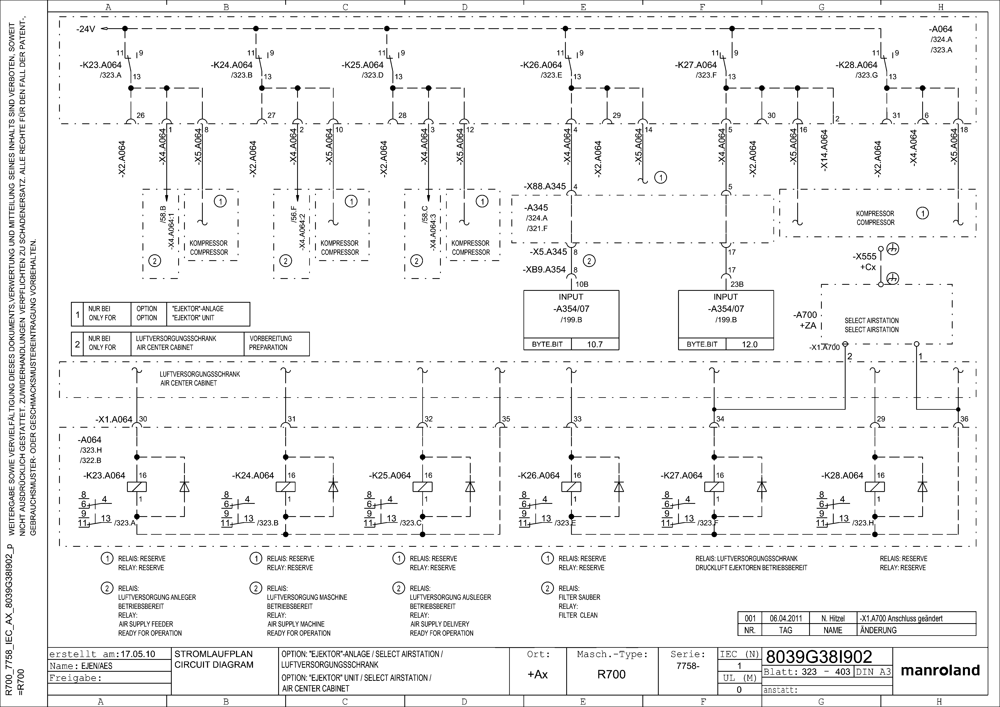

# +Ax — Sheet 323 of 403 — OPTION: "EJEKTOR" ANLAGE / SELECT AIRSTATION /

**LUFTVERSORGUNGSSCHRANK**

> Part of the manroland **R700** printing press IEC/UL circuit diagrams.
> Drawing class: **Stromlaufplan / Circuit diagram** (DIN A3).
> Document `+Ax` covers the **Central control console** machine section.

## At a glance

| Field | Value |
|---|---|
| Document | `+Ax`  (8039G38I902) |
| Sheet | **323** of 403 |
| Section (DE) | OPTION: "EJEKTOR" ANLAGE / SELECT AIRSTATION / |
| Section (EN) | LUFTVERSORGUNGSSCHRANK |
| Section type | CIRCUIT — Circuit diagram |
| Machine type | `R700` |
| Series | `7758` |
| Created | 17.05.10 |
| Replaces | — |
| Columns used | A, B, C, D, E, F, G, H |
| Path numbers | — |
| Labels on sheet | 266 |
| Cross-refs out | 23 |
| Cross-refs in | 56 |

**Previous:** [+Ax sheet 322](SHEET_0322.md) · **Next:** [+Ax sheet 324](SHEET_0324.md) · **Document TOC:** [_TOC.md](_TOC.md)  (+Ax) · **Master TOC:** [all sheets](../_MASTER_TOC.md)

## Sheet image (300 DPI, exact vector render)



_Rendered directly from the PDF vector layer at 300 DPI (1-bit), no OCR and no resampling. Use it to confirm anything ambiguous in the text below._

## Cross-references on this sheet

Each entry is a wire leaving this sheet. The printed token is `/sheet.column`; the link resolves to that sheet inside the same document.

| Ref | Target sheet | Col | Path | Destination on target | Target section | From col |
|---|---|---|---|---|---|---|
| `/324.A` | [+Ax sheet 324](SHEET_0324.md) | A | — | — | OPTION: "EJEKTOR" ANLAGE / SELECT AIRSTATION / | H |
| `/323.A` | [+Ax sheet 323](SHEET_0323.md) | A | — | — | OPTION: "EJEKTOR" ANLAGE / SELECT AIRSTATION / | H |
| `/323.A` | [+Ax sheet 323](SHEET_0323.md) | A | — | — | OPTION: "EJEKTOR" ANLAGE / SELECT AIRSTATION / | A |
| `/323.B` | [+Ax sheet 323](SHEET_0323.md) | B | — | — | OPTION: "EJEKTOR" ANLAGE / SELECT AIRSTATION / | B |
| `/323.E` | [+Ax sheet 323](SHEET_0323.md) | E | — | — | OPTION: "EJEKTOR" ANLAGE / SELECT AIRSTATION / | E |
| `/323.F` | [+Ax sheet 323](SHEET_0323.md) | F | — | — | OPTION: "EJEKTOR" ANLAGE / SELECT AIRSTATION / | F |
| `/323.G` | [+Ax sheet 323](SHEET_0323.md) | G | — | — | OPTION: "EJEKTOR" ANLAGE / SELECT AIRSTATION / | G |
| `/323.D` | [+Ax sheet 323](SHEET_0323.md) | D | — | — | OPTION: "EJEKTOR" ANLAGE / SELECT AIRSTATION / | C |
| `/58.B` | [+Ax sheet 58](SHEET_0058.md) | B | — | — | LUFTVERSORGUNG | A |
| `/56.F` | [+Ax sheet 56](SHEET_0056.md) | F | — | — | LUFTVERSORGUNG | C |
| `/58.C` | [+Ax sheet 58](SHEET_0058.md) | C | — | — | LUFTVERSORGUNG | D |
| `/324.A` | [+Ax sheet 324](SHEET_0324.md) | A | — | — | OPTION: "EJEKTOR" ANLAGE / SELECT AIRSTATION / | E |
| `/321.F` | [+Ax sheet 321](SHEET_0321.md) | F | — | — | OPTION: "EJEKTOR" ANLAGE / SELECT AIRSTATION / | E |
| `/199.B` | [+Ax sheet 199](SHEET_0199.md) | B | — | — | REFERENZMODUL | E |
| `/199.B` | [+Ax sheet 199](SHEET_0199.md) | B | — | — | REFERENZMODUL | F |
| `/323.H` | [+Ax sheet 323](SHEET_0323.md) | H | — | — | OPTION: "EJEKTOR" ANLAGE / SELECT AIRSTATION / | A |
| `/322.B` | [+Ax sheet 322](SHEET_0322.md) | B | — | — | OPTION: "EJEKTOR" ANLAGE / SELECT AIRSTATION / | A |
| `/323.A` | [+Ax sheet 323](SHEET_0323.md) | A | — | — | OPTION: "EJEKTOR" ANLAGE / SELECT AIRSTATION / | A |
| `/323.B` | [+Ax sheet 323](SHEET_0323.md) | B | — | — | OPTION: "EJEKTOR" ANLAGE / SELECT AIRSTATION / | B |
| `/323.E` | [+Ax sheet 323](SHEET_0323.md) | E | — | — | OPTION: "EJEKTOR" ANLAGE / SELECT AIRSTATION / | E |
| `/323.F` | [+Ax sheet 323](SHEET_0323.md) | F | — | — | OPTION: "EJEKTOR" ANLAGE / SELECT AIRSTATION / | F |
| `/323.C` | [+Ax sheet 323](SHEET_0323.md) | C | — | — | OPTION: "EJEKTOR" ANLAGE / SELECT AIRSTATION / | D |
| `/323.H` | [+Ax sheet 323](SHEET_0323.md) | H | — | — | OPTION: "EJEKTOR" ANLAGE / SELECT AIRSTATION / | G |

### Incoming references (sheets that point here)

Every other sheet that sends a wire to this one. `Back-ref` is the token printed on *that* sheet; `Path` is its line number.

| From sheet | Cols | Back-ref | Path | Refs | What continues there |
|---|---|---|---|---|---|
| [+Ax#56](SHEET_0056.md) | F | `/56.F` | — | 1 | — |
| [+Ax#58](SHEET_0058.md) | B, C | `/58.B`, `/58.C` | — | 2 | — |
| [+Ax#199](SHEET_0199.md) | B | `/199.B` | — | 2 | — |
| [+Ax#206](SHEET_0206.md) | A | `/206.A` | — | 8 | — |
| [+Ax#217](SHEET_0217.md) | A | `/217.A` | — | 6 | — |
| [+Ax#226](SHEET_0226.md) | A | `/226.A` | — | 6 | — |
| [+Ax#230](SHEET_0230.md) | A | `/230.A` | — | 6 | — |
| [+Ax#231](SHEET_0231.md) | A | `/231.A` | — | 2 | — |
| [+Ax#242](SHEET_0242.md) | A | `/242.A` | — | 2 | — |
| [+Ax#251](SHEET_0251.md) | A | `/251.A` | — | 1 | — |
| [+Ax#289](SHEET_0289.md) | A | `/289.A` | — | 2 | — |
| [+Ax#321](SHEET_0321.md) | F | `/321.F` | — | 1 | — |
| [+Ax#322](SHEET_0322.md) | B | `/322.B` | — | 1 | — |
| [+Ax#323](SHEET_0323.md) | A, B, C, D, E, F, G, H | `/323.A`, `/323.B`, `/323.C`, `/323.D`, `/323.E`, `/323.F`, `/323.G`, `/323.H` | — | 14 | — |
| [+Ax#324](SHEET_0324.md) | A | `/324.A` | — | 2 | — |


## Devices on this sheet

| Tag | Class | Class meaning (IEC) | Col | Sub | Terminal | Sign |
|---|---|---|---|---|---|---|
| `A064` | A | Baugruppe / assembly, module, PC board | A | — | — | — |
| `A064` | A | Baugruppe / assembly, module, PC board | H | — | — | — |
| `A354/07` | A | Baugruppe / assembly, module, PC board | E | 07 | — | — |
| `A354/07` | A | Baugruppe / assembly, module, PC board | F | 07 | — | — |
| `A345` | A | Baugruppe / assembly, module, PC board | E | — | — | — |
| `A700` | A | Baugruppe / assembly, module, PC board | G | — | — | — |
| `X555` | X | Klemme / terminal, plug connector | G | — | — | — |
| `K23.A064` | — | cross-device reference | A | — | — | — |
| `K24.A064` | — | cross-device reference | B | — | — | — |
| `K25.A064` | — | cross-device reference | C | — | — | — |
| `K26.A064` | — | cross-device reference | E | — | — | — |
| `K27.A064` | — | cross-device reference | F | — | — | — |
| `K28.A064` | — | cross-device reference | G | — | — | — |
| `X1.A064` | — | cross-device reference | A | — | — | — |
| `K26.A064` | — | cross-device reference | E | — | — | — |
| `K28.A064` | — | cross-device reference | G | — | — | — |
| `X5.A064` | — | cross-device reference | E | — | — | — |
| `X5.A064` | — | cross-device reference | H | — | — | — |
| `X4.A064` | — | cross-device reference | A | — | — | — |
| `K23.A064` | — | cross-device reference | A | — | — | — |
| `X5.A064` | — | cross-device reference | B | — | — | — |
| `X4.A064` | — | cross-device reference | C | — | — | — |
| `K24.A064` | — | cross-device reference | B | — | — | — |
| `X5.A064` | — | cross-device reference | C | — | — | — |
| `X4.A064` | — | cross-device reference | D | — | — | — |
| `K25.A064` | — | cross-device reference | C | — | — | — |
| `X5.A064` | — | cross-device reference | D | — | — | — |
| `K27.A064` | — | cross-device reference | F | — | — | — |
| `X5.A064` | — | cross-device reference | G | — | — | — |
| `X4.A064` | — | cross-device reference | E | — | — | — |
| `10.7` | — | cross-device reference | E | — | — | — |
| `XB9.A354` | — | cross-device reference | E | — | — | — |
| `X4.A064` | — | cross-device reference | F | — | — | — |
| `12.0` | — | cross-device reference | F | — | — | — |
| `X88.A345` | — | cross-device reference | E | — | — | — |
| `X5.A345` | — | cross-device reference | E | — | — | — |
| `X4.A064:1` | — | cross-device reference | B | — | 1 | — |
| `X4.A064:2` | — | cross-device reference | C | — | 2 | — |
| `X4.A064:3` | — | cross-device reference | D | — | 3 | — |
| `NR.` | — | cross-device reference | F | — | — | — |
| `06.04.2011` | — | cross-device reference | G | — | — | — |
| `X2.A064` | — | cross-device reference | G | — | — | — |
| `X4.A064` | — | cross-device reference | H | — | — | — |
| `X2.A064` | — | cross-device reference | A | — | — | — |
| `X2.A064` | — | cross-device reference | B | — | — | — |
| `X2.A064` | — | cross-device reference | C | — | — | — |
| `X14.A064` | — | cross-device reference | G | — | — | — |
| `X2.A064` | — | cross-device reference | E | — | — | — |
| `X2.A064` | — | cross-device reference | F | — | — | — |
| `X1.A700` | — | cross-device reference | G | — | — | — |

## Potentials / nets

| Potential | Count | Columns | Attached devices | Terminals |
|---|---|---|---|---|
| `24V` | 1 | A | — | — |


A potential such as `L24+/4` or `M24+` is a named supply/return rail; every place it appears on this sheet is electrically common.

## Wire-end annotations (grouped as printed)

A wire that continues elsewhere is annotated with a small cluster: the destination description, the path/line number `#NN`, and the `/sheet.column` cross reference. Each row below is one such cluster exactly as it is grouped on the drawing.

| Col | Y | Path | Cross-ref | Text on the wire |
|---|---|---|---|---|
| A | 30.1 | — | — | `24V` |
| H | 30.1 | — | — | `A064` |
| H | 43.1 | — | `/324.A`, `/323.A` | — |
| A | 59.1 | — | — | `K23.A064 9` |
| A | 59.1 | — | — | `11` |
| B | 59.1 | — | — | `K24.A064 9` |
| B | 59.1 | — | — | `11` |
| C | 59.1 | — | — | `K25.A064 9` |
| C | 59.1 | — | — | `11` |
| E | 59.1 | — | — | `K26.A064 9` |
| E | 59.1 | — | — | `11` |
| F | 59.1 | — | — | `K27.A064 9` |
| F | 59.1 | — | — | `11` |
| G | 59.1 | — | — | `K28.A064 9` |
| G | 59.1 | — | — | `11` |
| A | 85.7 | — | `/323.A` | — |
| B | 85.7 | — | `/323.B` | — |
| C | 85.7 | — | `/323.D` | — |
| E | 85.7 | — | `/323.E` | — |
| F | 85.7 | — | `/323.F` | — |
| G | 85.7 | — | `/323.G` | — |
| A | 87.5 | — | — | `13` |
| B | 87.5 | — | — | `13` |
| C | 87.5 | — | — | `13` |
| E | 87.5 | — | — | `13` |
| F | 87.5 | — | — | `13` |
| H | 87.5 | — | — | `13` |
| A | 133.6 | — | — | `26` |
| B | 133.6 | — | — | `27` |
| C | 133.6 | — | — | `28` |
| F | 133.6 | — | — | `29 30` |
| H | 133.6 | — | — | `31` |
| H | 133.6 | — | — | `6` |
| G | 137.8 | — | — | `2` |
| B | 150.6 | — | — | `1` |
| B | 150.6 | — | — | `8` |
| C | 150.6 | — | — | `2` |
| C | 150.6 | — | — | `10` |
| D | 150.6 | — | — | `3` |
| D | 150.6 | — | — | `12` |
| E | 150.6 | — | — | `4` |
| F | 150.6 | — | — | `14` |
| F | 150.6 | — | — | `5` |
| G | 150.6 | — | — | `16` |
| H | 150.6 | — | — | `18` |
| A | 152.5 | — | — | `X4.A064` |
| B | 152.5 | — | — | `X5.A064` |
| C | 152.5 | — | — | `X4.A064` |
| C | 152.5 | — | — | `X5.A064` |
| D | 152.5 | — | — | `X4.A064` |
| D | 152.5 | — | — | `X5.A064` |
| E | 152.5 | — | — | `X4.A064` |
| E | 152.5 | — | — | `X5.A064` |
| F | 152.5 | — | — | `X4.A064` |
| G | 152.5 | — | — | `X5.A064` |
| H | 152.5 | — | — | `X5.A064` |
| G | 153.9 | — | — | `X14.A064` |
| H | 153.9 | — | — | `X4.A064` |
| A | 167.2 | — | — | `X2.A064` |
| B | 167.2 | — | — | `X2.A064` |
| C | 167.2 | — | — | `X2.A064` |
| E | 167.2 | — | — | `X2.A064` |
| F | 167.2 | — | — | `X2.A064` |
| G | 167.2 | — | — | `X2.A064` |
| F | 208.1 | — | — | `1` |
| E | 217.2 | — | — | `X88.A345 4` |
| F | 218.6 | — | — | `5` |
| B | 236.5 | — | — | `1` |
| C | 236.5 | — | — | `1` |
| D | 236.5 | — | — | `1` |
| E | 242.7 | — | — | `A345` |
| A | 244.9 | — | `/58.B` | — |
| C | 244.9 | — | `/56.F` | — |
| D | 244.9 | — | `/58.C` | — |
| H | 250.6 | — | — | `1` |
| G | 251.5 | — | — | `KOMPRESSOR` |
| B | 253.4 | — | — | `X4.A064:1` |
| C | 254.6 | — | — | `X4.A064:2` |
| D | 254.8 | — | — | `X4.A064:3` |
| E | 255.7 | — | `/324.A` | — |
| G | 262.1 | — | — | `COMPRESSOR` |
| E | 268.1 | — | `/321.F` | — |
| B | 286.9 | — | — | `KOMPRESSOR` |
| C | 286.9 | — | — | `KOMPRESSOR` |
| D | 286.9 | — | — | `KOMPRESSOR` |
| E | 295.1 | — | — | `X5.A345 8` |
| F | 296.5 | — | — | `17` |
| B | 297.6 | — | — | `COMPRESSOR` |
| C | 297.6 | — | — | `COMPRESSOR` |
| D | 297.6 | — | — | `COMPRESSOR` |
| G | 300.8 | — | — | `X555` |
| A | 307.9 | — | — | `2` |
| B | 307.9 | — | — | `2` |
| D | 307.9 | — | — | `2` |
| E | 307.9 | — | — | `2` |
| G | 313.6 | — | — | `+Cx` |
| E | 316.4 | — | — | `XB9.A354 8` |
| F | 317.8 | — | — | `17` |
| E | 334.8 | — | — | `10B` |
| F | 334.8 | — | — | `23B` |
| E | 349.3 | — | — | `INPUT` |
| F | 349.3 | — | — | `INPUT` |
| E | 363.1 | — | — | `A354/07` |
| F | 363.1 | — | — | `A354/07` |
| A | 364.8 | — | — | `NUR BEI` |
| A | 364.9 | — | — | `1 ONLY FOR OPTION OPTION` |
| B | 364.9 | — | — | `"EJEKTOR" ANLAGE "EJEKTOR" UNIT` |
| G | 370.2 | — | — | `A700` |
| E | 376.9 | — | `/199.B` | — |
| F | 376.9 | — | `/199.B` | — |
| G | 379.0 | — | — | `SELECT AIRSTATION SELECT AIRSTATION` |
| G | 382.9 | — | — | `+ZA` |
| B | 400.3 | — | — | `2 PREPARATION VORBEREITUNG` |
| A | 400.3 | — | — | `NUR BEI` |
| B | 400.3 | — | — | `LUFTVERSORGUNGSSCHRANK` |
| E | 406.0 | — | — | `BYTE.BIT 10.7` |
| F | 406.0 | — | — | `BYTE.BIT 12.0` |
| G | 409.9 | — | — | `X1.A700` |
| A | 410.9 | — | — | `ONLY FOR` |
| A | 410.9 | — | — | `AIR CENTER CABINET` |
| H | 419.8 | — | — | `2 1` |
| B | 442.9 | — | — | `LUFTVERSORGUNGSSCHRANK` |
| B | 453.5 | — | — | `AIR CENTER CABINET` |
| E | 494.9 | — | — | `X1.A064 30 31 32 35 33 34 29 36` |
| A | 519.0 | — | — | `A064` |
| A | 532.1 | — | `/323.H`, `/322.B` | — |
| A | 561.6 | — | — | `K23.A064` |
| B | 561.6 | — | — | `K24.A064` |
| C | 561.6 | — | — | `K25.A064` |
| E | 561.6 | — | — | `K26.A064` |
| F | 561.6 | — | — | `K27.A064` |
| G | 561.6 | — | — | `K28.A064` |
| A | 562.3 | — | — | `16` |
| C | 562.3 | — | — | `16` |
| D | 562.3 | — | — | `16` |
| E | 562.3 | — | — | `16` |
| F | 562.3 | — | — | `16` |
| G | 562.3 | — | — | `16` |
| A | 584.2 | — | — | `11 8 6 9 13` |
| B | 584.2 | — | — | `11 8 6 9 13` |
| C | 584.2 | — | — | `11 8 6 9 13` |
| E | 584.2 | — | — | `11 8 6 9 13` |
| F | 584.2 | — | — | `11 8 6 9 13` |
| G | 584.2 | — | — | `11 8 6 9 13` |
| A | 589.9 | — | — | `4` |
| B | 589.9 | — | — | `4` |
| C | 589.9 | — | — | `4` |
| E | 589.9 | — | — | `4` |
| F | 589.9 | — | — | `4` |
| G | 589.9 | — | — | `4` |
| A | 590.6 | — | — | `1` |
| C | 590.6 | — | — | `1` |
| D | 590.6 | — | — | `1` |
| E | 590.6 | — | — | `1` |
| F | 590.6 | — | — | `1` |
| G | 590.6 | — | — | `1` |
| A | 618.9 | — | `/323.A` | — |
| B | 618.9 | — | `/323.B` | — |
| E | 618.9 | — | `/323.E` | — |
| F | 618.9 | — | `/323.F` | — |
| D | 619.0 | — | `/323.C` | — |
| G | 619.0 | — | `/323.H` | — |
| C | 661.7 | — | — | `1 1 1 1` |
| A | 662.5 | — | — | `RELAIS: RESERVE RELAY: RESERVE` |
| C | 662.5 | — | — | `RELAIS: RESERVE RELAY: RESERVE` |
| D | 662.5 | — | — | `RELAIS: RESERVE RELAY: RESERVE` |
| E | 662.5 | — | — | `RELAIS: RESERVE RELAY: RESERVE` |
| F | 662.5 | — | — | `RELAIS: LUFTVERSORGUNGSSCHRANK DRUCKLUFT EJEKTOREN BETRIEBSBEREIT` |
| H | 662.5 | — | — | `RELAIS: RESERVE RELAY: RESERVE` |
| C | 697.6 | — | — | `2 2 2 2` |
| A | 697.9 | — | — | `RELAIS: LUFTVERSORGUNG ANLEGER BETRIEBSBEREIT RELAY:` |
| C | 697.9 | — | — | `RELAIS: LUFTVERSORGUNG MASCHINE BETRIEBSBEREIT RELAY:` |
| D | 697.9 | — | — | `RELAIS: LUFTVERSORGUNG AUSLEGER BETRIEBSBEREIT RELAY:` |
| E | 697.9 | — | — | `RELAIS: FILTER SAUBER RELAY: FILTER CLEAN` |
| G | 732.7 | — | — | `001 06.04.2011 N. Hitzel X1.A700 Anschluss geändert` |
| A | 740.5 | — | — | `READY FOR OPERATION AIR SUPPLY FEEDER` |
| C | 740.5 | — | — | `READY FOR OPERATION AIR SUPPLY MACHINE` |
| D | 740.5 | — | — | `READY FOR OPERATION AIR SUPPLY DELIVERY` |
| G | 747.0 | — | — | `NR. TAG NAME ÄNDERUNG` |


## Reconstructed tables

This sheet carries tabular content (pin map / terminal assignment / index). The grid below was rebuilt from the drawing's own rule lines, so each row is exactly one physical row of the table.

### Table 1 — 7 data rows × 8 columns (at x=113.4, y=34.0)

| 11 K23.A064 /323.A |  | 13 | 9 |  |  | K24.A064 | 11 /323.B |
|---|---|---|---|---|---|---|---|
| `X2.A064` |  |  | `26 X4.A064 /58.B 2` | `1 X4.A064:1` | `X5.A064` | `8 1 KOMPRESSOR COMPRESSOR` | `X2.A064` |
| `BEI ONLY FOR` |  |  | `OPTION OPTION` |  | `"EJEKTOR" ANLAGE "EJEKTOR"` | `UNIT` |  |
| `BEI ONLY FOR` |  |  | `AIR CENTER` | `LUFTVERSORGUNGSSCHRANK CABINET` |  |  |  |
|  |  |  | `AIR` | `CENTER` | `LUFTVERSORGUNGSSCHRANK` | `CABINET` |  |
| `X1.A064` |  |  | `30` |  |  |  |  |
| `K23.A064 4` |  |  | `16 1` |  |  | `8 6 9` | `K24.A064 4` |
| `13` | `/323.A` |  |  |  |  | `11` | `13` |


### Table 2 — 7 data rows × 33 columns (at x=311.8, y=34.0)

| 9 13 |  |  | K25.A064 /323.D | 11 |  | 9 13 |  |  |  |  |  |  | 11 K26.A064 /323.E |  | 9 13 |  |  |  | K27.A064 /323.F | 11 | 13 | 9 |  |  |  |  | K28.A064 /323.G | 11 |  | 9 13 |  | A064 /324.A /323.A |
|---|---|---|---|---|---|---|---|---|---|---|---|---|---|---|---|---|---|---|---|---|---|---|---|---|---|---|---|---|---|---|---|---|
| `27 2` | `X4.A064 /56.F` | `2 X5.A064 X4.A064:2` | `10 1 KOMPRESSOR COMPRESSOR` | `X2.A064` |  | `28 2` | `X4.A064 /58.C` | `3 X5.A064 X4.A064:3` | `12` | `1 KOMPRESSOR COMPRESSOR` |  |  | `X88.A345 A345 /324.A /321.F X5.A345 XB9.A354` | `X4.A064` | `4 X2.A064 4 8 2 8 10B` | `29` | `X5.A064` | `14 1` |  | `X4.A064` | `5 5 17 17` | `X2.A064 23B` | `30` | `X5.A064` | `16 X14.A064` | `2` | `X555 +Cx` | `X2.A064 KOMPRESSOR COMPRESSOR` |  | `31 X4.A064` |  | `6 X5.A064 1` |
|  |  |  |  |  |  |  |  |  |  |  |  |  |  | `INPUT` | `A354/07 /199.B` |  |  |  |  | `INPUT` | `A354/07 /199.B` |  |  |  | `A700 +ZA` |  | `SELECT SELECT` |  | `AIRSTATION AIRSTATION` |  |  |  |
| `VORBEREITUNG PREPARATION` |  |  |  |  |  |  |  |  |  |  |  |  | `BYTE.BIT` |  | `10.7` |  |  |  | `BYTE.BIT` |  |  | `12.0` |  |  | `X1.A700` |  |  |  |  |  |  |  |
|  |  |  |  |  |  |  |  |  |  |  |  |  |  |  |  |  |  |  |  |  |  |  |  |  |  |  | `2` |  |  |  | `1` |  |
|  | `31` |  |  |  |  |  |  | `32` |  |  | `35` |  |  |  | `33` |  |  |  |  | `34` |  |  |  |  |  |  |  |  | `29` |  |  |  |
|  | `16 1` |  | `8 6 9` |  | `K25.A064 4` |  | `16 1` |  |  |  |  | `8 6 9` | `K26.A064 4` |  | `16 1` |  |  | `8 6 9` | `K27.A064 4` | `16 1` |  |  |  |  | `8 6 9` | `K28.A064 4` |  | `16 1` |  |  |  |  |
| `/323.B` |  |  | `11` |  | `13` | `/323.C` |  |  |  |  | `11` |  | `13` | `/323.E` |  |  |  | `11` | `13 /323.F` |  |  |  |  |  | `11` | `13` | `/323.H` |  |  |  |  |  |


## Notes and free text on this sheet

| Text | Col | Y (pt) |
|---|---|---|
| `10B` | E | 334.77 |
| `INPUT` | E | 349.3 |
| `BYTE.BIT` | E | 406.55 |
| `23B` | F | 334.77 |
| `INPUT` | F | 349.3 |
| `BYTE.BIT` | F | 406.55 |
| `+ZA` | G | 382.9 |
| `+Cx` | G | 313.57 |
| `TAG` | G | 747.05 |
| `NAME` | G | 747.05 |
| `ÄNDERUNG` | G | 747.11 |
| `N. Hitzel` | G | 733.02 |
| `X1.A700 Anschluss geändert` | H | 732.98 |
| `RELAIS: RESERVE` | A | 662.48 |
| `RELAY: RESERVE` | A | 673.12 |
| `RELAIS: RESERVE` | C | 662.48 |
| `RELAY: RESERVE` | C | 673.12 |
| `RELAIS: RESERVE` | D | 662.48 |
| `RELAY: RESERVE` | D | 673.12 |
| `RELAIS: RESERVE` | E | 662.48 |
| `RELAY: RESERVE` | E | 673.12 |
| `RELAIS: LUFTVERSORGUNGSSCHRANK` | F | 662.53 |
| `DRUCKLUFT EJEKTOREN BETRIEBSBEREIT` | F | 673.14 |
| `RELAIS:` | A | 697.88 |
| `LUFTVERSORGUNG ANLEGER` | A | 708.59 |
| `BETRIEBSBEREIT` | A | 719.18 |
| `RELAY:` | A | 729.78 |
| `AIR SUPPLY FEEDER` | A | 740.47 |
| `READY FOR OPERATION` | A | 751.1 |
| `RELAIS:` | B | 697.88 |
| `LUFTVERSORGUNG MASCHINE` | C | 708.59 |
| `BETRIEBSBEREIT` | C | 719.18 |
| `RELAY:` | B | 729.78 |
| `AIR SUPPLY MACHINE` | C | 740.48 |
| `READY FOR OPERATION` | C | 751.1 |
| `RELAIS:` | D | 697.88 |
| `LUFTVERSORGUNG AUSLEGER` | D | 708.59 |
| `BETRIEBSBEREIT` | D | 719.18 |
| `RELAY:` | D | 729.78 |
| `AIR SUPPLY DELIVERY` | D | 740.47 |
| `READY FOR OPERATION` | D | 751.1 |
| `RELAIS:` | E | 697.88 |
| `FILTER SAUBER` | E | 708.56 |
| `RELAY:` | E | 719.15 |
| `FILTER CLEAN` | E | 729.82 |
| `RELAIS: RESERVE` | H | 662.48 |
| `RELAY: RESERVE` | H | 673.12 |
| `NUR BEI` | A | 364.83 |
| `ONLY FOR` | A | 375.52 |
| `OPTION` | A | 364.85 |
| `"EJEKTOR" ANLAGE` | B | 364.87 |
| `"EJEKTOR" UNIT` | B | 375.5 |
| `LUFTVERSORGUNGSSCHRANK` | B | 400.33 |
| `AIR CENTER CABINET` | A | 410.94 |
| `VORBEREITUNG` | B | 400.32 |
| `PREPARATION` | B | 410.92 |
| `KOMPRESSOR` | B | 286.92 |
| `COMPRESSOR` | B | 297.57 |
| `KOMPRESSOR` | C | 286.92 |
| `COMPRESSOR` | C | 297.57 |
| `KOMPRESSOR` | D | 286.92 |
| `COMPRESSOR` | D | 297.57 |
| `KOMPRESSOR` | G | 251.49 |
| `COMPRESSOR` | G | 262.14 |
| `SELECT AIRSTATION` | G | 379.03 |
| `AIR CENTER CABINET` | B | 453.46 |

## Complete label inventory (exact text from the drawing)

Every text object inside the drawing area of this sheet, in DIN reading order (column A→H, then top→bottom). This is the authoritative list: if a string is not here it is not printed on this sheet.

| Col | Y | X | Dir | Type | Text |
|---|---|---|---|---|---|
| A | 30.1 | 91.0 | → | potential | `24V` |
| A | 59.1 | 138.0 | → | number | `11` |
| A | 59.1 | 165.5 | → | number | `9` |
| A | 72.6 | 95.0 | → | device ref | `K23.A064` |
| A | 85.7 | 119.1 | → | cross-reference | `/323.A` |
| A | 87.5 | 157.9 | → | number | `13` |
| A | 133.6 | 162.7 | → | number | `26` |
| A | 152.5 | 188.8 | ↕ | device ref | `X4.A064` |
| A | 167.2 | 140.6 | ↕ | device ref | `X2.A064` |
| A | 244.9 | 190.2 | ↕ | cross-reference | `/58.B` |
| A | 307.9 | 182.3 | → | number | `2` |
| A | 364.8 | 105.4 | → | text | `NUR BEI` |
| A | 364.8 | 162.7 | → | text | `OPTION` |
| A | 370.2 | 89.6 | → | number | `1` |
| A | 375.5 | 106.0 | → | text | `ONLY FOR` |
| A | 375.5 | 162.7 | → | text | `OPTION` |
| A | 400.3 | 105.4 | → | text | `NUR BEI` |
| A | 405.6 | 89.3 | → | number | `2` |
| A | 410.9 | 163.0 | → | text | `AIR CENTER CABINET` |
| A | 411.0 | 106.0 | → | text | `ONLY FOR` |
| A | 495.0 | 113.7 | → | device ref | `X1.A064` |
| A | 495.0 | 165.5 | → | number | `30` |
| A | 519.0 | 92.7 | → | device tag | `A064` |
| A | 532.1 | 95.5 | → | cross-reference | `/323.H` |
| A | 544.5 | 95.2 | → | cross-reference | `/322.B` |
| A | 561.6 | 99.2 | → | device ref | `K23.A064` |
| A | 562.3 | 165.0 | → | number | `16` |
| A | 584.2 | 96.7 | → | number | `8` |
| A | 589.9 | 121.6 | → | number | `4` |
| A | 590.6 | 165.0 | → | number | `1` |
| A | 595.5 | 96.7 | → | number | `6` |
| A | 606.9 | 96.7 | → | number | `9` |
| A | 612.6 | 119.9 | → | number | `13` |
| A | 618.2 | 92.1 | → | number | `11` |
| A | 618.9 | 136.1 | → | cross-reference | `/323.A` |
| A | 661.7 | 125.8 | → | number | `1` |
| A | 662.5 | 140.9 | → | text | `RELAIS: RESERVE` |
| A | 673.1 | 140.9 | → | text | `RELAY: RESERVE` |
| A | 697.6 | 125.6 | → | number | `2` |
| A | 697.9 | 140.9 | → | text | `RELAIS:` |
| A | 708.6 | 140.9 | → | text | `LUFTVERSORGUNG ANLEGER` |
| A | 719.2 | 140.9 | → | text | `BETRIEBSBEREIT` |
| A | 729.8 | 140.9 | → | text | `RELAY:` |
| A | 740.5 | 141.7 | → | text | `AIR SUPPLY FEEDER` |
| A | 751.1 | 140.9 | → | text | `READY FOR OPERATION` |
| B | 59.1 | 294.0 | → | number | `11` |
| B | 59.1 | 321.4 | → | number | `9` |
| B | 72.6 | 250.9 | → | device ref | `K24.A064` |
| B | 85.7 | 275.2 | → | cross-reference | `/323.B` |
| B | 87.5 | 313.8 | → | number | `13` |
| B | 133.6 | 318.6 | → | number | `27` |
| B | 150.6 | 200.4 | → | number | `1` |
| B | 150.6 | 243.5 | → | number | `8` |
| B | 152.5 | 231.3 | ↕ | device ref | `X5.A064` |
| B | 167.2 | 296.5 | ↕ | device ref | `X2.A064` |
| B | 236.5 | 260.4 | → | number | `1` |
| B | 253.4 | 200.1 | ↕ | device ref | `X4.A064:1` |
| B | 286.9 | 225.9 | → | text | `KOMPRESSOR` |
| B | 297.6 | 226.5 | → | text | `COMPRESSOR` |
| B | 307.9 | 338.2 | → | number | `2` |
| B | 364.9 | 205.2 | → | text | `"EJEKTOR" ANLAGE` |
| B | 375.5 | 205.2 | → | text | `"EJEKTOR" UNIT` |
| B | 400.3 | 162.1 | → | text | `LUFTVERSORGUNGSSCHRANK` |
| B | 400.3 | 297.6 | → | text | `VORBEREITUNG` |
| B | 410.9 | 296.8 | → | text | `PREPARATION` |
| B | 442.8 | 190.5 | → | text | `LUFTVERSORGUNGSSCHRANK` |
| B | 453.5 | 191.3 | → | text | `AIR CENTER CABINET` |
| B | 561.6 | 276.4 | → | device ref | `K24.A064` |
| B | 584.2 | 266.7 | → | number | `8` |
| B | 589.9 | 291.7 | → | number | `4` |
| B | 595.5 | 266.7 | → | number | `6` |
| B | 606.9 | 266.7 | → | number | `9` |
| B | 612.6 | 290.0 | → | number | `13` |
| B | 618.2 | 262.2 | → | number | `11` |
| B | 618.9 | 306.1 | → | cross-reference | `/323.B` |
| B | 661.7 | 303.0 | → | number | `1` |
| B | 697.6 | 302.7 | → | number | `2` |
| B | 697.9 | 318.0 | → | text | `RELAIS:` |
| B | 729.8 | 318.0 | → | text | `RELAY:` |
| C | 59.1 | 449.9 | → | number | `11` |
| C | 59.1 | 477.4 | → | number | `9` |
| C | 72.6 | 406.8 | → | device ref | `K25.A064` |
| C | 85.7 | 430.9 | → | cross-reference | `/323.D` |
| C | 87.5 | 469.7 | → | number | `13` |
| C | 133.6 | 474.5 | → | number | `28` |
| C | 150.6 | 356.9 | → | number | `2` |
| C | 150.6 | 398.8 | → | number | `10` |
| C | 152.5 | 344.7 | ↕ | device ref | `X4.A064` |
| C | 152.5 | 387.2 | ↕ | device ref | `X5.A064` |
| C | 167.2 | 452.4 | ↕ | device ref | `X2.A064` |
| C | 236.5 | 416.4 | → | number | `1` |
| C | 244.9 | 346.1 | ↕ | cross-reference | `/56.F` |
| C | 254.6 | 356.0 | ↕ | device ref | `X4.A064:2` |
| C | 286.9 | 381.8 | → | text | `KOMPRESSOR` |
| C | 297.6 | 382.4 | → | text | `COMPRESSOR` |
| C | 495.0 | 342.7 | → | number | `31` |
| C | 561.6 | 439.4 | → | device ref | `K25.A064` |
| C | 562.3 | 342.1 | → | number | `16` |
| C | 584.2 | 436.8 | → | number | `8` |
| C | 589.9 | 461.8 | → | number | `4` |
| C | 590.6 | 342.1 | → | number | `1` |
| C | 595.5 | 436.8 | → | number | `6` |
| C | 606.9 | 436.8 | → | number | `9` |
| C | 612.6 | 460.1 | → | number | `13` |
| C | 618.2 | 432.3 | → | number | `11` |
| C | 661.7 | 473.0 | → | number | `1` |
| C | 662.5 | 318.0 | → | text | `RELAIS: RESERVE` |
| C | 673.1 | 318.0 | → | text | `RELAY: RESERVE` |
| C | 697.6 | 472.8 | → | number | `2` |
| C | 708.6 | 318.0 | → | text | `LUFTVERSORGUNG MASCHINE` |
| C | 719.2 | 318.0 | → | text | `BETRIEBSBEREIT` |
| C | 740.5 | 318.9 | → | text | `AIR SUPPLY MACHINE` |
| C | 751.1 | 318.0 | → | text | `READY FOR OPERATION` |
| D | 150.6 | 512.8 | → | number | `3` |
| D | 150.6 | 554.7 | → | number | `12` |
| D | 152.5 | 500.6 | ↕ | device ref | `X4.A064` |
| D | 152.5 | 543.1 | ↕ | device ref | `X5.A064` |
| D | 236.5 | 572.3 | → | number | `1` |
| D | 244.9 | 502.0 | ↕ | cross-reference | `/58.C` |
| D | 254.8 | 511.9 | ↕ | device ref | `X4.A064:3` |
| D | 286.9 | 537.7 | → | text | `KOMPRESSOR` |
| D | 297.6 | 538.3 | → | text | `COMPRESSOR` |
| D | 307.9 | 494.1 | → | number | `2` |
| D | 495.0 | 505.7 | → | number | `32` |
| D | 495.0 | 597.8 | → | number | `35` |
| D | 562.3 | 505.1 | → | number | `16` |
| D | 590.6 | 505.1 | → | number | `1` |
| D | 618.2 | 616.5 | → | number | `11` |
| D | 619.0 | 476.2 | → | cross-reference | `/323.C` |
| D | 662.5 | 488.1 | → | text | `RELAIS: RESERVE` |
| D | 673.1 | 488.1 | → | text | `RELAY: RESERVE` |
| D | 697.9 | 488.1 | → | text | `RELAIS:` |
| D | 708.6 | 488.1 | → | text | `LUFTVERSORGUNG AUSLEGER` |
| D | 719.2 | 488.1 | → | text | `BETRIEBSBEREIT` |
| D | 729.8 | 488.1 | → | text | `RELAY:` |
| D | 740.5 | 489.0 | → | text | `AIR SUPPLY DELIVERY` |
| D | 751.1 | 488.1 | → | text | `READY FOR OPERATION` |
| E | 59.1 | 662.5 | → | number | `11` |
| E | 59.1 | 690.0 | → | number | `9` |
| E | 72.6 | 619.4 | → | device ref | `K26.A064` |
| E | 85.7 | 644.0 | → | cross-reference | `/323.E` |
| E | 87.5 | 682.3 | → | number | `13` |
| E | 133.6 | 729.6 | → | number | `29` |
| E | 150.6 | 682.9 | → | number | `4` |
| E | 152.5 | 670.7 | ↕ | device ref | `X4.A064` |
| E | 152.5 | 755.7 | ↕ | device ref | `X5.A064` |
| E | 167.2 | 707.6 | ↕ | device ref | `X2.A064` |
| E | 217.2 | 623.6 | → | device ref | `X88.A345` |
| E | 218.6 | 682.9 | → | number | `4` |
| E | 242.7 | 624.2 | → | device tag | `A345` |
| E | 255.7 | 626.5 | → | cross-reference | `/324.A` |
| E | 268.1 | 627.3 | → | cross-reference | `/321.F` |
| E | 295.1 | 631.0 | → | device ref | `X5.A345` |
| E | 296.5 | 682.9 | → | number | `8` |
| E | 307.9 | 699.6 | → | number | `2` |
| E | 316.4 | 622.5 | → | device ref | `XB9.A354` |
| E | 317.8 | 682.9 | → | number | `8` |
| E | 334.8 | 685.1 | → | text | `10B` |
| E | 349.3 | 665.4 | → | text | `INPUT` |
| E | 363.1 | 658.9 | → | device tag | `A354/07` |
| E | 376.9 | 667.7 | → | cross-reference | `/199.B` |
| E | 406.0 | 698.9 | → | device ref | `10.7` |
| E | 406.5 | 633.5 | → | text | `BYTE.BIT` |
| E | 495.0 | 682.9 | → | number | `33` |
| E | 561.6 | 616.5 | → | device ref | `K26.A064` |
| E | 562.3 | 682.3 | → | number | `16` |
| E | 584.2 | 621.1 | → | number | `8` |
| E | 589.9 | 646.0 | → | number | `4` |
| E | 590.6 | 682.3 | → | number | `1` |
| E | 595.5 | 621.1 | → | number | `6` |
| E | 606.9 | 621.1 | → | number | `9` |
| E | 612.6 | 644.3 | → | number | `13` |
| E | 618.9 | 660.5 | → | cross-reference | `/323.E` |
| E | 661.7 | 650.2 | → | number | `1` |
| E | 662.5 | 665.3 | → | text | `RELAIS: RESERVE` |
| E | 673.1 | 665.3 | → | text | `RELAY: RESERVE` |
| E | 697.6 | 650.0 | → | number | `2` |
| E | 697.9 | 665.3 | → | text | `RELAIS:` |
| E | 708.6 | 665.3 | → | text | `FILTER SAUBER` |
| E | 719.1 | 665.3 | → | text | `RELAY:` |
| E | 729.8 | 665.3 | → | text | `FILTER CLEAN` |
| F | 59.1 | 846.7 | → | number | `11` |
| F | 59.1 | 874.2 | → | number | `9` |
| F | 72.6 | 803.6 | → | device ref | `K27.A064` |
| F | 85.7 | 828.6 | → | cross-reference | `/323.F` |
| F | 87.5 | 866.6 | → | number | `13` |
| F | 150.6 | 767.3 | → | number | `14` |
| F | 150.6 | 867.1 | → | number | `5` |
| F | 152.5 | 855.0 | ↕ | device ref | `X4.A064` |
| F | 167.2 | 891.8 | ↕ | device ref | `X2.A064` |
| F | 208.1 | 784.9 | → | number | `1` |
| F | 218.6 | 867.1 | → | number | `5` |
| F | 296.5 | 866.6 | → | number | `17` |
| F | 317.8 | 866.6 | → | number | `17` |
| F | 334.8 | 870.0 | → | text | `23B` |
| F | 349.3 | 849.7 | → | text | `INPUT` |
| F | 363.1 | 843.2 | → | device tag | `A354/07` |
| F | 376.9 | 852.0 | → | cross-reference | `/199.B` |
| F | 406.0 | 883.1 | → | device ref | `12.0` |
| F | 406.5 | 817.8 | → | text | `BYTE.BIT` |
| F | 495.0 | 852.9 | → | number | `34` |
| F | 561.6 | 786.6 | → | device ref | `K27.A064` |
| F | 562.3 | 852.4 | → | number | `16` |
| F | 584.2 | 791.1 | → | number | `8` |
| F | 589.9 | 816.1 | → | number | `4` |
| F | 590.6 | 852.4 | → | number | `1` |
| F | 595.5 | 791.1 | → | number | `6` |
| F | 606.9 | 791.1 | → | number | `9` |
| F | 612.6 | 814.4 | → | number | `13` |
| F | 618.2 | 786.6 | → | number | `11` |
| F | 618.9 | 830.6 | → | cross-reference | `/323.F` |
| F | 662.5 | 828.3 | → | text | `RELAIS: LUFTVERSORGUNGSSCHRANK` |
| F | 673.1 | 828.3 | → | text | `DRUCKLUFT EJEKTOREN BETRIEBSBEREIT` |
| F | 732.7 | 886.9 | → | number | `001` |
| F | 747.0 | 886.3 | → | device ref | `NR.` |
| G | 59.1 | 1038.0 | → | number | `11` |
| G | 72.6 | 995.0 | → | device ref | `K28.A064` |
| G | 85.7 | 1018.8 | → | cross-reference | `/323.G` |
| G | 133.6 | 913.9 | → | number | `30` |
| G | 137.8 | 994.7 | → | number | `2` |
| G | 150.6 | 951.6 | → | number | `16` |
| G | 152.5 | 940.0 | ↕ | device ref | `X5.A064` |
| G | 153.9 | 976.8 | ↕ | device ref | `X14.A064` |
| G | 167.2 | 1040.6 | ↕ | device ref | `X2.A064` |
| G | 251.5 | 1019.6 | → | text | `KOMPRESSOR` |
| G | 262.1 | 1020.2 | → | text | `COMPRESSOR` |
| G | 300.8 | 1015.4 | → | device tag | `X555` |
| G | 313.6 | 1024.2 | → | text | `+Cx` |
| G | 370.2 | 944.5 | → | device tag | `A700` |
| G | 379.0 | 1006.0 | → | text | `SELECT AIRSTATION` |
| G | 382.9 | 952.2 | → | text | `+ZA` |
| G | 389.7 | 1006.0 | → | text | `SELECT AIRSTATION` |
| G | 409.9 | 963.5 | → | device ref | `X1.A700` |
| G | 419.8 | 1008.9 | → | number | `2` |
| G | 561.6 | 978.0 | → | device ref | `K28.A064` |
| G | 562.3 | 1043.7 | → | number | `16` |
| G | 584.2 | 975.4 | → | number | `8` |
| G | 589.9 | 1000.3 | → | number | `4` |
| G | 590.6 | 1043.7 | → | number | `1` |
| G | 595.5 | 975.4 | → | number | `6` |
| G | 606.9 | 975.4 | → | number | `9` |
| G | 612.6 | 998.6 | → | number | `13` |
| G | 618.2 | 970.9 | → | number | `11` |
| G | 619.0 | 1014.8 | → | cross-reference | `/323.H` |
| G | 732.9 | 916.9 | → | device ref | `06.04.2011` |
| G | 733.0 | 978.1 | → | text | `N. Hitzel` |
| G | 747.0 | 980.9 | → | text | `NAME` |
| G | 747.1 | 927.7 | → | text | `TAG` |
| G | 747.1 | 1024.4 | → | text | `ÄNDERUNG` |
| H | 30.1 | 1106.1 | → | device tag | `A064` |
| H | 43.1 | 1108.3 | → | cross-reference | `/324.A` |
| H | 55.5 | 1108.3 | → | cross-reference | `/323.A` |
| H | 59.1 | 1065.5 | → | number | `9` |
| H | 87.5 | 1057.9 | → | number | `13` |
| H | 133.6 | 1062.7 | → | number | `31` |
| H | 133.6 | 1101.0 | → | number | `6` |
| H | 150.6 | 1142.9 | → | number | `18` |
| H | 152.5 | 1131.3 | ↕ | device ref | `X5.A064` |
| H | 153.9 | 1083.1 | ↕ | device ref | `X4.A064` |
| H | 250.6 | 1096.7 | → | number | `1` |
| H | 419.8 | 1093.0 | → | number | `1` |
| H | 495.0 | 1044.3 | → | number | `29` |
| H | 495.0 | 1143.5 | → | number | `36` |
| H | 662.5 | 1048.0 | → | text | `RELAIS: RESERVE` |
| H | 673.1 | 1048.0 | → | text | `RELAY: RESERVE` |
| H | 733.0 | 1023.9 | → | text | `X1.A700 Anschluss geändert` |

## Reading-order text block

The same content as a plain block, grouped by DIN column — convenient to paste or to match against a visual description.

```text
=== Column A ===
  30.1   91.0  net          24V
  59.1  138.0  numeric      11
  59.1  165.5  numeric      9
  72.6   95.0  devref       K23.A064
  85.7  119.1  xref         /323.A
  87.5  157.9  numeric      13
 133.6  162.7  numeric      26
 152.5  188.8  devref       X4.A064
 167.2  140.6  devref       X2.A064
 244.9  190.2  xref         /58.B
 307.9  182.3  numeric      2
 364.8  105.4  text         NUR BEI
 364.8  162.7  text         OPTION
 370.2   89.6  numeric      1
 375.5  106.0  text         ONLY FOR
 375.5  162.7  text         OPTION
 400.3  105.4  text         NUR BEI
 405.6   89.3  numeric      2
 410.9  163.0  text         AIR CENTER CABINET
 411.0  106.0  text         ONLY FOR
 495.0  113.7  devref       X1.A064
 495.0  165.5  numeric      30
 519.0   92.7  devtag       A064
 532.1   95.5  xref         /323.H
 544.5   95.2  xref         /322.B
 561.6   99.2  devref       K23.A064
 562.3  165.0  numeric      16
 584.2   96.7  numeric      8
 589.9  121.6  numeric      4
 590.6  165.0  numeric      1
 595.5   96.7  numeric      6
 606.9   96.7  numeric      9
 612.6  119.9  numeric      13
 618.2   92.1  numeric      11
 618.9  136.1  xref         /323.A
 661.7  125.8  numeric      1
 662.5  140.9  text         RELAIS: RESERVE
 673.1  140.9  text         RELAY: RESERVE
 697.6  125.6  numeric      2
 697.9  140.9  text         RELAIS:
 708.6  140.9  text         LUFTVERSORGUNG ANLEGER
 719.2  140.9  text         BETRIEBSBEREIT
 729.8  140.9  text         RELAY:
 740.5  141.7  text         AIR SUPPLY FEEDER
 751.1  140.9  text         READY FOR OPERATION
=== Column B ===
  59.1  294.0  numeric      11
  59.1  321.4  numeric      9
  72.6  250.9  devref       K24.A064
  85.7  275.2  xref         /323.B
  87.5  313.8  numeric      13
 133.6  318.6  numeric      27
 150.6  200.4  numeric      1
 150.6  243.5  numeric      8
 152.5  231.3  devref       X5.A064
 167.2  296.5  devref       X2.A064
 236.5  260.4  numeric      1
 253.4  200.1  devref       X4.A064:1
 286.9  225.9  text         KOMPRESSOR
 297.6  226.5  text         COMPRESSOR
 307.9  338.2  numeric      2
 364.9  205.2  text         "EJEKTOR" ANLAGE
 375.5  205.2  text         "EJEKTOR" UNIT
 400.3  162.1  text         LUFTVERSORGUNGSSCHRANK
 400.3  297.6  text         VORBEREITUNG
 410.9  296.8  text         PREPARATION
 442.8  190.5  text         LUFTVERSORGUNGSSCHRANK
 453.5  191.3  text         AIR CENTER CABINET
 561.6  276.4  devref       K24.A064
 584.2  266.7  numeric      8
 589.9  291.7  numeric      4
 595.5  266.7  numeric      6
 606.9  266.7  numeric      9
 612.6  290.0  numeric      13
 618.2  262.2  numeric      11
 618.9  306.1  xref         /323.B
 661.7  303.0  numeric      1
 697.6  302.7  numeric      2
 697.9  318.0  text         RELAIS:
 729.8  318.0  text         RELAY:
=== Column C ===
  59.1  449.9  numeric      11
  59.1  477.4  numeric      9
  72.6  406.8  devref       K25.A064
  85.7  430.9  xref         /323.D
  87.5  469.7  numeric      13
 133.6  474.5  numeric      28
 150.6  356.9  numeric      2
 150.6  398.8  numeric      10
 152.5  344.7  devref       X4.A064
 152.5  387.2  devref       X5.A064
 167.2  452.4  devref       X2.A064
 236.5  416.4  numeric      1
 244.9  346.1  xref         /56.F
 254.6  356.0  devref       X4.A064:2
 286.9  381.8  text         KOMPRESSOR
 297.6  382.4  text         COMPRESSOR
 495.0  342.7  numeric      31
 561.6  439.4  devref       K25.A064
 562.3  342.1  numeric      16
 584.2  436.8  numeric      8
 589.9  461.8  numeric      4
 590.6  342.1  numeric      1
 595.5  436.8  numeric      6
 606.9  436.8  numeric      9
 612.6  460.1  numeric      13
 618.2  432.3  numeric      11
 661.7  473.0  numeric      1
 662.5  318.0  text         RELAIS: RESERVE
 673.1  318.0  text         RELAY: RESERVE
 697.6  472.8  numeric      2
 708.6  318.0  text         LUFTVERSORGUNG MASCHINE
 719.2  318.0  text         BETRIEBSBEREIT
 740.5  318.9  text         AIR SUPPLY MACHINE
 751.1  318.0  text         READY FOR OPERATION
=== Column D ===
 150.6  512.8  numeric      3
 150.6  554.7  numeric      12
 152.5  500.6  devref       X4.A064
 152.5  543.1  devref       X5.A064
 236.5  572.3  numeric      1
 244.9  502.0  xref         /58.C
 254.8  511.9  devref       X4.A064:3
 286.9  537.7  text         KOMPRESSOR
 297.6  538.3  text         COMPRESSOR
 307.9  494.1  numeric      2
 495.0  505.7  numeric      32
 495.0  597.8  numeric      35
 562.3  505.1  numeric      16
 590.6  505.1  numeric      1
 618.2  616.5  numeric      11
 619.0  476.2  xref         /323.C
 662.5  488.1  text         RELAIS: RESERVE
 673.1  488.1  text         RELAY: RESERVE
 697.9  488.1  text         RELAIS:
 708.6  488.1  text         LUFTVERSORGUNG AUSLEGER
 719.2  488.1  text         BETRIEBSBEREIT
 729.8  488.1  text         RELAY:
 740.5  489.0  text         AIR SUPPLY DELIVERY
 751.1  488.1  text         READY FOR OPERATION
=== Column E ===
  59.1  662.5  numeric      11
  59.1  690.0  numeric      9
  72.6  619.4  devref       K26.A064
  85.7  644.0  xref         /323.E
  87.5  682.3  numeric      13
 133.6  729.6  numeric      29
 150.6  682.9  numeric      4
 152.5  670.7  devref       X4.A064
 152.5  755.7  devref       X5.A064
 167.2  707.6  devref       X2.A064
 217.2  623.6  devref       X88.A345
 218.6  682.9  numeric      4
 242.7  624.2  devtag       A345
 255.7  626.5  xref         /324.A
 268.1  627.3  xref         /321.F
 295.1  631.0  devref       X5.A345
 296.5  682.9  numeric      8
 307.9  699.6  numeric      2
 316.4  622.5  devref       XB9.A354
 317.8  682.9  numeric      8
 334.8  685.1  text         10B
 349.3  665.4  text         INPUT
 363.1  658.9  devtag       A354/07
 376.9  667.7  xref         /199.B
 406.0  698.9  devref       10.7
 406.5  633.5  text         BYTE.BIT
 495.0  682.9  numeric      33
 561.6  616.5  devref       K26.A064
 562.3  682.3  numeric      16
 584.2  621.1  numeric      8
 589.9  646.0  numeric      4
 590.6  682.3  numeric      1
 595.5  621.1  numeric      6
 606.9  621.1  numeric      9
 612.6  644.3  numeric      13
 618.9  660.5  xref         /323.E
 661.7  650.2  numeric      1
 662.5  665.3  text         RELAIS: RESERVE
 673.1  665.3  text         RELAY: RESERVE
 697.6  650.0  numeric      2
 697.9  665.3  text         RELAIS:
 708.6  665.3  text         FILTER SAUBER
 719.1  665.3  text         RELAY:
 729.8  665.3  text         FILTER CLEAN
=== Column F ===
  59.1  846.7  numeric      11
  59.1  874.2  numeric      9
  72.6  803.6  devref       K27.A064
  85.7  828.6  xref         /323.F
  87.5  866.6  numeric      13
 150.6  767.3  numeric      14
 150.6  867.1  numeric      5
 152.5  855.0  devref       X4.A064
 167.2  891.8  devref       X2.A064
 208.1  784.9  numeric      1
 218.6  867.1  numeric      5
 296.5  866.6  numeric      17
 317.8  866.6  numeric      17
 334.8  870.0  text         23B
 349.3  849.7  text         INPUT
 363.1  843.2  devtag       A354/07
 376.9  852.0  xref         /199.B
 406.0  883.1  devref       12.0
 406.5  817.8  text         BYTE.BIT
 495.0  852.9  numeric      34
 561.6  786.6  devref       K27.A064
 562.3  852.4  numeric      16
 584.2  791.1  numeric      8
 589.9  816.1  numeric      4
 590.6  852.4  numeric      1
 595.5  791.1  numeric      6
 606.9  791.1  numeric      9
 612.6  814.4  numeric      13
 618.2  786.6  numeric      11
 618.9  830.6  xref         /323.F
 662.5  828.3  text         RELAIS: LUFTVERSORGUNGSSCHRANK
 673.1  828.3  text         DRUCKLUFT EJEKTOREN BETRIEBSBEREIT
 732.7  886.9  numeric      001
 747.0  886.3  devref       NR.
=== Column G ===
  59.1 1038.0  numeric      11
  72.6  995.0  devref       K28.A064
  85.7 1018.8  xref         /323.G
 133.6  913.9  numeric      30
 137.8  994.7  numeric      2
 150.6  951.6  numeric      16
 152.5  940.0  devref       X5.A064
 153.9  976.8  devref       X14.A064
 167.2 1040.6  devref       X2.A064
 251.5 1019.6  text         KOMPRESSOR
 262.1 1020.2  text         COMPRESSOR
 300.8 1015.4  devtag       X555
 313.6 1024.2  text         +Cx
 370.2  944.5  devtag       A700
 379.0 1006.0  text         SELECT AIRSTATION
 382.9  952.2  text         +ZA
 389.7 1006.0  text         SELECT AIRSTATION
 409.9  963.5  devref       X1.A700
 419.8 1008.9  numeric      2
 561.6  978.0  devref       K28.A064
 562.3 1043.7  numeric      16
 584.2  975.4  numeric      8
 589.9 1000.3  numeric      4
 590.6 1043.7  numeric      1
 595.5  975.4  numeric      6
 606.9  975.4  numeric      9
 612.6  998.6  numeric      13
 618.2  970.9  numeric      11
 619.0 1014.8  xref         /323.H
 732.9  916.9  devref       06.04.2011
 733.0  978.1  text         N. Hitzel
 747.0  980.9  text         NAME
 747.1  927.7  text         TAG
 747.1 1024.4  text         ÄNDERUNG
=== Column H ===
  30.1 1106.1  devtag       A064
  43.1 1108.3  xref         /324.A
  55.5 1108.3  xref         /323.A
  59.1 1065.5  numeric      9
  87.5 1057.9  numeric      13
 133.6 1062.7  numeric      31
 133.6 1101.0  numeric      6
 150.6 1142.9  numeric      18
 152.5 1131.3  devref       X5.A064
 153.9 1083.1  devref       X4.A064
 250.6 1096.7  numeric      1
 419.8 1093.0  numeric      1
 495.0 1044.3  numeric      29
 495.0 1143.5  numeric      36
 662.5 1048.0  text         RELAIS: RESERVE
 673.1 1048.0  text         RELAY: RESERVE
 733.0 1023.9  text         X1.A700 Anschluss geändert
```

---
_Generated from the PDF vector text layer; no OCR. Source: `R700_7758_IEC_AX_8039G38I902_p`, sheet 323._
