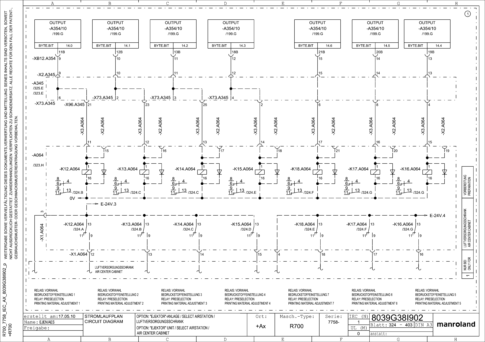

# +Ax — Sheet 324 of 403 — OPTION: "EJEKTOR" ANLAGE / SELECT AIRSTATION /

**LUFTVERSORGUNGSSCHRANK**

> Part of the manroland **R700** printing press IEC/UL circuit diagrams.
> Drawing class: **Stromlaufplan / Circuit diagram** (DIN A3).
> Document `+Ax` covers the **Central control console** machine section.

## At a glance

| Field | Value |
|---|---|
| Document | `+Ax`  (8039G38I902) |
| Sheet | **324** of 403 |
| Section (DE) | OPTION: "EJEKTOR" ANLAGE / SELECT AIRSTATION / |
| Section (EN) | LUFTVERSORGUNGSSCHRANK |
| Section type | CIRCUIT — Circuit diagram |
| Machine type | `R700` |
| Series | `7758` |
| Created | 17.05.10 |
| Replaces | — |
| Columns used | A, B, C, D, E, F, G, H |
| Path numbers | — |
| Labels on sheet | 264 |
| Cross-refs out | 24 |
| Cross-refs in | 72 |

**Previous:** [+Ax sheet 323](SHEET_0323.md) · **Next:** [+Ax sheet 325](SHEET_0325.md) · **Document TOC:** [_TOC.md](_TOC.md)  (+Ax) · **Master TOC:** [all sheets](../_MASTER_TOC.md)

## Sheet image (300 DPI, exact vector render)



_Rendered directly from the PDF vector layer at 300 DPI (1-bit), no OCR and no resampling. Use it to confirm anything ambiguous in the text below._

## Cross-references on this sheet

Each entry is a wire leaving this sheet. The printed token is `/sheet.column`; the link resolves to that sheet inside the same document.

| Ref | Target sheet | Col | Path | Destination on target | Target section | From col |
|---|---|---|---|---|---|---|
| `/199.G` | [+Ax sheet 199](SHEET_0199.md) | G | — | — | REFERENZMODUL | A |
| `/199.G` | [+Ax sheet 199](SHEET_0199.md) | G | — | — | REFERENZMODUL | B |
| `/199.G` | [+Ax sheet 199](SHEET_0199.md) | G | — | — | REFERENZMODUL | C |
| `/199.G` | [+Ax sheet 199](SHEET_0199.md) | G | — | — | REFERENZMODUL | D |
| `/199.G` | [+Ax sheet 199](SHEET_0199.md) | G | — | — | REFERENZMODUL | F |
| `/199.G` | [+Ax sheet 199](SHEET_0199.md) | G | — | — | REFERENZMODUL | G |
| `/199.G` | [+Ax sheet 199](SHEET_0199.md) | G | — | — | REFERENZMODUL | H |
| `/325.E` | [+Ax sheet 325](SHEET_0325.md) | E | — | — | OPTION: AUTOMATISCHE FARBZUFÜHRUNG | A |
| `/323.E` | [+Ax sheet 323](SHEET_0323.md) | E | — | — | OPTION: "EJEKTOR" ANLAGE / SELECT AIRSTATION / | A |
| `/323.H` | [+Ax sheet 323](SHEET_0323.md) | H | — | — | OPTION: "EJEKTOR" ANLAGE / SELECT AIRSTATION / | A |
| `/324.B` | [+Ax sheet 324](SHEET_0324.md) | B | — | — | OPTION: "EJEKTOR" ANLAGE / SELECT AIRSTATION / | A |
| `/324.E` | [+Ax sheet 324](SHEET_0324.md) | E | — | — | OPTION: "EJEKTOR" ANLAGE / SELECT AIRSTATION / | D |
| `/324.F` | [+Ax sheet 324](SHEET_0324.md) | F | — | — | OPTION: "EJEKTOR" ANLAGE / SELECT AIRSTATION / | E |
| `/324.G` | [+Ax sheet 324](SHEET_0324.md) | G | — | — | OPTION: "EJEKTOR" ANLAGE / SELECT AIRSTATION / | F |
| `/324.G` | [+Ax sheet 324](SHEET_0324.md) | G | — | — | OPTION: "EJEKTOR" ANLAGE / SELECT AIRSTATION / | G |
| `/324.C` | [+Ax sheet 324](SHEET_0324.md) | C | — | — | OPTION: "EJEKTOR" ANLAGE / SELECT AIRSTATION / | B |
| `/324.C` | [+Ax sheet 324](SHEET_0324.md) | C | — | — | OPTION: "EJEKTOR" ANLAGE / SELECT AIRSTATION / | C |
| `/324.A` | [+Ax sheet 324](SHEET_0324.md) | A | — | — | OPTION: "EJEKTOR" ANLAGE / SELECT AIRSTATION / | A |
| `/324.B` | [+Ax sheet 324](SHEET_0324.md) | B | — | — | OPTION: "EJEKTOR" ANLAGE / SELECT AIRSTATION / | B |
| `/324.E` | [+Ax sheet 324](SHEET_0324.md) | E | — | — | OPTION: "EJEKTOR" ANLAGE / SELECT AIRSTATION / | E |
| `/324.F` | [+Ax sheet 324](SHEET_0324.md) | F | — | — | OPTION: "EJEKTOR" ANLAGE / SELECT AIRSTATION / | F |
| `/324.G` | [+Ax sheet 324](SHEET_0324.md) | G | — | — | OPTION: "EJEKTOR" ANLAGE / SELECT AIRSTATION / | G |
| `/324.C` | [+Ax sheet 324](SHEET_0324.md) | C | — | — | OPTION: "EJEKTOR" ANLAGE / SELECT AIRSTATION / | C |
| `/324.D` | [+Ax sheet 324](SHEET_0324.md) | D | — | — | OPTION: "EJEKTOR" ANLAGE / SELECT AIRSTATION / | D |

### Incoming references (sheets that point here)

Every other sheet that sends a wire to this one. `Back-ref` is the token printed on *that* sheet; `Path` is its line number.

| From sheet | Cols | Back-ref | Path | Refs | What continues there |
|---|---|---|---|---|---|
| [+Ax#199](SHEET_0199.md) | G | `/199.G` | — | 7 | — |
| [+Ax#206](SHEET_0206.md) | A | `/206.A` | — | 9 | — |
| [+Ax#217](SHEET_0217.md) | A, H | `/217.A`, `/217.H` | — | 14 | — |
| [+Ax#222](SHEET_0222.md) | A | `/222.A` | — | 7 | — |
| [+Ax#248](SHEET_0248.md) | F | `/248.F` | — | 7 | — |
| [+Ax#285](SHEET_0285.md) | C | `/285.C` | — | 4 | — |
| [+Ax#290](SHEET_0290.md) | B | `/290.B` | — | 7 | — |
| [+Ax#323](SHEET_0323.md) | E, H | `/323.E`, `/323.H` | — | 2 | — |
| [+Ax#324](SHEET_0324.md) | A, B, C, D, E, F, G | `/324.A`, `/324.B`, `/324.C`, `/324.D`, `/324.E`, `/324.F`, `/324.G` | — | 14 | — |
| [+Ax#325](SHEET_0325.md) | E | `/325.E` | — | 1 | — |


## Devices on this sheet

| Tag | Class | Class meaning (IEC) | Col | Sub | Terminal | Sign |
|---|---|---|---|---|---|---|
| `A354/10` | A | Baugruppe / assembly, module, PC board | A | 10 | — | — |
| `A354/10` | A | Baugruppe / assembly, module, PC board | B | 10 | — | — |
| `A354/10` | A | Baugruppe / assembly, module, PC board | C | 10 | — | — |
| `A354/10` | A | Baugruppe / assembly, module, PC board | D | 10 | — | — |
| `A064` | A | Baugruppe / assembly, module, PC board | A | — | — | — |
| `A345` | A | Baugruppe / assembly, module, PC board | A | — | — | — |
| `A354/10` | A | Baugruppe / assembly, module, PC board | G | 10 | — | — |
| `A354/10` | A | Baugruppe / assembly, module, PC board | G | 10 | — | — |
| `A354/10` | A | Baugruppe / assembly, module, PC board | F | 10 | — | — |
| `XB12.A354` | — | cross-device reference | A | — | — | — |
| `14.0` | — | cross-device reference | A | — | — | — |
| `14.1` | — | cross-device reference | B | — | — | — |
| `14.2` | — | cross-device reference | C | — | — | — |
| `14.3` | — | cross-device reference | D | — | — | — |
| `X3.A064` | — | cross-device reference | B | — | — | — |
| `X3.A064` | — | cross-device reference | G | — | — | — |
| `X2.A345` | — | cross-device reference | A | — | — | — |
| `X3.A064` | — | cross-device reference | C | — | — | — |
| `X3.A064` | — | cross-device reference | D | — | — | — |
| `X3.A064` | — | cross-device reference | E | — | — | — |
| `X3.A064` | — | cross-device reference | F | — | — | — |
| `X3.A064` | — | cross-device reference | G | — | — | — |
| `K12.A064` | — | cross-device reference | A | — | — | — |
| `K13.A064` | — | cross-device reference | B | — | — | — |
| `K14.A064` | — | cross-device reference | C | — | — | — |
| `K15.A064` | — | cross-device reference | D | — | — | — |
| `K18.A064` | — | cross-device reference | E | — | — | — |
| `K17.A064` | — | cross-device reference | F | — | — | — |
| `K16.A064` | — | cross-device reference | G | — | — | — |
| `X96.A345` | — | cross-device reference | A | — | — | — |
| `K12.A064` | — | cross-device reference | A | — | — | — |
| `K13.A064` | — | cross-device reference | B | — | — | — |
| `K14.A064` | — | cross-device reference | C | — | — | — |
| `K15.A064` | — | cross-device reference | D | — | — | — |
| `K18.A064` | — | cross-device reference | E | — | — | — |
| `K17.A064` | — | cross-device reference | F | — | — | — |
| `K16.A064` | — | cross-device reference | G | — | — | — |
| `X1.A064` | — | cross-device reference | A | — | — | — |
| `X1.A064` | — | cross-device reference | A | — | — | — |
| `14.4` | — | cross-device reference | H | — | — | — |
| `14.5` | — | cross-device reference | G | — | — | — |
| `14.6` | — | cross-device reference | F | — | — | — |
| `X2.A064` | — | cross-device reference | H | — | — | — |
| `X2.A064` | — | cross-device reference | B | — | — | — |
| `X2.A064` | — | cross-device reference | C | — | — | — |
| `X2.A064` | — | cross-device reference | D | — | — | — |
| `X2.A064` | — | cross-device reference | E | — | — | — |
| `X2.A064` | — | cross-device reference | F | — | — | — |
| `X2.A064` | — | cross-device reference | G | — | — | — |
| `X73.A345` | — | cross-device reference | A | — | — | — |
| `X73.A345` | — | cross-device reference | C | — | — | — |
| `X73.A345` | — | cross-device reference | D | — | — | — |
| `X73.A345` | — | cross-device reference | B | — | — | — |

## Potentials / nets

| Potential | Count | Columns | Attached devices | Terminals |
|---|---|---|---|---|
| `0V` | 1 | A | — | — |


A potential such as `L24+/4` or `M24+` is a named supply/return rail; every place it appears on this sheet is electrically common.

## Wire-end annotations (grouped as printed)

A wire that continues elsewhere is annotated with a small cluster: the destination description, the path/line number `#NN`, and the `/sheet.column` cross reference. Each row below is one such cluster exactly as it is grouped on the drawing.

| Col | Y | Path | Cross-ref | Text on the wire |
|---|---|---|---|---|
| H | 31.0 | — | — | `1` |
| A | 51.6 | — | — | `OUTPUT` |
| B | 51.6 | — | — | `OUTPUT` |
| C | 51.6 | — | — | `OUTPUT` |
| D | 51.6 | — | — | `OUTPUT` |
| F | 51.6 | — | — | `OUTPUT` |
| G | 51.6 | — | — | `OUTPUT` |
| G | 51.6 | — | — | `OUTPUT` |
| A | 65.5 | — | — | `A354/10` |
| B | 65.5 | — | — | `A354/10` |
| C | 65.5 | — | — | `A354/10` |
| D | 65.5 | — | — | `A354/10` |
| F | 65.5 | — | — | `A354/10` |
| G | 65.5 | — | — | `A354/10` |
| G | 65.5 | — | — | `A354/10` |
| A | 79.3 | — | `/199.G` | — |
| B | 79.3 | — | `/199.G` | — |
| C | 79.3 | — | `/199.G` | — |
| D | 79.3 | — | `/199.G` | — |
| F | 79.3 | — | `/199.G` | — |
| G | 79.3 | — | `/199.G` | — |
| H | 79.3 | — | `/199.G` | — |
| A | 108.9 | — | — | `BYTE.BIT 14.0` |
| B | 108.9 | — | — | `BYTE.BIT 14.1` |
| C | 108.9 | — | — | `BYTE.BIT 14.2` |
| D | 108.9 | — | — | `BYTE.BIT 14.3` |
| F | 108.9 | — | — | `BYTE.BIT 14.6` |
| G | 108.9 | — | — | `BYTE.BIT 14.5` |
| G | 108.9 | — | — | `BYTE.BIT 14.4` |
| A | 124.3 | — | — | `11B` |
| B | 124.3 | — | — | `12B` |
| C | 124.3 | — | — | `13B` |
| D | 124.3 | — | — | `18B` |
| F | 124.3 | — | — | `21B` |
| G | 124.3 | — | — | `20B` |
| H | 124.3 | — | — | `19B` |
| A | 139.2 | — | — | `XB12.A354 9` |
| B | 140.6 | — | — | `10` |
| C | 140.6 | — | — | `11` |
| D | 140.6 | — | — | `12` |
| F | 140.6 | — | — | `15` |
| G | 140.6 | — | — | `14` |
| H | 140.6 | — | — | `13` |
| A | 176.1 | — | — | `X2.A345 9` |
| B | 176.1 | — | — | `10` |
| C | 176.1 | — | — | `11` |
| D | 176.1 | — | — | `12` |
| F | 176.1 | — | — | `15` |
| G | 176.1 | — | — | `14` |
| H | 176.1 | — | — | `13` |
| A | 200.1 | — | — | `A345` |
| A | 213.2 | — | `/325.E`, `/323.E` | — |
| C | 235.6 | — | — | `X73.A345 X73.A345 X73.A345` |
| C | 237.0 | — | — | `6 2 3 4` |
| A | 249.8 | — | — | `X73.A345` |
| C | 252.6 | — | — | `X96.A345 21 23 25 2` |
| F | 254.0 | — | — | `6` |
| G | 254.0 | — | — | `8` |
| H | 254.0 | — | — | `4` |
| B | 288.6 | — | — | `X3.A064` |
| B | 288.6 | — | — | `X2.A064` |
| C | 288.6 | — | — | `X3.A064` |
| C | 288.6 | — | — | `X2.A064` |
| D | 288.6 | — | — | `X3.A064` |
| D | 288.6 | — | — | `X2.A064` |
| E | 288.6 | — | — | `X3.A064` |
| E | 288.6 | — | — | `X2.A064` |
| F | 288.6 | — | — | `X3.A064` |
| F | 288.6 | — | — | `X2.A064` |
| G | 288.6 | — | — | `X3.A064` |
| G | 288.6 | — | — | `X2.A064` |
| G | 288.6 | — | — | `X3.A064` |
| H | 288.6 | — | — | `X2.A064` |
| B | 346.1 | — | — | `11` |
| C | 346.1 | — | — | `12` |
| D | 346.1 | — | — | `13` |
| E | 346.1 | — | — | `14` |
| F | 346.1 | — | — | `17` |
| G | 346.1 | — | — | `16` |
| H | 346.1 | — | — | `15` |
| B | 367.4 | — | — | `15` |
| C | 367.4 | — | — | `16` |
| D | 367.4 | — | — | `17` |
| E | 367.4 | — | — | `18` |
| F | 367.4 | — | — | `21` |
| G | 367.4 | — | — | `20` |
| H | 367.4 | — | — | `19` |
| A | 377.3 | — | — | `A064` |
| A | 402.8 | — | `/323.H` | — |
| B | 406.4 | — | — | `1` |
| C | 406.4 | — | — | `1` |
| D | 406.4 | — | — | `1` |
| E | 406.4 | — | — | `1` |
| F | 406.4 | — | — | `1` |
| G | 406.4 | — | — | `1` |
| H | 406.4 | — | — | `1` |
| A | 411.3 | — | — | `K12.A064` |
| B | 411.3 | — | — | `K13.A064` |
| C | 411.3 | — | — | `K14.A064` |
| D | 411.3 | — | — | `K15.A064` |
| E | 411.3 | — | — | `K18.A064` |
| F | 411.3 | — | — | `K17.A064` |
| G | 411.3 | — | — | `K16.A064` |
| H | 430.4 | — | — | `VORBEREITUNG AIR CENTER CABINET` |
| B | 434.7 | — | — | `16` |
| C | 434.7 | — | — | `16` |
| D | 434.7 | — | — | `16` |
| E | 434.7 | — | — | `16` |
| F | 434.7 | — | — | `16` |
| G | 434.7 | — | — | `16` |
| H | 434.7 | — | — | `16` |
| A | 435.4 | — | — | `11 8 6 9 13` |
| B | 435.4 | — | — | `11 8 6 9 13` |
| C | 435.4 | — | — | `11 8 6 9 13` |
| D | 435.4 | — | — | `11 8 6 9 13` |
| E | 435.4 | — | — | `11 8 6 9 13` |
| F | 435.4 | — | — | `11 8 6 9 13` |
| G | 435.4 | — | — | `11 8 6 9 13` |
| H | 435.9 | — | — | `PREPARATION` |
| A | 441.1 | — | — | `4` |
| B | 441.1 | — | — | `4` |
| C | 441.1 | — | — | `4` |
| D | 441.1 | — | — | `4` |
| E | 441.1 | — | — | `4` |
| F | 441.1 | — | — | `4` |
| G | 441.1 | — | — | `4` |
| A | 470.1 | — | `/324.B` | — |
| B | 470.1 | — | `/324.C` | — |
| C | 470.1 | — | `/324.C` | — |
| D | 470.1 | — | `/324.E` | — |
| E | 470.1 | — | `/324.F` | — |
| F | 470.1 | — | `/324.G` | — |
| G | 470.1 | — | `/324.G` | — |
| B | 483.6 | — | — | `0V E 24V.3` |
| H | 513.6 | — | — | `LUFTVERSORGUNGSSCHRANK 1 ONLY FOR` |
| A | 518.5 | — | — | `X1.A064 3` |
| H | 526.1 | — | — | `E 24V.4` |
| A | 547.4 | — | — | `K12.A064` |
| B | 547.4 | — | — | `K13.A064` |
| C | 547.4 | — | — | `K14.A064` |
| D | 547.4 | — | — | `K15.A064` |
| E | 547.4 | — | — | `K18.A064` |
| F | 547.4 | — | — | `K17.A064` |
| G | 547.4 | — | — | `K16.A064` |
| B | 548.1 | — | — | `13` |
| C | 548.1 | — | — | `13` |
| D | 548.1 | — | — | `13` |
| E | 548.1 | — | — | `13` |
| F | 548.1 | — | — | `13` |
| G | 548.1 | — | — | `13` |
| G | 548.1 | — | — | `13` |
| A | 560.5 | — | `/324.A` | — |
| B | 560.5 | — | `/324.B` | — |
| C | 560.5 | — | `/324.C` | — |
| D | 560.5 | — | `/324.D` | — |
| E | 560.5 | — | `/324.E` | — |
| F | 560.5 | — | `/324.F` | — |
| G | 560.5 | — | `/324.G` | — |
| B | 576.5 | — | — | `11` |
| B | 576.5 | — | — | `9` |
| C | 576.5 | — | — | `11` |
| C | 576.5 | — | — | `9` |
| C | 576.5 | — | — | `11` |
| D | 576.5 | — | — | `9` |
| D | 576.5 | — | — | `11` |
| E | 576.5 | — | — | `9` |
| F | 576.5 | — | — | `11` |
| F | 576.5 | — | — | `9` |
| F | 576.5 | — | — | `11` |
| G | 576.5 | — | — | `9` |
| G | 576.5 | — | — | `11` |
| G | 576.5 | — | — | `9` |
| D | 621.1 | — | — | `X1.A064 12 13 14 15 4 18 17 16` |
| H | 639.7 | — | — | `NUR BEI` |
| B | 655.5 | — | — | `LUFTVERSORGUNGSSCHRANK` |
| B | 666.1 | — | — | `AIR CENTER CABINET` |
| A | 712.1 | — | — | `RELAIS: VORWAHL BEDRUCKSTOFFEINSTELLUNG 1 RELAY: PRESELECTION PRINTING MATERIAL ADJUSTMENT 1` |
| B | 712.1 | — | — | `RELAIS: VORWAHL BEDRUCKSTOFFEINSTELLUNG 2 RELAY: PRESELECTION PRINTING MATERIAL ADJUSTMENT 2` |
| C | 712.1 | — | — | `RELAIS: VORWAHL BEDRUCKSTOFFEINSTELLUNG 3 RELAY: PRESELECTION PRINTING MATERIAL ADJUSTMENT 3` |
| D | 712.1 | — | — | `RELAIS: VORWAHL BEDRUCKSTOFFEINSTELLUNG 4 RELAY: PRESELECTION PRINTING MATERIAL ADJUSTMENT 4` |
| E | 712.1 | — | — | `RELAIS: VORWAHL BEDRUCKSTOFFEINSTELLUNG 7 RELAY: PRESELECTION PRINTING MATERIAL ADJUSTMENT 7` |
| G | 712.1 | — | — | `RELAIS: VORWAHL BEDRUCKSTOFFEINSTELLUNG 6 RELAY: PRESELECTION PRINTING MATERIAL ADJUSTMENT 6` |
| H | 712.1 | — | — | `RELAIS: VORWAHL BEDRUCKSTOFFEINSTELLUNG 5 RELAY: PRESELECTION PRINTING MATERIAL ADJUSTMENT 5` |


## Reconstructed tables

This sheet carries tabular content (pin map / terminal assignment / index). The grid below was rebuilt from the drawing's own rule lines, so each row is exactly one physical row of the table.

### Table 1 — 6 data rows × 18 columns (at x=85.0, y=48.2)

| OUTPUT | A354/10 /199.G |  |  |  |  |  | OUTPUT | A354/10 /199.G |  |  |  |  |  | OUTPUT | A354/10 /199.G |  |  |
|---|---|---|---|---|---|---|---|---|---|---|---|---|---|---|---|---|---|
| `BYTE.BIT` |  | `14.0` |  |  |  | `BYTE.BIT` |  |  | `14.1` |  |  |  | `BYTE.BIT` |  |  | `14.2` |  |
| `XB12.A354 X2.A345 A345 /325.E` | `11B 9 9` |  |  |  |  |  |  | `12B 10 10` |  |  |  |  |  |  | `13B 11 11` |  |  |
| `/323.E X73.A345 A064` | `6` | `X96.A345` | `X3.A064` | `11` | `21` | `X73.A345 X2.A064` | `15` | `2` |  | `X3.A064` | `12` | `23` | `X73.A345 X2.A064` | `16` | `3` |  | `X3.A064` |
| `/323.H` | `8 6` | `K12.A064 4` |  | `1 16` |  |  |  | `8 6` | `K13.A064 4` |  | `1 16` |  |  |  | `8 6` | `K14.A064 4` |  |
| `11` | `9` | `13 /324.B` |  |  |  |  | `11` | `9` | `13 /324.C` |  |  |  |  | `11` | `9` | `13 /324.C` |  |
| `3` |  | `0V` |  |  |  |  | `E 24V.3` |  |  |  |  |  |  |  |  |  |  |


### Table 2 — 5 data rows × 6 columns (at x=496.1, y=48.2)

|  |  | OUTPUT | A354/10 /199.G |  |  |
|---|---|---|---|---|---|
|  | `BYTE.BIT` |  |  | `14.3` |  |
|  |  |  | `18B 12 12` |  |  |
| `25 13` | `X73.A345 X2.A064` | `17` | `4` |  | `X3.A064` |
| `1 16` |  |  | `8 6` | `K15.A064 4` |  |
|  |  | `11` | `9` | `13 /324.E` |  |


### Table 3 — 5 data rows × 14 columns (at x=637.8, y=48.2)

|  |  | OUTPUT | A354/10 /199.G |  |  |  |  |  | OUTPUT | A354/10 /199.G |  |  |  |
|---|---|---|---|---|---|---|---|---|---|---|---|---|---|
|  |  | `BYTE.BIT` |  | `14.6` |  |  | `BYTE.BIT` |  |  | `14.5` |  |  | `BYTE.BIT` |
|  |  |  | `15 15` | `21B` |  |  |  |  |  | `20B 14 14` |  |  |  |
| `2 X2.A064 14` | `18` | `X3.A064` | `6 17` | `X2.A064` | `21` |  |  | `X3.A064` |  | `8 16` | `X2.A064 20` |  |  |
| `1 16` | `8 6` | `K18.A064 4` | `1 16` |  |  | `8 6` | `K17.A064 4` |  |  | `1 16` |  | `8 6` | `K16.A064 4` |
|  | `9 11` | `13 /324.F` |  |  |  | `9 11` | `13 /324.G` |  |  |  | `11` | `9` | `13` |


### Table 4 — 5 data rows × 3 columns (at x=1027.6, y=48.2)

| OUTPUT | A354/10 /199.G |  |
|---|---|---|
|  | `14.4` |  |
|  | `19B 13 13` |  |
| `X3.A064` | `4 X2.A064 15` | `19` |
|  | `1 16` |  |
| `/324.G` |  |  |


## Notes and free text on this sheet

| Text | Col | Y (pt) |
|---|---|---|
| `11B` | A | 124.3 |
| `OUTPUT` | A | 51.64 |
| `BYTE.BIT` | A | 108.91 |
| `RELAIS: VORWAHL` | A | 712.08 |
| `BEDRUCKSTOFFEINSTELLUNG 1` | A | 722.75 |
| `RELAY: PRESELECTION` | A | 733.37 |
| `PRINTING MATERIAL ADJUSTMENT 1` | A | 744.01 |
| `12B` | B | 124.3 |
| `OUTPUT` | B | 51.64 |
| `BYTE.BIT` | B | 108.91 |
| `RELAIS: VORWAHL` | B | 712.08 |
| `BEDRUCKSTOFFEINSTELLUNG 2` | B | 722.76 |
| `RELAY: PRESELECTION` | B | 733.37 |
| `PRINTING MATERIAL ADJUSTMENT 2` | B | 744.02 |
| `13B` | C | 124.3 |
| `OUTPUT` | C | 51.64 |
| `BYTE.BIT` | C | 108.91 |
| `RELAIS: VORWAHL` | C | 712.08 |
| `BEDRUCKSTOFFEINSTELLUNG 3` | C | 722.76 |
| `RELAY: PRESELECTION` | C | 733.37 |
| `PRINTING MATERIAL ADJUSTMENT 3` | C | 744.02 |
| `18B` | D | 124.3 |
| `OUTPUT` | D | 51.64 |
| `BYTE.BIT` | D | 108.91 |
| `RELAIS: VORWAHL` | D | 712.08 |
| `BEDRUCKSTOFFEINSTELLUNG 4` | D | 722.76 |
| `RELAY: PRESELECTION` | D | 733.37 |
| `PRINTING MATERIAL ADJUSTMENT 4` | D | 744.02 |
| `19B` | H | 124.3 |
| `OUTPUT` | G | 51.64 |
| `BYTE.BIT` | G | 108.91 |
| `RELAIS: VORWAHL` | G | 712.08 |
| `BEDRUCKSTOFFEINSTELLUNG 5` | H | 722.76 |
| `RELAY: PRESELECTION` | H | 733.37 |
| `PRINTING MATERIAL ADJUSTMENT 5` | H | 744.02 |
| `20B` | G | 124.3 |
| `BYTE.BIT` | F | 108.91 |
| `RELAIS: VORWAHL` | F | 712.08 |
| `BEDRUCKSTOFFEINSTELLUNG 6` | G | 722.76 |
| `RELAY: PRESELECTION` | F | 733.37 |
| `PRINTING MATERIAL ADJUSTMENT 6` | G | 744.02 |
| `21B` | F | 124.3 |
| `OUTPUT` | F | 51.64 |
| `BYTE.BIT` | E | 108.91 |
| `RELAIS: VORWAHL` | E | 712.08 |
| `BEDRUCKSTOFFEINSTELLUNG 7` | E | 722.76 |
| `RELAY: PRESELECTION` | E | 733.37 |
| `PRINTING MATERIAL ADJUSTMENT 7` | E | 744.02 |
| `E 24V.3` | B | 497.8 |
| `E 24V.4` | H | 526.14 |
| `LUFTVERSORGUNGSSCHRANK` | B | 655.45 |
| `AIR CENTER CABINET` | B | 666.06 |
| `NUR BEI` | H | 639.72 |
| `ONLY FOR` | H | 633.05 |
| `LUFTVERSORGUNGSSCHRANK` | H | 513.64 |
| `AIR CENTER CABINET` | H | 541.13 |
| `VORBEREITUNG` | H | 430.4 |
| `PREPARATION` | H | 435.95 |

## Complete label inventory (exact text from the drawing)

Every text object inside the drawing area of this sheet, in DIN reading order (column A→H, then top→bottom). This is the authoritative list: if a string is not here it is not printed on this sheet.

| Col | Y | X | Dir | Type | Text |
|---|---|---|---|---|---|
| A | 51.6 | 121.5 | → | text | `OUTPUT` |
| A | 65.5 | 120.3 | → | device tag | `A354/10` |
| A | 79.3 | 128.8 | → | cross-reference | `/199.G` |
| A | 108.9 | 95.0 | → | text | `BYTE.BIT` |
| A | 108.9 | 161.9 | → | device ref | `14.0` |
| A | 124.3 | 143.7 | → | text | `11B` |
| A | 139.2 | 79.4 | → | device ref | `XB12.A354` |
| A | 140.6 | 144.3 | → | number | `9` |
| A | 176.1 | 144.3 | → | number | `9` |
| A | 178.9 | 91.0 | → | device ref | `X2.A345` |
| A | 200.1 | 78.5 | → | device tag | `A345` |
| A | 213.2 | 81.4 | → | cross-reference | `/325.E` |
| A | 225.6 | 81.4 | → | cross-reference | `/323.E` |
| A | 237.0 | 144.3 | → | number | `6` |
| A | 249.8 | 85.0 | → | device ref | `X73.A345` |
| A | 252.6 | 157.3 | → | device ref | `X96.A345` |
| A | 377.3 | 78.5 | → | device tag | `A064` |
| A | 402.8 | 81.4 | → | cross-reference | `/323.H` |
| A | 411.3 | 146.0 | → | device ref | `K12.A064` |
| A | 435.4 | 139.2 | → | number | `8` |
| A | 441.1 | 164.1 | → | number | `4` |
| A | 446.7 | 139.2 | → | number | `6` |
| A | 458.1 | 139.2 | → | number | `9` |
| A | 463.7 | 162.4 | → | number | `13` |
| A | 469.4 | 134.6 | → | number | `11` |
| A | 470.1 | 178.6 | → | cross-reference | `/324.B` |
| A | 483.6 | 171.2 | → | potential | `0V` |
| A | 518.5 | 99.5 | ↕ | number | `3` |
| A | 547.4 | 155.9 | → | device ref | `K12.A064` |
| A | 550.3 | 98.1 | ↕ | device ref | `X1.A064` |
| A | 560.5 | 180.0 | → | cross-reference | `/324.A` |
| A | 621.1 | 170.4 | → | device ref | `X1.A064` |
| A | 712.1 | 84.2 | → | text | `RELAIS: VORWAHL` |
| A | 722.8 | 84.2 | → | text | `BEDRUCKSTOFFEINSTELLUNG 1` |
| A | 733.4 | 84.2 | → | text | `RELAY: PRESELECTION` |
| A | 744.0 | 84.2 | → | text | `PRINTING MATERIAL ADJUSTMENT 1` |
| B | 51.6 | 263.2 | → | text | `OUTPUT` |
| B | 65.5 | 262.1 | → | device tag | `A354/10` |
| B | 79.3 | 270.6 | → | cross-reference | `/199.G` |
| B | 108.9 | 236.7 | → | text | `BYTE.BIT` |
| B | 108.9 | 304.2 | → | device ref | `14.1` |
| B | 124.3 | 285.4 | → | text | `12B` |
| B | 140.6 | 285.4 | → | number | `10` |
| B | 176.1 | 285.4 | → | number | `10` |
| B | 235.6 | 226.8 | → | device ref | `X73.A345` |
| B | 237.0 | 286.0 | → | number | `2` |
| B | 254.0 | 215.1 | → | number | `21` |
| B | 288.6 | 197.3 | ↕ | device ref | `X3.A064` |
| B | 288.6 | 246.9 | ↕ | device ref | `X2.A064` |
| B | 346.2 | 214.6 | → | number | `11` |
| B | 367.4 | 257.1 | → | number | `15` |
| B | 406.4 | 214.6 | → | number | `1` |
| B | 411.3 | 287.7 | → | device ref | `K13.A064` |
| B | 434.7 | 214.6 | → | number | `16` |
| B | 435.4 | 280.9 | → | number | `8` |
| B | 441.1 | 305.9 | → | number | `4` |
| B | 446.7 | 280.9 | → | number | `6` |
| B | 458.1 | 280.9 | → | number | `9` |
| B | 463.7 | 304.2 | → | number | `13` |
| B | 469.4 | 276.4 | → | number | `11` |
| B | 470.1 | 320.3 | → | cross-reference | `/324.C` |
| B | 497.8 | 247.2 | → | text | `E 24V.3` |
| B | 547.4 | 297.6 | → | device ref | `K13.A064` |
| B | 548.1 | 214.6 | → | number | `13` |
| B | 560.5 | 322.0 | → | cross-reference | `/324.B` |
| B | 576.5 | 194.7 | → | number | `11` |
| B | 576.5 | 222.2 | → | number | `9` |
| B | 622.5 | 221.7 | → | number | `12` |
| B | 655.4 | 233.0 | → | text | `LUFTVERSORGUNGSSCHRANK` |
| B | 666.1 | 233.9 | → | text | `AIR CENTER CABINET` |
| B | 712.1 | 240.1 | → | text | `RELAIS: VORWAHL` |
| B | 722.8 | 240.1 | → | text | `BEDRUCKSTOFFEINSTELLUNG 2` |
| B | 733.4 | 240.1 | → | text | `RELAY: PRESELECTION` |
| B | 744.0 | 240.1 | → | text | `PRINTING MATERIAL ADJUSTMENT 2` |
| C | 51.6 | 404.9 | → | text | `OUTPUT` |
| C | 65.5 | 403.8 | → | device tag | `A354/10` |
| C | 79.3 | 412.3 | → | cross-reference | `/199.G` |
| C | 108.9 | 378.4 | → | text | `BYTE.BIT` |
| C | 108.9 | 445.5 | → | device ref | `14.2` |
| C | 124.3 | 427.2 | → | text | `13B` |
| C | 140.6 | 427.2 | → | number | `11` |
| C | 176.1 | 427.2 | → | number | `11` |
| C | 235.6 | 368.5 | → | device ref | `X73.A345` |
| C | 237.0 | 427.7 | → | number | `3` |
| C | 254.0 | 356.9 | → | number | `23` |
| C | 288.6 | 339.0 | ↕ | device ref | `X3.A064` |
| C | 288.6 | 388.7 | ↕ | device ref | `X2.A064` |
| C | 346.2 | 356.3 | → | number | `12` |
| C | 367.4 | 398.8 | → | number | `16` |
| C | 406.4 | 356.3 | → | number | `1` |
| C | 411.3 | 429.4 | → | device ref | `K14.A064` |
| C | 434.7 | 356.3 | → | number | `16` |
| C | 435.4 | 422.6 | → | number | `8` |
| C | 441.1 | 447.6 | → | number | `4` |
| C | 446.7 | 422.6 | → | number | `6` |
| C | 458.1 | 422.6 | → | number | `9` |
| C | 463.7 | 445.9 | → | number | `13` |
| C | 469.4 | 418.1 | → | number | `11` |
| C | 470.1 | 462.0 | → | cross-reference | `/324.C` |
| C | 547.4 | 425.2 | → | device ref | `K14.A064` |
| C | 548.1 | 356.3 | → | number | `13` |
| C | 560.5 | 449.3 | → | cross-reference | `/324.C` |
| C | 576.5 | 336.5 | → | number | `11` |
| C | 576.5 | 364.0 | → | number | `9` |
| C | 576.5 | 464.0 | → | number | `11` |
| C | 622.5 | 363.4 | → | number | `13` |
| C | 712.1 | 396.0 | → | text | `RELAIS: VORWAHL` |
| C | 722.8 | 396.0 | → | text | `BEDRUCKSTOFFEINSTELLUNG 3` |
| C | 733.4 | 396.0 | → | text | `RELAY: PRESELECTION` |
| C | 744.0 | 396.0 | → | text | `PRINTING MATERIAL ADJUSTMENT 3` |
| D | 51.6 | 546.7 | → | text | `OUTPUT` |
| D | 65.5 | 545.5 | → | device tag | `A354/10` |
| D | 79.3 | 554.0 | → | cross-reference | `/199.G` |
| D | 108.9 | 520.2 | → | text | `BYTE.BIT` |
| D | 108.9 | 587.1 | → | device ref | `14.3` |
| D | 124.3 | 568.9 | → | text | `18B` |
| D | 140.6 | 568.9 | → | number | `12` |
| D | 176.1 | 568.9 | → | number | `12` |
| D | 235.6 | 510.2 | → | device ref | `X73.A345` |
| D | 237.0 | 569.5 | → | number | `4` |
| D | 254.0 | 498.6 | → | number | `25` |
| D | 288.6 | 480.8 | ↕ | device ref | `X3.A064` |
| D | 288.6 | 530.4 | ↕ | device ref | `X2.A064` |
| D | 346.2 | 498.0 | → | number | `13` |
| D | 367.4 | 540.6 | → | number | `17` |
| D | 406.4 | 498.0 | → | number | `1` |
| D | 411.3 | 571.2 | → | device ref | `K15.A064` |
| D | 434.7 | 498.0 | → | number | `16` |
| D | 435.4 | 564.4 | → | number | `8` |
| D | 441.1 | 589.3 | → | number | `4` |
| D | 446.7 | 564.4 | → | number | `6` |
| D | 458.1 | 564.4 | → | number | `9` |
| D | 463.7 | 587.6 | → | number | `13` |
| D | 469.4 | 559.8 | → | number | `11` |
| D | 470.1 | 603.8 | → | cross-reference | `/324.E` |
| D | 547.4 | 566.9 | → | device ref | `K15.A064` |
| D | 548.1 | 483.9 | → | number | `13` |
| D | 560.5 | 591.0 | → | cross-reference | `/324.D` |
| D | 576.5 | 491.5 | → | number | `9` |
| D | 576.5 | 605.8 | → | number | `11` |
| D | 622.5 | 491.0 | → | number | `14` |
| D | 712.1 | 551.9 | → | text | `RELAIS: VORWAHL` |
| D | 722.8 | 551.9 | → | text | `BEDRUCKSTOFFEINSTELLUNG 4` |
| D | 733.4 | 551.9 | → | text | `RELAY: PRESELECTION` |
| D | 744.0 | 551.9 | → | text | `PRINTING MATERIAL ADJUSTMENT 4` |
| E | 108.9 | 732.8 | → | text | `BYTE.BIT` |
| E | 254.0 | 640.3 | → | number | `2` |
| E | 288.6 | 622.5 | ↕ | device ref | `X3.A064` |
| E | 288.6 | 672.1 | ↕ | device ref | `X2.A064` |
| E | 346.2 | 639.8 | → | number | `14` |
| E | 367.4 | 682.3 | → | number | `18` |
| E | 406.4 | 639.8 | → | number | `1` |
| E | 411.3 | 712.9 | → | device ref | `K18.A064` |
| E | 434.7 | 639.8 | → | number | `16` |
| E | 435.4 | 706.1 | → | number | `8` |
| E | 441.1 | 731.1 | → | number | `4` |
| E | 446.7 | 706.1 | → | number | `6` |
| E | 458.1 | 706.1 | → | number | `9` |
| E | 463.7 | 729.4 | → | number | `13` |
| E | 469.4 | 701.6 | → | number | `11` |
| E | 470.1 | 745.5 | → | cross-reference | `/324.F` |
| E | 547.4 | 722.8 | → | device ref | `K18.A064` |
| E | 548.1 | 625.6 | → | number | `13` |
| E | 560.5 | 747.5 | → | cross-reference | `/324.E` |
| E | 576.5 | 633.3 | → | number | `9` |
| E | 622.5 | 632.7 | → | number | `15` |
| E | 622.5 | 682.9 | → | number | `4` |
| E | 712.1 | 707.8 | → | text | `RELAIS: VORWAHL` |
| E | 722.8 | 707.8 | → | text | `BEDRUCKSTOFFEINSTELLUNG 7` |
| E | 733.4 | 707.8 | → | text | `RELAY: PRESELECTION` |
| E | 744.0 | 707.8 | → | text | `PRINTING MATERIAL ADJUSTMENT 7` |
| F | 51.6 | 759.3 | → | text | `OUTPUT` |
| F | 65.5 | 758.1 | → | device tag | `A354/10` |
| F | 79.3 | 766.6 | → | cross-reference | `/199.G` |
| F | 108.9 | 799.7 | → | device ref | `14.6` |
| F | 108.9 | 874.5 | → | text | `BYTE.BIT` |
| F | 124.3 | 782.1 | → | text | `21B` |
| F | 140.6 | 781.5 | → | number | `15` |
| F | 176.1 | 781.5 | → | number | `15` |
| F | 254.0 | 782.1 | → | number | `6` |
| F | 288.6 | 764.2 | ↕ | device ref | `X3.A064` |
| F | 288.6 | 813.9 | ↕ | device ref | `X2.A064` |
| F | 346.2 | 781.5 | → | number | `17` |
| F | 367.4 | 824.6 | → | number | `21` |
| F | 406.4 | 781.5 | → | number | `1` |
| F | 411.3 | 854.6 | → | device ref | `K17.A064` |
| F | 434.7 | 781.5 | → | number | `16` |
| F | 435.4 | 847.8 | → | number | `8` |
| F | 441.1 | 872.8 | → | number | `4` |
| F | 446.7 | 847.8 | → | number | `6` |
| F | 458.1 | 847.8 | → | number | `9` |
| F | 463.7 | 871.1 | → | number | `13` |
| F | 469.4 | 843.3 | → | number | `11` |
| F | 470.1 | 887.2 | → | cross-reference | `/324.G` |
| F | 547.4 | 850.4 | → | device ref | `K17.A064` |
| F | 548.1 | 781.5 | → | number | `13` |
| F | 560.5 | 875.3 | → | cross-reference | `/324.F` |
| F | 576.5 | 761.7 | → | number | `11` |
| F | 576.5 | 789.2 | → | number | `9` |
| F | 576.5 | 889.2 | → | number | `11` |
| F | 622.5 | 788.6 | → | number | `18` |
| F | 712.1 | 863.7 | → | text | `RELAIS: VORWAHL` |
| F | 733.4 | 863.7 | → | text | `RELAY: PRESELECTION` |
| G | 51.6 | 901.0 | → | text | `OUTPUT` |
| G | 51.6 | 1028.6 | → | text | `OUTPUT` |
| G | 65.5 | 899.9 | → | device tag | `A354/10` |
| G | 65.5 | 1027.4 | → | device tag | `A354/10` |
| G | 79.3 | 908.4 | → | cross-reference | `/199.G` |
| G | 108.9 | 941.4 | → | device ref | `14.5` |
| G | 108.9 | 1002.0 | → | text | `BYTE.BIT` |
| G | 124.3 | 923.8 | → | text | `20B` |
| G | 140.6 | 923.2 | → | number | `14` |
| G | 176.1 | 923.2 | → | number | `14` |
| G | 254.0 | 923.8 | → | number | `8` |
| G | 288.6 | 906.0 | ↕ | device ref | `X3.A064` |
| G | 288.6 | 962.7 | ↕ | device ref | `X2.A064` |
| G | 288.6 | 1033.5 | ↕ | device ref | `X3.A064` |
| G | 346.2 | 923.2 | → | number | `16` |
| G | 367.4 | 966.3 | → | number | `20` |
| G | 406.4 | 923.2 | → | number | `1` |
| G | 411.3 | 982.2 | → | device ref | `K16.A064` |
| G | 434.7 | 923.2 | → | number | `16` |
| G | 435.4 | 975.4 | → | number | `8` |
| G | 441.1 | 1000.3 | → | number | `4` |
| G | 446.7 | 975.4 | → | number | `6` |
| G | 458.1 | 975.4 | → | number | `9` |
| G | 463.7 | 998.6 | → | number | `13` |
| G | 469.4 | 970.9 | → | number | `11` |
| G | 470.1 | 1014.8 | → | cross-reference | `/324.G` |
| G | 547.4 | 963.8 | → | device ref | `K16.A064` |
| G | 548.1 | 909.1 | → | number | `13` |
| G | 548.1 | 1022.5 | → | number | `13` |
| G | 560.5 | 987.6 | → | cross-reference | `/324.G` |
| G | 576.5 | 916.7 | → | number | `9` |
| G | 576.5 | 1002.6 | → | number | `11` |
| G | 576.5 | 1030.1 | → | number | `9` |
| G | 622.5 | 916.2 | → | number | `17` |
| G | 622.5 | 1029.5 | → | number | `16` |
| G | 712.1 | 1019.6 | → | text | `RELAIS: VORWAHL` |
| G | 722.8 | 863.7 | → | text | `BEDRUCKSTOFFEINSTELLUNG 6` |
| G | 744.0 | 863.7 | → | text | `PRINTING MATERIAL ADJUSTMENT 6` |
| H | 31.0 | 1146.3 | → | number | `1` |
| H | 79.3 | 1035.9 | → | cross-reference | `/199.G` |
| H | 108.9 | 1068.9 | → | device ref | `14.4` |
| H | 124.3 | 1050.8 | → | text | `19B` |
| H | 140.6 | 1050.8 | → | number | `13` |
| H | 176.1 | 1050.8 | → | number | `13` |
| H | 254.0 | 1051.4 | → | number | `4` |
| H | 288.6 | 1083.1 | ↕ | device ref | `X2.A064` |
| H | 346.2 | 1050.8 | → | number | `15` |
| H | 367.4 | 1093.3 | → | number | `19` |
| H | 406.4 | 1050.8 | → | number | `1` |
| H | 430.4 | 1138.7 | ↕ | text | `VORBEREITUNG` |
| H | 434.7 | 1050.8 | → | number | `16` |
| H | 436.0 | 1149.3 | ↕ | text | `PREPARATION` |
| H | 513.6 | 1138.8 | ↕ | text | `LUFTVERSORGUNGSSCHRANK` |
| H | 526.1 | 1055.1 | → | text | `E 24V.4` |
| H | 541.1 | 1149.4 | ↕ | text | `AIR CENTER CABINET` |
| H | 633.0 | 1149.4 | ↕ | text | `ONLY FOR` |
| H | 639.7 | 1138.7 | ↕ | text | `NUR BEI` |
| H | 675.5 | 1144.1 | ↕ | number | `1` |
| H | 722.8 | 1019.6 | → | text | `BEDRUCKSTOFFEINSTELLUNG 5` |
| H | 733.4 | 1019.6 | → | text | `RELAY: PRESELECTION` |
| H | 744.0 | 1019.6 | → | text | `PRINTING MATERIAL ADJUSTMENT 5` |

## Reading-order text block

The same content as a plain block, grouped by DIN column — convenient to paste or to match against a visual description.

```text
=== Column A ===
  51.6  121.5  text         OUTPUT
  65.5  120.3  devtag       A354/10
  79.3  128.8  xref         /199.G
 108.9   95.0  text         BYTE.BIT
 108.9  161.9  devref       14.0
 124.3  143.7  text         11B
 139.2   79.4  devref       XB12.A354
 140.6  144.3  numeric      9
 176.1  144.3  numeric      9
 178.9   91.0  devref       X2.A345
 200.1   78.5  devtag       A345
 213.2   81.4  xref         /325.E
 225.6   81.4  xref         /323.E
 237.0  144.3  numeric      6
 249.8   85.0  devref       X73.A345
 252.6  157.3  devref       X96.A345
 377.3   78.5  devtag       A064
 402.8   81.4  xref         /323.H
 411.3  146.0  devref       K12.A064
 435.4  139.2  numeric      8
 441.1  164.1  numeric      4
 446.7  139.2  numeric      6
 458.1  139.2  numeric      9
 463.7  162.4  numeric      13
 469.4  134.6  numeric      11
 470.1  178.6  xref         /324.B
 483.6  171.2  net          0V
 518.5   99.5  numeric      3
 547.4  155.9  devref       K12.A064
 550.3   98.1  devref       X1.A064
 560.5  180.0  xref         /324.A
 621.1  170.4  devref       X1.A064
 712.1   84.2  text         RELAIS: VORWAHL
 722.8   84.2  text         BEDRUCKSTOFFEINSTELLUNG 1
 733.4   84.2  text         RELAY: PRESELECTION
 744.0   84.2  text         PRINTING MATERIAL ADJUSTMENT 1
=== Column B ===
  51.6  263.2  text         OUTPUT
  65.5  262.1  devtag       A354/10
  79.3  270.6  xref         /199.G
 108.9  236.7  text         BYTE.BIT
 108.9  304.2  devref       14.1
 124.3  285.4  text         12B
 140.6  285.4  numeric      10
 176.1  285.4  numeric      10
 235.6  226.8  devref       X73.A345
 237.0  286.0  numeric      2
 254.0  215.1  numeric      21
 288.6  197.3  devref       X3.A064
 288.6  246.9  devref       X2.A064
 346.2  214.6  numeric      11
 367.4  257.1  numeric      15
 406.4  214.6  numeric      1
 411.3  287.7  devref       K13.A064
 434.7  214.6  numeric      16
 435.4  280.9  numeric      8
 441.1  305.9  numeric      4
 446.7  280.9  numeric      6
 458.1  280.9  numeric      9
 463.7  304.2  numeric      13
 469.4  276.4  numeric      11
 470.1  320.3  xref         /324.C
 497.8  247.2  text         E 24V.3
 547.4  297.6  devref       K13.A064
 548.1  214.6  numeric      13
 560.5  322.0  xref         /324.B
 576.5  194.7  numeric      11
 576.5  222.2  numeric      9
 622.5  221.7  numeric      12
 655.4  233.0  text         LUFTVERSORGUNGSSCHRANK
 666.1  233.9  text         AIR CENTER CABINET
 712.1  240.1  text         RELAIS: VORWAHL
 722.8  240.1  text         BEDRUCKSTOFFEINSTELLUNG 2
 733.4  240.1  text         RELAY: PRESELECTION
 744.0  240.1  text         PRINTING MATERIAL ADJUSTMENT 2
=== Column C ===
  51.6  404.9  text         OUTPUT
  65.5  403.8  devtag       A354/10
  79.3  412.3  xref         /199.G
 108.9  378.4  text         BYTE.BIT
 108.9  445.5  devref       14.2
 124.3  427.2  text         13B
 140.6  427.2  numeric      11
 176.1  427.2  numeric      11
 235.6  368.5  devref       X73.A345
 237.0  427.7  numeric      3
 254.0  356.9  numeric      23
 288.6  339.0  devref       X3.A064
 288.6  388.7  devref       X2.A064
 346.2  356.3  numeric      12
 367.4  398.8  numeric      16
 406.4  356.3  numeric      1
 411.3  429.4  devref       K14.A064
 434.7  356.3  numeric      16
 435.4  422.6  numeric      8
 441.1  447.6  numeric      4
 446.7  422.6  numeric      6
 458.1  422.6  numeric      9
 463.7  445.9  numeric      13
 469.4  418.1  numeric      11
 470.1  462.0  xref         /324.C
 547.4  425.2  devref       K14.A064
 548.1  356.3  numeric      13
 560.5  449.3  xref         /324.C
 576.5  336.5  numeric      11
 576.5  364.0  numeric      9
 576.5  464.0  numeric      11
 622.5  363.4  numeric      13
 712.1  396.0  text         RELAIS: VORWAHL
 722.8  396.0  text         BEDRUCKSTOFFEINSTELLUNG 3
 733.4  396.0  text         RELAY: PRESELECTION
 744.0  396.0  text         PRINTING MATERIAL ADJUSTMENT 3
=== Column D ===
  51.6  546.7  text         OUTPUT
  65.5  545.5  devtag       A354/10
  79.3  554.0  xref         /199.G
 108.9  520.2  text         BYTE.BIT
 108.9  587.1  devref       14.3
 124.3  568.9  text         18B
 140.6  568.9  numeric      12
 176.1  568.9  numeric      12
 235.6  510.2  devref       X73.A345
 237.0  569.5  numeric      4
 254.0  498.6  numeric      25
 288.6  480.8  devref       X3.A064
 288.6  530.4  devref       X2.A064
 346.2  498.0  numeric      13
 367.4  540.6  numeric      17
 406.4  498.0  numeric      1
 411.3  571.2  devref       K15.A064
 434.7  498.0  numeric      16
 435.4  564.4  numeric      8
 441.1  589.3  numeric      4
 446.7  564.4  numeric      6
 458.1  564.4  numeric      9
 463.7  587.6  numeric      13
 469.4  559.8  numeric      11
 470.1  603.8  xref         /324.E
 547.4  566.9  devref       K15.A064
 548.1  483.9  numeric      13
 560.5  591.0  xref         /324.D
 576.5  491.5  numeric      9
 576.5  605.8  numeric      11
 622.5  491.0  numeric      14
 712.1  551.9  text         RELAIS: VORWAHL
 722.8  551.9  text         BEDRUCKSTOFFEINSTELLUNG 4
 733.4  551.9  text         RELAY: PRESELECTION
 744.0  551.9  text         PRINTING MATERIAL ADJUSTMENT 4
=== Column E ===
 108.9  732.8  text         BYTE.BIT
 254.0  640.3  numeric      2
 288.6  622.5  devref       X3.A064
 288.6  672.1  devref       X2.A064
 346.2  639.8  numeric      14
 367.4  682.3  numeric      18
 406.4  639.8  numeric      1
 411.3  712.9  devref       K18.A064
 434.7  639.8  numeric      16
 435.4  706.1  numeric      8
 441.1  731.1  numeric      4
 446.7  706.1  numeric      6
 458.1  706.1  numeric      9
 463.7  729.4  numeric      13
 469.4  701.6  numeric      11
 470.1  745.5  xref         /324.F
 547.4  722.8  devref       K18.A064
 548.1  625.6  numeric      13
 560.5  747.5  xref         /324.E
 576.5  633.3  numeric      9
 622.5  632.7  numeric      15
 622.5  682.9  numeric      4
 712.1  707.8  text         RELAIS: VORWAHL
 722.8  707.8  text         BEDRUCKSTOFFEINSTELLUNG 7
 733.4  707.8  text         RELAY: PRESELECTION
 744.0  707.8  text         PRINTING MATERIAL ADJUSTMENT 7
=== Column F ===
  51.6  759.3  text         OUTPUT
  65.5  758.1  devtag       A354/10
  79.3  766.6  xref         /199.G
 108.9  799.7  devref       14.6
 108.9  874.5  text         BYTE.BIT
 124.3  782.1  text         21B
 140.6  781.5  numeric      15
 176.1  781.5  numeric      15
 254.0  782.1  numeric      6
 288.6  764.2  devref       X3.A064
 288.6  813.9  devref       X2.A064
 346.2  781.5  numeric      17
 367.4  824.6  numeric      21
 406.4  781.5  numeric      1
 411.3  854.6  devref       K17.A064
 434.7  781.5  numeric      16
 435.4  847.8  numeric      8
 441.1  872.8  numeric      4
 446.7  847.8  numeric      6
 458.1  847.8  numeric      9
 463.7  871.1  numeric      13
 469.4  843.3  numeric      11
 470.1  887.2  xref         /324.G
 547.4  850.4  devref       K17.A064
 548.1  781.5  numeric      13
 560.5  875.3  xref         /324.F
 576.5  761.7  numeric      11
 576.5  789.2  numeric      9
 576.5  889.2  numeric      11
 622.5  788.6  numeric      18
 712.1  863.7  text         RELAIS: VORWAHL
 733.4  863.7  text         RELAY: PRESELECTION
=== Column G ===
  51.6  901.0  text         OUTPUT
  51.6 1028.6  text         OUTPUT
  65.5  899.9  devtag       A354/10
  65.5 1027.4  devtag       A354/10
  79.3  908.4  xref         /199.G
 108.9  941.4  devref       14.5
 108.9 1002.0  text         BYTE.BIT
 124.3  923.8  text         20B
 140.6  923.2  numeric      14
 176.1  923.2  numeric      14
 254.0  923.8  numeric      8
 288.6  906.0  devref       X3.A064
 288.6  962.7  devref       X2.A064
 288.6 1033.5  devref       X3.A064
 346.2  923.2  numeric      16
 367.4  966.3  numeric      20
 406.4  923.2  numeric      1
 411.3  982.2  devref       K16.A064
 434.7  923.2  numeric      16
 435.4  975.4  numeric      8
 441.1 1000.3  numeric      4
 446.7  975.4  numeric      6
 458.1  975.4  numeric      9
 463.7  998.6  numeric      13
 469.4  970.9  numeric      11
 470.1 1014.8  xref         /324.G
 547.4  963.8  devref       K16.A064
 548.1  909.1  numeric      13
 548.1 1022.5  numeric      13
 560.5  987.6  xref         /324.G
 576.5  916.7  numeric      9
 576.5 1002.6  numeric      11
 576.5 1030.1  numeric      9
 622.5  916.2  numeric      17
 622.5 1029.5  numeric      16
 712.1 1019.6  text         RELAIS: VORWAHL
 722.8  863.7  text         BEDRUCKSTOFFEINSTELLUNG 6
 744.0  863.7  text         PRINTING MATERIAL ADJUSTMENT 6
=== Column H ===
  31.0 1146.3  numeric      1
  79.3 1035.9  xref         /199.G
 108.9 1068.9  devref       14.4
 124.3 1050.8  text         19B
 140.6 1050.8  numeric      13
 176.1 1050.8  numeric      13
 254.0 1051.4  numeric      4
 288.6 1083.1  devref       X2.A064
 346.2 1050.8  numeric      15
 367.4 1093.3  numeric      19
 406.4 1050.8  numeric      1
 430.4 1138.7  text         VORBEREITUNG
 434.7 1050.8  numeric      16
 436.0 1149.3  text         PREPARATION
 513.6 1138.8  text         LUFTVERSORGUNGSSCHRANK
 526.1 1055.1  text         E 24V.4
 541.1 1149.4  text         AIR CENTER CABINET
 633.0 1149.4  text         ONLY FOR
 639.7 1138.7  text         NUR BEI
 675.5 1144.1  numeric      1
 722.8 1019.6  text         BEDRUCKSTOFFEINSTELLUNG 5
 733.4 1019.6  text         RELAY: PRESELECTION
 744.0 1019.6  text         PRINTING MATERIAL ADJUSTMENT 5
```

---
_Generated from the PDF vector text layer; no OCR. Source: `R700_7758_IEC_AX_8039G38I902_p`, sheet 324._
