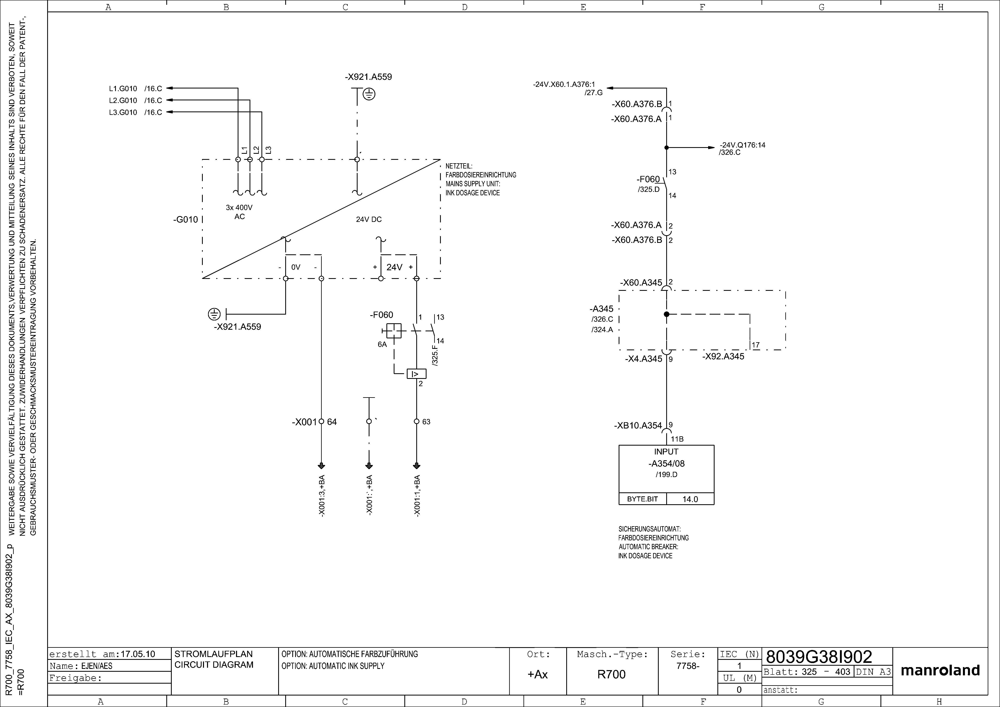

# +Ax — Sheet 325 of 403 — OPTION: AUTOMATISCHE FARBZUFÜHRUNG

**OPTION: AUTOMATIC INK SUPPLY**

> Part of the manroland **R700** printing press IEC/UL circuit diagrams.
> Drawing class: **Stromlaufplan / Circuit diagram** (DIN A3).
> Document `+Ax` covers the **Central control console** machine section.

## At a glance

| Field | Value |
|---|---|
| Document | `+Ax`  (8039G38I902) |
| Sheet | **325** of 403 |
| Section (DE) | OPTION: AUTOMATISCHE FARBZUFÜHRUNG |
| Section (EN) | OPTION: AUTOMATIC INK SUPPLY |
| Section type | CIRCUIT — Circuit diagram |
| Machine type | `R700` |
| Series | `7758` |
| Created | 17.05.10 |
| Replaces | — |
| Columns used | A, B, C, D, E, F |
| Path numbers | — |
| Labels on sheet | 76 |
| Cross-refs out | 10 |
| Cross-refs in | 18 |

**Previous:** [+Ax sheet 324](SHEET_0324.md) · **Next:** [+Ax sheet 326](SHEET_0326.md) · **Document TOC:** [_TOC.md](_TOC.md)  (+Ax) · **Master TOC:** [all sheets](../_MASTER_TOC.md)

## Sheet image (300 DPI, exact vector render)



_Rendered directly from the PDF vector layer at 300 DPI (1-bit), no OCR and no resampling. Use it to confirm anything ambiguous in the text below._

## Cross-references on this sheet

Each entry is a wire leaving this sheet. The printed token is `/sheet.column`; the link resolves to that sheet inside the same document.

| Ref | Target sheet | Col | Path | Destination on target | Target section | From col |
|---|---|---|---|---|---|---|
| `/16.C` | [+Ax sheet 16](SHEET_0016.md) | C | — | 24V.X60.1.A376:1 L1.G010 | SPANNUNGSVERSORGUNG, SCHALTSCHRANKBELÜFTUNG | C |
| `/27.G` | [+Ax sheet 27](SHEET_0027.md) | G | — | 24V.X60.1.A376:1 L1.G010 | SPANNUNGSVERSORGUNG, SCHALTSCHRANKBELÜFTUNG | C |
| `/16.C` | [+Ax sheet 16](SHEET_0016.md) | C | — | L2.G010 | SPANNUNGSVERSORGUNG, SCHALTSCHRANKBELÜFTUNG | A |
| `/16.C` | [+Ax sheet 16](SHEET_0016.md) | C | — | L3.G010 | SPANNUNGSVERSORGUNG, SCHALTSCHRANKBELÜFTUNG | A |
| `/326.C` | [+Ax sheet 326](SHEET_0326.md) | C | — | — | OPTION: AUTOMATISCHE FARBZUFÜHRUNG | F |
| `/325.D` | [+Ax sheet 325](SHEET_0325.md) | D | — | — | OPTION: AUTOMATISCHE FARBZUFÜHRUNG | F |
| `/326.C` | [+Ax sheet 326](SHEET_0326.md) | C | — | — | OPTION: AUTOMATISCHE FARBZUFÜHRUNG | E |
| `/324.A` | [+Ax sheet 324](SHEET_0324.md) | A | — | — | OPTION: "EJEKTOR" ANLAGE / SELECT AIRSTATION / | E |
| `/325.F` | [+Ax sheet 325](SHEET_0325.md) | F | — | — | OPTION: AUTOMATISCHE FARBZUFÜHRUNG | D |
| `/199.D` | [+Ax sheet 199](SHEET_0199.md) | D | — | — | REFERENZMODUL | F |

### Incoming references (sheets that point here)

Every other sheet that sends a wire to this one. `Back-ref` is the token printed on *that* sheet; `Path` is its line number.

| From sheet | Cols | Back-ref | Path | Refs | What continues there |
|---|---|---|---|---|---|
| [+Ax#16](SHEET_0016.md) | D | `/16.D` | — | 3 | L1.G010; L2.G010; L3.G010 |
| [+Ax#27](SHEET_0027.md) | G | `/27.G` | — | 1 | 24V.X60.1.A376:1 |
| [+Ax#199](SHEET_0199.md) | D | `/199.D` | — | 1 | — |
| [+Ax#227](SHEET_0227.md) | A | `/227.A` | — | 1 | — |
| [+Ax#245](SHEET_0245.md) | B | `/245.B` | — | 1 | — |
| [+Ax#284](SHEET_0284.md) | C, E, F | `/284.C`, `/284.E`, `/284.F` | — | 5 | — |
| [+Ax#289](SHEET_0289.md) | F | `/289.F` | — | 1 | — |
| [+Ax#324](SHEET_0324.md) | A | `/324.A` | — | 1 | — |
| [+Ax#325](SHEET_0325.md) | D, F | `/325.D`, `/325.F` | — | 2 | — |
| [+Ax#326](SHEET_0326.md) | C | `/326.C` | — | 2 | 24V.Q176:14 |


## Devices on this sheet

| Tag | Class | Class meaning (IEC) | Col | Sub | Terminal | Sign |
|---|---|---|---|---|---|---|
| `A354/08` | A | Baugruppe / assembly, module, PC board | F | 08 | — | — |
| `A345` | A | Baugruppe / assembly, module, PC board | E | — | — | — |
| `F060` | F | Schutz / protection device (fuse, circuit breaker) | F | — | — | — |
| `G010` | G | Stromversorgung / power supply | B | — | — | — |
| `F060` | F | Schutz / protection device (fuse, circuit breaker) | C | — | — | — |
| `X001` | X | Klemme / terminal, plug connector | C | — | — | — |
| `14.0` | — | cross-device reference | F | — | — | — |
| `XB10.A354` | — | cross-device reference | E | — | — | — |
| `X60.A345` | — | cross-device reference | E | — | — | — |
| `X60.A376.A` | — | cross-device reference | E | — | — | — |
| `X60.A376.B` | — | cross-device reference | E | — | — | — |
| `X60.A376.B` | — | cross-device reference | E | — | — | — |
| `X60.A376.A` | — | cross-device reference | E | — | — | — |
| `X4.A345` | — | cross-device reference | F | — | — | — |
| `X92.A345` | — | cross-device reference | F | — | — | — |
| `X921.A559` | — | cross-device reference | C | — | — | — |
| `X921.A559` | — | cross-device reference | B | — | — | — |

## Potentials / nets

| Potential | Count | Columns | Attached devices | Terminals |
|---|---|---|---|---|
| `0V` | 1 | C | — | — |
| `24V` | 4 | C, E, F | `1`, `A376`, `Q176`, `X60` | `1`, `14` |
| `L1` | 2 | A, B | `G010` | — |
| `L2` | 2 | A, B | `G010` | — |
| `L3` | 2 | A, B | `G010` | — |


A potential such as `L24+/4` or `M24+` is a named supply/return rail; every place it appears on this sheet is electrically common.

## Wire-end annotations (grouped as printed)

A wire that continues elsewhere is annotated with a small cluster: the destination description, the path/line number `#NN`, and the `/sheet.column` cross reference. Each row below is one such cluster exactly as it is grouped on the drawing.

| Col | Y | Path | Cross-ref | Text on the wire |
|---|---|---|---|---|
| C | 86.8 | — | — | `X921.A559` |
| C | 96.7 | — | `/16.C`, `/27.G` | `L1.G010 24V.X60.1.A376:1` |
| A | 115.8 | — | `/16.C` | `L2.G010` |
| E | 119.4 | — | — | `X60.A376.B 1` |
| A | 130.0 | — | `/16.C` | `L3.G010` |
| E | 136.4 | — | — | `X60.A376.A 1` |
| F | 169.0 | — | — | `24V.Q176:14` |
| B | 174.1 | — | — | `L1` |
| B | 174.1 | — | — | `L2` |
| B | 174.1 | — | — | `L3` |
| F | 177.5 | — | `/326.C` | — |
| C | 179.4 | — | — | `'` |
| D | 194.8 | — | — | `NETZTEIL: FARBDOSIEREINRICHTUNG INK DOSAGE DEVICE MAINS SUPPLY UNIT:` |
| F | 200.9 | — | — | `13` |
| F | 208.6 | — | — | `F060` |
| F | 221.8 | — | `/325.D` | — |
| F | 229.2 | — | — | `14` |
| B | 243.4 | — | — | `3x 400V AC` |
| B | 256.8 | — | — | `G010` |
| C | 257.5 | — | — | `24V DC` |
| E | 263.2 | — | — | `X60.A376.A 2` |
| E | 280.9 | — | — | `X60.A376.B 2` |
| C | 313.5 | — | — | `24V` |
| C | 314.2 | — | — | `0V` |
| C | 314.2 | — | — | `+ +` |
| F | 332.0 | — | — | `X60.A345 2` |
| E | 363.1 | — | — | `A345` |
| C | 370.2 | — | — | `F060` |
| D | 373.8 | — | — | `1` |
| D | 373.8 | — | — | `13` |
| E | 376.2 | — | `/326.C`, `/324.A` | — |
| B | 384.4 | — | — | `X921.A559` |
| D | 402.1 | — | — | `14` |
| C | 406.3 | — | — | `6A` |
| F | 407.1 | — | — | `17` |
| D | 410.7 | — | `/325.F` | — |
| F | 419.8 | — | — | `X92.A345` |
| F | 422.7 | — | — | `X4.A345 9` |
| D | 441.3 | — | — | `I> 2` |
| C | 497.3 | — | — | `'` |
| C | 497.6 | — | — | `X001 64 63` |
| F | 502.0 | — | — | `XB10.A354 9` |
| F | 519.0 | — | — | `11B` |
| F | 533.5 | — | — | `INPUT` |
| F | 547.4 | — | — | `A354/08` |
| F | 561.2 | — | `/199.D` | — |
| C | 565.5 | — | — | `X001:3,+BA` |
| C | 565.5 | — | — | `X001:',+BA` |
| D | 565.5 | — | — | `X001:1,+BA` |
| F | 590.2 | — | — | `BYTE.BIT 14.0` |
| F | 627.1 | — | — | `FARBDOSIEREINRICHTUNG SICHERUNGSAUTOMAT:` |
| F | 648.3 | — | — | `INK DOSAGE DEVICE AUTOMATIC BREAKER:` |


## Reconstructed tables

This sheet carries tabular content (pin map / terminal assignment / index). The grid below was rebuilt from the drawing's own rule lines, so each row is exactly one physical row of the table.

### Table 1 — 1 data rows × 4 columns (at x=283.5, y=104.9)

| L1 400V AC | L2 | L3 |  |
|---|---|---|---|
|  |  |  | `0V` |


### Table 2 — 2 data rows × 3 columns (at x=425.2, y=104.9)

| ` 24V | DC |  |
|---|---|---|
|  | `+` |  |
|  |  | `F060` |


### Table 3 — 4 data rows × 3 columns (at x=737.0, y=104.9)

| X60.A376.B X60.A376.A | 1 1 | 24V.Q176:14 |
|---|---|---|
| `F060 /325.D X60.A376.A X60.A376.B X60.A345` | `13 14 2 2 2` | `/326.C` |
| `X4.A345 XB10.A354` | `9 9 11B` | `X92.A345` |
| `INPUT` | `A354/08 /199.D` |  |
| `BYTE.BIT` | `14.0` |  |


## Notes and free text on this sheet

| Text | Col | Y (pt) |
|---|---|---|
| `11B` | F | 519.03 |
| `INPUT` | F | 533.55 |
| `BYTE.BIT` | E | 590.8 |
| `SICHERUNGSAUTOMAT:` | F | 627.09 |
| `FARBDOSIEREINRICHTUNG` | F | 637.72 |
| `AUTOMATIC BREAKER:` | F | 648.34 |
| `INK DOSAGE DEVICE` | F | 658.96 |
| `NETZTEIL:` | D | 194.75 |
| `FARBDOSIEREINRICHTUNG` | D | 205.44 |
| `MAINS SUPPLY UNIT:` | D | 216.05 |
| `INK DOSAGE DEVICE` | D | 226.68 |
| `I>` | D | 441.26 |
| `X001:3,+BA` | C | 565.51 |
| `X001:',+BA` | C | 565.51 |
| `X001:1,+BA` | D | 565.51 |
| `3x 400V` | B | 243.4 |
| `AC` | B | 253.92 |
| `6A` | C | 406.33 |

## Complete label inventory (exact text from the drawing)

Every text object inside the drawing area of this sheet, in DIN reading order (column A→H, then top→bottom). This is the authoritative list: if a string is not here it is not printed on this sheet.

| Col | Y | X | Dir | Type | Text |
|---|---|---|---|---|---|
| A | 101.6 | 129.8 | → | potential | `L1.G010` |
| A | 101.6 | 172.1 | → | cross-reference | `/16.C` |
| A | 115.8 | 129.8 | → | potential | `L2.G010` |
| A | 115.8 | 172.1 | → | cross-reference | `/16.C` |
| A | 130.0 | 129.8 | → | potential | `L3.G010` |
| A | 130.0 | 172.1 | → | cross-reference | `/16.C` |
| B | 174.0 | 287.3 | ↕ | potential | `L1` |
| B | 174.0 | 301.5 | ↕ | potential | `L2` |
| B | 174.0 | 315.7 | ↕ | potential | `L3` |
| B | 243.4 | 269.0 | → | text | `3x 400V` |
| B | 253.9 | 269.3 | → | text | `AC` |
| B | 256.8 | 206.4 | → | device tag | `G010` |
| B | 384.4 | 254.8 | → | device ref | `X921.A559` |
| C | 86.8 | 410.7 | → | device ref | `X921.A559` |
| C | 179.4 | 427.9 | ↕ | other | `'` |
| C | 257.5 | 424.1 | → | potential | `24V DC` |
| C | 313.5 | 460.3 | → | potential | `24V` |
| C | 314.2 | 347.0 | → | potential | `0V` |
| C | 314.2 | 444.0 | → | number | `+` |
| C | 370.2 | 440.5 | → | device tag | `F060` |
| C | 406.3 | 449.9 | → | text | `6A` |
| C | 497.3 | 445.9 | → | other | `'` |
| C | 497.5 | 347.8 | → | device tag | `X001` |
| C | 497.8 | 389.5 | → | number | `64` |
| C | 565.5 | 379.4 | ↕ | text | `X001:3,+BA` |
| C | 565.5 | 436.1 | ↕ | text | `X001:',+BA` |
| D | 194.8 | 530.6 | → | text | `NETZTEIL:` |
| D | 205.4 | 530.6 | → | text | `FARBDOSIEREINRICHTUNG` |
| D | 216.0 | 530.9 | → | text | `MAINS SUPPLY UNIT:` |
| D | 226.7 | 530.6 | → | text | `INK DOSAGE DEVICE` |
| D | 314.2 | 486.6 | → | number | `+` |
| D | 373.8 | 498.0 | → | number | `1` |
| D | 373.8 | 519.3 | → | number | `13` |
| D | 402.1 | 519.3 | → | number | `14` |
| D | 410.7 | 514.1 | ↕ | cross-reference | `/325.F` |
| D | 441.3 | 489.5 | → | text | `I>` |
| D | 453.2 | 498.6 | → | number | `2` |
| D | 498.5 | 502.9 | → | number | `63` |
| D | 565.5 | 492.8 | ↕ | text | `X001:1,+BA` |
| E | 96.7 | 634.7 | → | potential | `24V.X60.1.A376:1` |
| E | 106.6 | 696.2 | → | cross-reference | `/27.G` |
| E | 119.4 | 728.5 | → | device ref | `X60.A376.B` |
| E | 137.1 | 727.7 | → | device ref | `X60.A376.A` |
| E | 263.2 | 727.7 | → | device ref | `X60.A376.A` |
| E | 280.9 | 728.5 | → | device ref | `X60.A376.B` |
| E | 332.0 | 738.4 | → | device ref | `X60.A345` |
| E | 363.1 | 702.1 | → | device tag | `A345` |
| E | 376.2 | 704.4 | → | cross-reference | `/326.C` |
| E | 388.6 | 704.4 | → | cross-reference | `/324.A` |
| E | 502.0 | 731.3 | → | device ref | `XB10.A354` |
| E | 590.8 | 746.9 | → | text | `BYTE.BIT` |
| F | 119.4 | 795.7 | → | number | `1` |
| F | 136.4 | 795.7 | → | number | `1` |
| F | 169.0 | 857.2 | → | potential | `24V.Q176:14` |
| F | 177.5 | 856.1 | → | cross-reference | `/326.C` |
| F | 200.9 | 795.7 | → | number | `13` |
| F | 208.6 | 758.0 | → | device tag | `F060` |
| F | 221.7 | 759.7 | → | cross-reference | `/325.D` |
| F | 229.2 | 795.7 | → | number | `14` |
| F | 265.4 | 796.3 | → | number | `2` |
| F | 282.4 | 796.3 | → | number | `2` |
| F | 332.0 | 796.3 | → | number | `2` |
| F | 407.1 | 894.9 | → | number | `17` |
| F | 419.8 | 836.2 | → | device ref | `X92.A345` |
| F | 422.7 | 744.4 | → | device ref | `X4.A345` |
| F | 424.1 | 796.3 | → | number | `9` |
| F | 502.1 | 796.3 | → | number | `9` |
| F | 519.0 | 798.5 | → | text | `11B` |
| F | 533.6 | 778.8 | → | text | `INPUT` |
| F | 547.4 | 772.3 | → | device tag | `A354/08` |
| F | 561.2 | 780.9 | → | cross-reference | `/199.D` |
| F | 590.2 | 812.3 | → | device ref | `14.0` |
| F | 627.1 | 736.7 | → | text | `SICHERUNGSAUTOMAT:` |
| F | 637.7 | 736.2 | → | text | `FARBDOSIEREINRICHTUNG` |
| F | 648.3 | 737.0 | → | text | `AUTOMATIC BREAKER:` |
| F | 659.0 | 736.2 | → | text | `INK DOSAGE DEVICE` |

## Reading-order text block

The same content as a plain block, grouped by DIN column — convenient to paste or to match against a visual description.

```text
=== Column A ===
 101.6  129.8  net          L1.G010
 101.6  172.1  xref         /16.C
 115.8  129.8  net          L2.G010
 115.8  172.1  xref         /16.C
 130.0  129.8  net          L3.G010
 130.0  172.1  xref         /16.C
=== Column B ===
 174.0  287.3  net          L1
 174.0  301.5  net          L2
 174.0  315.7  net          L3
 243.4  269.0  text         3x 400V
 253.9  269.3  text         AC
 256.8  206.4  devtag       G010
 384.4  254.8  devref       X921.A559
=== Column C ===
  86.8  410.7  devref       X921.A559
 179.4  427.9  other        `
 257.5  424.1  net          24V DC
 313.5  460.3  net          24V
 314.2  347.0  net          0V
 314.2  444.0  numeric      +
 370.2  440.5  devtag       F060
 406.3  449.9  text         6A
 497.3  445.9  other        `
 497.5  347.8  devtag       X001
 497.8  389.5  numeric      64
 565.5  379.4  text         X001:3,+BA
 565.5  436.1  text         X001:`,+BA
=== Column D ===
 194.8  530.6  text         NETZTEIL:
 205.4  530.6  text         FARBDOSIEREINRICHTUNG
 216.0  530.9  text         MAINS SUPPLY UNIT:
 226.7  530.6  text         INK DOSAGE DEVICE
 314.2  486.6  numeric      +
 373.8  498.0  numeric      1
 373.8  519.3  numeric      13
 402.1  519.3  numeric      14
 410.7  514.1  xref         /325.F
 441.3  489.5  text         I>
 453.2  498.6  numeric      2
 498.5  502.9  numeric      63
 565.5  492.8  text         X001:1,+BA
=== Column E ===
  96.7  634.7  net          24V.X60.1.A376:1
 106.6  696.2  xref         /27.G
 119.4  728.5  devref       X60.A376.B
 137.1  727.7  devref       X60.A376.A
 263.2  727.7  devref       X60.A376.A
 280.9  728.5  devref       X60.A376.B
 332.0  738.4  devref       X60.A345
 363.1  702.1  devtag       A345
 376.2  704.4  xref         /326.C
 388.6  704.4  xref         /324.A
 502.0  731.3  devref       XB10.A354
 590.8  746.9  text         BYTE.BIT
=== Column F ===
 119.4  795.7  numeric      1
 136.4  795.7  numeric      1
 169.0  857.2  net          24V.Q176:14
 177.5  856.1  xref         /326.C
 200.9  795.7  numeric      13
 208.6  758.0  devtag       F060
 221.7  759.7  xref         /325.D
 229.2  795.7  numeric      14
 265.4  796.3  numeric      2
 282.4  796.3  numeric      2
 332.0  796.3  numeric      2
 407.1  894.9  numeric      17
 419.8  836.2  devref       X92.A345
 422.7  744.4  devref       X4.A345
 424.1  796.3  numeric      9
 502.1  796.3  numeric      9
 519.0  798.5  text         11B
 533.6  778.8  text         INPUT
 547.4  772.3  devtag       A354/08
 561.2  780.9  xref         /199.D
 590.2  812.3  devref       14.0
 627.1  736.7  text         SICHERUNGSAUTOMAT:
 637.7  736.2  text         FARBDOSIEREINRICHTUNG
 648.3  737.0  text         AUTOMATIC BREAKER:
 659.0  736.2  text         INK DOSAGE DEVICE
```

---
_Generated from the PDF vector text layer; no OCR. Source: `R700_7758_IEC_AX_8039G38I902_p`, sheet 325._
