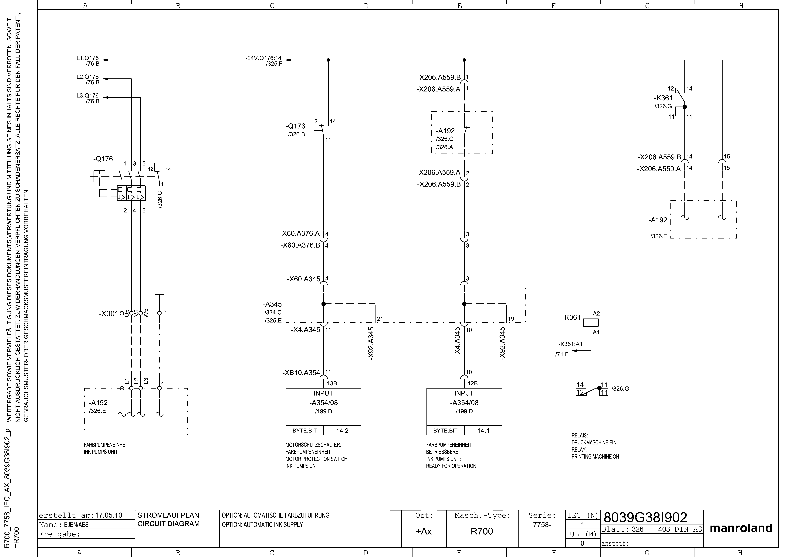

# +Ax — Sheet 326 of 403 — OPTION: AUTOMATISCHE FARBZUFÜHRUNG

**OPTION: AUTOMATIC INK SUPPLY**

> Part of the manroland **R700** printing press IEC/UL circuit diagrams.
> Drawing class: **Stromlaufplan / Circuit diagram** (DIN A3).
> Document `+Ax` covers the **Central control console** machine section.

## At a glance

| Field | Value |
|---|---|
| Document | `+Ax`  (8039G38I902) |
| Sheet | **326** of 403 |
| Section (DE) | OPTION: AUTOMATISCHE FARBZUFÜHRUNG |
| Section (EN) | OPTION: AUTOMATIC INK SUPPLY |
| Section type | CIRCUIT — Circuit diagram |
| Machine type | `R700` |
| Series | `7758` |
| Created | 17.05.10 |
| Replaces | — |
| Columns used | A, B, C, D, E, F, G, H |
| Path numbers | — |
| Labels on sheet | 118 |
| Cross-refs out | 16 |
| Cross-refs in | 36 |

**Previous:** [+Ax sheet 325](SHEET_0325.md) · **Next:** [+Ax sheet 327](SHEET_0327.md) · **Document TOC:** [_TOC.md](_TOC.md)  (+Ax) · **Master TOC:** [all sheets](../_MASTER_TOC.md)

## Sheet image (300 DPI, exact vector render)



_Rendered directly from the PDF vector layer at 300 DPI (1-bit), no OCR and no resampling. Use it to confirm anything ambiguous in the text below._

## Cross-references on this sheet

Each entry is a wire leaving this sheet. The printed token is `/sheet.column`; the link resolves to that sheet inside the same document.

| Ref | Target sheet | Col | Path | Destination on target | Target section | From col |
|---|---|---|---|---|---|---|
| `/325.F` | [+Ax sheet 325](SHEET_0325.md) | F | — | 24V.Q176:14 | OPTION: AUTOMATISCHE FARBZUFÜHRUNG | C |
| `/76.B` | [+Ax sheet 76](SHEET_0076.md) | B | — | L1.Q176 | ANLEGER | A |
| `/76.B` | [+Ax sheet 76](SHEET_0076.md) | B | — | L2.Q176 | ANLEGER | A |
| `/76.B` | [+Ax sheet 76](SHEET_0076.md) | B | — | L3.Q176 | ANLEGER | A |
| `/326.G` | [+Ax sheet 326](SHEET_0326.md) | G | — | — | OPTION: AUTOMATISCHE FARBZUFÜHRUNG | G |
| `/326.G` | [+Ax sheet 326](SHEET_0326.md) | G | — | A192 | OPTION: AUTOMATISCHE FARBZUFÜHRUNG | E |
| `/326.A` | [+Ax sheet 326](SHEET_0326.md) | A | — | A192 | OPTION: AUTOMATISCHE FARBZUFÜHRUNG | E |
| `/326.B` | [+Ax sheet 326](SHEET_0326.md) | B | — | — | OPTION: AUTOMATISCHE FARBZUFÜHRUNG | C |
| `/326.C` | [+Ax sheet 326](SHEET_0326.md) | C | — | — | OPTION: AUTOMATISCHE FARBZUFÜHRUNG | B |
| `/326.E` | [+Ax sheet 326](SHEET_0326.md) | E | — | — | OPTION: AUTOMATISCHE FARBZUFÜHRUNG | G |
| `/334.C` | [+Ax sheet 334](SHEET_0334.md) | C | — | — | OPTION: INLINESORTER | C |
| `/325.E` | [+Ax sheet 325](SHEET_0325.md) | E | — | — | OPTION: AUTOMATISCHE FARBZUFÜHRUNG | C |
| `/71.F` | [+Ax sheet 71](SHEET_0071.md) | F | — | — | WASCHVORRICHTUNGEN DRUCKWERKE | F |
| `/326.E` | [+Ax sheet 326](SHEET_0326.md) | E | — | A192 | OPTION: AUTOMATISCHE FARBZUFÜHRUNG | A |
| `/199.D` | [+Ax sheet 199](SHEET_0199.md) | D | — | — | REFERENZMODUL | D |
| `/199.D` | [+Ax sheet 199](SHEET_0199.md) | D | — | — | REFERENZMODUL | E |

### Incoming references (sheets that point here)

Every other sheet that sends a wire to this one. `Back-ref` is the token printed on *that* sheet; `Path` is its line number.

| From sheet | Cols | Back-ref | Path | Refs | What continues there |
|---|---|---|---|---|---|
| [+Ax#71](SHEET_0071.md) | G | `/71.G` | — | 1 | — |
| [+Ax#76](SHEET_0076.md) | B | `/76.B` | — | 3 | L1.Q176; L2.Q176; L3.Q176 |
| [+Ax#199](SHEET_0199.md) | D | `/199.D` | — | 2 | — |
| [+Ax#227](SHEET_0227.md) | A | `/227.A` | — | 2 | — |
| [+Ax#245](SHEET_0245.md) | B | `/245.B` | — | 2 | — |
| [+Ax#284](SHEET_0284.md) | C, E, F | `/284.C`, `/284.E`, `/284.F` | — | 6 | — |
| [+Ax#289](SHEET_0289.md) | F | `/289.F` | — | 2 | — |
| [+Ax#291](SHEET_0291.md) | F | `/291.F` | — | 8 | — |
| [+Ax#325](SHEET_0325.md) | E, F | `/325.E`, `/325.F` | — | 2 | — |
| [+Ax#326](SHEET_0326.md) | A, B, C, E, G | `/326.A`, `/326.B`, `/326.C`, `/326.E`, `/326.G` | — | 7 | A192 |
| [+Ax#334](SHEET_0334.md) | C | `/334.C` | — | 1 | — |


## Devices on this sheet

| Tag | Class | Class meaning (IEC) | Col | Sub | Terminal | Sign |
|---|---|---|---|---|---|---|
| `K361` | K | Relais / relay, contactor | G | — | — | — |
| `A192` | A | Baugruppe / assembly, module, PC board | G | — | — | — |
| `A2` | A | Baugruppe / assembly, module, PC board | F | — | — | — |
| `A1` | A | Baugruppe / assembly, module, PC board | F | — | — | — |
| `K361` | K | Relais / relay, contactor | F | — | — | — |
| `Q176` | Q | Leistungsschalter / power switching device | C | — | — | — |
| `A192` | A | Baugruppe / assembly, module, PC board | E | — | — | — |
| `U5` | U | Umrichter / frequency converter | A | — | — | — |
| `X001` | X | Klemme / terminal, plug connector | A | — | — | — |
| `V5` | V | Diode / semiconductor valve | B | — | — | — |
| `W5` | W | Kabel / cable, line, bus | B | — | — | — |
| `Q176` | Q | Leistungsschalter / power switching device | A | — | — | — |
| `A192` | A | Baugruppe / assembly, module, PC board | A | — | — | — |
| `A354/08` | A | Baugruppe / assembly, module, PC board | E | 08 | — | — |
| `A354/08` | A | Baugruppe / assembly, module, PC board | D | 08 | — | — |
| `A345` | A | Baugruppe / assembly, module, PC board | C | — | — | — |
| `K361:A1` | K | Relais / relay, contactor | F | — | A1 | — |
| `X206.A559.B` | — | cross-device reference | G | — | — | — |
| `X206.A559.A` | — | cross-device reference | G | — | — | — |
| `X4.A345` | — | cross-device reference | E | — | — | — |
| `X206.A559.B` | — | cross-device reference | E | — | — | — |
| `X206.A559.A` | — | cross-device reference | E | — | — | — |
| `X206.A559.B` | — | cross-device reference | E | — | — | — |
| `X206.A559.A` | — | cross-device reference | E | — | — | — |
| `14.1` | — | cross-device reference | E | — | — | — |
| `14.2` | — | cross-device reference | D | — | — | — |
| `XB10.A354` | — | cross-device reference | C | — | — | — |
| `X60.A345` | — | cross-device reference | C | — | — | — |
| `X60.A376.A` | — | cross-device reference | C | — | — | — |
| `X60.A376.B` | — | cross-device reference | C | — | — | — |
| `X4.A345` | — | cross-device reference | C | — | — | — |
| `X92.A345` | — | cross-device reference | D | — | — | — |
| `X92.A345` | — | cross-device reference | E | — | — | — |

## Potentials / nets

| Potential | Count | Columns | Attached devices | Terminals |
|---|---|---|---|---|
| `24V` | 1 | C | `Q176` | `14` |
| `L1` | 2 | A | `Q176` | — |
| `L2` | 2 | A, B | `Q176` | — |
| `L3` | 2 | A, B | `Q176` | — |


A potential such as `L24+/4` or `M24+` is a named supply/return rail; every place it appears on this sheet is electrically common.

## Wire-end annotations (grouped as printed)

A wire that continues elsewhere is annotated with a small cluster: the destination description, the path/line number `#NN`, and the `/sheet.column` cross reference. Each row below is one such cluster exactly as it is grouped on the drawing.

| Col | Y | Path | Cross-ref | Text on the wire |
|---|---|---|---|---|
| A | 83.9 | — | `/76.B` | `L1.Q176` |
| C | 83.9 | — | `/325.F` | `24V.Q176:14` |
| A | 112.3 | — | `/76.B` | `L2.Q176` |
| E | 112.3 | — | — | `X206.A559.B 1` |
| E | 129.3 | — | — | `X206.A559.A 1` |
| G | 130.0 | — | — | `K361 14` |
| G | 130.0 | — | — | `12` |
| A | 140.6 | — | `/76.B` | `L3.Q176` |
| G | 156.5 | — | `/326.G` | — |
| G | 172.5 | — | — | `11 11` |
| C | 179.6 | — | — | `Q176 14` |
| C | 179.6 | — | — | `12` |
| E | 193.1 | — | `/326.G`, `/326.A` | `A192` |
| C | 199.0 | — | `/326.B` | — |
| D | 208.0 | — | — | `11` |
| G | 232.8 | — | — | `X206.A559.B 14` |
| H | 232.8 | — | — | `15` |
| A | 235.6 | — | — | `Q176` |
| A | 243.4 | — | — | `1` |
| B | 243.4 | — | — | `3` |
| B | 243.4 | — | — | `5` |
| G | 249.8 | — | — | `X206.A559.A 14` |
| H | 249.8 | — | — | `15` |
| B | 252.5 | — | — | `12 14` |
| E | 256.1 | — | — | `X206.A559.A 2` |
| E | 273.9 | — | — | `X206.A559.B 2` |
| B | 275.1 | — | — | `11` |
| B | 288.9 | — | `/326.C` | — |
| A | 314.3 | — | — | `2` |
| B | 314.3 | — | — | `4` |
| B | 314.3 | — | — | `6` |
| G | 327.7 | — | — | `A192` |
| C | 348.3 | — | — | `X60.A376.A 4` |
| E | 350.4 | — | — | `3` |
| G | 353.2 | — | `/326.E` | — |
| C | 366.0 | — | — | `X60.A376.B 4` |
| E | 367.4 | — | — | `3` |
| C | 417.0 | — | — | `X60.A345 4` |
| E | 417.0 | — | — | `3` |
| C | 455.3 | — | — | `A345` |
| B | 466.3 | — | — | `W5` |
| B | 467.9 | — | — | `V5` |
| A | 468.1 | — | — | `U5` |
| C | 468.4 | — | `/334.C` | — |
| B | 469.0 | — | — | `'` |
| A | 469.2 | — | — | `X001` |
| F | 470.1 | — | — | `A2` |
| F | 475.1 | — | — | `K361` |
| E | 478.0 | — | — | `21 19` |
| C | 480.7 | — | `/325.E` | — |
| C | 493.5 | — | — | `X4.A345 11` |
| D | 494.1 | — | — | `X92.A345` |
| E | 494.1 | — | — | `X4.A345` |
| E | 494.1 | — | — | `X92.A345` |
| E | 495.0 | — | — | `10` |
| F | 498.5 | — | — | `A1` |
| F | 516.2 | — | — | `K361:A1` |
| F | 531.8 | — | `/71.F` | — |
| C | 558.7 | — | — | `XB10.A354 11` |
| E | 558.8 | — | — | `10` |
| A | 570.9 | — | — | `L1` |
| B | 570.9 | — | — | `L2` |
| B | 570.9 | — | — | `L3` |
| D | 575.7 | — | — | `13B` |
| E | 575.7 | — | — | `12B` |
| B | 576.3 | — | — | `'` |
| G | 577.1 | — | — | `14 12 11 11 /326.G` |
| D | 590.2 | — | — | `INPUT` |
| E | 590.2 | — | — | `INPUT` |
| A | 604.1 | — | `/326.E` | `A192` |
| D | 604.1 | — | — | `A354/08` |
| E | 604.1 | — | — | `A354/08` |
| D | 617.9 | — | `/199.D` | — |
| E | 617.9 | — | `/199.D` | — |
| D | 646.9 | — | — | `BYTE.BIT 14.2` |
| E | 646.9 | — | — | `BYTE.BIT 14.1` |
| F | 655.4 | — | — | `RELAIS: DRUCKMASCHINE EIN RELAY: PRINTING MACHINE ON` |
| A | 669.6 | — | — | `FARBPUMPENEINHEIT INK PUMPS UNIT` |
| C | 669.6 | — | — | `FARBPUMPENEINHEIT INK PUMPS UNIT MOTORSCHUTZSCHALTER: MOTOR PROTECTION SWITCH:` |
| E | 669.6 | — | — | `FARBPUMPENEINHEIT: BETRIEBSBEREIT INK PUMPS UNIT: READY FOR OPERATION` |


## Reconstructed tables

This sheet carries tabular content (pin map / terminal assignment / index). The grid below was rebuilt from the drawing's own rule lines, so each row is exactly one physical row of the table.

### Table 1 — 3 data rows × 6 columns (at x=432.3, y=90.7)

| 12 Q176 /326.B X60.A376.A X60.A376.B X60.A345 | 11 4 4 4 | 14 |  | X206.A559.B X206.A559.A A192 /326.G /326.A X206.A559.A X206.A559.B | 1 1 2 2 3 3 3 |
|---|---|---|---|---|---|
| `X4.A345 XB10.A354` | `11 11` | `13B` | `21 X92.A345` | `X4.A345` | `10 10 12B` |
| `INPUT` | `A354/08 /199.D` |  |  | `INPUT` | `A354/08 /199.D` |
| `BYTE.BIT` |  | `14.2` |  | `BYTE.BIT` | `14.1` |


## Notes and free text on this sheet

| Text | Col | Y (pt) |
|---|---|---|
| `11 /326.G` | G | 583.51 |
| `RELAIS:` | F | 655.36 |
| `DRUCKMASCHINE EIN` | F | 666.06 |
| `RELAY:` | F | 676.63 |
| `PRINTING MACHINE ON` | F | 687.33 |
| `FARBPUMPENEINHEIT` | A | 669.6 |
| `INK PUMPS UNIT` | A | 680.22 |
| `12B` | E | 575.72 |
| `INPUT` | E | 590.24 |
| `BYTE.BIT` | E | 647.49 |
| `FARBPUMPENEINHEIT:` | E | 669.59 |
| `BETRIEBSBEREIT` | E | 680.2 |
| `INK PUMPS UNIT:` | E | 690.85 |
| `READY FOR OPERATION` | E | 701.49 |
| `13B` | D | 575.72 |
| `INPUT` | D | 590.24 |
| `BYTE.BIT` | C | 647.49 |
| `MOTORSCHUTZSCHALTER:` | C | 669.62 |
| `FARBPUMPENEINHEIT` | C | 680.23 |
| `MOTOR PROTECTION SWITCH:` | C | 690.86 |
| `INK PUMPS UNIT` | C | 701.49 |

## Complete label inventory (exact text from the drawing)

Every text object inside the drawing area of this sheet, in DIN reading order (column A→H, then top→bottom). This is the authoritative list: if a string is not here it is not printed on this sheet.

| Col | Y | X | Dir | Type | Text |
|---|---|---|---|---|---|
| A | 83.9 | 115.7 | → | potential | `L1.Q176` |
| A | 92.4 | 129.8 | → | cross-reference | `/76.B` |
| A | 112.3 | 115.7 | → | potential | `L2.Q176` |
| A | 120.7 | 129.8 | → | cross-reference | `/76.B` |
| A | 140.6 | 115.7 | → | potential | `L3.Q176` |
| A | 149.1 | 129.8 | → | cross-reference | `/76.B` |
| A | 235.6 | 141.2 | → | device tag | `Q176` |
| A | 243.4 | 186.2 | → | number | `1` |
| A | 314.3 | 186.8 | → | number | `2` |
| A | 468.1 | 188.1 | ↕ | device tag | `U5` |
| A | 469.2 | 149.4 | → | device tag | `X001` |
| A | 570.9 | 188.1 | ↕ | potential | `L1` |
| A | 604.1 | 134.4 | → | device tag | `A192` |
| A | 617.2 | 134.6 | → | cross-reference | `/326.E` |
| A | 669.6 | 126.7 | → | text | `FARBPUMPENEINHEIT` |
| A | 680.2 | 126.7 | → | text | `INK PUMPS UNIT` |
| B | 243.4 | 201.0 | → | number | `3` |
| B | 243.4 | 215.1 | → | number | `5` |
| B | 252.5 | 223.4 | → | number | `12` |
| B | 252.5 | 250.3 | → | number | `14` |
| B | 275.1 | 243.2 | → | number | `11` |
| B | 288.9 | 237.7 | ↕ | cross-reference | `/326.C` |
| B | 314.3 | 201.0 | → | number | `4` |
| B | 314.3 | 215.1 | → | number | `6` |
| B | 466.3 | 216.2 | ↕ | device tag | `W5` |
| B | 467.9 | 202.2 | ↕ | device tag | `V5` |
| B | 469.0 | 247.5 | → | other | `'` |
| B | 570.9 | 202.3 | ↕ | potential | `L2` |
| B | 570.9 | 216.5 | ↕ | potential | `L3` |
| B | 576.3 | 243.6 | ↕ | other | `'` |
| C | 83.9 | 371.1 | → | potential | `24V.Q176:14` |
| C | 92.4 | 402.0 | → | cross-reference | `/325.F` |
| C | 179.6 | 470.0 | → | number | `12` |
| C | 186.0 | 431.7 | → | device tag | `Q176` |
| C | 199.0 | 435.4 | → | cross-reference | `/326.B` |
| C | 348.3 | 422.9 | → | device ref | `X60.A376.A` |
| C | 366.0 | 423.8 | → | device ref | `X60.A376.B` |
| C | 417.0 | 433.7 | → | device ref | `X60.A345` |
| C | 455.3 | 397.4 | → | device tag | `A345` |
| C | 468.4 | 399.7 | → | cross-reference | `/334.C` |
| C | 480.7 | 400.3 | → | cross-reference | `/325.E` |
| C | 493.5 | 439.7 | → | device ref | `X4.A345` |
| C | 558.7 | 426.6 | → | device ref | `XB10.A354` |
| C | 647.5 | 442.2 | → | text | `BYTE.BIT` |
| C | 669.6 | 431.7 | → | text | `MOTORSCHUTZSCHALTER:` |
| C | 680.2 | 431.4 | → | text | `FARBPUMPENEINHEIT` |
| C | 690.9 | 431.7 | → | text | `MOTOR PROTECTION SWITCH:` |
| C | 701.5 | 431.4 | → | text | `INK PUMPS UNIT` |
| D | 179.6 | 498.0 | → | number | `14` |
| D | 208.0 | 491.0 | → | number | `11` |
| D | 350.4 | 491.5 | → | number | `4` |
| D | 367.4 | 491.5 | → | number | `4` |
| D | 417.0 | 491.5 | → | number | `4` |
| D | 478.0 | 569.5 | → | number | `21` |
| D | 494.1 | 555.9 | ↕ | device ref | `X92.A345` |
| D | 495.0 | 491.0 | → | number | `11` |
| D | 558.7 | 491.0 | → | number | `11` |
| D | 575.7 | 493.8 | → | text | `13B` |
| D | 590.2 | 474.1 | → | text | `INPUT` |
| D | 604.1 | 467.6 | → | device tag | `A354/08` |
| D | 617.9 | 476.2 | → | cross-reference | `/199.D` |
| D | 646.9 | 507.5 | → | device ref | `14.2` |
| E | 112.3 | 630.4 | → | device ref | `X206.A559.B` |
| E | 112.3 | 703.6 | → | number | `1` |
| E | 129.3 | 703.6 | → | number | `1` |
| E | 130.0 | 629.6 | → | device ref | `X206.A559.A` |
| E | 193.1 | 658.8 | → | device tag | `A192` |
| E | 206.1 | 659.1 | → | cross-reference | `/326.G` |
| E | 218.5 | 659.1 | → | cross-reference | `/326.A` |
| E | 256.1 | 629.6 | → | device ref | `X206.A559.A` |
| E | 258.3 | 704.1 | → | number | `2` |
| E | 273.9 | 630.4 | → | device ref | `X206.A559.B` |
| E | 275.3 | 704.1 | → | number | `2` |
| E | 350.4 | 704.1 | → | number | `3` |
| E | 367.4 | 704.1 | → | number | `3` |
| E | 417.0 | 704.1 | → | number | `3` |
| E | 494.1 | 686.3 | ↕ | device ref | `X4.A345` |
| E | 494.1 | 754.3 | ↕ | device ref | `X92.A345` |
| E | 495.0 | 703.6 | → | number | `10` |
| E | 558.7 | 703.6 | → | number | `10` |
| E | 575.7 | 706.4 | → | text | `12B` |
| E | 590.2 | 686.7 | → | text | `INPUT` |
| E | 604.1 | 680.2 | → | device tag | `A354/08` |
| E | 617.9 | 688.8 | → | cross-reference | `/199.D` |
| E | 646.9 | 721.0 | → | device ref | `14.1` |
| E | 647.5 | 654.8 | → | text | `BYTE.BIT` |
| E | 669.6 | 644.0 | → | text | `FARBPUMPENEINHEIT:` |
| E | 680.2 | 644.0 | → | text | `BETRIEBSBEREIT` |
| E | 690.8 | 644.0 | → | text | `INK PUMPS UNIT:` |
| E | 701.5 | 644.0 | → | text | `READY FOR OPERATION` |
| F | 470.1 | 895.7 | → | device tag | `A2` |
| F | 475.1 | 849.5 | → | device tag | `K361` |
| F | 478.0 | 767.3 | → | number | `19` |
| F | 498.5 | 895.7 | → | device tag | `A1` |
| F | 516.2 | 843.9 | → | device tag | `K361:A1` |
| F | 531.8 | 839.1 | → | cross-reference | `/71.F` |
| F | 577.1 | 870.2 | → | number | `14` |
| F | 588.5 | 870.2 | → | number | `12` |
| F | 655.4 | 863.7 | → | text | `RELAIS:` |
| F | 666.1 | 863.7 | → | text | `DRUCKMASCHINE EIN` |
| F | 676.6 | 863.7 | → | text | `RELAY:` |
| F | 687.3 | 863.7 | → | text | `PRINTING MACHINE ON` |
| G | 130.0 | 1008.6 | → | number | `12` |
| G | 130.0 | 1036.6 | → | number | `14` |
| G | 143.5 | 988.4 | → | device tag | `K361` |
| G | 156.5 | 989.0 | → | cross-reference | `/326.G` |
| G | 172.5 | 1009.7 | → | number | `11` |
| G | 172.5 | 1036.6 | → | number | `11` |
| G | 232.7 | 963.5 | → | device ref | `X206.A559.B` |
| G | 232.8 | 1036.6 | → | number | `14` |
| G | 249.8 | 1036.6 | → | number | `14` |
| G | 250.5 | 962.6 | → | device ref | `X206.A559.A` |
| G | 327.7 | 979.9 | → | device tag | `A192` |
| G | 353.2 | 982.8 | → | cross-reference | `/326.E` |
| G | 577.1 | 907.4 | → | number | `11` |
| G | 583.5 | 907.4 | → | text | `11 /326.G` |
| H | 232.8 | 1093.3 | → | number | `15` |
| H | 249.8 | 1093.3 | → | number | `15` |

## Reading-order text block

The same content as a plain block, grouped by DIN column — convenient to paste or to match against a visual description.

```text
=== Column A ===
  83.9  115.7  net          L1.Q176
  92.4  129.8  xref         /76.B
 112.3  115.7  net          L2.Q176
 120.7  129.8  xref         /76.B
 140.6  115.7  net          L3.Q176
 149.1  129.8  xref         /76.B
 235.6  141.2  devtag       Q176
 243.4  186.2  numeric      1
 314.3  186.8  numeric      2
 468.1  188.1  devtag       U5
 469.2  149.4  devtag       X001
 570.9  188.1  net          L1
 604.1  134.4  devtag       A192
 617.2  134.6  xref         /326.E
 669.6  126.7  text         FARBPUMPENEINHEIT
 680.2  126.7  text         INK PUMPS UNIT
=== Column B ===
 243.4  201.0  numeric      3
 243.4  215.1  numeric      5
 252.5  223.4  numeric      12
 252.5  250.3  numeric      14
 275.1  243.2  numeric      11
 288.9  237.7  xref         /326.C
 314.3  201.0  numeric      4
 314.3  215.1  numeric      6
 466.3  216.2  devtag       W5
 467.9  202.2  devtag       V5
 469.0  247.5  other        `
 570.9  202.3  net          L2
 570.9  216.5  net          L3
 576.3  243.6  other        `
=== Column C ===
  83.9  371.1  net          24V.Q176:14
  92.4  402.0  xref         /325.F
 179.6  470.0  numeric      12
 186.0  431.7  devtag       Q176
 199.0  435.4  xref         /326.B
 348.3  422.9  devref       X60.A376.A
 366.0  423.8  devref       X60.A376.B
 417.0  433.7  devref       X60.A345
 455.3  397.4  devtag       A345
 468.4  399.7  xref         /334.C
 480.7  400.3  xref         /325.E
 493.5  439.7  devref       X4.A345
 558.7  426.6  devref       XB10.A354
 647.5  442.2  text         BYTE.BIT
 669.6  431.7  text         MOTORSCHUTZSCHALTER:
 680.2  431.4  text         FARBPUMPENEINHEIT
 690.9  431.7  text         MOTOR PROTECTION SWITCH:
 701.5  431.4  text         INK PUMPS UNIT
=== Column D ===
 179.6  498.0  numeric      14
 208.0  491.0  numeric      11
 350.4  491.5  numeric      4
 367.4  491.5  numeric      4
 417.0  491.5  numeric      4
 478.0  569.5  numeric      21
 494.1  555.9  devref       X92.A345
 495.0  491.0  numeric      11
 558.7  491.0  numeric      11
 575.7  493.8  text         13B
 590.2  474.1  text         INPUT
 604.1  467.6  devtag       A354/08
 617.9  476.2  xref         /199.D
 646.9  507.5  devref       14.2
=== Column E ===
 112.3  630.4  devref       X206.A559.B
 112.3  703.6  numeric      1
 129.3  703.6  numeric      1
 130.0  629.6  devref       X206.A559.A
 193.1  658.8  devtag       A192
 206.1  659.1  xref         /326.G
 218.5  659.1  xref         /326.A
 256.1  629.6  devref       X206.A559.A
 258.3  704.1  numeric      2
 273.9  630.4  devref       X206.A559.B
 275.3  704.1  numeric      2
 350.4  704.1  numeric      3
 367.4  704.1  numeric      3
 417.0  704.1  numeric      3
 494.1  686.3  devref       X4.A345
 494.1  754.3  devref       X92.A345
 495.0  703.6  numeric      10
 558.7  703.6  numeric      10
 575.7  706.4  text         12B
 590.2  686.7  text         INPUT
 604.1  680.2  devtag       A354/08
 617.9  688.8  xref         /199.D
 646.9  721.0  devref       14.1
 647.5  654.8  text         BYTE.BIT
 669.6  644.0  text         FARBPUMPENEINHEIT:
 680.2  644.0  text         BETRIEBSBEREIT
 690.8  644.0  text         INK PUMPS UNIT:
 701.5  644.0  text         READY FOR OPERATION
=== Column F ===
 470.1  895.7  devtag       A2
 475.1  849.5  devtag       K361
 478.0  767.3  numeric      19
 498.5  895.7  devtag       A1
 516.2  843.9  devtag       K361:A1
 531.8  839.1  xref         /71.F
 577.1  870.2  numeric      14
 588.5  870.2  numeric      12
 655.4  863.7  text         RELAIS:
 666.1  863.7  text         DRUCKMASCHINE EIN
 676.6  863.7  text         RELAY:
 687.3  863.7  text         PRINTING MACHINE ON
=== Column G ===
 130.0 1008.6  numeric      12
 130.0 1036.6  numeric      14
 143.5  988.4  devtag       K361
 156.5  989.0  xref         /326.G
 172.5 1009.7  numeric      11
 172.5 1036.6  numeric      11
 232.7  963.5  devref       X206.A559.B
 232.8 1036.6  numeric      14
 249.8 1036.6  numeric      14
 250.5  962.6  devref       X206.A559.A
 327.7  979.9  devtag       A192
 353.2  982.8  xref         /326.E
 577.1  907.4  numeric      11
 583.5  907.4  text         11 /326.G
=== Column H ===
 232.8 1093.3  numeric      15
 249.8 1093.3  numeric      15
```

---
_Generated from the PDF vector text layer; no OCR. Source: `R700_7758_IEC_AX_8039G38I902_p`, sheet 326._
