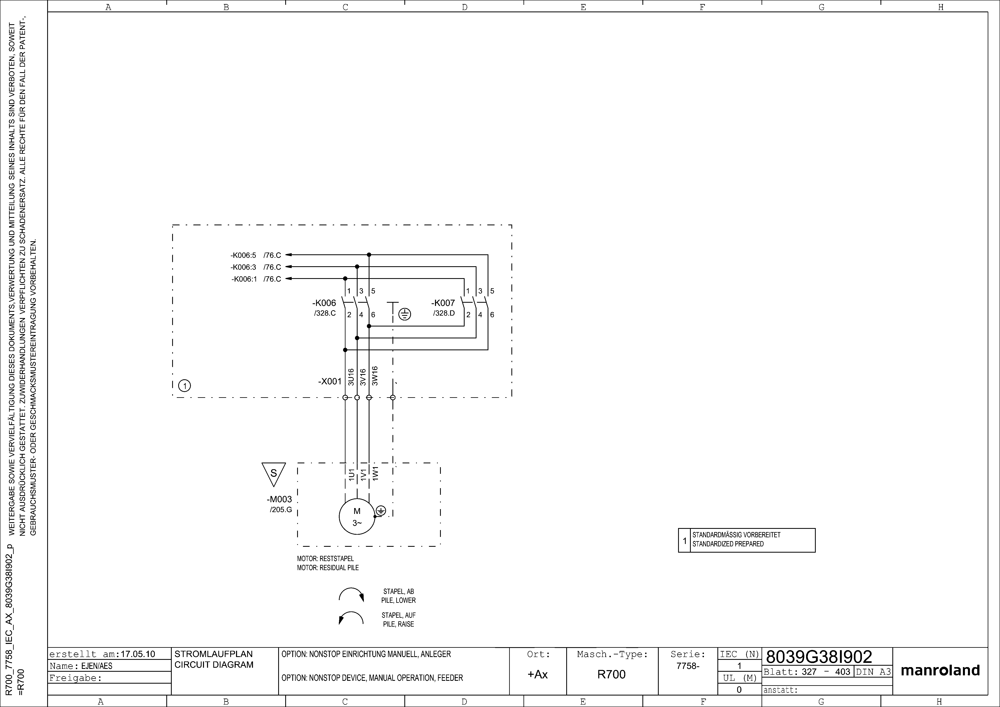

# +Ax — Sheet 327 of 403 — OPTION: NONSTOP EINRICHTUNG MANUELL, ANLEGER

> Part of the manroland **R700** printing press IEC/UL circuit diagrams.
> Drawing class: **Stromlaufplan / Circuit diagram** (DIN A3).
> Document `+Ax` covers the **Central control console** machine section.

## At a glance

| Field | Value |
|---|---|
| Document | `+Ax`  (8039G38I902) |
| Sheet | **327** of 403 |
| Section (DE) | OPTION: NONSTOP EINRICHTUNG MANUELL, ANLEGER |
| Section (EN) | — |
| Section type | CIRCUIT — Circuit diagram |
| Machine type | `R700` |
| Series | `7758` |
| Created | 17.05.10 |
| Replaces | — |
| Columns used | B, C, D, F |
| Path numbers | — |
| Labels on sheet | 46 |
| Cross-refs out | 6 |
| Cross-refs in | 6 |

**Previous:** [+Ax sheet 326](SHEET_0326.md) · **Next:** [+Ax sheet 328](SHEET_0328.md) · **Document TOC:** [_TOC.md](_TOC.md)  (+Ax) · **Master TOC:** [all sheets](../_MASTER_TOC.md)

## Sheet image (300 DPI, exact vector render)



_Rendered directly from the PDF vector layer at 300 DPI (1-bit), no OCR and no resampling. Use it to confirm anything ambiguous in the text below._

## Cross-references on this sheet

Each entry is a wire leaving this sheet. The printed token is `/sheet.column`; the link resolves to that sheet inside the same document.

| Ref | Target sheet | Col | Path | Destination on target | Target section | From col |
|---|---|---|---|---|---|---|
| `/76.C` | [+Ax sheet 76](SHEET_0076.md) | C | — | K006:5 | ANLEGER | B |
| `/76.C` | [+Ax sheet 76](SHEET_0076.md) | C | — | K006:3 | ANLEGER | B |
| `/76.C` | [+Ax sheet 76](SHEET_0076.md) | C | — | K006:1 | ANLEGER | B |
| `/328.C` | [+Ax sheet 328](SHEET_0328.md) | C | — | — | OPTION: NONSTOP EINRICHTUNG MANUELL, ANLEGER | C |
| `/328.D` | [+Ax sheet 328](SHEET_0328.md) | D | — | — | OPTION: NONSTOP EINRICHTUNG MANUELL, ANLEGER | D |
| `/205.G` | [+Ax sheet 205](SHEET_0205.md) | G | — | — | REFERENZMODUL | B |

### Incoming references (sheets that point here)

Every other sheet that sends a wire to this one. `Back-ref` is the token printed on *that* sheet; `Path` is its line number.

| From sheet | Cols | Back-ref | Path | Refs | What continues there |
|---|---|---|---|---|---|
| [+Ax#76](SHEET_0076.md) | C | `/76.C` | — | 3 | K006:1; K006:3; K006:5 |
| [+Ax#205](SHEET_0205.md) | G | `/205.G` | — | 1 | — |
| [+Ax#328](SHEET_0328.md) | C, D | `/328.C`, `/328.D` | — | 2 | — |


## Devices on this sheet

| Tag | Class | Class meaning (IEC) | Col | Sub | Terminal | Sign |
|---|---|---|---|---|---|---|
| `K007` | K | Relais / relay, contactor | D | — | — | — |
| `K006` | K | Relais / relay, contactor | C | — | — | — |
| `X001` | X | Klemme / terminal, plug connector | C | — | — | — |
| `K006:5` | K | Relais / relay, contactor | B | — | 5 | — |
| `K006:3` | K | Relais / relay, contactor | B | — | 3 | — |
| `K006:1` | K | Relais / relay, contactor | B | — | 1 | — |

## Potentials / nets

| Potential | Count | Columns | Attached devices | Terminals |
|---|---|---|---|---|
| `M003` | 1 | B | — | — |


A potential such as `L24+/4` or `M24+` is a named supply/return rail; every place it appears on this sheet is electrically common.

## Wire-end annotations (grouped as printed)

A wire that continues elsewhere is annotated with a small cluster: the destination description, the path/line number `#NN`, and the `/sheet.column` cross reference. Each row below is one such cluster exactly as it is grouped on the drawing.

| Col | Y | Path | Cross-ref | Text on the wire |
|---|---|---|---|---|
| B | 300.1 | — | `/76.C` | `K006:5` |
| B | 314.2 | — | `/76.C` | `K006:3` |
| B | 328.4 | — | `/76.C` | `K006:1` |
| C | 342.6 | — | — | `1` |
| C | 342.6 | — | — | `3` |
| C | 342.6 | — | — | `5` |
| D | 342.6 | — | — | `1` |
| D | 342.6 | — | — | `3` |
| D | 342.6 | — | — | `5` |
| C | 356.1 | — | — | `K006 6` |
| D | 356.1 | — | — | `K007 6` |
| C | 369.1 | — | `/328.C` | — |
| D | 369.1 | — | `/328.D` | — |
| C | 370.9 | — | — | `2` |
| C | 370.9 | — | — | `4` |
| D | 370.9 | — | — | `2` |
| D | 370.9 | — | — | `4` |
| C | 436.0 | — | — | `3W16` |
| C | 438.8 | — | — | `3U16` |
| C | 439.1 | — | — | `3V16` |
| C | 449.6 | — | — | `X001` |
| C | 454.8 | — | — | `'` |
| B | 456.1 | — | — | `1` |
| C | 554.6 | — | — | `'` |
| C | 554.7 | — | — | `1W1` |
| C | 557.6 | — | — | `1U1` |
| C | 557.9 | — | — | `1V1` |
| B | 558.1 | — | — | `S` |
| B | 589.9 | — | — | `M003` |
| B | 603.0 | — | `/205.G` | — |
| C | 604.4 | — | — | `3~ M` |
| F | 634.2 | — | — | `1 STANDARDMÄSSIG VORBEREITET STANDARDIZED PREPARED` |
| C | 662.5 | — | — | `MOTOR: RESTSTAPEL MOTOR: RESIDUAL PILE` |
| C | 701.5 | — | — | `PILE, LOWER STAPEL, AB` |
| C | 729.8 | — | — | `STAPEL, AUF` |
| C | 740.4 | — | — | `PILE, RAISE` |


## Notes and free text on this sheet

| Text | Col | Y (pt) |
|---|---|---|
| `3U16` | C | 438.8 |
| `3V16` | C | 439.09 |
| `3W16` | C | 435.97 |
| `M` | C | 604.36 |
| `1U1` | C | 557.58 |
| `1V1` | C | 557.86 |
| `1W1` | C | 554.74 |
| `MOTOR: RESTSTAPEL` | C | 662.51 |
| `MOTOR: RESIDUAL PILE` | C | 673.15 |
| `S` | B | 558.1 |
| `STAPEL, AB` | C | 701.45 |
| `PILE, LOWER` | C | 712.06 |
| `STAPEL, AUF` | C | 729.81 |
| `PILE, RAISE` | C | 740.41 |
| `STANDARDMÄSSIG VORBEREITET` | F | 634.17 |
| `STANDARDIZED PREPARED` | F | 644.81 |

## Complete label inventory (exact text from the drawing)

Every text object inside the drawing area of this sheet, in DIN reading order (column A→H, then top→bottom). This is the authoritative list: if a string is not here it is not printed on this sheet.

| Col | Y | X | Dir | Type | Text |
|---|---|---|---|---|---|
| B | 300.0 | 313.8 | → | cross-reference | `/76.C` |
| B | 300.1 | 274.4 | → | device tag | `K006:5` |
| B | 314.2 | 274.4 | → | device tag | `K006:3` |
| B | 314.2 | 313.8 | → | cross-reference | `/76.C` |
| B | 328.4 | 275.8 | → | device tag | `K006:1` |
| B | 328.4 | 313.8 | → | cross-reference | `/76.C` |
| B | 456.2 | 217.9 | → | number | `1` |
| B | 558.1 | 321.9 | → | text | `S` |
| B | 589.9 | 317.8 | → | potential | `M003` |
| B | 603.0 | 321.4 | → | cross-reference | `/205.G` |
| C | 342.6 | 413.0 | → | number | `1` |
| C | 342.6 | 427.7 | → | number | `3` |
| C | 342.6 | 441.9 | → | number | `5` |
| C | 356.1 | 371.9 | → | device tag | `K006` |
| C | 369.1 | 374.2 | → | cross-reference | `/328.C` |
| C | 371.0 | 413.6 | → | number | `2` |
| C | 371.0 | 427.7 | → | number | `4` |
| C | 371.0 | 441.9 | → | number | `6` |
| C | 436.0 | 442.4 | ↕ | text | `3W16` |
| C | 438.8 | 414.2 | ↕ | text | `3U16` |
| C | 439.1 | 428.3 | ↕ | text | `3V16` |
| C | 449.6 | 379.0 | → | device tag | `X001` |
| C | 454.8 | 470.0 | → | other | `'` |
| C | 554.6 | 470.3 | → | other | `'` |
| C | 554.7 | 443.1 | ↕ | text | `1W1` |
| C | 557.6 | 414.9 | ↕ | text | `1U1` |
| C | 557.9 | 429.0 | ↕ | text | `1V1` |
| C | 604.4 | 421.1 | → | text | `M` |
| C | 618.6 | 419.8 | → | other | `3~` |
| C | 662.5 | 353.8 | → | text | `MOTOR: RESTSTAPEL` |
| C | 673.1 | 353.8 | → | text | `MOTOR: RESIDUAL PILE` |
| C | 701.5 | 456.6 | → | text | `STAPEL, AB` |
| C | 712.1 | 454.0 | → | text | `PILE, LOWER` |
| C | 729.8 | 454.6 | → | text | `STAPEL, AUF` |
| C | 740.4 | 456.3 | → | text | `PILE, RAISE` |
| D | 342.6 | 554.7 | → | number | `1` |
| D | 342.6 | 569.5 | → | number | `3` |
| D | 342.6 | 583.7 | → | number | `5` |
| D | 356.1 | 513.6 | → | device tag | `K007` |
| D | 369.1 | 515.9 | → | cross-reference | `/328.D` |
| D | 371.0 | 555.3 | → | number | `2` |
| D | 371.0 | 569.5 | → | number | `4` |
| D | 371.0 | 583.7 | → | number | `6` |
| F | 634.2 | 824.6 | → | text | `STANDARDMÄSSIG VORBEREITET` |
| F | 639.5 | 812.4 | → | number | `1` |
| F | 644.8 | 824.6 | → | text | `STANDARDIZED PREPARED` |

## Reading-order text block

The same content as a plain block, grouped by DIN column — convenient to paste or to match against a visual description.

```text
=== Column B ===
 300.0  313.8  xref         /76.C
 300.1  274.4  devtag       K006:5
 314.2  274.4  devtag       K006:3
 314.2  313.8  xref         /76.C
 328.4  275.8  devtag       K006:1
 328.4  313.8  xref         /76.C
 456.2  217.9  numeric      1
 558.1  321.9  text         S
 589.9  317.8  net          M003
 603.0  321.4  xref         /205.G
=== Column C ===
 342.6  413.0  numeric      1
 342.6  427.7  numeric      3
 342.6  441.9  numeric      5
 356.1  371.9  devtag       K006
 369.1  374.2  xref         /328.C
 371.0  413.6  numeric      2
 371.0  427.7  numeric      4
 371.0  441.9  numeric      6
 436.0  442.4  text         3W16
 438.8  414.2  text         3U16
 439.1  428.3  text         3V16
 449.6  379.0  devtag       X001
 454.8  470.0  other        `
 554.6  470.3  other        `
 554.7  443.1  text         1W1
 557.6  414.9  text         1U1
 557.9  429.0  text         1V1
 604.4  421.1  text         M
 618.6  419.8  other        3~
 662.5  353.8  text         MOTOR: RESTSTAPEL
 673.1  353.8  text         MOTOR: RESIDUAL PILE
 701.5  456.6  text         STAPEL, AB
 712.1  454.0  text         PILE, LOWER
 729.8  454.6  text         STAPEL, AUF
 740.4  456.3  text         PILE, RAISE
=== Column D ===
 342.6  554.7  numeric      1
 342.6  569.5  numeric      3
 342.6  583.7  numeric      5
 356.1  513.6  devtag       K007
 369.1  515.9  xref         /328.D
 371.0  555.3  numeric      2
 371.0  569.5  numeric      4
 371.0  583.7  numeric      6
=== Column F ===
 634.2  824.6  text         STANDARDMÄSSIG VORBEREITET
 639.5  812.4  numeric      1
 644.8  824.6  text         STANDARDIZED PREPARED
```

---
_Generated from the PDF vector text layer; no OCR. Source: `R700_7758_IEC_AX_8039G38I902_p`, sheet 327._
