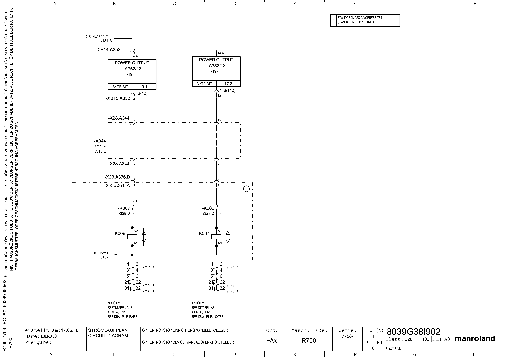

# +Ax — Sheet 328 of 403 — OPTION: NONSTOP EINRICHTUNG MANUELL, ANLEGER

> Part of the manroland **R700** printing press IEC/UL circuit diagrams.
> Drawing class: **Stromlaufplan / Circuit diagram** (DIN A3).
> Document `+Ax` covers the **Central control console** machine section.

## At a glance

| Field | Value |
|---|---|
| Document | `+Ax`  (8039G38I902) |
| Sheet | **328** of 403 |
| Section (DE) | OPTION: NONSTOP EINRICHTUNG MANUELL, ANLEGER |
| Section (EN) | — |
| Section type | CIRCUIT — Circuit diagram |
| Machine type | `R700` |
| Series | `7758` |
| Created | 17.05.10 |
| Replaces | — |
| Columns used | B, C, D, F |
| Path numbers | — |
| Labels on sheet | 90 |
| Cross-refs out | 14 |
| Cross-refs in | 25 |

**Previous:** [+Ax sheet 327](SHEET_0327.md) · **Next:** [+Ax sheet 329](SHEET_0329.md) · **Document TOC:** [_TOC.md](_TOC.md)  (+Ax) · **Master TOC:** [all sheets](../_MASTER_TOC.md)

## Sheet image (300 DPI, exact vector render)



_Rendered directly from the PDF vector layer at 300 DPI (1-bit), no OCR and no resampling. Use it to confirm anything ambiguous in the text below._

## Cross-references on this sheet

Each entry is a wire leaving this sheet. The printed token is `/sheet.column`; the link resolves to that sheet inside the same document.

| Ref | Target sheet | Col | Path | Destination on target | Target section | From col |
|---|---|---|---|---|---|---|
| `/134.B` | [+Ax sheet 134](SHEET_0134.md) | B | — | XB14.A352:2 | REALTIMERECHNER ANSTEUERUNG DER SPS POWERKARTE | B |
| `/197.F` | [+Ax sheet 197](SHEET_0197.md) | F | — | — | REFERENZMODUL | D |
| `/197.F` | [+Ax sheet 197](SHEET_0197.md) | F | — | — | REFERENZMODUL | B |
| `/329.A` | [+Ax sheet 329](SHEET_0329.md) | A | — | — | OPTION: NONSTOP EINRICHTUNG MANUELL, ANLEGER | B |
| `/310.E` | [+Ax sheet 310](SHEET_0310.md) | E | — | — | OPTION: IONISATIONSANLAGE ANLEGER | B |
| `/328.D` | [+Ax sheet 328](SHEET_0328.md) | D | — | — | OPTION: NONSTOP EINRICHTUNG MANUELL, ANLEGER | B |
| `/328.C` | [+Ax sheet 328](SHEET_0328.md) | C | — | — | OPTION: NONSTOP EINRICHTUNG MANUELL, ANLEGER | D |
| `/107.F` | [+Ax sheet 107](SHEET_0107.md) | F | — | K006:A1 | ANLEGER | B |
| `/327.C` | [+Ax sheet 327](SHEET_0327.md) | C | — | — | OPTION: NONSTOP EINRICHTUNG MANUELL, ANLEGER | C |
| `/327.D` | [+Ax sheet 327](SHEET_0327.md) | D | — | — | OPTION: NONSTOP EINRICHTUNG MANUELL, ANLEGER | D |
| `/329.B` | [+Ax sheet 329](SHEET_0329.md) | B | — | — | OPTION: NONSTOP EINRICHTUNG MANUELL, ANLEGER | C |
| `/329.E` | [+Ax sheet 329](SHEET_0329.md) | E | — | — | OPTION: NONSTOP EINRICHTUNG MANUELL, ANLEGER | D |
| `/328.B` | [+Ax sheet 328](SHEET_0328.md) | B | — | — | OPTION: NONSTOP EINRICHTUNG MANUELL, ANLEGER | D |
| `/328.D` | [+Ax sheet 328](SHEET_0328.md) | D | — | — | OPTION: NONSTOP EINRICHTUNG MANUELL, ANLEGER | C |

### Incoming references (sheets that point here)

Every other sheet that sends a wire to this one. `Back-ref` is the token printed on *that* sheet; `Path` is its line number.

| From sheet | Cols | Back-ref | Path | Refs | What continues there |
|---|---|---|---|---|---|
| [+Ax#107](SHEET_0107.md) | F | `/107.F` | — | 1 | — |
| [+Ax#134](SHEET_0134.md) | B | `/134.B` | — | 1 | — |
| [+Ax#197](SHEET_0197.md) | F | `/197.F` | — | 2 | — |
| [+Ax#251](SHEET_0251.md) | C | `/251.C` | — | 1 | — |
| [+Ax#253](SHEET_0253.md) | A | `/253.A` | — | 2 | — |
| [+Ax#264](SHEET_0264.md) | A, B, E | `/264.A`, `/264.B`, `/264.E` | — | 6 | — |
| [+Ax#271](SHEET_0271.md) | H | `/271.H` | — | 2 | — |
| [+Ax#310](SHEET_0310.md) | E | `/310.E` | — | 1 | — |
| [+Ax#327](SHEET_0327.md) | C, D | `/327.C`, `/327.D` | — | 2 | — |
| [+Ax#328](SHEET_0328.md) | B, C, D | `/328.B`, `/328.C`, `/328.D` | — | 4 | — |
| [+Ax#329](SHEET_0329.md) | A, B, E | `/329.A`, `/329.B`, `/329.E` | — | 3 | — |


## Devices on this sheet

| Tag | Class | Class meaning (IEC) | Col | Sub | Terminal | Sign |
|---|---|---|---|---|---|---|
| `K007` | K | Relais / relay, contactor | B | — | — | — |
| `A2` | A | Baugruppe / assembly, module, PC board | B | — | — | — |
| `A1` | A | Baugruppe / assembly, module, PC board | B | — | — | — |
| `K006` | K | Relais / relay, contactor | B | — | — | — |
| `K006` | K | Relais / relay, contactor | D | — | — | — |
| `A2` | A | Baugruppe / assembly, module, PC board | D | — | — | — |
| `A1` | A | Baugruppe / assembly, module, PC board | D | — | — | — |
| `K007` | K | Relais / relay, contactor | C | — | — | — |
| `A344` | A | Baugruppe / assembly, module, PC board | B | — | — | — |
| `A352/13` | A | Baugruppe / assembly, module, PC board | B | 13 | — | — |
| `A352/13` | A | Baugruppe / assembly, module, PC board | D | 13 | — | — |
| `K006:A1` | K | Relais / relay, contactor | B | — | A1 | — |
| `X23.A376.B` | — | cross-device reference | B | — | — | — |
| `X23.A376.A` | — | cross-device reference | B | — | — | — |
| `X23.A344` | — | cross-device reference | B | — | — | — |
| `X28.A344` | — | cross-device reference | B | — | — | — |
| `0.1` | — | cross-device reference | C | — | — | — |
| `XB14.A352` | — | cross-device reference | B | — | — | — |
| `XB15.A352` | — | cross-device reference | B | — | — | — |
| `17.3` | — | cross-device reference | D | — | — | — |
| `XB14.A352:2` | — | cross-device reference | B | — | 2 | — |

## Potentials / nets

_No named potentials on this sheet._

## Wire-end annotations (grouped as printed)

A wire that continues elsewhere is annotated with a small cluster: the destination description, the path/line number `#NN`, and the `/sheet.column` cross reference. Each row below is one such cluster exactly as it is grouped on the drawing.

| Col | Y | Path | Cross-ref | Text on the wire |
|---|---|---|---|---|
| F | 38.9 | — | — | `1 STANDARDMÄSSIG VORBEREITET STANDARDIZED PREPARED` |
| B | 82.5 | — | `/134.B` | `XB14.A352:2` |
| B | 112.3 | — | — | `XB14.A352 2` |
| D | 121.5 | — | — | `14A` |
| B | 128.5 | — | — | `4A` |
| D | 136.6 | — | — | `POWER OUTPUT` |
| B | 143.7 | — | — | `POWER OUTPUT` |
| D | 150.5 | — | — | `A352/13` |
| B | 157.6 | — | — | `A352/13` |
| D | 164.3 | — | `/197.F` | — |
| B | 171.4 | — | `/197.F` | — |
| D | 193.4 | — | — | `BYTE.BIT 17.3` |
| B | 200.5 | — | — | `BYTE.BIT 0.1` |
| D | 209.4 | — | — | `14B(14C)` |
| B | 216.5 | — | — | `4B(4C)` |
| D | 221.4 | — | — | `12` |
| B | 227.1 | — | — | `XB15.A352 2` |
| C | 273.9 | — | — | `X28.A344 2 12` |
| B | 327.7 | — | — | `A344` |
| B | 340.8 | — | `/329.A` | — |
| B | 353.2 | — | `/310.E` | — |
| C | 381.6 | — | — | `X23.A344 3 6` |
| B | 412.8 | — | — | `X23.A376.B 3` |
| D | 417.0 | — | — | `6` |
| B | 432.6 | — | — | `X23.A376.A 3` |
| D | 434.0 | — | — | `6` |
| D | 442.0 | — | — | `1` |
| B | 470.2 | — | — | `31` |
| D | 470.2 | — | — | `31` |
| B | 486.4 | — | — | `K007 32` |
| D | 486.4 | — | — | `K006 32` |
| B | 499.5 | — | `/328.D` | — |
| D | 499.5 | — | `/328.C` | — |
| B | 541.0 | — | — | `A2` |
| D | 541.0 | — | — | `A2` |
| B | 546.0 | — | — | `K006` |
| C | 546.0 | — | — | `K007` |
| B | 569.3 | — | — | `A1` |
| D | 569.3 | — | — | `A1` |
| B | 592.7 | — | `/107.F` | `K006:A1` |
| B | 618.2 | — | — | `21 3 5 1` |
| B | 618.2 | — | — | `31 32 2 4 6 22` |
| D | 618.2 | — | — | `21 3 5 1` |
| D | 618.2 | — | — | `31 32 2 4 6 22` |
| C | 626.0 | — | `/327.C` | — |
| D | 626.0 | — | `/327.D` | — |
| C | 668.5 | — | `/329.B` | — |
| D | 668.5 | — | `/329.E` | — |
| C | 682.7 | — | `/328.D` | — |
| D | 682.7 | — | `/328.B` | — |
| B | 712.1 | — | — | `RESTSTAPEL, AUF SCHÜTZ:` |
| C | 712.1 | — | — | `RESTSTAPEL, AB SCHÜTZ:` |
| B | 733.4 | — | — | `RESIDUAL PILE, RAISE CONTACTOR:` |
| D | 733.4 | — | — | `RESIDUAL PILE, LOWER CONTACTOR:` |


## Reconstructed tables

This sheet carries tabular content (pin map / terminal assignment / index). The grid below was rebuilt from the drawing's own rule lines, so each row is exactly one physical row of the table.

### Table 1 — 2 data rows × 3 columns (at x=255.1, y=133.2)

| POWER | OUTPUT A352/13 /197.F |  |
|---|---|---|
| `BYTE.BIT` |  | `0.1` |
| `XB15.A352 X28.A344 X23.A344 X23.A376.B X23.A376.A K007 /328.D K006` | `4B(4C) 2 2 3 3 3 31 32 A2 A1` |  |


### Table 2 — 2 data rows × 3 columns (at x=453.5, y=133.2)

| POWER | OUTPUT A352/13 /197.F |  |
|---|---|---|
| `BYTE.BIT` |  | `17.3` |
| `K006 /328.C K007` | `14B(14C) 12 12 6 6 6 31 32 A2 A1` |  |


## Notes and free text on this sheet

| Text | Col | Y (pt) |
|---|---|---|
| `SCHÜTZ:` | B | 712.11 |
| `RESTSTAPEL, AUF` | B | 722.73 |
| `CONTACTOR:` | B | 733.39 |
| `RESIDUAL PILE, RAISE` | B | 743.99 |
| `SCHÜTZ:` | C | 712.11 |
| `RESTSTAPEL, AB` | C | 722.72 |
| `CONTACTOR:` | C | 733.39 |
| `RESIDUAL PILE, LOWER` | D | 743.99 |
| `4A` | B | 128.54 |
| `4B(4C)` | B | 216.46 |
| `POWER OUTPUT` | B | 143.71 |
| `BYTE.BIT` | B | 201.04 |
| `14A` | D | 121.47 |
| `14B(14C)` | D | 209.38 |
| `POWER OUTPUT` | D | 136.62 |
| `BYTE.BIT` | C | 193.95 |
| `STANDARDMÄSSIG VORBEREITET` | F | 38.9 |
| `STANDARDIZED PREPARED` | F | 49.53 |

## Complete label inventory (exact text from the drawing)

Every text object inside the drawing area of this sheet, in DIN reading order (column A→H, then top→bottom). This is the authoritative list: if a string is not here it is not printed on this sheet.

| Col | Y | X | Dir | Type | Text |
|---|---|---|---|---|---|
| B | 82.5 | 199.6 | → | device ref | `XB14.A352:2` |
| B | 92.4 | 238.4 | → | cross-reference | `/134.B` |
| B | 112.3 | 226.5 | → | device ref | `XB14.A352` |
| B | 112.3 | 314.6 | → | number | `2` |
| B | 128.5 | 314.4 | → | text | `4A` |
| B | 143.7 | 271.0 | → | text | `POWER OUTPUT` |
| B | 157.6 | 290.4 | → | device tag | `A352/13` |
| B | 171.4 | 299.5 | → | cross-reference | `/197.F` |
| B | 201.0 | 265.0 | → | text | `BYTE.BIT` |
| B | 216.5 | 320.0 | → | text | `4B(4C)` |
| B | 227.1 | 249.4 | → | device ref | `XB15.A352` |
| B | 228.5 | 314.4 | → | number | `2` |
| B | 273.8 | 255.1 | → | device ref | `X28.A344` |
| B | 279.5 | 314.4 | → | number | `2` |
| B | 327.7 | 221.7 | → | device tag | `A344` |
| B | 340.8 | 223.9 | → | cross-reference | `/329.A` |
| B | 353.2 | 224.5 | → | cross-reference | `/310.E` |
| B | 381.6 | 255.1 | → | device ref | `X23.A344` |
| B | 381.6 | 314.4 | → | number | `3` |
| B | 412.8 | 246.6 | → | device ref | `X23.A376.B` |
| B | 417.0 | 314.4 | → | number | `3` |
| B | 432.6 | 245.8 | → | device ref | `X23.A376.A` |
| B | 434.0 | 314.4 | → | number | `3` |
| B | 470.2 | 314.4 | → | number | `31` |
| B | 486.4 | 278.4 | → | device tag | `K007` |
| B | 498.5 | 314.4 | → | number | `32` |
| B | 499.5 | 280.6 | → | cross-reference | `/328.D` |
| B | 541.0 | 314.6 | → | device tag | `A2` |
| B | 546.0 | 267.0 | → | device tag | `K006` |
| B | 569.3 | 314.6 | → | device tag | `A1` |
| B | 592.7 | 218.8 | → | device tag | `K006:A1` |
| B | 602.6 | 239.0 | → | cross-reference | `/107.F` |
| B | 618.2 | 299.3 | → | number | `1` |
| B | 618.2 | 320.0 | → | number | `2` |
| B | 632.4 | 297.9 | → | number | `3` |
| B | 632.4 | 320.0 | → | number | `4` |
| B | 646.6 | 297.9 | → | number | `5` |
| B | 646.6 | 320.0 | → | number | `6` |
| B | 660.7 | 293.4 | → | number | `21` |
| B | 660.7 | 320.0 | → | number | `22` |
| B | 674.9 | 293.4 | → | number | `31` |
| B | 674.9 | 319.7 | → | number | `32` |
| B | 712.1 | 254.8 | → | text | `SCHÜTZ:` |
| B | 722.7 | 254.3 | → | text | `RESTSTAPEL, AUF` |
| B | 733.4 | 254.8 | → | text | `CONTACTOR:` |
| B | 744.0 | 254.3 | → | text | `RESIDUAL PILE, RAISE` |
| C | 194.0 | 463.5 | → | text | `BYTE.BIT` |
| C | 200.5 | 334.2 | → | device ref | `0.1` |
| C | 546.0 | 465.4 | → | device tag | `K007` |
| C | 626.0 | 337.3 | → | cross-reference | `/327.C` |
| C | 668.5 | 337.3 | → | cross-reference | `/329.B` |
| C | 682.7 | 337.3 | → | cross-reference | `/328.D` |
| C | 712.1 | 453.3 | → | text | `SCHÜTZ:` |
| C | 722.7 | 452.7 | → | text | `RESTSTAPEL, AB` |
| C | 733.4 | 453.3 | → | text | `CONTACTOR:` |
| D | 121.5 | 512.2 | → | text | `14A` |
| D | 136.6 | 469.4 | → | text | `POWER OUTPUT` |
| D | 150.5 | 488.8 | → | device tag | `A352/13` |
| D | 164.3 | 497.9 | → | cross-reference | `/197.F` |
| D | 193.4 | 528.8 | → | device ref | `17.3` |
| D | 209.4 | 517.9 | → | text | `14B(14C)` |
| D | 221.4 | 512.2 | → | number | `12` |
| D | 279.5 | 512.2 | → | number | `12` |
| D | 381.6 | 512.8 | → | number | `6` |
| D | 417.0 | 512.8 | → | number | `6` |
| D | 434.0 | 512.8 | → | number | `6` |
| D | 442.0 | 579.3 | → | number | `1` |
| D | 470.2 | 512.8 | → | number | `31` |
| D | 486.4 | 476.8 | → | device tag | `K006` |
| D | 498.5 | 512.8 | → | number | `32` |
| D | 499.5 | 479.1 | → | cross-reference | `/328.C` |
| D | 541.0 | 513.1 | → | device tag | `A2` |
| D | 569.3 | 513.1 | → | device tag | `A1` |
| D | 618.2 | 497.8 | → | number | `1` |
| D | 618.2 | 518.5 | → | number | `2` |
| D | 626.0 | 535.7 | → | cross-reference | `/327.D` |
| D | 632.4 | 496.3 | → | number | `3` |
| D | 632.4 | 518.5 | → | number | `4` |
| D | 646.6 | 496.3 | → | number | `5` |
| D | 646.6 | 518.5 | → | number | `6` |
| D | 660.7 | 491.8 | → | number | `21` |
| D | 660.7 | 518.5 | → | number | `22` |
| D | 668.5 | 535.7 | → | cross-reference | `/329.E` |
| D | 674.9 | 491.8 | → | number | `31` |
| D | 674.9 | 518.2 | → | number | `32` |
| D | 682.7 | 535.7 | → | cross-reference | `/328.B` |
| D | 744.0 | 452.7 | → | text | `RESIDUAL PILE, LOWER` |
| F | 38.9 | 796.3 | → | text | `STANDARDMÄSSIG VORBEREITET` |
| F | 44.2 | 784.1 | → | number | `1` |
| F | 49.5 | 796.3 | → | text | `STANDARDIZED PREPARED` |

## Reading-order text block

The same content as a plain block, grouped by DIN column — convenient to paste or to match against a visual description.

```text
=== Column B ===
  82.5  199.6  devref       XB14.A352:2
  92.4  238.4  xref         /134.B
 112.3  226.5  devref       XB14.A352
 112.3  314.6  numeric      2
 128.5  314.4  text         4A
 143.7  271.0  text         POWER OUTPUT
 157.6  290.4  devtag       A352/13
 171.4  299.5  xref         /197.F
 201.0  265.0  text         BYTE.BIT
 216.5  320.0  text         4B(4C)
 227.1  249.4  devref       XB15.A352
 228.5  314.4  numeric      2
 273.8  255.1  devref       X28.A344
 279.5  314.4  numeric      2
 327.7  221.7  devtag       A344
 340.8  223.9  xref         /329.A
 353.2  224.5  xref         /310.E
 381.6  255.1  devref       X23.A344
 381.6  314.4  numeric      3
 412.8  246.6  devref       X23.A376.B
 417.0  314.4  numeric      3
 432.6  245.8  devref       X23.A376.A
 434.0  314.4  numeric      3
 470.2  314.4  numeric      31
 486.4  278.4  devtag       K007
 498.5  314.4  numeric      32
 499.5  280.6  xref         /328.D
 541.0  314.6  devtag       A2
 546.0  267.0  devtag       K006
 569.3  314.6  devtag       A1
 592.7  218.8  devtag       K006:A1
 602.6  239.0  xref         /107.F
 618.2  299.3  numeric      1
 618.2  320.0  numeric      2
 632.4  297.9  numeric      3
 632.4  320.0  numeric      4
 646.6  297.9  numeric      5
 646.6  320.0  numeric      6
 660.7  293.4  numeric      21
 660.7  320.0  numeric      22
 674.9  293.4  numeric      31
 674.9  319.7  numeric      32
 712.1  254.8  text         SCHÜTZ:
 722.7  254.3  text         RESTSTAPEL, AUF
 733.4  254.8  text         CONTACTOR:
 744.0  254.3  text         RESIDUAL PILE, RAISE
=== Column C ===
 194.0  463.5  text         BYTE.BIT
 200.5  334.2  devref       0.1
 546.0  465.4  devtag       K007
 626.0  337.3  xref         /327.C
 668.5  337.3  xref         /329.B
 682.7  337.3  xref         /328.D
 712.1  453.3  text         SCHÜTZ:
 722.7  452.7  text         RESTSTAPEL, AB
 733.4  453.3  text         CONTACTOR:
=== Column D ===
 121.5  512.2  text         14A
 136.6  469.4  text         POWER OUTPUT
 150.5  488.8  devtag       A352/13
 164.3  497.9  xref         /197.F
 193.4  528.8  devref       17.3
 209.4  517.9  text         14B(14C)
 221.4  512.2  numeric      12
 279.5  512.2  numeric      12
 381.6  512.8  numeric      6
 417.0  512.8  numeric      6
 434.0  512.8  numeric      6
 442.0  579.3  numeric      1
 470.2  512.8  numeric      31
 486.4  476.8  devtag       K006
 498.5  512.8  numeric      32
 499.5  479.1  xref         /328.C
 541.0  513.1  devtag       A2
 569.3  513.1  devtag       A1
 618.2  497.8  numeric      1
 618.2  518.5  numeric      2
 626.0  535.7  xref         /327.D
 632.4  496.3  numeric      3
 632.4  518.5  numeric      4
 646.6  496.3  numeric      5
 646.6  518.5  numeric      6
 660.7  491.8  numeric      21
 660.7  518.5  numeric      22
 668.5  535.7  xref         /329.E
 674.9  491.8  numeric      31
 674.9  518.2  numeric      32
 682.7  535.7  xref         /328.B
 744.0  452.7  text         RESIDUAL PILE, LOWER
=== Column F ===
  38.9  796.3  text         STANDARDMÄSSIG VORBEREITET
  44.2  784.1  numeric      1
  49.5  796.3  text         STANDARDIZED PREPARED
```

---
_Generated from the PDF vector text layer; no OCR. Source: `R700_7758_IEC_AX_8039G38I902_p`, sheet 328._
