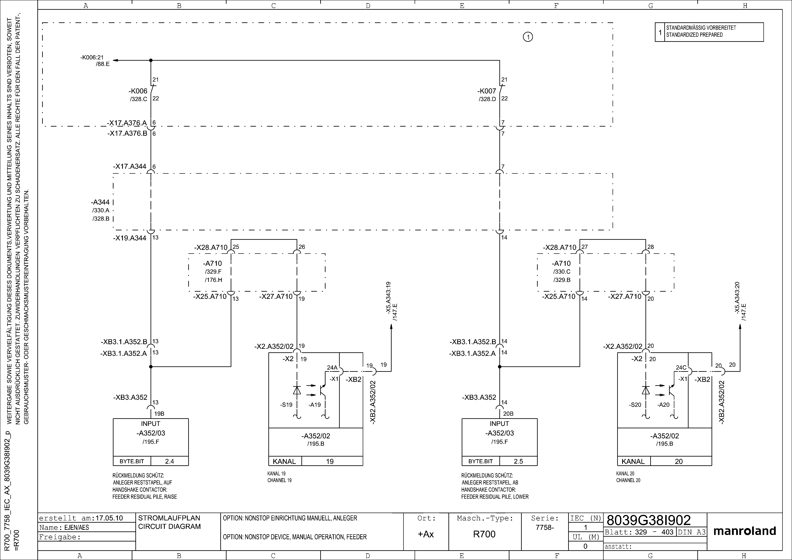

# +Ax — Sheet 329 of 403 — OPTION: NONSTOP EINRICHTUNG MANUELL, ANLEGER

> Part of the manroland **R700** printing press IEC/UL circuit diagrams.
> Drawing class: **Stromlaufplan / Circuit diagram** (DIN A3).
> Document `+Ax` covers the **Central control console** machine section.

## At a glance

| Field | Value |
|---|---|
| Document | `+Ax`  (8039G38I902) |
| Sheet | **329** of 403 |
| Section (DE) | OPTION: NONSTOP EINRICHTUNG MANUELL, ANLEGER |
| Section (EN) | — |
| Section type | CIRCUIT — Circuit diagram |
| Machine type | `R700` |
| Series | `7758` |
| Created | 17.05.10 |
| Replaces | — |
| Columns used | A, B, C, D, E, F, G, H |
| Path numbers | — |
| Labels on sheet | 121 |
| Cross-refs out | 15 |
| Cross-refs in | 41 |

**Previous:** [+Ax sheet 328](SHEET_0328.md) · **Next:** [+Ax sheet 330](SHEET_0330.md) · **Document TOC:** [_TOC.md](_TOC.md)  (+Ax) · **Master TOC:** [all sheets](../_MASTER_TOC.md)

## Sheet image (300 DPI, exact vector render)



_Rendered directly from the PDF vector layer at 300 DPI (1-bit), no OCR and no resampling. Use it to confirm anything ambiguous in the text below._

## Cross-references on this sheet

Each entry is a wire leaving this sheet. The printed token is `/sheet.column`; the link resolves to that sheet inside the same document.

| Ref | Target sheet | Col | Path | Destination on target | Target section | From col |
|---|---|---|---|---|---|---|
| `/88.E` | [+Ax sheet 88](SHEET_0088.md) | E | — | K006:21 | ANLEGER | A |
| `/328.C` | [+Ax sheet 328](SHEET_0328.md) | C | — | — | OPTION: NONSTOP EINRICHTUNG MANUELL, ANLEGER | B |
| `/328.D` | [+Ax sheet 328](SHEET_0328.md) | D | — | — | OPTION: NONSTOP EINRICHTUNG MANUELL, ANLEGER | E |
| `/330.A` | [+Ax sheet 330](SHEET_0330.md) | A | — | — | OPTION: NONSTOP EINRICHTUNG MANUELL, ANLEGER | A |
| `/328.B` | [+Ax sheet 328](SHEET_0328.md) | B | — | — | OPTION: NONSTOP EINRICHTUNG MANUELL, ANLEGER | A |
| `/329.F` | [+Ax sheet 329](SHEET_0329.md) | F | — | — | OPTION: NONSTOP EINRICHTUNG MANUELL, ANLEGER | B |
| `/176.H` | [+Ax sheet 176](SHEET_0176.md) | H | — | — | RESERVE | B |
| `/330.C` | [+Ax sheet 330](SHEET_0330.md) | C | — | — | OPTION: NONSTOP EINRICHTUNG MANUELL, ANLEGER | F |
| `/329.B` | [+Ax sheet 329](SHEET_0329.md) | B | — | — | OPTION: NONSTOP EINRICHTUNG MANUELL, ANLEGER | F |
| `/147.E` | [+Ax sheet 147](SHEET_0147.md) | E | — | X5.A343:19 | ÜBERWACHUNGSRECHNER SICHERHEITSBUS | D |
| `/147.E` | [+Ax sheet 147](SHEET_0147.md) | E | — | X5.A343:20 | ÜBERWACHUNGSRECHNER SICHERHEITSBUS | H |
| `/195.F` | [+Ax sheet 195](SHEET_0195.md) | F | — | — | REFERENZMODUL | B |
| `/195.F` | [+Ax sheet 195](SHEET_0195.md) | F | — | — | REFERENZMODUL | E |
| `/195.B` | [+Ax sheet 195](SHEET_0195.md) | B | — | — | REFERENZMODUL | C |
| `/195.B` | [+Ax sheet 195](SHEET_0195.md) | B | — | — | REFERENZMODUL | G |

### Incoming references (sheets that point here)

Every other sheet that sends a wire to this one. `Back-ref` is the token printed on *that* sheet; `Path` is its line number.

| From sheet | Cols | Back-ref | Path | Refs | What continues there |
|---|---|---|---|---|---|
| [+Ax#88](SHEET_0088.md) | F | `/88.F` | — | 1 | — |
| [+Ax#147](SHEET_0147.md) | E | `/147.E` | — | 2 | X5.A343:19; X5.A343:20 |
| [+Ax#176](SHEET_0176.md) | H | `/176.H` | — | 1 | A710 |
| [+Ax#195](SHEET_0195.md) | B, F | `/195.B`, `/195.F` | — | 4 | — |
| [+Ax#218](SHEET_0218.md) | H | `/218.H` | — | 2 | — |
| [+Ax#219](SHEET_0219.md) | B | `/219.B` | — | 2 | — |
| [+Ax#223](SHEET_0223.md) | E, G, H | `/223.E`, `/223.G`, `/223.H` | — | 6 | — |
| [+Ax#255](SHEET_0255.md) | B, E, F | `/255.B`, `/255.E`, `/255.F` | — | 6 | — |
| [+Ax#258](SHEET_0258.md) | G | `/258.G` | — | 2 | — |
| [+Ax#268](SHEET_0268.md) | B | `/268.B` | — | 2 | — |
| [+Ax#270](SHEET_0270.md) | H | `/270.H` | — | 2 | — |
| [+Ax#272](SHEET_0272.md) | E, F | `/272.E`, `/272.F` | — | 4 | — |
| [+Ax#328](SHEET_0328.md) | B, C, D | `/328.B`, `/328.C`, `/328.D` | — | 3 | — |
| [+Ax#329](SHEET_0329.md) | B, F | `/329.B`, `/329.F` | — | 2 | — |
| [+Ax#330](SHEET_0330.md) | A, C | `/330.A`, `/330.C` | — | 2 | — |


## Devices on this sheet

| Tag | Class | Class meaning (IEC) | Col | Sub | Terminal | Sign |
|---|---|---|---|---|---|---|
| `K006` | K | Relais / relay, contactor | B | — | — | — |
| `A352/03` | A | Baugruppe / assembly, module, PC board | B | 03 | — | — |
| `K007` | K | Relais / relay, contactor | E | — | — | — |
| `A352/03` | A | Baugruppe / assembly, module, PC board | E | 03 | — | — |
| `A344` | A | Baugruppe / assembly, module, PC board | A | — | — | — |
| `A710` | A | Baugruppe / assembly, module, PC board | B | — | — | — |
| `S19` | S | Schalter / switch | C | — | — | — |
| `A19` | A | Baugruppe / assembly, module, PC board | C | — | — | — |
| `X1` | X | Klemme / terminal, plug connector | D | — | — | — |
| `X2` | X | Klemme / terminal, plug connector | C | — | — | — |
| `XB2` | XB |  | D | — | — | — |
| `A352/02` | A | Baugruppe / assembly, module, PC board | C | 02 | — | — |
| `A710` | A | Baugruppe / assembly, module, PC board | F | — | — | — |
| `S20` | S | Schalter / switch | G | — | — | — |
| `A20` | A | Baugruppe / assembly, module, PC board | G | — | — | — |
| `X1` | X | Klemme / terminal, plug connector | G | — | — | — |
| `X2` | X | Klemme / terminal, plug connector | G | — | — | — |
| `XB2` | XB |  | H | — | — | — |
| `A352/02` | A | Baugruppe / assembly, module, PC board | G | 02 | — | — |
| `K006:21` | K | Relais / relay, contactor | A | — | 21 | — |
| `X17.A376.B` | — | cross-device reference | A | — | — | — |
| `X17.A376.A` | — | cross-device reference | A | — | — | — |
| `2.4` | — | cross-device reference | B | — | — | — |
| `XB3.A352` | — | cross-device reference | A | — | — | — |
| `2.5` | — | cross-device reference | F | — | — | — |
| `XB3.A352` | — | cross-device reference | E | — | — | — |
| `X19.A344` | — | cross-device reference | A | — | — | — |
| `X17.A344` | — | cross-device reference | A | — | — | — |
| `XB3.1.A352.B` | — | cross-device reference | A | — | — | — |
| `XB3.1.A352.A` | — | cross-device reference | A | — | — | — |
| `XB3.1.A352.B` | — | cross-device reference | E | — | — | — |
| `XB3.1.A352.A` | — | cross-device reference | E | — | — | — |
| `X28.A710` | — | cross-device reference | B | — | — | — |
| `X27.A710` | — | cross-device reference | C | — | — | — |
| `X25.A710` | — | cross-device reference | B | — | — | — |
| `X28.A710` | — | cross-device reference | F | — | — | — |
| `X27.A710` | — | cross-device reference | G | — | — | — |
| `X25.A710` | — | cross-device reference | F | — | — | — |
| `X5.A343:19` | — | cross-device reference | D | — | 19 | — |
| `X5.A343:20` | — | cross-device reference | H | — | 20 | — |

## Potentials / nets

_No named potentials on this sheet._

## Wire-end annotations (grouped as printed)

A wire that continues elsewhere is annotated with a small cluster: the destination description, the path/line number `#NN`, and the `/sheet.column` cross reference. Each row below is one such cluster exactly as it is grouped on the drawing.

| Col | Y | Path | Cross-ref | Text on the wire |
|---|---|---|---|---|
| G | 38.9 | — | — | `1 1 STANDARDMÄSSIG VORBEREITET STANDARDIZED PREPARED` |
| A | 82.5 | — | `/88.E` | `K006:21` |
| B | 115.8 | — | — | `21` |
| E | 115.8 | — | — | `21` |
| B | 132.1 | — | — | `K006 22` |
| E | 132.1 | — | — | `K007 22` |
| B | 145.2 | — | `/328.C` | — |
| E | 145.2 | — | `/328.D` | — |
| A | 180.3 | — | — | `X17.A376.A 6` |
| E | 180.3 | — | — | `7` |
| A | 195.9 | — | — | `X17.A376.B 6` |
| E | 197.3 | — | — | `7` |
| B | 245.5 | — | — | `X17.A344 6` |
| E | 246.9 | — | — | `7` |
| A | 299.4 | — | — | `A344` |
| A | 312.4 | — | `/330.A`, `/328.B` | — |
| B | 353.2 | — | — | `X19.A344 13` |
| E | 353.2 | — | — | `14` |
| C | 367.4 | — | — | `X28.A710 25 26` |
| F | 367.4 | — | — | `X28.A710 27 28` |
| B | 391.5 | — | — | `A710` |
| F | 391.5 | — | — | `A710` |
| B | 404.6 | — | `/329.F`, `/176.H` | — |
| F | 404.6 | — | `/330.C`, `/329.B` | — |
| D | 423.5 | — | `/147.E` | `X5.A343:19` |
| H | 423.5 | — | `/147.E` | `X5.A343:20` |
| C | 441.1 | — | — | `X25.A710 13 X27.A710 19` |
| F | 441.1 | — | — | `X25.A710 14 X27.A710 20` |
| A | 509.1 | — | — | `XB3.1.A352.B 13` |
| E | 509.1 | — | — | `XB3.1.A352.B 14` |
| C | 516.2 | — | — | `X2.A352/02 19` |
| G | 516.2 | — | — | `X2.A352/02 20` |
| A | 526.1 | — | — | `XB3.1.A352.A 13` |
| E | 526.1 | — | — | `XB3.1.A352.A 14` |
| C | 534.7 | — | — | `X2` |
| G | 534.7 | — | — | `X2` |
| D | 536.1 | — | — | `19 19` |
| G | 536.1 | — | — | `20 20` |
| D | 544.6 | — | — | `19` |
| H | 544.6 | — | — | `20` |
| D | 548.8 | — | — | `24A` |
| G | 548.8 | — | — | `24C` |
| D | 565.8 | — | — | `X1` |
| D | 565.8 | — | — | `XB2` |
| G | 565.8 | — | — | `X1` |
| H | 565.8 | — | — | `XB2` |
| D | 572.0 | — | — | `XB2.A352/02` |
| H | 572.0 | — | — | `XB2.A352/02` |
| B | 592.8 | — | — | `XB3.A352 13` |
| E | 592.8 | — | — | `XB3.A352 14` |
| C | 604.8 | — | — | `S19 A19` |
| G | 604.8 | — | — | `S20 A20` |
| B | 618.2 | — | — | `19B` |
| E | 618.2 | — | — | `20B` |
| B | 632.8 | — | — | `INPUT` |
| E | 632.8 | — | — | `INPUT` |
| B | 646.6 | — | — | `A352/03` |
| E | 646.6 | — | — | `A352/03` |
| C | 650.9 | — | — | `A352/02` |
| G | 650.9 | — | — | `A352/02` |
| B | 660.4 | — | `/195.F` | — |
| E | 660.4 | — | `/195.F` | — |
| C | 663.2 | — | `/195.B` | — |
| G | 663.2 | — | `/195.B` | — |
| C | 689.1 | — | — | `KANAL 19` |
| G | 689.1 | — | — | `KANAL 20` |
| B | 689.4 | — | — | `BYTE.BIT 2.4` |
| E | 689.4 | — | — | `BYTE.BIT 2.5` |
| C | 709.5 | — | — | `KANAL 19 CHANNEL 19` |
| G | 709.5 | — | — | `KANAL 20 CHANNEL 20` |
| B | 712.1 | — | — | `RÜCKMELDUNG SCHÜTZ:` |
| E | 712.1 | — | — | `RÜCKMELDUNG SCHÜTZ:` |
| B | 722.8 | — | — | `HANDSHAKE CONTACTOR: FEEDER RESIDUAL PILE, RAISE ANLEGER RESTSTAPEL, AUF` |
| E | 722.8 | — | — | `HANDSHAKE CONTACTOR: FEEDER RESIDUAL PILE, LOWER ANLEGER RESTSTAPEL, AB` |


## Reconstructed tables

This sheet carries tabular content (pin map / terminal assignment / index). The grid below was rebuilt from the drawing's own rule lines, so each row is exactly one physical row of the table.

### Table 1 — 6 data rows × 19 columns (at x=170.1, y=90.7)

| K006 /328.C X17.A376.A X17.A376.B X17.A344 X19.A344 | 21 22 6 6 6 13 |  |  |  |  |  |  |  |  | K007 /328.D | 21 22 7 7 7 14 |  |  |  |  |  |  |  |
|---|---|---|---|---|---|---|---|---|---|---|---|---|---|---|---|---|---|---|
| `XB3.1.A352.B` | `13` | `X28.A710 A710 /329.F /176.H X25.A710` | `25 13` | `X27.A710 X2.A352/02` | `26 19 19` |  |  | `X5.A343:19` | `/147.E` | `XB3.1.A352.B` | `14` | `X28.A710 A710 /330.C /329.B X25.A710` | `27 14` | `X27.A710 X2.A352/02` | `28 20 20` |  |  | `X5.A343:20` |
| `XB3.1.A352.A` | `13` |  |  | `X2` | `19` |  |  | `19 19` |  | `XB3.1.A352.A` | `14` |  |  | `X2` | `20` |  |  | `20 20` |
| `XB3.A352` | `13 19B` |  |  | `S19` | `A19` | `24A X1` | `XB2` | `XB2.A352/02` |  | `XB3.A352` | `14 20B` |  |  | `S20` | `A20` | `24C X1` | `XB2` | `XB2.A352/02` |
| `INPUT` |  |  |  |  |  |  |  |  |  | `INPUT` |  |  |  |  |  |  |  |  |
|  | `A352/03 /195.F` |  |  |  | `A352/02 /195.B` |  |  |  |  |  | `A352/03 /195.F` |  |  |  | `A352/02 /195.B` |  |  |  |
| `BYTE.BIT` | `2.4` |  |  | `KANAL` |  | `19` |  |  |  | `BYTE.BIT` | `2.5` |  |  | `KANAL` |  | `20` |  |  |


## Notes and free text on this sheet

| Text | Col | Y (pt) |
|---|---|---|
| `19B` | B | 618.24 |
| `INPUT` | B | 632.76 |
| `BYTE.BIT` | A | 690.01 |
| `RÜCKMELDUNG SCHÜTZ:` | B | 712.14 |
| `ANLEGER RESTSTAPEL, AUF` | B | 722.75 |
| `HANDSHAKE CONTACTOR:` | B | 733.39 |
| `FEEDER RESIDUAL PILE, RAISE` | B | 744 |
| `20B` | E | 618.24 |
| `INPUT` | E | 632.76 |
| `BYTE.BIT` | E | 690.01 |
| `RÜCKMELDUNG SCHÜTZ:` | E | 712.14 |
| `ANLEGER RESTSTAPEL, AB` | E | 722.75 |
| `HANDSHAKE CONTACTOR:` | E | 733.39 |
| `FEEDER RESIDUAL PILE, LOWER` | E | 744 |
| `KANAL 19` | C | 709.45 |
| `CHANNEL 19` | C | 719.39 |
| `24A` | D | 548.79 |
| `KANAL` | C | 689.12 |
| `X2.A352/02` | C | 516.21 |
| `XB2.A352/02` | D | 572.03 |
| `KANAL 20` | G | 709.45 |
| `CHANNEL 20` | G | 719.39 |
| `24C` | G | 548.83 |
| `KANAL` | G | 689.12 |
| `X2.A352/02` | G | 516.21 |
| `XB2.A352/02` | H | 572.03 |
| `STANDARDMÄSSIG VORBEREITET` | H | 38.9 |
| `STANDARDIZED PREPARED` | G | 49.53 |

## Complete label inventory (exact text from the drawing)

Every text object inside the drawing area of this sheet, in DIN reading order (column A→H, then top→bottom). This is the authoritative list: if a string is not here it is not printed on this sheet.

| Col | Y | X | Dir | Type | Text |
|---|---|---|---|---|---|
| A | 82.5 | 120.8 | → | device tag | `K006:21` |
| A | 92.4 | 144.3 | → | cross-reference | `/88.E` |
| A | 180.3 | 160.7 | → | device ref | `X17.A376.A` |
| A | 195.9 | 161.6 | → | device ref | `X17.A376.B` |
| A | 245.5 | 170.1 | → | device ref | `X17.A344` |
| A | 299.4 | 136.6 | → | device tag | `A344` |
| A | 312.4 | 138.9 | → | cross-reference | `/330.A` |
| A | 324.8 | 139.2 | → | cross-reference | `/328.B` |
| A | 353.2 | 170.1 | → | device ref | `X19.A344` |
| A | 509.1 | 151.7 | → | device ref | `XB3.1.A352.B` |
| A | 526.9 | 150.8 | → | device ref | `XB3.1.A352.A` |
| A | 592.7 | 170.4 | → | device ref | `XB3.A352` |
| A | 690.0 | 180.0 | → | text | `BYTE.BIT` |
| B | 115.8 | 229.3 | → | number | `21` |
| B | 132.1 | 193.3 | → | device tag | `K006` |
| B | 144.2 | 229.3 | → | number | `22` |
| B | 145.2 | 195.6 | → | cross-reference | `/328.C` |
| B | 180.3 | 229.3 | → | number | `6` |
| B | 197.3 | 229.3 | → | number | `6` |
| B | 246.9 | 229.3 | → | number | `6` |
| B | 353.2 | 228.8 | → | number | `13` |
| B | 367.4 | 292.0 | → | device ref | `X28.A710` |
| B | 391.5 | 305.3 | → | device tag | `A710` |
| B | 404.6 | 308.4 | → | cross-reference | `/329.F` |
| B | 417.0 | 308.1 | → | cross-reference | `/176.H` |
| B | 441.1 | 290.6 | → | device ref | `X25.A710` |
| B | 509.1 | 228.8 | → | number | `13` |
| B | 526.2 | 228.8 | → | number | `13` |
| B | 601.3 | 228.8 | → | number | `13` |
| B | 618.2 | 231.6 | → | text | `19B` |
| B | 632.8 | 211.9 | → | text | `INPUT` |
| B | 646.6 | 205.4 | → | device tag | `A352/03` |
| B | 660.4 | 214.4 | → | cross-reference | `/195.F` |
| B | 689.4 | 248.3 | → | device ref | `2.4` |
| B | 712.1 | 169.2 | → | text | `RÜCKMELDUNG SCHÜTZ:` |
| B | 722.8 | 170.1 | → | text | `ANLEGER RESTSTAPEL, AUF` |
| B | 733.4 | 169.2 | → | text | `HANDSHAKE CONTACTOR:` |
| B | 744.0 | 169.2 | → | text | `FEEDER RESIDUAL PILE, RAISE` |
| C | 367.4 | 349.8 | → | number | `25` |
| C | 367.4 | 449.0 | → | number | `26` |
| C | 441.1 | 389.8 | → | device ref | `X27.A710` |
| C | 445.4 | 349.2 | → | number | `13` |
| C | 445.4 | 448.4 | → | number | `19` |
| C | 516.2 | 382.4 | → | text | `X2.A352/02` |
| C | 516.2 | 448.4 | → | number | `19` |
| C | 534.7 | 424.9 | → | device tag | `X2` |
| C | 536.1 | 451.3 | → | number | `19` |
| C | 604.8 | 421.2 | → | device tag | `S19` |
| C | 604.8 | 463.7 | → | device tag | `A19` |
| C | 650.9 | 453.4 | → | device tag | `A352/02` |
| C | 663.2 | 462.2 | → | cross-reference | `/195.B` |
| C | 689.1 | 410.2 | → | text | `KANAL` |
| C | 709.4 | 402.0 | → | text | `KANAL 19` |
| C | 719.4 | 402.2 | → | text | `CHANNEL 19` |
| D | 423.5 | 580.0 | ↕ | device ref | `X5.A343:19` |
| D | 456.4 | 589.9 | ↕ | cross-reference | `/147.E` |
| D | 544.6 | 571.7 | → | number | `19` |
| D | 546.0 | 550.5 | → | number | `19` |
| D | 548.8 | 491.8 | → | text | `24A` |
| D | 565.8 | 495.5 | → | device tag | `X1` |
| D | 565.8 | 519.9 | → | device tag | `XB2` |
| D | 572.0 | 555.9 | ↕ | text | `XB2.A352/02` |
| D | 689.1 | 489.8 | → | number | `19` |
| E | 115.8 | 753.7 | → | number | `21` |
| E | 132.1 | 717.7 | → | device tag | `K007` |
| E | 144.2 | 753.7 | → | number | `22` |
| E | 145.2 | 720.0 | → | cross-reference | `/328.D` |
| E | 180.3 | 753.7 | → | number | `7` |
| E | 197.3 | 753.7 | → | number | `7` |
| E | 246.9 | 753.7 | → | number | `7` |
| E | 353.2 | 753.2 | → | number | `14` |
| E | 509.1 | 676.1 | → | device ref | `XB3.1.A352.B` |
| E | 509.1 | 753.2 | → | number | `14` |
| E | 526.2 | 753.2 | → | number | `14` |
| E | 526.9 | 675.2 | → | device ref | `XB3.1.A352.A` |
| E | 592.7 | 694.8 | → | device ref | `XB3.A352` |
| E | 601.3 | 753.2 | → | number | `14` |
| E | 618.2 | 756.6 | → | text | `20B` |
| E | 632.8 | 736.3 | → | text | `INPUT` |
| E | 646.6 | 729.8 | → | device tag | `A352/03` |
| E | 660.4 | 738.9 | → | cross-reference | `/195.F` |
| E | 690.0 | 704.4 | → | text | `BYTE.BIT` |
| E | 712.1 | 693.6 | → | text | `RÜCKMELDUNG SCHÜTZ:` |
| E | 722.7 | 694.5 | → | text | `ANLEGER RESTSTAPEL, AB` |
| E | 733.4 | 693.6 | → | text | `HANDSHAKE CONTACTOR:` |
| E | 744.0 | 693.6 | → | text | `FEEDER RESIDUAL PILE, LOWER` |
| F | 52.2 | 791.9 | → | number | `1` |
| F | 367.4 | 816.4 | → | device ref | `X28.A710` |
| F | 367.4 | 874.2 | → | number | `27` |
| F | 391.5 | 829.7 | → | device tag | `A710` |
| F | 404.6 | 832.0 | → | cross-reference | `/330.C` |
| F | 417.0 | 832.3 | → | cross-reference | `/329.B` |
| F | 441.1 | 815.0 | → | device ref | `X25.A710` |
| F | 445.4 | 873.6 | → | number | `14` |
| F | 689.4 | 772.7 | → | device ref | `2.5` |
| G | 44.2 | 989.6 | → | number | `1` |
| G | 49.5 | 1001.8 | → | text | `STANDARDIZED PREPARED` |
| G | 367.4 | 973.4 | → | number | `28` |
| G | 441.1 | 914.2 | → | device ref | `X27.A710` |
| G | 445.4 | 973.4 | → | number | `20` |
| G | 516.2 | 906.8 | → | text | `X2.A352/02` |
| G | 516.2 | 973.4 | → | number | `20` |
| G | 534.7 | 949.3 | → | device tag | `X2` |
| G | 536.1 | 976.3 | → | number | `20` |
| G | 548.8 | 1016.2 | → | text | `24C` |
| G | 565.8 | 1019.9 | → | device tag | `X1` |
| G | 604.8 | 945.6 | → | device tag | `S20` |
| G | 604.8 | 988.2 | → | device tag | `A20` |
| G | 650.9 | 977.8 | → | device tag | `A352/02` |
| G | 663.2 | 986.6 | → | cross-reference | `/195.B` |
| G | 689.1 | 934.6 | → | text | `KANAL` |
| G | 689.1 | 1014.7 | → | number | `20` |
| G | 709.4 | 926.4 | → | text | `KANAL 20` |
| G | 719.4 | 926.6 | → | text | `CHANNEL 20` |
| H | 38.9 | 1001.8 | → | text | `STANDARDMÄSSIG VORBEREITET` |
| H | 423.5 | 1104.4 | ↕ | device ref | `X5.A343:20` |
| H | 456.4 | 1114.3 | ↕ | cross-reference | `/147.E` |
| H | 544.6 | 1096.2 | → | number | `20` |
| H | 546.0 | 1075.5 | → | number | `20` |
| H | 565.8 | 1044.3 | → | device tag | `XB2` |
| H | 572.0 | 1080.3 | ↕ | text | `XB2.A352/02` |

## Reading-order text block

The same content as a plain block, grouped by DIN column — convenient to paste or to match against a visual description.

```text
=== Column A ===
  82.5  120.8  devtag       K006:21
  92.4  144.3  xref         /88.E
 180.3  160.7  devref       X17.A376.A
 195.9  161.6  devref       X17.A376.B
 245.5  170.1  devref       X17.A344
 299.4  136.6  devtag       A344
 312.4  138.9  xref         /330.A
 324.8  139.2  xref         /328.B
 353.2  170.1  devref       X19.A344
 509.1  151.7  devref       XB3.1.A352.B
 526.9  150.8  devref       XB3.1.A352.A
 592.7  170.4  devref       XB3.A352
 690.0  180.0  text         BYTE.BIT
=== Column B ===
 115.8  229.3  numeric      21
 132.1  193.3  devtag       K006
 144.2  229.3  numeric      22
 145.2  195.6  xref         /328.C
 180.3  229.3  numeric      6
 197.3  229.3  numeric      6
 246.9  229.3  numeric      6
 353.2  228.8  numeric      13
 367.4  292.0  devref       X28.A710
 391.5  305.3  devtag       A710
 404.6  308.4  xref         /329.F
 417.0  308.1  xref         /176.H
 441.1  290.6  devref       X25.A710
 509.1  228.8  numeric      13
 526.2  228.8  numeric      13
 601.3  228.8  numeric      13
 618.2  231.6  text         19B
 632.8  211.9  text         INPUT
 646.6  205.4  devtag       A352/03
 660.4  214.4  xref         /195.F
 689.4  248.3  devref       2.4
 712.1  169.2  text         RÜCKMELDUNG SCHÜTZ:
 722.8  170.1  text         ANLEGER RESTSTAPEL, AUF
 733.4  169.2  text         HANDSHAKE CONTACTOR:
 744.0  169.2  text         FEEDER RESIDUAL PILE, RAISE
=== Column C ===
 367.4  349.8  numeric      25
 367.4  449.0  numeric      26
 441.1  389.8  devref       X27.A710
 445.4  349.2  numeric      13
 445.4  448.4  numeric      19
 516.2  382.4  text         X2.A352/02
 516.2  448.4  numeric      19
 534.7  424.9  devtag       X2
 536.1  451.3  numeric      19
 604.8  421.2  devtag       S19
 604.8  463.7  devtag       A19
 650.9  453.4  devtag       A352/02
 663.2  462.2  xref         /195.B
 689.1  410.2  text         KANAL
 709.4  402.0  text         KANAL 19
 719.4  402.2  text         CHANNEL 19
=== Column D ===
 423.5  580.0  devref       X5.A343:19
 456.4  589.9  xref         /147.E
 544.6  571.7  numeric      19
 546.0  550.5  numeric      19
 548.8  491.8  text         24A
 565.8  495.5  devtag       X1
 565.8  519.9  devtag       XB2
 572.0  555.9  text         XB2.A352/02
 689.1  489.8  numeric      19
=== Column E ===
 115.8  753.7  numeric      21
 132.1  717.7  devtag       K007
 144.2  753.7  numeric      22
 145.2  720.0  xref         /328.D
 180.3  753.7  numeric      7
 197.3  753.7  numeric      7
 246.9  753.7  numeric      7
 353.2  753.2  numeric      14
 509.1  676.1  devref       XB3.1.A352.B
 509.1  753.2  numeric      14
 526.2  753.2  numeric      14
 526.9  675.2  devref       XB3.1.A352.A
 592.7  694.8  devref       XB3.A352
 601.3  753.2  numeric      14
 618.2  756.6  text         20B
 632.8  736.3  text         INPUT
 646.6  729.8  devtag       A352/03
 660.4  738.9  xref         /195.F
 690.0  704.4  text         BYTE.BIT
 712.1  693.6  text         RÜCKMELDUNG SCHÜTZ:
 722.7  694.5  text         ANLEGER RESTSTAPEL, AB
 733.4  693.6  text         HANDSHAKE CONTACTOR:
 744.0  693.6  text         FEEDER RESIDUAL PILE, LOWER
=== Column F ===
  52.2  791.9  numeric      1
 367.4  816.4  devref       X28.A710
 367.4  874.2  numeric      27
 391.5  829.7  devtag       A710
 404.6  832.0  xref         /330.C
 417.0  832.3  xref         /329.B
 441.1  815.0  devref       X25.A710
 445.4  873.6  numeric      14
 689.4  772.7  devref       2.5
=== Column G ===
  44.2  989.6  numeric      1
  49.5 1001.8  text         STANDARDIZED PREPARED
 367.4  973.4  numeric      28
 441.1  914.2  devref       X27.A710
 445.4  973.4  numeric      20
 516.2  906.8  text         X2.A352/02
 516.2  973.4  numeric      20
 534.7  949.3  devtag       X2
 536.1  976.3  numeric      20
 548.8 1016.2  text         24C
 565.8 1019.9  devtag       X1
 604.8  945.6  devtag       S20
 604.8  988.2  devtag       A20
 650.9  977.8  devtag       A352/02
 663.2  986.6  xref         /195.B
 689.1  934.6  text         KANAL
 689.1 1014.7  numeric      20
 709.4  926.4  text         KANAL 20
 719.4  926.6  text         CHANNEL 20
=== Column H ===
  38.9 1001.8  text         STANDARDMÄSSIG VORBEREITET
 423.5 1104.4  devref       X5.A343:20
 456.4 1114.3  xref         /147.E
 544.6 1096.2  numeric      20
 546.0 1075.5  numeric      20
 565.8 1044.3  devtag       XB2
 572.0 1080.3  text         XB2.A352/02
```

---
_Generated from the PDF vector text layer; no OCR. Source: `R700_7758_IEC_AX_8039G38I902_p`, sheet 329._
