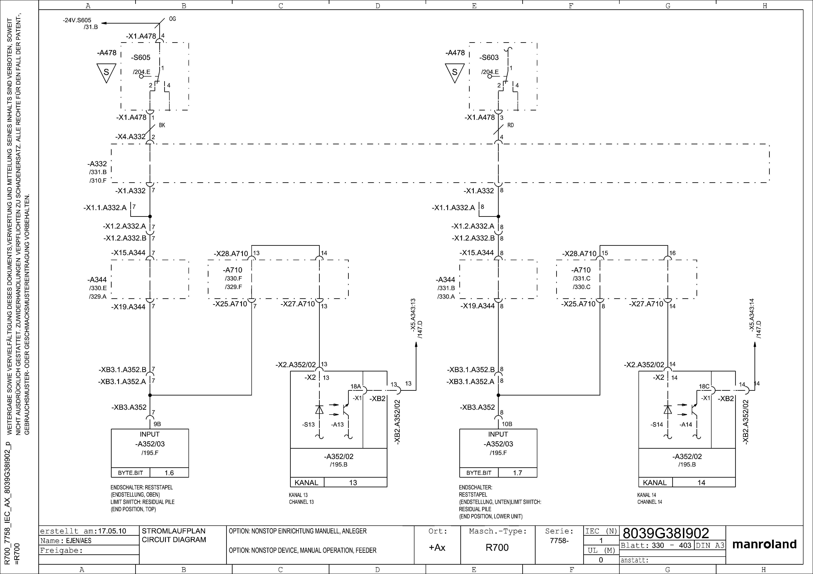

# +Ax — Sheet 330 of 403 — OPTION: NONSTOP EINRICHTUNG MANUELL, ANLEGER

> Part of the manroland **R700** printing press IEC/UL circuit diagrams.
> Drawing class: **Stromlaufplan / Circuit diagram** (DIN A3).
> Document `+Ax` covers the **Central control console** machine section.

## At a glance

| Field | Value |
|---|---|
| Document | `+Ax`  (8039G38I902) |
| Sheet | **330** of 403 |
| Section (DE) | OPTION: NONSTOP EINRICHTUNG MANUELL, ANLEGER |
| Section (EN) | — |
| Section type | CIRCUIT — Circuit diagram |
| Machine type | `R700` |
| Series | `7758` |
| Created | 17.05.10 |
| Replaces | — |
| Columns used | A, B, C, D, E, F, G, H |
| Path numbers | — |
| Labels on sheet | 156 |
| Cross-refs out | 19 |
| Cross-refs in | 54 |

**Previous:** [+Ax sheet 329](SHEET_0329.md) · **Next:** [+Ax sheet 331](SHEET_0331.md) · **Document TOC:** [_TOC.md](_TOC.md)  (+Ax) · **Master TOC:** [all sheets](../_MASTER_TOC.md)

## Sheet image (300 DPI, exact vector render)



_Rendered directly from the PDF vector layer at 300 DPI (1-bit), no OCR and no resampling. Use it to confirm anything ambiguous in the text below._

## Cross-references on this sheet

Each entry is a wire leaving this sheet. The printed token is `/sheet.column`; the link resolves to that sheet inside the same document.

| Ref | Target sheet | Col | Path | Destination on target | Target section | From col |
|---|---|---|---|---|---|---|
| `/31.B` | [+Ax sheet 31](SHEET_0031.md) | B | — | 24V.S605 | SPANNUNGSVERSORGUNG, SCHALTSCHRANKBELÜFTUNG | A |
| `/204.E` | [+Ax sheet 204](SHEET_0204.md) | E | — | — | REFERENZMODUL | B |
| `/204.E` | [+Ax sheet 204](SHEET_0204.md) | E | — | — | REFERENZMODUL | E |
| `/331.B` | [+Ax sheet 331](SHEET_0331.md) | B | — | — | OPTION: NONSTOP EINRICHTUNG MANUELL, ANLEGER | A |
| `/310.F` | [+Ax sheet 310](SHEET_0310.md) | F | — | — | OPTION: IONISATIONSANLAGE ANLEGER | A |
| `/330.F` | [+Ax sheet 330](SHEET_0330.md) | F | — | — | OPTION: NONSTOP EINRICHTUNG MANUELL, ANLEGER | C |
| `/329.F` | [+Ax sheet 329](SHEET_0329.md) | F | — | — | OPTION: NONSTOP EINRICHTUNG MANUELL, ANLEGER | C |
| `/331.C` | [+Ax sheet 331](SHEET_0331.md) | C | — | — | OPTION: NONSTOP EINRICHTUNG MANUELL, ANLEGER | F |
| `/330.C` | [+Ax sheet 330](SHEET_0330.md) | C | — | — | OPTION: NONSTOP EINRICHTUNG MANUELL, ANLEGER | F |
| `/330.E` | [+Ax sheet 330](SHEET_0330.md) | E | — | — | OPTION: NONSTOP EINRICHTUNG MANUELL, ANLEGER | A |
| `/329.A` | [+Ax sheet 329](SHEET_0329.md) | A | — | — | OPTION: NONSTOP EINRICHTUNG MANUELL, ANLEGER | A |
| `/331.B` | [+Ax sheet 331](SHEET_0331.md) | B | — | — | OPTION: NONSTOP EINRICHTUNG MANUELL, ANLEGER | E |
| `/330.A` | [+Ax sheet 330](SHEET_0330.md) | A | — | — | OPTION: NONSTOP EINRICHTUNG MANUELL, ANLEGER | E |
| `/147.D` | [+Ax sheet 147](SHEET_0147.md) | D | — | X5.A343:13 | ÜBERWACHUNGSRECHNER SICHERHEITSBUS | D |
| `/147.D` | [+Ax sheet 147](SHEET_0147.md) | D | — | X5.A343:14 | ÜBERWACHUNGSRECHNER SICHERHEITSBUS | H |
| `/195.F` | [+Ax sheet 195](SHEET_0195.md) | F | — | — | REFERENZMODUL | B |
| `/195.F` | [+Ax sheet 195](SHEET_0195.md) | F | — | — | REFERENZMODUL | E |
| `/195.B` | [+Ax sheet 195](SHEET_0195.md) | B | — | — | REFERENZMODUL | D |
| `/195.B` | [+Ax sheet 195](SHEET_0195.md) | B | — | — | REFERENZMODUL | G |

### Incoming references (sheets that point here)

Every other sheet that sends a wire to this one. `Back-ref` is the token printed on *that* sheet; `Path` is its line number.

| From sheet | Cols | Back-ref | Path | Refs | What continues there |
|---|---|---|---|---|---|
| [+Ax#31](SHEET_0031.md) | B | `/31.B` | — | 1 | 24V.S605 |
| [+Ax#147](SHEET_0147.md) | D | `/147.D` | — | 2 | X5.A343:13; X5.A343:14 |
| [+Ax#195](SHEET_0195.md) | B, F | `/195.B`, `/195.F` | — | 4 | — |
| [+Ax#204](SHEET_0204.md) | E | `/204.E` | — | 2 | — |
| [+Ax#207](SHEET_0207.md) | A, B, C | `/207.A`, `/207.B`, `/207.C` | — | 8 | — |
| [+Ax#209](SHEET_0209.md) | B | `/209.B` | — | 3 | — |
| [+Ax#218](SHEET_0218.md) | G | `/218.G` | — | 2 | — |
| [+Ax#219](SHEET_0219.md) | A | `/219.A` | — | 2 | — |
| [+Ax#223](SHEET_0223.md) | E, G, H | `/223.E`, `/223.G`, `/223.H` | — | 6 | — |
| [+Ax#226](SHEET_0226.md) | F | `/226.F` | — | 2 | — |
| [+Ax#252](SHEET_0252.md) | E | `/252.E` | — | 2 | — |
| [+Ax#258](SHEET_0258.md) | G | `/258.G` | — | 2 | — |
| [+Ax#268](SHEET_0268.md) | B | `/268.B` | — | 2 | — |
| [+Ax#270](SHEET_0270.md) | G | `/270.G` | — | 2 | — |
| [+Ax#272](SHEET_0272.md) | E | `/272.E` | — | 4 | — |
| [+Ax#310](SHEET_0310.md) | F | `/310.F` | — | 1 | — |
| [+Ax#329](SHEET_0329.md) | A, F | `/329.A`, `/329.F` | — | 2 | — |
| [+Ax#330](SHEET_0330.md) | A, C, E, F | `/330.A`, `/330.C`, `/330.E`, `/330.F` | — | 4 | — |
| [+Ax#331](SHEET_0331.md) | B, C | `/331.B`, `/331.C` | — | 3 | A710 |


## Devices on this sheet

| Tag | Class | Class meaning (IEC) | Col | Sub | Terminal | Sign |
|---|---|---|---|---|---|---|
| `A352/03` | A | Baugruppe / assembly, module, PC board | B | 03 | — | — |
| `A344` | A | Baugruppe / assembly, module, PC board | A | — | — | — |
| `A332` | A | Baugruppe / assembly, module, PC board | A | — | — | — |
| `S605` | S | Schalter / switch | B | — | — | — |
| `A478` | A | Baugruppe / assembly, module, PC board | A | — | — | — |
| `A710` | A | Baugruppe / assembly, module, PC board | C | — | — | — |
| `S13` | S | Schalter / switch | C | — | — | — |
| `A13` | A | Baugruppe / assembly, module, PC board | D | — | — | — |
| `X1` | X | Klemme / terminal, plug connector | D | — | — | — |
| `X2` | X | Klemme / terminal, plug connector | C | — | — | — |
| `XB2` | XB |  | D | — | — | — |
| `A352/02` | A | Baugruppe / assembly, module, PC board | D | 02 | — | — |
| `A352/03` | A | Baugruppe / assembly, module, PC board | E | 03 | — | — |
| `S603` | S | Schalter / switch | E | — | — | — |
| `A478` | A | Baugruppe / assembly, module, PC board | E | — | — | — |
| `A344` | A | Baugruppe / assembly, module, PC board | E | — | — | — |
| `A710` | A | Baugruppe / assembly, module, PC board | F | — | — | — |
| `S14` | S | Schalter / switch | G | — | — | — |
| `A14` | A | Baugruppe / assembly, module, PC board | G | — | — | — |
| `X1` | X | Klemme / terminal, plug connector | G | — | — | — |
| `X2` | X | Klemme / terminal, plug connector | G | — | — | — |
| `XB2` | XB |  | H | — | — | — |
| `A352/02` | A | Baugruppe / assembly, module, PC board | G | 02 | — | — |
| `A478` | A | Baugruppe / assembly, module, PC board | A | — | — | — |
| `A478` | A | Baugruppe / assembly, module, PC board | E | — | — | — |
| `1.6` | — | cross-device reference | B | — | — | — |
| `XB3.A352` | — | cross-device reference | A | — | — | — |
| `X19.A344` | — | cross-device reference | A | — | — | — |
| `X15.A344` | — | cross-device reference | A | — | — | — |
| `X4.A332` | — | cross-device reference | A | — | — | — |
| `X1.A332` | — | cross-device reference | A | — | — | — |
| `X1.2.A332.B` | — | cross-device reference | A | — | — | — |
| `X1.2.A332.A` | — | cross-device reference | A | — | — | — |
| `X1.1.A332.A` | — | cross-device reference | A | — | — | — |
| `X1.A478` | — | cross-device reference | A | — | — | — |
| `X1.A478` | — | cross-device reference | B | — | — | — |
| `X28.A710` | — | cross-device reference | B | — | — | — |
| `X27.A710` | — | cross-device reference | C | — | — | — |
| `X25.A710` | — | cross-device reference | B | — | — | — |
| `1.7` | — | cross-device reference | E | — | — | — |
| `XB3.A352` | — | cross-device reference | E | — | — | — |
| `X19.A344` | — | cross-device reference | E | — | — | — |
| `X15.A344` | — | cross-device reference | E | — | — | — |
| `X1.A332` | — | cross-device reference | E | — | — | — |
| `X1.2.A332.B` | — | cross-device reference | E | — | — | — |
| `X1.2.A332.A` | — | cross-device reference | E | — | — | — |
| `X1.1.A332.A` | — | cross-device reference | E | — | — | — |
| `X1.A478` | — | cross-device reference | E | — | — | — |
| `X28.A710` | — | cross-device reference | F | — | — | — |
| `X27.A710` | — | cross-device reference | G | — | — | — |
| `X25.A710` | — | cross-device reference | F | — | — | — |
| `XB3.1.A352.B` | — | cross-device reference | A | — | — | — |
| `XB3.1.A352.A` | — | cross-device reference | A | — | — | — |
| `XB3.1.A352.B` | — | cross-device reference | E | — | — | — |
| `XB3.1.A352.A` | — | cross-device reference | E | — | — | — |
| `X5.A343:14` | — | cross-device reference | H | — | 14 | — |
| `X5.A343:13` | — | cross-device reference | D | — | 13 | — |

## Potentials / nets

| Potential | Count | Columns | Attached devices | Terminals |
|---|---|---|---|---|
| `24V` | 1 | A | `S605` | — |


A potential such as `L24+/4` or `M24+` is a named supply/return rail; every place it appears on this sheet is electrically common.

## Wire-end annotations (grouped as printed)

A wire that continues elsewhere is annotated with a small cluster: the destination description, the path/line number `#NN`, and the `/sheet.column` cross reference. Each row below is one such cluster exactly as it is grouped on the drawing.

| Col | Y | Path | Cross-ref | Text on the wire |
|---|---|---|---|---|
| B | 24.7 | — | — | `OG` |
| A | 25.8 | — | `/31.B` | `24V.S605` |
| B | 48.5 | — | — | `X1.A478 4` |
| A | 72.6 | — | — | `A478 S605` |
| A | 72.6 | — | — | `A478` |
| E | 72.6 | — | — | `A478 S603` |
| E | 72.6 | — | — | `A478` |
| B | 96.0 | — | — | `1` |
| E | 96.0 | — | — | `1` |
| A | 100.3 | — | — | `S` |
| E | 100.3 | — | — | `S` |
| B | 101.6 | — | `/204.E` | — |
| E | 101.6 | — | `/204.E` | — |
| B | 121.5 | — | — | `2 4` |
| E | 121.5 | — | — | `2 4` |
| A | 167.6 | — | — | `X1.A478 1` |
| E | 167.6 | — | — | `X1.A478 3` |
| B | 180.5 | — | — | `BK` |
| E | 180.6 | — | — | `RD` |
| A | 195.9 | — | — | `X4.A332 2` |
| E | 197.3 | — | — | `4` |
| A | 235.6 | — | — | `A332` |
| A | 248.7 | — | `/331.B` | — |
| A | 261.1 | — | `/310.F` | — |
| A | 275.3 | — | — | `X1.A332 7` |
| E | 275.3 | — | — | `X1.A332 8` |
| A | 299.4 | — | — | `X1.1.A332.A 7` |
| E | 299.4 | — | — | `X1.1.A332.A 8` |
| A | 327.0 | — | — | `X1.2.A332.A 7` |
| E | 327.0 | — | — | `X1.2.A332.A 8` |
| A | 344.7 | — | — | `X1.2.A332.B 7` |
| E | 344.7 | — | — | `X1.2.A332.B 8` |
| A | 366.0 | — | — | `X15.A344 7` |
| E | 366.0 | — | — | `X15.A344 8` |
| C | 367.4 | — | — | `X28.A710 13 14` |
| F | 367.4 | — | — | `X28.A710 15 16` |
| C | 391.5 | — | — | `A710` |
| F | 391.5 | — | — | `A710` |
| C | 404.6 | — | `/330.F`, `/329.F` | — |
| F | 404.6 | — | `/331.C`, `/330.C` | — |
| A | 405.7 | — | — | `A344` |
| E | 405.7 | — | — | `A344` |
| A | 418.7 | — | `/330.E`, `/329.A` | — |
| E | 418.7 | — | `/331.B`, `/330.A` | — |
| D | 437.7 | — | `/147.D` | `X5.A343:13` |
| H | 437.7 | — | `/147.D` | `X5.A343:14` |
| C | 441.1 | — | — | `X25.A710 7 X27.A710 13` |
| F | 441.1 | — | — | `X25.A710 8 X27.A710 14` |
| E | 443.9 | — | — | `X19.A344 8` |
| A | 445.3 | — | — | `X19.A344 7` |
| C | 530.4 | — | — | `X2.A352/02 13` |
| G | 530.4 | — | — | `X2.A352/02 14` |
| A | 537.5 | — | — | `XB3.1.A352.B 7` |
| E | 537.5 | — | — | `XB3.1.A352.B 8` |
| C | 548.8 | — | — | `X2` |
| G | 548.8 | — | — | `X2` |
| D | 550.2 | — | — | `13 13` |
| G | 550.2 | — | — | `14 14` |
| A | 554.5 | — | — | `XB3.1.A352.A 7` |
| E | 554.5 | — | — | `XB3.1.A352.A 8` |
| D | 558.8 | — | — | `13` |
| H | 558.8 | — | — | `14` |
| D | 563.0 | — | — | `18A` |
| G | 563.0 | — | — | `18C` |
| D | 580.0 | — | — | `X1` |
| D | 580.0 | — | — | `XB2` |
| G | 580.0 | — | — | `X1` |
| H | 580.0 | — | — | `XB2` |
| D | 586.2 | — | — | `XB2.A352/02` |
| H | 586.2 | — | — | `XB2.A352/02` |
| A | 592.8 | — | — | `XB3.A352 7` |
| E | 592.8 | — | — | `XB3.A352 8` |
| B | 618.2 | — | — | `9B` |
| E | 618.2 | — | — | `10B` |
| C | 619.0 | — | — | `S13 A13` |
| G | 619.0 | — | — | `S14 A14` |
| B | 632.8 | — | — | `INPUT` |
| E | 632.8 | — | — | `INPUT` |
| B | 646.6 | — | — | `A352/03` |
| E | 646.6 | — | — | `A352/03` |
| B | 660.4 | — | `/195.F` | — |
| E | 660.4 | — | `/195.F` | — |
| D | 665.0 | — | — | `A352/02` |
| G | 665.0 | — | — | `A352/02` |
| D | 677.4 | — | `/195.B` | — |
| G | 677.4 | — | `/195.B` | — |
| B | 689.4 | — | — | `BYTE.BIT 1.6` |
| E | 689.4 | — | — | `BYTE.BIT 1.7` |
| C | 703.3 | — | — | `KANAL 13` |
| G | 703.3 | — | — | `KANAL 14` |
| B | 712.1 | — | — | `ENDSCHALTER: RESTSTAPEL LIMIT SWITCH: RESIDUAL PILE (ENDSTELLUNG, OBEN) (END POSITION, TOP)` |
| E | 712.1 | — | — | `ENDSCHALTER: RESTSTAPEL RESIDUAL PILE (ENDSTELLUNG, UNTEN)LIMIT SWITCH: (END POSITION, LOWER UNIT)` |
| C | 723.6 | — | — | `KANAL 13 CHANNEL 13` |
| G | 723.6 | — | — | `KANAL 14 CHANNEL 14` |


## Reconstructed tables

This sheet carries tabular content (pin map / terminal assignment / index). The grid below was rebuilt from the drawing's own rule lines, so each row is exactly one physical row of the table.

### Table 1 — 7 data rows × 20 columns (at x=163.0, y=34.0)

| X1.A478 S605 /204.E X1.A478 X4.A332 X1.A332 7 X1.2.A332.A X1.2.A332.B | 2 1 2 7 7 7 | 4 1 4 BK |  |  |  |  |  |  |  | A478 A478 S X1.1.A332.A | S603 /204.E X1.A478 X1.A332 8 X1.2.A332.A X1.2.A332.B | 1 2 4 3 RD 4 8 8 8 |  |  |  |  |  |  |  |
|---|---|---|---|---|---|---|---|---|---|---|---|---|---|---|---|---|---|---|---|
| `X15.A344 X19.A344 XB3.1.A352.B` | `7 7 7` |  | `X28.A710 A710 /330.F /329.F X25.A710` | `13 7` | `X27.A710 X2.A352/02` | `14 13 13` |  |  | `X5.A343:13` | `A344 /331.B /330.A /147.D` | `X15.A344 X19.A344 XB3.1.A352.B` | `8 8 8` | `X28.A710 A710 /331.C /330.C X25.A710` | `15 8` | `X27.A710 X2.A352/02` | `16 14 14` |  |  | `X5.A343:14` |
| `XB3.1.A352.A` | `7` |  |  |  | `X2` | `13` | `18A` |  | `13 13` |  | `XB3.1.A352.A` | `8` |  |  | `X2` | `14` | `18C` |  | `14` |
| `XB3.A352` | `7 9B` |  |  |  | `S13` | `A13` | `X1` | `XB2` | `XB2.A352/02` |  | `XB3.A352` | `8 10B` |  |  | `S14` | `A14` | `X1` | `XB2` | `XB2.A352/02` |
| `INPUT` | `A352/03` |  |  |  |  |  |  |  |  |  | `INPUT` | `A352/03` |  |  |  |  |  |  |  |
|  | `/195.F` |  |  |  |  | `A352/02 /195.B` |  |  |  |  |  | `/195.F` |  |  |  | `A352/02 /195.B` |  |  |  |
| `BYTE.BIT` |  | `1.6` |  |  |  |  |  |  |  |  | `BYTE.BIT` | `1.7` |  |  |  |  |  |  |  |
|  |  |  |  |  | `KANAL` |  | `13` |  |  |  |  |  |  |  | `KANAL` |  | `14` |  |  |


## Notes and free text on this sheet

| Text | Col | Y (pt) |
|---|---|---|
| `9B` | B | 618.22 |
| `INPUT` | B | 632.76 |
| `BYTE.BIT` | A | 690.01 |
| `ENDSCHALTER: RESTSTAPEL` | B | 712.12 |
| `(ENDSTELLUNG, OBEN)` | A | 722.76 |
| `LIMIT SWITCH: RESIDUAL PILE` | B | 733.36 |
| `(END POSITION, TOP)` | A | 744.01 |
| `KANAL 13` | C | 723.62 |
| `CHANNEL 13` | C | 733.56 |
| `18A` | D | 562.96 |
| `KANAL` | C | 703.29 |
| `X2.A352/02` | C | 530.39 |
| `XB2.A352/02` | D | 586.21 |
| `10B` | E | 618.24 |
| `INPUT` | E | 632.76 |
| `BYTE.BIT` | E | 690.01 |
| `ENDSCHALTER:` | E | 712.11 |
| `RESTSTAPEL` | E | 722.73 |
| `(ENDSTELLUNG, UNTEN)LIMIT SWITCH:` | E | 733.38 |
| `RESIDUAL PILE` | E | 744 |
| `(END POSITION, LOWER UNIT)` | E | 754.64 |
| `KANAL 14` | G | 723.62 |
| `CHANNEL 14` | G | 733.56 |
| `18C` | G | 563.01 |
| `KANAL` | G | 703.29 |
| `X2.A352/02` | G | 530.39 |
| `XB2.A352/02` | H | 586.21 |
| `S` | A | 100.3 |
| `S` | E | 100.3 |
| `BK` | B | 180.51 |
| `OG` | B | 24.68 |
| `RD` | E | 180.58 |

## Complete label inventory (exact text from the drawing)

Every text object inside the drawing area of this sheet, in DIN reading order (column A→H, then top→bottom). This is the authoritative list: if a string is not here it is not printed on this sheet.

| Col | Y | X | Dir | Type | Text |
|---|---|---|---|---|---|
| A | 25.8 | 92.1 | → | potential | `24V.S605` |
| A | 35.7 | 122.7 | → | cross-reference | `/31.B` |
| A | 72.6 | 142.3 | → | device tag | `A478` |
| A | 72.6 | 142.3 | → | device tag | `A478` |
| A | 100.3 | 151.8 | → | text | `S` |
| A | 167.6 | 170.4 | → | device ref | `X1.A478` |
| A | 195.9 | 168.9 | → | device ref | `X4.A332` |
| A | 235.6 | 128.1 | → | device tag | `A332` |
| A | 248.6 | 130.7 | → | cross-reference | `/331.B` |
| A | 261.1 | 131.2 | → | cross-reference | `/310.F` |
| A | 275.3 | 168.9 | → | device ref | `X1.A332` |
| A | 299.4 | 193.9 | → | number | `7` |
| A | 300.1 | 122.5 | → | device ref | `X1.1.A332.A` |
| A | 327.0 | 150.8 | → | device ref | `X1.2.A332.A` |
| A | 344.7 | 151.7 | → | device ref | `X1.2.A332.B` |
| A | 366.0 | 163.0 | → | device ref | `X15.A344` |
| A | 405.7 | 128.1 | → | device tag | `A344` |
| A | 418.7 | 131.0 | → | cross-reference | `/330.E` |
| A | 431.1 | 130.4 | → | cross-reference | `/329.A` |
| A | 445.3 | 163.0 | → | device ref | `X19.A344` |
| A | 537.5 | 144.6 | → | device ref | `XB3.1.A352.B` |
| A | 555.2 | 143.7 | → | device ref | `XB3.1.A352.A` |
| A | 592.7 | 163.3 | → | device ref | `XB3.A352` |
| A | 690.0 | 172.9 | → | text | `BYTE.BIT` |
| A | 722.8 | 162.4 | → | text | `(ENDSTELLUNG, OBEN)` |
| A | 744.0 | 162.4 | → | text | `(END POSITION, TOP)` |
| B | 24.7 | 247.7 | → | text | `OG` |
| B | 48.5 | 184.5 | → | device ref | `X1.A478` |
| B | 48.5 | 236.4 | → | number | `4` |
| B | 79.7 | 191.9 | → | device tag | `S605` |
| B | 96.0 | 235.8 | → | number | `1` |
| B | 101.6 | 194.7 | → | cross-reference | `/204.E` |
| B | 121.5 | 218.3 | → | number | `2` |
| B | 121.5 | 244.9 | → | number | `4` |
| B | 169.0 | 221.7 | → | number | `1` |
| B | 180.5 | 233.0 | → | text | `BK` |
| B | 197.3 | 222.2 | → | number | `2` |
| B | 275.3 | 222.2 | → | number | `7` |
| B | 329.1 | 222.2 | → | number | `7` |
| B | 346.2 | 222.2 | → | number | `7` |
| B | 367.4 | 222.2 | → | number | `7` |
| B | 367.4 | 313.2 | → | device ref | `X28.A710` |
| B | 441.1 | 311.8 | → | device ref | `X25.A710` |
| B | 445.4 | 222.2 | → | number | `7` |
| B | 537.5 | 222.2 | → | number | `7` |
| B | 554.5 | 222.2 | → | number | `7` |
| B | 601.3 | 222.2 | → | number | `7` |
| B | 618.2 | 225.1 | → | text | `9B` |
| B | 632.8 | 204.8 | → | text | `INPUT` |
| B | 646.6 | 198.3 | → | device tag | `A352/03` |
| B | 660.4 | 207.4 | → | cross-reference | `/195.F` |
| B | 689.4 | 240.9 | → | device ref | `1.6` |
| B | 712.1 | 162.1 | → | text | `ENDSCHALTER: RESTSTAPEL` |
| B | 733.4 | 162.1 | → | text | `LIMIT SWITCH: RESIDUAL PILE` |
| C | 367.4 | 370.5 | → | number | `13` |
| C | 367.4 | 469.7 | → | number | `14` |
| C | 391.5 | 326.6 | → | device tag | `A710` |
| C | 404.6 | 329.7 | → | cross-reference | `/330.F` |
| C | 417.0 | 329.7 | → | cross-reference | `/329.F` |
| C | 441.1 | 411.0 | → | device ref | `X27.A710` |
| C | 445.4 | 371.1 | → | number | `7` |
| C | 445.4 | 469.7 | → | number | `13` |
| C | 530.4 | 403.7 | → | text | `X2.A352/02` |
| C | 530.4 | 469.7 | → | number | `13` |
| C | 548.8 | 446.2 | → | device tag | `X2` |
| C | 550.2 | 472.5 | → | number | `13` |
| C | 619.0 | 442.5 | → | device tag | `S13` |
| C | 703.3 | 431.4 | → | text | `KANAL` |
| C | 723.6 | 423.2 | → | text | `KANAL 13` |
| C | 733.6 | 423.5 | → | text | `CHANNEL 13` |
| D | 437.7 | 601.2 | ↕ | device ref | `X5.A343:13` |
| D | 470.3 | 611.2 | ↕ | cross-reference | `/147.D` |
| D | 558.7 | 593.0 | → | number | `13` |
| D | 560.2 | 571.7 | → | number | `13` |
| D | 563.0 | 513.1 | → | text | `18A` |
| D | 580.0 | 516.8 | → | device tag | `X1` |
| D | 580.0 | 541.1 | → | device tag | `XB2` |
| D | 586.2 | 577.2 | ↕ | text | `XB2.A352/02` |
| D | 619.0 | 485.0 | → | device tag | `A13` |
| D | 665.0 | 474.7 | → | device tag | `A352/02` |
| D | 677.4 | 483.4 | → | cross-reference | `/195.B` |
| D | 703.3 | 511.1 | → | number | `13` |
| E | 72.6 | 652.5 | → | device tag | `A478` |
| E | 72.6 | 652.5 | → | device tag | `A478` |
| E | 79.7 | 702.1 | → | device tag | `S603` |
| E | 96.0 | 746.1 | → | number | `1` |
| E | 100.3 | 662.0 | → | text | `S` |
| E | 101.6 | 705.0 | → | cross-reference | `/204.E` |
| E | 121.5 | 728.5 | → | number | `2` |
| E | 121.5 | 755.1 | → | number | `4` |
| E | 167.6 | 680.6 | → | device ref | `X1.A478` |
| E | 169.0 | 732.5 | → | number | `3` |
| E | 180.6 | 743.2 | → | text | `RD` |
| E | 197.3 | 732.5 | → | number | `4` |
| E | 275.3 | 679.2 | → | device ref | `X1.A332` |
| E | 275.3 | 732.5 | → | number | `8` |
| E | 299.4 | 704.1 | → | number | `8` |
| E | 300.1 | 632.7 | → | device ref | `X1.1.A332.A` |
| E | 327.0 | 661.0 | → | device ref | `X1.2.A332.A` |
| E | 329.1 | 732.5 | → | number | `8` |
| E | 344.7 | 661.9 | → | device ref | `X1.2.A332.B` |
| E | 346.2 | 732.5 | → | number | `8` |
| E | 366.0 | 673.2 | → | device ref | `X15.A344` |
| E | 367.4 | 732.5 | → | number | `8` |
| E | 405.7 | 638.4 | → | device tag | `A344` |
| E | 418.7 | 640.9 | → | cross-reference | `/331.B` |
| E | 431.1 | 640.6 | → | cross-reference | `/330.A` |
| E | 443.9 | 674.6 | → | device ref | `X19.A344` |
| E | 445.4 | 732.5 | → | number | `8` |
| E | 537.5 | 654.8 | → | device ref | `XB3.1.A352.B` |
| E | 537.5 | 732.5 | → | number | `8` |
| E | 554.5 | 732.5 | → | number | `8` |
| E | 555.2 | 654.0 | → | device ref | `XB3.1.A352.A` |
| E | 592.7 | 673.5 | → | device ref | `XB3.A352` |
| E | 601.3 | 732.5 | → | number | `8` |
| E | 618.2 | 734.7 | → | text | `10B` |
| E | 632.8 | 715.0 | → | text | `INPUT` |
| E | 646.6 | 708.5 | → | device tag | `A352/03` |
| E | 660.4 | 717.6 | → | cross-reference | `/195.F` |
| E | 689.4 | 751.2 | → | device ref | `1.7` |
| E | 690.0 | 683.1 | → | text | `BYTE.BIT` |
| E | 712.1 | 672.4 | → | text | `ENDSCHALTER:` |
| E | 722.7 | 672.4 | → | text | `RESTSTAPEL` |
| E | 733.4 | 672.7 | → | text | `(ENDSTELLUNG, UNTEN)LIMIT SWITCH:` |
| E | 744.0 | 672.4 | → | text | `RESIDUAL PILE` |
| E | 754.6 | 672.7 | → | text | `(END POSITION, LOWER UNIT)` |
| F | 367.4 | 823.5 | → | device ref | `X28.A710` |
| F | 367.4 | 880.7 | → | number | `15` |
| F | 391.5 | 836.8 | → | device tag | `A710` |
| F | 404.6 | 839.1 | → | cross-reference | `/331.C` |
| F | 417.0 | 839.1 | → | cross-reference | `/330.C` |
| F | 441.1 | 822.0 | → | device ref | `X25.A710` |
| F | 445.4 | 881.3 | → | number | `8` |
| G | 367.4 | 979.9 | → | number | `16` |
| G | 441.1 | 921.3 | → | device ref | `X27.A710` |
| G | 445.4 | 979.9 | → | number | `14` |
| G | 530.4 | 913.9 | → | text | `X2.A352/02` |
| G | 530.4 | 979.9 | → | number | `14` |
| G | 548.8 | 956.4 | → | device tag | `X2` |
| G | 550.2 | 982.8 | → | number | `14` |
| G | 563.0 | 1023.3 | → | text | `18C` |
| G | 580.0 | 1027.0 | → | device tag | `X1` |
| G | 619.0 | 952.7 | → | device tag | `S14` |
| G | 619.0 | 995.2 | → | device tag | `A14` |
| G | 665.0 | 984.9 | → | device tag | `A352/02` |
| G | 677.4 | 993.7 | → | cross-reference | `/195.B` |
| G | 703.3 | 941.7 | → | text | `KANAL` |
| G | 703.3 | 1021.3 | → | number | `14` |
| G | 723.6 | 933.4 | → | text | `KANAL 14` |
| G | 733.6 | 933.7 | → | text | `CHANNEL 14` |
| H | 437.7 | 1097.3 | ↕ | device ref | `X5.A343:14` |
| H | 470.3 | 1107.2 | ↕ | cross-reference | `/147.D` |
| H | 558.7 | 1103.2 | → | number | `14` |
| H | 560.2 | 1082.0 | → | number | `14` |
| H | 580.0 | 1051.4 | → | device tag | `XB2` |
| H | 586.2 | 1087.4 | ↕ | text | `XB2.A352/02` |

## Reading-order text block

The same content as a plain block, grouped by DIN column — convenient to paste or to match against a visual description.

```text
=== Column A ===
  25.8   92.1  net          24V.S605
  35.7  122.7  xref         /31.B
  72.6  142.3  devtag       A478
  72.6  142.3  devtag       A478
 100.3  151.8  text         S
 167.6  170.4  devref       X1.A478
 195.9  168.9  devref       X4.A332
 235.6  128.1  devtag       A332
 248.6  130.7  xref         /331.B
 261.1  131.2  xref         /310.F
 275.3  168.9  devref       X1.A332
 299.4  193.9  numeric      7
 300.1  122.5  devref       X1.1.A332.A
 327.0  150.8  devref       X1.2.A332.A
 344.7  151.7  devref       X1.2.A332.B
 366.0  163.0  devref       X15.A344
 405.7  128.1  devtag       A344
 418.7  131.0  xref         /330.E
 431.1  130.4  xref         /329.A
 445.3  163.0  devref       X19.A344
 537.5  144.6  devref       XB3.1.A352.B
 555.2  143.7  devref       XB3.1.A352.A
 592.7  163.3  devref       XB3.A352
 690.0  172.9  text         BYTE.BIT
 722.8  162.4  text         (ENDSTELLUNG, OBEN)
 744.0  162.4  text         (END POSITION, TOP)
=== Column B ===
  24.7  247.7  text         OG
  48.5  184.5  devref       X1.A478
  48.5  236.4  numeric      4
  79.7  191.9  devtag       S605
  96.0  235.8  numeric      1
 101.6  194.7  xref         /204.E
 121.5  218.3  numeric      2
 121.5  244.9  numeric      4
 169.0  221.7  numeric      1
 180.5  233.0  text         BK
 197.3  222.2  numeric      2
 275.3  222.2  numeric      7
 329.1  222.2  numeric      7
 346.2  222.2  numeric      7
 367.4  222.2  numeric      7
 367.4  313.2  devref       X28.A710
 441.1  311.8  devref       X25.A710
 445.4  222.2  numeric      7
 537.5  222.2  numeric      7
 554.5  222.2  numeric      7
 601.3  222.2  numeric      7
 618.2  225.1  text         9B
 632.8  204.8  text         INPUT
 646.6  198.3  devtag       A352/03
 660.4  207.4  xref         /195.F
 689.4  240.9  devref       1.6
 712.1  162.1  text         ENDSCHALTER: RESTSTAPEL
 733.4  162.1  text         LIMIT SWITCH: RESIDUAL PILE
=== Column C ===
 367.4  370.5  numeric      13
 367.4  469.7  numeric      14
 391.5  326.6  devtag       A710
 404.6  329.7  xref         /330.F
 417.0  329.7  xref         /329.F
 441.1  411.0  devref       X27.A710
 445.4  371.1  numeric      7
 445.4  469.7  numeric      13
 530.4  403.7  text         X2.A352/02
 530.4  469.7  numeric      13
 548.8  446.2  devtag       X2
 550.2  472.5  numeric      13
 619.0  442.5  devtag       S13
 703.3  431.4  text         KANAL
 723.6  423.2  text         KANAL 13
 733.6  423.5  text         CHANNEL 13
=== Column D ===
 437.7  601.2  devref       X5.A343:13
 470.3  611.2  xref         /147.D
 558.7  593.0  numeric      13
 560.2  571.7  numeric      13
 563.0  513.1  text         18A
 580.0  516.8  devtag       X1
 580.0  541.1  devtag       XB2
 586.2  577.2  text         XB2.A352/02
 619.0  485.0  devtag       A13
 665.0  474.7  devtag       A352/02
 677.4  483.4  xref         /195.B
 703.3  511.1  numeric      13
=== Column E ===
  72.6  652.5  devtag       A478
  72.6  652.5  devtag       A478
  79.7  702.1  devtag       S603
  96.0  746.1  numeric      1
 100.3  662.0  text         S
 101.6  705.0  xref         /204.E
 121.5  728.5  numeric      2
 121.5  755.1  numeric      4
 167.6  680.6  devref       X1.A478
 169.0  732.5  numeric      3
 180.6  743.2  text         RD
 197.3  732.5  numeric      4
 275.3  679.2  devref       X1.A332
 275.3  732.5  numeric      8
 299.4  704.1  numeric      8
 300.1  632.7  devref       X1.1.A332.A
 327.0  661.0  devref       X1.2.A332.A
 329.1  732.5  numeric      8
 344.7  661.9  devref       X1.2.A332.B
 346.2  732.5  numeric      8
 366.0  673.2  devref       X15.A344
 367.4  732.5  numeric      8
 405.7  638.4  devtag       A344
 418.7  640.9  xref         /331.B
 431.1  640.6  xref         /330.A
 443.9  674.6  devref       X19.A344
 445.4  732.5  numeric      8
 537.5  654.8  devref       XB3.1.A352.B
 537.5  732.5  numeric      8
 554.5  732.5  numeric      8
 555.2  654.0  devref       XB3.1.A352.A
 592.7  673.5  devref       XB3.A352
 601.3  732.5  numeric      8
 618.2  734.7  text         10B
 632.8  715.0  text         INPUT
 646.6  708.5  devtag       A352/03
 660.4  717.6  xref         /195.F
 689.4  751.2  devref       1.7
 690.0  683.1  text         BYTE.BIT
 712.1  672.4  text         ENDSCHALTER:
 722.7  672.4  text         RESTSTAPEL
 733.4  672.7  text         (ENDSTELLUNG, UNTEN)LIMIT SWITCH:
 744.0  672.4  text         RESIDUAL PILE
 754.6  672.7  text         (END POSITION, LOWER UNIT)
=== Column F ===
 367.4  823.5  devref       X28.A710
 367.4  880.7  numeric      15
 391.5  836.8  devtag       A710
 404.6  839.1  xref         /331.C
 417.0  839.1  xref         /330.C
 441.1  822.0  devref       X25.A710
 445.4  881.3  numeric      8
=== Column G ===
 367.4  979.9  numeric      16
 441.1  921.3  devref       X27.A710
 445.4  979.9  numeric      14
 530.4  913.9  text         X2.A352/02
 530.4  979.9  numeric      14
 548.8  956.4  devtag       X2
 550.2  982.8  numeric      14
 563.0 1023.3  text         18C
 580.0 1027.0  devtag       X1
 619.0  952.7  devtag       S14
 619.0  995.2  devtag       A14
 665.0  984.9  devtag       A352/02
 677.4  993.7  xref         /195.B
 703.3  941.7  text         KANAL
 703.3 1021.3  numeric      14
 723.6  933.4  text         KANAL 14
 733.6  933.7  text         CHANNEL 14
=== Column H ===
 437.7 1097.3  devref       X5.A343:14
 470.3 1107.2  xref         /147.D
 558.7 1103.2  numeric      14
 560.2 1082.0  numeric      14
 580.0 1051.4  devtag       XB2
 586.2 1087.4  text         XB2.A352/02
```

---
_Generated from the PDF vector text layer; no OCR. Source: `R700_7758_IEC_AX_8039G38I902_p`, sheet 330._
