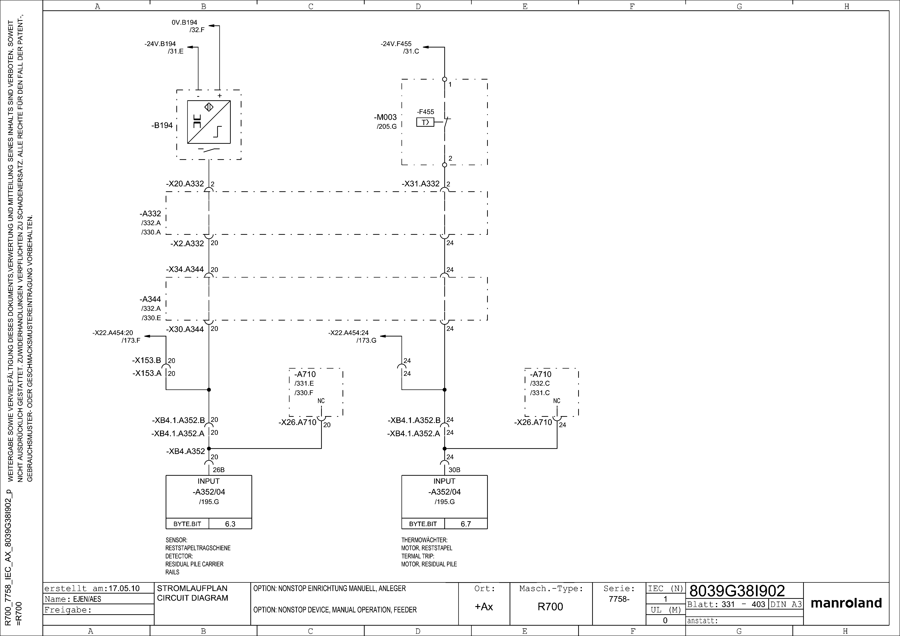

# +Ax — Sheet 331 of 403 — OPTION: NONSTOP EINRICHTUNG MANUELL, ANLEGER

> Part of the manroland **R700** printing press IEC/UL circuit diagrams.
> Drawing class: **Stromlaufplan / Circuit diagram** (DIN A3).
> Document `+Ax` covers the **Central control console** machine section.

## At a glance

| Field | Value |
|---|---|
| Document | `+Ax`  (8039G38I902) |
| Sheet | **331** of 403 |
| Section (DE) | OPTION: NONSTOP EINRICHTUNG MANUELL, ANLEGER |
| Section (EN) | — |
| Section type | CIRCUIT — Circuit diagram |
| Machine type | `R700` |
| Series | `7758` |
| Created | 17.05.10 |
| Replaces | — |
| Columns used | A, B, C, D, E |
| Path numbers | — |
| Labels on sheet | 87 |
| Cross-refs out | 16 |
| Cross-refs in | 36 |

**Previous:** [+Ax sheet 330](SHEET_0330.md) · **Next:** [+Ax sheet 332](SHEET_0332.md) · **Document TOC:** [_TOC.md](_TOC.md)  (+Ax) · **Master TOC:** [all sheets](../_MASTER_TOC.md)

## Sheet image (300 DPI, exact vector render)



_Rendered directly from the PDF vector layer at 300 DPI (1-bit), no OCR and no resampling. Use it to confirm anything ambiguous in the text below._

## Cross-references on this sheet

Each entry is a wire leaving this sheet. The printed token is `/sheet.column`; the link resolves to that sheet inside the same document.

| Ref | Target sheet | Col | Path | Destination on target | Target section | From col |
|---|---|---|---|---|---|---|
| `/32.F` | [+Ax sheet 32](SHEET_0032.md) | F | — | 0V.B194 | SPANNUNGSVERSORGUNG, SCHALTSCHRANKBELÜFTUNG | B |
| `/31.E` | [+Ax sheet 31](SHEET_0031.md) | E | — | 24V.B194 | SPANNUNGSVERSORGUNG, SCHALTSCHRANKBELÜFTUNG | B |
| `/31.C` | [+Ax sheet 31](SHEET_0031.md) | C | — | 24V.F455 | SPANNUNGSVERSORGUNG, SCHALTSCHRANKBELÜFTUNG | D |
| `/205.G` | [+Ax sheet 205](SHEET_0205.md) | G | — | — | REFERENZMODUL | D |
| `/332.A` | [+Ax sheet 332](SHEET_0332.md) | A | — | — | OPTION: NONSTOP EINRICHTUNG MANUELL, ANLEGER | B |
| `/330.A` | [+Ax sheet 330](SHEET_0330.md) | A | — | — | OPTION: NONSTOP EINRICHTUNG MANUELL, ANLEGER | B |
| `/332.A` | [+Ax sheet 332](SHEET_0332.md) | A | — | — | OPTION: NONSTOP EINRICHTUNG MANUELL, ANLEGER | B |
| `/330.E` | [+Ax sheet 330](SHEET_0330.md) | E | — | — | OPTION: NONSTOP EINRICHTUNG MANUELL, ANLEGER | B |
| `/173.F` | [+Ax sheet 173](SHEET_0173.md) | F | — | X22.A454:20 X22.A454:24 | RESERVE | B |
| `/173.G` | [+Ax sheet 173](SHEET_0173.md) | G | — | X22.A454:20 X22.A454:24 | RESERVE | B |
| `/331.E` | [+Ax sheet 331](SHEET_0331.md) | E | — | A710 | OPTION: NONSTOP EINRICHTUNG MANUELL, ANLEGER | C |
| `/330.F` | [+Ax sheet 330](SHEET_0330.md) | F | — | A710 | OPTION: NONSTOP EINRICHTUNG MANUELL, ANLEGER | C |
| `/332.C` | [+Ax sheet 332](SHEET_0332.md) | C | — | A710 | OPTION: NONSTOP EINRICHTUNG MANUELL, ANLEGER | E |
| `/331.C` | [+Ax sheet 331](SHEET_0331.md) | C | — | A710 | OPTION: NONSTOP EINRICHTUNG MANUELL, ANLEGER | E |
| `/195.G` | [+Ax sheet 195](SHEET_0195.md) | G | — | — | REFERENZMODUL | B |
| `/195.G` | [+Ax sheet 195](SHEET_0195.md) | G | — | — | REFERENZMODUL | D |

### Incoming references (sheets that point here)

Every other sheet that sends a wire to this one. `Back-ref` is the token printed on *that* sheet; `Path` is its line number.

| From sheet | Cols | Back-ref | Path | Refs | What continues there |
|---|---|---|---|---|---|
| [+Ax#31](SHEET_0031.md) | C, E | `/31.C`, `/31.E` | — | 2 | 24V.B194 |
| [+Ax#32](SHEET_0032.md) | F | `/32.F` | — | 1 | 0V.B194 |
| [+Ax#173](SHEET_0173.md) | F, G | `/173.F`, `/173.G` | — | 2 | — |
| [+Ax#195](SHEET_0195.md) | G | `/195.G` | — | 2 | — |
| [+Ax#205](SHEET_0205.md) | G | `/205.G` | — | 1 | — |
| [+Ax#217](SHEET_0217.md) | F | `/217.F` | — | 2 | — |
| [+Ax#227](SHEET_0227.md) | E, F, G | `/227.E`, `/227.F`, `/227.G` | — | 6 | — |
| [+Ax#260](SHEET_0260.md) | A | `/260.A` | — | 1 | — |
| [+Ax#269](SHEET_0269.md) | G | `/269.G` | — | 2 | — |
| [+Ax#274](SHEET_0274.md) | F | `/274.F` | — | 2 | — |
| [+Ax#275](SHEET_0275.md) | A | `/275.A` | — | 1 | — |
| [+Ax#278](SHEET_0278.md) | A | `/278.A` | — | 2 | — |
| [+Ax#290](SHEET_0290.md) | C, E | `/290.C`, `/290.E` | — | 4 | — |
| [+Ax#330](SHEET_0330.md) | A, E, F | `/330.A`, `/330.E`, `/330.F` | — | 3 | — |
| [+Ax#331](SHEET_0331.md) | C, E | `/331.C`, `/331.E` | — | 2 | A710 |
| [+Ax#332](SHEET_0332.md) | A, B | `/332.A`, `/332.B` | — | 3 | — |


## Devices on this sheet

| Tag | Class | Class meaning (IEC) | Col | Sub | Terminal | Sign |
|---|---|---|---|---|---|---|
| `A332` | A | Baugruppe / assembly, module, PC board | A | — | — | — |
| `A352/04` | A | Baugruppe / assembly, module, PC board | B | 04 | — | — |
| `B194` | B | Umformer / transducer, sensor | B | — | — | — |
| `A344` | A | Baugruppe / assembly, module, PC board | A | — | — | — |
| `A352/04` | A | Baugruppe / assembly, module, PC board | D | 04 | — | — |
| `F455` | F | Schutz / protection device (fuse, circuit breaker) | D | — | — | — |
| `A710` | A | Baugruppe / assembly, module, PC board | C | — | — | — |
| `A710` | A | Baugruppe / assembly, module, PC board | E | — | — | — |
| `6.3` | — | cross-device reference | B | — | — | — |
| `XB4.A352` | — | cross-device reference | B | — | — | — |
| `X20.A332` | — | cross-device reference | B | — | — | — |
| `X2.A332` | — | cross-device reference | B | — | — | — |
| `X153.A` | — | cross-device reference | A | — | — | — |
| `X153.B` | — | cross-device reference | A | — | — | — |
| `X30.A344` | — | cross-device reference | B | — | — | — |
| `X34.A344` | — | cross-device reference | B | — | — | — |
| `6.7` | — | cross-device reference | D | — | — | — |
| `X31.A332` | — | cross-device reference | D | — | — | — |
| `X26.A710` | — | cross-device reference | C | — | — | — |
| `XB4.1.A352.B` | — | cross-device reference | B | — | — | — |
| `XB4.1.A352.A` | — | cross-device reference | B | — | — | — |
| `X26.A710` | — | cross-device reference | E | — | — | — |
| `XB4.1.A352.B` | — | cross-device reference | D | — | — | — |
| `XB4.1.A352.A` | — | cross-device reference | D | — | — | — |
| `X22.A454:24` | — | cross-device reference | C | — | 24 | — |
| `X22.A454:20` | — | cross-device reference | A | — | 20 | — |

## Potentials / nets

| Potential | Count | Columns | Attached devices | Terminals |
|---|---|---|---|---|
| `0V` | 1 | B | `B194` | — |
| `24V` | 2 | B, D | `B194`, `F455` | — |
| `M003` | 1 | D | — | — |


A potential such as `L24+/4` or `M24+` is a named supply/return rail; every place it appears on this sheet is electrically common.

## Wire-end annotations (grouped as printed)

A wire that continues elsewhere is annotated with a small cluster: the destination description, the path/line number `#NN`, and the `/sheet.column` cross reference. Each row below is one such cluster exactly as it is grouped on the drawing.

| Col | Y | Path | Cross-ref | Text on the wire |
|---|---|---|---|---|
| B | 25.8 | — | `/32.F` | `0V.B194` |
| B | 54.1 | — | `/31.E` | `24V.B194` |
| D | 54.1 | — | `/31.C` | `24V.F455` |
| D | 108.0 | — | — | `1` |
| B | 122.2 | — | — | `+` |
| D | 144.2 | — | — | `F455` |
| D | 150.6 | — | — | `M003` |
| D | 158.0 | — | — | `T` |
| B | 161.2 | — | — | `B194` |
| D | 163.6 | — | `/205.G` | — |
| D | 205.8 | — | — | `2` |
| B | 238.4 | — | — | `X20.A332 2` |
| D | 238.4 | — | — | `X31.A332 2` |
| A | 278.1 | — | — | `A332` |
| B | 291.2 | — | `/332.A`, `/330.A` | — |
| B | 317.8 | — | — | `X2.A332 20` |
| D | 317.8 | — | — | `24` |
| B | 351.8 | — | — | `X34.A344 20` |
| D | 353.2 | — | — | `24` |
| A | 391.5 | — | — | `A344` |
| B | 404.6 | — | `/332.A` | — |
| B | 417.0 | — | `/330.E` | — |
| B | 431.2 | — | — | `X30.A344 20` |
| D | 431.2 | — | — | `24` |
| B | 436.8 | — | `/173.F`, `/173.G` | `X22.A454:20 X22.A454:24` |
| B | 472.3 | — | — | `X153.B 20` |
| D | 473.7 | — | — | `24` |
| B | 489.3 | — | — | `X153.A 20` |
| C | 490.7 | — | `/331.E`, `/330.F` | `A710` |
| D | 490.7 | — | — | `24` |
| E | 490.7 | — | `/332.C`, `/331.C` | `A710` |
| D | 527.8 | — | — | `NC NC` |
| B | 551.7 | — | — | `XB4.1.A352.B 20` |
| D | 551.7 | — | — | `XB4.1.A352.B 24` |
| C | 554.5 | — | — | `X26.A710 20` |
| E | 554.5 | — | — | `X26.A710 24` |
| B | 568.7 | — | — | `XB4.1.A352.A 20` |
| D | 568.7 | — | — | `XB4.1.A352.A 24` |
| B | 592.8 | — | — | `XB4.A352 20` |
| D | 601.3 | — | — | `24` |
| B | 618.2 | — | — | `26B` |
| D | 618.2 | — | — | `30B` |
| B | 632.8 | — | — | `INPUT` |
| D | 632.8 | — | — | `INPUT` |
| B | 646.6 | — | — | `A352/04` |
| D | 646.6 | — | — | `A352/04` |
| B | 660.4 | — | `/195.G` | — |
| D | 660.4 | — | `/195.G` | — |
| B | 689.4 | — | — | `BYTE.BIT 6.3` |
| D | 689.4 | — | — | `BYTE.BIT 6.7` |
| B | 712.1 | — | — | `RESTSTAPELTRAGSCHIENE DETECTOR: RESIDUAL PILE CARRIER RAILS SENSOR:` |
| D | 712.1 | — | — | `MOTOR, RESTSTAPEL MOTOR, RESIDUAL PILE THERMOWÄCHTER: TERMAL TRIP:` |


## Reconstructed tables

This sheet carries tabular content (pin map / terminal assignment / index). The grid below was rebuilt from the drawing's own rule lines, so each row is exactly one physical row of the table.

### Table 1 — 4 data rows × 1 columns (at x=219.7, y=104.9)

| C1 |
|---|
| `X20.A332 X2.A332 X34.A344 X30.A344 20 20` |
| `XB4.1.A352.B XB4.1.A352.A` |
| `XB4.A352` |
| `BYTE.BIT` |


### Table 2 — 7 data rows × 9 columns (at x=262.2, y=104.9)

|  |  | + |  |  |  |  | 1 |  |
|---|---|---|---|---|---|---|---|---|
|  |  |  |  |  | `M003 /205.G` | `F455 T` |  |  |
|  |  |  |  |  |  |  | `2` |  |
|  | `2 20 20 20` |  |  | `A710 /331.E` | `X22.A454:24 /173.G` | `X31.A332 24 24` | `2 24 24 24` | `A710 /332.C` |
|  | `20 20` |  |  | `/330.F NC X26.A710` | `20` | `XB4.1.A352.B XB4.1.A352.A` | `24 24` | `/331.C NC X26.A710` |
|  | `20 26B` |  |  |  |  |  | `24 30B` |  |
| `INPUT` | `A352/04 /195.G` |  |  |  |  | `INPUT` | `A352/04 /195.G` |  |
|  |  |  | `6.3` |  |  | `BYTE.BIT` | `6.7` |  |


## Notes and free text on this sheet

| Text | Col | Y (pt) |
|---|---|---|
| `26B` | B | 618.24 |
| `INPUT` | B | 632.76 |
| `BYTE.BIT` | B | 690.01 |
| `SENSOR:` | B | 712.09 |
| `RESTSTAPELTRAGSCHIENE` | B | 722.75 |
| `DETECTOR:` | B | 733.36 |
| `RESIDUAL PILE CARRIER` | B | 744.01 |
| `RAILS` | B | 754.59 |
| `30B` | D | 618.24 |
| `INPUT` | D | 632.76 |
| `BYTE.BIT` | D | 690.01 |
| `THERMOWÄCHTER:` | D | 712.11 |
| `MOTOR, RESTSTAPEL` | D | 722.75 |
| `TERMAL TRIP:` | D | 733.37 |
| `MOTOR, RESIDUAL PILE` | D | 744.02 |
| `T` | D | 157.96 |
| `NC` | C | 527.83 |
| `NC` | E | 527.83 |

## Complete label inventory (exact text from the drawing)

Every text object inside the drawing area of this sheet, in DIN reading order (column A→H, then top→bottom). This is the authoritative list: if a string is not here it is not printed on this sheet.

| Col | Y | X | Dir | Type | Text |
|---|---|---|---|---|---|
| A | 278.1 | 184.8 | → | device tag | `A332` |
| A | 391.5 | 184.8 | → | device tag | `A344` |
| A | 436.8 | 122.5 | → | device ref | `X22.A454:20` |
| A | 446.7 | 161.0 | → | cross-reference | `/173.F` |
| A | 472.3 | 174.9 | → | device ref | `X153.B` |
| A | 489.3 | 175.5 | → | device ref | `X153.A` |
| B | 25.8 | 227.3 | → | potential | `0V.B194` |
| B | 35.7 | 250.9 | → | cross-reference | `/32.F` |
| B | 54.1 | 191.3 | → | potential | `24V.B194` |
| B | 64.0 | 222.2 | → | cross-reference | `/31.E` |
| B | 122.2 | 287.6 | → | number | `+` |
| B | 161.2 | 200.4 | → | device tag | `B194` |
| B | 238.4 | 219.7 | → | device ref | `X20.A332` |
| B | 239.9 | 278.9 | → | number | `2` |
| B | 291.2 | 187.1 | → | cross-reference | `/332.A` |
| B | 303.6 | 187.1 | → | cross-reference | `/330.A` |
| B | 317.8 | 225.6 | → | device ref | `X2.A332` |
| B | 317.8 | 278.9 | → | number | `20` |
| B | 351.8 | 219.7 | → | device ref | `X34.A344` |
| B | 353.2 | 278.9 | → | number | `20` |
| B | 404.6 | 187.1 | → | cross-reference | `/332.A` |
| B | 417.0 | 187.7 | → | cross-reference | `/330.E` |
| B | 431.2 | 219.7 | → | device ref | `X30.A344` |
| B | 431.2 | 278.9 | → | number | `20` |
| B | 473.7 | 222.2 | → | number | `20` |
| B | 490.7 | 222.2 | → | number | `20` |
| B | 551.7 | 201.3 | → | device ref | `XB4.1.A352.B` |
| B | 551.7 | 278.9 | → | number | `20` |
| B | 568.7 | 278.9 | → | number | `20` |
| B | 569.4 | 200.4 | → | device ref | `XB4.1.A352.A` |
| B | 592.7 | 220.0 | → | device ref | `XB4.A352` |
| B | 601.3 | 278.9 | → | number | `20` |
| B | 618.2 | 281.8 | → | text | `26B` |
| B | 632.8 | 261.5 | → | text | `INPUT` |
| B | 646.6 | 255.0 | → | device tag | `A352/04` |
| B | 660.4 | 263.5 | → | cross-reference | `/195.G` |
| B | 689.4 | 297.9 | → | device ref | `6.3` |
| B | 690.0 | 229.6 | → | text | `BYTE.BIT` |
| B | 712.1 | 219.4 | → | text | `SENSOR:` |
| B | 722.7 | 218.8 | → | text | `RESTSTAPELTRAGSCHIENE` |
| B | 733.4 | 218.8 | → | text | `DETECTOR:` |
| B | 744.0 | 218.8 | → | text | `RESIDUAL PILE CARRIER` |
| B | 754.6 | 218.8 | → | text | `RAILS` |
| C | 436.8 | 434.3 | → | device ref | `X22.A454:24` |
| C | 490.7 | 389.5 | → | device tag | `A710` |
| C | 503.8 | 389.8 | → | cross-reference | `/331.E` |
| C | 516.2 | 389.8 | → | cross-reference | `/330.F` |
| C | 527.8 | 420.3 | → | text | `NC` |
| C | 554.5 | 368.5 | → | device ref | `X26.A710` |
| C | 558.7 | 427.7 | → | number | `20` |
| D | 54.2 | 503.7 | → | potential | `24V.F455` |
| D | 64.1 | 533.5 | → | cross-reference | `/31.C` |
| D | 108.0 | 593.0 | → | number | `1` |
| D | 144.2 | 551.6 | → | device tag | `F455` |
| D | 150.5 | 494.9 | → | potential | `M003` |
| D | 158.0 | 557.7 | → | text | `T` |
| D | 163.6 | 498.6 | → | cross-reference | `/205.G` |
| D | 205.8 | 593.6 | → | number | `2` |
| D | 238.4 | 531.5 | → | device ref | `X31.A332` |
| D | 239.9 | 590.7 | → | number | `2` |
| D | 317.8 | 590.7 | → | number | `24` |
| D | 353.2 | 590.7 | → | number | `24` |
| D | 431.2 | 590.7 | → | number | `24` |
| D | 446.7 | 471.7 | → | cross-reference | `/173.G` |
| D | 473.7 | 534.0 | → | number | `24` |
| D | 490.7 | 534.0 | → | number | `24` |
| D | 551.7 | 513.1 | → | device ref | `XB4.1.A352.B` |
| D | 551.7 | 590.7 | → | number | `24` |
| D | 568.7 | 590.7 | → | number | `24` |
| D | 569.4 | 512.2 | → | device ref | `XB4.1.A352.A` |
| D | 601.3 | 590.7 | → | number | `24` |
| D | 618.2 | 593.6 | → | text | `30B` |
| D | 632.8 | 573.3 | → | text | `INPUT` |
| D | 646.6 | 566.8 | → | device tag | `A352/04` |
| D | 660.4 | 575.3 | → | cross-reference | `/195.G` |
| D | 689.4 | 609.7 | → | device ref | `6.7` |
| D | 690.0 | 541.4 | → | text | `BYTE.BIT` |
| D | 712.1 | 531.2 | → | text | `THERMOWÄCHTER:` |
| D | 722.8 | 530.9 | → | text | `MOTOR, RESTSTAPEL` |
| D | 733.4 | 531.2 | → | text | `TERMAL TRIP:` |
| D | 744.0 | 530.9 | → | text | `MOTOR, RESIDUAL PILE` |
| E | 490.7 | 701.3 | → | device tag | `A710` |
| E | 503.8 | 701.6 | → | cross-reference | `/332.C` |
| E | 516.2 | 701.6 | → | cross-reference | `/331.C` |
| E | 527.8 | 732.1 | → | text | `NC` |
| E | 554.5 | 680.3 | → | device ref | `X26.A710` |
| E | 558.7 | 739.6 | → | number | `24` |

## Reading-order text block

The same content as a plain block, grouped by DIN column — convenient to paste or to match against a visual description.

```text
=== Column A ===
 278.1  184.8  devtag       A332
 391.5  184.8  devtag       A344
 436.8  122.5  devref       X22.A454:20
 446.7  161.0  xref         /173.F
 472.3  174.9  devref       X153.B
 489.3  175.5  devref       X153.A
=== Column B ===
  25.8  227.3  net          0V.B194
  35.7  250.9  xref         /32.F
  54.1  191.3  net          24V.B194
  64.0  222.2  xref         /31.E
 122.2  287.6  numeric      +
 161.2  200.4  devtag       B194
 238.4  219.7  devref       X20.A332
 239.9  278.9  numeric      2
 291.2  187.1  xref         /332.A
 303.6  187.1  xref         /330.A
 317.8  225.6  devref       X2.A332
 317.8  278.9  numeric      20
 351.8  219.7  devref       X34.A344
 353.2  278.9  numeric      20
 404.6  187.1  xref         /332.A
 417.0  187.7  xref         /330.E
 431.2  219.7  devref       X30.A344
 431.2  278.9  numeric      20
 473.7  222.2  numeric      20
 490.7  222.2  numeric      20
 551.7  201.3  devref       XB4.1.A352.B
 551.7  278.9  numeric      20
 568.7  278.9  numeric      20
 569.4  200.4  devref       XB4.1.A352.A
 592.7  220.0  devref       XB4.A352
 601.3  278.9  numeric      20
 618.2  281.8  text         26B
 632.8  261.5  text         INPUT
 646.6  255.0  devtag       A352/04
 660.4  263.5  xref         /195.G
 689.4  297.9  devref       6.3
 690.0  229.6  text         BYTE.BIT
 712.1  219.4  text         SENSOR:
 722.7  218.8  text         RESTSTAPELTRAGSCHIENE
 733.4  218.8  text         DETECTOR:
 744.0  218.8  text         RESIDUAL PILE CARRIER
 754.6  218.8  text         RAILS
=== Column C ===
 436.8  434.3  devref       X22.A454:24
 490.7  389.5  devtag       A710
 503.8  389.8  xref         /331.E
 516.2  389.8  xref         /330.F
 527.8  420.3  text         NC
 554.5  368.5  devref       X26.A710
 558.7  427.7  numeric      20
=== Column D ===
  54.2  503.7  net          24V.F455
  64.1  533.5  xref         /31.C
 108.0  593.0  numeric      1
 144.2  551.6  devtag       F455
 150.5  494.9  net          M003
 158.0  557.7  text         T
 163.6  498.6  xref         /205.G
 205.8  593.6  numeric      2
 238.4  531.5  devref       X31.A332
 239.9  590.7  numeric      2
 317.8  590.7  numeric      24
 353.2  590.7  numeric      24
 431.2  590.7  numeric      24
 446.7  471.7  xref         /173.G
 473.7  534.0  numeric      24
 490.7  534.0  numeric      24
 551.7  513.1  devref       XB4.1.A352.B
 551.7  590.7  numeric      24
 568.7  590.7  numeric      24
 569.4  512.2  devref       XB4.1.A352.A
 601.3  590.7  numeric      24
 618.2  593.6  text         30B
 632.8  573.3  text         INPUT
 646.6  566.8  devtag       A352/04
 660.4  575.3  xref         /195.G
 689.4  609.7  devref       6.7
 690.0  541.4  text         BYTE.BIT
 712.1  531.2  text         THERMOWÄCHTER:
 722.8  530.9  text         MOTOR, RESTSTAPEL
 733.4  531.2  text         TERMAL TRIP:
 744.0  530.9  text         MOTOR, RESIDUAL PILE
=== Column E ===
 490.7  701.3  devtag       A710
 503.8  701.6  xref         /332.C
 516.2  701.6  xref         /331.C
 527.8  732.1  text         NC
 554.5  680.3  devref       X26.A710
 558.7  739.6  numeric      24
```

---
_Generated from the PDF vector text layer; no OCR. Source: `R700_7758_IEC_AX_8039G38I902_p`, sheet 331._
