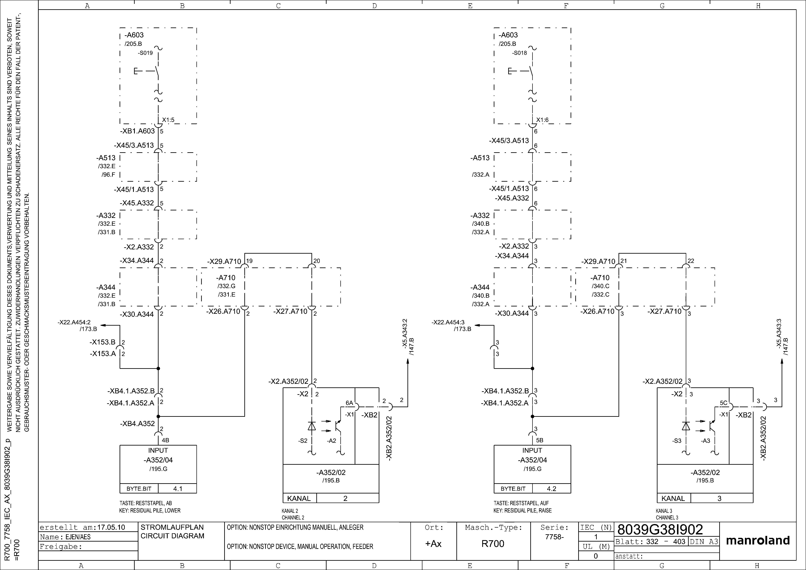

# +Ax — Sheet 332 of 403 — OPTION: NONSTOP EINRICHTUNG MANUELL, ANLEGER

> Part of the manroland **R700** printing press IEC/UL circuit diagrams.
> Drawing class: **Stromlaufplan / Circuit diagram** (DIN A3).
> Document `+Ax` covers the **Central control console** machine section.

## At a glance

| Field | Value |
|---|---|
| Document | `+Ax`  (8039G38I902) |
| Sheet | **332** of 403 |
| Section (DE) | OPTION: NONSTOP EINRICHTUNG MANUELL, ANLEGER |
| Section (EN) | — |
| Section type | CIRCUIT — Circuit diagram |
| Machine type | `R700` |
| Series | `7758` |
| Created | 17.05.10 |
| Replaces | — |
| Columns used | A, B, C, D, E, F, G, H |
| Path numbers | — |
| Labels on sheet | 149 |
| Cross-refs out | 25 |
| Cross-refs in | 61 |

**Previous:** [+Ax sheet 331](SHEET_0331.md) · **Next:** [+Ax sheet 333](SHEET_0333.md) · **Document TOC:** [_TOC.md](_TOC.md)  (+Ax) · **Master TOC:** [all sheets](../_MASTER_TOC.md)

## Sheet image (300 DPI, exact vector render)



_Rendered directly from the PDF vector layer at 300 DPI (1-bit), no OCR and no resampling. Use it to confirm anything ambiguous in the text below._

## Cross-references on this sheet

Each entry is a wire leaving this sheet. The printed token is `/sheet.column`; the link resolves to that sheet inside the same document.

| Ref | Target sheet | Col | Path | Destination on target | Target section | From col |
|---|---|---|---|---|---|---|
| `/205.B` | [+Ax sheet 205](SHEET_0205.md) | B | — | A603 | REFERENZMODUL | A |
| `/205.B` | [+Ax sheet 205](SHEET_0205.md) | B | — | A603 | REFERENZMODUL | E |
| `/332.E` | [+Ax sheet 332](SHEET_0332.md) | E | — | — | OPTION: NONSTOP EINRICHTUNG MANUELL, ANLEGER | A |
| `/96.F` | [+Ax sheet 96](SHEET_0096.md) | F | — | — | ANLEGER | A |
| `/332.A` | [+Ax sheet 332](SHEET_0332.md) | A | — | — | OPTION: NONSTOP EINRICHTUNG MANUELL, ANLEGER | E |
| `/332.E` | [+Ax sheet 332](SHEET_0332.md) | E | — | — | OPTION: NONSTOP EINRICHTUNG MANUELL, ANLEGER | A |
| `/331.B` | [+Ax sheet 331](SHEET_0331.md) | B | — | — | OPTION: NONSTOP EINRICHTUNG MANUELL, ANLEGER | A |
| `/340.B` | [+Ax sheet 340](SHEET_0340.md) | B | — | — | OPTION: INLINESHEETER RS104 S | E |
| `/332.A` | [+Ax sheet 332](SHEET_0332.md) | A | — | — | OPTION: NONSTOP EINRICHTUNG MANUELL, ANLEGER | E |
| `/332.G` | [+Ax sheet 332](SHEET_0332.md) | G | — | — | OPTION: NONSTOP EINRICHTUNG MANUELL, ANLEGER | B |
| `/340.C` | [+Ax sheet 340](SHEET_0340.md) | C | — | — | OPTION: INLINESHEETER RS104 S | F |
| `/332.C` | [+Ax sheet 332](SHEET_0332.md) | C | — | — | OPTION: NONSTOP EINRICHTUNG MANUELL, ANLEGER | F |
| `/331.E` | [+Ax sheet 331](SHEET_0331.md) | E | — | — | OPTION: NONSTOP EINRICHTUNG MANUELL, ANLEGER | B |
| `/332.E` | [+Ax sheet 332](SHEET_0332.md) | E | — | — | OPTION: NONSTOP EINRICHTUNG MANUELL, ANLEGER | A |
| `/331.B` | [+Ax sheet 331](SHEET_0331.md) | B | — | — | OPTION: NONSTOP EINRICHTUNG MANUELL, ANLEGER | A |
| `/340.B` | [+Ax sheet 340](SHEET_0340.md) | B | — | — | OPTION: INLINESHEETER RS104 S | E |
| `/332.A` | [+Ax sheet 332](SHEET_0332.md) | A | — | — | OPTION: NONSTOP EINRICHTUNG MANUELL, ANLEGER | E |
| `/147.B` | [+Ax sheet 147](SHEET_0147.md) | B | — | X5.A343:2 | ÜBERWACHUNGSRECHNER SICHERHEITSBUS | D |
| `/147.B` | [+Ax sheet 147](SHEET_0147.md) | B | — | X5.A343:3 | ÜBERWACHUNGSRECHNER SICHERHEITSBUS | H |
| `/173.B` | [+Ax sheet 173](SHEET_0173.md) | B | — | X22.A454:2 | RESERVE | A |
| `/173.B` | [+Ax sheet 173](SHEET_0173.md) | B | — | X22.A454:3 | RESERVE | E |
| `/195.G` | [+Ax sheet 195](SHEET_0195.md) | G | — | — | REFERENZMODUL | B |
| `/195.G` | [+Ax sheet 195](SHEET_0195.md) | G | — | — | REFERENZMODUL | F |
| `/195.B` | [+Ax sheet 195](SHEET_0195.md) | B | — | — | REFERENZMODUL | D |
| `/195.B` | [+Ax sheet 195](SHEET_0195.md) | B | — | — | REFERENZMODUL | G |

### Incoming references (sheets that point here)

Every other sheet that sends a wire to this one. `Back-ref` is the token printed on *that* sheet; `Path` is its line number.

| From sheet | Cols | Back-ref | Path | Refs | What continues there |
|---|---|---|---|---|---|
| [+Ax#96](SHEET_0096.md) | F | `/96.F` | — | 1 | — |
| [+Ax#147](SHEET_0147.md) | B | `/147.B` | — | 2 | X5.A343:2; X5.A343:3 |
| [+Ax#173](SHEET_0173.md) | B | `/173.B` | — | 2 | — |
| [+Ax#195](SHEET_0195.md) | B, G | `/195.B`, `/195.G` | — | 4 | — |
| [+Ax#205](SHEET_0205.md) | B | `/205.B` | — | 2 | — |
| [+Ax#210](SHEET_0210.md) | A | `/210.A` | — | 2 | — |
| [+Ax#217](SHEET_0217.md) | F | `/217.F` | — | 2 | — |
| [+Ax#218](SHEET_0218.md) | G | `/218.G` | — | 2 | — |
| [+Ax#219](SHEET_0219.md) | A | `/219.A` | — | 2 | — |
| [+Ax#227](SHEET_0227.md) | E, F, G | `/227.E`, `/227.F`, `/227.G` | — | 6 | — |
| [+Ax#269](SHEET_0269.md) | G | `/269.G` | — | 2 | — |
| [+Ax#270](SHEET_0270.md) | G | `/270.G` | — | 2 | — |
| [+Ax#273](SHEET_0273.md) | G | `/273.G` | — | 4 | — |
| [+Ax#274](SHEET_0274.md) | F | `/274.F` | — | 2 | — |
| [+Ax#278](SHEET_0278.md) | A | `/278.A` | — | 2 | — |
| [+Ax#282](SHEET_0282.md) | A, C, E | `/282.A`, `/282.C`, `/282.E` | — | 6 | — |
| [+Ax#290](SHEET_0290.md) | C, E | `/290.C`, `/290.E` | — | 4 | — |
| [+Ax#331](SHEET_0331.md) | B, E | `/331.B`, `/331.E` | — | 3 | A710 |
| [+Ax#332](SHEET_0332.md) | A, B, E, F | `/332.A`, `/332.B`, `/332.E`, `/332.F` | — | 8 | — |
| [+Ax#340](SHEET_0340.md) | B, C | `/340.B`, `/340.C` | — | 3 | A710 |


## Devices on this sheet

| Tag | Class | Class meaning (IEC) | Col | Sub | Terminal | Sign |
|---|---|---|---|---|---|---|
| `A352/04` | A | Baugruppe / assembly, module, PC board | F | 04 | — | — |
| `X1:6` | X | Klemme / terminal, plug connector | F | — | 6 | — |
| `S018` | S | Schalter / switch | F | — | — | — |
| `A603` | A | Baugruppe / assembly, module, PC board | E | — | — | — |
| `A513` | A | Baugruppe / assembly, module, PC board | E | — | — | — |
| `A352/04` | A | Baugruppe / assembly, module, PC board | B | 04 | — | — |
| `X1:5` | X | Klemme / terminal, plug connector | B | — | 5 | — |
| `S019` | S | Schalter / switch | B | — | — | — |
| `A603` | A | Baugruppe / assembly, module, PC board | A | — | — | — |
| `A513` | A | Baugruppe / assembly, module, PC board | A | — | — | — |
| `A344` | A | Baugruppe / assembly, module, PC board | A | — | — | — |
| `A332` | A | Baugruppe / assembly, module, PC board | A | — | — | — |
| `S2` | S | Schalter / switch | C | — | — | — |
| `A2` | A | Baugruppe / assembly, module, PC board | D | — | — | — |
| `X1` | X | Klemme / terminal, plug connector | D | — | — | — |
| `X2` | X | Klemme / terminal, plug connector | C | — | — | — |
| `XB2` | XB |  | D | — | — | — |
| `A352/02` | A | Baugruppe / assembly, module, PC board | D | 02 | — | — |
| `A710` | A | Baugruppe / assembly, module, PC board | B | — | — | — |
| `A344` | A | Baugruppe / assembly, module, PC board | E | — | — | — |
| `A332` | A | Baugruppe / assembly, module, PC board | E | — | — | — |
| `S3` | S | Schalter / switch | G | — | — | — |
| `A3` | A | Baugruppe / assembly, module, PC board | G | — | — | — |
| `X1` | X | Klemme / terminal, plug connector | H | — | — | — |
| `X2` | X | Klemme / terminal, plug connector | G | — | — | — |
| `XB2` | XB |  | H | — | — | — |
| `A352/02` | A | Baugruppe / assembly, module, PC board | G | 02 | — | — |
| `A710` | A | Baugruppe / assembly, module, PC board | F | — | — | — |
| `4.2` | — | cross-device reference | F | — | — | — |
| `X45/1.A513` | — | cross-device reference | E | — | — | — |
| `X45/3.A513` | — | cross-device reference | E | — | — | — |
| `XB4.1.A352.B` | — | cross-device reference | E | — | — | — |
| `XB4.1.A352.A` | — | cross-device reference | E | — | — | — |
| `4.1` | — | cross-device reference | B | — | — | — |
| `XB4.A352` | — | cross-device reference | B | — | — | — |
| `XB1.A603` | — | cross-device reference | B | — | — | — |
| `X45/1.A513` | — | cross-device reference | A | — | — | — |
| `X45/3.A513` | — | cross-device reference | A | — | — | — |
| `X153.A` | — | cross-device reference | A | — | — | — |
| `X153.B` | — | cross-device reference | A | — | — | — |
| `XB4.1.A352.B` | — | cross-device reference | A | — | — | — |
| `XB4.1.A352.A` | — | cross-device reference | A | — | — | — |
| `X34.A344` | — | cross-device reference | B | — | — | — |
| `X2.A332` | — | cross-device reference | B | — | — | — |
| `X45.A332` | — | cross-device reference | B | — | — | — |
| `X30.A344` | — | cross-device reference | B | — | — | — |
| `X29.A710` | — | cross-device reference | B | — | — | — |
| `X27.A710` | — | cross-device reference | C | — | — | — |
| `X26.A710` | — | cross-device reference | B | — | — | — |
| `X34.A344` | — | cross-device reference | E | — | — | — |
| `X2.A332` | — | cross-device reference | E | — | — | — |
| `X45.A332` | — | cross-device reference | E | — | — | — |
| `X30.A344` | — | cross-device reference | E | — | — | — |
| `X29.A710` | — | cross-device reference | F | — | — | — |
| `X27.A710` | — | cross-device reference | G | — | — | — |
| `X26.A710` | — | cross-device reference | F | — | — | — |
| `X22.A454:2` | — | cross-device reference | A | — | 2 | — |
| `X22.A454:3` | — | cross-device reference | E | — | 3 | — |
| `X5.A343:3` | — | cross-device reference | H | — | 3 | — |
| `X5.A343:2` | — | cross-device reference | D | — | 2 | — |

## Potentials / nets

_No named potentials on this sheet._

## Wire-end annotations (grouped as printed)

A wire that continues elsewhere is annotated with a small cluster: the destination description, the path/line number `#NN`, and the `/sheet.column` cross reference. Each row below is one such cluster exactly as it is grouped on the drawing.

| Col | Y | Path | Cross-ref | Text on the wire |
|---|---|---|---|---|
| A | 47.1 | — | `/205.B` | `A603` |
| E | 47.1 | — | `/205.B` | `A603` |
| B | 74.4 | — | — | `S019` |
| F | 74.4 | — | — | `S018` |
| B | 173.2 | — | — | `X1:5` |
| F | 173.2 | — | — | `X1:6` |
| B | 188.8 | — | — | `XB1.A603 5` |
| F | 190.2 | — | — | `6` |
| E | 203.0 | — | — | `X45/3.A513 6` |
| B | 210.1 | — | — | `X45/3.A513 5` |
| A | 228.5 | — | — | `A513` |
| E | 228.5 | — | — | `A513` |
| A | 241.6 | — | `/332.E` | — |
| A | 254.0 | — | `/96.F` | — |
| E | 254.0 | — | `/332.A` | — |
| E | 273.9 | — | — | `X45/1.A513 6` |
| B | 275.3 | — | — | `X45/1.A513 5` |
| E | 288.0 | — | — | `X45.A332 6` |
| B | 295.1 | — | — | `X45.A332 5` |
| A | 313.5 | — | — | `A332` |
| E | 313.5 | — | — | `A332` |
| A | 326.6 | — | `/332.E`, `/331.B` | — |
| E | 326.6 | — | `/340.B`, `/332.A` | — |
| F | 358.9 | — | — | `X2.A332 3` |
| B | 360.3 | — | — | `X2.A332 2` |
| E | 373.1 | — | — | `X34.A344 3` |
| B | 380.1 | — | — | `X34.A344 2` |
| C | 381.6 | — | — | `X29.A710 19 20` |
| G | 381.6 | — | — | `X29.A710 21 22` |
| B | 405.7 | — | — | `A710` |
| F | 405.7 | — | — | `A710` |
| B | 418.7 | — | `/332.G` | — |
| F | 418.8 | — | `/340.C`, `/332.C` | — |
| A | 419.8 | — | — | `A344` |
| E | 419.8 | — | — | `A344` |
| B | 431.1 | — | `/331.E` | — |
| A | 432.9 | — | `/332.E`, `/331.B` | — |
| E | 432.9 | — | `/340.B`, `/332.A` | — |
| C | 455.3 | — | — | `X26.A710 2 X27.A710 2` |
| G | 455.3 | — | — | `X26.A710 3 X27.A710 3` |
| E | 458.1 | — | — | `X30.A344 3` |
| B | 459.5 | — | — | `X30.A344 2` |
| D | 470.8 | — | `/147.B` | `X5.A343:2` |
| H | 470.8 | — | `/147.B` | `X5.A343:3` |
| A | 472.2 | — | `/173.B` | `X22.A454:2` |
| E | 472.2 | — | `/173.B` | `X22.A454:3` |
| A | 500.6 | — | — | `X153.B 2` |
| E | 502.1 | — | — | `3` |
| A | 517.6 | — | — | `X153.A 2` |
| E | 519.1 | — | — | `3` |
| C | 558.7 | — | — | `X2.A352/02 2` |
| G | 558.7 | — | — | `X2.A352/02 3` |
| B | 572.9 | — | — | `XB4.1.A352.B 2` |
| E | 572.9 | — | — | `XB4.1.A352.B 3` |
| C | 577.2 | — | — | `X2` |
| G | 577.2 | — | — | `X2` |
| D | 578.6 | — | — | `2 2` |
| H | 578.6 | — | — | `3 3` |
| D | 587.1 | — | — | `2` |
| H | 587.1 | — | — | `3` |
| B | 589.9 | — | — | `XB4.1.A352.A 2` |
| E | 589.9 | — | — | `XB4.1.A352.A 3` |
| D | 591.3 | — | — | `6A` |
| H | 591.4 | — | — | `5C` |
| D | 608.3 | — | — | `X1` |
| H | 608.3 | — | — | `X1` |
| D | 608.4 | — | — | `XB2` |
| H | 608.4 | — | — | `XB2` |
| D | 614.5 | — | — | `XB2.A352/02` |
| H | 614.5 | — | — | `XB2.A352/02` |
| B | 621.1 | — | — | `XB4.A352 2` |
| F | 629.6 | — | — | `3` |
| B | 646.6 | — | — | `4B` |
| F | 646.6 | — | — | `5B` |
| C | 647.3 | — | — | `S2 A2` |
| G | 647.3 | — | — | `S3 A3` |
| B | 661.1 | — | — | `INPUT` |
| F | 661.1 | — | — | `INPUT` |
| B | 675.0 | — | — | `A352/04` |
| F | 675.0 | — | — | `A352/04` |
| B | 688.7 | — | `/195.G` | — |
| F | 688.7 | — | `/195.G` | — |
| D | 693.4 | — | — | `A352/02` |
| G | 693.4 | — | — | `A352/02` |
| D | 705.7 | — | `/195.B` | — |
| G | 705.7 | — | `/195.B` | — |
| B | 717.8 | — | — | `BYTE.BIT 4.1` |
| F | 717.8 | — | — | `BYTE.BIT 4.2` |
| C | 731.6 | — | — | `KANAL 2` |
| G | 731.6 | — | — | `KANAL 3` |
| B | 740.4 | — | — | `KEY: RESIDUAL PILE, LOWER TASTE: RESTSTAPEL, AB` |
| F | 740.5 | — | — | `KEY: RESIDUAL PILE, RAISE TASTE: RESTSTAPEL, AUF` |
| C | 752.0 | — | — | `KANAL 2 CHANNEL 2` |
| G | 752.0 | — | — | `KANAL 3 CHANNEL 3` |


## Reconstructed tables

This sheet carries tabular content (pin map / terminal assignment / index). The grid below was rebuilt from the drawing's own rule lines, so each row is exactly one physical row of the table.

### Table 1 — 9 data rows × 9 columns (at x=177.2, y=41.1)

| A603 /205.B S019 | X1:5 |  |  |  |  |  |  |  |
|---|---|---|---|---|---|---|---|---|
| `XB1.A603 X45/3.A513 X45/1.A513 X45.A332 X2.A332` | `5 5 5 5 2` |  |  |  |  |  |  |  |
| `X34.A344 X30.A344 2 2` | `2 2` | `X29.A710 A710 /332.G /331.E X26.A710` | `19 2` | `X27.A710` | `20 2` |  |  | `X5.A343:2` |
|  |  |  |  | `X2.A352/02` | `2` |  |  |  |
| `XB4.1.A352.B XB4.1.A352.A` | `2 2` |  |  | `X2` | `2` | `6A X1` | `XB2` | `2 2` |
| `XB4.A352` | `2 4B` |  |  | `S2` | `A2` |  |  | `XB2.A352/02` |
| `INPUT` | `A352/04` |  |  |  |  |  |  |  |
|  | `/195.G` |  |  |  | `A352/02 /195.B` |  |  |  |
| `BYTE.BIT` | `4.1` |  |  |  |  |  |  |  |
|  |  |  |  | `KANAL` |  | `2` |  |  |


### Table 2 — 9 data rows × 9 columns (at x=729.9, y=41.1)

| A603 /205.B S018 | X1:6 |  |  |  |  |  |  |  |
|---|---|---|---|---|---|---|---|---|
| `X45/3.A513 X45/1.A513 X45.A332 X2.A332` | `6 6 6 6 3` |  |  |  |  |  |  |  |
| `X34.A344 X30.A344 3 3` | `3 3` | `X29.A710 A710 /340.C /332.C X26.A710` | `21 3` | `X27.A710` | `22 3` |  |  | `X5.A343:3` |
|  |  |  |  | `X2.A352/02` | `3` |  |  |  |
| `XB4.1.A352.B XB4.1.A352.A` | `3 3` |  |  | `X2` | `3` | `5C X1` | `XB2` | `3 3` |
|  | `3 5B` |  |  | `S3` | `A3` |  |  | `XB2.A352/02` |
| `INPUT` | `A352/04` |  |  |  |  |  |  |  |
|  | `/195.G` |  |  |  | `A352/02 /195.B` |  |  |  |
| `BYTE.BIT` | `4.2` |  |  |  |  |  |  |  |
|  |  |  |  | `KANAL` |  | `3` |  |  |


## Notes and free text on this sheet

| Text | Col | Y (pt) |
|---|---|---|
| `5B` | F | 646.57 |
| `INPUT` | F | 661.11 |
| `BYTE.BIT` | E | 718.36 |
| `TASTE: RESTSTAPEL, AUF` | F | 740.45 |
| `KEY: RESIDUAL PILE, RAISE` | F | 751.07 |
| `4B` | B | 646.57 |
| `INPUT` | B | 661.11 |
| `BYTE.BIT` | B | 718.36 |
| `TASTE: RESTSTAPEL, AB` | B | 740.44 |
| `KEY: RESIDUAL PILE, LOWER` | B | 751.07 |
| `KANAL 2` | C | 751.95 |
| `CHANNEL 2` | C | 761.9 |
| `6A` | D | 591.29 |
| `KANAL` | C | 731.64 |
| `X2.A352/02` | C | 558.73 |
| `XB2.A352/02` | D | 614.55 |
| `KANAL 3` | G | 751.96 |
| `CHANNEL 3` | G | 761.91 |
| `5C` | H | 591.35 |
| `KANAL` | G | 731.64 |
| `X2.A352/02` | G | 558.73 |
| `XB2.A352/02` | H | 614.55 |

## Complete label inventory (exact text from the drawing)

Every text object inside the drawing area of this sheet, in DIN reading order (column A→H, then top→bottom). This is the authoritative list: if a string is not here it is not printed on this sheet.

| Col | Y | X | Dir | Type | Text |
|---|---|---|---|---|---|
| A | 47.1 | 184.0 | → | device tag | `A603` |
| A | 60.9 | 184.3 | → | cross-reference | `/205.B` |
| A | 210.1 | 168.4 | → | device ref | `X45/3.A513` |
| A | 228.5 | 142.3 | → | device tag | `A513` |
| A | 241.6 | 145.1 | → | cross-reference | `/332.E` |
| A | 254.0 | 150.2 | → | cross-reference | `/96.F` |
| A | 275.3 | 168.4 | → | device ref | `X45/1.A513` |
| A | 313.5 | 142.3 | → | device tag | `A332` |
| A | 326.6 | 145.1 | → | cross-reference | `/332.E` |
| A | 339.0 | 144.9 | → | cross-reference | `/331.B` |
| A | 419.8 | 142.3 | → | device tag | `A344` |
| A | 432.9 | 145.1 | → | cross-reference | `/332.E` |
| A | 445.3 | 144.9 | → | cross-reference | `/331.B` |
| A | 472.3 | 85.0 | → | device ref | `X22.A454:2` |
| A | 482.2 | 117.9 | → | cross-reference | `/173.B` |
| A | 500.6 | 132.4 | → | device ref | `X153.B` |
| A | 502.1 | 179.7 | → | number | `2` |
| A | 517.6 | 132.9 | → | device ref | `X153.A` |
| A | 519.1 | 179.7 | → | number | `2` |
| A | 572.9 | 158.7 | → | device ref | `XB4.1.A352.B` |
| A | 590.6 | 157.9 | → | device ref | `XB4.1.A352.A` |
| B | 74.4 | 203.8 | → | device tag | `S019` |
| B | 173.2 | 239.5 | → | device tag | `X1:5` |
| B | 188.8 | 177.4 | → | device ref | `XB1.A603` |
| B | 190.2 | 236.4 | → | number | `5` |
| B | 211.5 | 236.4 | → | number | `5` |
| B | 275.3 | 236.4 | → | number | `5` |
| B | 295.1 | 177.2 | → | device ref | `X45.A332` |
| B | 296.5 | 236.4 | → | number | `5` |
| B | 360.3 | 183.1 | → | device ref | `X2.A332` |
| B | 360.3 | 236.4 | → | number | `2` |
| B | 380.1 | 177.2 | → | device ref | `X34.A344` |
| B | 381.6 | 236.4 | → | number | `2` |
| B | 381.6 | 306.1 | → | device ref | `X29.A710` |
| B | 405.7 | 319.5 | → | device tag | `A710` |
| B | 418.7 | 321.4 | → | cross-reference | `/332.G` |
| B | 431.1 | 322.3 | → | cross-reference | `/331.E` |
| B | 455.3 | 304.7 | → | device ref | `X26.A710` |
| B | 459.5 | 177.2 | → | device ref | `X30.A344` |
| B | 459.5 | 236.4 | → | number | `2` |
| B | 572.9 | 236.4 | → | number | `2` |
| B | 589.9 | 236.4 | → | number | `2` |
| B | 621.1 | 177.4 | → | device ref | `XB4.A352` |
| B | 629.6 | 236.4 | → | number | `2` |
| B | 646.6 | 239.2 | → | text | `4B` |
| B | 661.1 | 219.0 | → | text | `INPUT` |
| B | 675.0 | 212.5 | → | device tag | `A352/04` |
| B | 688.7 | 221.0 | → | cross-reference | `/195.G` |
| B | 717.8 | 256.3 | → | device ref | `4.1` |
| B | 718.4 | 187.1 | → | text | `BYTE.BIT` |
| B | 740.4 | 176.9 | → | text | `TASTE: RESTSTAPEL, AB` |
| B | 751.1 | 176.3 | → | text | `KEY: RESIDUAL PILE, LOWER` |
| C | 381.6 | 363.4 | → | number | `19` |
| C | 381.6 | 463.2 | → | number | `20` |
| C | 455.3 | 403.9 | → | device ref | `X27.A710` |
| C | 459.5 | 364.0 | → | number | `2` |
| C | 459.5 | 463.2 | → | number | `2` |
| C | 558.7 | 396.6 | → | text | `X2.A352/02` |
| C | 558.7 | 463.2 | → | number | `2` |
| C | 577.2 | 439.1 | → | device tag | `X2` |
| C | 578.6 | 466.0 | → | number | `2` |
| C | 647.3 | 440.5 | → | device tag | `S2` |
| C | 731.6 | 424.3 | → | text | `KANAL` |
| C | 752.0 | 416.1 | → | text | `KANAL 2` |
| C | 761.9 | 416.4 | → | text | `CHANNEL 2` |
| D | 470.8 | 594.1 | ↕ | device ref | `X5.A343:2` |
| D | 498.9 | 604.0 | ↕ | cross-reference | `/147.B` |
| D | 587.1 | 591.0 | → | number | `2` |
| D | 588.5 | 565.2 | → | number | `2` |
| D | 591.3 | 510.8 | → | text | `6A` |
| D | 608.3 | 509.7 | → | device tag | `X1` |
| D | 608.3 | 534.0 | → | device tag | `XB2` |
| D | 614.6 | 570.1 | ↕ | text | `XB2.A352/02` |
| D | 647.3 | 483.0 | → | device tag | `A2` |
| D | 693.4 | 467.6 | → | device tag | `A352/02` |
| D | 705.7 | 476.4 | → | cross-reference | `/195.B` |
| D | 731.6 | 507.4 | → | number | `2` |
| E | 47.1 | 736.7 | → | device tag | `A603` |
| E | 60.9 | 737.0 | → | cross-reference | `/205.B` |
| E | 203.0 | 722.6 | → | device ref | `X45/3.A513` |
| E | 228.5 | 695.1 | → | device tag | `A513` |
| E | 254.0 | 697.3 | → | cross-reference | `/332.A` |
| E | 273.9 | 722.6 | → | device ref | `X45/1.A513` |
| E | 288.0 | 731.3 | → | device ref | `X45.A332` |
| E | 313.5 | 695.1 | → | device tag | `A332` |
| E | 326.6 | 697.6 | → | cross-reference | `/340.B` |
| E | 339.0 | 697.3 | → | cross-reference | `/332.A` |
| E | 358.9 | 737.3 | → | device ref | `X2.A332` |
| E | 373.1 | 731.3 | → | device ref | `X34.A344` |
| E | 419.8 | 695.1 | → | device tag | `A344` |
| E | 432.9 | 697.6 | → | cross-reference | `/340.B` |
| E | 445.3 | 697.3 | → | cross-reference | `/332.A` |
| E | 458.1 | 731.3 | → | device ref | `X30.A344` |
| E | 472.3 | 637.5 | → | device ref | `X22.A454:3` |
| E | 482.2 | 670.7 | → | cross-reference | `/173.B` |
| E | 502.1 | 732.5 | → | number | `3` |
| E | 519.1 | 732.5 | → | number | `3` |
| E | 572.9 | 711.5 | → | device ref | `XB4.1.A352.B` |
| E | 590.6 | 710.6 | → | device ref | `XB4.1.A352.A` |
| E | 718.4 | 739.8 | → | text | `BYTE.BIT` |
| F | 74.4 | 756.6 | → | device tag | `S018` |
| F | 173.2 | 792.3 | → | device tag | `X1:6` |
| F | 190.2 | 789.2 | → | number | `6` |
| F | 211.5 | 789.2 | → | number | `6` |
| F | 275.3 | 789.2 | → | number | `6` |
| F | 296.5 | 789.2 | → | number | `6` |
| F | 360.3 | 789.2 | → | number | `3` |
| F | 381.6 | 789.2 | → | number | `3` |
| F | 381.6 | 858.9 | → | device ref | `X29.A710` |
| F | 405.7 | 872.2 | → | device tag | `A710` |
| F | 418.8 | 874.5 | → | cross-reference | `/340.C` |
| F | 431.2 | 874.5 | → | cross-reference | `/332.C` |
| F | 455.3 | 857.5 | → | device ref | `X26.A710` |
| F | 459.5 | 789.2 | → | number | `3` |
| F | 572.9 | 789.2 | → | number | `3` |
| F | 589.9 | 789.2 | → | number | `3` |
| F | 629.6 | 789.2 | → | number | `3` |
| F | 646.6 | 792.0 | → | text | `5B` |
| F | 661.1 | 771.7 | → | text | `INPUT` |
| F | 675.0 | 765.2 | → | device tag | `A352/04` |
| F | 688.7 | 773.7 | → | cross-reference | `/195.G` |
| F | 717.8 | 808.2 | → | device ref | `4.2` |
| F | 740.4 | 729.6 | → | text | `TASTE: RESTSTAPEL, AUF` |
| F | 751.1 | 729.1 | → | text | `KEY: RESIDUAL PILE, RAISE` |
| G | 381.6 | 916.7 | → | number | `21` |
| G | 381.6 | 1015.9 | → | number | `22` |
| G | 455.3 | 956.7 | → | device ref | `X27.A710` |
| G | 459.5 | 916.7 | → | number | `3` |
| G | 459.5 | 1015.9 | → | number | `3` |
| G | 558.7 | 949.3 | → | text | `X2.A352/02` |
| G | 558.7 | 1015.9 | → | number | `3` |
| G | 577.2 | 991.8 | → | device tag | `X2` |
| G | 578.6 | 1018.8 | → | number | `3` |
| G | 647.3 | 993.0 | → | device tag | `S3` |
| G | 647.3 | 1035.5 | → | device tag | `A3` |
| G | 693.4 | 1020.3 | → | device tag | `A352/02` |
| G | 705.7 | 1029.1 | → | cross-reference | `/195.B` |
| G | 731.6 | 977.1 | → | text | `KANAL` |
| G | 752.0 | 968.9 | → | text | `KANAL 3` |
| G | 761.9 | 969.2 | → | text | `CHANNEL 3` |
| H | 470.8 | 1146.9 | ↕ | device ref | `X5.A343:3` |
| H | 498.9 | 1156.8 | ↕ | cross-reference | `/147.B` |
| H | 587.1 | 1143.5 | → | number | `3` |
| H | 588.5 | 1118.0 | → | number | `3` |
| H | 591.4 | 1063.6 | → | text | `5C` |
| H | 608.3 | 1062.4 | → | device tag | `X1` |
| H | 608.3 | 1086.8 | → | device tag | `XB2` |
| H | 614.6 | 1122.8 | ↕ | text | `XB2.A352/02` |
| H | 731.6 | 1060.0 | → | number | `3` |

## Reading-order text block

The same content as a plain block, grouped by DIN column — convenient to paste or to match against a visual description.

```text
=== Column A ===
  47.1  184.0  devtag       A603
  60.9  184.3  xref         /205.B
 210.1  168.4  devref       X45/3.A513
 228.5  142.3  devtag       A513
 241.6  145.1  xref         /332.E
 254.0  150.2  xref         /96.F
 275.3  168.4  devref       X45/1.A513
 313.5  142.3  devtag       A332
 326.6  145.1  xref         /332.E
 339.0  144.9  xref         /331.B
 419.8  142.3  devtag       A344
 432.9  145.1  xref         /332.E
 445.3  144.9  xref         /331.B
 472.3   85.0  devref       X22.A454:2
 482.2  117.9  xref         /173.B
 500.6  132.4  devref       X153.B
 502.1  179.7  numeric      2
 517.6  132.9  devref       X153.A
 519.1  179.7  numeric      2
 572.9  158.7  devref       XB4.1.A352.B
 590.6  157.9  devref       XB4.1.A352.A
=== Column B ===
  74.4  203.8  devtag       S019
 173.2  239.5  devtag       X1:5
 188.8  177.4  devref       XB1.A603
 190.2  236.4  numeric      5
 211.5  236.4  numeric      5
 275.3  236.4  numeric      5
 295.1  177.2  devref       X45.A332
 296.5  236.4  numeric      5
 360.3  183.1  devref       X2.A332
 360.3  236.4  numeric      2
 380.1  177.2  devref       X34.A344
 381.6  236.4  numeric      2
 381.6  306.1  devref       X29.A710
 405.7  319.5  devtag       A710
 418.7  321.4  xref         /332.G
 431.1  322.3  xref         /331.E
 455.3  304.7  devref       X26.A710
 459.5  177.2  devref       X30.A344
 459.5  236.4  numeric      2
 572.9  236.4  numeric      2
 589.9  236.4  numeric      2
 621.1  177.4  devref       XB4.A352
 629.6  236.4  numeric      2
 646.6  239.2  text         4B
 661.1  219.0  text         INPUT
 675.0  212.5  devtag       A352/04
 688.7  221.0  xref         /195.G
 717.8  256.3  devref       4.1
 718.4  187.1  text         BYTE.BIT
 740.4  176.9  text         TASTE: RESTSTAPEL, AB
 751.1  176.3  text         KEY: RESIDUAL PILE, LOWER
=== Column C ===
 381.6  363.4  numeric      19
 381.6  463.2  numeric      20
 455.3  403.9  devref       X27.A710
 459.5  364.0  numeric      2
 459.5  463.2  numeric      2
 558.7  396.6  text         X2.A352/02
 558.7  463.2  numeric      2
 577.2  439.1  devtag       X2
 578.6  466.0  numeric      2
 647.3  440.5  devtag       S2
 731.6  424.3  text         KANAL
 752.0  416.1  text         KANAL 2
 761.9  416.4  text         CHANNEL 2
=== Column D ===
 470.8  594.1  devref       X5.A343:2
 498.9  604.0  xref         /147.B
 587.1  591.0  numeric      2
 588.5  565.2  numeric      2
 591.3  510.8  text         6A
 608.3  509.7  devtag       X1
 608.3  534.0  devtag       XB2
 614.6  570.1  text         XB2.A352/02
 647.3  483.0  devtag       A2
 693.4  467.6  devtag       A352/02
 705.7  476.4  xref         /195.B
 731.6  507.4  numeric      2
=== Column E ===
  47.1  736.7  devtag       A603
  60.9  737.0  xref         /205.B
 203.0  722.6  devref       X45/3.A513
 228.5  695.1  devtag       A513
 254.0  697.3  xref         /332.A
 273.9  722.6  devref       X45/1.A513
 288.0  731.3  devref       X45.A332
 313.5  695.1  devtag       A332
 326.6  697.6  xref         /340.B
 339.0  697.3  xref         /332.A
 358.9  737.3  devref       X2.A332
 373.1  731.3  devref       X34.A344
 419.8  695.1  devtag       A344
 432.9  697.6  xref         /340.B
 445.3  697.3  xref         /332.A
 458.1  731.3  devref       X30.A344
 472.3  637.5  devref       X22.A454:3
 482.2  670.7  xref         /173.B
 502.1  732.5  numeric      3
 519.1  732.5  numeric      3
 572.9  711.5  devref       XB4.1.A352.B
 590.6  710.6  devref       XB4.1.A352.A
 718.4  739.8  text         BYTE.BIT
=== Column F ===
  74.4  756.6  devtag       S018
 173.2  792.3  devtag       X1:6
 190.2  789.2  numeric      6
 211.5  789.2  numeric      6
 275.3  789.2  numeric      6
 296.5  789.2  numeric      6
 360.3  789.2  numeric      3
 381.6  789.2  numeric      3
 381.6  858.9  devref       X29.A710
 405.7  872.2  devtag       A710
 418.8  874.5  xref         /340.C
 431.2  874.5  xref         /332.C
 455.3  857.5  devref       X26.A710
 459.5  789.2  numeric      3
 572.9  789.2  numeric      3
 589.9  789.2  numeric      3
 629.6  789.2  numeric      3
 646.6  792.0  text         5B
 661.1  771.7  text         INPUT
 675.0  765.2  devtag       A352/04
 688.7  773.7  xref         /195.G
 717.8  808.2  devref       4.2
 740.4  729.6  text         TASTE: RESTSTAPEL, AUF
 751.1  729.1  text         KEY: RESIDUAL PILE, RAISE
=== Column G ===
 381.6  916.7  numeric      21
 381.6 1015.9  numeric      22
 455.3  956.7  devref       X27.A710
 459.5  916.7  numeric      3
 459.5 1015.9  numeric      3
 558.7  949.3  text         X2.A352/02
 558.7 1015.9  numeric      3
 577.2  991.8  devtag       X2
 578.6 1018.8  numeric      3
 647.3  993.0  devtag       S3
 647.3 1035.5  devtag       A3
 693.4 1020.3  devtag       A352/02
 705.7 1029.1  xref         /195.B
 731.6  977.1  text         KANAL
 752.0  968.9  text         KANAL 3
 761.9  969.2  text         CHANNEL 3
=== Column H ===
 470.8 1146.9  devref       X5.A343:3
 498.9 1156.8  xref         /147.B
 587.1 1143.5  numeric      3
 588.5 1118.0  numeric      3
 591.4 1063.6  text         5C
 608.3 1062.4  devtag       X1
 608.3 1086.8  devtag       XB2
 614.6 1122.8  text         XB2.A352/02
 731.6 1060.0  numeric      3
```

---
_Generated from the PDF vector text layer; no OCR. Source: `R700_7758_IEC_AX_8039G38I902_p`, sheet 332._
