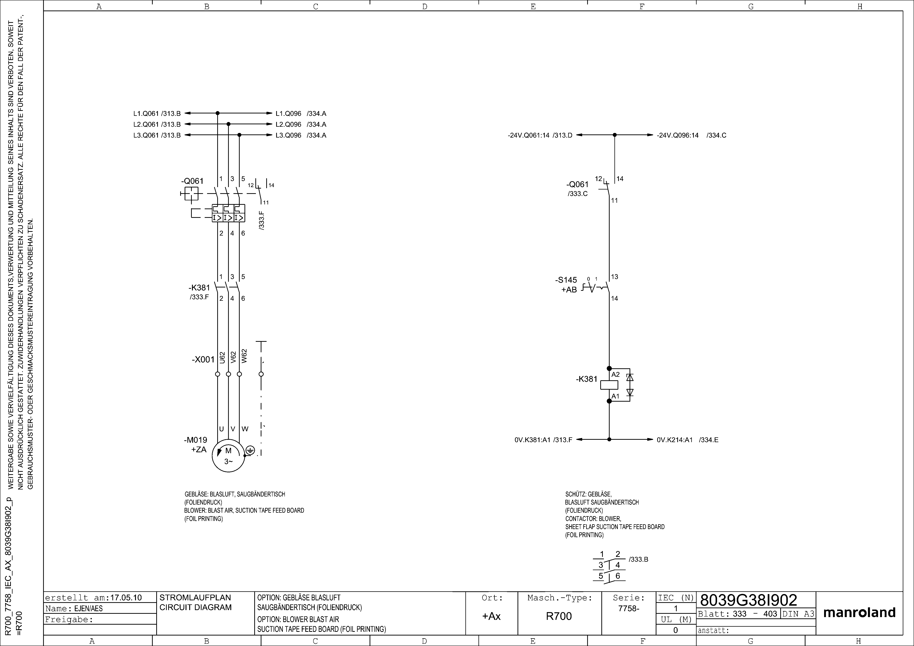

# +Ax — Sheet 333 of 403 — OPTION: GEBLÄSE BLASLUFT

**SAUGBÄNDERTISCH (FOLIENDRUCK)**

> Part of the manroland **R700** printing press IEC/UL circuit diagrams.
> Drawing class: **Stromlaufplan / Circuit diagram** (DIN A3).
> Document `+Ax` covers the **Central control console** machine section.

## At a glance

| Field | Value |
|---|---|
| Document | `+Ax`  (8039G38I902) |
| Sheet | **333** of 403 |
| Section (DE) | OPTION: GEBLÄSE BLASLUFT |
| Section (EN) | SAUGBÄNDERTISCH (FOLIENDRUCK) |
| Section type | CIRCUIT — Circuit diagram |
| Machine type | `R700` |
| Series | `7758` |
| Created | 17.05.10 |
| Replaces | — |
| Columns used | A, B, C, E, F, G |
| Path numbers | — |
| Labels on sheet | 83 |
| Cross-refs out | 14 |
| Cross-refs in | 14 |

**Previous:** [+Ax sheet 332](SHEET_0332.md) · **Next:** [+Ax sheet 334](SHEET_0334.md) · **Document TOC:** [_TOC.md](_TOC.md)  (+Ax) · **Master TOC:** [all sheets](../_MASTER_TOC.md)

## Sheet image (300 DPI, exact vector render)



_Rendered directly from the PDF vector layer at 300 DPI (1-bit), no OCR and no resampling. Use it to confirm anything ambiguous in the text below._

## Cross-references on this sheet

Each entry is a wire leaving this sheet. The printed token is `/sheet.column`; the link resolves to that sheet inside the same document.

| Ref | Target sheet | Col | Path | Destination on target | Target section | From col |
|---|---|---|---|---|---|---|
| `/313.B` | [+Ax sheet 313](SHEET_0313.md) | B | — | L1.Q061 | OPTION: STAUBSAUGER MIT BÜRSTE | B |
| `/334.A` | [+Ax sheet 334](SHEET_0334.md) | A | — | L1.Q096 | OPTION: INLINESORTER | C |
| `/313.B` | [+Ax sheet 313](SHEET_0313.md) | B | — | L2.Q061 L2.Q096 | OPTION: STAUBSAUGER MIT BÜRSTE | B |
| `/334.A` | [+Ax sheet 334](SHEET_0334.md) | A | — | L2.Q061 L2.Q096 | OPTION: INLINESORTER | B |
| `/313.B` | [+Ax sheet 313](SHEET_0313.md) | B | — | 24V.Q061:14 L3.Q061 L3.Q096 | OPTION: STAUBSAUGER MIT BÜRSTE | C |
| `/334.A` | [+Ax sheet 334](SHEET_0334.md) | A | — | 24V.Q061:14 L3.Q061 L3.Q096 | OPTION: INLINESORTER | C |
| `/313.D` | [+Ax sheet 313](SHEET_0313.md) | D | — | 24V.Q061:14 L3.Q061 L3.Q096 | OPTION: STAUBSAUGER MIT BÜRSTE | C |
| `/334.C` | [+Ax sheet 334](SHEET_0334.md) | C | — | 24V.Q096:14 | OPTION: INLINESORTER | F |
| `/333.C` | [+Ax sheet 333](SHEET_0333.md) | C | — | — | OPTION: GEBLÄSE BLASLUFT | E |
| `/333.F` | [+Ax sheet 333](SHEET_0333.md) | F | — | — | OPTION: GEBLÄSE BLASLUFT | C |
| `/333.F` | [+Ax sheet 333](SHEET_0333.md) | F | — | — | OPTION: GEBLÄSE BLASLUFT | B |
| `/313.F` | [+Ax sheet 313](SHEET_0313.md) | F | — | 0V.K381:A1 | OPTION: STAUBSAUGER MIT BÜRSTE | E |
| `/334.E` | [+Ax sheet 334](SHEET_0334.md) | E | — | 0V.K214:A1 | OPTION: INLINESORTER | F |
| `/333.B` | [+Ax sheet 333](SHEET_0333.md) | B | — | — | OPTION: GEBLÄSE BLASLUFT | F |

### Incoming references (sheets that point here)

Every other sheet that sends a wire to this one. `Back-ref` is the token printed on *that* sheet; `Path` is its line number.

| From sheet | Cols | Back-ref | Path | Refs | What continues there |
|---|---|---|---|---|---|
| [+Ax#313](SHEET_0313.md) | C, D, F | `/313.C`, `/313.D`, `/313.F` | — | 5 | L1.Q061; L2.Q061; L3.Q061 |
| [+Ax#333](SHEET_0333.md) | B, C, E, F | `/333.B`, `/333.C`, `/333.E`, `/333.F` | — | 4 | — |
| [+Ax#334](SHEET_0334.md) | A, C, D | `/334.A`, `/334.C`, `/334.D` | — | 5 | 0V.K214:A1; 24V.Q096:14; L1.Q096; L2.Q096; L3.Q096 |


## Devices on this sheet

| Tag | Class | Class meaning (IEC) | Col | Sub | Terminal | Sign |
|---|---|---|---|---|---|---|
| `A2` | A | Baugruppe / assembly, module, PC board | F | — | — | — |
| `A1` | A | Baugruppe / assembly, module, PC board | F | — | — | — |
| `K381` | K | Relais / relay, contactor | E | — | — | — |
| `S145` | S | Schalter / switch | E | — | — | — |
| `Q061` | Q | Leistungsschalter / power switching device | E | — | — | — |
| `K381` | K | Relais / relay, contactor | B | — | — | — |
| `Q061` | Q | Leistungsschalter / power switching device | B | — | — | — |
| `U62` | U | Umrichter / frequency converter | B | — | — | — |
| `X001` | X | Klemme / terminal, plug connector | B | — | — | — |
| `V62` | V | Diode / semiconductor valve | B | — | — | — |
| `W62` | W | Kabel / cable, line, bus | B | — | — | — |

## Potentials / nets

| Potential | Count | Columns | Attached devices | Terminals |
|---|---|---|---|---|
| `0V` | 2 | E, F | `K214`, `K381` | `A1` |
| `24V` | 2 | E, F | `Q061`, `Q096` | `14` |
| `L1` | 2 | A, C | `Q061`, `Q096` | — |
| `L2` | 2 | A, C | `Q061`, `Q096` | — |
| `L3` | 2 | A, C | `Q061`, `Q096` | — |
| `M019` | 1 | B | — | — |


A potential such as `L24+/4` or `M24+` is a named supply/return rail; every place it appears on this sheet is electrically common.

## Wire-end annotations (grouped as printed)

A wire that continues elsewhere is annotated with a small cluster: the destination description, the path/line number `#NN`, and the `/sheet.column` cross reference. Each row below is one such cluster exactly as it is grouped on the drawing.

| Col | Y | Path | Cross-ref | Text on the wire |
|---|---|---|---|---|
| B | 144.1 | — | `/313.B` | `L1.Q061` |
| C | 144.1 | — | `/334.A` | `L1.Q096` |
| B | 158.3 | — | `/313.B`, `/334.A` | `L2.Q061 L2.Q096` |
| C | 172.5 | — | `/313.B`, `/334.A`, `/313.D` | `L3.Q061 L3.Q096 24V.Q061:14` |
| F | 172.5 | — | `/334.C` | `24V.Q096:14` |
| B | 229.2 | — | — | `1` |
| B | 229.2 | — | — | `3` |
| B | 229.2 | — | — | `5` |
| F | 229.2 | — | — | `Q061 14` |
| F | 229.2 | — | — | `12` |
| B | 231.3 | — | — | `Q061` |
| B | 238.3 | — | — | `12 14` |
| E | 248.7 | — | `/333.C` | — |
| F | 257.6 | — | — | `11` |
| C | 261.0 | — | — | `11` |
| C | 274.7 | — | `/333.F` | — |
| B | 300.1 | — | — | `2` |
| B | 300.1 | — | — | `4` |
| B | 300.1 | — | — | `6` |
| B | 356.8 | — | — | `1` |
| B | 356.8 | — | — | `3` |
| B | 356.8 | — | — | `5` |
| F | 356.8 | — | — | `13` |
| E | 360.3 | — | — | `S145 0 1` |
| B | 370.2 | — | — | `K381 6` |
| E | 373.0 | — | — | `+AB` |
| B | 383.3 | — | `/333.F` | — |
| B | 385.1 | — | — | `2` |
| B | 385.1 | — | — | `4` |
| F | 385.1 | — | — | `14` |
| B | 454.7 | — | — | `W62` |
| B | 457.8 | — | — | `V62` |
| B | 458.4 | — | — | `U62` |
| B | 463.5 | — | — | `X001` |
| C | 470.0 | — | — | `'` |
| F | 484.3 | — | — | `A2` |
| E | 489.3 | — | — | `K381` |
| F | 512.6 | — | — | `A1` |
| B | 554.0 | — | — | `U V W '` |
| B | 568.7 | — | — | `M019` |
| E | 569.3 | — | `/313.F` | `0V.K381:A1` |
| F | 569.3 | — | `/334.E` | `0V.K214:A1` |
| B | 581.3 | — | — | `+ZA` |
| B | 583.1 | — | — | `3~ M` |
| B | 641.2 | — | — | `BLOWER: BLAST AIR, SUCTION TAPE FEED BOARD (FOLIENDRUCK) (FOIL PRINTING) GEBLÄSE: BLASLUFT, SAUGBÄNDERTISCH` |
| F | 641.2 | — | — | `BLASLUFT SAUGBÄNDERTISCH (FOLIENDRUCK) (FOIL PRINTING) SCHÜTZ: GEBLÄSE, CONTACTOR: BLOWER, SHEET FLAP SUCTION TAPE FEED BOARD` |
| F | 717.4 | — | — | `3 5 1` |
| F | 717.4 | — | — | `2 4 6` |
| F | 725.2 | — | `/333.B` | — |


## Notes and free text on this sheet

| Text | Col | Y (pt) |
|---|---|---|
| `SCHÜTZ: GEBLÄSE,` | F | 641.24 |
| `BLASLUFT SAUGBÄNDERTISCH` | F | 651.88 |
| `(FOLIENDRUCK)` | E | 662.54 |
| `CONTACTOR: BLOWER,` | F | 673.14 |
| `SHEET FLAP SUCTION TAPE FEED BOARD` | F | 683.78 |
| `(FOIL PRINTING)` | E | 694.42 |
| `+AB` | E | 372.99 |
| `U` | B | 555.22 |
| `V` | B | 555.11 |
| `W` | B | 554.85 |
| `M` | B | 583.1 |
| `+ZA` | B | 581.33 |
| `GEBLÄSE: BLASLUFT, SAUGBÄNDERTISCH` | B | 641.25 |
| `(FOLIENDRUCK)` | B | 651.91 |
| `BLOWER: BLAST AIR, SUCTION TAPE FEED BOARD` | B | 662.5 |
| `(FOIL PRINTING)` | B | 673.15 |

## Complete label inventory (exact text from the drawing)

Every text object inside the drawing area of this sheet, in DIN reading order (column A→H, then top→bottom). This is the authoritative list: if a string is not here it is not printed on this sheet.

| Col | Y | X | Dir | Type | Text |
|---|---|---|---|---|---|
| A | 144.2 | 173.8 | → | potential | `L1.Q061` |
| A | 158.3 | 173.8 | → | potential | `L2.Q061` |
| A | 172.5 | 173.8 | → | potential | `L3.Q061` |
| B | 144.1 | 210.0 | → | cross-reference | `/313.B` |
| B | 158.3 | 210.0 | → | cross-reference | `/313.B` |
| B | 172.5 | 210.0 | → | cross-reference | `/313.B` |
| B | 229.2 | 285.4 | → | number | `1` |
| B | 229.2 | 300.2 | → | number | `3` |
| B | 229.2 | 314.4 | → | number | `5` |
| B | 231.3 | 236.1 | → | device tag | `Q061` |
| B | 238.3 | 322.6 | → | number | `12` |
| B | 300.1 | 286.0 | → | number | `2` |
| B | 300.1 | 300.2 | → | number | `4` |
| B | 300.1 | 314.4 | → | number | `6` |
| B | 356.8 | 285.4 | → | number | `1` |
| B | 356.8 | 300.2 | → | number | `3` |
| B | 356.8 | 314.4 | → | number | `5` |
| B | 370.2 | 245.8 | → | device tag | `K381` |
| B | 383.3 | 247.5 | → | cross-reference | `/333.F` |
| B | 385.1 | 286.0 | → | number | `2` |
| B | 385.1 | 300.2 | → | number | `4` |
| B | 385.1 | 314.4 | → | number | `6` |
| B | 454.7 | 314.1 | ↕ | device tag | `W62` |
| B | 457.8 | 300.1 | ↕ | device tag | `V62` |
| B | 458.4 | 285.9 | ↕ | device tag | `U62` |
| B | 463.5 | 250.0 | → | device tag | `X001` |
| B | 554.8 | 314.6 | → | text | `W` |
| B | 555.1 | 300.5 | → | text | `V` |
| B | 555.2 | 285.4 | → | text | `U` |
| B | 568.7 | 239.8 | → | potential | `M019` |
| B | 581.3 | 249.2 | → | text | `+ZA` |
| B | 583.1 | 293.5 | → | text | `M` |
| B | 597.3 | 292.3 | → | other | `3~` |
| B | 641.2 | 240.7 | → | text | `GEBLÄSE: BLASLUFT, SAUGBÄNDERTISCH` |
| B | 651.9 | 240.4 | → | text | `(FOLIENDRUCK)` |
| B | 662.5 | 240.1 | → | text | `BLOWER: BLAST AIR, SUCTION TAPE FEED BOARD` |
| B | 673.2 | 240.4 | → | text | `(FOIL PRINTING)` |
| C | 144.1 | 399.7 | → | cross-reference | `/334.A` |
| C | 144.2 | 359.1 | → | potential | `L1.Q096` |
| C | 158.3 | 359.1 | → | potential | `L2.Q096` |
| C | 158.3 | 399.7 | → | cross-reference | `/334.A` |
| C | 172.5 | 359.1 | → | potential | `L3.Q096` |
| C | 172.5 | 399.7 | → | cross-reference | `/334.A` |
| C | 238.3 | 349.5 | → | number | `14` |
| C | 261.0 | 342.4 | → | number | `11` |
| C | 274.7 | 336.9 | ↕ | cross-reference | `/333.F` |
| C | 470.0 | 341.4 | ↕ | other | `'` |
| C | 554.0 | 342.4 | → | other | `'` |
| E | 172.5 | 661.6 | → | potential | `24V.Q061:14` |
| E | 172.5 | 720.0 | → | cross-reference | `/313.D` |
| E | 235.6 | 737.9 | → | device tag | `Q061` |
| E | 248.7 | 739.8 | → | cross-reference | `/333.C` |
| E | 360.3 | 723.4 | → | device tag | `S145` |
| E | 373.0 | 731.3 | → | text | `+AB` |
| E | 489.3 | 750.3 | → | device tag | `K381` |
| E | 569.3 | 670.4 | → | potential | `0V.K381:A1` |
| E | 569.3 | 720.9 | → | cross-reference | `/313.F` |
| E | 662.5 | 736.4 | → | text | `(FOLIENDRUCK)` |
| E | 694.4 | 736.4 | → | text | `(FOIL PRINTING)` |
| F | 172.5 | 855.8 | → | potential | `24V.Q096:14` |
| F | 229.2 | 774.7 | → | number | `12` |
| F | 229.2 | 802.8 | → | number | `14` |
| F | 257.6 | 795.7 | → | number | `11` |
| F | 356.8 | 795.7 | → | number | `13` |
| F | 360.6 | 764.9 | → | number | `0` |
| F | 360.6 | 775.0 | → | number | `1` |
| F | 385.1 | 795.7 | → | number | `14` |
| F | 484.3 | 796.5 | → | device tag | `A2` |
| F | 512.6 | 796.5 | → | device tag | `A1` |
| F | 569.3 | 855.8 | → | potential | `0V.K214:A1` |
| F | 641.2 | 736.7 | → | text | `SCHÜTZ: GEBLÄSE,` |
| F | 651.9 | 736.2 | → | text | `BLASLUFT SAUGBÄNDERTISCH` |
| F | 673.1 | 736.7 | → | text | `CONTACTOR: BLOWER,` |
| F | 683.8 | 736.7 | → | text | `SHEET FLAP SUCTION TAPE FEED BOARD` |
| F | 717.4 | 781.2 | → | number | `1` |
| F | 717.4 | 801.9 | → | number | `2` |
| F | 725.2 | 819.2 | → | cross-reference | `/333.B` |
| F | 731.6 | 779.8 | → | number | `3` |
| F | 731.6 | 801.9 | → | number | `4` |
| F | 745.8 | 779.8 | → | number | `5` |
| F | 745.8 | 801.9 | → | number | `6` |
| G | 172.5 | 920.6 | → | cross-reference | `/334.C` |
| G | 569.3 | 910.6 | → | cross-reference | `/334.E` |

## Reading-order text block

The same content as a plain block, grouped by DIN column — convenient to paste or to match against a visual description.

```text
=== Column A ===
 144.2  173.8  net          L1.Q061
 158.3  173.8  net          L2.Q061
 172.5  173.8  net          L3.Q061
=== Column B ===
 144.1  210.0  xref         /313.B
 158.3  210.0  xref         /313.B
 172.5  210.0  xref         /313.B
 229.2  285.4  numeric      1
 229.2  300.2  numeric      3
 229.2  314.4  numeric      5
 231.3  236.1  devtag       Q061
 238.3  322.6  numeric      12
 300.1  286.0  numeric      2
 300.1  300.2  numeric      4
 300.1  314.4  numeric      6
 356.8  285.4  numeric      1
 356.8  300.2  numeric      3
 356.8  314.4  numeric      5
 370.2  245.8  devtag       K381
 383.3  247.5  xref         /333.F
 385.1  286.0  numeric      2
 385.1  300.2  numeric      4
 385.1  314.4  numeric      6
 454.7  314.1  devtag       W62
 457.8  300.1  devtag       V62
 458.4  285.9  devtag       U62
 463.5  250.0  devtag       X001
 554.8  314.6  text         W
 555.1  300.5  text         V
 555.2  285.4  text         U
 568.7  239.8  net          M019
 581.3  249.2  text         +ZA
 583.1  293.5  text         M
 597.3  292.3  other        3~
 641.2  240.7  text         GEBLÄSE: BLASLUFT, SAUGBÄNDERTISCH
 651.9  240.4  text         (FOLIENDRUCK)
 662.5  240.1  text         BLOWER: BLAST AIR, SUCTION TAPE FEED BOARD
 673.2  240.4  text         (FOIL PRINTING)
=== Column C ===
 144.1  399.7  xref         /334.A
 144.2  359.1  net          L1.Q096
 158.3  359.1  net          L2.Q096
 158.3  399.7  xref         /334.A
 172.5  359.1  net          L3.Q096
 172.5  399.7  xref         /334.A
 238.3  349.5  numeric      14
 261.0  342.4  numeric      11
 274.7  336.9  xref         /333.F
 470.0  341.4  other        `
 554.0  342.4  other        `
=== Column E ===
 172.5  661.6  net          24V.Q061:14
 172.5  720.0  xref         /313.D
 235.6  737.9  devtag       Q061
 248.7  739.8  xref         /333.C
 360.3  723.4  devtag       S145
 373.0  731.3  text         +AB
 489.3  750.3  devtag       K381
 569.3  670.4  net          0V.K381:A1
 569.3  720.9  xref         /313.F
 662.5  736.4  text         (FOLIENDRUCK)
 694.4  736.4  text         (FOIL PRINTING)
=== Column F ===
 172.5  855.8  net          24V.Q096:14
 229.2  774.7  numeric      12
 229.2  802.8  numeric      14
 257.6  795.7  numeric      11
 356.8  795.7  numeric      13
 360.6  764.9  numeric      0
 360.6  775.0  numeric      1
 385.1  795.7  numeric      14
 484.3  796.5  devtag       A2
 512.6  796.5  devtag       A1
 569.3  855.8  net          0V.K214:A1
 641.2  736.7  text         SCHÜTZ: GEBLÄSE,
 651.9  736.2  text         BLASLUFT SAUGBÄNDERTISCH
 673.1  736.7  text         CONTACTOR: BLOWER,
 683.8  736.7  text         SHEET FLAP SUCTION TAPE FEED BOARD
 717.4  781.2  numeric      1
 717.4  801.9  numeric      2
 725.2  819.2  xref         /333.B
 731.6  779.8  numeric      3
 731.6  801.9  numeric      4
 745.8  779.8  numeric      5
 745.8  801.9  numeric      6
=== Column G ===
 172.5  920.6  xref         /334.C
 569.3  910.6  xref         /334.E
```

---
_Generated from the PDF vector text layer; no OCR. Source: `R700_7758_IEC_AX_8039G38I902_p`, sheet 333._
