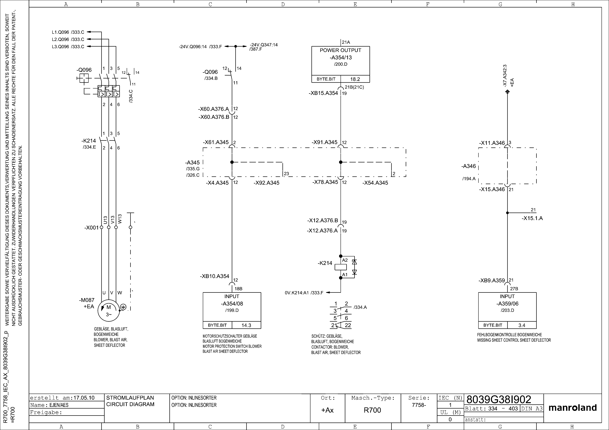

# +Ax — Sheet 334 of 403 — OPTION: INLINESORTER

**OPTION: INLINESORTER**

> Part of the manroland **R700** printing press IEC/UL circuit diagrams.
> Drawing class: **Stromlaufplan / Circuit diagram** (DIN A3).
> Document `+Ax` covers the **Central control console** machine section.

## At a glance

| Field | Value |
|---|---|
| Document | `+Ax`  (8039G38I902) |
| Sheet | **334** of 403 |
| Section (DE) | OPTION: INLINESORTER |
| Section (EN) | OPTION: INLINESORTER |
| Section type | CIRCUIT — Circuit diagram |
| Machine type | `R700` |
| Series | `7758` |
| Created | 17.05.10 |
| Replaces | — |
| Columns used | A, B, C, D, E, F, G |
| Path numbers | — |
| Labels on sheet | 133 |
| Cross-refs out | 16 |
| Cross-refs in | 32 |

**Previous:** [+Ax sheet 333](SHEET_0333.md) · **Next:** [+Ax sheet 335](SHEET_0335.md) · **Document TOC:** [_TOC.md](_TOC.md)  (+Ax) · **Master TOC:** [all sheets](../_MASTER_TOC.md)

## Sheet image (300 DPI, exact vector render)



_Rendered directly from the PDF vector layer at 300 DPI (1-bit), no OCR and no resampling. Use it to confirm anything ambiguous in the text below._

## Cross-references on this sheet

Each entry is a wire leaving this sheet. The printed token is `/sheet.column`; the link resolves to that sheet inside the same document.

| Ref | Target sheet | Col | Path | Destination on target | Target section | From col |
|---|---|---|---|---|---|---|
| `/333.C` | [+Ax sheet 333](SHEET_0333.md) | C | — | L1.Q096 | OPTION: GEBLÄSE BLASLUFT | A |
| `/333.C` | [+Ax sheet 333](SHEET_0333.md) | C | — | L2.Q096 | OPTION: GEBLÄSE BLASLUFT | A |
| `/333.F` | [+Ax sheet 333](SHEET_0333.md) | F | — | 24V.Q096:14 | OPTION: GEBLÄSE BLASLUFT | C |
| `/387.F` | [+Ax sheet 387](SHEET_0387.md) | F | — | 24V.Q096:14 | OPTION: PUDERABSAUGEINRICHTUNG | C |
| `/333.C` | [+Ax sheet 333](SHEET_0333.md) | C | — | L3.Q096 | OPTION: GEBLÄSE BLASLUFT | A |
| `/200.D` | [+Ax sheet 200](SHEET_0200.md) | D | — | — | REFERENZMODUL | E |
| `/334.B` | [+Ax sheet 334](SHEET_0334.md) | B | — | — | OPTION: INLINESORTER | C |
| `/334.C` | [+Ax sheet 334](SHEET_0334.md) | C | — | — | OPTION: INLINESORTER | B |
| `/334.E` | [+Ax sheet 334](SHEET_0334.md) | E | — | — | OPTION: INLINESORTER | A |
| `/335.G` | [+Ax sheet 335](SHEET_0335.md) | G | — | — | 1 OPTION: LOGISTIK (ANLEGER AUSLEGER) | C |
| `/326.C` | [+Ax sheet 326](SHEET_0326.md) | C | — | — | OPTION: AUTOMATISCHE FARBZUFÜHRUNG | C |
| `/194.A` | [+Ax sheet 194](SHEET_0194.md) | A | — | — | RESERVE | G |
| `/333.F` | [+Ax sheet 333](SHEET_0333.md) | F | — | 0V.K214:A1 | OPTION: GEBLÄSE BLASLUFT | D |
| `/334.A` | [+Ax sheet 334](SHEET_0334.md) | A | — | — | OPTION: INLINESORTER | E |
| `/199.D` | [+Ax sheet 199](SHEET_0199.md) | D | — | — | REFERENZMODUL | C |
| `/203.D` | [+Ax sheet 203](SHEET_0203.md) | D | — | — | REFERENZMODUL | G |

### Incoming references (sheets that point here)

Every other sheet that sends a wire to this one. `Back-ref` is the token printed on *that* sheet; `Path` is its line number.

| From sheet | Cols | Back-ref | Path | Refs | What continues there |
|---|---|---|---|---|---|
| [+Ax#194](SHEET_0194.md) | A | `/194.A` | — | 1 | — |
| [+Ax#199](SHEET_0199.md) | D | `/199.D` | — | 1 | — |
| [+Ax#200](SHEET_0200.md) | D | `/200.D` | — | 1 | — |
| [+Ax#203](SHEET_0203.md) | D | `/203.D` | — | 1 | — |
| [+Ax#227](SHEET_0227.md) | A | `/227.A` | — | 1 | — |
| [+Ax#242](SHEET_0242.md) | C | `/242.C` | — | 1 | — |
| [+Ax#245](SHEET_0245.md) | B | `/245.B` | — | 1 | — |
| [+Ax#246](SHEET_0246.md) | D | `/246.D` | — | 1 | — |
| [+Ax#248](SHEET_0248.md) | G, H | `/248.G`, `/248.H` | — | 2 | — |
| [+Ax#252](SHEET_0252.md) | A, G | `/252.A`, `/252.G` | — | 2 | — |
| [+Ax#253](SHEET_0253.md) | B | `/253.B` | — | 1 | — |
| [+Ax#283](SHEET_0283.md) | H | `/283.H` | — | 1 | — |
| [+Ax#284](SHEET_0284.md) | C, E, F | `/284.C`, `/284.E`, `/284.F` | — | 3 | — |
| [+Ax#286](SHEET_0286.md) | A | `/286.A` | — | 1 | — |
| [+Ax#289](SHEET_0289.md) | E, F | `/289.E`, `/289.F` | — | 2 | — |
| [+Ax#326](SHEET_0326.md) | C | `/326.C` | — | 1 | — |
| [+Ax#333](SHEET_0333.md) | B, C, F | `/333.B`, `/333.C`, `/333.F` | — | 5 | 0V.K214:A1; 24V.Q061:14 L3.Q061 L3.Q096; 24V.Q096:14; L1.Q096; L2.Q061 L2.Q096 |
| [+Ax#334](SHEET_0334.md) | A, B, C, E | `/334.A`, `/334.B`, `/334.C`, `/334.E` | — | 4 | — |
| [+Ax#335](SHEET_0335.md) | F | `/335.F` | — | 1 | — |
| [+Ax#387](SHEET_0387.md) | F | `/387.F` | — | 1 | 24V.Q347:14 24V.Q093:14 |


## Devices on this sheet

| Tag | Class | Class meaning (IEC) | Col | Sub | Terminal | Sign |
|---|---|---|---|---|---|---|
| `K214` | K | Relais / relay, contactor | A | — | — | — |
| `Q096` | Q | Leistungsschalter / power switching device | A | — | — | — |
| `V13` | V | Diode / semiconductor valve | B | — | — | — |
| `U13` | U | Umrichter / frequency converter | B | — | — | — |
| `X001` | X | Klemme / terminal, plug connector | A | — | — | — |
| `W13` | W | Kabel / cable, line, bus | B | — | — | — |
| `A345` | A | Baugruppe / assembly, module, PC board | C | — | — | — |
| `Q096` | Q | Leistungsschalter / power switching device | C | — | — | — |
| `A354/13` | A | Baugruppe / assembly, module, PC board | E | 13 | — | — |
| `A346` | A | Baugruppe / assembly, module, PC board | G | — | — | — |
| `A359/06` | A | Baugruppe / assembly, module, PC board | G | 06 | — | — |
| `A354/08` | A | Baugruppe / assembly, module, PC board | C | 08 | — | — |
| `A2` | A | Baugruppe / assembly, module, PC board | E | — | — | — |
| `A1` | A | Baugruppe / assembly, module, PC board | E | — | — | — |
| `K214` | K | Relais / relay, contactor | E | — | — | — |
| `X61.A345` | — | cross-device reference | C | — | — | — |
| `X4.A345` | — | cross-device reference | C | — | — | — |
| `X60.A376.A` | — | cross-device reference | C | — | — | — |
| `X60.A376.B` | — | cross-device reference | C | — | — | — |
| `X12.A376.B` | — | cross-device reference | E | — | — | — |
| `X12.A376.A` | — | cross-device reference | E | — | — | — |
| `X91.A345` | — | cross-device reference | E | — | — | — |
| `X78.A345` | — | cross-device reference | E | — | — | — |
| `18.2` | — | cross-device reference | E | — | — | — |
| `XB15.A354` | — | cross-device reference | E | — | — | — |
| `X15.A346` | — | cross-device reference | G | — | — | — |
| `X11.A346` | — | cross-device reference | G | — | — | — |
| `X7.A342:3` | — | cross-device reference | G | — | 3 | — |
| `3.4` | — | cross-device reference | G | — | — | — |
| `XB9.A359` | — | cross-device reference | G | — | — | — |
| `XB10.A354` | — | cross-device reference | C | — | — | — |
| `14.3` | — | cross-device reference | C | — | — | — |
| `X15.1.A` | — | cross-device reference | G | — | — | — |
| `X92.A345` | — | cross-device reference | D | — | — | — |
| `X54.A345` | — | cross-device reference | E | — | — | — |

## Potentials / nets

| Potential | Count | Columns | Attached devices | Terminals |
|---|---|---|---|---|
| `0V` | 1 | D | `K214` | `A1` |
| `24V` | 2 | C, D | `Q096`, `Q347` | `14` |
| `L1` | 1 | A | `Q096` | — |
| `L2` | 1 | A | `Q096` | — |
| `L3` | 1 | A | `Q096` | — |
| `M087` | 1 | A | — | — |


A potential such as `L24+/4` or `M24+` is a named supply/return rail; every place it appears on this sheet is electrically common.

## Wire-end annotations (grouped as printed)

A wire that continues elsewhere is annotated with a small cluster: the destination description, the path/line number `#NN`, and the `/sheet.column` cross reference. Each row below is one such cluster exactly as it is grouped on the drawing.

| Col | Y | Path | Cross-ref | Text on the wire |
|---|---|---|---|---|
| A | 59.1 | — | `/333.C` | `L1.Q096` |
| A | 73.3 | — | `/333.C` | `L2.Q096` |
| E | 79.0 | — | — | `21A` |
| D | 83.9 | — | — | `24V.Q347:14` |
| C | 87.4 | — | `/333.F`, `/387.F` | `24V.Q096:14` |
| A | 87.5 | — | `/333.C` | `L3.Q096` |
| E | 94.1 | — | — | `POWER OUTPUT` |
| E | 108.0 | — | — | `A354/13` |
| E | 121.8 | — | `/200.D` | — |
| G | 126.4 | — | — | `X7.A342:3` |
| B | 130.0 | — | — | `1` |
| B | 130.0 | — | — | `3` |
| B | 130.0 | — | — | `5` |
| C | 130.0 | — | — | `Q096 14` |
| C | 130.0 | — | — | `12` |
| A | 132.1 | — | — | `Q096` |
| B | 139.1 | — | — | `12 14` |
| C | 149.4 | — | `/334.B` | — |
| E | 150.9 | — | — | `BYTE.BIT 18.2` |
| G | 153.4 | — | — | `+EA` |
| C | 158.4 | — | — | `11` |
| B | 161.8 | — | — | `11` |
| E | 166.9 | — | — | `21B(21C)` |
| B | 175.5 | — | `/334.C` | — |
| E | 177.5 | — | — | `XB15.A354 19` |
| B | 200.9 | — | — | `2` |
| B | 200.9 | — | — | `4` |
| B | 200.9 | — | — | `6` |
| C | 208.7 | — | — | `X60.A376.A 12` |
| C | 224.2 | — | — | `X60.A376.B 12` |
| B | 257.6 | — | — | `1` |
| B | 257.6 | — | — | `3` |
| B | 257.6 | — | — | `5` |
| A | 271.0 | — | — | `K214 6` |
| C | 273.9 | — | — | `X61.A345 2` |
| E | 273.9 | — | — | `X91.A345 12` |
| G | 275.3 | — | — | `X11.A346 3` |
| A | 284.1 | — | `/334.E` | — |
| B | 285.9 | — | — | `2` |
| B | 285.9 | — | — | `4` |
| C | 313.5 | — | — | `A345` |
| G | 320.6 | — | — | `A346` |
| C | 326.6 | — | `/335.G`, `/326.C` | — |
| D | 336.2 | — | — | `23` |
| F | 336.2 | — | — | `2` |
| G | 346.1 | — | `/194.A` | — |
| E | 351.8 | — | — | `X78.A345 12` |
| C | 353.2 | — | — | `X4.A345 12` |
| E | 353.2 | — | — | `X92.A345 X54.A345` |
| G | 366.0 | — | — | `X15.A346 21` |
| G | 407.1 | — | — | `21` |
| B | 419.2 | — | — | `W13` |
| B | 422.4 | — | — | `V13` |
| G | 422.7 | — | — | `X15.1.A` |
| B | 422.9 | — | — | `U13` |
| E | 426.9 | — | — | `X12.A376.B 19` |
| B | 433.5 | — | — | `'` |
| A | 441.1 | — | — | `X001` |
| E | 446.8 | — | — | `X12.A376.A 19` |
| E | 505.6 | — | — | `A2` |
| E | 510.5 | — | — | `K214` |
| E | 533.9 | — | — | `A1` |
| E | 536.0 | — | — | `XB10.A354 12 XB9.A359 21` |
| C | 561.5 | — | — | `18B` |
| G | 561.5 | — | — | `27B` |
| B | 568.2 | — | — | `U V W '` |
| D | 569.3 | — | `/333.F` | `0V.K214:A1` |
| C | 576.1 | — | — | `INPUT` |
| G | 576.1 | — | — | `INPUT` |
| A | 582.8 | — | — | `M087` |
| C | 589.9 | — | — | `A354/08` |
| E | 589.9 | — | — | `21 3 5 1` |
| E | 589.9 | — | — | `2 4 6 22` |
| G | 589.9 | — | — | `A359/06` |
| A | 595.5 | — | — | `+EA` |
| B | 597.3 | — | — | `3~ M` |
| E | 597.7 | — | `/334.A` | — |
| C | 603.7 | — | `/199.D` | — |
| G | 603.7 | — | `/203.D` | — |
| G | 632.7 | — | — | `BYTE.BIT 3.4` |
| C | 632.8 | — | — | `BYTE.BIT 14.3` |
| B | 641.2 | — | — | `BOGENWEICHE BLOWER, BLAST AIR, GEBLÄSE, BLASLUFT,` |
| G | 652.6 | — | — | `FEHLBOGENKONTROLLE BOGENWEICHE MISSING SHEET CONTROL SHEET DEFLECTOR` |
| E | 655.4 | — | — | `BLASLUFT, BOGENWEICHE SCHÜTZ: GEBLÄSE,` |
| C | 655.6 | — | — | `BLASLUFT BOGENWEICHE BLAST AIR SHEET DEFLECTOR MOTORSCHUTZSCHALTER GEBLÄSE MOTOR PROTECTION SWITCH BLOWER` |
| B | 673.2 | — | — | `SHEET DEFLECTOR` |
| E | 676.7 | — | — | `BLAST AIR, SHEET DEFLECTOR CONTACTOR: BLOWER,` |


## Reconstructed tables

This sheet carries tabular content (pin map / terminal assignment / index). The grid below was rebuilt from the drawing's own rule lines, so each row is exactly one physical row of the table.

### Table 1 — 5 data rows × 7 columns (at x=396.9, y=90.7)

| /333.F 12 Q096 |  | /387.F 14 |  | POWER | OUTPUT A354/13 /200.D |  |
|---|---|---|---|---|---|---|
| `/334.B` |  |  |  | `BYTE.BIT` |  | `18.2` |
| `X60.A376.A X60.A376.B X61.A345` | `11 12 12 2` |  |  | `XB15.A354 X91.A345` | `21B(21C) 19 12` |  |
| `X4.A345 XB10.A354` | `12 12` | `18B` | `23 X92.A345` | `X78.A345 X12.A376.B X12.A376.A K214` | `12 19 19 A2 A1` |  |
| `INPUT` | `A354/08 /199.D` |  | `0V.K214:A1` | `/333.F 1 3 5` | `2 4 6` | `/334.A` |
| `BYTE.BIT` |  | `14.3` |  | `21` | `22` |  |


### Table 2 — 2 data rows × 2 columns (at x=935.4, y=416.7)

| XB9.A359 | X15.1.A 21 27B |
|---|---|
| `INPUT` | `A359/06 /203.D` |
| `BYTE.BIT` | `3.4` |


## Notes and free text on this sheet

| Text | Col | Y (pt) |
|---|---|---|
| `21A` | E | 78.95 |
| `21B(21C)` | E | 166.86 |
| `POWER OUTPUT` | E | 94.1 |
| `BYTE.BIT` | E | 151.43 |
| `+EA` | G | 153.36 |
| `27B` | G | 561.55 |
| `INPUT` | G | 576.07 |
| `BYTE.BIT` | G | 633.32 |
| `FEHLBOGENKONTROLLE BOGENWEICHE` | G | 652.59 |
| `MISSING SHEET CONTROL SHEET DEFLECTOR` | G | 663.23 |
| `18B` | C | 561.55 |
| `INPUT` | C | 576.07 |
| `BYTE.BIT` | C | 633.32 |
| `MOTORSCHUTZSCHALTER GEBLÄSE` | C | 655.57 |
| `BLASLUFT BOGENWEICHE` | C | 665.51 |
| `MOTOR PROTECTION SWITCH BLOWER` | C | 675.44 |
| `BLAST AIR SHEET DEFLECTOR` | C | 685.42 |
| `SCHÜTZ: GEBLÄSE,` | E | 655.41 |
| `BLASLUFT, BOGENWEICHE` | E | 666.03 |
| `CONTACTOR: BLOWER,` | E | 676.68 |
| `BLAST AIR, SHEET DEFLECTOR` | E | 687.32 |
| `U` | B | 569.39 |
| `V` | B | 569.28 |
| `W` | B | 569.02 |
| `M` | B | 597.28 |
| `+EA` | A | 595.51 |
| `GEBLÄSE, BLASLUFT,` | B | 641.23 |
| `BOGENWEICHE` | B | 651.84 |
| `BLOWER, BLAST AIR,` | B | 662.47 |
| `SHEET DEFLECTOR` | B | 673.16 |

## Complete label inventory (exact text from the drawing)

Every text object inside the drawing area of this sheet, in DIN reading order (column A→H, then top→bottom). This is the authoritative list: if a string is not here it is not printed on this sheet.

| Col | Y | X | Dir | Type | Text |
|---|---|---|---|---|---|
| A | 59.1 | 101.5 | → | potential | `L1.Q096` |
| A | 59.1 | 138.9 | → | cross-reference | `/333.C` |
| A | 73.3 | 101.5 | → | potential | `L2.Q096` |
| A | 73.3 | 138.9 | → | cross-reference | `/333.C` |
| A | 87.5 | 101.5 | → | potential | `L3.Q096` |
| A | 87.5 | 138.9 | → | cross-reference | `/333.C` |
| A | 132.1 | 149.7 | → | device tag | `Q096` |
| A | 271.0 | 159.3 | → | device tag | `K214` |
| A | 284.1 | 162.1 | → | cross-reference | `/334.E` |
| A | 441.1 | 165.0 | → | device tag | `X001` |
| A | 582.8 | 154.8 | → | potential | `M087` |
| A | 595.5 | 163.6 | → | text | `+EA` |
| B | 130.0 | 200.4 | → | number | `1` |
| B | 130.0 | 215.1 | → | number | `3` |
| B | 130.0 | 229.3 | → | number | `5` |
| B | 139.1 | 237.5 | → | number | `12` |
| B | 139.1 | 264.5 | → | number | `14` |
| B | 161.8 | 257.4 | → | number | `11` |
| B | 175.5 | 251.9 | ↕ | cross-reference | `/334.C` |
| B | 200.9 | 201.0 | → | number | `2` |
| B | 200.9 | 215.1 | → | number | `4` |
| B | 200.9 | 229.3 | → | number | `6` |
| B | 257.6 | 200.4 | → | number | `1` |
| B | 257.6 | 215.1 | → | number | `3` |
| B | 257.6 | 229.3 | → | number | `5` |
| B | 285.9 | 201.0 | → | number | `2` |
| B | 285.9 | 215.1 | → | number | `4` |
| B | 285.9 | 229.3 | → | number | `6` |
| B | 419.2 | 230.5 | ↕ | device tag | `W13` |
| B | 422.4 | 216.4 | ↕ | device tag | `V13` |
| B | 422.9 | 202.3 | ↕ | device tag | `U13` |
| B | 433.5 | 261.6 | → | other | `'` |
| B | 568.2 | 257.4 | → | other | `'` |
| B | 569.0 | 229.6 | → | text | `W` |
| B | 569.3 | 215.4 | → | text | `V` |
| B | 569.4 | 200.4 | → | text | `U` |
| B | 597.3 | 208.5 | → | text | `M` |
| B | 611.5 | 207.2 | → | other | `3~` |
| B | 641.2 | 184.0 | → | text | `GEBLÄSE, BLASLUFT,` |
| B | 651.8 | 183.4 | → | text | `BOGENWEICHE` |
| B | 662.5 | 183.4 | → | text | `BLOWER, BLAST AIR,` |
| B | 673.2 | 184.0 | → | text | `SHEET DEFLECTOR` |
| C | 87.4 | 409.0 | → | cross-reference | `/333.F` |
| C | 87.5 | 349.8 | → | potential | `24V.Q096:14` |
| C | 130.0 | 434.6 | → | number | `12` |
| C | 130.0 | 462.6 | → | number | `14` |
| C | 136.4 | 396.3 | → | device tag | `Q096` |
| C | 149.4 | 400.0 | → | cross-reference | `/334.B` |
| C | 158.4 | 455.5 | → | number | `11` |
| C | 208.7 | 387.5 | → | device ref | `X60.A376.A` |
| C | 208.7 | 455.5 | → | number | `12` |
| C | 224.2 | 388.3 | → | device ref | `X60.A376.B` |
| C | 225.7 | 455.5 | → | number | `12` |
| C | 273.8 | 396.9 | → | device ref | `X61.A345` |
| C | 275.3 | 456.1 | → | number | `2` |
| C | 313.5 | 362.0 | → | device tag | `A345` |
| C | 326.6 | 364.0 | → | cross-reference | `/335.G` |
| C | 339.0 | 364.3 | → | cross-reference | `/326.C` |
| C | 353.2 | 402.8 | → | device ref | `X4.A345` |
| C | 353.2 | 455.5 | → | number | `12` |
| C | 536.1 | 391.2 | → | device ref | `XB10.A354` |
| C | 544.6 | 455.5 | → | number | `12` |
| C | 561.5 | 458.4 | → | text | `18B` |
| C | 576.1 | 438.7 | → | text | `INPUT` |
| C | 589.9 | 432.1 | → | device tag | `A354/08` |
| C | 603.7 | 440.8 | → | cross-reference | `/199.D` |
| C | 632.8 | 472.1 | → | device ref | `14.3` |
| C | 633.3 | 406.8 | → | text | `BYTE.BIT` |
| C | 655.6 | 396.6 | → | text | `MOTORSCHUTZSCHALTER GEBLÄSE` |
| C | 665.5 | 396.3 | → | text | `BLASLUFT BOGENWEICHE` |
| C | 675.4 | 396.6 | → | text | `MOTOR PROTECTION SWITCH BLOWER` |
| C | 685.4 | 396.3 | → | text | `BLAST AIR SHEET DEFLECTOR` |
| D | 83.9 | 488.7 | → | potential | `24V.Q347:14` |
| D | 92.4 | 487.6 | → | cross-reference | `/387.F` |
| D | 336.2 | 555.3 | → | number | `23` |
| D | 353.2 | 496.1 | → | device ref | `X92.A345` |
| D | 569.3 | 557.0 | → | potential | `0V.K214:A1` |
| D | 569.3 | 607.5 | → | cross-reference | `/333.F` |
| E | 78.9 | 668.7 | → | text | `21A` |
| E | 94.1 | 625.3 | → | text | `POWER OUTPUT` |
| E | 108.0 | 644.7 | → | device tag | `A354/13` |
| E | 121.8 | 653.4 | → | cross-reference | `/200.D` |
| E | 150.9 | 684.7 | → | device ref | `18.2` |
| E | 151.4 | 619.4 | → | text | `BYTE.BIT` |
| E | 166.9 | 674.4 | → | text | `21B(21C)` |
| E | 177.5 | 603.8 | → | device ref | `XB15.A354` |
| E | 178.9 | 668.1 | → | number | `19` |
| E | 273.8 | 609.4 | → | device ref | `X91.A345` |
| E | 275.3 | 668.1 | → | number | `12` |
| E | 351.8 | 610.9 | → | device ref | `X78.A345` |
| E | 353.2 | 668.1 | → | number | `12` |
| E | 353.2 | 708.7 | → | device ref | `X54.A345` |
| E | 426.9 | 600.9 | → | device ref | `X12.A376.B` |
| E | 431.2 | 668.1 | → | number | `19` |
| E | 446.8 | 600.1 | → | device ref | `X12.A376.A` |
| E | 448.2 | 668.1 | → | number | `19` |
| E | 505.5 | 669.0 | → | device tag | `A2` |
| E | 510.5 | 621.4 | → | device tag | `K214` |
| E | 533.9 | 669.0 | → | device tag | `A1` |
| E | 589.9 | 653.7 | → | number | `1` |
| E | 589.9 | 674.4 | → | number | `2` |
| E | 597.7 | 691.7 | → | cross-reference | `/334.A` |
| E | 604.1 | 652.3 | → | number | `3` |
| E | 604.1 | 674.4 | → | number | `4` |
| E | 618.2 | 652.3 | → | number | `5` |
| E | 618.2 | 674.4 | → | number | `6` |
| E | 632.4 | 647.7 | → | number | `21` |
| E | 632.4 | 674.4 | → | number | `22` |
| E | 655.4 | 609.2 | → | text | `SCHÜTZ: GEBLÄSE,` |
| E | 666.0 | 608.6 | → | text | `BLASLUFT, BOGENWEICHE` |
| E | 676.7 | 609.2 | → | text | `CONTACTOR: BLOWER,` |
| E | 687.3 | 608.6 | → | text | `BLAST AIR, SHEET DEFLECTOR` |
| F | 336.2 | 767.9 | → | number | `2` |
| G | 126.4 | 983.2 | ↕ | device ref | `X7.A342:3` |
| G | 153.4 | 997.3 | ↕ | text | `+EA` |
| G | 275.3 | 936.9 | → | device ref | `X11.A346` |
| G | 275.3 | 994.7 | → | number | `3` |
| G | 320.6 | 902.0 | → | device tag | `A346` |
| G | 346.1 | 904.3 | → | cross-reference | `/194.A` |
| G | 366.0 | 936.9 | → | device ref | `X15.A346` |
| G | 367.4 | 994.7 | → | number | `21` |
| G | 407.1 | 1038.0 | → | number | `21` |
| G | 422.7 | 1020.2 | → | device ref | `X15.1.A` |
| G | 544.6 | 935.7 | → | device ref | `XB9.A359` |
| G | 544.6 | 994.7 | → | number | `21` |
| G | 561.5 | 997.5 | → | text | `27B` |
| G | 576.1 | 977.2 | → | text | `INPUT` |
| G | 589.9 | 970.7 | → | device tag | `A359/06` |
| G | 603.7 | 979.4 | → | cross-reference | `/203.D` |
| G | 632.7 | 1013.7 | → | device ref | `3.4` |
| G | 633.3 | 945.4 | → | text | `BYTE.BIT` |
| G | 652.6 | 933.2 | → | text | `FEHLBOGENKONTROLLE BOGENWEICHE` |
| G | 663.2 | 933.4 | → | text | `MISSING SHEET CONTROL SHEET DEFLECTOR` |

## Reading-order text block

The same content as a plain block, grouped by DIN column — convenient to paste or to match against a visual description.

```text
=== Column A ===
  59.1  101.5  net          L1.Q096
  59.1  138.9  xref         /333.C
  73.3  101.5  net          L2.Q096
  73.3  138.9  xref         /333.C
  87.5  101.5  net          L3.Q096
  87.5  138.9  xref         /333.C
 132.1  149.7  devtag       Q096
 271.0  159.3  devtag       K214
 284.1  162.1  xref         /334.E
 441.1  165.0  devtag       X001
 582.8  154.8  net          M087
 595.5  163.6  text         +EA
=== Column B ===
 130.0  200.4  numeric      1
 130.0  215.1  numeric      3
 130.0  229.3  numeric      5
 139.1  237.5  numeric      12
 139.1  264.5  numeric      14
 161.8  257.4  numeric      11
 175.5  251.9  xref         /334.C
 200.9  201.0  numeric      2
 200.9  215.1  numeric      4
 200.9  229.3  numeric      6
 257.6  200.4  numeric      1
 257.6  215.1  numeric      3
 257.6  229.3  numeric      5
 285.9  201.0  numeric      2
 285.9  215.1  numeric      4
 285.9  229.3  numeric      6
 419.2  230.5  devtag       W13
 422.4  216.4  devtag       V13
 422.9  202.3  devtag       U13
 433.5  261.6  other        `
 568.2  257.4  other        `
 569.0  229.6  text         W
 569.3  215.4  text         V
 569.4  200.4  text         U
 597.3  208.5  text         M
 611.5  207.2  other        3~
 641.2  184.0  text         GEBLÄSE, BLASLUFT,
 651.8  183.4  text         BOGENWEICHE
 662.5  183.4  text         BLOWER, BLAST AIR,
 673.2  184.0  text         SHEET DEFLECTOR
=== Column C ===
  87.4  409.0  xref         /333.F
  87.5  349.8  net          24V.Q096:14
 130.0  434.6  numeric      12
 130.0  462.6  numeric      14
 136.4  396.3  devtag       Q096
 149.4  400.0  xref         /334.B
 158.4  455.5  numeric      11
 208.7  387.5  devref       X60.A376.A
 208.7  455.5  numeric      12
 224.2  388.3  devref       X60.A376.B
 225.7  455.5  numeric      12
 273.8  396.9  devref       X61.A345
 275.3  456.1  numeric      2
 313.5  362.0  devtag       A345
 326.6  364.0  xref         /335.G
 339.0  364.3  xref         /326.C
 353.2  402.8  devref       X4.A345
 353.2  455.5  numeric      12
 536.1  391.2  devref       XB10.A354
 544.6  455.5  numeric      12
 561.5  458.4  text         18B
 576.1  438.7  text         INPUT
 589.9  432.1  devtag       A354/08
 603.7  440.8  xref         /199.D
 632.8  472.1  devref       14.3
 633.3  406.8  text         BYTE.BIT
 655.6  396.6  text         MOTORSCHUTZSCHALTER GEBLÄSE
 665.5  396.3  text         BLASLUFT BOGENWEICHE
 675.4  396.6  text         MOTOR PROTECTION SWITCH BLOWER
 685.4  396.3  text         BLAST AIR SHEET DEFLECTOR
=== Column D ===
  83.9  488.7  net          24V.Q347:14
  92.4  487.6  xref         /387.F
 336.2  555.3  numeric      23
 353.2  496.1  devref       X92.A345
 569.3  557.0  net          0V.K214:A1
 569.3  607.5  xref         /333.F
=== Column E ===
  78.9  668.7  text         21A
  94.1  625.3  text         POWER OUTPUT
 108.0  644.7  devtag       A354/13
 121.8  653.4  xref         /200.D
 150.9  684.7  devref       18.2
 151.4  619.4  text         BYTE.BIT
 166.9  674.4  text         21B(21C)
 177.5  603.8  devref       XB15.A354
 178.9  668.1  numeric      19
 273.8  609.4  devref       X91.A345
 275.3  668.1  numeric      12
 351.8  610.9  devref       X78.A345
 353.2  668.1  numeric      12
 353.2  708.7  devref       X54.A345
 426.9  600.9  devref       X12.A376.B
 431.2  668.1  numeric      19
 446.8  600.1  devref       X12.A376.A
 448.2  668.1  numeric      19
 505.5  669.0  devtag       A2
 510.5  621.4  devtag       K214
 533.9  669.0  devtag       A1
 589.9  653.7  numeric      1
 589.9  674.4  numeric      2
 597.7  691.7  xref         /334.A
 604.1  652.3  numeric      3
 604.1  674.4  numeric      4
 618.2  652.3  numeric      5
 618.2  674.4  numeric      6
 632.4  647.7  numeric      21
 632.4  674.4  numeric      22
 655.4  609.2  text         SCHÜTZ: GEBLÄSE,
 666.0  608.6  text         BLASLUFT, BOGENWEICHE
 676.7  609.2  text         CONTACTOR: BLOWER,
 687.3  608.6  text         BLAST AIR, SHEET DEFLECTOR
=== Column F ===
 336.2  767.9  numeric      2
=== Column G ===
 126.4  983.2  devref       X7.A342:3
 153.4  997.3  text         +EA
 275.3  936.9  devref       X11.A346
 275.3  994.7  numeric      3
 320.6  902.0  devtag       A346
 346.1  904.3  xref         /194.A
 366.0  936.9  devref       X15.A346
 367.4  994.7  numeric      21
 407.1 1038.0  numeric      21
 422.7 1020.2  devref       X15.1.A
 544.6  935.7  devref       XB9.A359
 544.6  994.7  numeric      21
 561.5  997.5  text         27B
 576.1  977.2  text         INPUT
 589.9  970.7  devtag       A359/06
 603.7  979.4  xref         /203.D
 632.7 1013.7  devref       3.4
 633.3  945.4  text         BYTE.BIT
 652.6  933.2  text         FEHLBOGENKONTROLLE BOGENWEICHE
 663.2  933.4  text         MISSING SHEET CONTROL SHEET DEFLECTOR
```

---
_Generated from the PDF vector text layer; no OCR. Source: `R700_7758_IEC_AX_8039G38I902_p`, sheet 334._
