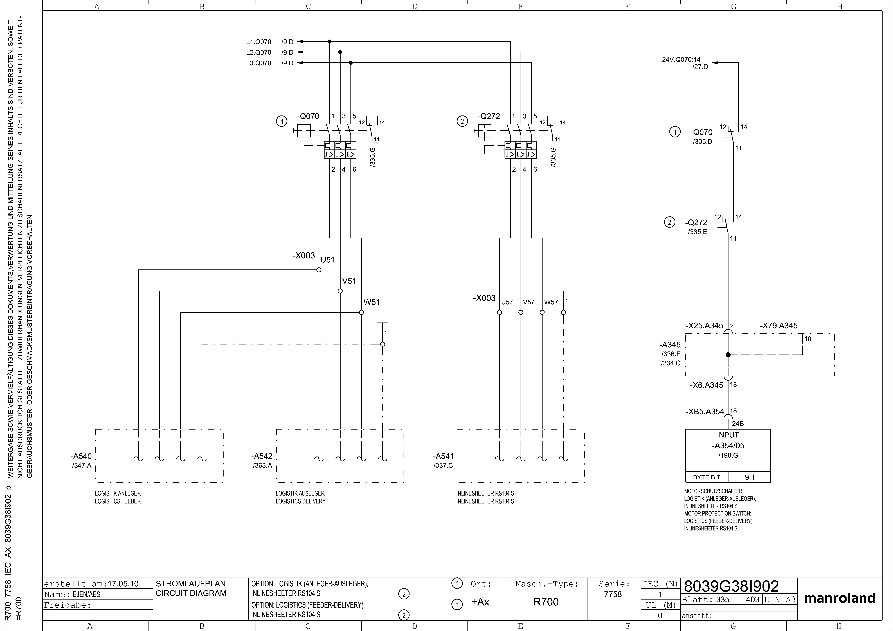

# +Ax — Sheet 335 of 403 — 1 OPTION: LOGISTIK (ANLEGER AUSLEGER)

**INLINESHEETER RS104 S 2**

> Part of the manroland **R700** printing press IEC/UL circuit diagrams.
> Drawing class: **Stromlaufplan / Circuit diagram** (DIN A3).
> Document `+Ax` covers the **Central control console** machine section.

## At a glance

| Field | Value |
|---|---|
| Document | `+Ax`  (8039G38I902) |
| Sheet | **335** of 403 |
| Section (DE) | 1 OPTION: LOGISTIK (ANLEGER AUSLEGER) |
| Section (EN) | INLINESHEETER RS104 S 2 |
| Section type | CIRCUIT — Circuit diagram |
| Machine type | `R700` |
| Series | `7758` |
| Created | 17.05.10 |
| Replaces | — |
| Columns used | A, C, D, E, F, G, H |
| Path numbers | — |
| Labels on sheet | 88 |
| Cross-refs out | 14 |
| Cross-refs in | 18 |

**Previous:** [+Ax sheet 334](SHEET_0334.md) · **Next:** [+Ax sheet 336](SHEET_0336.md) · **Document TOC:** [_TOC.md](_TOC.md)  (+Ax) · **Master TOC:** [all sheets](../_MASTER_TOC.md)

## Sheet image (300 DPI, exact vector render)



_Rendered directly from the PDF vector layer at 300 DPI (1-bit), no OCR and no resampling. Use it to confirm anything ambiguous in the text below._

## Cross-references on this sheet

Each entry is a wire leaving this sheet. The printed token is `/sheet.column`; the link resolves to that sheet inside the same document.

| Ref | Target sheet | Col | Path | Destination on target | Target section | From col |
|---|---|---|---|---|---|---|
| `/9.D` | [+Ax sheet 9](SHEET_0009.md) | D | — | L1.Q070 | SPANNUNGSVERSORGUNG, SCHALTSCHRANKBELÜFTUNG | C |
| `/9.D` | [+Ax sheet 9](SHEET_0009.md) | D | — | L2.Q070 | SPANNUNGSVERSORGUNG, SCHALTSCHRANKBELÜFTUNG | C |
| `/27.D` | [+Ax sheet 27](SHEET_0027.md) | D | — | 24V.Q070:14 | SPANNUNGSVERSORGUNG, SCHALTSCHRANKBELÜFTUNG | G |
| `/9.D` | [+Ax sheet 9](SHEET_0009.md) | D | — | L3.Q070 | SPANNUNGSVERSORGUNG, SCHALTSCHRANKBELÜFTUNG | C |
| `/335.D` | [+Ax sheet 335](SHEET_0335.md) | D | — | — | 1 OPTION: LOGISTIK (ANLEGER AUSLEGER) | G |
| `/335.G` | [+Ax sheet 335](SHEET_0335.md) | G | — | — | 1 OPTION: LOGISTIK (ANLEGER AUSLEGER) | D |
| `/335.G` | [+Ax sheet 335](SHEET_0335.md) | G | — | — | 1 OPTION: LOGISTIK (ANLEGER AUSLEGER) | E |
| `/335.E` | [+Ax sheet 335](SHEET_0335.md) | E | — | — | 1 OPTION: LOGISTIK (ANLEGER AUSLEGER) | G |
| `/336.E` | [+Ax sheet 336](SHEET_0336.md) | E | — | — | OPTION: LOGISTIK ANLEGER / | F |
| `/334.C` | [+Ax sheet 334](SHEET_0334.md) | C | — | — | OPTION: INLINESORTER | F |
| `/198.G` | [+Ax sheet 198](SHEET_0198.md) | G | — | — | REFERENZMODUL | G |
| `/347.A` | [+Ax sheet 347](SHEET_0347.md) | A | — | — | OPTION: LOGISTIK ANLEGER | A |
| `/363.A` | [+Ax sheet 363](SHEET_0363.md) | A | — | — | OPTION: LOGISTIK AUSLEGER | C |
| `/337.C` | [+Ax sheet 337](SHEET_0337.md) | C | — | — | OPTION: INLINESHEETER RS104 S | D |

### Incoming references (sheets that point here)

Every other sheet that sends a wire to this one. `Back-ref` is the token printed on *that* sheet; `Path` is its line number.

| From sheet | Cols | Back-ref | Path | Refs | What continues there |
|---|---|---|---|---|---|
| [+Ax#9](SHEET_0009.md) | D | `/9.D` | — | 3 | L1.Q070; L2.Q070; L3.Q070 |
| [+Ax#27](SHEET_0027.md) | D | `/27.D` | — | 1 | 24V.Q070:14 |
| [+Ax#198](SHEET_0198.md) | G | `/198.G` | — | 1 | — |
| [+Ax#231](SHEET_0231.md) | E | `/231.E` | — | 1 | — |
| [+Ax#233](SHEET_0233.md) | G | `/233.G` | — | 1 | — |
| [+Ax#267](SHEET_0267.md) | C | `/267.C` | — | 1 | — |
| [+Ax#286](SHEET_0286.md) | B | `/286.B` | — | 1 | — |
| [+Ax#334](SHEET_0334.md) | C | `/334.C` | — | 1 | — |
| [+Ax#335](SHEET_0335.md) | D, E, G | `/335.D`, `/335.E`, `/335.G` | — | 4 | — |
| [+Ax#336](SHEET_0336.md) | E | `/336.E` | — | 1 | — |
| [+Ax#337](SHEET_0337.md) | C | `/337.C` | — | 1 | — |
| [+Ax#347](SHEET_0347.md) | A | `/347.A` | — | 1 | — |
| [+Ax#363](SHEET_0363.md) | A | `/363.A` | — | 1 | — |


## Devices on this sheet

| Tag | Class | Class meaning (IEC) | Col | Sub | Terminal | Sign |
|---|---|---|---|---|---|---|
| `A542` | A | Baugruppe / assembly, module, PC board | C | — | — | — |
| `A540` | A | Baugruppe / assembly, module, PC board | A | — | — | — |
| `A541` | A | Baugruppe / assembly, module, PC board | D | — | — | — |
| `Q070` | Q | Leistungsschalter / power switching device | C | — | — | — |
| `Q070` | Q | Leistungsschalter / power switching device | G | — | — | — |
| `Q272` | Q | Leistungsschalter / power switching device | E | — | — | — |
| `A345` | A | Baugruppe / assembly, module, PC board | F | — | — | — |
| `A354/05` | A | Baugruppe / assembly, module, PC board | G | 05 | — | — |
| `Q272` | Q | Leistungsschalter / power switching device | G | — | — | — |
| `V51` | V | Diode / semiconductor valve | C | — | — | — |
| `W51` | W | Kabel / cable, line, bus | D | — | — | — |
| `U51` | U | Umrichter / frequency converter | C | — | — | — |
| `X003` | X | Klemme / terminal, plug connector | C | — | — | — |
| `U57` | U | Umrichter / frequency converter | E | — | — | — |
| `X003` | X | Klemme / terminal, plug connector | E | — | — | — |
| `V57` | V | Diode / semiconductor valve | E | — | — | — |
| `X25.A345` | — | cross-device reference | G | — | — | — |
| `X6.A345` | — | cross-device reference | G | — | — | — |
| `XB5.A354` | — | cross-device reference | G | — | — | — |
| `9.1` | — | cross-device reference | G | — | — | — |
| `X79.A345` | — | cross-device reference | G | — | — | — |

## Potentials / nets

| Potential | Count | Columns | Attached devices | Terminals |
|---|---|---|---|---|
| `24V` | 1 | F | `Q070` | `14` |
| `L1` | 1 | C | `Q070` | — |
| `L2` | 1 | C | `Q070` | — |
| `L3` | 1 | C | `Q070` | — |


A potential such as `L24+/4` or `M24+` is a named supply/return rail; every place it appears on this sheet is electrically common.

## Wire-end annotations (grouped as printed)

A wire that continues elsewhere is annotated with a small cluster: the destination description, the path/line number `#NN`, and the `/sheet.column` cross reference. Each row below is one such cluster exactly as it is grouped on the drawing.

| Col | Y | Path | Cross-ref | Text on the wire |
|---|---|---|---|---|
| C | 52.0 | — | `/9.D` | `L1.Q070` |
| C | 66.2 | — | `/9.D` | `L2.Q070` |
| G | 75.4 | — | `/27.D` | `24V.Q070:14` |
| C | 80.3 | — | `/9.D` | `L3.Q070` |
| C | 150.5 | — | — | `Q070` |
| E | 150.5 | — | — | `Q272` |
| C | 151.3 | — | — | `1` |
| C | 151.3 | — | — | `3` |
| C | 151.3 | — | — | `5` |
| E | 151.3 | — | — | `1` |
| E | 151.3 | — | — | `3` |
| E | 151.3 | — | — | `5` |
| C | 158.5 | — | — | `1` |
| D | 159.0 | — | — | `2` |
| D | 160.3 | — | — | `12 14` |
| E | 160.3 | — | — | `12 14` |
| G | 165.4 | — | — | `Q070 14` |
| G | 165.4 | — | — | `12` |
| F | 172.7 | — | — | `1` |
| D | 183.0 | — | — | `11` |
| E | 183.0 | — | — | `11` |
| G | 184.9 | — | `/335.D` | — |
| G | 193.8 | — | — | `11` |
| D | 196.4 | — | `/335.G` | — |
| E | 196.4 | — | `/335.G` | — |
| C | 222.1 | — | — | `2` |
| C | 222.1 | — | — | `4` |
| C | 222.1 | — | — | `6` |
| E | 222.1 | — | — | `2` |
| E | 222.1 | — | — | `4` |
| E | 222.1 | — | — | `6` |
| G | 285.9 | — | — | `Q272 14` |
| G | 285.9 | — | — | `12` |
| F | 293.7 | — | — | `2` |
| G | 305.3 | — | `/335.E` | — |
| G | 314.3 | — | — | `11` |
| C | 336.0 | — | — | `X003 U51` |
| C | 370.2 | — | — | `V51` |
| E | 392.7 | — | — | `X003 U57 V57 W57 '` |
| D | 398.4 | — | — | `W51` |
| G | 429.8 | — | — | `X25.A345 2` |
| G | 429.8 | — | — | `X79.A345` |
| D | 440.6 | — | — | `'` |
| G | 448.2 | — | — | `A345 10` |
| F | 468.3 | — | `/336.E`, `/334.C` | — |
| G | 509.1 | — | — | `X6.A345 18` |
| G | 544.6 | — | — | `XB5.A354 18` |
| G | 561.5 | — | — | `24B` |
| G | 576.1 | — | — | `INPUT` |
| G | 589.9 | — | — | `A354/05` |
| G | 603.7 | — | `/198.G` | — |
| A | 604.1 | — | — | `A540` |
| C | 604.1 | — | — | `A542` |
| D | 604.1 | — | — | `A541` |
| A | 617.1 | — | `/347.A` | — |
| C | 617.1 | — | `/363.A` | — |
| D | 617.2 | — | `/337.C` | — |
| G | 632.7 | — | — | `BYTE.BIT 9.1` |
| G | 652.7 | — | — | `LOGISTIK (ANLEGER AUSLEGER), INLINESHEETER RS104 S LOGISTICS (FEEDER DELIVERY), INLINESHEETER RS104 S MOTORSCHUTZSCHALTER: MOTOR PROTECTION SWITCH:` |
| A | 655.4 | — | — | `LOGISTIK ANLEGER LOGISTICS FEEDER` |
| C | 655.4 | — | — | `LOGISTIK AUSLEGER LOGISTICS DELIVERY` |
| E | 655.4 | — | — | `INLINESHEETER RS104 S INLINESHEETER RS104 S` |


## Reconstructed tables

This sheet carries tabular content (pin map / terminal assignment / index). The grid below was rebuilt from the drawing's own rule lines, so each row is exactly one physical row of the table.

### Table 1 — 2 data rows × 2 columns (at x=396.9, y=55.3)

| C1 | C2 |
|---|---|
|  | `Q070` |
| `X003` |  |


### Table 2 — 0 data rows × 2 columns (at x=432.3, y=55.3) — **1**

_none_


### Table 3 — 2 data rows × 3 columns (at x=453.5, y=55.3)

| 3 |  | 5 |
|---|---|---|
| `4` |  | `6` |
|  | `V51` |  |


### Table 4 — 4 data rows × 1 columns (at x=481.9, y=55.3)

| C1 |
|---|
| `12 14` |
| `11` |
| `/335.G` |
| `W51` |


### Table 5 — 3 data rows × 1 columns (at x=722.8, y=55.3)

| C1 |
|---|
| `12 14` |
| `11` |
| `/335.G` |


### Table 6 — 2 data rows × 4 columns (at x=914.2, y=473.4)

| X6.A345 XB5.A354 | 18 18 | 24B |  |
|---|---|---|---|
| `INPUT` | `A354/05 /198.G` |  |  |
| `BYTE.BIT` |  |  | `9.1` |


## Notes and free text on this sheet

| Text | Col | Y (pt) |
|---|---|---|
| `LOGISTIK AUSLEGER` | C | 655.42 |
| `LOGISTICS DELIVERY` | C | 666.05 |
| `LOGISTIK ANLEGER` | A | 655.42 |
| `LOGISTICS FEEDER` | A | 666.05 |
| `INLINESHEETER RS104 S` | E | 655.42 |
| `24B` | G | 561.55 |
| `INPUT` | G | 576.07 |
| `BYTE.BIT` | G | 633.32 |
| `MOTORSCHUTZSCHALTER:` | G | 652.72 |
| `LOGISTIK (ANLEGER AUSLEGER),` | G | 662.69 |
| `INLINESHEETER RS104 S` | G | 672.66 |
| `MOTOR PROTECTION SWITCH:` | G | 682.55 |
| `LOGISTICS (FEEDER DELIVERY),` | G | 692.54 |
| `W57 '` | E | 396.68 |

## Complete label inventory (exact text from the drawing)

Every text object inside the drawing area of this sheet, in DIN reading order (column A→H, then top→bottom). This is the authoritative list: if a string is not here it is not printed on this sheet.

| Col | Y | X | Dir | Type | Text |
|---|---|---|---|---|---|
| A | 604.1 | 94.1 | → | device tag | `A540` |
| A | 617.2 | 96.4 | → | cross-reference | `/347.A` |
| A | 655.4 | 126.7 | → | text | `LOGISTIK ANLEGER` |
| A | 666.0 | 126.7 | → | text | `LOGISTICS FEEDER` |
| C | 52.0 | 328.3 | → | potential | `L1.Q070` |
| C | 52.0 | 375.3 | → | cross-reference | `/9.D` |
| C | 66.2 | 328.3 | → | potential | `L2.Q070` |
| C | 66.2 | 375.3 | → | cross-reference | `/9.D` |
| C | 80.3 | 375.3 | → | cross-reference | `/9.D` |
| C | 80.4 | 328.3 | → | potential | `L3.Q070` |
| C | 150.5 | 396.3 | → | device tag | `Q070` |
| C | 151.3 | 441.4 | → | number | `1` |
| C | 151.3 | 456.1 | → | number | `3` |
| C | 151.3 | 470.3 | → | number | `5` |
| C | 158.5 | 373.8 | → | number | `1` |
| C | 222.1 | 441.9 | → | number | `2` |
| C | 222.1 | 456.1 | → | number | `4` |
| C | 222.1 | 470.3 | → | number | `6` |
| C | 336.0 | 390.0 | → | device tag | `X003` |
| C | 341.9 | 427.2 | → | device tag | `U51` |
| C | 370.2 | 456.4 | → | device tag | `V51` |
| C | 604.1 | 335.1 | → | device tag | `A542` |
| C | 617.2 | 337.3 | → | cross-reference | `/363.A` |
| C | 655.4 | 367.7 | → | text | `LOGISTIK AUSLEGER` |
| C | 666.1 | 367.7 | → | text | `LOGISTICS DELIVERY` |
| D | 159.0 | 614.5 | → | number | `2` |
| D | 160.3 | 478.5 | → | number | `12` |
| D | 160.3 | 505.4 | → | number | `14` |
| D | 183.0 | 498.3 | → | number | `11` |
| D | 196.4 | 492.8 | ↕ | cross-reference | `/335.G` |
| D | 398.4 | 484.7 | → | device tag | `W51` |
| D | 440.6 | 512.5 | → | other | `'` |
| D | 604.1 | 577.4 | → | device tag | `A541` |
| D | 617.2 | 578.3 | → | cross-reference | `/337.C` |
| E | 150.5 | 637.2 | → | device tag | `Q272` |
| E | 151.3 | 682.3 | → | number | `1` |
| E | 151.3 | 697.0 | → | number | `3` |
| E | 151.3 | 711.2 | → | number | `5` |
| E | 160.3 | 719.4 | → | number | `12` |
| E | 160.3 | 746.4 | → | number | `14` |
| E | 183.0 | 739.3 | → | number | `11` |
| E | 196.4 | 733.7 | ↕ | cross-reference | `/335.G` |
| E | 222.1 | 682.9 | → | number | `2` |
| E | 222.1 | 697.0 | → | number | `4` |
| E | 222.1 | 711.2 | → | number | `6` |
| E | 392.7 | 631.0 | → | device tag | `X003` |
| E | 396.7 | 725.7 | → | text | `W57 '` |
| E | 399.3 | 668.1 | → | device tag | `U57` |
| E | 399.3 | 697.3 | → | device tag | `V57` |
| E | 655.4 | 608.6 | → | text | `INLINESHEETER RS104 S` |
| E | 666.1 | 608.6 | → | text | `INLINESHEETER RS104 S` |
| F | 75.4 | 879.9 | → | potential | `24V.Q070:14` |
| F | 172.7 | 898.2 | → | number | `1` |
| F | 293.7 | 890.9 | → | number | `2` |
| F | 455.3 | 879.3 | → | device tag | `A345` |
| F | 468.3 | 882.1 | → | cross-reference | `/336.E` |
| F | 480.8 | 881.6 | → | cross-reference | `/334.C` |
| G | 85.3 | 923.2 | → | cross-reference | `/27.D` |
| G | 165.4 | 959.0 | → | number | `12` |
| G | 165.4 | 987.0 | → | number | `14` |
| G | 171.8 | 920.7 | → | device tag | `Q070` |
| G | 184.9 | 924.1 | → | cross-reference | `/335.D` |
| G | 193.8 | 979.9 | → | number | `11` |
| G | 285.9 | 951.9 | → | number | `12` |
| G | 285.9 | 979.9 | → | number | `14` |
| G | 292.3 | 913.6 | → | device tag | `Q272` |
| G | 305.3 | 917.6 | → | cross-reference | `/335.E` |
| G | 314.3 | 972.9 | → | number | `11` |
| G | 429.8 | 914.2 | → | device ref | `X25.A345` |
| G | 429.8 | 1013.4 | → | device ref | `X79.A345` |
| G | 431.2 | 973.4 | → | number | `2` |
| G | 509.1 | 920.1 | → | device ref | `X6.A345` |
| G | 509.1 | 972.9 | → | number | `18` |
| G | 544.6 | 914.5 | → | device ref | `XB5.A354` |
| G | 544.6 | 972.9 | → | number | `18` |
| G | 561.5 | 976.3 | → | text | `24B` |
| G | 576.1 | 956.0 | → | text | `INPUT` |
| G | 589.9 | 949.5 | → | device tag | `A354/05` |
| G | 603.7 | 958.0 | → | cross-reference | `/198.G` |
| G | 632.7 | 993.3 | → | device ref | `9.1` |
| G | 633.3 | 924.1 | → | text | `BYTE.BIT` |
| G | 652.7 | 912.5 | → | text | `MOTORSCHUTZSCHALTER:` |
| G | 662.7 | 912.2 | → | text | `LOGISTIK (ANLEGER AUSLEGER),` |
| G | 672.7 | 912.2 | → | text | `INLINESHEETER RS104 S` |
| G | 682.5 | 912.5 | → | text | `MOTOR PROTECTION SWITCH:` |
| G | 692.5 | 912.2 | → | text | `LOGISTICS (FEEDER DELIVERY),` |
| G | 702.5 | 912.2 | → | text | `INLINESHEETER RS104 S` |
| H | 448.2 | 1072.1 | → | number | `10` |

## Reading-order text block

The same content as a plain block, grouped by DIN column — convenient to paste or to match against a visual description.

```text
=== Column A ===
 604.1   94.1  devtag       A540
 617.2   96.4  xref         /347.A
 655.4  126.7  text         LOGISTIK ANLEGER
 666.0  126.7  text         LOGISTICS FEEDER
=== Column C ===
  52.0  328.3  net          L1.Q070
  52.0  375.3  xref         /9.D
  66.2  328.3  net          L2.Q070
  66.2  375.3  xref         /9.D
  80.3  375.3  xref         /9.D
  80.4  328.3  net          L3.Q070
 150.5  396.3  devtag       Q070
 151.3  441.4  numeric      1
 151.3  456.1  numeric      3
 151.3  470.3  numeric      5
 158.5  373.8  numeric      1
 222.1  441.9  numeric      2
 222.1  456.1  numeric      4
 222.1  470.3  numeric      6
 336.0  390.0  devtag       X003
 341.9  427.2  devtag       U51
 370.2  456.4  devtag       V51
 604.1  335.1  devtag       A542
 617.2  337.3  xref         /363.A
 655.4  367.7  text         LOGISTIK AUSLEGER
 666.1  367.7  text         LOGISTICS DELIVERY
=== Column D ===
 159.0  614.5  numeric      2
 160.3  478.5  numeric      12
 160.3  505.4  numeric      14
 183.0  498.3  numeric      11
 196.4  492.8  xref         /335.G
 398.4  484.7  devtag       W51
 440.6  512.5  other        `
 604.1  577.4  devtag       A541
 617.2  578.3  xref         /337.C
=== Column E ===
 150.5  637.2  devtag       Q272
 151.3  682.3  numeric      1
 151.3  697.0  numeric      3
 151.3  711.2  numeric      5
 160.3  719.4  numeric      12
 160.3  746.4  numeric      14
 183.0  739.3  numeric      11
 196.4  733.7  xref         /335.G
 222.1  682.9  numeric      2
 222.1  697.0  numeric      4
 222.1  711.2  numeric      6
 392.7  631.0  devtag       X003
 396.7  725.7  text         W57 `
 399.3  668.1  devtag       U57
 399.3  697.3  devtag       V57
 655.4  608.6  text         INLINESHEETER RS104 S
 666.1  608.6  text         INLINESHEETER RS104 S
=== Column F ===
  75.4  879.9  net          24V.Q070:14
 172.7  898.2  numeric      1
 293.7  890.9  numeric      2
 455.3  879.3  devtag       A345
 468.3  882.1  xref         /336.E
 480.8  881.6  xref         /334.C
=== Column G ===
  85.3  923.2  xref         /27.D
 165.4  959.0  numeric      12
 165.4  987.0  numeric      14
 171.8  920.7  devtag       Q070
 184.9  924.1  xref         /335.D
 193.8  979.9  numeric      11
 285.9  951.9  numeric      12
 285.9  979.9  numeric      14
 292.3  913.6  devtag       Q272
 305.3  917.6  xref         /335.E
 314.3  972.9  numeric      11
 429.8  914.2  devref       X25.A345
 429.8 1013.4  devref       X79.A345
 431.2  973.4  numeric      2
 509.1  920.1  devref       X6.A345
 509.1  972.9  numeric      18
 544.6  914.5  devref       XB5.A354
 544.6  972.9  numeric      18
 561.5  976.3  text         24B
 576.1  956.0  text         INPUT
 589.9  949.5  devtag       A354/05
 603.7  958.0  xref         /198.G
 632.7  993.3  devref       9.1
 633.3  924.1  text         BYTE.BIT
 652.7  912.5  text         MOTORSCHUTZSCHALTER:
 662.7  912.2  text         LOGISTIK (ANLEGER AUSLEGER),
 672.7  912.2  text         INLINESHEETER RS104 S
 682.5  912.5  text         MOTOR PROTECTION SWITCH:
 692.5  912.2  text         LOGISTICS (FEEDER DELIVERY),
 702.5  912.2  text         INLINESHEETER RS104 S
=== Column H ===
 448.2 1072.1  numeric      10
```

---
_Generated from the PDF vector text layer; no OCR. Source: `R700_7758_IEC_AX_8039G38I902_p`, sheet 335._
