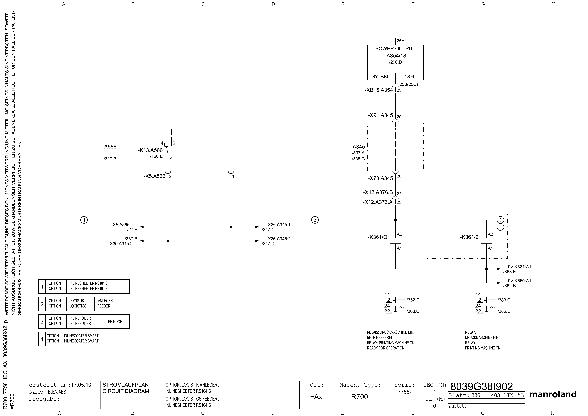

# +Ax — Sheet 336 of 403 — OPTION: LOGISTIK ANLEGER /

**INLINESHEETER RS104 S**

> Part of the manroland **R700** printing press IEC/UL circuit diagrams.
> Drawing class: **Stromlaufplan / Circuit diagram** (DIN A3).
> Document `+Ax` covers the **Central control console** machine section.

## At a glance

| Field | Value |
|---|---|
| Document | `+Ax`  (8039G38I902) |
| Sheet | **336** of 403 |
| Section (DE) | OPTION: LOGISTIK ANLEGER / |
| Section (EN) | INLINESHEETER RS104 S |
| Section type | CIRCUIT — Circuit diagram |
| Machine type | `R700` |
| Series | `7758` |
| Created | 17.05.10 |
| Replaces | — |
| Columns used | A, B, C, D, E, F, G, H |
| Path numbers | — |
| Labels on sheet | 97 |
| Cross-refs out | 13 |
| Cross-refs in | 22 |

**Previous:** [+Ax sheet 335](SHEET_0335.md) · **Next:** [+Ax sheet 337](SHEET_0337.md) · **Document TOC:** [_TOC.md](_TOC.md)  (+Ax) · **Master TOC:** [all sheets](../_MASTER_TOC.md)

## Sheet image (300 DPI, exact vector render)



_Rendered directly from the PDF vector layer at 300 DPI (1-bit), no OCR and no resampling. Use it to confirm anything ambiguous in the text below._

## Cross-references on this sheet

Each entry is a wire leaving this sheet. The printed token is `/sheet.column`; the link resolves to that sheet inside the same document.

| Ref | Target sheet | Col | Path | Destination on target | Target section | From col |
|---|---|---|---|---|---|---|
| `/200.D` | [+Ax sheet 200](SHEET_0200.md) | D | — | — | REFERENZMODUL | F |
| `/337.A` | [+Ax sheet 337](SHEET_0337.md) | A | — | — | OPTION: INLINESHEETER RS104 S | E |
| `/335.G` | [+Ax sheet 335](SHEET_0335.md) | G | — | — | 1 OPTION: LOGISTIK (ANLEGER AUSLEGER) | E |
| `/160.E` | [+Ax sheet 160](SHEET_0160.md) | E | — | — | ÜBERWACHUNGSRECHNER/ANSTEUERUNG NOT AUS | B |
| `/317.B` | [+Ax sheet 317](SHEET_0317.md) | B | — | — | OPTION: "EJEKTOR" ANLAGE / SELECT AIRSTATION / | B |
| `/27.E` | [+Ax sheet 27](SHEET_0027.md) | E | — | X5.A566:1 | SPANNUNGSVERSORGUNG, SCHALTSCHRANKBELÜFTUNG | B |
| `/347.C` | [+Ax sheet 347](SHEET_0347.md) | C | — | — | OPTION: LOGISTIK ANLEGER | D |
| `/337.B` | [+Ax sheet 337](SHEET_0337.md) | B | — | X39.A345:2 | OPTION: INLINESHEETER RS104 S | B |
| `/347.D` | [+Ax sheet 347](SHEET_0347.md) | D | — | — | OPTION: LOGISTIK ANLEGER | D |
| `/368.E` | [+Ax sheet 368](SHEET_0368.md) | E | — | — | OPTION: LOGISTIK AUSLEGER | G |
| `/382.B` | [+Ax sheet 382](SHEET_0382.md) | B | — | — | OPTION: INLINEFOILER PRINDOR | G |
| `/368.C` | [+Ax sheet 368](SHEET_0368.md) | C | — | — | OPTION: LOGISTIK AUSLEGER | F |
| `/386.D` | [+Ax sheet 386](SHEET_0386.md) | D | — | — | OPTION: INLINECOATER SMART | G |

### Incoming references (sheets that point here)

Every other sheet that sends a wire to this one. `Back-ref` is the token printed on *that* sheet; `Path` is its line number.

| From sheet | Cols | Back-ref | Path | Refs | What continues there |
|---|---|---|---|---|---|
| [+Ax#27](SHEET_0027.md) | E | `/27.E` | — | 1 | X5.A566:1 |
| [+Ax#160](SHEET_0160.md) | E | `/160.E` | — | 1 | — |
| [+Ax#200](SHEET_0200.md) | D | `/200.D` | — | 1 | — |
| [+Ax#232](SHEET_0232.md) | G | `/232.G` | — | 2 | — |
| [+Ax#248](SHEET_0248.md) | G, H | `/248.G`, `/248.H` | — | 2 | — |
| [+Ax#253](SHEET_0253.md) | B | `/253.B` | — | 1 | — |
| [+Ax#286](SHEET_0286.md) | A | `/286.A` | — | 1 | — |
| [+Ax#289](SHEET_0289.md) | E | `/289.E` | — | 1 | — |
| [+Ax#317](SHEET_0317.md) | B | `/317.B` | — | 1 | — |
| [+Ax#335](SHEET_0335.md) | F | `/335.F` | — | 1 | — |
| [+Ax#337](SHEET_0337.md) | A | `/337.A` | — | 2 | — |
| [+Ax#347](SHEET_0347.md) | C, D | `/347.C`, `/347.D` | — | 2 | — |
| [+Ax#352](SHEET_0352.md) | F | `/352.F` | — | 1 | — |
| [+Ax#368](SHEET_0368.md) | C, D | `/368.C`, `/368.D` | — | 2 | 0V.K361:A1 |
| [+Ax#382](SHEET_0382.md) | D | `/382.D` | — | 1 | 0V.K559:A1 |
| [+Ax#383](SHEET_0383.md) | B | `/383.B` | — | 1 | — |
| [+Ax#386](SHEET_0386.md) | D | `/386.D` | — | 1 | — |


## Devices on this sheet

| Tag | Class | Class meaning (IEC) | Col | Sub | Terminal | Sign |
|---|---|---|---|---|---|---|
| `A354/13` | A | Baugruppe / assembly, module, PC board | F | 13 | — | — |
| `A2` | A | Baugruppe / assembly, module, PC board | F | — | — | — |
| `A1` | A | Baugruppe / assembly, module, PC board | F | — | — | — |
| `A345` | A | Baugruppe / assembly, module, PC board | E | — | — | — |
| `A2` | A | Baugruppe / assembly, module, PC board | G | — | — | — |
| `A1` | A | Baugruppe / assembly, module, PC board | G | — | — | — |
| `K361/2` | K | Relais / relay, contactor | G | 2 | — | — |
| `A566` | A | Baugruppe / assembly, module, PC board | B | — | — | — |
| `18.6` | — | cross-device reference | F | — | — | — |
| `XB15.A354` | — | cross-device reference | F | — | — | — |
| `X78.A345` | — | cross-device reference | F | — | — | — |
| `X91.A345` | — | cross-device reference | F | — | — | — |
| `X12.A376.B` | — | cross-device reference | F | — | — | — |
| `X12.A376.A` | — | cross-device reference | E | — | — | — |
| `X5.A566` | — | cross-device reference | B | — | — | — |
| `K13.A566` | — | cross-device reference | B | — | — | — |
| `X26.A345:2` | — | cross-device reference | D | — | 2 | — |
| `X26.A345:1` | — | cross-device reference | D | — | 1 | — |
| `X39.A345:2` | — | cross-device reference | B | — | 2 | — |
| `X5.A566:1` | — | cross-device reference | B | — | 1 | — |

## Potentials / nets

| Potential | Count | Columns | Attached devices | Terminals |
|---|---|---|---|---|
| `0V` | 2 | H | `K361`, `K559` | `A1` |


A potential such as `L24+/4` or `M24+` is a named supply/return rail; every place it appears on this sheet is electrically common.

## Wire-end annotations (grouped as printed)

A wire that continues elsewhere is annotated with a small cluster: the destination description, the path/line number `#NN`, and the `/sheet.column` cross reference. Each row below is one such cluster exactly as it is grouped on the drawing.

| Col | Y | Path | Cross-ref | Text on the wire |
|---|---|---|---|---|
| F | 79.0 | — | — | `25A` |
| F | 94.1 | — | — | `POWER OUTPUT` |
| F | 108.0 | — | — | `A354/13` |
| F | 121.8 | — | `/200.D` | — |
| F | 150.9 | — | — | `BYTE.BIT 18.6` |
| F | 166.9 | — | — | `25B(25C)` |
| F | 177.5 | — | — | `XB15.A354 23` |
| F | 228.5 | — | — | `X91.A345 20` |
| B | 285.9 | — | — | `K13.A566 6` |
| B | 285.9 | — | — | `4` |
| B | 292.3 | — | — | `A566` |
| E | 292.3 | — | — | `A345` |
| E | 305.3 | — | `/337.A`, `/335.G` | — |
| B | 312.4 | — | `/160.E` | — |
| C | 314.3 | — | — | `5` |
| B | 317.7 | — | `/317.B` | — |
| C | 351.8 | — | — | `X5.A566 2 1` |
| F | 353.2 | — | — | `X78.A345 20` |
| F | 384.4 | — | — | `X12.A376.B 23` |
| F | 404.2 | — | — | `X12.A376.A 23` |
| D | 442.0 | — | — | `1 3` |
| E | 442.5 | — | — | `2` |
| B | 451.0 | — | `/27.E` | `X5.A566:1` |
| D | 451.0 | — | — | `X26.A345:1` |
| G | 456.7 | — | — | `4` |
| D | 460.9 | — | `/347.C` | — |
| F | 470.1 | — | — | `A2` |
| G | 470.1 | — | — | `A2` |
| E | 475.1 | — | — | `K361/Q` |
| G | 475.1 | — | — | `K361/2` |
| B | 479.3 | — | `/337.B` | `X39.A345:2` |
| D | 479.3 | — | — | `X26.A345:2` |
| D | 489.3 | — | `/347.D` | — |
| F | 498.5 | — | — | `A1` |
| G | 498.5 | — | — | `A1` |
| H | 536.0 | — | — | `0V.K361:A1` |
| G | 545.9 | — | `/368.E` | — |
| H | 564.4 | — | — | `0V.K559:A1` |
| A | 570.4 | — | — | `1 OPTION OPTION` |
| A | 570.4 | — | — | `INLINESHEETER RS104 S INLINESHEETER RS104 S` |
| G | 574.3 | — | `/382.B` | — |
| F | 591.3 | — | — | `14 12 24 22 21` |
| G | 591.3 | — | — | `14 12 24 22 21` |
| F | 597.0 | — | — | `11 /352.F` |
| G | 597.0 | — | — | `11 /383.C` |
| A | 605.8 | — | — | `2 OPTION OPTION` |
| A | 605.8 | — | — | `LOGISTIK LOGISTICS` |
| B | 605.8 | — | — | `FEEDER ANLEGER` |
| F | 626.0 | — | `/368.C` | — |
| G | 626.0 | — | `/386.D` | — |
| A | 641.2 | — | — | `3 OPTION OPTION` |
| A | 641.2 | — | — | `INLINEFOILER INLINEFOILER PRINDOR` |
| G | 669.5 | — | — | `RELAIS: DRUCKMASCHINE EIN RELAY: PRINTING MACHINE ON` |
| F | 669.6 | — | — | `RELAIS: DRUCKMASCHINE EIN, BETRIEBSBEREIT RELAY: PRINTING MACHINE ON, READY FOR OPERATION` |
| A | 676.7 | — | — | `4 OPTION OPTION` |
| A | 676.7 | — | — | `INLINECOATER SMART INLINECOATER SMART` |


## Reconstructed tables

This sheet carries tabular content (pin map / terminal assignment / index). The grid below was rebuilt from the drawing's own rule lines, so each row is exactly one physical row of the table.

### Table 1 — 3 data rows × 2 columns (at x=744.1, y=90.7)

| POWER | OUTPUT A354/13 /200.D |
|---|---|
| `BYTE.BIT` | `18.6` |
| `XB15.A354 X91.A345 X78.A345 X12.A376.B X12.A376.A` | `25B(25C) 23 20 20 23 23` |
| `K361/Q` | `A2 A1` |


## Notes and free text on this sheet

| Text | Col | Y (pt) |
|---|---|---|
| `25A` | F | 78.95 |
| `25B(25C)` | F | 166.86 |
| `POWER OUTPUT` | F | 94.1 |
| `BYTE.BIT` | F | 151.43 |
| `11 /352.F` | F | 596.96 |
| `K361/Q` | E | 475.12 |
| `RELAIS: DRUCKMASCHINE EIN,` | F | 669.6 |
| `BETRIEBSBEREIT` | F | 680.2 |
| `RELAY: PRINTING MACHINE ON,` | F | 690.86 |
| `READY FOR OPERATION` | F | 701.49 |
| `11 /383.C` | G | 596.96 |
| `RELAIS:` | G | 669.53 |
| `DRUCKMASCHINE EIN` | G | 680.24 |
| `RELAY:` | G | 690.8 |
| `PRINTING MACHINE ON` | G | 701.5 |
| `OPTION` | A | 570.36 |
| `INLINESHEETER RS104 S` | A | 570.38 |
| `LOGISTIK` | A | 605.79 |
| `LOGISTICS` | A | 616.42 |
| `ANLEGER` | B | 605.83 |
| `FEEDER` | B | 616.43 |
| `INLINEFOILER` | A | 641.25 |
| `PRINDOR` | B | 648.34 |
| `INLINECOATER SMART` | A | 676.69 |

## Complete label inventory (exact text from the drawing)

Every text object inside the drawing area of this sheet, in DIN reading order (column A→H, then top→bottom). This is the authoritative list: if a string is not here it is not printed on this sheet.

| Col | Y | X | Dir | Type | Text |
|---|---|---|---|---|---|
| A | 442.0 | 168.3 | → | number | `1` |
| A | 570.4 | 98.9 | → | text | `OPTION` |
| A | 570.4 | 140.9 | → | text | `INLINESHEETER RS104 S` |
| A | 575.7 | 82.5 | → | number | `1` |
| A | 581.0 | 98.9 | → | text | `OPTION` |
| A | 581.0 | 140.9 | → | text | `INLINESHEETER RS104 S` |
| A | 605.8 | 98.9 | → | text | `OPTION` |
| A | 605.8 | 140.9 | → | text | `LOGISTIK` |
| A | 611.1 | 82.2 | → | number | `2` |
| A | 616.4 | 98.9 | → | text | `OPTION` |
| A | 616.4 | 140.9 | → | text | `LOGISTICS` |
| A | 641.2 | 98.9 | → | text | `OPTION` |
| A | 641.2 | 140.9 | → | text | `INLINEFOILER` |
| A | 646.6 | 82.1 | → | number | `3` |
| A | 651.9 | 98.9 | → | text | `OPTION` |
| A | 651.9 | 140.9 | → | text | `INLINEFOILER` |
| A | 676.7 | 94.7 | → | text | `OPTION` |
| A | 676.7 | 129.5 | → | text | `INLINECOATER SMART` |
| A | 682.0 | 82.2 | → | number | `4` |
| A | 687.3 | 94.7 | → | text | `OPTION` |
| A | 687.3 | 129.5 | → | text | `INLINECOATER SMART` |
| B | 285.9 | 325.7 | → | number | `4` |
| B | 292.3 | 207.5 | → | device tag | `A566` |
| B | 299.4 | 279.2 | → | device ref | `K13.A566` |
| B | 312.4 | 303.9 | → | cross-reference | `/160.E` |
| B | 317.7 | 210.0 | → | cross-reference | `/317.B` |
| B | 351.8 | 290.8 | → | device ref | `X5.A566` |
| B | 451.0 | 225.6 | → | device ref | `X5.A566:1` |
| B | 460.9 | 257.7 | → | cross-reference | `/27.E` |
| B | 479.3 | 252.6 | → | cross-reference | `/337.B` |
| B | 489.3 | 219.7 | → | device ref | `X39.A345:2` |
| B | 605.8 | 198.4 | → | text | `ANLEGER` |
| B | 616.4 | 197.6 | → | text | `FEEDER` |
| B | 648.3 | 218.8 | → | text | `PRINDOR` |
| C | 285.9 | 349.8 | → | number | `6` |
| C | 314.3 | 342.7 | → | number | `5` |
| C | 353.2 | 342.7 | → | number | `2` |
| C | 353.2 | 469.7 | → | number | `1` |
| D | 451.0 | 539.7 | → | device ref | `X26.A345:1` |
| D | 460.9 | 530.1 | → | cross-reference | `/347.C` |
| D | 479.3 | 539.7 | → | device ref | `X26.A345:2` |
| D | 489.3 | 530.1 | → | cross-reference | `/347.D` |
| E | 292.3 | 710.6 | → | device tag | `A345` |
| E | 305.3 | 712.9 | → | cross-reference | `/337.A` |
| E | 317.8 | 712.6 | → | cross-reference | `/335.G` |
| E | 404.2 | 734.7 | → | device ref | `X12.A376.A` |
| E | 442.5 | 635.8 | → | number | `2` |
| E | 475.1 | 744.9 | → | text | `K361/Q` |
| F | 78.9 | 803.3 | → | text | `25A` |
| F | 94.1 | 760.0 | → | text | `POWER OUTPUT` |
| F | 108.0 | 779.4 | → | device tag | `A354/13` |
| F | 121.8 | 788.0 | → | cross-reference | `/200.D` |
| F | 150.9 | 819.4 | → | device ref | `18.6` |
| F | 151.4 | 754.0 | → | text | `BYTE.BIT` |
| F | 166.9 | 809.0 | → | text | `25B(25C)` |
| F | 177.5 | 738.4 | → | device ref | `XB15.A354` |
| F | 178.9 | 803.3 | → | number | `23` |
| F | 228.5 | 745.5 | → | device ref | `X91.A345` |
| F | 232.8 | 803.3 | → | number | `20` |
| F | 353.2 | 803.3 | → | number | `20` |
| F | 356.1 | 745.5 | → | device ref | `X78.A345` |
| F | 384.4 | 735.6 | → | device ref | `X12.A376.B` |
| F | 388.7 | 803.3 | → | number | `23` |
| F | 405.7 | 803.3 | → | number | `23` |
| F | 470.1 | 803.6 | → | device tag | `A2` |
| F | 498.5 | 803.6 | → | device tag | `A1` |
| F | 591.3 | 778.1 | → | number | `14` |
| F | 597.0 | 808.2 | → | text | `11 /352.F` |
| F | 602.6 | 778.1 | → | number | `12` |
| F | 614.0 | 778.1 | → | number | `24` |
| F | 619.6 | 808.4 | → | number | `21` |
| F | 625.3 | 778.1 | → | number | `22` |
| F | 626.0 | 823.5 | → | cross-reference | `/368.C` |
| F | 669.6 | 743.2 | → | text | `RELAIS: DRUCKMASCHINE EIN,` |
| F | 680.2 | 743.2 | → | text | `BETRIEBSBEREIT` |
| F | 690.9 | 743.2 | → | text | `RELAY: PRINTING MACHINE ON,` |
| F | 701.5 | 743.2 | → | text | `READY FOR OPERATION` |
| G | 442.5 | 1011.4 | → | number | `3` |
| G | 456.7 | 1011.4 | → | number | `4` |
| G | 470.1 | 987.9 | → | device tag | `A2` |
| G | 475.1 | 931.5 | → | device tag | `K361/2` |
| G | 498.5 | 987.9 | → | device tag | `A1` |
| G | 545.9 | 1019.1 | → | cross-reference | `/368.E` |
| G | 574.3 | 1019.1 | → | cross-reference | `/382.B` |
| G | 591.3 | 962.4 | → | number | `14` |
| G | 597.0 | 992.4 | → | text | `11 /383.C` |
| G | 602.6 | 962.4 | → | number | `12` |
| G | 614.0 | 962.4 | → | number | `24` |
| G | 619.6 | 992.7 | → | number | `21` |
| G | 625.3 | 962.4 | → | number | `22` |
| G | 626.0 | 1007.7 | → | cross-reference | `/386.D` |
| G | 669.5 | 941.7 | → | text | `RELAIS:` |
| G | 680.2 | 941.7 | → | text | `DRUCKMASCHINE EIN` |
| G | 690.8 | 941.7 | → | text | `RELAY:` |
| G | 701.5 | 941.7 | → | text | `PRINTING MACHINE ON` |
| H | 536.0 | 1028.7 | → | potential | `0V.K361:A1` |
| H | 564.4 | 1028.7 | → | potential | `0V.K559:A1` |

## Reading-order text block

The same content as a plain block, grouped by DIN column — convenient to paste or to match against a visual description.

```text
=== Column A ===
 442.0  168.3  numeric      1
 570.4   98.9  text         OPTION
 570.4  140.9  text         INLINESHEETER RS104 S
 575.7   82.5  numeric      1
 581.0   98.9  text         OPTION
 581.0  140.9  text         INLINESHEETER RS104 S
 605.8   98.9  text         OPTION
 605.8  140.9  text         LOGISTIK
 611.1   82.2  numeric      2
 616.4   98.9  text         OPTION
 616.4  140.9  text         LOGISTICS
 641.2   98.9  text         OPTION
 641.2  140.9  text         INLINEFOILER
 646.6   82.1  numeric      3
 651.9   98.9  text         OPTION
 651.9  140.9  text         INLINEFOILER
 676.7   94.7  text         OPTION
 676.7  129.5  text         INLINECOATER SMART
 682.0   82.2  numeric      4
 687.3   94.7  text         OPTION
 687.3  129.5  text         INLINECOATER SMART
=== Column B ===
 285.9  325.7  numeric      4
 292.3  207.5  devtag       A566
 299.4  279.2  devref       K13.A566
 312.4  303.9  xref         /160.E
 317.7  210.0  xref         /317.B
 351.8  290.8  devref       X5.A566
 451.0  225.6  devref       X5.A566:1
 460.9  257.7  xref         /27.E
 479.3  252.6  xref         /337.B
 489.3  219.7  devref       X39.A345:2
 605.8  198.4  text         ANLEGER
 616.4  197.6  text         FEEDER
 648.3  218.8  text         PRINDOR
=== Column C ===
 285.9  349.8  numeric      6
 314.3  342.7  numeric      5
 353.2  342.7  numeric      2
 353.2  469.7  numeric      1
=== Column D ===
 451.0  539.7  devref       X26.A345:1
 460.9  530.1  xref         /347.C
 479.3  539.7  devref       X26.A345:2
 489.3  530.1  xref         /347.D
=== Column E ===
 292.3  710.6  devtag       A345
 305.3  712.9  xref         /337.A
 317.8  712.6  xref         /335.G
 404.2  734.7  devref       X12.A376.A
 442.5  635.8  numeric      2
 475.1  744.9  text         K361/Q
=== Column F ===
  78.9  803.3  text         25A
  94.1  760.0  text         POWER OUTPUT
 108.0  779.4  devtag       A354/13
 121.8  788.0  xref         /200.D
 150.9  819.4  devref       18.6
 151.4  754.0  text         BYTE.BIT
 166.9  809.0  text         25B(25C)
 177.5  738.4  devref       XB15.A354
 178.9  803.3  numeric      23
 228.5  745.5  devref       X91.A345
 232.8  803.3  numeric      20
 353.2  803.3  numeric      20
 356.1  745.5  devref       X78.A345
 384.4  735.6  devref       X12.A376.B
 388.7  803.3  numeric      23
 405.7  803.3  numeric      23
 470.1  803.6  devtag       A2
 498.5  803.6  devtag       A1
 591.3  778.1  numeric      14
 597.0  808.2  text         11 /352.F
 602.6  778.1  numeric      12
 614.0  778.1  numeric      24
 619.6  808.4  numeric      21
 625.3  778.1  numeric      22
 626.0  823.5  xref         /368.C
 669.6  743.2  text         RELAIS: DRUCKMASCHINE EIN,
 680.2  743.2  text         BETRIEBSBEREIT
 690.9  743.2  text         RELAY: PRINTING MACHINE ON,
 701.5  743.2  text         READY FOR OPERATION
=== Column G ===
 442.5 1011.4  numeric      3
 456.7 1011.4  numeric      4
 470.1  987.9  devtag       A2
 475.1  931.5  devtag       K361/2
 498.5  987.9  devtag       A1
 545.9 1019.1  xref         /368.E
 574.3 1019.1  xref         /382.B
 591.3  962.4  numeric      14
 597.0  992.4  text         11 /383.C
 602.6  962.4  numeric      12
 614.0  962.4  numeric      24
 619.6  992.7  numeric      21
 625.3  962.4  numeric      22
 626.0 1007.7  xref         /386.D
 669.5  941.7  text         RELAIS:
 680.2  941.7  text         DRUCKMASCHINE EIN
 690.8  941.7  text         RELAY:
 701.5  941.7  text         PRINTING MACHINE ON
=== Column H ===
 536.0 1028.7  net          0V.K361:A1
 564.4 1028.7  net          0V.K559:A1
```

---
_Generated from the PDF vector text layer; no OCR. Source: `R700_7758_IEC_AX_8039G38I902_p`, sheet 336._
