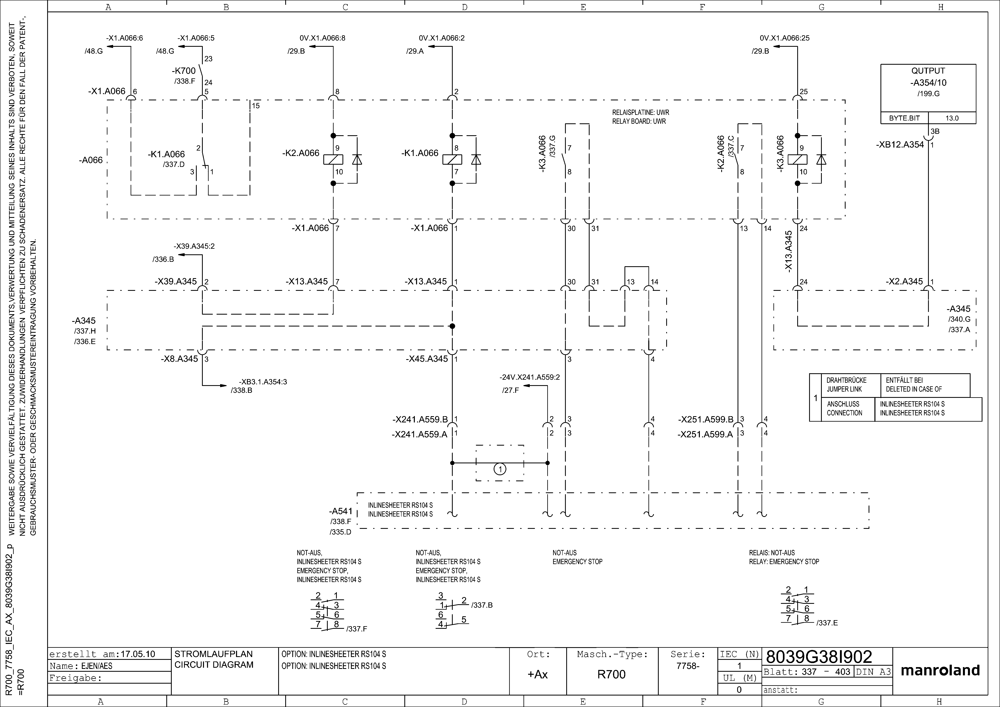

# +Ax — Sheet 337 of 403 — OPTION: INLINESHEETER RS104 S

**OPTION: INLINESHEETER RS104 S**

> Part of the manroland **R700** printing press IEC/UL circuit diagrams.
> Drawing class: **Stromlaufplan / Circuit diagram** (DIN A3).
> Document `+Ax` covers the **Central control console** machine section.

## At a glance

| Field | Value |
|---|---|
| Document | `+Ax`  (8039G38I902) |
| Sheet | **337** of 403 |
| Section (DE) | OPTION: INLINESHEETER RS104 S |
| Section (EN) | OPTION: INLINESHEETER RS104 S |
| Section type | CIRCUIT — Circuit diagram |
| Machine type | `R700` |
| Series | `7758` |
| Created | 17.05.10 |
| Replaces | — |
| Columns used | A, B, C, D, E, F, G, H |
| Path numbers | — |
| Labels on sheet | 163 |
| Cross-refs out | 22 |
| Cross-refs in | 61 |

**Previous:** [+Ax sheet 336](SHEET_0336.md) · **Next:** [+Ax sheet 338](SHEET_0338.md) · **Document TOC:** [_TOC.md](_TOC.md)  (+Ax) · **Master TOC:** [all sheets](../_MASTER_TOC.md)

## Sheet image (300 DPI, exact vector render)



_Rendered directly from the PDF vector layer at 300 DPI (1-bit), no OCR and no resampling. Use it to confirm anything ambiguous in the text below._

## Cross-references on this sheet

Each entry is a wire leaving this sheet. The printed token is `/sheet.column`; the link resolves to that sheet inside the same document.

| Ref | Target sheet | Col | Path | Destination on target | Target section | From col |
|---|---|---|---|---|---|---|
| `/29.B` | [+Ax sheet 29](SHEET_0029.md) | B | — | — | SPANNUNGSVERSORGUNG, SCHALTSCHRANKBELÜFTUNG | C |
| `/29.A` | [+Ax sheet 29](SHEET_0029.md) | A | — | — | SPANNUNGSVERSORGUNG, SCHALTSCHRANKBELÜFTUNG | D |
| `/29.B` | [+Ax sheet 29](SHEET_0029.md) | B | — | — | SPANNUNGSVERSORGUNG, SCHALTSCHRANKBELÜFTUNG | F |
| `/48.G` | [+Ax sheet 48](SHEET_0048.md) | G | — | — | NOT AUS | A |
| `/48.G` | [+Ax sheet 48](SHEET_0048.md) | G | — | — | NOT AUS | A |
| `/338.F` | [+Ax sheet 338](SHEET_0338.md) | F | — | — | OPTION: INLINESHEETER RS104 S | B |
| `/199.G` | [+Ax sheet 199](SHEET_0199.md) | G | — | — | REFERENZMODUL | H |
| `/337.G` | [+Ax sheet 337](SHEET_0337.md) | G | — | — | OPTION: INLINESHEETER RS104 S | E |
| `/337.C` | [+Ax sheet 337](SHEET_0337.md) | C | — | — | OPTION: INLINESHEETER RS104 S | F |
| `/337.D` | [+Ax sheet 337](SHEET_0337.md) | D | — | — | OPTION: INLINESHEETER RS104 S | B |
| `/336.B` | [+Ax sheet 336](SHEET_0336.md) | B | — | — | OPTION: LOGISTIK ANLEGER / | A |
| `/340.G` | [+Ax sheet 340](SHEET_0340.md) | G | — | — | OPTION: INLINESHEETER RS104 S | H |
| `/337.A` | [+Ax sheet 337](SHEET_0337.md) | A | — | — | OPTION: INLINESHEETER RS104 S | H |
| `/337.H` | [+Ax sheet 337](SHEET_0337.md) | H | — | — | OPTION: INLINESHEETER RS104 S | A |
| `/336.E` | [+Ax sheet 336](SHEET_0336.md) | E | — | — | OPTION: LOGISTIK ANLEGER / | A |
| `/338.B` | [+Ax sheet 338](SHEET_0338.md) | B | — | — | OPTION: INLINESHEETER RS104 S | B |
| `/27.F` | [+Ax sheet 27](SHEET_0027.md) | F | — | — | SPANNUNGSVERSORGUNG, SCHALTSCHRANKBELÜFTUNG | D |
| `/338.F` | [+Ax sheet 338](SHEET_0338.md) | F | — | — | OPTION: INLINESHEETER RS104 S | C |
| `/335.D` | [+Ax sheet 335](SHEET_0335.md) | D | — | — | 1 OPTION: LOGISTIK (ANLEGER AUSLEGER) | C |
| `/337.E` | [+Ax sheet 337](SHEET_0337.md) | E | — | 2 1 4 3 5 6 7 8 | OPTION: INLINESHEETER RS104 S | G |
| `/337.F` | [+Ax sheet 337](SHEET_0337.md) | F | — | 2 1 4 3 5 6 7 8 | OPTION: INLINESHEETER RS104 S | C |
| `/337.B` | [+Ax sheet 337](SHEET_0337.md) | B | — | — | OPTION: INLINESHEETER RS104 S | D |

### Incoming references (sheets that point here)

Every other sheet that sends a wire to this one. `Back-ref` is the token printed on *that* sheet; `Path` is its line number.

| From sheet | Cols | Back-ref | Path | Refs | What continues there |
|---|---|---|---|---|---|
| [+Ax#27](SHEET_0027.md) | F | `/27.F` | — | 1 | 24V.X241.A559:2 |
| [+Ax#29](SHEET_0029.md) | A, B | `/29.A`, `/29.B` | — | 3 | 0V.X1.A066:2; 0V.X1.A066:25; 0V.X1.A066:8 |
| [+Ax#48](SHEET_0048.md) | G | `/48.G` | — | 2 | — |
| [+Ax#199](SHEET_0199.md) | G | `/199.G` | — | 1 | — |
| [+Ax#206](SHEET_0206.md) | B, C | `/206.B`, `/206.C` | — | 13 | — |
| [+Ax#217](SHEET_0217.md) | H | `/217.H` | — | 1 | — |
| [+Ax#238](SHEET_0238.md) | A | `/238.A` | — | 1 | — |
| [+Ax#248](SHEET_0248.md) | F | `/248.F` | — | 1 | — |
| [+Ax#249](SHEET_0249.md) | G, H | `/249.G`, `/249.H` | — | 7 | — |
| [+Ax#280](SHEET_0280.md) | B | `/280.B` | — | 1 | — |
| [+Ax#282](SHEET_0282.md) | B | `/282.B` | — | 3 | — |
| [+Ax#295](SHEET_0295.md) | A, B, E, F | `/295.A`, `/295.B`, `/295.E`, `/295.F` | — | 12 | — |
| [+Ax#335](SHEET_0335.md) | D | `/335.D` | — | 1 | — |
| [+Ax#336](SHEET_0336.md) | B, E | `/336.B`, `/336.E` | — | 2 | X39.A345:2 |
| [+Ax#337](SHEET_0337.md) | A, B, C, D, E, F, G, H | `/337.A`, `/337.B`, `/337.C`, `/337.D`, `/337.E`, `/337.F`, `/337.G`, `/337.H` | — | 8 | 2 1 4 3 5 6 7 8 |
| [+Ax#338](SHEET_0338.md) | A, F | `/338.A`, `/338.F` | — | 3 | XB3.1.A354:3 |
| [+Ax#340](SHEET_0340.md) | G | `/340.G` | — | 1 | — |


## Devices on this sheet

| Tag | Class | Class meaning (IEC) | Col | Sub | Terminal | Sign |
|---|---|---|---|---|---|---|
| `A066` | A | Baugruppe / assembly, module, PC board | A | — | — | — |
| `A345` | A | Baugruppe / assembly, module, PC board | A | — | — | — |
| `A354/10` | A | Baugruppe / assembly, module, PC board | H | 10 | — | — |
| `A541` | A | Baugruppe / assembly, module, PC board | C | — | — | — |
| `A345` | A | Baugruppe / assembly, module, PC board | H | — | — | — |
| `K700` | K | Relais / relay, contactor | B | — | — | — |
| `X241.A559.B` | — | cross-device reference | D | — | — | — |
| `X241.A559.A` | — | cross-device reference | D | — | — | — |
| `13.0` | — | cross-device reference | H | — | — | — |
| `XB12.A354` | — | cross-device reference | H | — | — | — |
| `K1.A066` | — | cross-device reference | D | — | — | — |
| `X1.A066` | — | cross-device reference | D | — | — | — |
| `K3.A066` | — | cross-device reference | G | — | — | — |
| `X13.A345` | — | cross-device reference | D | — | — | — |
| `X2.A345` | — | cross-device reference | H | — | — | — |
| `X13.A345` | — | cross-device reference | G | — | — | — |
| `K2.A066` | — | cross-device reference | C | — | — | — |
| `X1.A066` | — | cross-device reference | C | — | — | — |
| `X13.A345` | — | cross-device reference | C | — | — | — |
| `X1.A066` | — | cross-device reference | A | — | — | — |
| `X45.A345` | — | cross-device reference | D | — | — | — |
| `X39.A345` | — | cross-device reference | B | — | — | — |
| `K1.A066` | — | cross-device reference | A | — | — | — |
| `K3.A066` | — | cross-device reference | E | — | — | — |
| `X251.A599.B` | — | cross-device reference | F | — | — | — |
| `X251.A599.A` | — | cross-device reference | F | — | — | — |
| `K2.A066` | — | cross-device reference | F | — | — | — |
| `X8.A345` | — | cross-device reference | B | — | — | — |
| `XB3.1.A354:3` | — | cross-device reference | B | — | 3 | — |
| `X39.A345:2` | — | cross-device reference | B | — | 2 | — |
| `X1.A066:5` | — | cross-device reference | B | — | 5 | — |
| `X1.A066:6` | — | cross-device reference | A | — | 6 | — |

## Potentials / nets

| Potential | Count | Columns | Attached devices | Terminals |
|---|---|---|---|---|
| `0V` | 3 | C, D, G | `A066`, `X1` | `2`, `25`, `8` |
| `24V` | 1 | E | `A559`, `X241` | `2` |


A potential such as `L24+/4` or `M24+` is a named supply/return rail; every place it appears on this sheet is electrically common.

## Wire-end annotations (grouped as printed)

A wire that continues elsewhere is annotated with a small cluster: the destination description, the path/line number `#NN`, and the `/sheet.column` cross reference. Each row below is one such cluster exactly as it is grouped on the drawing.

| Col | Y | Path | Cross-ref | Text on the wire |
|---|---|---|---|---|
| A | 41.4 | — | — | `X1.A066:6` |
| B | 41.4 | — | — | `X1.A066:5` |
| C | 41.4 | — | — | `0V.X1.A066:8` |
| D | 41.4 | — | — | `0V.X1.A066:2` |
| G | 41.4 | — | — | `0V.X1.A066:25` |
| C | 56.9 | — | `/29.B` | — |
| D | 56.9 | — | `/29.A` | — |
| F | 56.9 | — | `/29.B` | — |
| A | 57.0 | — | `/48.G` | — |
| A | 57.0 | — | `/48.G` | — |
| B | 66.2 | — | — | `23` |
| B | 79.7 | — | — | `K700 24` |
| H | 80.0 | — | — | `QUTPUT` |
| B | 92.8 | — | `/338.F` | — |
| H | 93.8 | — | — | `A354/10` |
| A | 103.8 | — | — | `X1.A066 6` |
| B | 105.2 | — | — | `5 8` |
| E | 105.2 | — | — | `2 25` |
| H | 107.6 | — | `/199.G` | — |
| B | 122.2 | — | — | `15` |
| E | 131.0 | — | — | `RELAISPLATINE: UWR RELAY BOARD: UWR` |
| H | 137.3 | — | — | `BYTE.BIT 13.0` |
| H | 152.6 | — | — | `3B` |
| E | 161.0 | — | — | `K3.A066` |
| E | 161.0 | — | `/337.G` | — |
| F | 161.0 | — | — | `K2.A066` |
| G | 161.0 | — | — | `K3.A066` |
| F | 161.3 | — | `/337.C` | — |
| H | 167.6 | — | — | `XB12.A354 1` |
| B | 172.5 | — | — | `2` |
| C | 172.5 | — | — | `9` |
| D | 172.5 | — | — | `8` |
| E | 172.5 | — | — | `7` |
| F | 172.5 | — | — | `7` |
| G | 172.5 | — | — | `9` |
| C | 177.5 | — | — | `K2.A066` |
| D | 177.5 | — | — | `K1.A066` |
| A | 178.9 | — | — | `K1.A066` |
| A | 186.0 | — | — | `A066` |
| B | 192.0 | — | `/337.D` | — |
| B | 200.9 | — | — | `3` |
| B | 200.9 | — | — | `1` |
| C | 200.9 | — | — | `10` |
| D | 200.9 | — | — | `7` |
| E | 200.9 | — | — | `8` |
| F | 200.9 | — | — | `8` |
| G | 200.9 | — | — | `10` |
| C | 266.8 | — | — | `X1.A066 7` |
| D | 266.8 | — | — | `X1.A066 1` |
| E | 268.2 | — | — | `30 31` |
| F | 268.2 | — | — | `13 14` |
| G | 268.2 | — | — | `24` |
| G | 274.4 | — | — | `X13.A345` |
| B | 289.4 | — | — | `X39.A345:2` |
| A | 305.0 | — | `/336.B` | — |
| B | 330.5 | — | — | `X39.A345 2` |
| C | 330.5 | — | — | `X13.A345 7` |
| F | 330.5 | — | — | `X13.A345 1 24 X2.A345 1` |
| E | 332.0 | — | — | `30 31 13 14` |
| H | 363.1 | — | — | `A345` |
| H | 376.2 | — | `/340.G`, `/337.A` | — |
| A | 377.3 | — | — | `A345` |
| A | 390.4 | — | `/337.H`, `/336.E` | — |
| B | 422.7 | — | — | `X8.A345 3` |
| D | 422.7 | — | — | `X45.A345 1` |
| E | 424.1 | — | — | `3 4` |
| E | 445.3 | — | — | `24V.X241.A559:2` |
| G | 449.9 | — | — | `1 INLINESHEETER RS104 S INLINESHEETER RS104 S ENTFÄLLT BEI DELETED IN CASE OF` |
| G | 449.9 | — | — | `DRAHTBRÜCKE` |
| B | 451.0 | — | — | `XB3.1.A354:3` |
| G | 460.6 | — | — | `JUMPER LINK` |
| B | 460.9 | — | `/338.B` | — |
| D | 460.9 | — | `/27.F` | — |
| G | 478.3 | — | — | `CONNECTION ANSCHLUSS` |
| D | 494.9 | — | — | `X241.A559.B 1` |
| F | 494.9 | — | — | `X251.A599.B 3` |
| E | 495.0 | — | — | `2` |
| E | 495.0 | — | — | `3` |
| F | 495.0 | — | — | `4` |
| G | 495.0 | — | — | `4` |
| D | 512.0 | — | — | `X241.A559.A 1` |
| E | 512.0 | — | — | `2` |
| E | 512.0 | — | — | `3` |
| F | 512.0 | — | — | `4` |
| F | 512.0 | — | — | `X251.A599.A 3` |
| G | 512.0 | — | — | `4` |
| D | 555.4 | — | — | `1` |
| C | 598.7 | — | — | `INLINESHEETER RS104 S INLINESHEETER RS104 S` |
| C | 604.1 | — | — | `A541` |
| C | 617.2 | — | `/338.F`, `/335.D` | — |
| C | 655.4 | — | — | `NOT AUS, INLINESHEETER RS104 S EMERGENCY STOP, INLINESHEETER RS104 S` |
| D | 655.4 | — | — | `NOT AUS, INLINESHEETER RS104 S EMERGENCY STOP, INLINESHEETER RS104 S` |
| E | 655.4 | — | — | `NOT AUS EMERGENCY STOP` |
| G | 655.4 | — | — | `RELAIS: NOT AUS RELAY: EMERGENCY STOP` |
| G | 697.6 | — | `/337.E` | `2 4 5 7 1 3 8 6` |
| C | 704.7 | — | `/337.F` | `2 4 5 7 1 3 8 6` |
| D | 704.7 | — | — | `3 6 4 1` |
| D | 710.4 | — | — | `2` |
| D | 716.7 | — | `/337.B` | — |
| D | 733.0 | — | — | `5` |


## Reconstructed tables

This sheet carries tabular content (pin map / terminal assignment / index). The grid below was rebuilt from the drawing's own rule lines, so each row is exactly one physical row of the table.

### Table 1 — 3 data rows × 13 columns (at x=538.6, y=76.5)

| 2 |  |  |  |  |  |  |  |  | 25 |  | QUTPUT | A354/10 /199.G |
|---|---|---|---|---|---|---|---|---|---|---|---|---|
|  |  |  |  | `RELAY` | `RELAISPLATINE: BOARD:` | `UWR UWR` |  |  |  |  | `BYTE.BIT` | `13.0` |
| `8 7 1 1` | `K3.A066` | `/337.G` | `7 8 30 30` | `31 31` | `13` | `K2.A066 /337.C 14` | `7 8 13` | `K3.A066 14 X13.A345` | `9 10 24 24` |  | `XB12.A354 X2.A345` | `3B 1 1 A345 /340.G` |
| `1 1 1` | `24V.X241.A559:2 /27.F` | `2 2` | `3 3 3` |  |  | `4 X251.A599.B 4 4 X251.A599.A` | `3 3` | `4 4` | `1` | `DRAHTBRÜCKE JUMPER LINK ANSCHLUSS CONNECTION` | `ENTFÄLLT BEI DELETED IN CASE INLINESHEETER INLINESHEETER` | `/337.A OF RS104 S RS104 S` |


## Notes and free text on this sheet

| Text | Col | Y (pt) |
|---|---|---|
| `RELAISPLATINE: UWR` | E | 130.98 |
| `RELAY BOARD: UWR` | E | 141.62 |
| `3B` | H | 152.63 |
| `QUTPUT` | H | 79.98 |
| `BYTE.BIT` | H | 137.26 |
| `INLINESHEETER RS104 S` | C | 598.73 |
| `NOT AUS,` | D | 655.4 |
| `INLINESHEETER RS104 S` | D | 666.05 |
| `EMERGENCY STOP,` | D | 676.68 |
| `RELAIS: NOT AUS` | G | 655.41 |
| `RELAY: EMERGENCY STOP` | G | 666.06 |
| `NOT AUS,` | C | 655.4 |
| `EMERGENCY STOP,` | C | 676.68 |
| `DRAHTBRÜCKE` | G | 449.92 |
| `JUMPER LINK` | G | 460.56 |
| `ANSCHLUSS` | G | 478.27 |
| `CONNECTION` | G | 488.91 |
| `ENTFÄLLT BEI` | H | 449.88 |
| `DELETED IN CASE OF` | H | 460.54 |
| `INLINESHEETER RS104 S` | H | 478.26 |
| `NOT AUS` | E | 655.41 |
| `EMERGENCY STOP` | E | 666.06 |

## Complete label inventory (exact text from the drawing)

Every text object inside the drawing area of this sheet, in DIN reading order (column A→H, then top→bottom). This is the authoritative list: if a string is not here it is not printed on this sheet.

| Col | Y | X | Dir | Type | Text |
|---|---|---|---|---|---|
| A | 41.4 | 126.4 | → | device ref | `X1.A066:6` |
| A | 57.0 | 100.9 | → | cross-reference | `/48.G` |
| A | 57.0 | 186.0 | → | cross-reference | `/48.G` |
| A | 103.8 | 105.2 | → | device ref | `X1.A066` |
| A | 105.2 | 158.5 | → | number | `6` |
| A | 178.9 | 176.0 | → | device ref | `K1.A066` |
| A | 186.0 | 94.1 | → | device tag | `A066` |
| A | 305.0 | 181.7 | → | cross-reference | `/336.B` |
| A | 377.3 | 85.6 | → | device tag | `A345` |
| A | 390.4 | 88.4 | → | cross-reference | `/337.H` |
| A | 402.8 | 88.4 | → | cross-reference | `/336.E` |
| B | 41.4 | 211.5 | → | device ref | `X1.A066:5` |
| B | 66.2 | 243.5 | → | number | `23` |
| B | 79.7 | 204.7 | → | device tag | `K700` |
| B | 92.8 | 207.8 | → | cross-reference | `/338.F` |
| B | 94.6 | 243.5 | → | number | `24` |
| B | 105.2 | 243.5 | → | number | `5` |
| B | 122.2 | 299.6 | → | number | `15` |
| B | 172.5 | 233.9 | → | number | `2` |
| B | 192.0 | 194.2 | → | cross-reference | `/337.D` |
| B | 200.9 | 226.5 | → | number | `3` |
| B | 200.9 | 250.0 | → | number | `1` |
| B | 289.4 | 206.9 | → | device ref | `X39.A345:2` |
| B | 330.5 | 184.3 | → | device ref | `X39.A345` |
| B | 332.0 | 243.5 | → | number | `2` |
| B | 422.7 | 191.6 | → | device ref | `X8.A345` |
| B | 424.1 | 243.5 | → | number | `3` |
| B | 451.0 | 284.6 | → | device ref | `XB3.1.A354:3` |
| B | 460.9 | 275.0 | → | cross-reference | `/338.B` |
| C | 41.4 | 356.9 | → | potential | `0V.X1.A066:8` |
| C | 56.9 | 342.4 | → | cross-reference | `/29.B` |
| C | 105.2 | 399.4 | → | number | `8` |
| C | 172.5 | 399.4 | → | number | `9` |
| C | 177.5 | 336.2 | → | device ref | `K2.A066` |
| C | 200.9 | 398.8 | → | number | `10` |
| C | 266.8 | 347.5 | → | device ref | `X1.A066` |
| C | 268.2 | 399.4 | → | number | `7` |
| C | 330.5 | 340.2 | → | device ref | `X13.A345` |
| C | 332.0 | 399.4 | → | number | `7` |
| C | 598.7 | 438.5 | → | text | `INLINESHEETER RS104 S` |
| C | 604.1 | 391.7 | → | device tag | `A541` |
| C | 609.4 | 438.5 | → | text | `INLINESHEETER RS104 S` |
| C | 617.2 | 393.4 | → | cross-reference | `/338.F` |
| C | 629.6 | 392.6 | → | cross-reference | `/335.D` |
| C | 655.4 | 353.5 | → | text | `NOT AUS,` |
| C | 666.1 | 353.5 | → | text | `INLINESHEETER RS104 S` |
| C | 676.7 | 353.5 | → | text | `EMERGENCY STOP,` |
| C | 687.3 | 353.5 | → | text | `INLINESHEETER RS104 S` |
| C | 704.7 | 375.9 | → | number | `2` |
| C | 704.7 | 397.1 | → | number | `1` |
| C | 716.0 | 375.9 | → | number | `4` |
| C | 716.0 | 397.7 | → | number | `3` |
| C | 727.4 | 375.9 | → | number | `5` |
| C | 727.4 | 398.0 | → | number | `6` |
| C | 738.7 | 375.9 | → | number | `7` |
| C | 738.7 | 397.7 | → | number | `8` |
| C | 745.1 | 412.4 | → | cross-reference | `/337.F` |
| D | 41.4 | 498.9 | → | potential | `0V.X1.A066:2` |
| D | 56.9 | 483.9 | → | cross-reference | `/29.A` |
| D | 105.2 | 541.1 | → | number | `2` |
| D | 172.5 | 541.1 | → | number | `8` |
| D | 177.5 | 477.9 | → | device ref | `K1.A066` |
| D | 200.9 | 541.1 | → | number | `7` |
| D | 266.8 | 489.3 | → | device ref | `X1.A066` |
| D | 268.2 | 540.6 | → | number | `1` |
| D | 330.5 | 481.9 | → | device ref | `X13.A345` |
| D | 332.0 | 540.6 | → | number | `1` |
| D | 422.7 | 483.3 | → | device ref | `X45.A345` |
| D | 424.1 | 540.6 | → | number | `1` |
| D | 460.9 | 598.1 | → | cross-reference | `/27.F` |
| D | 495.0 | 467.4 | → | device ref | `X241.A559.B` |
| D | 495.0 | 540.6 | → | number | `1` |
| D | 512.0 | 540.6 | → | number | `1` |
| D | 512.7 | 466.6 | → | device ref | `X241.A559.A` |
| D | 555.4 | 593.5 | → | number | `1` |
| D | 655.4 | 495.2 | → | text | `NOT AUS,` |
| D | 666.1 | 495.2 | → | text | `INLINESHEETER RS104 S` |
| D | 676.7 | 495.2 | → | text | `EMERGENCY STOP,` |
| D | 687.3 | 495.2 | → | text | `INLINESHEETER RS104 S` |
| D | 704.7 | 521.9 | → | number | `3` |
| D | 710.3 | 549.6 | → | number | `2` |
| D | 716.0 | 523.3 | → | number | `1` |
| D | 716.7 | 561.3 | → | cross-reference | `/337.B` |
| D | 727.4 | 521.9 | → | number | `6` |
| D | 733.0 | 549.4 | → | number | `5` |
| D | 738.7 | 521.9 | → | number | `4` |
| E | 131.0 | 729.1 | → | text | `RELAISPLATINE: UWR` |
| E | 141.6 | 729.1 | → | text | `RELAY BOARD: UWR` |
| E | 161.0 | 640.9 | ↕ | device ref | `K3.A066` |
| E | 161.0 | 654.0 | ↕ | cross-reference | `/337.G` |
| E | 172.5 | 675.8 | → | number | `7` |
| E | 200.9 | 675.8 | → | number | `8` |
| E | 268.2 | 675.8 | → | number | `30` |
| E | 268.2 | 704.1 | → | number | `31` |
| E | 332.0 | 675.8 | → | number | `30` |
| E | 332.0 | 704.1 | → | number | `31` |
| E | 332.0 | 746.1 | → | number | `13` |
| E | 424.1 | 675.8 | → | number | `3` |
| E | 445.3 | 595.0 | → | potential | `24V.X241.A559:2` |
| E | 495.0 | 654.5 | → | number | `2` |
| E | 495.0 | 675.8 | → | number | `3` |
| E | 512.0 | 654.5 | → | number | `2` |
| E | 512.0 | 675.8 | → | number | `3` |
| E | 655.4 | 658.2 | → | text | `NOT AUS` |
| E | 666.1 | 658.2 | → | text | `EMERGENCY STOP` |
| F | 56.9 | 895.2 | → | cross-reference | `/29.B` |
| F | 161.0 | 853.5 | ↕ | device ref | `K2.A066` |
| F | 161.3 | 866.6 | ↕ | cross-reference | `/337.C` |
| F | 172.5 | 881.3 | → | number | `7` |
| F | 200.9 | 881.3 | → | number | `8` |
| F | 268.2 | 880.7 | → | number | `13` |
| F | 332.0 | 774.4 | → | number | `14` |
| F | 424.1 | 775.0 | → | number | `4` |
| F | 495.0 | 775.0 | → | number | `4` |
| F | 495.0 | 807.6 | → | device ref | `X251.A599.B` |
| F | 495.0 | 881.3 | → | number | `3` |
| F | 512.0 | 775.0 | → | number | `4` |
| F | 512.0 | 881.3 | → | number | `3` |
| F | 512.7 | 806.7 | → | device ref | `X251.A599.A` |
| G | 41.4 | 904.8 | → | potential | `0V.X1.A066:25` |
| G | 105.2 | 952.2 | → | number | `25` |
| G | 161.0 | 924.4 | ↕ | device ref | `K3.A066` |
| G | 172.5 | 952.2 | → | number | `9` |
| G | 200.9 | 951.6 | → | number | `10` |
| G | 268.2 | 909.1 | → | number | `14` |
| G | 268.2 | 952.2 | → | number | `24` |
| G | 274.4 | 934.3 | ↕ | device ref | `X13.A345` |
| G | 332.0 | 952.2 | → | number | `24` |
| G | 449.9 | 984.2 | → | text | `DRAHTBRÜCKE` |
| G | 460.6 | 984.8 | → | text | `JUMPER LINK` |
| G | 469.4 | 968.3 | → | number | `1` |
| G | 478.3 | 985.0 | → | text | `ANSCHLUSS` |
| G | 488.9 | 984.8 | → | text | `CONNECTION` |
| G | 495.0 | 909.6 | → | number | `4` |
| G | 512.0 | 909.6 | → | number | `4` |
| G | 655.4 | 892.1 | → | text | `RELAIS: NOT AUS` |
| G | 666.1 | 892.1 | → | text | `RELAY: EMERGENCY STOP` |
| G | 697.6 | 935.7 | → | number | `2` |
| G | 697.6 | 957.0 | → | number | `1` |
| G | 708.9 | 935.7 | → | number | `4` |
| G | 708.9 | 957.5 | → | number | `3` |
| G | 720.3 | 935.7 | → | number | `5` |
| G | 720.3 | 957.8 | → | number | `6` |
| G | 731.6 | 935.7 | → | number | `7` |
| G | 731.6 | 957.5 | → | number | `8` |
| G | 738.0 | 972.3 | → | cross-reference | `/337.E` |
| H | 80.0 | 1085.2 | → | text | `QUTPUT` |
| H | 93.8 | 1084.1 | → | device tag | `A354/10` |
| H | 107.6 | 1092.6 | → | cross-reference | `/199.G` |
| H | 137.3 | 1058.7 | → | text | `BYTE.BIT` |
| H | 137.3 | 1125.6 | → | device ref | `13.0` |
| H | 152.6 | 1108.1 | → | text | `3B` |
| H | 167.5 | 1043.1 | → | device ref | `XB12.A354` |
| H | 169.0 | 1107.5 | → | number | `1` |
| H | 330.5 | 1054.8 | → | device ref | `X2.A345` |
| H | 332.0 | 1107.5 | → | number | `1` |
| H | 363.1 | 1127.3 | → | device tag | `A345` |
| H | 376.2 | 1129.3 | → | cross-reference | `/340.G` |
| H | 388.6 | 1129.6 | → | cross-reference | `/337.A` |
| H | 449.9 | 1055.1 | → | text | `ENTFÄLLT BEI` |
| H | 460.5 | 1055.1 | → | text | `DELETED IN CASE OF` |
| H | 478.3 | 1048.0 | → | text | `INLINESHEETER RS104 S` |
| H | 488.9 | 1048.0 | → | text | `INLINESHEETER RS104 S` |

## Reading-order text block

The same content as a plain block, grouped by DIN column — convenient to paste or to match against a visual description.

```text
=== Column A ===
  41.4  126.4  devref       X1.A066:6
  57.0  100.9  xref         /48.G
  57.0  186.0  xref         /48.G
 103.8  105.2  devref       X1.A066
 105.2  158.5  numeric      6
 178.9  176.0  devref       K1.A066
 186.0   94.1  devtag       A066
 305.0  181.7  xref         /336.B
 377.3   85.6  devtag       A345
 390.4   88.4  xref         /337.H
 402.8   88.4  xref         /336.E
=== Column B ===
  41.4  211.5  devref       X1.A066:5
  66.2  243.5  numeric      23
  79.7  204.7  devtag       K700
  92.8  207.8  xref         /338.F
  94.6  243.5  numeric      24
 105.2  243.5  numeric      5
 122.2  299.6  numeric      15
 172.5  233.9  numeric      2
 192.0  194.2  xref         /337.D
 200.9  226.5  numeric      3
 200.9  250.0  numeric      1
 289.4  206.9  devref       X39.A345:2
 330.5  184.3  devref       X39.A345
 332.0  243.5  numeric      2
 422.7  191.6  devref       X8.A345
 424.1  243.5  numeric      3
 451.0  284.6  devref       XB3.1.A354:3
 460.9  275.0  xref         /338.B
=== Column C ===
  41.4  356.9  net          0V.X1.A066:8
  56.9  342.4  xref         /29.B
 105.2  399.4  numeric      8
 172.5  399.4  numeric      9
 177.5  336.2  devref       K2.A066
 200.9  398.8  numeric      10
 266.8  347.5  devref       X1.A066
 268.2  399.4  numeric      7
 330.5  340.2  devref       X13.A345
 332.0  399.4  numeric      7
 598.7  438.5  text         INLINESHEETER RS104 S
 604.1  391.7  devtag       A541
 609.4  438.5  text         INLINESHEETER RS104 S
 617.2  393.4  xref         /338.F
 629.6  392.6  xref         /335.D
 655.4  353.5  text         NOT AUS,
 666.1  353.5  text         INLINESHEETER RS104 S
 676.7  353.5  text         EMERGENCY STOP,
 687.3  353.5  text         INLINESHEETER RS104 S
 704.7  375.9  numeric      2
 704.7  397.1  numeric      1
 716.0  375.9  numeric      4
 716.0  397.7  numeric      3
 727.4  375.9  numeric      5
 727.4  398.0  numeric      6
 738.7  375.9  numeric      7
 738.7  397.7  numeric      8
 745.1  412.4  xref         /337.F
=== Column D ===
  41.4  498.9  net          0V.X1.A066:2
  56.9  483.9  xref         /29.A
 105.2  541.1  numeric      2
 172.5  541.1  numeric      8
 177.5  477.9  devref       K1.A066
 200.9  541.1  numeric      7
 266.8  489.3  devref       X1.A066
 268.2  540.6  numeric      1
 330.5  481.9  devref       X13.A345
 332.0  540.6  numeric      1
 422.7  483.3  devref       X45.A345
 424.1  540.6  numeric      1
 460.9  598.1  xref         /27.F
 495.0  467.4  devref       X241.A559.B
 495.0  540.6  numeric      1
 512.0  540.6  numeric      1
 512.7  466.6  devref       X241.A559.A
 555.4  593.5  numeric      1
 655.4  495.2  text         NOT AUS,
 666.1  495.2  text         INLINESHEETER RS104 S
 676.7  495.2  text         EMERGENCY STOP,
 687.3  495.2  text         INLINESHEETER RS104 S
 704.7  521.9  numeric      3
 710.3  549.6  numeric      2
 716.0  523.3  numeric      1
 716.7  561.3  xref         /337.B
 727.4  521.9  numeric      6
 733.0  549.4  numeric      5
 738.7  521.9  numeric      4
=== Column E ===
 131.0  729.1  text         RELAISPLATINE: UWR
 141.6  729.1  text         RELAY BOARD: UWR
 161.0  640.9  devref       K3.A066
 161.0  654.0  xref         /337.G
 172.5  675.8  numeric      7
 200.9  675.8  numeric      8
 268.2  675.8  numeric      30
 268.2  704.1  numeric      31
 332.0  675.8  numeric      30
 332.0  704.1  numeric      31
 332.0  746.1  numeric      13
 424.1  675.8  numeric      3
 445.3  595.0  net          24V.X241.A559:2
 495.0  654.5  numeric      2
 495.0  675.8  numeric      3
 512.0  654.5  numeric      2
 512.0  675.8  numeric      3
 655.4  658.2  text         NOT AUS
 666.1  658.2  text         EMERGENCY STOP
=== Column F ===
  56.9  895.2  xref         /29.B
 161.0  853.5  devref       K2.A066
 161.3  866.6  xref         /337.C
 172.5  881.3  numeric      7
 200.9  881.3  numeric      8
 268.2  880.7  numeric      13
 332.0  774.4  numeric      14
 424.1  775.0  numeric      4
 495.0  775.0  numeric      4
 495.0  807.6  devref       X251.A599.B
 495.0  881.3  numeric      3
 512.0  775.0  numeric      4
 512.0  881.3  numeric      3
 512.7  806.7  devref       X251.A599.A
=== Column G ===
  41.4  904.8  net          0V.X1.A066:25
 105.2  952.2  numeric      25
 161.0  924.4  devref       K3.A066
 172.5  952.2  numeric      9
 200.9  951.6  numeric      10
 268.2  909.1  numeric      14
 268.2  952.2  numeric      24
 274.4  934.3  devref       X13.A345
 332.0  952.2  numeric      24
 449.9  984.2  text         DRAHTBRÜCKE
 460.6  984.8  text         JUMPER LINK
 469.4  968.3  numeric      1
 478.3  985.0  text         ANSCHLUSS
 488.9  984.8  text         CONNECTION
 495.0  909.6  numeric      4
 512.0  909.6  numeric      4
 655.4  892.1  text         RELAIS: NOT AUS
 666.1  892.1  text         RELAY: EMERGENCY STOP
 697.6  935.7  numeric      2
 697.6  957.0  numeric      1
 708.9  935.7  numeric      4
 708.9  957.5  numeric      3
 720.3  935.7  numeric      5
 720.3  957.8  numeric      6
 731.6  935.7  numeric      7
 731.6  957.5  numeric      8
 738.0  972.3  xref         /337.E
=== Column H ===
  80.0 1085.2  text         QUTPUT
  93.8 1084.1  devtag       A354/10
 107.6 1092.6  xref         /199.G
 137.3 1058.7  text         BYTE.BIT
 137.3 1125.6  devref       13.0
 152.6 1108.1  text         3B
 167.5 1043.1  devref       XB12.A354
 169.0 1107.5  numeric      1
 330.5 1054.8  devref       X2.A345
 332.0 1107.5  numeric      1
 363.1 1127.3  devtag       A345
 376.2 1129.3  xref         /340.G
 388.6 1129.6  xref         /337.A
 449.9 1055.1  text         ENTFÄLLT BEI
 460.5 1055.1  text         DELETED IN CASE OF
 478.3 1048.0  text         INLINESHEETER RS104 S
 488.9 1048.0  text         INLINESHEETER RS104 S
```

---
_Generated from the PDF vector text layer; no OCR. Source: `R700_7758_IEC_AX_8039G38I902_p`, sheet 337._
