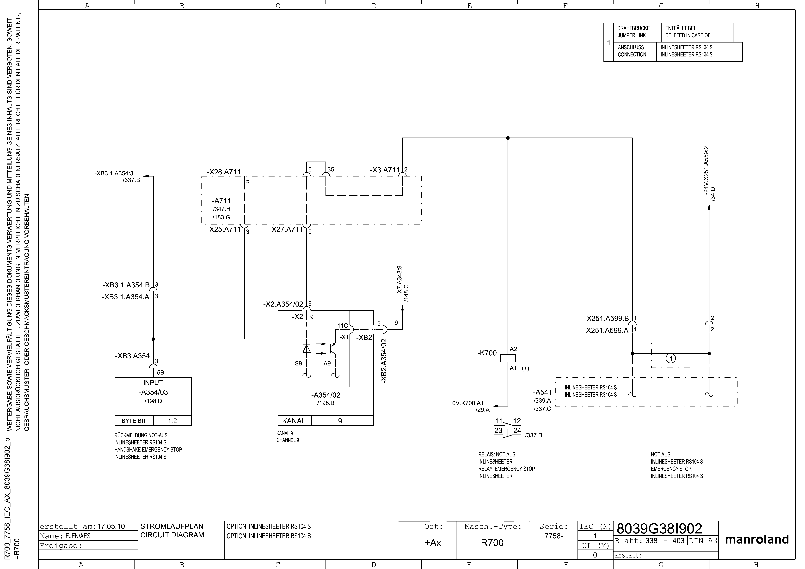

# +Ax — Sheet 338 of 403 — OPTION: INLINESHEETER RS104 S

**OPTION: INLINESHEETER RS104 S**

> Part of the manroland **R700** printing press IEC/UL circuit diagrams.
> Drawing class: **Stromlaufplan / Circuit diagram** (DIN A3).
> Document `+Ax` covers the **Central control console** machine section.

## At a glance

| Field | Value |
|---|---|
| Document | `+Ax`  (8039G38I902) |
| Sheet | **338** of 403 |
| Section (DE) | OPTION: INLINESHEETER RS104 S |
| Section (EN) | OPTION: INLINESHEETER RS104 S |
| Section type | CIRCUIT — Circuit diagram |
| Machine type | `R700` |
| Series | `7758` |
| Created | 17.05.10 |
| Replaces | — |
| Columns used | A, B, C, D, E, F, G, H |
| Path numbers | — |
| Labels on sheet | 93 |
| Cross-refs out | 11 |
| Cross-refs in | 26 |

**Previous:** [+Ax sheet 337](SHEET_0337.md) · **Next:** [+Ax sheet 339](SHEET_0339.md) · **Document TOC:** [_TOC.md](_TOC.md)  (+Ax) · **Master TOC:** [all sheets](../_MASTER_TOC.md)

## Sheet image (300 DPI, exact vector render)



_Rendered directly from the PDF vector layer at 300 DPI (1-bit), no OCR and no resampling. Use it to confirm anything ambiguous in the text below._

## Cross-references on this sheet

Each entry is a wire leaving this sheet. The printed token is `/sheet.column`; the link resolves to that sheet inside the same document.

| Ref | Target sheet | Col | Path | Destination on target | Target section | From col |
|---|---|---|---|---|---|---|
| `/34.D` | [+Ax sheet 34](SHEET_0034.md) | D | — | 24V.X251.A559:2 | SPANNUNGSVERSORGUNG, SCHALTSCHRANKBELÜFTUNG | H |
| `/337.B` | [+Ax sheet 337](SHEET_0337.md) | B | — | XB3.1.A354:3 | OPTION: INLINESHEETER RS104 S | A |
| `/347.H` | [+Ax sheet 347](SHEET_0347.md) | H | — | — | OPTION: LOGISTIK ANLEGER | B |
| `/183.G` | [+Ax sheet 183](SHEET_0183.md) | G | — | — | RESERVE | B |
| `/148.C` | [+Ax sheet 148](SHEET_0148.md) | C | — | X7.A343:9 | ÜBERWACHUNGSRECHNER SICHERHEITSBUS | D |
| `/339.A` | [+Ax sheet 339](SHEET_0339.md) | A | — | — | OPTION: INLINESHEETER RS104 S | F |
| `/337.C` | [+Ax sheet 337](SHEET_0337.md) | C | — | — | OPTION: INLINESHEETER RS104 S | F |
| `/198.D` | [+Ax sheet 198](SHEET_0198.md) | D | — | — | REFERENZMODUL | B |
| `/198.B` | [+Ax sheet 198](SHEET_0198.md) | B | — | — | REFERENZMODUL | C |
| `/29.A` | [+Ax sheet 29](SHEET_0029.md) | A | — | 0V.K700:A1 | SPANNUNGSVERSORGUNG, SCHALTSCHRANKBELÜFTUNG | E |
| `/337.B` | [+Ax sheet 337](SHEET_0337.md) | B | — | — | OPTION: INLINESHEETER RS104 S | F |

### Incoming references (sheets that point here)

Every other sheet that sends a wire to this one. `Back-ref` is the token printed on *that* sheet; `Path` is its line number.

| From sheet | Cols | Back-ref | Path | Refs | What continues there |
|---|---|---|---|---|---|
| [+Ax#29](SHEET_0029.md) | A | `/29.A` | — | 1 | — |
| [+Ax#34](SHEET_0034.md) | D | `/34.D` | — | 1 | 24V.X251.A559:2 |
| [+Ax#148](SHEET_0148.md) | C | `/148.C` | — | 1 | X7.A343:9 |
| [+Ax#183](SHEET_0183.md) | G | `/183.G` | — | 1 | A711 |
| [+Ax#198](SHEET_0198.md) | B, D | `/198.B`, `/198.D` | — | 2 | — |
| [+Ax#219](SHEET_0219.md) | C, E | `/219.C`, `/219.E` | — | 2 | — |
| [+Ax#224](SHEET_0224.md) | A, B, C | `/224.A`, `/224.B`, `/224.C` | — | 3 | — |
| [+Ax#225](SHEET_0225.md) | H | `/225.H` | — | 1 | — |
| [+Ax#268](SHEET_0268.md) | C | `/268.C` | — | 1 | — |
| [+Ax#271](SHEET_0271.md) | A | `/271.A` | — | 1 | — |
| [+Ax#272](SHEET_0272.md) | G, H | `/272.G`, `/272.H` | — | 3 | — |
| [+Ax#295](SHEET_0295.md) | A, B | `/295.A`, `/295.B` | — | 4 | — |
| [+Ax#337](SHEET_0337.md) | B, C | `/337.B`, `/337.C` | — | 3 | — |
| [+Ax#339](SHEET_0339.md) | A | `/339.A` | — | 1 | — |
| [+Ax#347](SHEET_0347.md) | H | `/347.H` | — | 1 | A711 |


## Devices on this sheet

| Tag | Class | Class meaning (IEC) | Col | Sub | Terminal | Sign |
|---|---|---|---|---|---|---|
| `A541` | A | Baugruppe / assembly, module, PC board | F | — | — | — |
| `A2` | A | Baugruppe / assembly, module, PC board | E | — | — | — |
| `A1` | A | Baugruppe / assembly, module, PC board | E | — | — | — |
| `K700` | K | Relais / relay, contactor | E | — | — | — |
| `A354/03` | A | Baugruppe / assembly, module, PC board | B | 03 | — | — |
| `A711` | A | Baugruppe / assembly, module, PC board | B | — | — | — |
| `S9` | S | Schalter / switch | C | — | — | — |
| `A9` | A | Baugruppe / assembly, module, PC board | D | — | — | — |
| `X1` | X | Klemme / terminal, plug connector | D | — | — | — |
| `X2` | X | Klemme / terminal, plug connector | C | — | — | — |
| `XB2` | XB |  | D | — | — | — |
| `A354/02` | A | Baugruppe / assembly, module, PC board | C | 02 | — | — |
| `X251.A599.B` | — | cross-device reference | F | — | — | — |
| `X251.A599.A` | — | cross-device reference | F | — | — | — |
| `XB3.A354` | — | cross-device reference | A | — | — | — |
| `1.2` | — | cross-device reference | B | — | — | — |
| `XB3.1.A354.B` | — | cross-device reference | A | — | — | — |
| `XB3.1.A354.A` | — | cross-device reference | A | — | — | — |
| `X25.A711` | — | cross-device reference | B | — | — | — |
| `X27.A711` | — | cross-device reference | C | — | — | — |
| `X3.A711` | — | cross-device reference | D | — | — | — |
| `XB3.1.A354:3` | — | cross-device reference | A | — | 3 | — |
| `X7.A343:9` | — | cross-device reference | D | — | 9 | — |
| `X28.A711` | — | cross-device reference | B | — | — | — |

## Potentials / nets

| Potential | Count | Columns | Attached devices | Terminals |
|---|---|---|---|---|
| `0V` | 1 | E | `K700` | `A1` |
| `24V` | 1 | G | `A559`, `X251` | `2` |


A potential such as `L24+/4` or `M24+` is a named supply/return rail; every place it appears on this sheet is electrically common.

## Wire-end annotations (grouped as printed)

A wire that continues elsewhere is annotated with a small cluster: the destination description, the path/line number `#NN`, and the `/sheet.column` cross reference. Each row below is one such cluster exactly as it is grouped on the drawing.

| Col | Y | Path | Cross-ref | Text on the wire |
|---|---|---|---|---|
| G | 38.9 | — | — | `1 INLINESHEETER RS104 S INLINESHEETER RS104 S ENTFÄLLT BEI DELETED IN CASE OF` |
| G | 38.9 | — | — | `DRAHTBRÜCKE` |
| G | 49.5 | — | — | `JUMPER LINK` |
| G | 67.2 | — | — | `CONNECTION ANSCHLUSS` |
| H | 216.3 | — | `/34.D` | `24V.X251.A559:2` |
| C | 246.9 | — | — | `6` |
| D | 246.9 | — | — | `35 X3.A711 2` |
| B | 249.8 | — | — | `X28.A711` |
| A | 252.6 | — | `/337.B` | `XB3.1.A354:3` |
| C | 263.9 | — | — | `5` |
| B | 292.3 | — | — | `A711` |
| B | 305.4 | — | `/347.H`, `/183.G` | — |
| B | 334.8 | — | — | `X25.A711 3` |
| C | 334.8 | — | — | `X27.A711 9` |
| D | 392.9 | — | `/148.C` | `X7.A343:9` |
| A | 417.0 | — | — | `XB3.1.A354.B 3` |
| A | 434.0 | — | — | `XB3.1.A354.A 3` |
| C | 445.4 | — | — | `X2.A354/02 9` |
| C | 463.8 | — | — | `X2` |
| D | 465.2 | — | — | `9 9` |
| F | 466.6 | — | — | `X251.A599.B 1` |
| H | 466.6 | — | — | `2` |
| D | 473.7 | — | — | `9` |
| D | 478.0 | — | — | `11C` |
| F | 483.6 | — | — | `X251.A599.A 1` |
| H | 483.6 | — | — | `2` |
| D | 494.9 | — | — | `X1` |
| D | 495.0 | — | — | `XB2` |
| D | 501.2 | — | — | `XB2.A354/02` |
| E | 512.6 | — | — | `A2` |
| E | 517.6 | — | — | `K700` |
| B | 521.9 | — | — | `XB3.A354 3` |
| G | 527.0 | — | — | `1` |
| C | 533.9 | — | — | `S9 A9` |
| E | 541.0 | — | — | `A1` |
| F | 541.0 | — | — | `(+)` |
| B | 547.4 | — | — | `5B` |
| B | 561.9 | — | — | `INPUT` |
| F | 570.4 | — | — | `INLINESHEETER RS104 S INLINESHEETER RS104 S` |
| B | 575.7 | — | — | `A354/03` |
| F | 575.7 | — | — | `A541` |
| C | 580.0 | — | — | `A354/02` |
| F | 588.8 | — | `/339.A`, `/337.C` | — |
| B | 589.5 | — | `/198.D` | — |
| C | 592.4 | — | `/198.B` | — |
| E | 592.7 | — | `/29.A` | `0V.K700:A1` |
| C | 618.2 | — | — | `KANAL 9` |
| E | 618.2 | — | — | `23 11 12 24` |
| B | 618.6 | — | — | `BYTE.BIT 1.2` |
| C | 638.6 | — | — | `KANAL 9 CHANNEL 9` |
| F | 640.2 | — | `/337.B` | — |
| B | 641.3 | — | — | `RÜCKMELDUNG NOT AUS INLINESHEETER RS104 S HANDSHAKE EMERGENCY STOP INLINESHEETER RS104 S` |
| E | 669.6 | — | — | `RELAIS: NOT AUS INLINESHEETER RELAY: EMERGENCY STOP INLINESHEETER` |
| G | 669.6 | — | — | `NOT AUS, INLINESHEETER RS104 S EMERGENCY STOP, INLINESHEETER RS104 S` |


## Reconstructed tables

This sheet carries tabular content (pin map / terminal assignment / index). The grid below was rebuilt from the drawing's own rule lines, so each row is exactly one physical row of the table.

### Table 1 — 6 data rows × 9 columns (at x=170.1, y=204.1)

| /337.B |  | X28.A711 | 5 |  | 6 35 |  |  | X3.A711 |
|---|---|---|---|---|---|---|---|---|
| `XB3.1.A354.B XB3.1.A354.A` | `3 3` | `A711 /347.H /183.G X25.A711` | `3` | `X27.A711 X2.A354/02` | `9 9` |  |  | `X7.A343:9` |
|  |  |  |  | `X2` | `9` | `11C X1` | `XB2` | `9 9` |
| `XB3.A354` | `3 5B` |  |  | `S9` | `A9` |  |  | `XB2.A354/02` |
| `INPUT` |  |  |  |  |  |  |  |  |
|  | `A354/03 /198.D` |  |  |  | `A354/02 /198.B` |  |  |  |
| `BYTE.BIT` | `1.2` |  |  | `KANAL` |  | `9` |  |  |


## Notes and free text on this sheet

| Text | Col | Y (pt) |
|---|---|---|
| `INLINESHEETER RS104 S` | F | 570.38 |
| `RELAIS: NOT AUS` | E | 669.58 |
| `INLINESHEETER` | E | 680.22 |
| `RELAY: EMERGENCY STOP` | E | 690.86 |
| `5B` | B | 547.36 |
| `INPUT` | B | 561.9 |
| `BYTE.BIT` | A | 619.15 |
| `RÜCKMELDUNG NOT AUS` | B | 641.28 |
| `INLINESHEETER RS104 S` | B | 651.88 |
| `HANDSHAKE EMERGENCY STOP` | B | 662.52 |
| `KANAL 9` | C | 638.58 |
| `CHANNEL 9` | C | 648.52 |
| `11C` | D | 477.97 |
| `KANAL` | C | 618.25 |
| `X2.A354/02` | C | 445.35 |
| `XB2.A354/02` | D | 501.17 |
| `DRAHTBRÜCKE` | G | 38.89 |
| `JUMPER LINK` | G | 49.53 |
| `ANSCHLUSS` | G | 67.25 |
| `CONNECTION` | G | 77.88 |
| `ENTFÄLLT BEI` | G | 38.86 |
| `DELETED IN CASE OF` | G | 49.51 |
| `INLINESHEETER RS104 S` | G | 67.23 |
| `NOT AUS,` | G | 669.57 |
| `EMERGENCY STOP,` | G | 690.85 |

## Complete label inventory (exact text from the drawing)

Every text object inside the drawing area of this sheet, in DIN reading order (column A→H, then top→bottom). This is the authoritative list: if a string is not here it is not printed on this sheet.

| Col | Y | X | Dir | Type | Text |
|---|---|---|---|---|---|
| A | 252.6 | 140.0 | → | device ref | `XB3.1.A354:3` |
| A | 262.5 | 181.7 | → | cross-reference | `/337.B` |
| A | 417.0 | 151.7 | → | device ref | `XB3.1.A354.B` |
| A | 434.7 | 150.8 | → | device ref | `XB3.1.A354.A` |
| A | 521.9 | 170.4 | → | device ref | `XB3.A354` |
| A | 619.1 | 180.0 | → | text | `BYTE.BIT` |
| B | 249.8 | 306.1 | → | device ref | `X28.A711` |
| B | 292.3 | 313.8 | → | device tag | `A711` |
| B | 305.4 | 315.2 | → | cross-reference | `/347.H` |
| B | 317.8 | 314.4 | → | cross-reference | `/183.G` |
| B | 334.8 | 306.1 | → | device ref | `X25.A711` |
| B | 417.0 | 229.3 | → | number | `3` |
| B | 434.0 | 229.3 | → | number | `3` |
| B | 530.4 | 229.3 | → | number | `3` |
| B | 547.4 | 232.2 | → | text | `5B` |
| B | 561.9 | 211.9 | → | text | `INPUT` |
| B | 575.7 | 205.4 | → | device tag | `A354/03` |
| B | 589.5 | 214.0 | → | cross-reference | `/198.D` |
| B | 618.6 | 248.0 | → | device ref | `1.2` |
| B | 641.3 | 169.2 | → | text | `RÜCKMELDUNG NOT AUS` |
| B | 651.9 | 169.2 | → | text | `INLINESHEETER RS104 S` |
| B | 662.5 | 169.2 | → | text | `HANDSHAKE EMERGENCY STOP` |
| B | 673.1 | 169.2 | → | text | `INLINESHEETER RS104 S` |
| C | 246.9 | 456.1 | → | number | `6` |
| C | 263.9 | 364.0 | → | number | `5` |
| C | 334.8 | 398.3 | → | device ref | `X27.A711` |
| C | 339.1 | 364.0 | → | number | `3` |
| C | 339.1 | 456.1 | → | number | `9` |
| C | 445.3 | 389.5 | → | text | `X2.A354/02` |
| C | 445.4 | 456.1 | → | number | `9` |
| C | 463.8 | 432.0 | → | device tag | `X2` |
| C | 465.2 | 458.9 | → | number | `9` |
| C | 533.9 | 433.1 | → | device tag | `S9` |
| C | 580.0 | 460.5 | → | device tag | `A354/02` |
| C | 592.4 | 469.3 | → | cross-reference | `/198.B` |
| C | 618.3 | 417.3 | → | text | `KANAL` |
| C | 638.6 | 409.0 | → | text | `KANAL 9` |
| C | 648.5 | 409.3 | → | text | `CHANNEL 9` |
| D | 246.9 | 484.4 | → | number | `35` |
| D | 246.9 | 547.4 | → | device ref | `X3.A711` |
| D | 246.9 | 597.8 | → | number | `2` |
| D | 392.9 | 587.1 | ↕ | device ref | `X7.A343:9` |
| D | 420.7 | 597.0 | ↕ | cross-reference | `/148.C` |
| D | 473.7 | 583.7 | → | number | `9` |
| D | 475.1 | 558.1 | → | number | `9` |
| D | 478.0 | 498.9 | → | text | `11C` |
| D | 494.9 | 502.6 | → | device tag | `X1` |
| D | 495.0 | 527.0 | → | device tag | `XB2` |
| D | 501.2 | 563.0 | ↕ | text | `XB2.A354/02` |
| D | 533.9 | 475.7 | → | device tag | `A9` |
| D | 618.2 | 500.2 | → | number | `9` |
| E | 512.6 | 754.0 | → | device tag | `A2` |
| E | 517.6 | 706.4 | → | device tag | `K700` |
| E | 541.0 | 754.0 | → | device tag | `A1` |
| E | 592.7 | 669.0 | → | potential | `0V.K700:A1` |
| E | 602.6 | 703.6 | → | cross-reference | `/29.A` |
| E | 618.2 | 732.8 | → | number | `11` |
| E | 618.2 | 758.6 | → | number | `12` |
| E | 632.4 | 731.3 | → | number | `23` |
| E | 669.6 | 707.8 | → | text | `RELAIS: NOT AUS` |
| E | 680.2 | 707.8 | → | text | `INLINESHEETER` |
| E | 690.9 | 707.8 | → | text | `RELAY: EMERGENCY STOP` |
| E | 701.5 | 707.8 | → | text | `INLINESHEETER` |
| F | 58.4 | 897.4 | → | number | `1` |
| F | 466.6 | 864.3 | → | device ref | `X251.A599.B` |
| F | 484.3 | 863.4 | → | device ref | `X251.A599.A` |
| F | 541.1 | 771.9 | → | other | `(+)` |
| F | 570.4 | 835.4 | → | text | `INLINESHEETER RS104 S` |
| F | 575.7 | 788.6 | → | device tag | `A541` |
| F | 581.0 | 835.4 | → | text | `INLINESHEETER RS104 S` |
| F | 588.8 | 789.4 | → | cross-reference | `/339.A` |
| F | 601.2 | 789.4 | → | cross-reference | `/337.C` |
| F | 632.4 | 759.4 | → | number | `24` |
| F | 640.2 | 776.7 | → | cross-reference | `/337.B` |
| G | 38.9 | 913.3 | → | text | `DRAHTBRÜCKE` |
| G | 38.9 | 984.2 | → | text | `ENTFÄLLT BEI` |
| G | 49.5 | 913.9 | → | text | `JUMPER LINK` |
| G | 49.5 | 984.2 | → | text | `DELETED IN CASE OF` |
| G | 67.2 | 914.2 | → | text | `ANSCHLUSS` |
| G | 67.2 | 977.1 | → | text | `INLINESHEETER RS104 S` |
| G | 77.9 | 913.9 | → | text | `CONNECTION` |
| G | 77.9 | 977.1 | → | text | `INLINESHEETER RS104 S` |
| G | 216.3 | 1040.6 | ↕ | potential | `24V.X251.A559:2` |
| G | 466.6 | 937.4 | → | number | `1` |
| G | 483.6 | 937.4 | → | number | `1` |
| G | 527.0 | 990.4 | → | number | `1` |
| G | 669.6 | 962.9 | → | text | `NOT AUS,` |
| G | 680.2 | 962.9 | → | text | `INLINESHEETER RS104 S` |
| G | 690.9 | 962.9 | → | text | `EMERGENCY STOP,` |
| G | 701.5 | 962.9 | → | text | `INLINESHEETER RS104 S` |
| H | 276.7 | 1050.5 | ↕ | cross-reference | `/34.D` |
| H | 466.6 | 1051.4 | → | number | `2` |
| H | 483.6 | 1051.4 | → | number | `2` |

## Reading-order text block

The same content as a plain block, grouped by DIN column — convenient to paste or to match against a visual description.

```text
=== Column A ===
 252.6  140.0  devref       XB3.1.A354:3
 262.5  181.7  xref         /337.B
 417.0  151.7  devref       XB3.1.A354.B
 434.7  150.8  devref       XB3.1.A354.A
 521.9  170.4  devref       XB3.A354
 619.1  180.0  text         BYTE.BIT
=== Column B ===
 249.8  306.1  devref       X28.A711
 292.3  313.8  devtag       A711
 305.4  315.2  xref         /347.H
 317.8  314.4  xref         /183.G
 334.8  306.1  devref       X25.A711
 417.0  229.3  numeric      3
 434.0  229.3  numeric      3
 530.4  229.3  numeric      3
 547.4  232.2  text         5B
 561.9  211.9  text         INPUT
 575.7  205.4  devtag       A354/03
 589.5  214.0  xref         /198.D
 618.6  248.0  devref       1.2
 641.3  169.2  text         RÜCKMELDUNG NOT AUS
 651.9  169.2  text         INLINESHEETER RS104 S
 662.5  169.2  text         HANDSHAKE EMERGENCY STOP
 673.1  169.2  text         INLINESHEETER RS104 S
=== Column C ===
 246.9  456.1  numeric      6
 263.9  364.0  numeric      5
 334.8  398.3  devref       X27.A711
 339.1  364.0  numeric      3
 339.1  456.1  numeric      9
 445.3  389.5  text         X2.A354/02
 445.4  456.1  numeric      9
 463.8  432.0  devtag       X2
 465.2  458.9  numeric      9
 533.9  433.1  devtag       S9
 580.0  460.5  devtag       A354/02
 592.4  469.3  xref         /198.B
 618.3  417.3  text         KANAL
 638.6  409.0  text         KANAL 9
 648.5  409.3  text         CHANNEL 9
=== Column D ===
 246.9  484.4  numeric      35
 246.9  547.4  devref       X3.A711
 246.9  597.8  numeric      2
 392.9  587.1  devref       X7.A343:9
 420.7  597.0  xref         /148.C
 473.7  583.7  numeric      9
 475.1  558.1  numeric      9
 478.0  498.9  text         11C
 494.9  502.6  devtag       X1
 495.0  527.0  devtag       XB2
 501.2  563.0  text         XB2.A354/02
 533.9  475.7  devtag       A9
 618.2  500.2  numeric      9
=== Column E ===
 512.6  754.0  devtag       A2
 517.6  706.4  devtag       K700
 541.0  754.0  devtag       A1
 592.7  669.0  net          0V.K700:A1
 602.6  703.6  xref         /29.A
 618.2  732.8  numeric      11
 618.2  758.6  numeric      12
 632.4  731.3  numeric      23
 669.6  707.8  text         RELAIS: NOT AUS
 680.2  707.8  text         INLINESHEETER
 690.9  707.8  text         RELAY: EMERGENCY STOP
 701.5  707.8  text         INLINESHEETER
=== Column F ===
  58.4  897.4  numeric      1
 466.6  864.3  devref       X251.A599.B
 484.3  863.4  devref       X251.A599.A
 541.1  771.9  other        (+)
 570.4  835.4  text         INLINESHEETER RS104 S
 575.7  788.6  devtag       A541
 581.0  835.4  text         INLINESHEETER RS104 S
 588.8  789.4  xref         /339.A
 601.2  789.4  xref         /337.C
 632.4  759.4  numeric      24
 640.2  776.7  xref         /337.B
=== Column G ===
  38.9  913.3  text         DRAHTBRÜCKE
  38.9  984.2  text         ENTFÄLLT BEI
  49.5  913.9  text         JUMPER LINK
  49.5  984.2  text         DELETED IN CASE OF
  67.2  914.2  text         ANSCHLUSS
  67.2  977.1  text         INLINESHEETER RS104 S
  77.9  913.9  text         CONNECTION
  77.9  977.1  text         INLINESHEETER RS104 S
 216.3 1040.6  net          24V.X251.A559:2
 466.6  937.4  numeric      1
 483.6  937.4  numeric      1
 527.0  990.4  numeric      1
 669.6  962.9  text         NOT AUS,
 680.2  962.9  text         INLINESHEETER RS104 S
 690.9  962.9  text         EMERGENCY STOP,
 701.5  962.9  text         INLINESHEETER RS104 S
=== Column H ===
 276.7 1050.5  xref         /34.D
 466.6 1051.4  numeric      2
 483.6 1051.4  numeric      2
```

---
_Generated from the PDF vector text layer; no OCR. Source: `R700_7758_IEC_AX_8039G38I902_p`, sheet 338._
