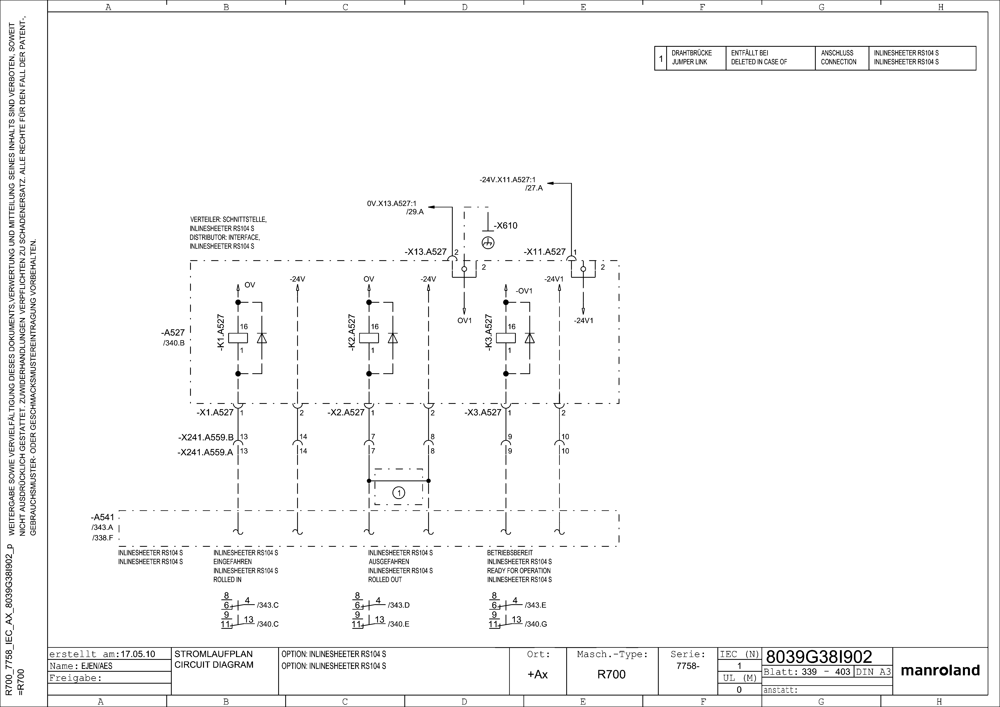

# +Ax — Sheet 339 of 403 — OPTION: INLINESHEETER RS104 S

**OPTION: INLINESHEETER RS104 S**

> Part of the manroland **R700** printing press IEC/UL circuit diagrams.
> Drawing class: **Stromlaufplan / Circuit diagram** (DIN A3).
> Document `+Ax` covers the **Central control console** machine section.

## At a glance

| Field | Value |
|---|---|
| Document | `+Ax`  (8039G38I902) |
| Sheet | **339** of 403 |
| Section (DE) | OPTION: INLINESHEETER RS104 S |
| Section (EN) | OPTION: INLINESHEETER RS104 S |
| Section type | CIRCUIT — Circuit diagram |
| Machine type | `R700` |
| Series | `7758` |
| Created | 17.05.10 |
| Replaces | — |
| Columns used | A, B, C, D, E, F, G, H |
| Path numbers | — |
| Labels on sheet | 108 |
| Cross-refs out | 11 |
| Cross-refs in | 29 |

**Previous:** [+Ax sheet 338](SHEET_0338.md) · **Next:** [+Ax sheet 340](SHEET_0340.md) · **Document TOC:** [_TOC.md](_TOC.md)  (+Ax) · **Master TOC:** [all sheets](../_MASTER_TOC.md)

## Sheet image (300 DPI, exact vector render)



_Rendered directly from the PDF vector layer at 300 DPI (1-bit), no OCR and no resampling. Use it to confirm anything ambiguous in the text below._

## Cross-references on this sheet

Each entry is a wire leaving this sheet. The printed token is `/sheet.column`; the link resolves to that sheet inside the same document.

| Ref | Target sheet | Col | Path | Destination on target | Target section | From col |
|---|---|---|---|---|---|---|
| `/27.A` | [+Ax sheet 27](SHEET_0027.md) | A | — | 24V.X11.A527:1 | SPANNUNGSVERSORGUNG, SCHALTSCHRANKBELÜFTUNG | D |
| `/29.A` | [+Ax sheet 29](SHEET_0029.md) | A | — | 0V.X13.A527:1 | SPANNUNGSVERSORGUNG, SCHALTSCHRANKBELÜFTUNG | C |
| `/340.B` | [+Ax sheet 340](SHEET_0340.md) | B | — | — | OPTION: INLINESHEETER RS104 S | B |
| `/343.A` | [+Ax sheet 343](SHEET_0343.md) | A | — | — | OPTION: INLINESHEETER RS104 S | A |
| `/338.F` | [+Ax sheet 338](SHEET_0338.md) | F | — | — | OPTION: INLINESHEETER RS104 S | A |
| `/343.C` | [+Ax sheet 343](SHEET_0343.md) | C | — | 4 | OPTION: INLINESHEETER RS104 S | B |
| `/343.D` | [+Ax sheet 343](SHEET_0343.md) | D | — | 4 | OPTION: INLINESHEETER RS104 S | C |
| `/343.E` | [+Ax sheet 343](SHEET_0343.md) | E | — | 4 | OPTION: INLINESHEETER RS104 S | E |
| `/340.E` | [+Ax sheet 340](SHEET_0340.md) | E | — | — | OPTION: INLINESHEETER RS104 S | C |
| `/340.G` | [+Ax sheet 340](SHEET_0340.md) | G | — | — | OPTION: INLINESHEETER RS104 S | E |
| `/340.C` | [+Ax sheet 340](SHEET_0340.md) | C | — | — | OPTION: INLINESHEETER RS104 S | B |

### Incoming references (sheets that point here)

Every other sheet that sends a wire to this one. `Back-ref` is the token printed on *that* sheet; `Path` is its line number.

| From sheet | Cols | Back-ref | Path | Refs | What continues there |
|---|---|---|---|---|---|
| [+Ax#27](SHEET_0027.md) | A | `/27.A` | — | 1 | — |
| [+Ax#29](SHEET_0029.md) | A | `/29.A` | — | 1 | 0V.X13.A527:1 |
| [+Ax#209](SHEET_0209.md) | B | `/209.B` | — | 2 | — |
| [+Ax#220](SHEET_0220.md) | G | `/220.G` | — | 2 | — |
| [+Ax#225](SHEET_0225.md) | C | `/225.C` | — | 2 | — |
| [+Ax#295](SHEET_0295.md) | E, F | `/295.E`, `/295.F` | — | 12 | — |
| [+Ax#338](SHEET_0338.md) | F | `/338.F` | — | 1 | — |
| [+Ax#340](SHEET_0340.md) | B, C, E, G | `/340.B`, `/340.C`, `/340.E`, `/340.G` | — | 4 | — |
| [+Ax#343](SHEET_0343.md) | A, C, D | `/343.A`, `/343.C`, `/343.D` | — | 4 | — |


## Devices on this sheet

| Tag | Class | Class meaning (IEC) | Col | Sub | Terminal | Sign |
|---|---|---|---|---|---|---|
| `A527` | A | Baugruppe / assembly, module, PC board | B | — | — | — |
| `A541` | A | Baugruppe / assembly, module, PC board | A | — | — | — |
| `OV1` | OV |  | E | — | — | — |
| `OV1` | OV |  | D | — | — | — |
| `X610` | X | Klemme / terminal, plug connector | D | — | — | — |
| `K1.A527` | — | cross-device reference | B | — | — | — |
| `K2.A527` | — | cross-device reference | C | — | — | — |
| `X1.A527` | — | cross-device reference | B | — | — | — |
| `X2.A527` | — | cross-device reference | C | — | — | — |
| `K3.A527` | — | cross-device reference | D | — | — | — |
| `X3.A527` | — | cross-device reference | D | — | — | — |
| `X241.A559.B` | — | cross-device reference | B | — | — | — |
| `X241.A559.A` | — | cross-device reference | B | — | — | — |
| `X11.A527` | — | cross-device reference | E | — | — | — |
| `X13.A527` | — | cross-device reference | D | — | — | — |

## Potentials / nets

| Potential | Count | Columns | Attached devices | Terminals |
|---|---|---|---|---|
| `0V` | 1 | C | `A527`, `X13` | `1` |
| `24V` | 3 | C, D | `A527`, `X11` | `1` |


A potential such as `L24+/4` or `M24+` is a named supply/return rail; every place it appears on this sheet is electrically common.

## Wire-end annotations (grouped as printed)

A wire that continues elsewhere is annotated with a small cluster: the destination description, the path/line number `#NN`, and the `/sheet.column` cross reference. Each row below is one such cluster exactly as it is grouped on the drawing.

| Col | Y | Path | Cross-ref | Text on the wire |
|---|---|---|---|---|
| G | 60.1 | — | — | `1 CONNECTION ANSCHLUSS INLINESHEETER RS104 S INLINESHEETER RS104 S` |
| F | 60.1 | — | — | `DRAHTBRÜCKE` |
| F | 60.1 | — | — | `ENTFÄLLT BEI DELETED IN CASE OF` |
| F | 70.8 | — | — | `JUMPER LINK` |
| D | 210.0 | — | `/27.A` | `24V.X11.A527:1` |
| C | 238.4 | — | `/29.A` | `0V.X13.A527:1` |
| B | 258.6 | — | — | `INLINESHEETER RS104 S DISTRIBUTOR: INTERFACE, INLINESHEETER RS104 S VERTEILER: SCHNITTSTELLE,` |
| D | 263.9 | — | — | `X610` |
| D | 295.1 | — | — | `X13.A527 2 X11.A527 1` |
| E | 314.3 | — | — | `2 2` |
| C | 328.4 | — | — | `24V OV 24V` |
| E | 328.4 | — | — | `24V1` |
| B | 335.5 | — | — | `OV` |
| E | 342.6 | — | — | `OV1` |
| B | 373.6 | — | — | `K1.A527` |
| C | 373.6 | — | — | `K2.A527` |
| D | 373.6 | — | — | `K3.A527` |
| D | 378.0 | — | — | `OV1` |
| E | 378.0 | — | — | `24V1` |
| B | 385.1 | — | — | `16` |
| C | 385.1 | — | — | `16` |
| D | 385.1 | — | — | `16` |
| B | 391.5 | — | — | `A527` |
| B | 404.6 | — | `/340.B` | — |
| B | 413.5 | — | — | `1` |
| C | 413.5 | — | — | `1` |
| D | 413.5 | — | — | `1` |
| C | 486.4 | — | — | `X1.A527 1 2 X2.A527 1 2 2` |
| D | 486.4 | — | — | `X3.A527 1` |
| B | 516.2 | — | — | `X241.A559.B 13` |
| C | 516.2 | — | — | `14` |
| C | 516.2 | — | — | `7` |
| D | 516.2 | — | — | `8` |
| D | 516.2 | — | — | `9` |
| E | 516.2 | — | — | `10` |
| B | 533.2 | — | — | `X241.A559.A 13` |
| C | 533.2 | — | — | `14` |
| C | 533.2 | — | — | `7` |
| D | 533.2 | — | — | `8` |
| D | 533.2 | — | — | `9` |
| E | 533.2 | — | — | `10` |
| C | 583.7 | — | — | `1` |
| A | 611.2 | — | — | `A541` |
| A | 624.2 | — | `/343.A` | — |
| A | 636.6 | — | `/338.F` | — |
| A | 655.4 | — | — | `INLINESHEETER RS104 S INLINESHEETER RS104 S` |
| B | 655.4 | — | — | `INLINESHEETER RS104 S EINGEFAHREN INLINESHEETER RS104 S ROLLED IN` |
| C | 655.4 | — | — | `INLINESHEETER RS104 S` |
| D | 655.4 | — | — | `BETRIEBSBEREIT INLINESHEETER RS104 S READY FOR OPERATION INLINESHEETER RS104 S` |
| C | 666.1 | — | — | `INLINESHEETER RS104 S ROLLED OUT AUSGEFAHREN` |
| B | 704.7 | — | — | `11 8 6 9 13` |
| C | 704.7 | — | — | `11 8 6 9 13` |
| D | 704.7 | — | — | `11 8 6 9 13` |
| B | 710.4 | — | `/343.C` | `4` |
| C | 710.4 | — | `/343.D` | `4` |
| E | 710.4 | — | `/343.E` | `4` |
| B | 739.4 | — | `/340.C` | — |
| C | 739.4 | — | `/340.E` | — |
| E | 739.4 | — | `/340.G` | — |


## Notes and free text on this sheet

| Text | Col | Y (pt) |
|---|---|---|
| `BETRIEBSBEREIT` | D | 655.4 |
| `INLINESHEETER RS104 S` | D | 666.05 |
| `READY FOR OPERATION` | D | 676.68 |
| `VERTEILER: SCHNITTSTELLE,` | B | 258.57 |
| `INLINESHEETER RS104 S` | B | 269.2 |
| `DISTRIBUTOR: INTERFACE,` | B | 279.83 |
| `INLINESHEETER RS104 S` | A | 655.42 |
| `OV` | B | 335.46 |
| `INLINESHEETER RS104 S` | C | 655.42 |
| `AUSGEFAHREN` | C | 666.06 |
| `ROLLED OUT` | C | 687.33 |
| `EINGEFAHREN` | B | 666.04 |
| `ROLLED IN` | B | 687.31 |
| `OV` | C | 328.37 |
| `24V1` | E | 378.02 |
| `DRAHTBRÜCKE` | F | 60.15 |
| `JUMPER LINK` | F | 70.79 |
| `ENTFÄLLT BEI` | F | 60.12 |
| `DELETED IN CASE OF` | F | 70.77 |
| `ANSCHLUSS` | G | 60.16 |
| `CONNECTION` | G | 70.8 |
| `INLINESHEETER RS104 S` | H | 60.15 |

## Complete label inventory (exact text from the drawing)

Every text object inside the drawing area of this sheet, in DIN reading order (column A→H, then top→bottom). This is the authoritative list: if a string is not here it is not printed on this sheet.

| Col | Y | X | Dir | Type | Text |
|---|---|---|---|---|---|
| A | 611.2 | 108.3 | → | device tag | `A541` |
| A | 624.2 | 109.1 | → | cross-reference | `/343.A` |
| A | 636.7 | 110.0 | → | cross-reference | `/338.F` |
| A | 655.4 | 140.9 | → | text | `INLINESHEETER RS104 S` |
| A | 666.1 | 140.9 | → | text | `INLINESHEETER RS104 S` |
| B | 258.6 | 226.8 | → | text | `VERTEILER: SCHNITTSTELLE,` |
| B | 269.2 | 225.9 | → | text | `INLINESHEETER RS104 S` |
| B | 279.8 | 225.9 | → | text | `DISTRIBUTOR: INTERFACE,` |
| B | 290.5 | 225.9 | → | text | `INLINESHEETER RS104 S` |
| B | 335.5 | 291.1 | → | text | `OV` |
| B | 373.6 | 258.3 | ↕ | device ref | `K1.A527` |
| B | 385.1 | 285.4 | → | number | `16` |
| B | 391.5 | 191.9 | → | device tag | `A527` |
| B | 404.6 | 194.5 | → | cross-reference | `/340.B` |
| B | 413.5 | 285.4 | → | number | `1` |
| B | 486.5 | 234.1 | → | device ref | `X1.A527` |
| B | 487.9 | 285.4 | → | number | `1` |
| B | 516.2 | 212.3 | → | device ref | `X241.A559.B` |
| B | 516.2 | 285.4 | → | number | `13` |
| B | 533.2 | 285.4 | → | number | `13` |
| B | 533.9 | 211.5 | → | device ref | `X241.A559.A` |
| B | 655.4 | 254.3 | → | text | `INLINESHEETER RS104 S` |
| B | 666.0 | 254.3 | → | text | `EINGEFAHREN` |
| B | 676.7 | 254.3 | → | text | `INLINESHEETER RS104 S` |
| B | 687.3 | 254.3 | → | text | `ROLLED IN` |
| B | 704.7 | 266.7 | → | number | `8` |
| B | 710.3 | 291.7 | → | number | `4` |
| B | 716.0 | 266.7 | → | number | `6` |
| B | 716.7 | 306.1 | → | cross-reference | `/343.C` |
| B | 727.4 | 266.7 | → | number | `9` |
| B | 733.0 | 290.0 | → | number | `13` |
| B | 738.7 | 262.2 | → | number | `11` |
| B | 739.4 | 306.1 | → | cross-reference | `/340.C` |
| C | 238.4 | 437.1 | → | potential | `0V.X13.A527:1` |
| C | 328.4 | 345.0 | → | potential | `24V` |
| C | 328.4 | 432.9 | → | text | `OV` |
| C | 373.6 | 414.2 | ↕ | device ref | `K2.A527` |
| C | 385.1 | 441.4 | → | number | `16` |
| C | 413.5 | 441.4 | → | number | `1` |
| C | 486.5 | 390.0 | → | device ref | `X2.A527` |
| C | 487.9 | 356.9 | → | number | `2` |
| C | 487.9 | 441.4 | → | number | `1` |
| C | 516.2 | 356.3 | → | number | `14` |
| C | 516.2 | 441.9 | → | number | `7` |
| C | 533.2 | 356.3 | → | number | `14` |
| C | 533.2 | 441.9 | → | number | `7` |
| C | 583.7 | 473.0 | → | number | `1` |
| C | 655.4 | 438.5 | → | text | `INLINESHEETER RS104 S` |
| C | 666.1 | 439.4 | → | text | `AUSGEFAHREN` |
| C | 676.7 | 438.5 | → | text | `INLINESHEETER RS104 S` |
| C | 687.3 | 438.5 | → | text | `ROLLED OUT` |
| C | 704.7 | 422.6 | → | number | `8` |
| C | 710.3 | 447.6 | → | number | `4` |
| C | 716.0 | 422.6 | → | number | `6` |
| C | 716.7 | 462.0 | → | cross-reference | `/343.D` |
| C | 727.4 | 422.6 | → | number | `9` |
| C | 733.0 | 445.9 | → | number | `13` |
| C | 738.7 | 418.1 | → | number | `11` |
| C | 739.4 | 462.0 | → | cross-reference | `/340.E` |
| D | 210.0 | 571.2 | → | potential | `24V.X11.A527:1` |
| D | 248.3 | 483.9 | → | cross-reference | `/29.A` |
| D | 263.9 | 587.9 | → | device tag | `X610` |
| D | 295.1 | 481.9 | → | device ref | `X13.A527` |
| D | 296.5 | 541.1 | → | number | `2` |
| D | 314.3 | 573.7 | → | number | `2` |
| D | 328.4 | 500.9 | → | potential | `24V` |
| D | 373.6 | 577.2 | ↕ | device ref | `K3.A527` |
| D | 378.0 | 544.7 | → | device tag | `OV1` |
| D | 385.1 | 604.3 | → | number | `16` |
| D | 413.5 | 604.3 | → | number | `1` |
| D | 486.5 | 553.0 | → | device ref | `X3.A527` |
| D | 487.9 | 512.8 | → | number | `2` |
| D | 487.9 | 604.3 | → | number | `1` |
| D | 516.2 | 512.8 | → | number | `8` |
| D | 516.2 | 604.9 | → | number | `9` |
| D | 533.2 | 512.8 | → | number | `8` |
| D | 533.2 | 604.9 | → | number | `9` |
| D | 655.4 | 580.3 | → | text | `BETRIEBSBEREIT` |
| D | 666.1 | 580.3 | → | text | `INLINESHEETER RS104 S` |
| D | 676.7 | 580.3 | → | text | `READY FOR OPERATION` |
| D | 687.3 | 580.3 | → | text | `INLINESHEETER RS104 S` |
| D | 704.7 | 585.6 | → | number | `8` |
| D | 710.3 | 610.6 | → | number | `4` |
| D | 716.0 | 585.6 | → | number | `6` |
| D | 727.4 | 585.6 | → | number | `9` |
| D | 733.0 | 608.9 | → | number | `13` |
| D | 738.7 | 581.1 | → | number | `11` |
| E | 219.9 | 625.6 | → | cross-reference | `/27.A` |
| E | 295.1 | 623.6 | → | device ref | `X11.A527` |
| E | 296.5 | 682.3 | → | number | `1` |
| E | 314.3 | 715.5 | → | number | `2` |
| E | 328.4 | 648.1 | → | text | `24V1` |
| E | 342.6 | 614.1 | → | device tag | `OV1` |
| E | 378.0 | 683.6 | → | text | `24V1` |
| E | 487.9 | 668.7 | → | number | `2` |
| E | 516.2 | 668.1 | → | number | `10` |
| E | 533.2 | 668.1 | → | number | `10` |
| E | 716.7 | 625.0 | → | cross-reference | `/343.E` |
| E | 739.4 | 625.0 | → | cross-reference | `/340.G` |
| F | 60.1 | 870.8 | → | text | `ENTFÄLLT BEI` |
| F | 60.2 | 799.9 | → | text | `DRAHTBRÜCKE` |
| F | 65.5 | 784.1 | → | number | `1` |
| F | 70.8 | 800.5 | → | text | `JUMPER LINK` |
| F | 70.8 | 870.8 | → | text | `DELETED IN CASE OF` |
| G | 60.2 | 978.0 | → | text | `ANSCHLUSS` |
| G | 70.8 | 977.7 | → | text | `CONNECTION` |
| H | 60.1 | 1040.9 | → | text | `INLINESHEETER RS104 S` |
| H | 70.8 | 1040.9 | → | text | `INLINESHEETER RS104 S` |

## Reading-order text block

The same content as a plain block, grouped by DIN column — convenient to paste or to match against a visual description.

```text
=== Column A ===
 611.2  108.3  devtag       A541
 624.2  109.1  xref         /343.A
 636.7  110.0  xref         /338.F
 655.4  140.9  text         INLINESHEETER RS104 S
 666.1  140.9  text         INLINESHEETER RS104 S
=== Column B ===
 258.6  226.8  text         VERTEILER: SCHNITTSTELLE,
 269.2  225.9  text         INLINESHEETER RS104 S
 279.8  225.9  text         DISTRIBUTOR: INTERFACE,
 290.5  225.9  text         INLINESHEETER RS104 S
 335.5  291.1  text         OV
 373.6  258.3  devref       K1.A527
 385.1  285.4  numeric      16
 391.5  191.9  devtag       A527
 404.6  194.5  xref         /340.B
 413.5  285.4  numeric      1
 486.5  234.1  devref       X1.A527
 487.9  285.4  numeric      1
 516.2  212.3  devref       X241.A559.B
 516.2  285.4  numeric      13
 533.2  285.4  numeric      13
 533.9  211.5  devref       X241.A559.A
 655.4  254.3  text         INLINESHEETER RS104 S
 666.0  254.3  text         EINGEFAHREN
 676.7  254.3  text         INLINESHEETER RS104 S
 687.3  254.3  text         ROLLED IN
 704.7  266.7  numeric      8
 710.3  291.7  numeric      4
 716.0  266.7  numeric      6
 716.7  306.1  xref         /343.C
 727.4  266.7  numeric      9
 733.0  290.0  numeric      13
 738.7  262.2  numeric      11
 739.4  306.1  xref         /340.C
=== Column C ===
 238.4  437.1  net          0V.X13.A527:1
 328.4  345.0  net          24V
 328.4  432.9  text         OV
 373.6  414.2  devref       K2.A527
 385.1  441.4  numeric      16
 413.5  441.4  numeric      1
 486.5  390.0  devref       X2.A527
 487.9  356.9  numeric      2
 487.9  441.4  numeric      1
 516.2  356.3  numeric      14
 516.2  441.9  numeric      7
 533.2  356.3  numeric      14
 533.2  441.9  numeric      7
 583.7  473.0  numeric      1
 655.4  438.5  text         INLINESHEETER RS104 S
 666.1  439.4  text         AUSGEFAHREN
 676.7  438.5  text         INLINESHEETER RS104 S
 687.3  438.5  text         ROLLED OUT
 704.7  422.6  numeric      8
 710.3  447.6  numeric      4
 716.0  422.6  numeric      6
 716.7  462.0  xref         /343.D
 727.4  422.6  numeric      9
 733.0  445.9  numeric      13
 738.7  418.1  numeric      11
 739.4  462.0  xref         /340.E
=== Column D ===
 210.0  571.2  net          24V.X11.A527:1
 248.3  483.9  xref         /29.A
 263.9  587.9  devtag       X610
 295.1  481.9  devref       X13.A527
 296.5  541.1  numeric      2
 314.3  573.7  numeric      2
 328.4  500.9  net          24V
 373.6  577.2  devref       K3.A527
 378.0  544.7  devtag       OV1
 385.1  604.3  numeric      16
 413.5  604.3  numeric      1
 486.5  553.0  devref       X3.A527
 487.9  512.8  numeric      2
 487.9  604.3  numeric      1
 516.2  512.8  numeric      8
 516.2  604.9  numeric      9
 533.2  512.8  numeric      8
 533.2  604.9  numeric      9
 655.4  580.3  text         BETRIEBSBEREIT
 666.1  580.3  text         INLINESHEETER RS104 S
 676.7  580.3  text         READY FOR OPERATION
 687.3  580.3  text         INLINESHEETER RS104 S
 704.7  585.6  numeric      8
 710.3  610.6  numeric      4
 716.0  585.6  numeric      6
 727.4  585.6  numeric      9
 733.0  608.9  numeric      13
 738.7  581.1  numeric      11
=== Column E ===
 219.9  625.6  xref         /27.A
 295.1  623.6  devref       X11.A527
 296.5  682.3  numeric      1
 314.3  715.5  numeric      2
 328.4  648.1  text         24V1
 342.6  614.1  devtag       OV1
 378.0  683.6  text         24V1
 487.9  668.7  numeric      2
 516.2  668.1  numeric      10
 533.2  668.1  numeric      10
 716.7  625.0  xref         /343.E
 739.4  625.0  xref         /340.G
=== Column F ===
  60.1  870.8  text         ENTFÄLLT BEI
  60.2  799.9  text         DRAHTBRÜCKE
  65.5  784.1  numeric      1
  70.8  800.5  text         JUMPER LINK
  70.8  870.8  text         DELETED IN CASE OF
=== Column G ===
  60.2  978.0  text         ANSCHLUSS
  70.8  977.7  text         CONNECTION
=== Column H ===
  60.1 1040.9  text         INLINESHEETER RS104 S
  70.8 1040.9  text         INLINESHEETER RS104 S
```

---
_Generated from the PDF vector text layer; no OCR. Source: `R700_7758_IEC_AX_8039G38I902_p`, sheet 339._
