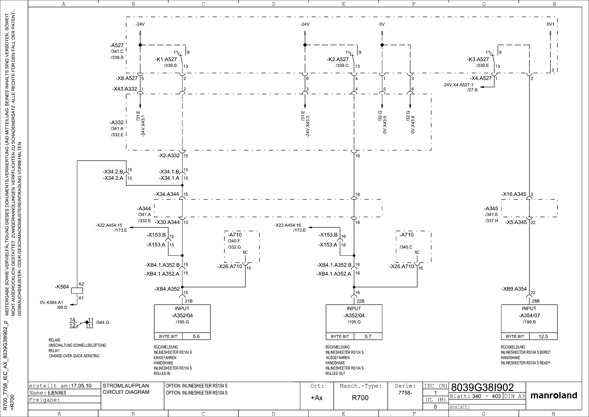

# +Ax — Sheet 340 of 403 — OPTION: INLINESHEETER RS104 S

**OPTION: INLINESHEETER RS104 S**

> Part of the manroland **R700** printing press IEC/UL circuit diagrams.
> Drawing class: **Stromlaufplan / Circuit diagram** (DIN A3).
> Document `+Ax` covers the **Central control console** machine section.

## At a glance

| Field | Value |
|---|---|
| Document | `+Ax`  (8039G38I902) |
| Sheet | **340** of 403 |
| Section (DE) | OPTION: INLINESHEETER RS104 S |
| Section (EN) | OPTION: INLINESHEETER RS104 S |
| Section type | CIRCUIT — Circuit diagram |
| Machine type | `R700` |
| Series | `7758` |
| Created | 17.05.10 |
| Replaces | — |
| Columns used | A, B, C, D, E, F, G, H |
| Path numbers | — |
| Labels on sheet | 163 |
| Cross-refs out | 25 |
| Cross-refs in | 66 |

**Previous:** [+Ax sheet 339](SHEET_0339.md) · **Next:** [+Ax sheet 341](SHEET_0341.md) · **Document TOC:** [_TOC.md](_TOC.md)  (+Ax) · **Master TOC:** [all sheets](../_MASTER_TOC.md)

## Sheet image (300 DPI, exact vector render)



_Rendered directly from the PDF vector layer at 300 DPI (1-bit), no OCR and no resampling. Use it to confirm anything ambiguous in the text below._

## Cross-references on this sheet

Each entry is a wire leaving this sheet. The printed token is `/sheet.column`; the link resolves to that sheet inside the same document.

| Ref | Target sheet | Col | Path | Destination on target | Target section | From col |
|---|---|---|---|---|---|---|
| `/341.C` | [+Ax sheet 341](SHEET_0341.md) | C | — | — | OPTION: INLINESHEETER RS104 S | B |
| `/339.B` | [+Ax sheet 339](SHEET_0339.md) | B | — | — | OPTION: INLINESHEETER RS104 S | B |
| `/339.B` | [+Ax sheet 339](SHEET_0339.md) | B | — | — | OPTION: INLINESHEETER RS104 S | C |
| `/339.E` | [+Ax sheet 339](SHEET_0339.md) | E | — | — | OPTION: INLINESHEETER RS104 S | G |
| `/339.C` | [+Ax sheet 339](SHEET_0339.md) | C | — | — | OPTION: INLINESHEETER RS104 S | E |
| `/27.B` | [+Ax sheet 27](SHEET_0027.md) | B | — | 24V.X4.A527:1 | SPANNUNGSVERSORGUNG, SCHALTSCHRANKBELÜFTUNG | G |
| `/31.E` | [+Ax sheet 31](SHEET_0031.md) | E | — | — | SPANNUNGSVERSORGUNG, SCHALTSCHRANKBELÜFTUNG | B |
| `/31.E` | [+Ax sheet 31](SHEET_0031.md) | E | — | — | SPANNUNGSVERSORGUNG, SCHALTSCHRANKBELÜFTUNG | D |
| `/32.G` | [+Ax sheet 32](SHEET_0032.md) | G | — | — | SPANNUNGSVERSORGUNG, SCHALTSCHRANKBELÜFTUNG | F |
| `/32.G` | [+Ax sheet 32](SHEET_0032.md) | G | — | — | SPANNUNGSVERSORGUNG, SCHALTSCHRANKBELÜFTUNG | F |
| `/341.A` | [+Ax sheet 341](SHEET_0341.md) | A | — | — | OPTION: INLINESHEETER RS104 S | B |
| `/332.E` | [+Ax sheet 332](SHEET_0332.md) | E | — | — | OPTION: NONSTOP EINRICHTUNG MANUELL, ANLEGER | B |
| `/341.A` | [+Ax sheet 341](SHEET_0341.md) | A | — | — | OPTION: INLINESHEETER RS104 S | B |
| `/341.E` | [+Ax sheet 341](SHEET_0341.md) | E | — | — | OPTION: INLINESHEETER RS104 S | G |
| `/337.H` | [+Ax sheet 337](SHEET_0337.md) | H | — | — | OPTION: INLINESHEETER RS104 S | G |
| `/332.E` | [+Ax sheet 332](SHEET_0332.md) | E | — | — | OPTION: NONSTOP EINRICHTUNG MANUELL, ANLEGER | B |
| `/173.E` | [+Ax sheet 173](SHEET_0173.md) | E | — | X22.A454:15 | RESERVE | B |
| `/173.E` | [+Ax sheet 173](SHEET_0173.md) | E | — | X22.A454:16 | RESERVE | D |
| `/340.F` | [+Ax sheet 340](SHEET_0340.md) | F | — | A710 | OPTION: INLINESHEETER RS104 S | C |
| `/332.G` | [+Ax sheet 332](SHEET_0332.md) | G | — | A710 | OPTION: NONSTOP EINRICHTUNG MANUELL, ANLEGER | C |
| `/340.C` | [+Ax sheet 340](SHEET_0340.md) | C | — | — | OPTION: INLINESHEETER RS104 S | F |
| `/69.D` | [+Ax sheet 69](SHEET_0069.md) | D | — | 0V.K564:A1 | SAUGBÄNDERTISCH | A |
| `/195.G` | [+Ax sheet 195](SHEET_0195.md) | G | — | 14 11 11 /344.G 12 | REFERENZMODUL | B |
| `/199.B` | [+Ax sheet 199](SHEET_0199.md) | B | — | — | REFERENZMODUL | H |
| `/195.G` | [+Ax sheet 195](SHEET_0195.md) | G | — | — | REFERENZMODUL | E |

### Incoming references (sheets that point here)

Every other sheet that sends a wire to this one. `Back-ref` is the token printed on *that* sheet; `Path` is its line number.

| From sheet | Cols | Back-ref | Path | Refs | What continues there |
|---|---|---|---|---|---|
| [+Ax#27](SHEET_0027.md) | B | `/27.B` | — | 1 | 24V.X4.A527:1 |
| [+Ax#31](SHEET_0031.md) | E | `/31.E` | — | 2 | — |
| [+Ax#32](SHEET_0032.md) | H | `/32.H` | — | 2 | — |
| [+Ax#69](SHEET_0069.md) | E | `/69.E` | — | 1 | — |
| [+Ax#173](SHEET_0173.md) | E | `/173.E` | — | 2 | — |
| [+Ax#195](SHEET_0195.md) | G | `/195.G` | — | 2 | — |
| [+Ax#199](SHEET_0199.md) | B | `/199.B` | — | 1 | — |
| [+Ax#217](SHEET_0217.md) | F | `/217.F` | — | 2 | — |
| [+Ax#227](SHEET_0227.md) | E, F, G | `/227.E`, `/227.F`, `/227.G` | — | 6 | — |
| [+Ax#229](SHEET_0229.md) | D | `/229.D` | — | 3 | — |
| [+Ax#231](SHEET_0231.md) | A | `/231.A` | — | 1 | — |
| [+Ax#239](SHEET_0239.md) | B | `/239.B` | — | 6 | — |
| [+Ax#242](SHEET_0242.md) | A | `/242.A` | — | 1 | — |
| [+Ax#254](SHEET_0254.md) | B | `/254.B` | — | 1 | — |
| [+Ax#269](SHEET_0269.md) | G | `/269.G` | — | 2 | — |
| [+Ax#274](SHEET_0274.md) | F | `/274.F` | — | 2 | — |
| [+Ax#277](SHEET_0277.md) | A, B, C, E | `/277.A`, `/277.B`, `/277.C`, `/277.E` | — | 4 | — |
| [+Ax#278](SHEET_0278.md) | A | `/278.A` | — | 2 | — |
| [+Ax#281](SHEET_0281.md) | E | `/281.E` | — | 6 | — |
| [+Ax#290](SHEET_0290.md) | C, E | `/290.C`, `/290.E` | — | 4 | — |
| [+Ax#332](SHEET_0332.md) | E, F | `/332.E`, `/332.F` | — | 3 | — |
| [+Ax#337](SHEET_0337.md) | H | `/337.H` | — | 1 | — |
| [+Ax#339](SHEET_0339.md) | B, C, E | `/339.B`, `/339.C`, `/339.E` | — | 4 | — |
| [+Ax#340](SHEET_0340.md) | C, F | `/340.C`, `/340.F` | — | 2 | A710 |
| [+Ax#341](SHEET_0341.md) | A, B, E | `/341.A`, `/341.B`, `/341.E` | — | 4 | — |
| [+Ax#344](SHEET_0344.md) | G | `/344.G` | — | 1 | — |


## Devices on this sheet

| Tag | Class | Class meaning (IEC) | Col | Sub | Terminal | Sign |
|---|---|---|---|---|---|---|
| `A527` | A | Baugruppe / assembly, module, PC board | B | — | — | — |
| `A344` | A | Baugruppe / assembly, module, PC board | B | — | — | — |
| `A332` | A | Baugruppe / assembly, module, PC board | B | — | — | — |
| `A352/04` | A | Baugruppe / assembly, module, PC board | C | 04 | — | — |
| `A2` | A | Baugruppe / assembly, module, PC board | A | — | — | — |
| `A1` | A | Baugruppe / assembly, module, PC board | A | — | — | — |
| `K564` | K | Relais / relay, contactor | A | — | — | — |
| `A710` | A | Baugruppe / assembly, module, PC board | C | — | — | — |
| `A345` | A | Baugruppe / assembly, module, PC board | G | — | — | — |
| `A352/04` | A | Baugruppe / assembly, module, PC board | E | 04 | — | — |
| `A354/07` | A | Baugruppe / assembly, module, PC board | H | 07 | — | — |
| `A710` | A | Baugruppe / assembly, module, PC board | F | — | — | — |
| `K1.A527` | — | cross-device reference | B | — | — | — |
| `X8.A527` | — | cross-device reference | B | — | — | — |
| `X34.A344` | — | cross-device reference | B | — | — | — |
| `X43.A332` | — | cross-device reference | B | — | — | — |
| `X2.A332` | — | cross-device reference | C | — | — | — |
| `X34.1.B` | — | cross-device reference | C | — | — | — |
| `X34.1.A` | — | cross-device reference | C | — | — | — |
| `X34.2.B` | — | cross-device reference | B | — | — | — |
| `X34.2.A` | — | cross-device reference | B | — | — | — |
| `XB4.A352` | — | cross-device reference | B | — | — | — |
| `5.6` | — | cross-device reference | C | — | — | — |
| `X30.A344` | — | cross-device reference | B | — | — | — |
| `X153.B` | — | cross-device reference | B | — | — | — |
| `X153.A` | — | cross-device reference | B | — | — | — |
| `XB4.1.A352.B` | — | cross-device reference | B | — | — | — |
| `XB4.1.A352.A` | — | cross-device reference | B | — | — | — |
| `X26.A710` | — | cross-device reference | C | — | — | — |
| `K2.A527` | — | cross-device reference | E | — | — | — |
| `K3.A527` | — | cross-device reference | G | — | — | — |
| `X4.A527` | — | cross-device reference | G | — | — | — |
| `X16.A345` | — | cross-device reference | G | — | — | — |
| `5.7` | — | cross-device reference | E | — | — | — |
| `XB9.A354` | — | cross-device reference | G | — | — | — |
| `12.5` | — | cross-device reference | H | — | — | — |
| `X153.B` | — | cross-device reference | E | — | — | — |
| `X153.A` | — | cross-device reference | E | — | — | — |
| `XB4.1.A352.B` | — | cross-device reference | E | — | — | — |
| `XB4.1.A352.A` | — | cross-device reference | E | — | — | — |
| `X26.A710` | — | cross-device reference | F | — | — | — |
| `X5.A345` | — | cross-device reference | G | — | — | — |
| `X22.A454:15` | — | cross-device reference | B | — | 15 | — |
| `X22.A454:16` | — | cross-device reference | D | — | 16 | — |

## Potentials / nets

| Potential | Count | Columns | Attached devices | Terminals |
|---|---|---|---|---|
| `0V` | 4 | A, F | `K564`, `X43` | `5`, `6`, `A1` |
| `24V` | 5 | B, D, G | `A527`, `X4`, `X43` | `1`, `3` |


A potential such as `L24+/4` or `M24+` is a named supply/return rail; every place it appears on this sheet is electrically common.

## Wire-end annotations (grouped as printed)

A wire that continues elsewhere is annotated with a small cluster: the destination description, the path/line number `#NN`, and the `/sheet.column` cross reference. Each row below is one such cluster exactly as it is grouped on the drawing.

| Col | Y | Path | Cross-ref | Text on the wire |
|---|---|---|---|---|
| F | 44.9 | — | — | `24V 0V 0V1` |
| B | 45.0 | — | — | `24V` |
| B | 86.8 | — | — | `A527` |
| B | 99.9 | — | `/341.C`, `/339.B` | — |
| C | 101.7 | — | — | `K1.A527 9` |
| C | 101.7 | — | — | `11` |
| E | 101.7 | — | — | `K2.A527 9` |
| E | 101.7 | — | — | `11` |
| G | 101.7 | — | — | `K3.A527 9` |
| G | 101.7 | — | — | `11` |
| C | 128.2 | — | `/339.B` | — |
| E | 128.2 | — | `/339.C` | — |
| G | 128.2 | — | `/339.E` | — |
| C | 130.0 | — | — | `13` |
| E | 130.0 | — | — | `13` |
| G | 130.0 | — | — | `13` |
| H | 137.8 | — | — | `3` |
| B | 153.4 | — | — | `X8.A527 5 2` |
| G | 153.4 | — | — | `X4.A527 1 2` |
| E | 154.8 | — | — | `6 4 1 3` |
| G | 167.5 | — | `/27.B` | `24V.X4.A527:1` |
| B | 174.6 | — | — | `X43.A332 1 2` |
| E | 176.1 | — | — | `3 4 5 6` |
| B | 223.4 | — | `/31.E` | — |
| D | 223.4 | — | `/31.E` | — |
| F | 223.4 | — | `/32.G` | — |
| F | 223.4 | — | `/32.G` | — |
| B | 232.2 | — | — | `24V.X43:1` |
| D | 233.6 | — | — | `24V.X43:3` |
| F | 233.6 | — | — | `0V.X43:5` |
| F | 233.6 | — | — | `0V.X43:6` |
| B | 242.7 | — | — | `A332` |
| B | 255.7 | — | `/341.A` | — |
| B | 268.1 | — | `/332.E` | — |
| C | 309.3 | — | — | `X2.A332 15` |
| E | 310.7 | — | — | `16` |
| B | 339.1 | — | — | `X34.2.B 15` |
| C | 339.1 | — | — | `X34.1.B 15` |
| B | 354.7 | — | — | `X34.2.A 15` |
| C | 354.7 | — | — | `X34.1.A 15` |
| C | 387.2 | — | — | `X34.A344 15` |
| F | 387.2 | — | — | `16 X16.A345 2` |
| B | 416.3 | — | — | `A344` |
| G | 416.3 | — | — | `A345` |
| B | 429.4 | — | `/341.A` | — |
| G | 429.4 | — | `/341.E`, `/337.H` | — |
| B | 441.8 | — | `/332.E` | — |
| C | 443.9 | — | — | `X30.A344 15` |
| H | 443.9 | — | — | `X5.A345 22` |
| E | 445.4 | — | — | `16` |
| B | 451.0 | — | `/173.E` | `X22.A454:15` |
| D | 451.0 | — | `/173.E` | `X22.A454:16` |
| B | 469.4 | — | — | `X153.B 15` |
| C | 469.4 | — | `/340.F`, `/332.G` | `A710` |
| E | 469.4 | — | — | `X153.B 16` |
| F | 469.4 | — | — | `A710` |
| B | 489.3 | — | — | `X153.A 15` |
| E | 489.3 | — | — | `X153.A 16` |
| F | 494.9 | — | `/340.C` | — |
| D | 506.6 | — | — | `NC` |
| F | 506.6 | — | — | `NC` |
| B | 530.4 | — | — | `XB4.1.A352.B 15` |
| E | 530.4 | — | — | `XB4.1.A352.B 16` |
| C | 533.2 | — | — | `X26.A710 15` |
| F | 533.2 | — | — | `X26.A710 16` |
| B | 547.4 | — | — | `XB4.1.A352.A 15` |
| E | 547.4 | — | — | `XB4.1.A352.A 16` |
| A | 569.3 | — | — | `A2` |
| A | 574.3 | — | — | `K564` |
| C | 578.6 | — | — | `XB4.A352 15` |
| G | 578.6 | — | — | `XB9.A354 22` |
| E | 587.1 | — | — | `16` |
| A | 597.7 | — | — | `A1` |
| C | 604.1 | — | — | `21B` |
| E | 604.1 | — | — | `22B` |
| H | 604.1 | — | — | `28B` |
| A | 606.9 | — | `/69.D` | `0V.K564:A1` |
| C | 618.6 | — | — | `INPUT` |
| E | 618.6 | — | — | `INPUT` |
| H | 618.6 | — | — | `INPUT` |
| C | 632.4 | — | — | `A352/04` |
| E | 632.4 | — | — | `A352/04` |
| H | 632.4 | — | — | `A354/07` |
| B | 640.9 | — | `/195.G` | `14 12 11 11 /344.G` |
| E | 646.2 | — | `/195.G` | — |
| H | 646.2 | — | `/199.B` | — |
| C | 675.3 | — | — | `BYTE.BIT 5.6` |
| E | 675.3 | — | — | `BYTE.BIT 5.7` |
| H | 675.3 | — | — | `BYTE.BIT 12.5` |
| A | 683.7 | — | — | `RELAIS: UMSCHALTUNG SCHNELLBELÜFTUNG RELAY:` |
| C | 698.0 | — | — | `RÜCKMELDUNG INLINESHEETER RS104 S EINGEFAHREN HANDSHAKE INLINESHEETER RS104 S ROLLED IN` |
| E | 698.0 | — | — | `RÜCKMELDUNG INLINESHEETER RS104 S` |
| H | 698.0 | — | — | `RÜCKMELDUNG INLINESHEETER RS104 S BEREIT HANDSHAKE INLINESHEETER RS104 S READY` |
| A | 715.7 | — | — | `CHANGE OVER QUICK AERATING` |
| E | 719.2 | — | — | `HANDSHAKE INLINESHEETER RS104 S ROLLED OUT AUSGEFAHREN` |


## Reconstructed tables

This sheet carries tabular content (pin map / terminal assignment / index). The grid below was rebuilt from the drawing's own rule lines, so each row is exactly one physical row of the table.

### Table 1 — 5 data rows × 4 columns (at x=283.5, y=90.7)

| 5 1 24V.X43:1 | 11 K1.A527 /339.B X2.A332 X34.1.B X34.1.A | 9 13 2 2 15 15 15 |  |
|---|---|---|---|
| `A344 /341.A /332.E` | `X34.A344 X30.A344` | `15 15` |  |
|  | `X153.B 15 X153.A 15 XB4.1.A352.B XB4.1.A352.A` | `15 15` | `A710 /340.F /332.G NC X26.A710` |
|  | `XB4.A352` | `15 21B` |  |
|  | `INPUT` | `A352/04 /195.G` |  |
|  | `BYTE.BIT` | `5.6` |  |


### Table 2 — 4 data rows × 5 columns (at x=616.5, y=90.7)

| 6 3 24V.X43:3 | 11 K2.A527 /339.C | 9 13 4 4 /32.G 16 16 16 | 1 5 /32.G 0V.X43:5 | 3 6 0V.X43:6 |
|---|---|---|---|---|
|  | `X153.B 16 X153.A 16 XB4.1.A352.B XB4.1.A352.A` | `16 16` | `A710 /340.C X26.A710` | `NC` |
|  |  | `16 22B` |  |  |
|  | `INPUT` | `A352/04 /195.G` |  |  |
|  | `BYTE.BIT` | `5.7` |  |  |


### Table 3 — 2 data rows × 3 columns (at x=1013.4, y=90.7)

| X16.A345 X5.A345 XB9.A354 | 2 2 22 22 28B | 3 |
|---|---|---|
| `INPUT` | `A354/07 /199.B` |  |
| `BYTE.BIT` | `12.5` |  |


## Notes and free text on this sheet

| Text | Col | Y (pt) |
|---|---|---|
| `21B` | C | 604.07 |
| `INPUT` | C | 618.59 |
| `BYTE.BIT` | B | 675.84 |
| `RÜCKMELDUNG` | B | 697.97 |
| `INLINESHEETER RS104 S` | C | 708.57 |
| `EINGEFAHREN` | B | 719.2 |
| `HANDSHAKE` | B | 729.83 |
| `ROLLED IN` | B | 751.1 |
| `11 /344.G` | A | 647.29 |
| `RELAIS:` | A | 683.7 |
| `UMSCHALTUNG SCHNELLBELÜFTUNG` | A | 694.43 |
| `RELAY:` | A | 704.97 |
| `CHANGE OVER QUICK AERATING` | A | 715.68 |
| `22B` | E | 604.07 |
| `INPUT` | E | 618.59 |
| `BYTE.BIT` | E | 675.84 |
| `RÜCKMELDUNG` | E | 697.97 |
| `INLINESHEETER RS104 S` | E | 708.57 |
| `AUSGEFAHREN` | E | 719.21 |
| `HANDSHAKE` | E | 729.83 |
| `ROLLED OUT` | E | 751.12 |
| `28B` | H | 604.07 |
| `INPUT` | H | 618.59 |
| `BYTE.BIT` | G | 675.84 |
| `RÜCKMELDUNG` | G | 697.97 |
| `INLINESHEETER RS104 S BEREIT` | H | 708.57 |
| `HANDSHAKE` | G | 719.2 |
| `INLINESHEETER RS104 S READY` | H | 729.85 |
| `NC` | D | 506.57 |
| `0V1` | H | 44.93 |
| `NC` | F | 506.57 |

## Complete label inventory (exact text from the drawing)

Every text object inside the drawing area of this sheet, in DIN reading order (column A→H, then top→bottom). This is the authoritative list: if a string is not here it is not printed on this sheet.

| Col | Y | X | Dir | Type | Text |
|---|---|---|---|---|---|
| A | 569.3 | 158.7 | → | device tag | `A2` |
| A | 574.3 | 111.1 | → | device tag | `K564` |
| A | 597.7 | 158.7 | → | device tag | `A1` |
| A | 606.9 | 80.8 | → | potential | `0V.K564:A1` |
| A | 616.8 | 115.4 | → | cross-reference | `/69.D` |
| A | 640.9 | 140.3 | → | number | `14` |
| A | 640.9 | 177.4 | → | number | `11` |
| A | 647.3 | 177.4 | → | text | `11 /344.G` |
| A | 652.2 | 140.3 | → | number | `12` |
| A | 683.7 | 98.4 | → | text | `RELAIS:` |
| A | 694.4 | 98.4 | → | text | `UMSCHALTUNG SCHNELLBELÜFTUNG` |
| A | 705.0 | 98.4 | → | text | `RELAY:` |
| A | 715.7 | 98.9 | → | text | `CHANGE OVER QUICK AERATING` |
| B | 44.9 | 274.1 | → | potential | `24V` |
| B | 86.8 | 221.7 | → | device tag | `A527` |
| B | 99.9 | 223.9 | → | cross-reference | `/341.C` |
| B | 112.2 | 224.2 | → | cross-reference | `/339.B` |
| B | 115.1 | 313.5 | → | device ref | `K1.A527` |
| B | 153.4 | 234.1 | → | device ref | `X8.A527` |
| B | 154.8 | 286.0 | → | number | `5` |
| B | 174.6 | 226.8 | → | device ref | `X43.A332` |
| B | 176.1 | 285.4 | → | number | `1` |
| B | 223.4 | 275.2 | ↕ | cross-reference | `/31.E` |
| B | 232.2 | 285.2 | ↕ | potential | `24V.X43:1` |
| B | 242.7 | 221.7 | → | device tag | `A332` |
| B | 255.7 | 223.9 | → | cross-reference | `/341.A` |
| B | 268.1 | 224.5 | → | cross-reference | `/332.E` |
| B | 339.1 | 257.1 | → | number | `15` |
| B | 341.9 | 207.5 | → | device ref | `X34.2.B` |
| B | 354.7 | 208.1 | → | device ref | `X34.2.A` |
| B | 356.1 | 257.1 | → | number | `15` |
| B | 387.2 | 311.8 | → | device ref | `X34.A344` |
| B | 416.3 | 276.9 | → | device tag | `A344` |
| B | 429.4 | 279.2 | → | cross-reference | `/341.A` |
| B | 441.8 | 279.8 | → | cross-reference | `/332.E` |
| B | 443.9 | 313.2 | → | device ref | `X30.A344` |
| B | 451.0 | 193.3 | → | device ref | `X22.A454:15` |
| B | 460.9 | 231.6 | → | cross-reference | `/173.E` |
| B | 469.4 | 296.8 | → | device ref | `X153.B` |
| B | 489.3 | 295.9 | → | device ref | `X153.A` |
| B | 530.4 | 293.4 | → | device ref | `XB4.1.A352.B` |
| B | 548.1 | 292.5 | → | device ref | `XB4.1.A352.A` |
| B | 578.6 | 312.1 | → | device ref | `XB4.A352` |
| B | 675.8 | 321.7 | → | text | `BYTE.BIT` |
| B | 698.0 | 311.0 | → | text | `RÜCKMELDUNG` |
| B | 719.2 | 311.0 | → | text | `EINGEFAHREN` |
| B | 729.8 | 311.0 | → | text | `HANDSHAKE` |
| B | 751.1 | 311.0 | → | text | `ROLLED IN` |
| C | 101.7 | 350.6 | → | number | `11` |
| C | 101.7 | 378.1 | → | number | `9` |
| C | 128.2 | 331.9 | → | cross-reference | `/339.B` |
| C | 130.0 | 370.5 | → | number | `13` |
| C | 154.8 | 371.1 | → | number | `2` |
| C | 176.1 | 371.1 | → | number | `2` |
| C | 309.3 | 319.2 | → | device ref | `X2.A332` |
| C | 310.7 | 370.5 | → | number | `15` |
| C | 339.1 | 370.5 | → | number | `15` |
| C | 341.9 | 320.9 | → | device ref | `X34.1.B` |
| C | 354.7 | 321.4 | → | device ref | `X34.1.A` |
| C | 356.1 | 370.5 | → | number | `15` |
| C | 388.7 | 370.5 | → | number | `15` |
| C | 445.4 | 370.5 | → | number | `15` |
| C | 469.4 | 460.3 | → | device tag | `A710` |
| C | 473.7 | 342.1 | → | number | `15` |
| C | 482.5 | 460.6 | → | cross-reference | `/340.F` |
| C | 490.7 | 342.1 | → | number | `15` |
| C | 494.9 | 460.6 | → | cross-reference | `/332.G` |
| C | 530.4 | 370.5 | → | number | `15` |
| C | 533.2 | 439.4 | → | device ref | `X26.A710` |
| C | 547.4 | 370.5 | → | number | `15` |
| C | 587.1 | 370.5 | → | number | `15` |
| C | 604.1 | 373.9 | → | text | `21B` |
| C | 618.6 | 353.6 | → | text | `INPUT` |
| C | 632.4 | 347.1 | → | device tag | `A352/04` |
| C | 646.2 | 355.6 | → | cross-reference | `/195.G` |
| C | 675.3 | 390.0 | → | device ref | `5.6` |
| C | 708.6 | 311.0 | → | text | `INLINESHEETER RS104 S` |
| C | 740.5 | 311.0 | → | text | `INLINESHEETER RS104 S` |
| D | 44.9 | 607.2 | → | potential | `24V` |
| D | 154.8 | 619.1 | → | number | `6` |
| D | 176.1 | 619.1 | → | number | `3` |
| D | 223.4 | 608.3 | ↕ | cross-reference | `/31.E` |
| D | 233.6 | 618.2 | ↕ | potential | `24V.X43:3` |
| D | 451.0 | 554.7 | → | device ref | `X22.A454:16` |
| D | 460.9 | 593.0 | → | cross-reference | `/173.E` |
| D | 506.6 | 491.2 | → | text | `NC` |
| D | 537.5 | 498.0 | → | number | `15` |
| E | 101.7 | 697.9 | → | number | `11` |
| E | 101.7 | 725.4 | → | number | `9` |
| E | 115.1 | 660.8 | → | device ref | `K2.A527` |
| E | 128.2 | 678.9 | → | cross-reference | `/339.C` |
| E | 130.0 | 717.7 | → | number | `13` |
| E | 154.8 | 718.3 | → | number | `4` |
| E | 176.1 | 718.3 | → | number | `4` |
| E | 310.7 | 717.7 | → | number | `16` |
| E | 388.7 | 717.7 | → | number | `16` |
| E | 445.4 | 717.7 | → | number | `16` |
| E | 469.4 | 644.0 | → | device ref | `X153.B` |
| E | 473.7 | 689.4 | → | number | `16` |
| E | 489.3 | 643.2 | → | device ref | `X153.A` |
| E | 490.7 | 689.4 | → | number | `16` |
| E | 530.4 | 640.6 | → | device ref | `XB4.1.A352.B` |
| E | 530.4 | 717.7 | → | number | `16` |
| E | 547.4 | 717.7 | → | number | `16` |
| E | 548.1 | 639.8 | → | device ref | `XB4.1.A352.A` |
| E | 587.1 | 717.7 | → | number | `16` |
| E | 604.1 | 721.1 | → | text | `22B` |
| E | 618.6 | 700.9 | → | text | `INPUT` |
| E | 632.4 | 694.3 | → | device tag | `A352/04` |
| E | 646.2 | 702.9 | → | cross-reference | `/195.G` |
| E | 675.3 | 737.3 | → | device ref | `5.7` |
| E | 675.8 | 669.0 | → | text | `BYTE.BIT` |
| E | 698.0 | 658.2 | → | text | `RÜCKMELDUNG` |
| E | 708.6 | 658.2 | → | text | `INLINESHEETER RS104 S` |
| E | 719.2 | 659.1 | → | text | `AUSGEFAHREN` |
| E | 729.8 | 658.2 | → | text | `HANDSHAKE` |
| E | 740.5 | 658.2 | → | text | `INLINESHEETER RS104 S` |
| E | 751.1 | 658.2 | → | text | `ROLLED OUT` |
| F | 44.9 | 766.9 | → | potential | `0V` |
| F | 154.8 | 774.4 | → | number | `1` |
| F | 154.8 | 831.7 | → | number | `3` |
| F | 176.1 | 775.0 | → | number | `5` |
| F | 176.1 | 831.7 | → | number | `6` |
| F | 223.4 | 764.2 | ↕ | cross-reference | `/32.G` |
| F | 223.4 | 820.9 | ↕ | cross-reference | `/32.G` |
| F | 233.6 | 774.1 | ↕ | potential | `0V.X43:5` |
| F | 233.6 | 830.8 | ↕ | potential | `0V.X43:6` |
| F | 469.4 | 807.6 | → | device tag | `A710` |
| F | 494.9 | 807.9 | → | cross-reference | `/340.C` |
| F | 506.6 | 838.4 | → | text | `NC` |
| F | 533.2 | 786.6 | → | device ref | `X26.A710` |
| F | 537.5 | 845.3 | → | number | `16` |
| G | 101.7 | 981.4 | → | number | `11` |
| G | 101.7 | 1008.9 | → | number | `9` |
| G | 115.1 | 944.2 | → | device ref | `K3.A527` |
| G | 128.2 | 962.9 | → | cross-reference | `/339.E` |
| G | 130.0 | 1001.2 | → | number | `13` |
| G | 153.4 | 949.9 | → | device ref | `X4.A527` |
| G | 154.8 | 1001.2 | → | number | `1` |
| G | 167.5 | 894.9 | → | potential | `24V.X4.A527:1` |
| G | 177.4 | 944.8 | → | cross-reference | `/27.B` |
| G | 387.2 | 1013.4 | → | device ref | `X16.A345` |
| G | 416.3 | 978.5 | → | device tag | `A345` |
| G | 429.4 | 981.4 | → | cross-reference | `/341.E` |
| G | 441.8 | 981.4 | → | cross-reference | `/337.H` |
| G | 443.9 | 1020.8 | → | device ref | `X5.A345` |
| G | 578.6 | 1013.7 | → | device ref | `XB9.A354` |
| G | 675.8 | 1023.3 | → | text | `BYTE.BIT` |
| G | 698.0 | 1012.5 | → | text | `RÜCKMELDUNG` |
| G | 719.2 | 1012.5 | → | text | `HANDSHAKE` |
| H | 44.9 | 1105.5 | → | text | `0V1` |
| H | 137.8 | 1115.1 | → | number | `3` |
| H | 154.8 | 1072.6 | → | number | `2` |
| H | 388.7 | 1072.6 | → | number | `2` |
| H | 445.4 | 1072.6 | → | number | `22` |
| H | 587.1 | 1072.6 | → | number | `22` |
| H | 604.1 | 1075.5 | → | text | `28B` |
| H | 618.6 | 1055.2 | → | text | `INPUT` |
| H | 632.4 | 1048.7 | → | device tag | `A354/07` |
| H | 646.2 | 1057.5 | → | cross-reference | `/199.B` |
| H | 675.3 | 1088.6 | → | device ref | `12.5` |
| H | 708.6 | 1012.5 | → | text | `INLINESHEETER RS104 S BEREIT` |
| H | 729.8 | 1012.5 | → | text | `INLINESHEETER RS104 S READY` |

## Reading-order text block

The same content as a plain block, grouped by DIN column — convenient to paste or to match against a visual description.

```text
=== Column A ===
 569.3  158.7  devtag       A2
 574.3  111.1  devtag       K564
 597.7  158.7  devtag       A1
 606.9   80.8  net          0V.K564:A1
 616.8  115.4  xref         /69.D
 640.9  140.3  numeric      14
 640.9  177.4  numeric      11
 647.3  177.4  text         11 /344.G
 652.2  140.3  numeric      12
 683.7   98.4  text         RELAIS:
 694.4   98.4  text         UMSCHALTUNG SCHNELLBELÜFTUNG
 705.0   98.4  text         RELAY:
 715.7   98.9  text         CHANGE OVER QUICK AERATING
=== Column B ===
  44.9  274.1  net          24V
  86.8  221.7  devtag       A527
  99.9  223.9  xref         /341.C
 112.2  224.2  xref         /339.B
 115.1  313.5  devref       K1.A527
 153.4  234.1  devref       X8.A527
 154.8  286.0  numeric      5
 174.6  226.8  devref       X43.A332
 176.1  285.4  numeric      1
 223.4  275.2  xref         /31.E
 232.2  285.2  net          24V.X43:1
 242.7  221.7  devtag       A332
 255.7  223.9  xref         /341.A
 268.1  224.5  xref         /332.E
 339.1  257.1  numeric      15
 341.9  207.5  devref       X34.2.B
 354.7  208.1  devref       X34.2.A
 356.1  257.1  numeric      15
 387.2  311.8  devref       X34.A344
 416.3  276.9  devtag       A344
 429.4  279.2  xref         /341.A
 441.8  279.8  xref         /332.E
 443.9  313.2  devref       X30.A344
 451.0  193.3  devref       X22.A454:15
 460.9  231.6  xref         /173.E
 469.4  296.8  devref       X153.B
 489.3  295.9  devref       X153.A
 530.4  293.4  devref       XB4.1.A352.B
 548.1  292.5  devref       XB4.1.A352.A
 578.6  312.1  devref       XB4.A352
 675.8  321.7  text         BYTE.BIT
 698.0  311.0  text         RÜCKMELDUNG
 719.2  311.0  text         EINGEFAHREN
 729.8  311.0  text         HANDSHAKE
 751.1  311.0  text         ROLLED IN
=== Column C ===
 101.7  350.6  numeric      11
 101.7  378.1  numeric      9
 128.2  331.9  xref         /339.B
 130.0  370.5  numeric      13
 154.8  371.1  numeric      2
 176.1  371.1  numeric      2
 309.3  319.2  devref       X2.A332
 310.7  370.5  numeric      15
 339.1  370.5  numeric      15
 341.9  320.9  devref       X34.1.B
 354.7  321.4  devref       X34.1.A
 356.1  370.5  numeric      15
 388.7  370.5  numeric      15
 445.4  370.5  numeric      15
 469.4  460.3  devtag       A710
 473.7  342.1  numeric      15
 482.5  460.6  xref         /340.F
 490.7  342.1  numeric      15
 494.9  460.6  xref         /332.G
 530.4  370.5  numeric      15
 533.2  439.4  devref       X26.A710
 547.4  370.5  numeric      15
 587.1  370.5  numeric      15
 604.1  373.9  text         21B
 618.6  353.6  text         INPUT
 632.4  347.1  devtag       A352/04
 646.2  355.6  xref         /195.G
 675.3  390.0  devref       5.6
 708.6  311.0  text         INLINESHEETER RS104 S
 740.5  311.0  text         INLINESHEETER RS104 S
=== Column D ===
  44.9  607.2  net          24V
 154.8  619.1  numeric      6
 176.1  619.1  numeric      3
 223.4  608.3  xref         /31.E
 233.6  618.2  net          24V.X43:3
 451.0  554.7  devref       X22.A454:16
 460.9  593.0  xref         /173.E
 506.6  491.2  text         NC
 537.5  498.0  numeric      15
=== Column E ===
 101.7  697.9  numeric      11
 101.7  725.4  numeric      9
 115.1  660.8  devref       K2.A527
 128.2  678.9  xref         /339.C
 130.0  717.7  numeric      13
 154.8  718.3  numeric      4
 176.1  718.3  numeric      4
 310.7  717.7  numeric      16
 388.7  717.7  numeric      16
 445.4  717.7  numeric      16
 469.4  644.0  devref       X153.B
 473.7  689.4  numeric      16
 489.3  643.2  devref       X153.A
 490.7  689.4  numeric      16
 530.4  640.6  devref       XB4.1.A352.B
 530.4  717.7  numeric      16
 547.4  717.7  numeric      16
 548.1  639.8  devref       XB4.1.A352.A
 587.1  717.7  numeric      16
 604.1  721.1  text         22B
 618.6  700.9  text         INPUT
 632.4  694.3  devtag       A352/04
 646.2  702.9  xref         /195.G
 675.3  737.3  devref       5.7
 675.8  669.0  text         BYTE.BIT
 698.0  658.2  text         RÜCKMELDUNG
 708.6  658.2  text         INLINESHEETER RS104 S
 719.2  659.1  text         AUSGEFAHREN
 729.8  658.2  text         HANDSHAKE
 740.5  658.2  text         INLINESHEETER RS104 S
 751.1  658.2  text         ROLLED OUT
=== Column F ===
  44.9  766.9  net          0V
 154.8  774.4  numeric      1
 154.8  831.7  numeric      3
 176.1  775.0  numeric      5
 176.1  831.7  numeric      6
 223.4  764.2  xref         /32.G
 223.4  820.9  xref         /32.G
 233.6  774.1  net          0V.X43:5
 233.6  830.8  net          0V.X43:6
 469.4  807.6  devtag       A710
 494.9  807.9  xref         /340.C
 506.6  838.4  text         NC
 533.2  786.6  devref       X26.A710
 537.5  845.3  numeric      16
=== Column G ===
 101.7  981.4  numeric      11
 101.7 1008.9  numeric      9
 115.1  944.2  devref       K3.A527
 128.2  962.9  xref         /339.E
 130.0 1001.2  numeric      13
 153.4  949.9  devref       X4.A527
 154.8 1001.2  numeric      1
 167.5  894.9  net          24V.X4.A527:1
 177.4  944.8  xref         /27.B
 387.2 1013.4  devref       X16.A345
 416.3  978.5  devtag       A345
 429.4  981.4  xref         /341.E
 441.8  981.4  xref         /337.H
 443.9 1020.8  devref       X5.A345
 578.6 1013.7  devref       XB9.A354
 675.8 1023.3  text         BYTE.BIT
 698.0 1012.5  text         RÜCKMELDUNG
 719.2 1012.5  text         HANDSHAKE
=== Column H ===
  44.9 1105.5  text         0V1
 137.8 1115.1  numeric      3
 154.8 1072.6  numeric      2
 388.7 1072.6  numeric      2
 445.4 1072.6  numeric      22
 587.1 1072.6  numeric      22
 604.1 1075.5  text         28B
 618.6 1055.2  text         INPUT
 632.4 1048.7  devtag       A354/07
 646.2 1057.5  xref         /199.B
 675.3 1088.6  devref       12.5
 708.6 1012.5  text         INLINESHEETER RS104 S BEREIT
 729.8 1012.5  text         INLINESHEETER RS104 S READY
```

---
_Generated from the PDF vector text layer; no OCR. Source: `R700_7758_IEC_AX_8039G38I902_p`, sheet 340._
