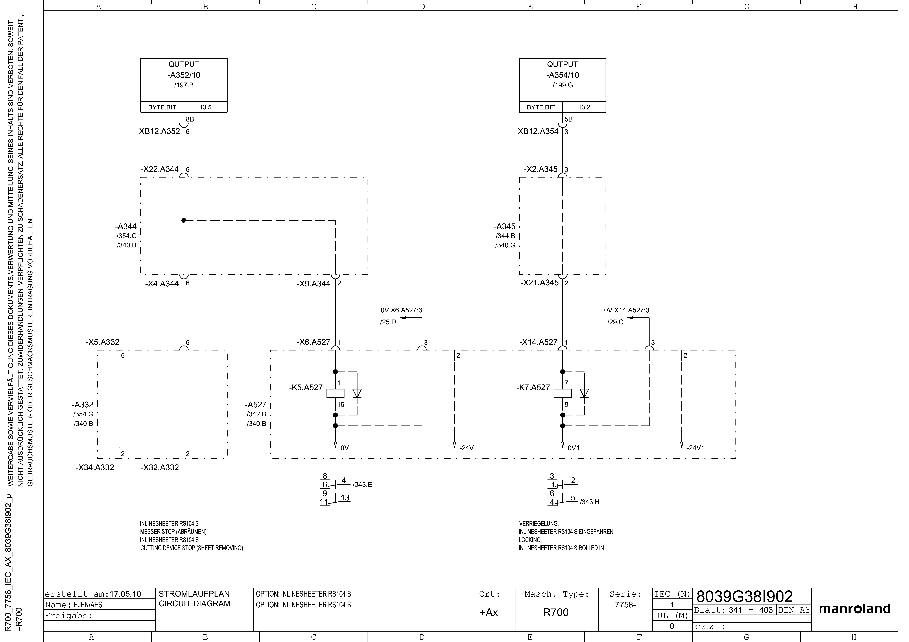

# +Ax — Sheet 341 of 403 — OPTION: INLINESHEETER RS104 S

**OPTION: INLINESHEETER RS104 S**

> Part of the manroland **R700** printing press IEC/UL circuit diagrams.
> Drawing class: **Stromlaufplan / Circuit diagram** (DIN A3).
> Document `+Ax` covers the **Central control console** machine section.

## At a glance

| Field | Value |
|---|---|
| Document | `+Ax`  (8039G38I902) |
| Sheet | **341** of 403 |
| Section (DE) | OPTION: INLINESHEETER RS104 S |
| Section (EN) | OPTION: INLINESHEETER RS104 S |
| Section type | CIRCUIT — Circuit diagram |
| Machine type | `R700` |
| Series | `7758` |
| Created | 17.05.10 |
| Replaces | — |
| Columns used | A, B, C, D, E, F, G |
| Path numbers | — |
| Labels on sheet | 88 |
| Cross-refs out | 13 |
| Cross-refs in | 31 |

**Previous:** [+Ax sheet 340](SHEET_0340.md) · **Next:** [+Ax sheet 342](SHEET_0342.md) · **Document TOC:** [_TOC.md](_TOC.md)  (+Ax) · **Master TOC:** [all sheets](../_MASTER_TOC.md)

## Sheet image (300 DPI, exact vector render)



_Rendered directly from the PDF vector layer at 300 DPI (1-bit), no OCR and no resampling. Use it to confirm anything ambiguous in the text below._

## Cross-references on this sheet

Each entry is a wire leaving this sheet. The printed token is `/sheet.column`; the link resolves to that sheet inside the same document.

| Ref | Target sheet | Col | Path | Destination on target | Target section | From col |
|---|---|---|---|---|---|---|
| `/197.B` | [+Ax sheet 197](SHEET_0197.md) | B | — | — | REFERENZMODUL | B |
| `/199.G` | [+Ax sheet 199](SHEET_0199.md) | G | — | — | REFERENZMODUL | E |
| `/344.B` | [+Ax sheet 344](SHEET_0344.md) | B | — | — | OPTION: INLINESHEETER RS104 S | E |
| `/340.G` | [+Ax sheet 340](SHEET_0340.md) | G | — | — | OPTION: INLINESHEETER RS104 S | E |
| `/354.G` | [+Ax sheet 354](SHEET_0354.md) | G | — | — | OPTION: LOGISTIK ANLEGER | A |
| `/340.B` | [+Ax sheet 340](SHEET_0340.md) | B | — | — | OPTION: INLINESHEETER RS104 S | A |
| `/25.D` | [+Ax sheet 25](SHEET_0025.md) | D | — | — | SPANNUNGSVERSORGUNG, SCHALTSCHRANKBELÜFTUNG | D |
| `/29.C` | [+Ax sheet 29](SHEET_0029.md) | C | — | — | SPANNUNGSVERSORGUNG, SCHALTSCHRANKBELÜFTUNG | F |
| `/342.B` | [+Ax sheet 342](SHEET_0342.md) | B | — | — | OPTION: INLINESHEETER RS104 S | B |
| `/340.B` | [+Ax sheet 340](SHEET_0340.md) | B | — | — | OPTION: INLINESHEETER RS104 S | B |
| `/354.G` | [+Ax sheet 354](SHEET_0354.md) | G | — | — | OPTION: LOGISTIK ANLEGER | A |
| `/340.B` | [+Ax sheet 340](SHEET_0340.md) | B | — | — | OPTION: INLINESHEETER RS104 S | A |
| `/343.E` | [+Ax sheet 343](SHEET_0343.md) | E | — | 4 | OPTION: INLINESHEETER RS104 S | C |

### Incoming references (sheets that point here)

Every other sheet that sends a wire to this one. `Back-ref` is the token printed on *that* sheet; `Path` is its line number.

| From sheet | Cols | Back-ref | Path | Refs | What continues there |
|---|---|---|---|---|---|
| [+Ax#25](SHEET_0025.md) | D | `/25.D` | — | 1 | — |
| [+Ax#29](SHEET_0029.md) | C | `/29.C` | — | 1 | 0V.X14.A527:3 |
| [+Ax#197](SHEET_0197.md) | B | `/197.B` | — | 1 | — |
| [+Ax#199](SHEET_0199.md) | G | `/199.G` | — | 1 | — |
| [+Ax#217](SHEET_0217.md) | H | `/217.H` | — | 1 | — |
| [+Ax#226](SHEET_0226.md) | H | `/226.H` | — | 1 | — |
| [+Ax#230](SHEET_0230.md) | F | `/230.F` | — | 2 | — |
| [+Ax#234](SHEET_0234.md) | E | `/234.E` | — | 3 | — |
| [+Ax#240](SHEET_0240.md) | H | `/240.H` | — | 1 | — |
| [+Ax#248](SHEET_0248.md) | E, F | `/248.E`, `/248.F` | — | 2 | — |
| [+Ax#251](SHEET_0251.md) | F | `/251.F` | — | 3 | — |
| [+Ax#261](SHEET_0261.md) | B | `/261.B` | — | 1 | — |
| [+Ax#262](SHEET_0262.md) | E | `/262.E` | — | 1 | — |
| [+Ax#275](SHEET_0275.md) | D | `/275.D` | — | 1 | — |
| [+Ax#277](SHEET_0277.md) | G | `/277.G` | — | 1 | — |
| [+Ax#340](SHEET_0340.md) | B, G | `/340.B`, `/340.G` | — | 4 | — |
| [+Ax#342](SHEET_0342.md) | B | `/342.B` | — | 1 | — |
| [+Ax#343](SHEET_0343.md) | E, H | `/343.E`, `/343.H` | — | 2 | — |
| [+Ax#344](SHEET_0344.md) | B | `/344.B` | — | 1 | — |
| [+Ax#354](SHEET_0354.md) | F | `/354.F` | — | 2 | — |


## Devices on this sheet

| Tag | Class | Class meaning (IEC) | Col | Sub | Terminal | Sign |
|---|---|---|---|---|---|---|
| `A344` | A | Baugruppe / assembly, module, PC board | A | — | — | — |
| `A352/10` | A | Baugruppe / assembly, module, PC board | B | 10 | — | — |
| `A332` | A | Baugruppe / assembly, module, PC board | A | — | — | — |
| `A527` | A | Baugruppe / assembly, module, PC board | B | — | — | — |
| `A354/10` | A | Baugruppe / assembly, module, PC board | E | 10 | — | — |
| `A345` | A | Baugruppe / assembly, module, PC board | E | — | — | — |
| `X22.A344` | — | cross-device reference | B | — | — | — |
| `X4.A344` | — | cross-device reference | B | — | — | — |
| `13.5` | — | cross-device reference | B | — | — | — |
| `XB12.A352` | — | cross-device reference | B | — | — | — |
| `X9.A344` | — | cross-device reference | C | — | — | — |
| `X5.A332` | — | cross-device reference | A | — | — | — |
| `X6.A527` | — | cross-device reference | C | — | — | — |
| `K5.A527` | — | cross-device reference | C | — | — | — |
| `13.2` | — | cross-device reference | E | — | — | — |
| `XB12.A354` | — | cross-device reference | E | — | — | — |
| `X2.A345` | — | cross-device reference | E | — | — | — |
| `X21.A345` | — | cross-device reference | E | — | — | — |
| `X14.A527` | — | cross-device reference | E | — | — | — |
| `K7.A527` | — | cross-device reference | E | — | — | — |
| `X32.A332` | — | cross-device reference | B | — | — | — |
| `X34.A332` | — | cross-device reference | A | — | — | — |

## Potentials / nets

| Potential | Count | Columns | Attached devices | Terminals |
|---|---|---|---|---|
| `0V` | 3 | C, D, F | `A527`, `X14`, `X6` | `3` |
| `24V` | 1 | D | — | — |


A potential such as `L24+/4` or `M24+` is a named supply/return rail; every place it appears on this sheet is electrically common.

## Wire-end annotations (grouped as printed)

A wire that continues elsewhere is annotated with a small cluster: the destination description, the path/line number `#NN`, and the `/sheet.column` cross reference. Each row below is one such cluster exactly as it is grouped on the drawing.

| Col | Y | Path | Cross-ref | Text on the wire |
|---|---|---|---|---|
| B | 80.0 | — | — | `QUTPUT` |
| E | 80.0 | — | — | `QUTPUT` |
| B | 93.8 | — | — | `A352/10` |
| E | 93.8 | — | — | `A354/10` |
| B | 107.6 | — | `/197.B` | — |
| E | 107.6 | — | `/199.G` | — |
| B | 137.3 | — | — | `BYTE.BIT 13.5` |
| E | 137.3 | — | — | `BYTE.BIT 13.2` |
| B | 152.6 | — | — | `8B` |
| E | 152.6 | — | — | `5B` |
| B | 167.6 | — | — | `XB12.A352 6` |
| E | 167.6 | — | — | `XB12.A354 3` |
| B | 217.2 | — | — | `X22.A344 6` |
| E | 217.2 | — | — | `X2.A345 3` |
| A | 292.3 | — | — | `A344` |
| E | 292.3 | — | — | `A345` |
| E | 305.3 | — | `/344.B`, `/340.G` | — |
| A | 305.4 | — | `/354.G` | — |
| A | 317.7 | — | `/340.B` | — |
| E | 366.0 | — | — | `X21.A345 2` |
| B | 367.4 | — | — | `X4.A344 6` |
| C | 367.4 | — | — | `X9.A344 2` |
| D | 402.8 | — | — | `0V.X6.A527:3` |
| F | 402.8 | — | — | `0V.X14.A527:3` |
| D | 418.4 | — | `/25.D` | — |
| F | 418.4 | — | `/29.C` | — |
| A | 443.9 | — | — | `X5.A332 6` |
| C | 443.9 | — | — | `X6.A527 1` |
| E | 443.9 | — | — | `X14.A527 1` |
| D | 445.4 | — | — | `3` |
| F | 445.4 | — | — | `3` |
| A | 462.4 | — | — | `5` |
| D | 462.4 | — | — | `2` |
| F | 462.4 | — | — | `2` |
| C | 498.5 | — | — | `1` |
| E | 498.5 | — | — | `7` |
| C | 503.5 | — | — | `K5.A527` |
| E | 503.5 | — | — | `K7.A527` |
| A | 526.1 | — | — | `A332` |
| B | 526.1 | — | — | `A527` |
| C | 526.9 | — | — | `16` |
| E | 526.9 | — | — | `8` |
| A | 539.2 | — | `/354.G` | — |
| B | 539.2 | — | `/342.B`, `/340.B` | — |
| A | 551.6 | — | `/340.B` | — |
| D | 583.5 | — | — | `0V 24V` |
| F | 583.5 | — | — | `0V1 24V1` |
| B | 591.4 | — | — | `2 2` |
| A | 608.3 | — | — | `X34.A332 X32.A332` |
| C | 619.6 | — | — | `11 8 6 9 13` |
| E | 619.6 | — | — | `3 6 4 1` |
| C | 625.3 | — | `/343.E` | `4` |
| E | 625.3 | — | — | `2` |
| F | 648.0 | — | — | `5 /343.H` |
| B | 683.8 | — | — | `INLINESHEETER RS104 S INLINESHEETER RS104 S MESSER STOP (ABRÄUMEN)` |
| E | 683.8 | — | — | `INLINESHEETER RS104 S EINGEFAHREN LOCKING, INLINESHEETER RS104 S ROLLED IN VERRIEGELUNG,` |
| B | 715.7 | — | — | `CUTTING DEVICE STOP (SHEET REMOVING)` |


## Reconstructed tables

This sheet carries tabular content (pin map / terminal assignment / index). The grid below was rebuilt from the drawing's own rule lines, so each row is exactly one physical row of the table.

### Table 1 — 2 data rows × 2 columns (at x=184.3, y=76.5)

| QUTPUT | A352/10 /197.B |
|---|---|
| `BYTE.BIT` | `13.5` |
| `XB12.A352 X22.A344` | `8B 6 6` |


### Table 2 — 3 data rows × 6 columns (at x=439.4, y=76.5)

|  |  |  |  | QUTPUT | A354/10 /199.G |
|---|---|---|---|---|---|
|  |  |  |  | `BYTE.BIT` | `13.2` |
|  |  |  |  | `XB12.A354 X2.A345` | `5B 3 3` |
| `2 1 1 16` | `0V.X6.A527:3 /25.D` | `3` | `A345 /344.B /340.G 2` | `X21.A345 X14.A527 K7.A527` | `2 1 7 8` |


## Notes and free text on this sheet

| Text | Col | Y (pt) |
|---|---|---|
| `8B` | B | 152.63 |
| `QUTPUT` | B | 79.98 |
| `BYTE.BIT` | B | 137.26 |
| `INLINESHEETER RS104 S` | B | 683.77 |
| `MESSER STOP (ABRÄUMEN)` | B | 694.41 |
| `CUTTING DEVICE STOP (SHEET REMOVING)` | B | 715.68 |
| `5B` | E | 152.63 |
| `QUTPUT` | E | 79.98 |
| `BYTE.BIT` | E | 137.26 |
| `VERRIEGELUNG,` | E | 683.78 |
| `INLINESHEETER RS104 S EINGEFAHREN` | E | 694.4 |
| `LOCKING,` | E | 705.01 |
| `INLINESHEETER RS104 S ROLLED IN` | E | 715.67 |
| `5 /343.H` | F | 647.99 |
| `0V1` | E | 583.52 |
| `24V1` | G | 583.54 |

## Complete label inventory (exact text from the drawing)

Every text object inside the drawing area of this sheet, in DIN reading order (column A→H, then top→bottom). This is the authoritative list: if a string is not here it is not printed on this sheet.

| Col | Y | X | Dir | Type | Text |
|---|---|---|---|---|---|
| A | 292.3 | 150.8 | → | device tag | `A344` |
| A | 305.4 | 152.8 | → | cross-reference | `/354.G` |
| A | 317.7 | 153.4 | → | cross-reference | `/340.B` |
| A | 443.9 | 112.3 | → | device ref | `X5.A332` |
| A | 462.4 | 158.5 | → | number | `5` |
| A | 526.1 | 94.1 | → | device tag | `A332` |
| A | 539.2 | 96.1 | → | cross-reference | `/354.G` |
| A | 551.6 | 96.7 | → | cross-reference | `/340.B` |
| A | 591.3 | 158.5 | → | number | `2` |
| A | 608.3 | 99.2 | → | device ref | `X34.A332` |
| B | 80.0 | 220.7 | → | text | `QUTPUT` |
| B | 93.8 | 219.5 | → | device tag | `A352/10` |
| B | 107.6 | 228.3 | → | cross-reference | `/197.B` |
| B | 137.3 | 194.2 | → | text | `BYTE.BIT` |
| B | 137.3 | 261.1 | → | device ref | `13.5` |
| B | 152.6 | 243.5 | → | text | `8B` |
| B | 167.5 | 178.6 | → | device ref | `XB12.A352` |
| B | 169.0 | 243.5 | → | number | `6` |
| B | 217.2 | 184.3 | → | device ref | `X22.A344` |
| B | 218.6 | 243.5 | → | number | `6` |
| B | 367.4 | 190.2 | → | device ref | `X4.A344` |
| B | 367.4 | 243.5 | → | number | `6` |
| B | 445.4 | 243.5 | → | number | `6` |
| B | 526.1 | 320.9 | → | device tag | `A527` |
| B | 539.2 | 323.4 | → | cross-reference | `/342.B` |
| B | 551.6 | 323.4 | → | cross-reference | `/340.B` |
| B | 591.3 | 243.5 | → | number | `2` |
| B | 608.3 | 184.3 | → | device ref | `X32.A332` |
| B | 683.8 | 183.4 | → | text | `INLINESHEETER RS104 S` |
| B | 694.4 | 183.7 | → | text | `MESSER STOP (ABRÄUMEN)` |
| B | 705.0 | 183.4 | → | text | `INLINESHEETER RS104 S` |
| B | 715.7 | 184.0 | → | text | `CUTTING DEVICE STOP (SHEET REMOVING)` |
| C | 367.4 | 388.6 | → | device ref | `X9.A344` |
| C | 367.4 | 441.9 | → | number | `2` |
| C | 443.9 | 388.6 | → | device ref | `X6.A527` |
| C | 445.4 | 441.4 | → | number | `1` |
| C | 498.5 | 441.4 | → | number | `1` |
| C | 503.5 | 378.7 | → | device ref | `K5.A527` |
| C | 526.9 | 441.4 | → | number | `16` |
| C | 583.5 | 446.2 | → | potential | `0V` |
| C | 619.6 | 422.6 | → | number | `8` |
| C | 625.3 | 447.6 | → | number | `4` |
| C | 631.0 | 422.6 | → | number | `6` |
| C | 631.7 | 462.0 | → | cross-reference | `/343.E` |
| C | 642.3 | 422.6 | → | number | `9` |
| C | 648.0 | 445.9 | → | number | `13` |
| C | 653.7 | 418.1 | → | number | `11` |
| D | 402.8 | 498.6 | → | potential | `0V.X6.A527:3` |
| D | 418.4 | 498.0 | → | cross-reference | `/25.D` |
| D | 445.4 | 555.3 | → | number | `3` |
| D | 462.4 | 597.8 | → | number | `2` |
| D | 583.5 | 602.1 | → | potential | `24V` |
| E | 80.0 | 716.7 | → | text | `QUTPUT` |
| E | 93.8 | 715.6 | → | device tag | `A354/10` |
| E | 107.6 | 724.1 | → | cross-reference | `/199.G` |
| E | 137.3 | 690.2 | → | text | `BYTE.BIT` |
| E | 137.3 | 757.3 | → | device ref | `13.2` |
| E | 152.6 | 739.6 | → | text | `5B` |
| E | 167.5 | 674.6 | → | device ref | `XB12.A354` |
| E | 169.0 | 739.6 | → | number | `3` |
| E | 217.2 | 686.3 | → | device ref | `X2.A345` |
| E | 218.6 | 739.6 | → | number | `3` |
| E | 292.3 | 646.9 | → | device tag | `A345` |
| E | 305.3 | 649.4 | → | cross-reference | `/344.B` |
| E | 317.8 | 648.9 | → | cross-reference | `/340.G` |
| E | 366.0 | 681.7 | → | device ref | `X21.A345` |
| E | 367.4 | 739.6 | → | number | `2` |
| E | 443.9 | 680.3 | → | device ref | `X14.A527` |
| E | 445.4 | 739.0 | → | number | `1` |
| E | 498.5 | 739.6 | → | number | `7` |
| E | 503.5 | 676.3 | → | device ref | `K7.A527` |
| E | 526.9 | 739.6 | → | number | `8` |
| E | 583.5 | 743.8 | → | text | `0V1` |
| E | 619.6 | 720.3 | → | number | `3` |
| E | 625.3 | 748.1 | → | number | `2` |
| E | 631.0 | 721.7 | → | number | `1` |
| E | 642.3 | 720.3 | → | number | `6` |
| E | 653.7 | 720.3 | → | number | `4` |
| E | 683.8 | 680.3 | → | text | `VERRIEGELUNG,` |
| E | 694.4 | 679.5 | → | text | `INLINESHEETER RS104 S EINGEFAHREN` |
| E | 705.0 | 679.5 | → | text | `LOCKING,` |
| E | 715.7 | 679.5 | → | text | `INLINESHEETER RS104 S ROLLED IN` |
| F | 402.8 | 791.4 | → | potential | `0V.X14.A527:3` |
| F | 418.4 | 795.7 | → | cross-reference | `/29.C` |
| F | 445.4 | 852.9 | → | number | `3` |
| F | 462.4 | 895.5 | → | number | `2` |
| F | 648.0 | 747.8 | → | text | `5 /343.H` |
| G | 583.5 | 899.7 | → | text | `24V1` |

## Reading-order text block

The same content as a plain block, grouped by DIN column — convenient to paste or to match against a visual description.

```text
=== Column A ===
 292.3  150.8  devtag       A344
 305.4  152.8  xref         /354.G
 317.7  153.4  xref         /340.B
 443.9  112.3  devref       X5.A332
 462.4  158.5  numeric      5
 526.1   94.1  devtag       A332
 539.2   96.1  xref         /354.G
 551.6   96.7  xref         /340.B
 591.3  158.5  numeric      2
 608.3   99.2  devref       X34.A332
=== Column B ===
  80.0  220.7  text         QUTPUT
  93.8  219.5  devtag       A352/10
 107.6  228.3  xref         /197.B
 137.3  194.2  text         BYTE.BIT
 137.3  261.1  devref       13.5
 152.6  243.5  text         8B
 167.5  178.6  devref       XB12.A352
 169.0  243.5  numeric      6
 217.2  184.3  devref       X22.A344
 218.6  243.5  numeric      6
 367.4  190.2  devref       X4.A344
 367.4  243.5  numeric      6
 445.4  243.5  numeric      6
 526.1  320.9  devtag       A527
 539.2  323.4  xref         /342.B
 551.6  323.4  xref         /340.B
 591.3  243.5  numeric      2
 608.3  184.3  devref       X32.A332
 683.8  183.4  text         INLINESHEETER RS104 S
 694.4  183.7  text         MESSER STOP (ABRÄUMEN)
 705.0  183.4  text         INLINESHEETER RS104 S
 715.7  184.0  text         CUTTING DEVICE STOP (SHEET REMOVING)
=== Column C ===
 367.4  388.6  devref       X9.A344
 367.4  441.9  numeric      2
 443.9  388.6  devref       X6.A527
 445.4  441.4  numeric      1
 498.5  441.4  numeric      1
 503.5  378.7  devref       K5.A527
 526.9  441.4  numeric      16
 583.5  446.2  net          0V
 619.6  422.6  numeric      8
 625.3  447.6  numeric      4
 631.0  422.6  numeric      6
 631.7  462.0  xref         /343.E
 642.3  422.6  numeric      9
 648.0  445.9  numeric      13
 653.7  418.1  numeric      11
=== Column D ===
 402.8  498.6  net          0V.X6.A527:3
 418.4  498.0  xref         /25.D
 445.4  555.3  numeric      3
 462.4  597.8  numeric      2
 583.5  602.1  net          24V
=== Column E ===
  80.0  716.7  text         QUTPUT
  93.8  715.6  devtag       A354/10
 107.6  724.1  xref         /199.G
 137.3  690.2  text         BYTE.BIT
 137.3  757.3  devref       13.2
 152.6  739.6  text         5B
 167.5  674.6  devref       XB12.A354
 169.0  739.6  numeric      3
 217.2  686.3  devref       X2.A345
 218.6  739.6  numeric      3
 292.3  646.9  devtag       A345
 305.3  649.4  xref         /344.B
 317.8  648.9  xref         /340.G
 366.0  681.7  devref       X21.A345
 367.4  739.6  numeric      2
 443.9  680.3  devref       X14.A527
 445.4  739.0  numeric      1
 498.5  739.6  numeric      7
 503.5  676.3  devref       K7.A527
 526.9  739.6  numeric      8
 583.5  743.8  text         0V1
 619.6  720.3  numeric      3
 625.3  748.1  numeric      2
 631.0  721.7  numeric      1
 642.3  720.3  numeric      6
 653.7  720.3  numeric      4
 683.8  680.3  text         VERRIEGELUNG,
 694.4  679.5  text         INLINESHEETER RS104 S EINGEFAHREN
 705.0  679.5  text         LOCKING,
 715.7  679.5  text         INLINESHEETER RS104 S ROLLED IN
=== Column F ===
 402.8  791.4  net          0V.X14.A527:3
 418.4  795.7  xref         /29.C
 445.4  852.9  numeric      3
 462.4  895.5  numeric      2
 648.0  747.8  text         5 /343.H
=== Column G ===
 583.5  899.7  text         24V1
```

---
_Generated from the PDF vector text layer; no OCR. Source: `R700_7758_IEC_AX_8039G38I902_p`, sheet 341._
