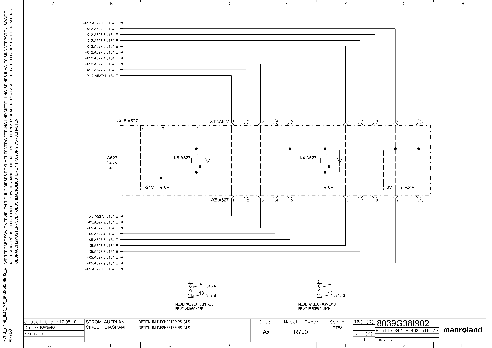

# +Ax — Sheet 342 of 403 — OPTION: INLINESHEETER RS104 S

**OPTION: INLINESHEETER RS104 S**

> Part of the manroland **R700** printing press IEC/UL circuit diagrams.
> Drawing class: **Stromlaufplan / Circuit diagram** (DIN A3).
> Document `+Ax` covers the **Central control console** machine section.

## At a glance

| Field | Value |
|---|---|
| Document | `+Ax`  (8039G38I902) |
| Sheet | **342** of 403 |
| Section (DE) | OPTION: INLINESHEETER RS104 S |
| Section (EN) | OPTION: INLINESHEETER RS104 S |
| Section type | CIRCUIT — Circuit diagram |
| Machine type | `R700` |
| Series | `7758` |
| Created | 17.05.10 |
| Replaces | — |
| Columns used | B, C, D, E, F, G |
| Path numbers | — |
| Labels on sheet | 99 |
| Cross-refs out | 25 |
| Cross-refs in | 48 |

**Previous:** [+Ax sheet 341](SHEET_0341.md) · **Next:** [+Ax sheet 343](SHEET_0343.md) · **Document TOC:** [_TOC.md](_TOC.md)  (+Ax) · **Master TOC:** [all sheets](../_MASTER_TOC.md)

## Sheet image (300 DPI, exact vector render)



_Rendered directly from the PDF vector layer at 300 DPI (1-bit), no OCR and no resampling. Use it to confirm anything ambiguous in the text below._

## Cross-references on this sheet

Each entry is a wire leaving this sheet. The printed token is `/sheet.column`; the link resolves to that sheet inside the same document.

| Ref | Target sheet | Col | Path | Destination on target | Target section | From col |
|---|---|---|---|---|---|---|
| `/134.E` | [+Ax sheet 134](SHEET_0134.md) | E | — | X12.A527:10 | REALTIMERECHNER ANSTEUERUNG DER SPS POWERKARTE | B |
| `/134.E` | [+Ax sheet 134](SHEET_0134.md) | E | — | X12.A527:9 | REALTIMERECHNER ANSTEUERUNG DER SPS POWERKARTE | B |
| `/134.E` | [+Ax sheet 134](SHEET_0134.md) | E | — | X12.A527:8 | REALTIMERECHNER ANSTEUERUNG DER SPS POWERKARTE | B |
| `/134.E` | [+Ax sheet 134](SHEET_0134.md) | E | — | X12.A527:7 | REALTIMERECHNER ANSTEUERUNG DER SPS POWERKARTE | B |
| `/134.E` | [+Ax sheet 134](SHEET_0134.md) | E | — | X12.A527:6 | REALTIMERECHNER ANSTEUERUNG DER SPS POWERKARTE | B |
| `/134.E` | [+Ax sheet 134](SHEET_0134.md) | E | — | X12.A527:5 | REALTIMERECHNER ANSTEUERUNG DER SPS POWERKARTE | B |
| `/134.E` | [+Ax sheet 134](SHEET_0134.md) | E | — | X12.A527:4 | REALTIMERECHNER ANSTEUERUNG DER SPS POWERKARTE | B |
| `/134.E` | [+Ax sheet 134](SHEET_0134.md) | E | — | X12.A527:3 | REALTIMERECHNER ANSTEUERUNG DER SPS POWERKARTE | B |
| `/134.E` | [+Ax sheet 134](SHEET_0134.md) | E | — | X12.A527:2 | REALTIMERECHNER ANSTEUERUNG DER SPS POWERKARTE | B |
| `/134.E` | [+Ax sheet 134](SHEET_0134.md) | E | — | X12.A527:1 | REALTIMERECHNER ANSTEUERUNG DER SPS POWERKARTE | B |
| `/343.A` | [+Ax sheet 343](SHEET_0343.md) | A | — | — | OPTION: INLINESHEETER RS104 S | B |
| `/341.C` | [+Ax sheet 341](SHEET_0341.md) | C | — | — | OPTION: INLINESHEETER RS104 S | B |
| `/134.E` | [+Ax sheet 134](SHEET_0134.md) | E | — | X5.A527:1 | REALTIMERECHNER ANSTEUERUNG DER SPS POWERKARTE | B |
| `/134.E` | [+Ax sheet 134](SHEET_0134.md) | E | — | X5.A527:2 | REALTIMERECHNER ANSTEUERUNG DER SPS POWERKARTE | B |
| `/134.E` | [+Ax sheet 134](SHEET_0134.md) | E | — | X5.A527:3 | REALTIMERECHNER ANSTEUERUNG DER SPS POWERKARTE | B |
| `/134.E` | [+Ax sheet 134](SHEET_0134.md) | E | — | X5.A527:4 | REALTIMERECHNER ANSTEUERUNG DER SPS POWERKARTE | B |
| `/134.E` | [+Ax sheet 134](SHEET_0134.md) | E | — | X5.A527:5 | REALTIMERECHNER ANSTEUERUNG DER SPS POWERKARTE | B |
| `/134.E` | [+Ax sheet 134](SHEET_0134.md) | E | — | X5.A527:6 | REALTIMERECHNER ANSTEUERUNG DER SPS POWERKARTE | B |
| `/134.E` | [+Ax sheet 134](SHEET_0134.md) | E | — | X5.A527:7 | REALTIMERECHNER ANSTEUERUNG DER SPS POWERKARTE | B |
| `/134.E` | [+Ax sheet 134](SHEET_0134.md) | E | — | X5.A527:8 | REALTIMERECHNER ANSTEUERUNG DER SPS POWERKARTE | B |
| `/134.E` | [+Ax sheet 134](SHEET_0134.md) | E | — | X5.A527:9 | REALTIMERECHNER ANSTEUERUNG DER SPS POWERKARTE | B |
| `/134.E` | [+Ax sheet 134](SHEET_0134.md) | E | — | X5.A527:10 | REALTIMERECHNER ANSTEUERUNG DER SPS POWERKARTE | B |
| `/343.A` | [+Ax sheet 343](SHEET_0343.md) | A | — | 4 | OPTION: INLINESHEETER RS104 S | D |
| `/343.B` | [+Ax sheet 343](SHEET_0343.md) | B | — | — | OPTION: INLINESHEETER RS104 S | D |
| `/343.G` | [+Ax sheet 343](SHEET_0343.md) | G | — | — | OPTION: INLINESHEETER RS104 S | F |

### Incoming references (sheets that point here)

Every other sheet that sends a wire to this one. `Back-ref` is the token printed on *that* sheet; `Path` is its line number.

| From sheet | Cols | Back-ref | Path | Refs | What continues there |
|---|---|---|---|---|---|
| [+Ax#134](SHEET_0134.md) | E | `/134.E` | — | 20 | X12.A527:1; X12.A527:10; X12.A527:2; X12.A527:3; X12.A527:4; X12.A527:5; X12.A527:6; X12.A527:7; X12.A527:8; X12.A527:9; X5.A527:1; X5.A527:10; X5.A527:2; X5.A5 |
| [+Ax#232](SHEET_0232.md) | E | `/232.E` | — | 10 | — |
| [+Ax#249](SHEET_0249.md) | A | `/249.A` | — | 10 | — |
| [+Ax#253](SHEET_0253.md) | C | `/253.C` | — | 3 | — |
| [+Ax#341](SHEET_0341.md) | B | `/341.B` | — | 1 | — |
| [+Ax#343](SHEET_0343.md) | A, B, F | `/343.A`, `/343.B`, `/343.F` | — | 4 | — |


## Devices on this sheet

| Tag | Class | Class meaning (IEC) | Col | Sub | Terminal | Sign |
|---|---|---|---|---|---|---|
| `A527` | A | Baugruppe / assembly, module, PC board | B | — | — | — |
| `K6.A527` | — | cross-device reference | C | — | — | — |
| `X5.A527` | — | cross-device reference | D | — | — | — |
| `X12.A527` | — | cross-device reference | D | — | — | — |
| `K4.A527` | — | cross-device reference | E | — | — | — |
| `X12.A527:10` | — | cross-device reference | B | — | 10 | — |
| `X12.A527:9` | — | cross-device reference | B | — | 9 | — |
| `X12.A527:3` | — | cross-device reference | B | — | 3 | — |
| `X12.A527:2` | — | cross-device reference | B | — | 2 | — |
| `X12.A527:1` | — | cross-device reference | B | — | 1 | — |
| `X12.A527:4` | — | cross-device reference | B | — | 4 | — |
| `X12.A527:8` | — | cross-device reference | B | — | 8 | — |
| `X12.A527:7` | — | cross-device reference | B | — | 7 | — |
| `X12.A527:6` | — | cross-device reference | B | — | 6 | — |
| `X12.A527:5` | — | cross-device reference | B | — | 5 | — |
| `X5.A527:8` | — | cross-device reference | B | — | 8 | — |
| `X5.A527:7` | — | cross-device reference | B | — | 7 | — |
| `X5.A527:6` | — | cross-device reference | B | — | 6 | — |
| `X5.A527:5` | — | cross-device reference | B | — | 5 | — |
| `X5.A527:9` | — | cross-device reference | B | — | 9 | — |
| `X5.A527:10` | — | cross-device reference | B | — | 10 | — |
| `X5.A527:4` | — | cross-device reference | B | — | 4 | — |
| `X5.A527:3` | — | cross-device reference | B | — | 3 | — |
| `X5.A527:2` | — | cross-device reference | B | — | 2 | — |
| `X5.A527:1` | — | cross-device reference | B | — | 1 | — |
| `X15.A527` | — | cross-device reference | B | — | — | — |

## Potentials / nets

| Potential | Count | Columns | Attached devices | Terminals |
|---|---|---|---|---|
| `0V` | 3 | C, F, G | — | — |
| `24V` | 2 | C, G | — | — |


A potential such as `L24+/4` or `M24+` is a named supply/return rail; every place it appears on this sheet is electrically common.

## Wire-end annotations (grouped as printed)

A wire that continues elsewhere is annotated with a small cluster: the destination description, the path/line number `#NN`, and the `/sheet.column` cross reference. Each row below is one such cluster exactly as it is grouped on the drawing.

| Col | Y | Path | Cross-ref | Text on the wire |
|---|---|---|---|---|
| B | 52.0 | — | `/134.E` | `X12.A527:10` |
| B | 66.2 | — | `/134.E` | `X12.A527:9` |
| B | 80.3 | — | `/134.E` | `X12.A527:8` |
| B | 94.5 | — | `/134.E` | `X12.A527:7` |
| B | 108.7 | — | `/134.E` | `X12.A527:6` |
| B | 122.9 | — | `/134.E` | `X12.A527:5` |
| B | 137.0 | — | `/134.E` | `X12.A527:4` |
| B | 151.2 | — | `/134.E` | `X12.A527:3` |
| B | 165.4 | — | `/134.E` | `X12.A527:2` |
| B | 179.6 | — | `/134.E` | `X12.A527:1` |
| B | 288.0 | — | — | `X15.A527` |
| D | 289.4 | — | — | `X12.A527 1` |
| E | 289.5 | — | — | `2 3 8` |
| E | 289.5 | — | — | `4` |
| E | 289.5 | — | — | `5` |
| F | 289.5 | — | — | `6` |
| F | 289.5 | — | — | `7` |
| G | 289.5 | — | — | `9` |
| G | 289.5 | — | — | `10` |
| C | 306.5 | — | — | `2` |
| C | 306.5 | — | — | `3` |
| C | 306.5 | — | — | `1` |
| C | 370.9 | — | — | `1` |
| F | 370.9 | — | — | `1` |
| B | 377.3 | — | — | `A527` |
| C | 377.3 | — | — | `K6.A527` |
| E | 377.3 | — | — | `K4.A527` |
| B | 390.4 | — | `/343.A`, `/341.C` | — |
| C | 399.3 | — | — | `16` |
| F | 399.3 | — | — | `16` |
| E | 448.2 | — | — | `24V 0V 0V 0V 24V` |
| D | 479.4 | — | — | `X5.A527 1` |
| D | 480.8 | — | — | `2 3` |
| E | 480.8 | — | — | `4` |
| E | 480.8 | — | — | `5` |
| F | 480.8 | — | — | `6` |
| F | 480.8 | — | — | `7` |
| G | 480.8 | — | — | `8` |
| G | 480.8 | — | — | `9` |
| G | 480.8 | — | — | `10` |
| B | 519.7 | — | `/134.E` | `X5.A527:1` |
| B | 533.9 | — | `/134.E` | `X5.A527:2` |
| B | 548.1 | — | `/134.E` | `X5.A527:3` |
| B | 562.2 | — | `/134.E` | `X5.A527:4` |
| B | 576.4 | — | `/134.E` | `X5.A527:5` |
| B | 590.6 | — | `/134.E` | `X5.A527:6` |
| B | 604.8 | — | `/134.E` | `X5.A527:7` |
| B | 618.9 | — | `/134.E` | `X5.A527:8` |
| B | 633.1 | — | `/134.E` | `X5.A527:9` |
| B | 647.3 | — | `/134.E` | `X5.A527:10` |
| C | 676.3 | — | — | `11 8 6 9 13` |
| F | 676.3 | — | — | `11 8 6 9 13` |
| D | 682.0 | — | `/343.A` | `4` |
| F | 682.0 | — | — | `4` |
| D | 711.0 | — | `/343.B` | — |
| F | 711.1 | — | `/343.G` | — |
| C | 733.4 | — | — | `RELAIS: SAUGLUFT: EIN / AUS RELAY: ÄS107/2 / OFF` |
| F | 733.4 | — | — | `RELAIS: ANLEGERKUPPLUNG RELAY: FEEDER CLUTCH` |


## Reconstructed tables

This sheet carries tabular content (pin map / terminal assignment / index). The grid below was rebuilt from the drawing's own rule lines, so each row is exactly one physical row of the table.

### Table 1 — 2 data rows × 10 columns (at x=340.2, y=55.3)

| 2 | 3 | 1 | X12.A527 | 1 | 2 | 3 | 4 | 5 |  |
|---|---|---|---|---|---|---|---|---|---|
|  | `K6.A527` | `1 16` |  |  |  |  |  | `K4.A527` | `1 16` |
| `24V` | `0V` |  | `X5.A527` | `1` | `2` | `3` | `4` | `5` | `0V` |


### Table 2 — 1 data rows × 6 columns (at x=836.2, y=55.3)

| 6 | 7 | 8 |  | 9 |  |
|---|---|---|---|---|---|
| `6` | `7` | `8` | `0V` | `9` | `24V` |


## Notes and free text on this sheet

| Text | Col | Y (pt) |
|---|---|---|
| `RELAIS: SAUGLUFT: EIN / AUS` | C | 733.36 |
| `RELAY: ÄS107/2 / OFF` | C | 743.99 |
| `RELAIS: ANLEGERKUPPLUNG` | F | 733.38 |
| `RELAY: FEEDER CLUTCH` | E | 744.01 |

## Complete label inventory (exact text from the drawing)

Every text object inside the drawing area of this sheet, in DIN reading order (column A→H, then top→bottom). This is the authoritative list: if a string is not here it is not printed on this sheet.

| Col | Y | X | Dir | Type | Text |
|---|---|---|---|---|---|
| B | 52.0 | 201.8 | → | device ref | `X12.A527:10` |
| B | 52.0 | 259.9 | → | cross-reference | `/134.E` |
| B | 66.2 | 206.6 | → | device ref | `X12.A527:9` |
| B | 66.2 | 259.9 | → | cross-reference | `/134.E` |
| B | 80.3 | 259.9 | → | cross-reference | `/134.E` |
| B | 80.4 | 206.6 | → | device ref | `X12.A527:8` |
| B | 94.5 | 206.6 | → | device ref | `X12.A527:7` |
| B | 94.5 | 259.9 | → | cross-reference | `/134.E` |
| B | 108.7 | 206.6 | → | device ref | `X12.A527:6` |
| B | 108.7 | 259.9 | → | cross-reference | `/134.E` |
| B | 122.9 | 206.6 | → | device ref | `X12.A527:5` |
| B | 122.9 | 259.9 | → | cross-reference | `/134.E` |
| B | 137.0 | 259.9 | → | cross-reference | `/134.E` |
| B | 137.1 | 206.6 | → | device ref | `X12.A527:4` |
| B | 151.2 | 206.6 | → | device ref | `X12.A527:3` |
| B | 151.2 | 259.9 | → | cross-reference | `/134.E` |
| B | 165.4 | 206.9 | → | device ref | `X12.A527:2` |
| B | 165.4 | 259.9 | → | cross-reference | `/134.E` |
| B | 179.6 | 208.1 | → | device ref | `X12.A527:1` |
| B | 179.6 | 259.9 | → | cross-reference | `/134.E` |
| B | 288.0 | 283.5 | → | device ref | `X15.A527` |
| B | 377.3 | 255.7 | → | device tag | `A527` |
| B | 390.4 | 258.0 | → | cross-reference | `/343.A` |
| B | 402.8 | 258.0 | → | cross-reference | `/341.C` |
| B | 519.7 | 212.9 | → | device ref | `X5.A527:1` |
| B | 519.7 | 259.9 | → | cross-reference | `/134.E` |
| B | 533.9 | 211.7 | → | device ref | `X5.A527:2` |
| B | 533.9 | 259.9 | → | cross-reference | `/134.E` |
| B | 548.1 | 211.5 | → | device ref | `X5.A527:3` |
| B | 548.1 | 259.9 | → | cross-reference | `/134.E` |
| B | 562.2 | 211.5 | → | device ref | `X5.A527:4` |
| B | 562.2 | 259.9 | → | cross-reference | `/134.E` |
| B | 576.4 | 211.5 | → | device ref | `X5.A527:5` |
| B | 576.4 | 259.9 | → | cross-reference | `/134.E` |
| B | 590.6 | 211.5 | → | device ref | `X5.A527:6` |
| B | 590.6 | 259.9 | → | cross-reference | `/134.E` |
| B | 604.8 | 211.5 | → | device ref | `X5.A527:7` |
| B | 604.8 | 259.9 | → | cross-reference | `/134.E` |
| B | 618.9 | 211.5 | → | device ref | `X5.A527:8` |
| B | 618.9 | 259.9 | → | cross-reference | `/134.E` |
| B | 633.1 | 211.5 | → | device ref | `X5.A527:9` |
| B | 633.1 | 259.9 | → | cross-reference | `/134.E` |
| B | 647.3 | 206.6 | → | device ref | `X5.A527:10` |
| B | 647.3 | 259.9 | → | cross-reference | `/134.E` |
| C | 306.5 | 342.7 | → | number | `2` |
| C | 306.5 | 392.3 | → | number | `3` |
| C | 306.5 | 476.8 | → | number | `1` |
| C | 371.0 | 476.8 | → | number | `1` |
| C | 377.3 | 417.0 | → | device ref | `K6.A527` |
| C | 399.3 | 476.8 | → | number | `16` |
| C | 448.2 | 350.1 | → | potential | `24V` |
| C | 448.2 | 397.1 | → | potential | `0V` |
| C | 676.3 | 458.1 | → | number | `8` |
| C | 687.7 | 458.1 | → | number | `6` |
| C | 699.0 | 458.1 | → | number | `9` |
| C | 710.3 | 453.5 | → | number | `11` |
| C | 733.4 | 424.3 | → | text | `RELAIS: SAUGLUFT: EIN / AUS` |
| C | 744.0 | 424.3 | → | text | `RELAY: ÄS107/2 / OFF` |
| D | 289.4 | 504.6 | → | device ref | `X12.A527` |
| D | 289.5 | 561.8 | → | number | `1` |
| D | 289.5 | 597.8 | → | number | `2` |
| D | 479.4 | 509.1 | → | device ref | `X5.A527` |
| D | 480.8 | 561.8 | → | number | `1` |
| D | 480.8 | 597.8 | → | number | `2` |
| D | 682.0 | 483.0 | → | number | `4` |
| D | 688.4 | 497.5 | → | cross-reference | `/343.A` |
| D | 704.7 | 481.3 | → | number | `13` |
| D | 711.1 | 497.5 | → | cross-reference | `/343.B` |
| E | 289.5 | 633.3 | → | number | `3` |
| E | 289.5 | 668.7 | → | number | `4` |
| E | 289.5 | 704.1 | → | number | `5` |
| E | 377.3 | 721.7 | → | device ref | `K4.A527` |
| E | 480.8 | 633.3 | → | number | `3` |
| E | 480.8 | 668.7 | → | number | `4` |
| E | 480.8 | 704.1 | → | number | `5` |
| E | 744.0 | 722.0 | → | text | `RELAY: FEEDER CLUTCH` |
| F | 289.5 | 838.8 | → | number | `6` |
| F | 289.5 | 874.2 | → | number | `7` |
| F | 371.0 | 788.6 | → | number | `1` |
| F | 399.3 | 788.6 | → | number | `16` |
| F | 448.2 | 794.0 | → | potential | `0V` |
| F | 480.8 | 838.8 | → | number | `6` |
| F | 480.8 | 874.2 | → | number | `7` |
| F | 676.3 | 769.9 | → | number | `8` |
| F | 682.0 | 794.8 | → | number | `4` |
| F | 687.7 | 769.9 | → | number | `6` |
| F | 699.0 | 769.9 | → | number | `9` |
| F | 704.7 | 793.1 | → | number | `13` |
| F | 710.3 | 765.4 | → | number | `11` |
| F | 711.1 | 809.3 | → | cross-reference | `/343.G` |
| F | 733.4 | 722.0 | → | text | `RELAIS: ANLEGERKUPPLUNG` |
| G | 289.5 | 909.6 | → | number | `8` |
| G | 289.5 | 959.2 | → | number | `9` |
| G | 289.5 | 1015.4 | → | number | `10` |
| G | 448.2 | 935.7 | → | potential | `0V` |
| G | 448.2 | 980.8 | → | potential | `24V` |
| G | 480.8 | 909.6 | → | number | `8` |
| G | 480.8 | 959.2 | → | number | `9` |
| G | 480.8 | 1015.4 | → | number | `10` |

## Reading-order text block

The same content as a plain block, grouped by DIN column — convenient to paste or to match against a visual description.

```text
=== Column B ===
  52.0  201.8  devref       X12.A527:10
  52.0  259.9  xref         /134.E
  66.2  206.6  devref       X12.A527:9
  66.2  259.9  xref         /134.E
  80.3  259.9  xref         /134.E
  80.4  206.6  devref       X12.A527:8
  94.5  206.6  devref       X12.A527:7
  94.5  259.9  xref         /134.E
 108.7  206.6  devref       X12.A527:6
 108.7  259.9  xref         /134.E
 122.9  206.6  devref       X12.A527:5
 122.9  259.9  xref         /134.E
 137.0  259.9  xref         /134.E
 137.1  206.6  devref       X12.A527:4
 151.2  206.6  devref       X12.A527:3
 151.2  259.9  xref         /134.E
 165.4  206.9  devref       X12.A527:2
 165.4  259.9  xref         /134.E
 179.6  208.1  devref       X12.A527:1
 179.6  259.9  xref         /134.E
 288.0  283.5  devref       X15.A527
 377.3  255.7  devtag       A527
 390.4  258.0  xref         /343.A
 402.8  258.0  xref         /341.C
 519.7  212.9  devref       X5.A527:1
 519.7  259.9  xref         /134.E
 533.9  211.7  devref       X5.A527:2
 533.9  259.9  xref         /134.E
 548.1  211.5  devref       X5.A527:3
 548.1  259.9  xref         /134.E
 562.2  211.5  devref       X5.A527:4
 562.2  259.9  xref         /134.E
 576.4  211.5  devref       X5.A527:5
 576.4  259.9  xref         /134.E
 590.6  211.5  devref       X5.A527:6
 590.6  259.9  xref         /134.E
 604.8  211.5  devref       X5.A527:7
 604.8  259.9  xref         /134.E
 618.9  211.5  devref       X5.A527:8
 618.9  259.9  xref         /134.E
 633.1  211.5  devref       X5.A527:9
 633.1  259.9  xref         /134.E
 647.3  206.6  devref       X5.A527:10
 647.3  259.9  xref         /134.E
=== Column C ===
 306.5  342.7  numeric      2
 306.5  392.3  numeric      3
 306.5  476.8  numeric      1
 371.0  476.8  numeric      1
 377.3  417.0  devref       K6.A527
 399.3  476.8  numeric      16
 448.2  350.1  net          24V
 448.2  397.1  net          0V
 676.3  458.1  numeric      8
 687.7  458.1  numeric      6
 699.0  458.1  numeric      9
 710.3  453.5  numeric      11
 733.4  424.3  text         RELAIS: SAUGLUFT: EIN / AUS
 744.0  424.3  text         RELAY: ÄS107/2 / OFF
=== Column D ===
 289.4  504.6  devref       X12.A527
 289.5  561.8  numeric      1
 289.5  597.8  numeric      2
 479.4  509.1  devref       X5.A527
 480.8  561.8  numeric      1
 480.8  597.8  numeric      2
 682.0  483.0  numeric      4
 688.4  497.5  xref         /343.A
 704.7  481.3  numeric      13
 711.1  497.5  xref         /343.B
=== Column E ===
 289.5  633.3  numeric      3
 289.5  668.7  numeric      4
 289.5  704.1  numeric      5
 377.3  721.7  devref       K4.A527
 480.8  633.3  numeric      3
 480.8  668.7  numeric      4
 480.8  704.1  numeric      5
 744.0  722.0  text         RELAY: FEEDER CLUTCH
=== Column F ===
 289.5  838.8  numeric      6
 289.5  874.2  numeric      7
 371.0  788.6  numeric      1
 399.3  788.6  numeric      16
 448.2  794.0  net          0V
 480.8  838.8  numeric      6
 480.8  874.2  numeric      7
 676.3  769.9  numeric      8
 682.0  794.8  numeric      4
 687.7  769.9  numeric      6
 699.0  769.9  numeric      9
 704.7  793.1  numeric      13
 710.3  765.4  numeric      11
 711.1  809.3  xref         /343.G
 733.4  722.0  text         RELAIS: ANLEGERKUPPLUNG
=== Column G ===
 289.5  909.6  numeric      8
 289.5  959.2  numeric      9
 289.5 1015.4  numeric      10
 448.2  935.7  net          0V
 448.2  980.8  net          24V
 480.8  909.6  numeric      8
 480.8  959.2  numeric      9
 480.8 1015.4  numeric      10
```

---
_Generated from the PDF vector text layer; no OCR. Source: `R700_7758_IEC_AX_8039G38I902_p`, sheet 342._
