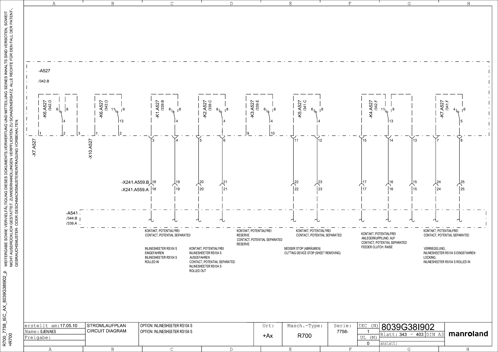

# +Ax — Sheet 343 of 403 — OPTION: INLINESHEETER RS104 S

**OPTION: INLINESHEETER RS104 S**

> Part of the manroland **R700** printing press IEC/UL circuit diagrams.
> Drawing class: **Stromlaufplan / Circuit diagram** (DIN A3).
> Document `+Ax` covers the **Central control console** machine section.

## At a glance

| Field | Value |
|---|---|
| Document | `+Ax`  (8039G38I902) |
| Sheet | **343** of 403 |
| Section (DE) | OPTION: INLINESHEETER RS104 S |
| Section (EN) | OPTION: INLINESHEETER RS104 S |
| Section type | CIRCUIT — Circuit diagram |
| Machine type | `R700` |
| Series | `7758` |
| Created | 17.05.10 |
| Replaces | — |
| Columns used | A, B, C, D, E, F, G, H |
| Path numbers | — |
| Labels on sheet | 119 |
| Cross-refs out | 11 |
| Cross-refs in | 50 |

**Previous:** [+Ax sheet 342](SHEET_0342.md) · **Next:** [+Ax sheet 344](SHEET_0344.md) · **Document TOC:** [_TOC.md](_TOC.md)  (+Ax) · **Master TOC:** [all sheets](../_MASTER_TOC.md)

## Sheet image (300 DPI, exact vector render)



_Rendered directly from the PDF vector layer at 300 DPI (1-bit), no OCR and no resampling. Use it to confirm anything ambiguous in the text below._

## Cross-references on this sheet

Each entry is a wire leaving this sheet. The printed token is `/sheet.column`; the link resolves to that sheet inside the same document.

| Ref | Target sheet | Col | Path | Destination on target | Target section | From col |
|---|---|---|---|---|---|---|
| `/342.B` | [+Ax sheet 342](SHEET_0342.md) | B | — | — | OPTION: INLINESHEETER RS104 S | A |
| `/339.E` | [+Ax sheet 339](SHEET_0339.md) | E | — | — | OPTION: INLINESHEETER RS104 S | D |
| `/342.D` | [+Ax sheet 342](SHEET_0342.md) | D | — | — | OPTION: INLINESHEETER RS104 S | A |
| `/342.D` | [+Ax sheet 342](SHEET_0342.md) | D | — | — | OPTION: INLINESHEETER RS104 S | B |
| `/339.B` | [+Ax sheet 339](SHEET_0339.md) | B | — | — | OPTION: INLINESHEETER RS104 S | C |
| `/339.C` | [+Ax sheet 339](SHEET_0339.md) | C | — | — | OPTION: INLINESHEETER RS104 S | D |
| `/341.C` | [+Ax sheet 341](SHEET_0341.md) | C | — | — | OPTION: INLINESHEETER RS104 S | E |
| `/342.F` | [+Ax sheet 342](SHEET_0342.md) | F | — | — | OPTION: INLINESHEETER RS104 S | F |
| `/341.F` | [+Ax sheet 341](SHEET_0341.md) | F | — | — | OPTION: INLINESHEETER RS104 S | H |
| `/344.B` | [+Ax sheet 344](SHEET_0344.md) | B | — | — | OPTION: INLINESHEETER RS104 S | A |
| `/339.A` | [+Ax sheet 339](SHEET_0339.md) | A | — | — | OPTION: INLINESHEETER RS104 S | A |

### Incoming references (sheets that point here)

Every other sheet that sends a wire to this one. `Back-ref` is the token printed on *that* sheet; `Path` is its line number.

| From sheet | Cols | Back-ref | Path | Refs | What continues there |
|---|---|---|---|---|---|
| [+Ax#236](SHEET_0236.md) | G | `/236.G` | — | 3 | — |
| [+Ax#245](SHEET_0245.md) | G | `/245.G` | — | 15 | — |
| [+Ax#295](SHEET_0295.md) | E, F | `/295.E`, `/295.F` | — | 22 | — |
| [+Ax#339](SHEET_0339.md) | A, B, C, E | `/339.A`, `/339.B`, `/339.C`, `/339.E` | — | 4 | 4 |
| [+Ax#341](SHEET_0341.md) | C | `/341.C` | — | 1 | 4 |
| [+Ax#342](SHEET_0342.md) | B, D, F | `/342.B`, `/342.D`, `/342.F` | — | 4 | 4 |
| [+Ax#344](SHEET_0344.md) | B | `/344.B` | — | 1 | — |


## Devices on this sheet

| Tag | Class | Class meaning (IEC) | Col | Sub | Terminal | Sign |
|---|---|---|---|---|---|---|
| `A527` | A | Baugruppe / assembly, module, PC board | A | — | — | — |
| `A541` | A | Baugruppe / assembly, module, PC board | A | — | — | — |
| `K4.A527` | — | cross-device reference | F | — | — | — |
| `K5.A527` | — | cross-device reference | E | — | — | — |
| `K1.A527` | — | cross-device reference | C | — | — | — |
| `K2.A527` | — | cross-device reference | D | — | — | — |
| `K6.A527` | — | cross-device reference | B | — | — | — |
| `K3.A527` | — | cross-device reference | D | — | — | — |
| `K7.A527` | — | cross-device reference | H | — | — | — |
| `K6.A527` | — | cross-device reference | A | — | — | — |
| `X241.A559.B` | — | cross-device reference | B | — | — | — |
| `X241.A559.A` | — | cross-device reference | B | — | — | — |
| `X7.A527` | — | cross-device reference | A | — | — | — |
| `X10.A527` | — | cross-device reference | B | — | — | — |

## Potentials / nets

_No named potentials on this sheet._

## Wire-end annotations (grouped as printed)

A wire that continues elsewhere is annotated with a small cluster: the destination description, the path/line number `#NN`, and the `/sheet.column` cross reference. Each row below is one such cluster exactly as it is grouped on the drawing.

| Col | Y | Path | Cross-ref | Text on the wire |
|---|---|---|---|---|
| A | 164.7 | — | — | `A527` |
| A | 190.2 | — | `/342.B` | — |
| A | 239.0 | — | — | `K6.A527` |
| B | 239.0 | — | — | `K6.A527` |
| C | 239.0 | — | — | `K1.A527` |
| D | 239.0 | — | — | `K2.A527` |
| D | 239.0 | — | — | `K3.A527` |
| D | 239.0 | — | `/339.E` | — |
| E | 239.0 | — | — | `K5.A527` |
| F | 239.0 | — | — | `K4.A527` |
| H | 239.0 | — | — | `K7.A527` |
| A | 239.2 | — | `/342.D` | — |
| B | 239.2 | — | `/342.D` | — |
| C | 239.2 | — | `/339.B` | — |
| D | 239.2 | — | `/339.C` | — |
| E | 239.2 | — | `/341.C` | — |
| F | 239.2 | — | `/342.F` | — |
| H | 239.2 | — | `/341.F` | — |
| A | 257.6 | — | — | `6` |
| A | 257.6 | — | — | `8` |
| B | 257.6 | — | — | `11` |
| B | 257.6 | — | — | `9` |
| C | 257.6 | — | — | `6` |
| C | 257.6 | — | — | `8` |
| D | 257.6 | — | — | `6` |
| D | 257.6 | — | — | `8` |
| E | 257.6 | — | — | `6` |
| E | 257.6 | — | — | `8` |
| E | 257.6 | — | — | `6` |
| F | 257.6 | — | — | `8` |
| G | 257.6 | — | — | `11` |
| G | 257.6 | — | — | `9` |
| H | 257.6 | — | — | `4` |
| H | 257.6 | — | — | `6` |
| A | 285.9 | — | — | `4` |
| B | 285.9 | — | — | `13` |
| C | 285.9 | — | — | `4` |
| D | 285.9 | — | — | `4` |
| E | 285.9 | — | — | `4` |
| E | 285.9 | — | — | `4` |
| G | 285.9 | — | — | `13` |
| H | 285.9 | — | — | `5` |
| A | 315.0 | — | — | `1 2` |
| A | 315.0 | — | — | `3` |
| B | 315.0 | — | — | `1` |
| C | 315.0 | — | — | `2 9 10` |
| A | 331.1 | — | — | `X7.A527` |
| B | 331.1 | — | — | `X10.A527` |
| E | 332.0 | — | — | `3 4 5 6 11 12 15 13` |
| G | 332.0 | — | — | `14 7 8` |
| B | 431.2 | — | — | `X241.A559.B 18` |
| C | 431.2 | — | — | `19` |
| D | 431.2 | — | — | `20` |
| D | 431.2 | — | — | `21` |
| E | 431.2 | — | — | `22` |
| F | 431.2 | — | — | `23` |
| F | 431.2 | — | — | `17` |
| G | 431.2 | — | — | `16` |
| G | 431.2 | — | — | `15` |
| H | 431.2 | — | — | `24` |
| H | 431.2 | — | — | `25` |
| B | 448.2 | — | — | `X241.A559.A 18` |
| C | 448.2 | — | — | `19` |
| D | 448.2 | — | — | `20` |
| D | 448.2 | — | — | `21` |
| E | 448.2 | — | — | `22` |
| F | 448.2 | — | — | `23` |
| F | 448.2 | — | — | `17` |
| G | 448.2 | — | — | `16` |
| G | 448.2 | — | — | `15` |
| H | 448.2 | — | — | `24` |
| H | 448.2 | — | — | `25` |
| A | 504.9 | — | — | `A541` |
| A | 517.9 | — | `/344.B`, `/339.A` | — |
| C | 549.1 | — | — | `KONTAKT, POTENTIALFREI` |
| E | 549.1 | — | — | `KONTAKT, POTENTIALFREI RESERVE CONTACT, POTENTIAL SEPARATED` |
| E | 549.1 | — | — | `KONTAKT, POTENTIALFREI` |
| H | 549.1 | — | — | `KONTAKT, POTENTIALFREI` |
| G | 556.2 | — | — | `KONTAKT, POTENTIALFREI CONTACT, POTENTIAL SEPARATED` |
| C | 559.8 | — | — | `CONTACT, POTENTIAL SEPARATED` |
| G | 566.9 | — | — | `FEEDER CLUTCH: RAISE CONTACT, POTENTIAL SEPARATED ANLEGERKUPPLUNG: AUF` |
| D | 570.4 | — | — | `KONTAKT, POTENTIALFREI INLINESHEETER RS104 S RESERVE CONTACT, POTENTIAL SEPARATED` |
| C | 591.6 | — | — | `INLINESHEETER RS104 S EINGEFAHREN INLINESHEETER RS104 S ROLLED IN` |
| E | 591.6 | — | — | `MESSER STOP (ABRÄUMEN) CUTTING DEVICE STOP (SHEET REMOVING)` |
| H | 591.6 | — | — | `INLINESHEETER RS104 S EINGEFAHREN LOCKING, INLINESHEETER RS104 S ROLLED IN VERRIEGELUNG,` |
| D | 612.9 | — | — | `INLINESHEETER RS104 S ROLLED OUT CONTACT, POTENTIAL SEPARATED AUSGEFAHREN` |


## Notes and free text on this sheet

| Text | Col | Y (pt) |
|---|---|---|
| `MESSER STOP (ABRÄUMEN)` | E | 591.65 |
| `CUTTING DEVICE STOP (SHEET REMOVING)` | E | 602.29 |
| `KONTAKT, POTENTIALFREI` | H | 549.11 |
| `CONTACT, POTENTIAL SEPARATED` | H | 559.76 |
| `KONTAKT, POTENTIALFREI` | F | 556.2 |
| `ANLEGERKUPPLUNG: AUF` | F | 566.86 |
| `CONTACT, POTENTIAL SEPARATED` | G | 577.48 |
| `FEEDER CLUTCH: RAISE` | F | 588.11 |
| `KONTAKT, POTENTIALFREI` | C | 549.11 |
| `CONTACT, POTENTIAL SEPARATED` | C | 559.76 |
| `KONTAKT, POTENTIALFREI` | E | 549.11 |
| `CONTACT, POTENTIAL SEPARATED` | E | 559.76 |
| `KONTAKT, POTENTIALFREI` | D | 549.11 |
| `RESERVE` | D | 559.72 |
| `CONTACT, POTENTIAL SEPARATED` | D | 570.39 |
| `INLINESHEETER RS104 S` | D | 602.27 |
| `AUSGEFAHREN` | C | 612.91 |
| `ROLLED OUT` | C | 644.82 |
| `INLINESHEETER RS104 S` | C | 591.64 |
| `EINGEFAHREN` | C | 602.26 |
| `ROLLED IN` | C | 623.53 |
| `VERRIEGELUNG,` | G | 591.65 |
| `INLINESHEETER RS104 S EINGEFAHREN` | H | 602.28 |
| `LOCKING,` | G | 612.89 |
| `INLINESHEETER RS104 S ROLLED IN` | H | 623.55 |

## Complete label inventory (exact text from the drawing)

Every text object inside the drawing area of this sheet, in DIN reading order (column A→H, then top→bottom). This is the authoritative list: if a string is not here it is not printed on this sheet.

| Col | Y | X | Dir | Type | Text |
|---|---|---|---|---|---|
| A | 164.7 | 91.8 | → | device tag | `A527` |
| A | 190.2 | 92.1 | → | cross-reference | `/342.B` |
| A | 239.0 | 102.4 | ↕ | device ref | `K6.A527` |
| A | 239.2 | 115.4 | ↕ | cross-reference | `/342.D` |
| A | 257.6 | 134.4 | → | number | `6` |
| A | 257.6 | 158.5 | → | number | `8` |
| A | 285.9 | 151.4 | → | number | `4` |
| A | 315.0 | 94.1 | → | number | `1` |
| A | 315.0 | 151.4 | → | number | `2` |
| A | 315.0 | 186.8 | → | number | `3` |
| A | 331.1 | 76.8 | ↕ | device ref | `X7.A527` |
| A | 504.9 | 157.9 | → | device tag | `A541` |
| A | 517.9 | 159.0 | → | cross-reference | `/344.B` |
| A | 530.3 | 158.7 | → | cross-reference | `/339.A` |
| B | 239.0 | 237.0 | ↕ | device ref | `K6.A527` |
| B | 239.2 | 250.1 | ↕ | cross-reference | `/342.D` |
| B | 257.6 | 265.6 | → | number | `11` |
| B | 257.6 | 293.1 | → | number | `9` |
| B | 285.9 | 285.4 | → | number | `13` |
| B | 315.0 | 228.8 | → | number | `1` |
| B | 315.0 | 286.0 | → | number | `2` |
| B | 331.1 | 211.5 | ↕ | device ref | `X10.A527` |
| B | 431.2 | 290.3 | → | device ref | `X241.A559.B` |
| B | 448.9 | 289.4 | → | device ref | `X241.A559.A` |
| C | 239.0 | 371.6 | ↕ | device ref | `K1.A527` |
| C | 239.2 | 384.7 | ↕ | cross-reference | `/339.B` |
| C | 257.6 | 403.7 | → | number | `6` |
| C | 257.6 | 427.7 | → | number | `8` |
| C | 285.9 | 420.7 | → | number | `4` |
| C | 332.0 | 364.0 | → | number | `3` |
| C | 332.0 | 420.7 | → | number | `4` |
| C | 332.0 | 477.4 | → | number | `5` |
| C | 431.2 | 363.4 | → | number | `18` |
| C | 431.2 | 420.1 | → | number | `19` |
| C | 448.2 | 363.4 | → | number | `18` |
| C | 448.2 | 420.1 | → | number | `19` |
| C | 549.1 | 346.4 | → | text | `KONTAKT, POTENTIALFREI` |
| C | 559.8 | 347.0 | → | text | `CONTACT, POTENTIAL SEPARATED` |
| C | 591.6 | 346.4 | → | text | `INLINESHEETER RS104 S` |
| C | 602.3 | 346.4 | → | text | `EINGEFAHREN` |
| C | 612.9 | 346.4 | → | text | `INLINESHEETER RS104 S` |
| C | 612.9 | 453.5 | → | text | `AUSGEFAHREN` |
| C | 623.5 | 346.4 | → | text | `ROLLED IN` |
| C | 644.8 | 452.7 | → | text | `ROLLED OUT` |
| D | 239.0 | 485.0 | ↕ | device ref | `K2.A527` |
| D | 239.0 | 598.4 | ↕ | device ref | `K3.A527` |
| D | 239.0 | 611.5 | ↕ | cross-reference | `/339.E` |
| D | 239.2 | 498.1 | ↕ | cross-reference | `/339.C` |
| D | 257.6 | 517.0 | → | number | `6` |
| D | 257.6 | 541.1 | → | number | `8` |
| D | 285.9 | 534.0 | → | number | `4` |
| D | 315.0 | 590.7 | → | number | `9` |
| D | 332.0 | 534.0 | → | number | `6` |
| D | 431.2 | 477.4 | → | number | `20` |
| D | 431.2 | 534.0 | → | number | `21` |
| D | 448.2 | 477.4 | → | number | `20` |
| D | 448.2 | 534.0 | → | number | `21` |
| D | 549.1 | 566.1 | → | text | `KONTAKT, POTENTIALFREI` |
| D | 559.7 | 566.1 | → | text | `RESERVE` |
| D | 570.4 | 566.6 | → | text | `CONTACT, POTENTIAL SEPARATED` |
| D | 581.0 | 566.1 | → | text | `RESERVE` |
| D | 591.6 | 452.7 | → | text | `KONTAKT, POTENTIALFREI` |
| D | 602.3 | 452.7 | → | text | `INLINESHEETER RS104 S` |
| D | 623.5 | 453.3 | → | text | `CONTACT, POTENTIAL SEPARATED` |
| D | 634.2 | 452.7 | → | text | `INLINESHEETER RS104 S` |
| E | 239.0 | 711.8 | ↕ | device ref | `K5.A527` |
| E | 239.2 | 724.9 | ↕ | cross-reference | `/341.C` |
| E | 257.6 | 630.4 | → | number | `6` |
| E | 257.6 | 654.5 | → | number | `8` |
| E | 257.6 | 743.8 | → | number | `6` |
| E | 285.9 | 647.4 | → | number | `4` |
| E | 285.9 | 760.8 | → | number | `4` |
| E | 315.0 | 646.9 | → | number | `10` |
| E | 332.0 | 703.6 | → | number | `11` |
| E | 332.0 | 760.3 | → | number | `12` |
| E | 431.2 | 704.1 | → | number | `22` |
| E | 448.2 | 704.1 | → | number | `22` |
| E | 549.1 | 707.8 | → | text | `KONTAKT, POTENTIALFREI` |
| E | 559.8 | 708.4 | → | text | `CONTACT, POTENTIAL SEPARATED` |
| E | 591.7 | 679.7 | → | text | `MESSER STOP (ABRÄUMEN)` |
| E | 602.3 | 680.0 | → | text | `CUTTING DEVICE STOP (SHEET REMOVING)` |
| F | 239.0 | 881.9 | ↕ | device ref | `K4.A527` |
| F | 239.2 | 895.0 | ↕ | cross-reference | `/342.F` |
| F | 257.6 | 767.9 | → | number | `8` |
| F | 332.0 | 866.6 | → | number | `15` |
| F | 431.2 | 760.8 | → | number | `23` |
| F | 431.2 | 866.6 | → | number | `17` |
| F | 448.2 | 760.8 | → | number | `23` |
| F | 448.2 | 866.6 | → | number | `17` |
| F | 556.2 | 863.7 | → | text | `KONTAKT, POTENTIALFREI` |
| F | 566.9 | 864.6 | → | text | `ANLEGERKUPPLUNG: AUF` |
| F | 588.1 | 863.7 | → | text | `FEEDER CLUTCH: RAISE` |
| G | 257.6 | 910.5 | → | number | `11` |
| G | 257.6 | 938.0 | → | number | `9` |
| G | 285.9 | 930.3 | → | number | `13` |
| G | 332.0 | 930.3 | → | number | `14` |
| G | 332.0 | 987.0 | → | number | `13` |
| G | 332.0 | 1044.3 | → | number | `7` |
| G | 431.2 | 930.3 | → | number | `16` |
| G | 431.2 | 987.0 | → | number | `15` |
| G | 448.2 | 930.3 | → | number | `16` |
| G | 448.2 | 987.0 | → | number | `15` |
| G | 577.5 | 864.3 | → | text | `CONTACT, POTENTIAL SEPARATED` |
| G | 591.6 | 1013.4 | → | text | `VERRIEGELUNG,` |
| G | 612.9 | 1012.5 | → | text | `LOCKING,` |
| H | 239.0 | 1052.0 | ↕ | device ref | `K7.A527` |
| H | 239.2 | 1065.0 | ↕ | cross-reference | `/341.F` |
| H | 257.6 | 1084.0 | → | number | `4` |
| H | 257.6 | 1108.1 | → | number | `6` |
| H | 285.9 | 1101.0 | → | number | `5` |
| H | 332.0 | 1101.0 | → | number | `8` |
| H | 431.2 | 1044.3 | → | number | `24` |
| H | 431.2 | 1101.0 | → | number | `25` |
| H | 448.2 | 1044.3 | → | number | `24` |
| H | 448.2 | 1101.0 | → | number | `25` |
| H | 549.1 | 1012.5 | → | text | `KONTAKT, POTENTIALFREI` |
| H | 559.8 | 1013.1 | → | text | `CONTACT, POTENTIAL SEPARATED` |
| H | 602.3 | 1012.5 | → | text | `INLINESHEETER RS104 S EINGEFAHREN` |
| H | 623.5 | 1012.5 | → | text | `INLINESHEETER RS104 S ROLLED IN` |

## Reading-order text block

The same content as a plain block, grouped by DIN column — convenient to paste or to match against a visual description.

```text
=== Column A ===
 164.7   91.8  devtag       A527
 190.2   92.1  xref         /342.B
 239.0  102.4  devref       K6.A527
 239.2  115.4  xref         /342.D
 257.6  134.4  numeric      6
 257.6  158.5  numeric      8
 285.9  151.4  numeric      4
 315.0   94.1  numeric      1
 315.0  151.4  numeric      2
 315.0  186.8  numeric      3
 331.1   76.8  devref       X7.A527
 504.9  157.9  devtag       A541
 517.9  159.0  xref         /344.B
 530.3  158.7  xref         /339.A
=== Column B ===
 239.0  237.0  devref       K6.A527
 239.2  250.1  xref         /342.D
 257.6  265.6  numeric      11
 257.6  293.1  numeric      9
 285.9  285.4  numeric      13
 315.0  228.8  numeric      1
 315.0  286.0  numeric      2
 331.1  211.5  devref       X10.A527
 431.2  290.3  devref       X241.A559.B
 448.9  289.4  devref       X241.A559.A
=== Column C ===
 239.0  371.6  devref       K1.A527
 239.2  384.7  xref         /339.B
 257.6  403.7  numeric      6
 257.6  427.7  numeric      8
 285.9  420.7  numeric      4
 332.0  364.0  numeric      3
 332.0  420.7  numeric      4
 332.0  477.4  numeric      5
 431.2  363.4  numeric      18
 431.2  420.1  numeric      19
 448.2  363.4  numeric      18
 448.2  420.1  numeric      19
 549.1  346.4  text         KONTAKT, POTENTIALFREI
 559.8  347.0  text         CONTACT, POTENTIAL SEPARATED
 591.6  346.4  text         INLINESHEETER RS104 S
 602.3  346.4  text         EINGEFAHREN
 612.9  346.4  text         INLINESHEETER RS104 S
 612.9  453.5  text         AUSGEFAHREN
 623.5  346.4  text         ROLLED IN
 644.8  452.7  text         ROLLED OUT
=== Column D ===
 239.0  485.0  devref       K2.A527
 239.0  598.4  devref       K3.A527
 239.0  611.5  xref         /339.E
 239.2  498.1  xref         /339.C
 257.6  517.0  numeric      6
 257.6  541.1  numeric      8
 285.9  534.0  numeric      4
 315.0  590.7  numeric      9
 332.0  534.0  numeric      6
 431.2  477.4  numeric      20
 431.2  534.0  numeric      21
 448.2  477.4  numeric      20
 448.2  534.0  numeric      21
 549.1  566.1  text         KONTAKT, POTENTIALFREI
 559.7  566.1  text         RESERVE
 570.4  566.6  text         CONTACT, POTENTIAL SEPARATED
 581.0  566.1  text         RESERVE
 591.6  452.7  text         KONTAKT, POTENTIALFREI
 602.3  452.7  text         INLINESHEETER RS104 S
 623.5  453.3  text         CONTACT, POTENTIAL SEPARATED
 634.2  452.7  text         INLINESHEETER RS104 S
=== Column E ===
 239.0  711.8  devref       K5.A527
 239.2  724.9  xref         /341.C
 257.6  630.4  numeric      6
 257.6  654.5  numeric      8
 257.6  743.8  numeric      6
 285.9  647.4  numeric      4
 285.9  760.8  numeric      4
 315.0  646.9  numeric      10
 332.0  703.6  numeric      11
 332.0  760.3  numeric      12
 431.2  704.1  numeric      22
 448.2  704.1  numeric      22
 549.1  707.8  text         KONTAKT, POTENTIALFREI
 559.8  708.4  text         CONTACT, POTENTIAL SEPARATED
 591.7  679.7  text         MESSER STOP (ABRÄUMEN)
 602.3  680.0  text         CUTTING DEVICE STOP (SHEET REMOVING)
=== Column F ===
 239.0  881.9  devref       K4.A527
 239.2  895.0  xref         /342.F
 257.6  767.9  numeric      8
 332.0  866.6  numeric      15
 431.2  760.8  numeric      23
 431.2  866.6  numeric      17
 448.2  760.8  numeric      23
 448.2  866.6  numeric      17
 556.2  863.7  text         KONTAKT, POTENTIALFREI
 566.9  864.6  text         ANLEGERKUPPLUNG: AUF
 588.1  863.7  text         FEEDER CLUTCH: RAISE
=== Column G ===
 257.6  910.5  numeric      11
 257.6  938.0  numeric      9
 285.9  930.3  numeric      13
 332.0  930.3  numeric      14
 332.0  987.0  numeric      13
 332.0 1044.3  numeric      7
 431.2  930.3  numeric      16
 431.2  987.0  numeric      15
 448.2  930.3  numeric      16
 448.2  987.0  numeric      15
 577.5  864.3  text         CONTACT, POTENTIAL SEPARATED
 591.6 1013.4  text         VERRIEGELUNG,
 612.9 1012.5  text         LOCKING,
=== Column H ===
 239.0 1052.0  devref       K7.A527
 239.2 1065.0  xref         /341.F
 257.6 1084.0  numeric      4
 257.6 1108.1  numeric      6
 285.9 1101.0  numeric      5
 332.0 1101.0  numeric      8
 431.2 1044.3  numeric      24
 431.2 1101.0  numeric      25
 448.2 1044.3  numeric      24
 448.2 1101.0  numeric      25
 549.1 1012.5  text         KONTAKT, POTENTIALFREI
 559.8 1013.1  text         CONTACT, POTENTIAL SEPARATED
 602.3 1012.5  text         INLINESHEETER RS104 S EINGEFAHREN
 623.5 1012.5  text         INLINESHEETER RS104 S ROLLED IN
```

---
_Generated from the PDF vector text layer; no OCR. Source: `R700_7758_IEC_AX_8039G38I902_p`, sheet 343._
