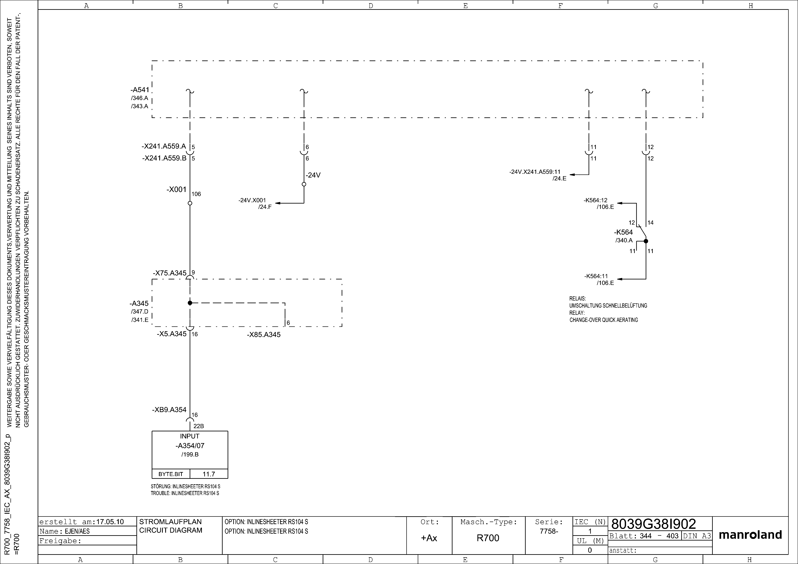

# +Ax — Sheet 344 of 403 — OPTION: INLINESHEETER RS104 S

**OPTION: INLINESHEETER RS104 S**

> Part of the manroland **R700** printing press IEC/UL circuit diagrams.
> Drawing class: **Stromlaufplan / Circuit diagram** (DIN A3).
> Document `+Ax` covers the **Central control console** machine section.

## At a glance

| Field | Value |
|---|---|
| Document | `+Ax`  (8039G38I902) |
| Sheet | **344** of 403 |
| Section (DE) | OPTION: INLINESHEETER RS104 S |
| Section (EN) | OPTION: INLINESHEETER RS104 S |
| Section type | CIRCUIT — Circuit diagram |
| Machine type | `R700` |
| Series | `7758` |
| Created | 17.05.10 |
| Replaces | — |
| Columns used | B, C, F, G |
| Path numbers | — |
| Labels on sheet | 53 |
| Cross-refs out | 10 |
| Cross-refs in | 21 |

**Previous:** [+Ax sheet 343](SHEET_0343.md) · **Next:** [+Ax sheet 345](SHEET_0345.md) · **Document TOC:** [_TOC.md](_TOC.md)  (+Ax) · **Master TOC:** [all sheets](../_MASTER_TOC.md)

## Sheet image (300 DPI, exact vector render)



_Rendered directly from the PDF vector layer at 300 DPI (1-bit), no OCR and no resampling. Use it to confirm anything ambiguous in the text below._

## Cross-references on this sheet

Each entry is a wire leaving this sheet. The printed token is `/sheet.column`; the link resolves to that sheet inside the same document.

| Ref | Target sheet | Col | Path | Destination on target | Target section | From col |
|---|---|---|---|---|---|---|
| `/346.A` | [+Ax sheet 346](SHEET_0346.md) | A | — | — | OPTION: INLINESHEETER RS104 S | B |
| `/343.A` | [+Ax sheet 343](SHEET_0343.md) | A | — | — | OPTION: INLINESHEETER RS104 S | B |
| `/24.E` | [+Ax sheet 24](SHEET_0024.md) | E | — | 24V.X241.A559:11 | SPANNUNGSVERSORGUNG, SCHALTSCHRANKBELÜFTUNG | F |
| `/24.F` | [+Ax sheet 24](SHEET_0024.md) | F | — | 24V.X001 K564:12 | SPANNUNGSVERSORGUNG, SCHALTSCHRANKBELÜFTUNG | E |
| `/106.E` | [+Ax sheet 106](SHEET_0106.md) | E | — | 24V.X001 K564:12 | ANLEGER | E |
| `/340.A` | [+Ax sheet 340](SHEET_0340.md) | A | — | — | OPTION: INLINESHEETER RS104 S | G |
| `/106.E` | [+Ax sheet 106](SHEET_0106.md) | E | — | K564:11 | ANLEGER | F |
| `/347.D` | [+Ax sheet 347](SHEET_0347.md) | D | — | — | OPTION: LOGISTIK ANLEGER | B |
| `/341.E` | [+Ax sheet 341](SHEET_0341.md) | E | — | — | OPTION: INLINESHEETER RS104 S | B |
| `/199.B` | [+Ax sheet 199](SHEET_0199.md) | B | — | — | REFERENZMODUL | B |

### Incoming references (sheets that point here)

Every other sheet that sends a wire to this one. `Back-ref` is the token printed on *that* sheet; `Path` is its line number.

| From sheet | Cols | Back-ref | Path | Refs | What continues there |
|---|---|---|---|---|---|
| [+Ax#24](SHEET_0024.md) | E, F | `/24.E`, `/24.F` | — | 2 | 24V.X001; 24V.X241.A559:11 |
| [+Ax#106](SHEET_0106.md) | E | `/106.E` | — | 2 | — |
| [+Ax#199](SHEET_0199.md) | B | `/199.B` | — | 1 | — |
| [+Ax#231](SHEET_0231.md) | A | `/231.A` | — | 1 | — |
| [+Ax#242](SHEET_0242.md) | A | `/242.A` | — | 1 | — |
| [+Ax#285](SHEET_0285.md) | E | `/285.E` | — | 1 | — |
| [+Ax#287](SHEET_0287.md) | C | `/287.C` | — | 1 | — |
| [+Ax#295](SHEET_0295.md) | E, F | `/295.E`, `/295.F` | — | 8 | — |
| [+Ax#341](SHEET_0341.md) | E | `/341.E` | — | 1 | — |
| [+Ax#343](SHEET_0343.md) | A | `/343.A` | — | 1 | — |
| [+Ax#346](SHEET_0346.md) | A | `/346.A` | — | 1 | — |
| [+Ax#347](SHEET_0347.md) | D | `/347.D` | — | 1 | — |


## Devices on this sheet

| Tag | Class | Class meaning (IEC) | Col | Sub | Terminal | Sign |
|---|---|---|---|---|---|---|
| `A541` | A | Baugruppe / assembly, module, PC board | B | — | — | — |
| `K564` | K | Relais / relay, contactor | G | — | — | — |
| `A345` | A | Baugruppe / assembly, module, PC board | B | — | — | — |
| `A354/07` | A | Baugruppe / assembly, module, PC board | B | 07 | — | — |
| `X001` | X | Klemme / terminal, plug connector | B | — | — | — |
| `K564:11` | K | Relais / relay, contactor | F | — | 11 | — |
| `K564:12` | K | Relais / relay, contactor | F | — | 12 | — |
| `X241.A559.B` | — | cross-device reference | B | — | — | — |
| `X241.A559.A` | — | cross-device reference | B | — | — | — |
| `X5.A345` | — | cross-device reference | B | — | — | — |
| `X75.A345` | — | cross-device reference | B | — | — | — |
| `11.7` | — | cross-device reference | B | — | — | — |
| `XB9.A354` | — | cross-device reference | B | — | — | — |
| `X85.A345` | — | cross-device reference | C | — | — | — |

## Potentials / nets

| Potential | Count | Columns | Attached devices | Terminals |
|---|---|---|---|---|
| `24V` | 3 | C, F | `A559`, `X001`, `X241` | `11` |


A potential such as `L24+/4` or `M24+` is a named supply/return rail; every place it appears on this sheet is electrically common.

## Wire-end annotations (grouped as printed)

A wire that continues elsewhere is annotated with a small cluster: the destination description, the path/line number `#NN`, and the `/sheet.column` cross reference. Each row below is one such cluster exactly as it is grouped on the drawing.

| Col | Y | Path | Cross-ref | Text on the wire |
|---|---|---|---|---|
| B | 129.3 | — | — | `A541` |
| B | 142.3 | — | `/346.A`, `/343.A` | — |
| B | 213.6 | — | — | `X241.A559.A 5` |
| C | 215.8 | — | — | `6` |
| F | 215.8 | — | — | `11` |
| G | 215.8 | — | — | `12` |
| B | 231.3 | — | — | `X241.A559.B 5` |
| C | 232.8 | — | — | `6` |
| F | 232.8 | — | — | `11` |
| G | 232.8 | — | — | `12` |
| F | 252.6 | — | `/24.E` | `24V.X241.A559:11` |
| C | 256.9 | — | — | `24V` |
| B | 277.9 | — | — | `X001 106` |
| E | 295.1 | — | `/24.F`, `/106.E` | `24V.X001 K564:12` |
| G | 328.4 | — | — | `K564 14` |
| G | 328.4 | — | — | `12` |
| G | 354.9 | — | `/340.A` | — |
| G | 370.9 | — | — | `11 11` |
| B | 402.8 | — | — | `X75.A345 9` |
| F | 408.5 | — | `/106.E` | `K564:11` |
| G | 442.8 | — | — | `RELAIS: UMSCHALTUNG SCHNELLBELÜFTUNG RELAY:` |
| B | 448.2 | — | — | `A345` |
| B | 461.3 | — | `/347.D` | — |
| B | 473.6 | — | `/341.E` | — |
| F | 474.7 | — | — | `CHANGE OVER QUICK AERATING` |
| C | 478.0 | — | — | `6` |
| B | 493.5 | — | — | `X5.A345 16` |
| C | 494.9 | — | — | `X85.A345` |
| B | 606.9 | — | — | `XB9.A354 16` |
| B | 632.4 | — | — | `22B` |
| B | 646.9 | — | — | `INPUT` |
| B | 660.8 | — | — | `A354/07` |
| B | 674.5 | — | `/199.B` | — |
| B | 703.6 | — | — | `BYTE.BIT 11.7` |
| B | 723.6 | — | — | `STÖRUNG: INLINESHEETER RS104 S TROUBLE: INLINESHEETER RS104 S` |


## Reconstructed tables

This sheet carries tabular content (pin map / terminal assignment / index). The grid below was rebuilt from the drawing's own rule lines, so each row is exactly one physical row of the table.

### Table 1 — 2 data rows × 4 columns (at x=226.8, y=452.1)

| X5.A345 XB9.A354 | 16 16 22B | X85.A345 | 6 |
|---|---|---|---|
| `INPUT` | `A354/07 /199.B` |  |  |
| `BYTE.BIT` | `11.7` |  |  |


## Notes and free text on this sheet

| Text | Col | Y (pt) |
|---|---|---|
| `22B` | B | 632.41 |
| `INPUT` | B | 646.94 |
| `BYTE.BIT` | B | 704.19 |
| `STÖRUNG: INLINESHEETER RS104 S` | B | 723.62 |
| `TROUBLE: INLINESHEETER RS104 S` | B | 733.57 |
| `RELAIS:` | F | 442.76 |
| `UMSCHALTUNG SCHNELLBELÜFTUNG` | G | 453.49 |
| `RELAY:` | F | 464.03 |
| `CHANGE OVER QUICK AERATING` | F | 474.73 |

## Complete label inventory (exact text from the drawing)

Every text object inside the drawing area of this sheet, in DIN reading order (column A→H, then top→bottom). This is the authoritative list: if a string is not here it is not printed on this sheet.

| Col | Y | X | Dir | Type | Text |
|---|---|---|---|---|---|
| B | 129.3 | 194.7 | → | device tag | `A541` |
| B | 142.4 | 195.6 | → | cross-reference | `/346.A` |
| B | 154.8 | 195.6 | → | cross-reference | `/343.A` |
| B | 213.6 | 211.5 | → | device ref | `X241.A559.A` |
| B | 215.8 | 286.0 | → | number | `5` |
| B | 231.3 | 212.3 | → | device ref | `X241.A559.B` |
| B | 232.8 | 286.0 | → | number | `5` |
| B | 277.9 | 248.6 | → | device tag | `X001` |
| B | 285.9 | 285.4 | → | number | `106` |
| B | 402.8 | 228.2 | → | device ref | `X75.A345` |
| B | 402.8 | 286.0 | → | number | `9` |
| B | 448.2 | 193.3 | → | device tag | `A345` |
| B | 461.3 | 195.6 | → | cross-reference | `/347.D` |
| B | 473.6 | 196.2 | → | cross-reference | `/341.E` |
| B | 493.5 | 234.1 | → | device ref | `X5.A345` |
| B | 495.0 | 285.4 | → | number | `16` |
| B | 606.9 | 227.1 | → | device ref | `XB9.A354` |
| B | 615.4 | 285.4 | → | number | `16` |
| B | 632.4 | 288.9 | → | text | `22B` |
| B | 646.9 | 268.6 | → | text | `INPUT` |
| B | 660.8 | 262.1 | → | device tag | `A354/07` |
| B | 674.6 | 270.9 | → | cross-reference | `/199.B` |
| B | 703.6 | 302.0 | → | device ref | `11.7` |
| B | 704.2 | 236.7 | → | text | `BYTE.BIT` |
| B | 723.6 | 225.1 | → | text | `STÖRUNG: INLINESHEETER RS104 S` |
| B | 733.6 | 225.1 | → | text | `TROUBLE: INLINESHEETER RS104 S` |
| C | 215.8 | 456.1 | → | number | `6` |
| C | 232.8 | 456.1 | → | number | `6` |
| C | 256.8 | 456.1 | → | potential | `24V` |
| C | 295.1 | 355.7 | → | potential | `24V.X001` |
| C | 305.0 | 385.5 | → | cross-reference | `/24.F` |
| C | 478.0 | 427.7 | → | number | `6` |
| C | 495.0 | 368.5 | → | device ref | `X85.A345` |
| F | 215.8 | 880.7 | → | number | `11` |
| F | 232.8 | 880.7 | → | number | `11` |
| F | 252.6 | 760.0 | → | potential | `24V.X241.A559:11` |
| F | 262.5 | 824.6 | → | cross-reference | `/24.E` |
| F | 295.1 | 870.8 | → | device tag | `K564:12` |
| F | 305.0 | 890.6 | → | cross-reference | `/106.E` |
| F | 408.5 | 871.9 | → | device tag | `K564:11` |
| F | 418.4 | 890.6 | → | cross-reference | `/106.E` |
| F | 442.8 | 849.5 | → | text | `RELAIS:` |
| F | 464.0 | 849.5 | → | text | `RELAY:` |
| F | 474.7 | 850.1 | → | text | `CHANGE OVER QUICK AERATING` |
| G | 215.8 | 965.8 | → | number | `12` |
| G | 232.8 | 965.8 | → | number | `12` |
| G | 328.4 | 937.7 | → | number | `12` |
| G | 328.4 | 965.8 | → | number | `14` |
| G | 341.9 | 916.2 | → | device tag | `K564` |
| G | 354.9 | 918.4 | → | cross-reference | `/340.A` |
| G | 371.0 | 938.8 | → | number | `11` |
| G | 371.0 | 965.8 | → | number | `11` |
| G | 453.5 | 849.5 | → | text | `UMSCHALTUNG SCHNELLBELÜFTUNG` |

## Reading-order text block

The same content as a plain block, grouped by DIN column — convenient to paste or to match against a visual description.

```text
=== Column B ===
 129.3  194.7  devtag       A541
 142.4  195.6  xref         /346.A
 154.8  195.6  xref         /343.A
 213.6  211.5  devref       X241.A559.A
 215.8  286.0  numeric      5
 231.3  212.3  devref       X241.A559.B
 232.8  286.0  numeric      5
 277.9  248.6  devtag       X001
 285.9  285.4  numeric      106
 402.8  228.2  devref       X75.A345
 402.8  286.0  numeric      9
 448.2  193.3  devtag       A345
 461.3  195.6  xref         /347.D
 473.6  196.2  xref         /341.E
 493.5  234.1  devref       X5.A345
 495.0  285.4  numeric      16
 606.9  227.1  devref       XB9.A354
 615.4  285.4  numeric      16
 632.4  288.9  text         22B
 646.9  268.6  text         INPUT
 660.8  262.1  devtag       A354/07
 674.6  270.9  xref         /199.B
 703.6  302.0  devref       11.7
 704.2  236.7  text         BYTE.BIT
 723.6  225.1  text         STÖRUNG: INLINESHEETER RS104 S
 733.6  225.1  text         TROUBLE: INLINESHEETER RS104 S
=== Column C ===
 215.8  456.1  numeric      6
 232.8  456.1  numeric      6
 256.8  456.1  net          24V
 295.1  355.7  net          24V.X001
 305.0  385.5  xref         /24.F
 478.0  427.7  numeric      6
 495.0  368.5  devref       X85.A345
=== Column F ===
 215.8  880.7  numeric      11
 232.8  880.7  numeric      11
 252.6  760.0  net          24V.X241.A559:11
 262.5  824.6  xref         /24.E
 295.1  870.8  devtag       K564:12
 305.0  890.6  xref         /106.E
 408.5  871.9  devtag       K564:11
 418.4  890.6  xref         /106.E
 442.8  849.5  text         RELAIS:
 464.0  849.5  text         RELAY:
 474.7  850.1  text         CHANGE OVER QUICK AERATING
=== Column G ===
 215.8  965.8  numeric      12
 232.8  965.8  numeric      12
 328.4  937.7  numeric      12
 328.4  965.8  numeric      14
 341.9  916.2  devtag       K564
 354.9  918.4  xref         /340.A
 371.0  938.8  numeric      11
 371.0  965.8  numeric      11
 453.5  849.5  text         UMSCHALTUNG SCHNELLBELÜFTUNG
```

---
_Generated from the PDF vector text layer; no OCR. Source: `R700_7758_IEC_AX_8039G38I902_p`, sheet 344._
