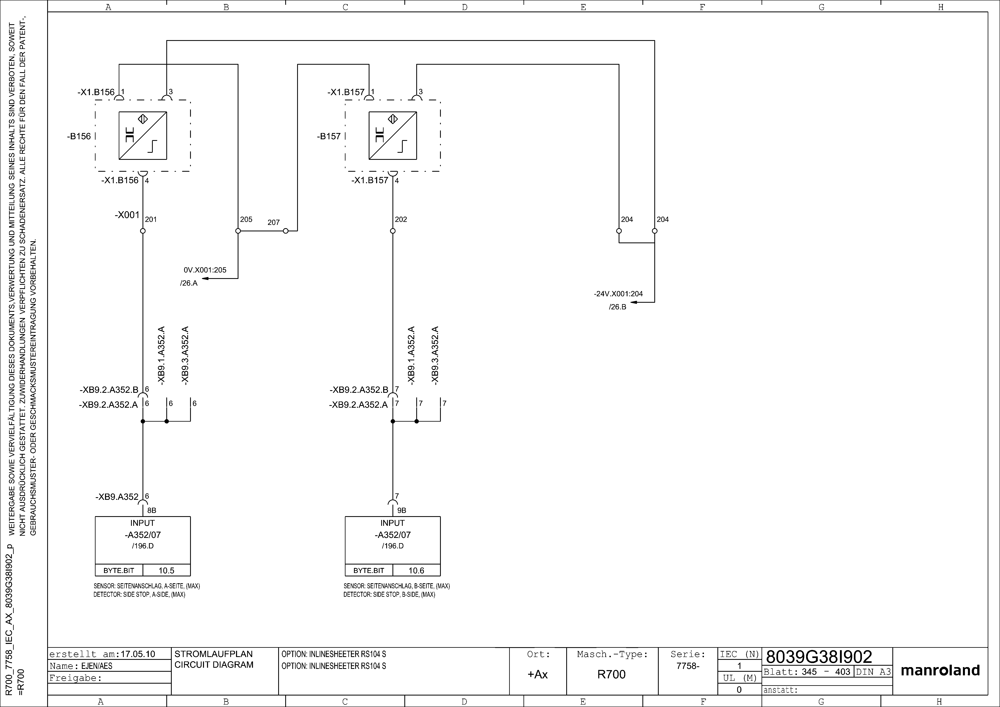

# +Ax — Sheet 345 of 403 — OPTION: INLINESHEETER RS104 S

**OPTION: INLINESHEETER RS104 S**

> Part of the manroland **R700** printing press IEC/UL circuit diagrams.
> Drawing class: **Stromlaufplan / Circuit diagram** (DIN A3).
> Document `+Ax` covers the **Central control console** machine section.

## At a glance

| Field | Value |
|---|---|
| Document | `+Ax`  (8039G38I902) |
| Sheet | **345** of 403 |
| Section (DE) | OPTION: INLINESHEETER RS104 S |
| Section (EN) | OPTION: INLINESHEETER RS104 S |
| Section type | CIRCUIT — Circuit diagram |
| Machine type | `R700` |
| Series | `7758` |
| Created | 17.05.10 |
| Replaces | — |
| Columns used | A, B, C, D, E, F |
| Path numbers | — |
| Labels on sheet | 58 |
| Cross-refs out | 4 |
| Cross-refs in | 20 |

**Previous:** [+Ax sheet 344](SHEET_0344.md) · **Next:** [+Ax sheet 346](SHEET_0346.md) · **Document TOC:** [_TOC.md](_TOC.md)  (+Ax) · **Master TOC:** [all sheets](../_MASTER_TOC.md)

## Sheet image (300 DPI, exact vector render)



_Rendered directly from the PDF vector layer at 300 DPI (1-bit), no OCR and no resampling. Use it to confirm anything ambiguous in the text below._

## Cross-references on this sheet

Each entry is a wire leaving this sheet. The printed token is `/sheet.column`; the link resolves to that sheet inside the same document.

| Ref | Target sheet | Col | Path | Destination on target | Target section | From col |
|---|---|---|---|---|---|---|
| `/26.A` | [+Ax sheet 26](SHEET_0026.md) | A | — | — | SPANNUNGSVERSORGUNG, SCHALTSCHRANKBELÜFTUNG | B |
| `/26.B` | [+Ax sheet 26](SHEET_0026.md) | B | — | — | SPANNUNGSVERSORGUNG, SCHALTSCHRANKBELÜFTUNG | E |
| `/196.D` | [+Ax sheet 196](SHEET_0196.md) | D | — | — | REFERENZMODUL | A |
| `/196.D` | [+Ax sheet 196](SHEET_0196.md) | D | — | — | REFERENZMODUL | C |

### Incoming references (sheets that point here)

Every other sheet that sends a wire to this one. `Back-ref` is the token printed on *that* sheet; `Path` is its line number.

| From sheet | Cols | Back-ref | Path | Refs | What continues there |
|---|---|---|---|---|---|
| [+Ax#26](SHEET_0026.md) | A, B | `/26.A`, `/26.B` | — | 2 | 24V.X001:204 |
| [+Ax#196](SHEET_0196.md) | D | `/196.D` | — | 2 | — |
| [+Ax#212](SHEET_0212.md) | A | `/212.A` | — | 6 | — |
| [+Ax#241](SHEET_0241.md) | B, C, E, F, H | `/241.B`, `/241.C`, `/241.E`, `/241.F`, `/241.H` | — | 10 | — |


## Devices on this sheet

| Tag | Class | Class meaning (IEC) | Col | Sub | Terminal | Sign |
|---|---|---|---|---|---|---|
| `B157` | B | Umformer / transducer, sensor | C | — | — | — |
| `A352/07` | A | Baugruppe / assembly, module, PC board | C | 07 | — | — |
| `B156` | B | Umformer / transducer, sensor | A | — | — | — |
| `X001` | X | Klemme / terminal, plug connector | A | — | — | — |
| `A352/07` | A | Baugruppe / assembly, module, PC board | A | 07 | — | — |
| `X1.B157` | — | cross-device reference | C | — | — | — |
| `X1.B157` | — | cross-device reference | C | — | — | — |
| `10.6` | — | cross-device reference | D | — | — | — |
| `X1.B156` | — | cross-device reference | A | — | — | — |
| `X1.B156` | — | cross-device reference | A | — | — | — |
| `10.5` | — | cross-device reference | A | — | — | — |
| `XB9.A352` | — | cross-device reference | A | — | — | — |
| `XB9.2.A352.B` | — | cross-device reference | A | — | — | — |
| `XB9.2.A352.A` | — | cross-device reference | A | — | — | — |
| `XB9.1.A352.A` | — | cross-device reference | A | — | — | — |
| `XB9.3.A352.A` | — | cross-device reference | B | — | — | — |
| `XB9.2.A352.B` | — | cross-device reference | C | — | — | — |
| `XB9.2.A352.A` | — | cross-device reference | C | — | — | — |
| `XB9.1.A352.A` | — | cross-device reference | D | — | — | — |
| `XB9.3.A352.A` | — | cross-device reference | D | — | — | — |

## Potentials / nets

| Potential | Count | Columns | Attached devices | Terminals |
|---|---|---|---|---|
| `0V` | 1 | B | `X001` | `205` |
| `24V` | 1 | E | `X001` | `204` |


A potential such as `L24+/4` or `M24+` is a named supply/return rail; every place it appears on this sheet is electrically common.

## Wire-end annotations (grouped as printed)

A wire that continues elsewhere is annotated with a small cluster: the destination description, the path/line number `#NN`, and the `/sheet.column` cross reference. Each row below is one such cluster exactly as it is grouped on the drawing.

| Col | Y | Path | Cross-ref | Text on the wire |
|---|---|---|---|---|
| A | 105.2 | — | — | `X1.B156 1 3` |
| C | 105.2 | — | — | `X1.B157 1 3` |
| A | 157.6 | — | — | `B156` |
| C | 157.6 | — | — | `B157` |
| A | 210.1 | — | — | `X1.B156 4` |
| C | 210.1 | — | — | `X1.B157 4` |
| A | 250.9 | — | — | `X001 201` |
| C | 257.6 | — | — | `205 207 202` |
| F | 257.6 | — | — | `204 204` |
| B | 317.8 | — | — | `0V.X001:205` |
| B | 333.3 | — | `/26.A` | — |
| E | 346.1 | — | — | `24V.X001:204` |
| E | 361.7 | — | `/26.B` | — |
| A | 388.6 | — | — | `XB9.1.A352.A` |
| B | 388.6 | — | — | `XB9.3.A352.A` |
| D | 388.6 | — | — | `XB9.1.A352.A` |
| D | 388.6 | — | — | `XB9.3.A352.A` |
| A | 459.5 | — | — | `XB9.2.A352.B 6` |
| C | 459.5 | — | — | `XB9.2.A352.B 7` |
| A | 476.5 | — | — | `XB9.2.A352.A 6 6` |
| B | 476.5 | — | — | `6` |
| C | 476.5 | — | — | `XB9.2.A352.A 7 7` |
| D | 476.5 | — | — | `7` |
| A | 587.1 | — | — | `XB9.A352 6` |
| C | 587.1 | — | — | `7` |
| A | 604.0 | — | — | `8B` |
| C | 604.0 | — | — | `9B` |
| A | 618.6 | — | — | `INPUT` |
| C | 618.6 | — | — | `INPUT` |
| A | 632.4 | — | — | `A352/07` |
| C | 632.4 | — | — | `A352/07` |
| A | 646.2 | — | `/196.D` | — |
| C | 646.2 | — | `/196.D` | — |
| A | 675.3 | — | — | `BYTE.BIT 10.5` |
| C | 675.3 | — | — | `BYTE.BIT 10.6` |
| A | 695.3 | — | — | `DETECTOR: SIDE STOP, A SIDE, (MAX) SENSOR: SEITENANSCHLAG, A SEITE, (MAX)` |
| C | 695.3 | — | — | `DETECTOR: SIDE STOP, B SIDE, (MAX) SENSOR: SEITENANSCHLAG, B SEITE, (MAX)` |


## Reconstructed tables

This sheet carries tabular content (pin map / terminal assignment / index). The grid below was rebuilt from the drawing's own rule lines, so each row is exactly one physical row of the table.

### Table 1 — 4 data rows × 11 columns (at x=113.4, y=48.2)

| X1.B156 | 1 |  | 3 |  |  |  | X1.B157 | 1 |  | 3 |
|---|---|---|---|---|---|---|---|---|---|---|
|  |  |  |  |  |  | `B157` |  |  |  |  |
| `XB9.2.A352.B XB9.2.A352.A XB9.A352` | `X1.B156 X001` | `4 201 XB9.1.A352.A 6 6 6 8B` | `/26.A XB9.3.A352.A 6` | `0V.X001:205 6` | `205 207` |  | `XB9.2.A352.B XB9.2.A352.A` | `X1.B157` | `4 202 XB9.1.A352.A 7 7 7 9B` | `XB9.3.A352.A 7` |
|  | `INPUT` | `A352/07 /196.D` |  |  |  |  |  | `INPUT` | `A352/07 /196.D` |  |
| `BYTE.BIT` |  | `10.5` |  |  |  |  | `BYTE.BIT` |  | `10.6` |  |


## Notes and free text on this sheet

| Text | Col | Y (pt) |
|---|---|---|
| `9B` | C | 604.05 |
| `INPUT` | C | 618.59 |
| `BYTE.BIT` | C | 675.84 |
| `SENSOR: SEITENANSCHLAG, B SEITE, (MAX)` | C | 695.28 |
| `DETECTOR: SIDE STOP, B SIDE, (MAX)` | C | 705.21 |
| `8B` | A | 604.05 |
| `INPUT` | A | 618.59 |
| `BYTE.BIT` | A | 675.84 |
| `SENSOR: SEITENANSCHLAG, A SEITE, (MAX)` | A | 695.28 |
| `DETECTOR: SIDE STOP, A SIDE, (MAX)` | A | 705.21 |

## Complete label inventory (exact text from the drawing)

Every text object inside the drawing area of this sheet, in DIN reading order (column A→H, then top→bottom). This is the authoritative list: if a string is not here it is not printed on this sheet.

| Col | Y | X | Dir | Type | Text |
|---|---|---|---|---|---|
| A | 105.2 | 92.4 | → | device ref | `X1.B156` |
| A | 105.2 | 143.7 | → | number | `1` |
| A | 157.6 | 79.9 | → | device tag | `B156` |
| A | 210.1 | 120.8 | → | device ref | `X1.B156` |
| A | 211.5 | 172.6 | → | number | `4` |
| A | 250.9 | 136.6 | → | device tag | `X001` |
| A | 257.6 | 172.6 | → | number | `201` |
| A | 388.6 | 187.4 | ↕ | device ref | `XB9.1.A352.A` |
| A | 459.5 | 95.0 | → | device ref | `XB9.2.A352.B` |
| A | 459.5 | 172.6 | → | number | `6` |
| A | 476.5 | 172.6 | → | number | `6` |
| A | 477.2 | 94.1 | → | device ref | `XB9.2.A352.A` |
| A | 587.1 | 113.7 | → | device ref | `XB9.A352` |
| A | 587.1 | 172.6 | → | number | `6` |
| A | 604.0 | 175.5 | → | text | `8B` |
| A | 618.6 | 155.2 | → | text | `INPUT` |
| A | 632.4 | 148.7 | → | device tag | `A352/07` |
| A | 646.2 | 157.3 | → | cross-reference | `/196.D` |
| A | 675.3 | 188.6 | → | device ref | `10.5` |
| A | 675.8 | 123.3 | → | text | `BYTE.BIT` |
| A | 695.3 | 111.7 | → | text | `SENSOR: SEITENANSCHLAG, A SEITE, (MAX)` |
| A | 705.2 | 111.4 | → | text | `DETECTOR: SIDE STOP, A SIDE, (MAX)` |
| B | 105.2 | 201.0 | → | number | `3` |
| B | 257.6 | 286.0 | → | number | `205` |
| B | 261.1 | 318.8 | → | number | `207` |
| B | 317.8 | 218.8 | → | potential | `0V.X001:205` |
| B | 333.3 | 214.6 | → | cross-reference | `/26.A` |
| B | 388.6 | 215.8 | ↕ | device ref | `XB9.3.A352.A` |
| B | 476.5 | 201.0 | → | number | `6` |
| B | 476.5 | 229.3 | → | number | `6` |
| C | 105.2 | 390.0 | → | device ref | `X1.B157` |
| C | 105.2 | 441.4 | → | number | `1` |
| C | 157.6 | 377.6 | → | device tag | `B157` |
| C | 210.1 | 418.4 | → | device ref | `X1.B157` |
| C | 211.5 | 470.3 | → | number | `4` |
| C | 257.6 | 470.3 | → | number | `202` |
| C | 459.5 | 392.6 | → | device ref | `XB9.2.A352.B` |
| C | 459.5 | 470.3 | → | number | `7` |
| C | 476.5 | 470.3 | → | number | `7` |
| C | 477.2 | 391.7 | → | device ref | `XB9.2.A352.A` |
| C | 587.1 | 470.3 | → | number | `7` |
| C | 604.0 | 473.1 | → | text | `9B` |
| C | 618.6 | 452.8 | → | text | `INPUT` |
| C | 632.4 | 446.3 | → | device tag | `A352/07` |
| C | 646.2 | 455.0 | → | cross-reference | `/196.D` |
| C | 675.8 | 420.9 | → | text | `BYTE.BIT` |
| C | 695.3 | 409.3 | → | text | `SENSOR: SEITENANSCHLAG, B SEITE, (MAX)` |
| C | 705.2 | 409.0 | → | text | `DETECTOR: SIDE STOP, B SIDE, (MAX)` |
| D | 105.2 | 498.6 | → | number | `3` |
| D | 388.6 | 485.0 | ↕ | device ref | `XB9.1.A352.A` |
| D | 388.6 | 513.4 | ↕ | device ref | `XB9.3.A352.A` |
| D | 476.5 | 498.6 | → | number | `7` |
| D | 476.5 | 527.0 | → | number | `7` |
| D | 675.3 | 486.3 | → | device ref | `10.6` |
| E | 257.6 | 739.6 | → | number | `204` |
| E | 346.1 | 707.2 | → | potential | `24V.X001:204` |
| E | 361.7 | 725.1 | → | cross-reference | `/26.B` |
| F | 257.6 | 782.1 | → | number | `204` |

## Reading-order text block

The same content as a plain block, grouped by DIN column — convenient to paste or to match against a visual description.

```text
=== Column A ===
 105.2   92.4  devref       X1.B156
 105.2  143.7  numeric      1
 157.6   79.9  devtag       B156
 210.1  120.8  devref       X1.B156
 211.5  172.6  numeric      4
 250.9  136.6  devtag       X001
 257.6  172.6  numeric      201
 388.6  187.4  devref       XB9.1.A352.A
 459.5   95.0  devref       XB9.2.A352.B
 459.5  172.6  numeric      6
 476.5  172.6  numeric      6
 477.2   94.1  devref       XB9.2.A352.A
 587.1  113.7  devref       XB9.A352
 587.1  172.6  numeric      6
 604.0  175.5  text         8B
 618.6  155.2  text         INPUT
 632.4  148.7  devtag       A352/07
 646.2  157.3  xref         /196.D
 675.3  188.6  devref       10.5
 675.8  123.3  text         BYTE.BIT
 695.3  111.7  text         SENSOR: SEITENANSCHLAG, A SEITE, (MAX)
 705.2  111.4  text         DETECTOR: SIDE STOP, A SIDE, (MAX)
=== Column B ===
 105.2  201.0  numeric      3
 257.6  286.0  numeric      205
 261.1  318.8  numeric      207
 317.8  218.8  net          0V.X001:205
 333.3  214.6  xref         /26.A
 388.6  215.8  devref       XB9.3.A352.A
 476.5  201.0  numeric      6
 476.5  229.3  numeric      6
=== Column C ===
 105.2  390.0  devref       X1.B157
 105.2  441.4  numeric      1
 157.6  377.6  devtag       B157
 210.1  418.4  devref       X1.B157
 211.5  470.3  numeric      4
 257.6  470.3  numeric      202
 459.5  392.6  devref       XB9.2.A352.B
 459.5  470.3  numeric      7
 476.5  470.3  numeric      7
 477.2  391.7  devref       XB9.2.A352.A
 587.1  470.3  numeric      7
 604.0  473.1  text         9B
 618.6  452.8  text         INPUT
 632.4  446.3  devtag       A352/07
 646.2  455.0  xref         /196.D
 675.8  420.9  text         BYTE.BIT
 695.3  409.3  text         SENSOR: SEITENANSCHLAG, B SEITE, (MAX)
 705.2  409.0  text         DETECTOR: SIDE STOP, B SIDE, (MAX)
=== Column D ===
 105.2  498.6  numeric      3
 388.6  485.0  devref       XB9.1.A352.A
 388.6  513.4  devref       XB9.3.A352.A
 476.5  498.6  numeric      7
 476.5  527.0  numeric      7
 675.3  486.3  devref       10.6
=== Column E ===
 257.6  739.6  numeric      204
 346.1  707.2  net          24V.X001:204
 361.7  725.1  xref         /26.B
=== Column F ===
 257.6  782.1  numeric      204
```

---
_Generated from the PDF vector text layer; no OCR. Source: `R700_7758_IEC_AX_8039G38I902_p`, sheet 345._
