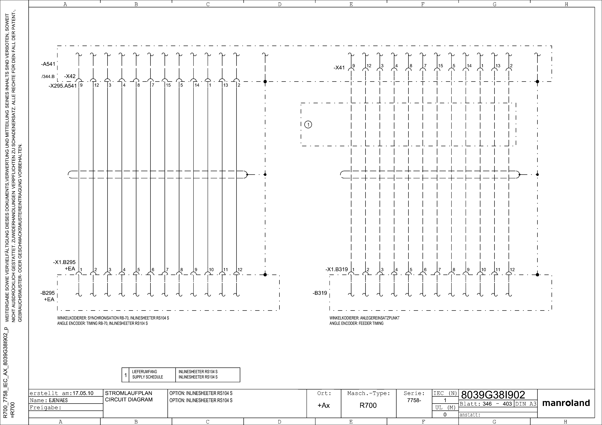

# +Ax — Sheet 346 of 403 — OPTION: INLINESHEETER RS104 S

**OPTION: INLINESHEETER RS104 S**

> Part of the manroland **R700** printing press IEC/UL circuit diagrams.
> Drawing class: **Stromlaufplan / Circuit diagram** (DIN A3).
> Document `+Ax` covers the **Central control console** machine section.

## At a glance

| Field | Value |
|---|---|
| Document | `+Ax`  (8039G38I902) |
| Sheet | **346** of 403 |
| Section (DE) | OPTION: INLINESHEETER RS104 S |
| Section (EN) | OPTION: INLINESHEETER RS104 S |
| Section type | CIRCUIT — Circuit diagram |
| Machine type | `R700` |
| Series | `7758` |
| Created | 17.05.10 |
| Replaces | — |
| Columns used | A, B, C, D, E, F, G |
| Path numbers | — |
| Labels on sheet | 69 |
| Cross-refs out | 1 |
| Cross-refs in | 37 |

**Previous:** [+Ax sheet 345](SHEET_0345.md) · **Next:** [+Ax sheet 347](SHEET_0347.md) · **Document TOC:** [_TOC.md](_TOC.md)  (+Ax) · **Master TOC:** [all sheets](../_MASTER_TOC.md)

## Sheet image (300 DPI, exact vector render)



_Rendered directly from the PDF vector layer at 300 DPI (1-bit), no OCR and no resampling. Use it to confirm anything ambiguous in the text below._

## Cross-references on this sheet

Each entry is a wire leaving this sheet. The printed token is `/sheet.column`; the link resolves to that sheet inside the same document.

| Ref | Target sheet | Col | Path | Destination on target | Target section | From col |
|---|---|---|---|---|---|---|
| `/344.B` | [+Ax sheet 344](SHEET_0344.md) | B | — | — | OPTION: INLINESHEETER RS104 S | A |

### Incoming references (sheets that point here)

Every other sheet that sends a wire to this one. `Back-ref` is the token printed on *that* sheet; `Path` is its line number.

| From sheet | Cols | Back-ref | Path | Refs | What continues there |
|---|---|---|---|---|---|
| [+Ax#213](SHEET_0213.md) | D, E | `/213.D`, `/213.E` | — | 24 | — |
| [+Ax#295](SHEET_0295.md) | C | `/295.C` | — | 12 | — |
| [+Ax#344](SHEET_0344.md) | B | `/344.B` | — | 1 | — |


## Devices on this sheet

| Tag | Class | Class meaning (IEC) | Col | Sub | Terminal | Sign |
|---|---|---|---|---|---|---|
| `B295` | B | Umformer / transducer, sensor | A | — | — | — |
| `A541` | A | Baugruppe / assembly, module, PC board | A | — | — | — |
| `B319` | B | Umformer / transducer, sensor | E | — | — | — |
| `X42` | X | Klemme / terminal, plug connector | A | — | — | — |
| `X41` | X | Klemme / terminal, plug connector | E | — | — | — |
| `X1.B295` | — | cross-device reference | A | — | — | — |
| `X1.B319` | — | cross-device reference | E | — | — | — |
| `X295.A541` | — | cross-device reference | A | — | — | — |

## Potentials / nets

_No named potentials on this sheet._

## Wire-end annotations (grouped as printed)

A wire that continues elsewhere is annotated with a small cluster: the destination description, the path/line number `#NN`, and the `/sheet.column` cross reference. Each row below is one such cluster exactly as it is grouped on the drawing.

| Col | Y | Path | Cross-ref | Text on the wire |
|---|---|---|---|---|
| A | 122.2 | — | — | `A541` |
| F | 126.5 | — | — | `9 12 3 4 8 7 15 5 14 1 13 2` |
| E | 129.3 | — | — | `X41` |
| A | 146.3 | — | — | `X42` |
| A | 147.7 | — | `/344.B` | — |
| B | 164.7 | — | — | `X295.A541 9 12 3 4 8 7 15 5 14 1 13 2` |
| D | 243.6 | — | — | `1` |
| A | 514.8 | — | — | `X1.B295 1` |
| B | 527.5 | — | — | `+EA 2 3 4 5 6 7 8 9 10 11 12` |
| F | 529.0 | — | — | `X1.B319 1 2 3 4 5 6 7 8 9 10 11 12` |
| A | 575.7 | — | — | `B295` |
| E | 575.7 | — | — | `B319` |
| A | 588.4 | — | — | `+EA` |
| B | 627.1 | — | — | `WINKELKODIERER: SYNCHRONISATION RB 70, INLINESHEETER RS104 S ANGLE ENCODER: TIMING RB 70, INLINESHEETER RS104 S` |
| E | 627.1 | — | — | `WINKELKODIERER: ANLEGEREINSATZPUNKT ANGLE ENCODER: FEEDER TIMING` |
| B | 733.4 | — | — | `1 SUPPLY SCHEDULE INLINESHEETER RS104 S INLINESHEETER RS104 S` |
| B | 733.4 | — | — | `LIEFERUMFANG` |


## Notes and free text on this sheet

| Text | Col | Y (pt) |
|---|---|---|
| `+EA` | A | 588.42 |
| `WINKELKODIERER: SYNCHRONISATION RB 70, INLINESHEETER RS104 S` | B | 627.08 |
| `ANGLE ENCODER: TIMING RB 70, INLINESHEETER RS104 S` | B | 637.72 |
| `WINKELKODIERER: ANLEGEREINSATZPUNKT` | E | 627.07 |
| `ANGLE ENCODER: FEEDER TIMING` | E | 637.72 |
| `LIEFERUMFANG` | B | 733.38 |
| `SUPPLY SCHEDULE` | B | 744.01 |
| `INLINESHEETER RS104 S` | C | 733.37 |

## Complete label inventory (exact text from the drawing)

Every text object inside the drawing area of this sheet, in DIN reading order (column A→H, then top→bottom). This is the authoritative list: if a string is not here it is not printed on this sheet.

| Col | Y | X | Dir | Type | Text |
|---|---|---|---|---|---|
| A | 122.2 | 81.4 | → | device tag | `A541` |
| A | 146.3 | 127.0 | → | device tag | `X42` |
| A | 147.7 | 82.5 | → | cross-reference | `/344.B` |
| A | 164.7 | 158.5 | → | number | `9` |
| A | 164.7 | 186.2 | → | number | `12` |
| A | 165.4 | 96.1 | → | device ref | `X295.A541` |
| A | 514.8 | 105.2 | → | device ref | `X1.B295` |
| A | 527.5 | 128.1 | → | text | `+EA` |
| A | 530.4 | 157.9 | → | number | `1` |
| A | 530.4 | 186.8 | → | number | `2` |
| A | 575.7 | 79.9 | → | device tag | `B295` |
| A | 588.4 | 87.0 | → | text | `+EA` |
| B | 164.7 | 215.1 | → | number | `3` |
| B | 164.7 | 243.5 | → | number | `4` |
| B | 164.7 | 271.8 | → | number | `8` |
| B | 164.7 | 300.2 | → | number | `7` |
| B | 164.7 | 328.0 | → | number | `15` |
| B | 530.4 | 215.1 | → | number | `3` |
| B | 530.4 | 243.5 | → | number | `4` |
| B | 530.4 | 271.8 | → | number | `5` |
| B | 530.4 | 300.2 | → | number | `6` |
| B | 530.4 | 328.5 | → | number | `7` |
| B | 627.1 | 113.4 | → | text | `WINKELKODIERER: SYNCHRONISATION RB 70, INLINESHEETER RS104 S` |
| B | 637.7 | 113.4 | → | text | `ANGLE ENCODER: TIMING RB 70, INLINESHEETER RS104 S` |
| B | 733.4 | 261.4 | → | text | `LIEFERUMFANG` |
| B | 738.7 | 245.5 | → | number | `1` |
| B | 744.0 | 261.9 | → | text | `SUPPLY SCHEDULE` |
| C | 164.7 | 356.9 | → | number | `5` |
| C | 164.7 | 384.7 | → | number | `14` |
| C | 164.7 | 413.0 | → | number | `1` |
| C | 164.7 | 441.4 | → | number | `13` |
| C | 164.7 | 470.3 | → | number | `2` |
| C | 530.4 | 356.9 | → | number | `8` |
| C | 530.4 | 385.2 | → | number | `9` |
| C | 530.4 | 413.0 | → | number | `10` |
| C | 530.4 | 441.4 | → | number | `11` |
| C | 530.4 | 469.7 | → | number | `12` |
| C | 733.4 | 353.5 | → | text | `INLINESHEETER RS104 S` |
| C | 744.0 | 353.5 | → | text | `INLINESHEETER RS104 S` |
| D | 243.6 | 607.7 | → | number | `1` |
| E | 126.5 | 697.0 | → | number | `9` |
| E | 126.5 | 724.8 | → | number | `12` |
| E | 126.5 | 753.7 | → | number | `3` |
| E | 129.3 | 659.9 | → | device tag | `X41` |
| E | 529.0 | 643.7 | → | device ref | `X1.B319` |
| E | 530.4 | 696.5 | → | number | `1` |
| E | 530.4 | 725.4 | → | number | `2` |
| E | 530.4 | 753.7 | → | number | `3` |
| E | 575.7 | 618.5 | → | device tag | `B319` |
| E | 627.1 | 652.0 | → | text | `WINKELKODIERER: ANLEGEREINSATZPUNKT` |
| E | 637.7 | 652.0 | → | text | `ANGLE ENCODER: FEEDER TIMING` |
| F | 126.5 | 782.1 | → | number | `4` |
| F | 126.5 | 810.4 | → | number | `8` |
| F | 126.5 | 838.8 | → | number | `7` |
| F | 126.5 | 866.6 | → | number | `15` |
| F | 126.5 | 895.5 | → | number | `5` |
| F | 530.4 | 782.1 | → | number | `4` |
| F | 530.4 | 810.4 | → | number | `5` |
| F | 530.4 | 838.8 | → | number | `6` |
| F | 530.4 | 867.1 | → | number | `7` |
| F | 530.4 | 895.5 | → | number | `8` |
| G | 126.5 | 923.2 | → | number | `14` |
| G | 126.5 | 951.6 | → | number | `1` |
| G | 126.5 | 979.9 | → | number | `13` |
| G | 126.5 | 1008.9 | → | number | `2` |
| G | 530.4 | 923.8 | → | number | `9` |
| G | 530.4 | 951.6 | → | number | `10` |
| G | 530.4 | 979.9 | → | number | `11` |
| G | 530.4 | 1008.3 | → | number | `12` |

## Reading-order text block

The same content as a plain block, grouped by DIN column — convenient to paste or to match against a visual description.

```text
=== Column A ===
 122.2   81.4  devtag       A541
 146.3  127.0  devtag       X42
 147.7   82.5  xref         /344.B
 164.7  158.5  numeric      9
 164.7  186.2  numeric      12
 165.4   96.1  devref       X295.A541
 514.8  105.2  devref       X1.B295
 527.5  128.1  text         +EA
 530.4  157.9  numeric      1
 530.4  186.8  numeric      2
 575.7   79.9  devtag       B295
 588.4   87.0  text         +EA
=== Column B ===
 164.7  215.1  numeric      3
 164.7  243.5  numeric      4
 164.7  271.8  numeric      8
 164.7  300.2  numeric      7
 164.7  328.0  numeric      15
 530.4  215.1  numeric      3
 530.4  243.5  numeric      4
 530.4  271.8  numeric      5
 530.4  300.2  numeric      6
 530.4  328.5  numeric      7
 627.1  113.4  text         WINKELKODIERER: SYNCHRONISATION RB 70, INLINESHEETER RS104 S
 637.7  113.4  text         ANGLE ENCODER: TIMING RB 70, INLINESHEETER RS104 S
 733.4  261.4  text         LIEFERUMFANG
 738.7  245.5  numeric      1
 744.0  261.9  text         SUPPLY SCHEDULE
=== Column C ===
 164.7  356.9  numeric      5
 164.7  384.7  numeric      14
 164.7  413.0  numeric      1
 164.7  441.4  numeric      13
 164.7  470.3  numeric      2
 530.4  356.9  numeric      8
 530.4  385.2  numeric      9
 530.4  413.0  numeric      10
 530.4  441.4  numeric      11
 530.4  469.7  numeric      12
 733.4  353.5  text         INLINESHEETER RS104 S
 744.0  353.5  text         INLINESHEETER RS104 S
=== Column D ===
 243.6  607.7  numeric      1
=== Column E ===
 126.5  697.0  numeric      9
 126.5  724.8  numeric      12
 126.5  753.7  numeric      3
 129.3  659.9  devtag       X41
 529.0  643.7  devref       X1.B319
 530.4  696.5  numeric      1
 530.4  725.4  numeric      2
 530.4  753.7  numeric      3
 575.7  618.5  devtag       B319
 627.1  652.0  text         WINKELKODIERER: ANLEGEREINSATZPUNKT
 637.7  652.0  text         ANGLE ENCODER: FEEDER TIMING
=== Column F ===
 126.5  782.1  numeric      4
 126.5  810.4  numeric      8
 126.5  838.8  numeric      7
 126.5  866.6  numeric      15
 126.5  895.5  numeric      5
 530.4  782.1  numeric      4
 530.4  810.4  numeric      5
 530.4  838.8  numeric      6
 530.4  867.1  numeric      7
 530.4  895.5  numeric      8
=== Column G ===
 126.5  923.2  numeric      14
 126.5  951.6  numeric      1
 126.5  979.9  numeric      13
 126.5 1008.9  numeric      2
 530.4  923.8  numeric      9
 530.4  951.6  numeric      10
 530.4  979.9  numeric      11
 530.4 1008.3  numeric      12
```

---
_Generated from the PDF vector text layer; no OCR. Source: `R700_7758_IEC_AX_8039G38I902_p`, sheet 346._
