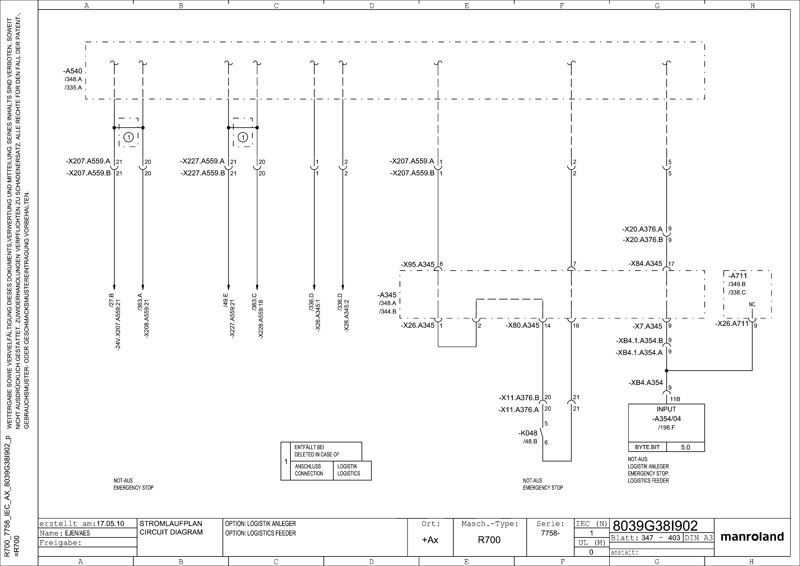

# +Ax — Sheet 347 of 403 — OPTION: LOGISTIK ANLEGER

**OPTION: LOGISTICS FEEDER**

> Part of the manroland **R700** printing press IEC/UL circuit diagrams.
> Drawing class: **Stromlaufplan / Circuit diagram** (DIN A3).
> Document `+Ax` covers the **Central control console** machine section.

## At a glance

| Field | Value |
|---|---|
| Document | `+Ax`  (8039G38I902) |
| Sheet | **347** of 403 |
| Section (DE) | OPTION: LOGISTIK ANLEGER |
| Section (EN) | OPTION: LOGISTICS FEEDER |
| Section type | CIRCUIT — Circuit diagram |
| Machine type | `R700` |
| Series | `7758` |
| Created | 17.05.10 |
| Replaces | — |
| Columns used | A, B, C, D, E, F, G, H |
| Path numbers | — |
| Labels on sheet | 104 |
| Cross-refs out | 14 |
| Cross-refs in | 50 |

**Previous:** [+Ax sheet 346](SHEET_0346.md) · **Next:** [+Ax sheet 348](SHEET_0348.md) · **Document TOC:** [_TOC.md](_TOC.md)  (+Ax) · **Master TOC:** [all sheets](../_MASTER_TOC.md)

## Sheet image (300 DPI, exact vector render)



_Rendered directly from the PDF vector layer at 300 DPI (1-bit), no OCR and no resampling. Use it to confirm anything ambiguous in the text below._

## Cross-references on this sheet

Each entry is a wire leaving this sheet. The printed token is `/sheet.column`; the link resolves to that sheet inside the same document.

| Ref | Target sheet | Col | Path | Destination on target | Target section | From col |
|---|---|---|---|---|---|---|
| `/348.A` | [+Ax sheet 348](SHEET_0348.md) | A | — | — | OPTION: LOGISTIK ANLEGER | A |
| `/335.A` | [+Ax sheet 335](SHEET_0335.md) | A | — | — | 1 OPTION: LOGISTIK (ANLEGER AUSLEGER) | A |
| `/349.B` | [+Ax sheet 349](SHEET_0349.md) | B | — | A711 | OPTION: LOGISTIK ANLEGER | H |
| `/338.C` | [+Ax sheet 338](SHEET_0338.md) | C | — | A711 | OPTION: INLINESHEETER RS104 S | H |
| `/49.E` | [+Ax sheet 49](SHEET_0049.md) | E | — | — | NOT AUS | B |
| `/27.B` | [+Ax sheet 27](SHEET_0027.md) | B | — | — | SPANNUNGSVERSORGUNG, SCHALTSCHRANKBELÜFTUNG | A |
| `/363.C` | [+Ax sheet 363](SHEET_0363.md) | C | — | — | OPTION: LOGISTIK AUSLEGER | C |
| `/336.D` | [+Ax sheet 336](SHEET_0336.md) | D | — | — | OPTION: LOGISTIK ANLEGER / | C |
| `/336.D` | [+Ax sheet 336](SHEET_0336.md) | D | — | — | OPTION: LOGISTIK ANLEGER / | D |
| `/363.A` | [+Ax sheet 363](SHEET_0363.md) | A | — | — | OPTION: LOGISTIK AUSLEGER | B |
| `/348.A` | [+Ax sheet 348](SHEET_0348.md) | A | — | — | OPTION: LOGISTIK ANLEGER | D |
| `/344.B` | [+Ax sheet 344](SHEET_0344.md) | B | — | — | OPTION: INLINESHEETER RS104 S | D |
| `/198.F` | [+Ax sheet 198](SHEET_0198.md) | F | — | — | REFERENZMODUL | G |
| `/48.B` | [+Ax sheet 48](SHEET_0048.md) | B | — | — | NOT AUS | F |

### Incoming references (sheets that point here)

Every other sheet that sends a wire to this one. `Back-ref` is the token printed on *that* sheet; `Path` is its line number.

| From sheet | Cols | Back-ref | Path | Refs | What continues there |
|---|---|---|---|---|---|
| [+Ax#27](SHEET_0027.md) | B | `/27.B` | — | 1 | — |
| [+Ax#48](SHEET_0048.md) | B | `/48.B` | — | 1 | — |
| [+Ax#49](SHEET_0049.md) | E | `/49.E` | — | 1 | X227.A559:21 |
| [+Ax#198](SHEET_0198.md) | F | `/198.F` | — | 1 | — |
| [+Ax#228](SHEET_0228.md) | A, B, C | `/228.A`, `/228.B`, `/228.C` | — | 3 | — |
| [+Ax#235](SHEET_0235.md) | H | `/235.H` | — | 1 | — |
| [+Ax#247](SHEET_0247.md) | C, E | `/247.C`, `/247.E` | — | 4 | — |
| [+Ax#260](SHEET_0260.md) | E, F | `/260.E`, `/260.F` | — | 2 | — |
| [+Ax#268](SHEET_0268.md) | E | `/268.E` | — | 2 | — |
| [+Ax#269](SHEET_0269.md) | H | `/269.H` | — | 1 | — |
| [+Ax#286](SHEET_0286.md) | C | `/286.C` | — | 2 | — |
| [+Ax#287](SHEET_0287.md) | B | `/287.B` | — | 1 | — |
| [+Ax#290](SHEET_0290.md) | A | `/290.A` | — | 2 | — |
| [+Ax#292](SHEET_0292.md) | E, F | `/292.E`, `/292.F` | — | 10 | — |
| [+Ax#294](SHEET_0294.md) | B, C | `/294.B`, `/294.C` | — | 8 | — |
| [+Ax#335](SHEET_0335.md) | A | `/335.A` | — | 1 | — |
| [+Ax#336](SHEET_0336.md) | D | `/336.D` | — | 2 | — |
| [+Ax#338](SHEET_0338.md) | B | `/338.B` | — | 1 | — |
| [+Ax#344](SHEET_0344.md) | B | `/344.B` | — | 1 | — |
| [+Ax#348](SHEET_0348.md) | A | `/348.A` | — | 2 | — |
| [+Ax#349](SHEET_0349.md) | B | `/349.B` | — | 1 | — |
| [+Ax#363](SHEET_0363.md) | A, C | `/363.A`, `/363.C` | — | 2 | X208.A559:21; X228.A559:18 |


## Devices on this sheet

| Tag | Class | Class meaning (IEC) | Col | Sub | Terminal | Sign |
|---|---|---|---|---|---|---|
| `K048` | K | Relais / relay, contactor | F | — | — | — |
| `A354/04` | A | Baugruppe / assembly, module, PC board | G | 04 | — | — |
| `A345` | A | Baugruppe / assembly, module, PC board | D | — | — | — |
| `A711` | A | Baugruppe / assembly, module, PC board | H | — | — | — |
| `A540` | A | Baugruppe / assembly, module, PC board | A | — | — | — |
| `X11.A376.B` | — | cross-device reference | F | — | — | — |
| `X11.A376.A` | — | cross-device reference | F | — | — | — |
| `X207.A559.A` | — | cross-device reference | D | — | — | — |
| `X207.A559.B` | — | cross-device reference | D | — | — | — |
| `5.0` | — | cross-device reference | G | — | — | — |
| `XB4.A354` | — | cross-device reference | G | — | — | — |
| `X95.A345` | — | cross-device reference | D | — | — | — |
| `X20.A376.B` | — | cross-device reference | G | — | — | — |
| `X20.A376.A` | — | cross-device reference | G | — | — | — |
| `X84.A345` | — | cross-device reference | G | — | — | — |
| `X26.A711` | — | cross-device reference | H | — | — | — |
| `X80.A345` | — | cross-device reference | F | — | — | — |
| `X26.A345` | — | cross-device reference | D | — | — | — |
| `X7.A345` | — | cross-device reference | G | — | — | — |
| `XB4.1.A354.B` | — | cross-device reference | G | — | — | — |
| `XB4.1.A354.A` | — | cross-device reference | G | — | — | — |
| `X227.A559.A` | — | cross-device reference | B | — | — | — |
| `X227.A559.B` | — | cross-device reference | B | — | — | — |
| `X207.A559.A` | — | cross-device reference | A | — | — | — |
| `X207.A559.B` | — | cross-device reference | A | — | — | — |
| `X26.A345:2` | — | cross-device reference | D | — | 2 | — |
| `X26.A345:1` | — | cross-device reference | C | — | 1 | — |
| `X208.A559:21` | — | cross-device reference | B | — | 21 | — |
| `X228.A559:18` | — | cross-device reference | C | — | 18 | — |
| `X227.A559:21` | — | cross-device reference | C | — | 21 | — |

## Potentials / nets

| Potential | Count | Columns | Attached devices | Terminals |
|---|---|---|---|---|
| `24V` | 1 | A | `A559`, `X207` | `21` |


A potential such as `L24+/4` or `M24+` is a named supply/return rail; every place it appears on this sheet is electrically common.

## Wire-end annotations (grouped as printed)

A wire that continues elsewhere is annotated with a small cluster: the destination description, the path/line number `#NN`, and the `/sheet.column` cross reference. Each row below is one such cluster exactly as it is grouped on the drawing.

| Col | Y | Path | Cross-ref | Text on the wire |
|---|---|---|---|---|
| A | 100.9 | — | — | `A540` |
| A | 114.0 | — | `/348.A`, `/335.A` | — |
| B | 201.0 | — | — | `1 1` |
| A | 234.9 | — | — | `X207.A559.A 21` |
| B | 234.9 | — | — | `X227.A559.A 21` |
| D | 234.9 | — | — | `X207.A559.A 1` |
| B | 237.0 | — | — | `20` |
| C | 237.0 | — | — | `20` |
| C | 237.0 | — | — | `1` |
| D | 237.0 | — | — | `2` |
| F | 237.0 | — | — | `2` |
| G | 237.0 | — | — | `5` |
| A | 252.6 | — | — | `X207.A559.B 21` |
| B | 252.6 | — | — | `X227.A559.B 21` |
| D | 252.6 | — | — | `X207.A559.B 1` |
| B | 254.0 | — | — | `20` |
| C | 254.0 | — | — | `20` |
| C | 254.0 | — | — | `1` |
| D | 254.0 | — | — | `2` |
| F | 254.0 | — | — | `2` |
| G | 254.0 | — | — | `5` |
| G | 336.2 | — | — | `X20.A376.A 9` |
| G | 351.8 | — | — | `X20.A376.B 9` |
| G | 387.2 | — | — | `X84.A345 17` |
| E | 388.6 | — | — | `X95.A345 6 7` |
| H | 405.7 | — | `/349.B`, `/338.C` | `A711` |
| D | 434.0 | — | — | `A345` |
| B | 436.0 | — | `/49.E` | — |
| A | 436.2 | — | `/27.B` | — |
| C | 436.2 | — | `/363.C` | — |
| C | 436.2 | — | `/336.D` | — |
| D | 436.2 | — | `/336.D` | — |
| B | 436.5 | — | `/363.A` | — |
| A | 444.8 | — | — | `24V.X207.A559:21` |
| B | 444.8 | — | — | `X208.A559:21` |
| C | 444.8 | — | — | `X227.A559:21` |
| C | 444.8 | — | — | `X26.A345:1` |
| D | 445.9 | — | — | `X26.A345:2` |
| C | 446.2 | — | — | `X228.A559:18` |
| D | 447.1 | — | `/348.A`, `/344.B` | — |
| H | 449.9 | — | — | `NC` |
| F | 476.5 | — | — | `X26.A345 1 2 X80.A345 14 16 X7.A345 9 X26.A711 9` |
| G | 502.1 | — | — | `XB4.1.A354.B 9` |
| G | 519.1 | — | — | `XB4.1.A354.A 9` |
| G | 564.4 | — | — | `XB4.A354 9` |
| F | 587.1 | — | — | `X11.A376.B 20` |
| F | 587.1 | — | — | `21` |
| G | 589.9 | — | — | `11B` |
| F | 604.1 | — | — | `X11.A376.A 20` |
| F | 604.1 | — | — | `21` |
| G | 604.4 | — | — | `INPUT` |
| G | 618.3 | — | — | `A354/04` |
| F | 626.1 | — | — | `5` |
| G | 632.0 | — | `/198.F` | — |
| F | 639.5 | — | — | `K048 6` |
| F | 652.6 | — | `/48.B` | — |
| G | 661.1 | — | — | `BYTE.BIT 5.0` |
| C | 662.5 | — | — | `ENTFÄLLT BEI DELETED IN CASE OF` |
| G | 680.2 | — | — | `NOT AUS: LOGISTIK ANLEGER EMERGENCY STOP: LOGISTICS FEEDER` |
| C | 682.0 | — | — | `NOT AUS EMERGENCY STOP 1 LOGISTIK LOGISTICS` |
| C | 690.9 | — | — | `CONNECTION ANSCHLUSS` |
| F | 712.1 | — | — | `NOT AUS EMERGENCY STOP` |


## Reconstructed tables

This sheet carries tabular content (pin map / terminal assignment / index). The grid below was rebuilt from the drawing's own rule lines, so each row is exactly one physical row of the table.

### Table 1 — 5 data rows × 7 columns (at x=652.0, y=445.0)

| 1 | X80.A345 2 | 14 | 16 | X7.A345 XB4.1.A354.B | 9 9 | NC X26.A711 |
|---|---|---|---|---|---|---|
|  |  |  |  | `XB4.1.A354.A` | `9` |  |
|  | `X11.A376.B` | `20` | `21` | `XB4.A354` | `9 11B` |  |
|  | `X11.A376.A K048 /48.B` | `20 5` | `21` | `INPUT` | `A354/04 /198.F` |  |
|  |  | `6` |  | `BYTE.BIT` | `5.0` |  |
|  |  |  |  | `NOT AUS:` |  |  |


## Notes and free text on this sheet

| Text | Col | Y (pt) |
|---|---|---|
| `11B` | G | 589.89 |
| `INPUT` | G | 604.42 |
| `BYTE.BIT` | G | 661.67 |
| `NOT AUS:` | G | 680.2 |
| `LOGISTIK ANLEGER` | G | 690.85 |
| `EMERGENCY STOP:` | G | 701.48 |
| `LOGISTICS FEEDER` | G | 712.12 |
| `NOT AUS` | F | 712.11 |
| `EMERGENCY STOP` | F | 722.75 |
| `NC` | H | 449.88 |
| `ENTFÄLLT BEI` | C | 662.48 |
| `DELETED IN CASE OF` | C | 673.13 |
| `ANSCHLUSS` | C | 690.87 |
| `CONNECTION` | C | 701.51 |
| `LOGISTIK` | D | 690.83 |
| `LOGISTICS` | D | 701.46 |
| `NOT AUS` | A | 712.11 |
| `EMERGENCY STOP` | A | 722.75 |

## Complete label inventory (exact text from the drawing)

Every text object inside the drawing area of this sheet, in DIN reading order (column A→H, then top→bottom). This is the authoritative list: if a string is not here it is not printed on this sheet.

| Col | Y | X | Dir | Type | Text |
|---|---|---|---|---|---|
| A | 100.9 | 94.1 | → | device tag | `A540` |
| A | 114.0 | 96.4 | → | cross-reference | `/348.A` |
| A | 126.4 | 96.4 | → | cross-reference | `/335.A` |
| A | 201.0 | 189.6 | → | number | `1` |
| A | 234.9 | 98.1 | → | device ref | `X207.A559.A` |
| A | 237.0 | 172.6 | → | number | `21` |
| A | 252.6 | 98.9 | → | device ref | `X207.A559.B` |
| A | 254.0 | 172.6 | → | number | `21` |
| A | 436.3 | 161.8 | ↕ | cross-reference | `/27.B` |
| A | 444.8 | 171.8 | ↕ | potential | `24V.X207.A559:21` |
| A | 712.1 | 169.2 | → | text | `NOT AUS` |
| A | 722.8 | 169.2 | → | text | `EMERGENCY STOP` |
| B | 234.9 | 268.2 | → | device ref | `X227.A559.A` |
| B | 237.0 | 215.1 | → | number | `20` |
| B | 252.6 | 269.0 | → | device ref | `X227.A559.B` |
| B | 254.0 | 215.1 | → | number | `20` |
| B | 436.0 | 331.9 | ↕ | cross-reference | `/49.E` |
| B | 436.5 | 204.4 | ↕ | cross-reference | `/363.A` |
| B | 444.8 | 214.3 | ↕ | device ref | `X208.A559:21` |
| C | 201.0 | 359.7 | → | number | `1` |
| C | 237.0 | 342.7 | → | number | `21` |
| C | 237.0 | 385.2 | → | number | `20` |
| C | 237.0 | 469.7 | → | number | `1` |
| C | 254.0 | 342.7 | → | number | `21` |
| C | 254.0 | 385.2 | → | number | `20` |
| C | 254.0 | 469.7 | → | number | `1` |
| C | 436.3 | 374.5 | ↕ | cross-reference | `/363.C` |
| C | 436.3 | 459.5 | ↕ | cross-reference | `/336.D` |
| C | 444.8 | 341.9 | ↕ | device ref | `X227.A559:21` |
| C | 444.8 | 469.4 | ↕ | device ref | `X26.A345:1` |
| C | 446.2 | 384.4 | ↕ | device ref | `X228.A559:18` |
| C | 662.5 | 438.5 | → | text | `ENTFÄLLT BEI` |
| C | 673.1 | 438.5 | → | text | `DELETED IN CASE OF` |
| C | 682.0 | 422.6 | → | number | `1` |
| C | 690.9 | 439.4 | → | text | `ANSCHLUSS` |
| C | 701.5 | 439.1 | → | text | `CONNECTION` |
| D | 234.9 | 580.0 | → | device ref | `X207.A559.A` |
| D | 237.0 | 512.8 | → | number | `2` |
| D | 252.6 | 580.8 | → | device ref | `X207.A559.B` |
| D | 254.0 | 512.8 | → | number | `2` |
| D | 388.7 | 596.7 | → | device ref | `X95.A345` |
| D | 434.0 | 561.8 | → | device tag | `A345` |
| D | 436.3 | 502.0 | ↕ | cross-reference | `/336.D` |
| D | 445.9 | 511.9 | ↕ | device ref | `X26.A345:2` |
| D | 447.1 | 564.1 | → | cross-reference | `/348.A` |
| D | 459.5 | 564.4 | → | cross-reference | `/344.B` |
| D | 479.4 | 596.7 | → | device ref | `X26.A345` |
| D | 690.8 | 502.3 | → | text | `LOGISTIK` |
| D | 701.5 | 502.3 | → | text | `LOGISTICS` |
| E | 237.0 | 654.0 | → | number | `1` |
| E | 254.0 | 654.0 | → | number | `1` |
| E | 388.7 | 654.5 | → | number | `6` |
| E | 480.8 | 654.0 | → | number | `1` |
| E | 480.8 | 711.2 | → | number | `2` |
| F | 237.0 | 852.9 | → | number | `2` |
| F | 254.0 | 852.9 | → | number | `2` |
| F | 388.7 | 852.9 | → | number | `7` |
| F | 479.4 | 752.6 | → | device ref | `X80.A345` |
| F | 480.8 | 809.9 | → | number | `14` |
| F | 480.8 | 852.4 | → | number | `16` |
| F | 587.1 | 742.7 | → | device ref | `X11.A376.B` |
| F | 587.1 | 810.4 | → | number | `20` |
| F | 587.1 | 852.9 | → | number | `21` |
| F | 604.1 | 810.4 | → | number | `20` |
| F | 604.1 | 852.9 | → | number | `21` |
| F | 604.8 | 741.8 | → | device ref | `X11.A376.A` |
| F | 626.1 | 810.4 | → | number | `5` |
| F | 639.5 | 771.6 | → | device tag | `K048` |
| F | 652.6 | 779.0 | → | cross-reference | `/48.B` |
| F | 654.4 | 810.4 | → | number | `6` |
| F | 712.1 | 778.7 | → | text | `NOT AUS` |
| F | 722.8 | 778.7 | → | text | `EMERGENCY STOP` |
| G | 237.0 | 994.7 | → | number | `5` |
| G | 254.0 | 994.7 | → | number | `5` |
| G | 336.2 | 926.1 | → | device ref | `X20.A376.A` |
| G | 336.2 | 994.7 | → | number | `9` |
| G | 351.8 | 926.9 | → | device ref | `X20.A376.B` |
| G | 353.2 | 994.7 | → | number | `9` |
| G | 387.2 | 935.4 | → | device ref | `X84.A345` |
| G | 388.7 | 994.1 | → | number | `17` |
| G | 480.8 | 941.4 | → | device ref | `X7.A345` |
| G | 480.8 | 994.7 | → | number | `9` |
| G | 502.1 | 917.0 | → | device ref | `XB4.1.A354.B` |
| G | 502.1 | 994.7 | → | number | `9` |
| G | 519.1 | 994.7 | → | number | `9` |
| G | 519.8 | 916.2 | → | device ref | `XB4.1.A354.A` |
| G | 564.4 | 935.7 | → | device ref | `XB4.A354` |
| G | 572.9 | 994.7 | → | number | `9` |
| G | 589.9 | 996.9 | → | text | `11B` |
| G | 604.4 | 977.2 | → | text | `INPUT` |
| G | 618.3 | 970.7 | → | device tag | `A354/04` |
| G | 632.0 | 979.8 | → | cross-reference | `/198.F` |
| G | 661.1 | 1013.7 | → | device ref | `5.0` |
| G | 661.7 | 945.4 | → | text | `BYTE.BIT` |
| G | 680.2 | 934.6 | → | text | `NOT AUS:` |
| G | 690.9 | 934.6 | → | text | `LOGISTIK ANLEGER` |
| G | 701.5 | 934.6 | → | text | `EMERGENCY STOP:` |
| G | 712.1 | 934.6 | → | text | `LOGISTICS FEEDER` |
| H | 405.7 | 1084.0 | → | device tag | `A711` |
| H | 418.7 | 1084.3 | → | cross-reference | `/349.B` |
| H | 431.2 | 1084.3 | → | cross-reference | `/338.C` |
| H | 449.9 | 1114.8 | → | text | `NC` |
| H | 476.5 | 1064.4 | → | device ref | `X26.A711` |
| H | 480.8 | 1122.2 | → | number | `9` |

## Reading-order text block

The same content as a plain block, grouped by DIN column — convenient to paste or to match against a visual description.

```text
=== Column A ===
 100.9   94.1  devtag       A540
 114.0   96.4  xref         /348.A
 126.4   96.4  xref         /335.A
 201.0  189.6  numeric      1
 234.9   98.1  devref       X207.A559.A
 237.0  172.6  numeric      21
 252.6   98.9  devref       X207.A559.B
 254.0  172.6  numeric      21
 436.3  161.8  xref         /27.B
 444.8  171.8  net          24V.X207.A559:21
 712.1  169.2  text         NOT AUS
 722.8  169.2  text         EMERGENCY STOP
=== Column B ===
 234.9  268.2  devref       X227.A559.A
 237.0  215.1  numeric      20
 252.6  269.0  devref       X227.A559.B
 254.0  215.1  numeric      20
 436.0  331.9  xref         /49.E
 436.5  204.4  xref         /363.A
 444.8  214.3  devref       X208.A559:21
=== Column C ===
 201.0  359.7  numeric      1
 237.0  342.7  numeric      21
 237.0  385.2  numeric      20
 237.0  469.7  numeric      1
 254.0  342.7  numeric      21
 254.0  385.2  numeric      20
 254.0  469.7  numeric      1
 436.3  374.5  xref         /363.C
 436.3  459.5  xref         /336.D
 444.8  341.9  devref       X227.A559:21
 444.8  469.4  devref       X26.A345:1
 446.2  384.4  devref       X228.A559:18
 662.5  438.5  text         ENTFÄLLT BEI
 673.1  438.5  text         DELETED IN CASE OF
 682.0  422.6  numeric      1
 690.9  439.4  text         ANSCHLUSS
 701.5  439.1  text         CONNECTION
=== Column D ===
 234.9  580.0  devref       X207.A559.A
 237.0  512.8  numeric      2
 252.6  580.8  devref       X207.A559.B
 254.0  512.8  numeric      2
 388.7  596.7  devref       X95.A345
 434.0  561.8  devtag       A345
 436.3  502.0  xref         /336.D
 445.9  511.9  devref       X26.A345:2
 447.1  564.1  xref         /348.A
 459.5  564.4  xref         /344.B
 479.4  596.7  devref       X26.A345
 690.8  502.3  text         LOGISTIK
 701.5  502.3  text         LOGISTICS
=== Column E ===
 237.0  654.0  numeric      1
 254.0  654.0  numeric      1
 388.7  654.5  numeric      6
 480.8  654.0  numeric      1
 480.8  711.2  numeric      2
=== Column F ===
 237.0  852.9  numeric      2
 254.0  852.9  numeric      2
 388.7  852.9  numeric      7
 479.4  752.6  devref       X80.A345
 480.8  809.9  numeric      14
 480.8  852.4  numeric      16
 587.1  742.7  devref       X11.A376.B
 587.1  810.4  numeric      20
 587.1  852.9  numeric      21
 604.1  810.4  numeric      20
 604.1  852.9  numeric      21
 604.8  741.8  devref       X11.A376.A
 626.1  810.4  numeric      5
 639.5  771.6  devtag       K048
 652.6  779.0  xref         /48.B
 654.4  810.4  numeric      6
 712.1  778.7  text         NOT AUS
 722.8  778.7  text         EMERGENCY STOP
=== Column G ===
 237.0  994.7  numeric      5
 254.0  994.7  numeric      5
 336.2  926.1  devref       X20.A376.A
 336.2  994.7  numeric      9
 351.8  926.9  devref       X20.A376.B
 353.2  994.7  numeric      9
 387.2  935.4  devref       X84.A345
 388.7  994.1  numeric      17
 480.8  941.4  devref       X7.A345
 480.8  994.7  numeric      9
 502.1  917.0  devref       XB4.1.A354.B
 502.1  994.7  numeric      9
 519.1  994.7  numeric      9
 519.8  916.2  devref       XB4.1.A354.A
 564.4  935.7  devref       XB4.A354
 572.9  994.7  numeric      9
 589.9  996.9  text         11B
 604.4  977.2  text         INPUT
 618.3  970.7  devtag       A354/04
 632.0  979.8  xref         /198.F
 661.1 1013.7  devref       5.0
 661.7  945.4  text         BYTE.BIT
 680.2  934.6  text         NOT AUS:
 690.9  934.6  text         LOGISTIK ANLEGER
 701.5  934.6  text         EMERGENCY STOP:
 712.1  934.6  text         LOGISTICS FEEDER
=== Column H ===
 405.7 1084.0  devtag       A711
 418.7 1084.3  xref         /349.B
 431.2 1084.3  xref         /338.C
 449.9 1114.8  text         NC
 476.5 1064.4  devref       X26.A711
 480.8 1122.2  numeric      9
```

---
_Generated from the PDF vector text layer; no OCR. Source: `R700_7758_IEC_AX_8039G38I902_p`, sheet 347._
