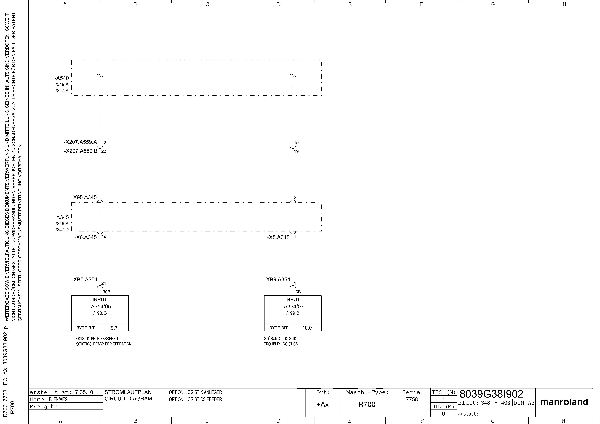

# +Ax — Sheet 348 of 403 — OPTION: LOGISTIK ANLEGER

**OPTION: LOGISTICS FEEDER**

> Part of the manroland **R700** printing press IEC/UL circuit diagrams.
> Drawing class: **Stromlaufplan / Circuit diagram** (DIN A3).
> Document `+Ax` covers the **Central control console** machine section.

## At a glance

| Field | Value |
|---|---|
| Document | `+Ax`  (8039G38I902) |
| Sheet | **348** of 403 |
| Section (DE) | OPTION: LOGISTIK ANLEGER |
| Section (EN) | OPTION: LOGISTICS FEEDER |
| Section type | CIRCUIT — Circuit diagram |
| Machine type | `R700` |
| Series | `7758` |
| Created | 17.05.10 |
| Replaces | — |
| Columns used | A, B, D |
| Path numbers | — |
| Labels on sheet | 39 |
| Cross-refs out | 6 |
| Cross-refs in | 16 |

**Previous:** [+Ax sheet 347](SHEET_0347.md) · **Next:** [+Ax sheet 349](SHEET_0349.md) · **Document TOC:** [_TOC.md](_TOC.md)  (+Ax) · **Master TOC:** [all sheets](../_MASTER_TOC.md)

## Sheet image (300 DPI, exact vector render)



_Rendered directly from the PDF vector layer at 300 DPI (1-bit), no OCR and no resampling. Use it to confirm anything ambiguous in the text below._

## Cross-references on this sheet

Each entry is a wire leaving this sheet. The printed token is `/sheet.column`; the link resolves to that sheet inside the same document.

| Ref | Target sheet | Col | Path | Destination on target | Target section | From col |
|---|---|---|---|---|---|---|
| `/349.A` | [+Ax sheet 349](SHEET_0349.md) | A | — | — | OPTION: LOGISTIK ANLEGER | A |
| `/347.A` | [+Ax sheet 347](SHEET_0347.md) | A | — | — | OPTION: LOGISTIK ANLEGER | A |
| `/349.A` | [+Ax sheet 349](SHEET_0349.md) | A | — | — | OPTION: LOGISTIK ANLEGER | A |
| `/347.D` | [+Ax sheet 347](SHEET_0347.md) | D | — | — | OPTION: LOGISTIK ANLEGER | A |
| `/199.B` | [+Ax sheet 199](SHEET_0199.md) | B | — | — | REFERENZMODUL | D |
| `/198.G` | [+Ax sheet 198](SHEET_0198.md) | G | — | — | REFERENZMODUL | A |

### Incoming references (sheets that point here)

Every other sheet that sends a wire to this one. `Back-ref` is the token printed on *that* sheet; `Path` is its line number.

| From sheet | Cols | Back-ref | Path | Refs | What continues there |
|---|---|---|---|---|---|
| [+Ax#198](SHEET_0198.md) | G | `/198.G` | — | 1 | — |
| [+Ax#199](SHEET_0199.md) | B | `/199.B` | — | 1 | — |
| [+Ax#231](SHEET_0231.md) | A, E | `/231.A`, `/231.E` | — | 2 | — |
| [+Ax#233](SHEET_0233.md) | G | `/233.G` | — | 1 | — |
| [+Ax#242](SHEET_0242.md) | A | `/242.A` | — | 1 | — |
| [+Ax#290](SHEET_0290.md) | A | `/290.A` | — | 2 | — |
| [+Ax#292](SHEET_0292.md) | E, F | `/292.E`, `/292.F` | — | 4 | — |
| [+Ax#347](SHEET_0347.md) | A, D | `/347.A`, `/347.D` | — | 2 | — |
| [+Ax#349](SHEET_0349.md) | A | `/349.A` | — | 2 | — |


## Devices on this sheet

| Tag | Class | Class meaning (IEC) | Col | Sub | Terminal | Sign |
|---|---|---|---|---|---|---|
| `A540` | A | Baugruppe / assembly, module, PC board | A | — | — | — |
| `A354/05` | A | Baugruppe / assembly, module, PC board | A | 05 | — | — |
| `A345` | A | Baugruppe / assembly, module, PC board | A | — | — | — |
| `A354/07` | A | Baugruppe / assembly, module, PC board | D | 07 | — | — |
| `X95.A345` | — | cross-device reference | A | — | — | — |
| `X6.A345` | — | cross-device reference | A | — | — | — |
| `XB5.A354` | — | cross-device reference | A | — | — | — |
| `9.7` | — | cross-device reference | B | — | — | — |
| `X207.A559.B` | — | cross-device reference | A | — | — | — |
| `X207.A559.A` | — | cross-device reference | A | — | — | — |
| `X5.A345` | — | cross-device reference | D | — | — | — |
| `10.0` | — | cross-device reference | D | — | — | — |
| `XB9.A354` | — | cross-device reference | D | — | — | — |

## Potentials / nets

_No named potentials on this sheet._

## Wire-end annotations (grouped as printed)

A wire that continues elsewhere is annotated with a small cluster: the destination description, the path/line number `#NN`, and the `/sheet.column` cross reference. Each row below is one such cluster exactly as it is grouped on the drawing.

| Col | Y | Path | Cross-ref | Text on the wire |
|---|---|---|---|---|
| A | 150.5 | — | — | `A540` |
| A | 163.6 | — | `/349.A`, `/347.A` | — |
| A | 277.4 | — | — | `X207.A559.A 22` |
| D | 279.5 | — | — | `19` |
| A | 295.1 | — | — | `X207.A559.B 22` |
| D | 296.5 | — | — | `19` |
| A | 387.2 | — | — | `X95.A345 2` |
| D | 388.7 | — | — | `3` |
| A | 426.9 | — | — | `A345` |
| A | 440.0 | — | `/349.A`, `/347.D` | — |
| A | 466.6 | — | — | `X6.A345 24` |
| D | 466.6 | — | — | `X5.A345 1` |
| A | 550.2 | — | — | `XB5.A354 24` |
| D | 550.2 | — | — | `XB9.A354 1` |
| B | 575.7 | — | — | `30B` |
| D | 575.7 | — | — | `3B` |
| A | 590.2 | — | — | `INPUT` |
| D | 590.2 | — | — | `INPUT` |
| A | 604.1 | — | — | `A354/05` |
| D | 604.1 | — | — | `A354/07` |
| A | 617.9 | — | `/198.G` | — |
| D | 617.9 | — | `/199.B` | — |
| A | 646.9 | — | — | `BYTE.BIT 9.7` |
| D | 646.9 | — | — | `BYTE.BIT 10.0` |
| B | 669.6 | — | — | `LOGISTIK: BETRIEBSBEREIT LOGISTICS: READY FOR OPERATION` |
| D | 669.6 | — | — | `STÖRUNG: LOGISTIK TROUBLE: LOGISTICS` |


## Reconstructed tables

This sheet carries tabular content (pin map / terminal assignment / index). The grid below was rebuilt from the drawing's own rule lines, so each row is exactly one physical row of the table.

### Table 1 — 1 data rows × 2 columns (at x=141.7, y=586.8)

| INPUT | A354/05 /198.G |
|---|---|
| `BYTE.BIT` | `9.7` |


### Table 2 — 1 data rows × 2 columns (at x=524.4, y=586.8)

| INPUT | A354/07 /199.B |
|---|---|
| `BYTE.BIT` | `10.0` |


## Notes and free text on this sheet

| Text | Col | Y (pt) |
|---|---|---|
| `30B` | B | 575.72 |
| `INPUT` | A | 590.24 |
| `BYTE.BIT` | A | 647.49 |
| `LOGISTIK: BETRIEBSBEREIT` | A | 669.58 |
| `LOGISTICS: READY FOR OPERATION` | B | 680.22 |
| `3B` | D | 575.7 |
| `INPUT` | D | 590.24 |
| `BYTE.BIT` | D | 647.49 |
| `STÖRUNG: LOGISTIK` | D | 669.61 |
| `TROUBLE: LOGISTICS` | D | 680.23 |

## Complete label inventory (exact text from the drawing)

Every text object inside the drawing area of this sheet, in DIN reading order (column A→H, then top→bottom). This is the authoritative list: if a string is not here it is not printed on this sheet.

| Col | Y | X | Dir | Type | Text |
|---|---|---|---|---|---|
| A | 150.5 | 108.3 | → | device tag | `A540` |
| A | 163.6 | 110.6 | → | cross-reference | `/349.A` |
| A | 176.0 | 110.6 | → | cross-reference | `/347.A` |
| A | 277.4 | 126.4 | → | device ref | `X207.A559.A` |
| A | 295.1 | 127.3 | → | device ref | `X207.A559.B` |
| A | 387.2 | 141.7 | → | device ref | `X95.A345` |
| A | 426.9 | 108.3 | → | device tag | `A345` |
| A | 440.0 | 110.6 | → | cross-reference | `/349.A` |
| A | 452.4 | 110.6 | → | cross-reference | `/347.D` |
| A | 466.6 | 147.7 | → | device ref | `X6.A345` |
| A | 550.2 | 142.0 | → | device ref | `XB5.A354` |
| A | 590.2 | 183.5 | → | text | `INPUT` |
| A | 604.1 | 177.0 | → | device tag | `A354/05` |
| A | 617.9 | 185.5 | → | cross-reference | `/198.G` |
| A | 647.5 | 151.7 | → | text | `BYTE.BIT` |
| A | 669.6 | 148.0 | → | text | `LOGISTIK: BETRIEBSBEREIT` |
| B | 279.5 | 201.0 | → | number | `22` |
| B | 296.5 | 201.0 | → | number | `22` |
| B | 388.7 | 201.0 | → | number | `2` |
| B | 466.6 | 201.0 | → | number | `24` |
| B | 558.7 | 201.0 | → | number | `24` |
| B | 575.7 | 203.8 | → | text | `30B` |
| B | 646.9 | 220.0 | → | device ref | `9.7` |
| B | 680.2 | 148.0 | → | text | `LOGISTICS: READY FOR OPERATION` |
| D | 279.5 | 583.1 | → | number | `19` |
| D | 296.5 | 583.1 | → | number | `19` |
| D | 388.7 | 583.7 | → | number | `3` |
| D | 466.6 | 530.4 | → | device ref | `X5.A345` |
| D | 466.6 | 583.1 | → | number | `1` |
| D | 550.2 | 524.7 | → | device ref | `XB9.A354` |
| D | 558.7 | 583.1 | → | number | `1` |
| D | 575.7 | 586.5 | → | text | `3B` |
| D | 590.2 | 566.2 | → | text | `INPUT` |
| D | 604.1 | 559.7 | → | device tag | `A354/07` |
| D | 617.9 | 568.5 | → | cross-reference | `/199.B` |
| D | 646.9 | 599.7 | → | device ref | `10.0` |
| D | 647.5 | 534.3 | → | text | `BYTE.BIT` |
| D | 669.6 | 524.1 | → | text | `STÖRUNG: LOGISTIK` |
| D | 680.2 | 524.1 | → | text | `TROUBLE: LOGISTICS` |

## Reading-order text block

The same content as a plain block, grouped by DIN column — convenient to paste or to match against a visual description.

```text
=== Column A ===
 150.5  108.3  devtag       A540
 163.6  110.6  xref         /349.A
 176.0  110.6  xref         /347.A
 277.4  126.4  devref       X207.A559.A
 295.1  127.3  devref       X207.A559.B
 387.2  141.7  devref       X95.A345
 426.9  108.3  devtag       A345
 440.0  110.6  xref         /349.A
 452.4  110.6  xref         /347.D
 466.6  147.7  devref       X6.A345
 550.2  142.0  devref       XB5.A354
 590.2  183.5  text         INPUT
 604.1  177.0  devtag       A354/05
 617.9  185.5  xref         /198.G
 647.5  151.7  text         BYTE.BIT
 669.6  148.0  text         LOGISTIK: BETRIEBSBEREIT
=== Column B ===
 279.5  201.0  numeric      22
 296.5  201.0  numeric      22
 388.7  201.0  numeric      2
 466.6  201.0  numeric      24
 558.7  201.0  numeric      24
 575.7  203.8  text         30B
 646.9  220.0  devref       9.7
 680.2  148.0  text         LOGISTICS: READY FOR OPERATION
=== Column D ===
 279.5  583.1  numeric      19
 296.5  583.1  numeric      19
 388.7  583.7  numeric      3
 466.6  530.4  devref       X5.A345
 466.6  583.1  numeric      1
 550.2  524.7  devref       XB9.A354
 558.7  583.1  numeric      1
 575.7  586.5  text         3B
 590.2  566.2  text         INPUT
 604.1  559.7  devtag       A354/07
 617.9  568.5  xref         /199.B
 646.9  599.7  devref       10.0
 647.5  534.3  text         BYTE.BIT
 669.6  524.1  text         STÖRUNG: LOGISTIK
 680.2  524.1  text         TROUBLE: LOGISTICS
```

---
_Generated from the PDF vector text layer; no OCR. Source: `R700_7758_IEC_AX_8039G38I902_p`, sheet 348._
