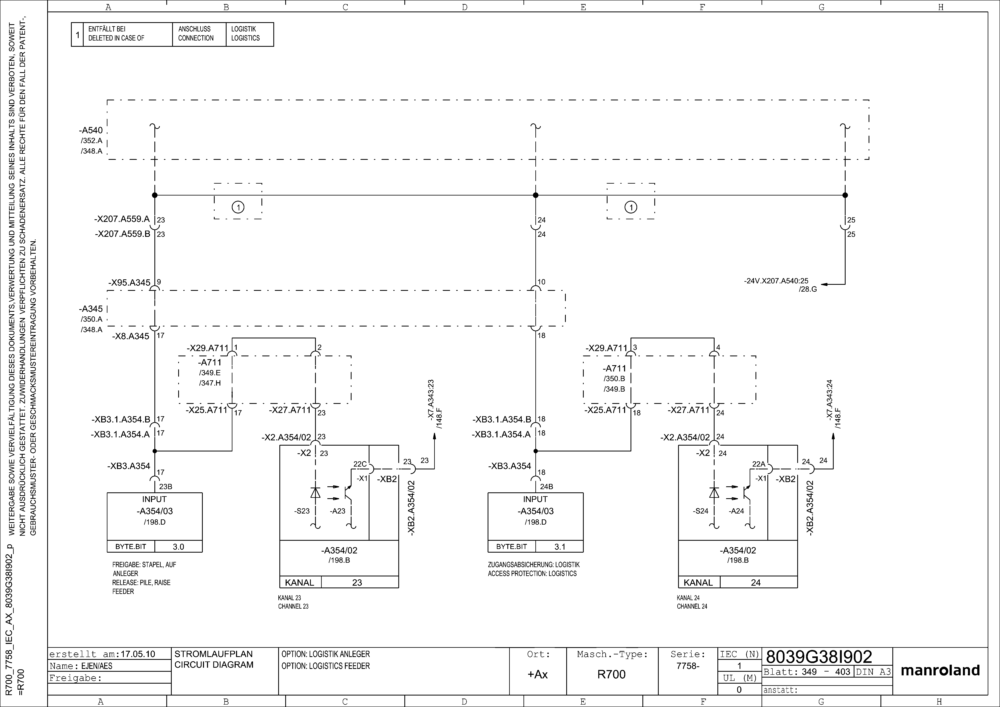

# +Ax — Sheet 349 of 403 — OPTION: LOGISTIK ANLEGER

**OPTION: LOGISTICS FEEDER**

> Part of the manroland **R700** printing press IEC/UL circuit diagrams.
> Drawing class: **Stromlaufplan / Circuit diagram** (DIN A3).
> Document `+Ax` covers the **Central control console** machine section.

## At a glance

| Field | Value |
|---|---|
| Document | `+Ax`  (8039G38I902) |
| Sheet | **349** of 403 |
| Section (DE) | OPTION: LOGISTIK ANLEGER |
| Section (EN) | OPTION: LOGISTICS FEEDER |
| Section type | CIRCUIT — Circuit diagram |
| Machine type | `R700` |
| Series | `7758` |
| Created | 17.05.10 |
| Replaces | — |
| Columns used | A, B, C, D, E, F, G |
| Path numbers | — |
| Labels on sheet | 121 |
| Cross-refs out | 15 |
| Cross-refs in | 43 |

**Previous:** [+Ax sheet 348](SHEET_0348.md) · **Next:** [+Ax sheet 350](SHEET_0350.md) · **Document TOC:** [_TOC.md](_TOC.md)  (+Ax) · **Master TOC:** [all sheets](../_MASTER_TOC.md)

## Sheet image (300 DPI, exact vector render)



_Rendered directly from the PDF vector layer at 300 DPI (1-bit), no OCR and no resampling. Use it to confirm anything ambiguous in the text below._

## Cross-references on this sheet

Each entry is a wire leaving this sheet. The printed token is `/sheet.column`; the link resolves to that sheet inside the same document.

| Ref | Target sheet | Col | Path | Destination on target | Target section | From col |
|---|---|---|---|---|---|---|
| `/352.A` | [+Ax sheet 352](SHEET_0352.md) | A | — | — | OPTION: LOGISTIK ANLEGER | A |
| `/348.A` | [+Ax sheet 348](SHEET_0348.md) | A | — | — | OPTION: LOGISTIK ANLEGER | A |
| `/28.G` | [+Ax sheet 28](SHEET_0028.md) | G | — | 24V.X207.A540:25 | SPANNUNGSVERSORGUNG, SCHALTSCHRANKBELÜFTUNG | G |
| `/350.A` | [+Ax sheet 350](SHEET_0350.md) | A | — | — | OPTION: LOGISTIK ANLEGER | A |
| `/348.A` | [+Ax sheet 348](SHEET_0348.md) | A | — | — | OPTION: LOGISTIK ANLEGER | A |
| `/349.E` | [+Ax sheet 349](SHEET_0349.md) | E | — | — | OPTION: LOGISTIK ANLEGER | B |
| `/347.H` | [+Ax sheet 347](SHEET_0347.md) | H | — | — | OPTION: LOGISTIK ANLEGER | B |
| `/350.B` | [+Ax sheet 350](SHEET_0350.md) | B | — | — | OPTION: LOGISTIK ANLEGER | E |
| `/349.B` | [+Ax sheet 349](SHEET_0349.md) | B | — | — | OPTION: LOGISTIK ANLEGER | E |
| `/148.F` | [+Ax sheet 148](SHEET_0148.md) | F | — | X7.A343:23 | ÜBERWACHUNGSRECHNER SICHERHEITSBUS | D |
| `/148.F` | [+Ax sheet 148](SHEET_0148.md) | F | — | X7.A343:24 | ÜBERWACHUNGSRECHNER SICHERHEITSBUS | G |
| `/198.D` | [+Ax sheet 198](SHEET_0198.md) | D | — | — | REFERENZMODUL | A |
| `/198.D` | [+Ax sheet 198](SHEET_0198.md) | D | — | — | REFERENZMODUL | E |
| `/198.B` | [+Ax sheet 198](SHEET_0198.md) | B | — | — | REFERENZMODUL | C |
| `/198.B` | [+Ax sheet 198](SHEET_0198.md) | B | — | — | REFERENZMODUL | F |

### Incoming references (sheets that point here)

Every other sheet that sends a wire to this one. `Back-ref` is the token printed on *that* sheet; `Path` is its line number.

| From sheet | Cols | Back-ref | Path | Refs | What continues there |
|---|---|---|---|---|---|
| [+Ax#28](SHEET_0028.md) | G | `/28.G` | — | 1 | — |
| [+Ax#148](SHEET_0148.md) | F | `/148.F` | — | 2 | X7.A343:23; X7.A343:24 |
| [+Ax#198](SHEET_0198.md) | B, D | `/198.B`, `/198.D` | — | 4 | — |
| [+Ax#219](SHEET_0219.md) | D, F | `/219.D`, `/219.F` | — | 4 | — |
| [+Ax#224](SHEET_0224.md) | A, B, C | `/224.A`, `/224.B`, `/224.C` | — | 6 | — |
| [+Ax#238](SHEET_0238.md) | A | `/238.A` | — | 2 | — |
| [+Ax#268](SHEET_0268.md) | C | `/268.C` | — | 2 | — |
| [+Ax#271](SHEET_0271.md) | B | `/271.B` | — | 2 | — |
| [+Ax#274](SHEET_0274.md) | A | `/274.A` | — | 4 | — |
| [+Ax#290](SHEET_0290.md) | A | `/290.A` | — | 2 | — |
| [+Ax#292](SHEET_0292.md) | E, F | `/292.E`, `/292.F` | — | 6 | — |
| [+Ax#347](SHEET_0347.md) | H | `/347.H` | — | 1 | A711 |
| [+Ax#348](SHEET_0348.md) | A | `/348.A` | — | 2 | — |
| [+Ax#349](SHEET_0349.md) | B, E | `/349.B`, `/349.E` | — | 2 | — |
| [+Ax#350](SHEET_0350.md) | A, B | `/350.A`, `/350.B` | — | 2 | — |
| [+Ax#352](SHEET_0352.md) | A | `/352.A` | — | 1 | — |


## Devices on this sheet

| Tag | Class | Class meaning (IEC) | Col | Sub | Terminal | Sign |
|---|---|---|---|---|---|---|
| `A540` | A | Baugruppe / assembly, module, PC board | A | — | — | — |
| `A354/03` | A | Baugruppe / assembly, module, PC board | A | 03 | — | — |
| `A345` | A | Baugruppe / assembly, module, PC board | A | — | — | — |
| `S23` | S | Schalter / switch | C | — | — | — |
| `A23` | A | Baugruppe / assembly, module, PC board | C | — | — | — |
| `X1` | X | Klemme / terminal, plug connector | C | — | — | — |
| `X2` | X | Klemme / terminal, plug connector | C | — | — | — |
| `XB2` | XB |  | C | — | — | — |
| `A354/02` | A | Baugruppe / assembly, module, PC board | C | 02 | — | — |
| `A354/03` | A | Baugruppe / assembly, module, PC board | E | 03 | — | — |
| `A711` | A | Baugruppe / assembly, module, PC board | B | — | — | — |
| `S24` | S | Schalter / switch | F | — | — | — |
| `A24` | A | Baugruppe / assembly, module, PC board | F | — | — | — |
| `X1` | X | Klemme / terminal, plug connector | F | — | — | — |
| `X2` | X | Klemme / terminal, plug connector | F | — | — | — |
| `XB2` | XB |  | G | — | — | — |
| `A354/02` | A | Baugruppe / assembly, module, PC board | F | 02 | — | — |
| `A711` | A | Baugruppe / assembly, module, PC board | E | — | — | — |
| `3.0` | — | cross-device reference | B | — | — | — |
| `XB3.A354` | — | cross-device reference | A | — | — | — |
| `X207.A559.B` | — | cross-device reference | A | — | — | — |
| `X207.A559.A` | — | cross-device reference | A | — | — | — |
| `X95.A345` | — | cross-device reference | A | — | — | — |
| `X8.A345` | — | cross-device reference | A | — | — | — |
| `XB3.1.A354.B` | — | cross-device reference | A | — | — | — |
| `XB3.1.A354.A` | — | cross-device reference | A | — | — | — |
| `3.1` | — | cross-device reference | E | — | — | — |
| `XB3.A354` | — | cross-device reference | D | — | — | — |
| `XB3.1.A354.B` | — | cross-device reference | D | — | — | — |
| `XB3.1.A354.A` | — | cross-device reference | D | — | — | — |
| `X29.A711` | — | cross-device reference | B | — | — | — |
| `X27.A711` | — | cross-device reference | C | — | — | — |
| `X25.A711` | — | cross-device reference | B | — | — | — |
| `X29.A711` | — | cross-device reference | E | — | — | — |
| `X27.A711` | — | cross-device reference | F | — | — | — |
| `X25.A711` | — | cross-device reference | E | — | — | — |
| `X7.A343:23` | — | cross-device reference | D | — | 23 | — |
| `X7.A343:24` | — | cross-device reference | G | — | 24 | — |

## Potentials / nets

| Potential | Count | Columns | Attached devices | Terminals |
|---|---|---|---|---|
| `24V` | 1 | G | `A540`, `X207` | `25` |


A potential such as `L24+/4` or `M24+` is a named supply/return rail; every place it appears on this sheet is electrically common.

## Wire-end annotations (grouped as printed)

A wire that continues elsewhere is annotated with a small cluster: the destination description, the path/line number `#NN`, and the `/sheet.column` cross reference. Each row below is one such cluster exactly as it is grouped on the drawing.

| Col | Y | Path | Cross-ref | Text on the wire |
|---|---|---|---|---|
| A | 31.8 | — | — | `1 ENTFÄLLT BEI DELETED IN CASE OF CONNECTION ANSCHLUSS` |
| B | 31.8 | — | — | `LOGISTIK LOGISTICS` |
| A | 150.5 | — | — | `A540` |
| A | 163.6 | — | `/352.A`, `/348.A` | — |
| D | 243.6 | — | — | `1 1` |
| A | 256.1 | — | — | `X207.A559.A 23` |
| E | 258.3 | — | — | `24` |
| G | 258.3 | — | — | `25` |
| A | 273.9 | — | — | `X207.A559.B 23` |
| E | 275.3 | — | — | `24` |
| G | 275.3 | — | — | `25` |
| G | 330.5 | — | `/28.G` | `24V.X207.A540:25` |
| A | 332.0 | — | — | `X95.A345 9` |
| E | 332.0 | — | — | `10` |
| A | 363.1 | — | — | `A345` |
| A | 376.2 | — | `/350.A`, `/348.A` | — |
| A | 395.7 | — | — | `X8.A345 17` |
| E | 395.8 | — | — | `18` |
| B | 409.9 | — | — | `X29.A711 1 2` |
| F | 409.9 | — | — | `X29.A711 3 4` |
| B | 426.9 | — | — | `A711` |
| E | 434.0 | — | — | `A711` |
| B | 440.0 | — | `/349.E`, `/347.H` | — |
| E | 447.1 | — | `/350.B`, `/349.B` | — |
| D | 451.8 | — | `/148.F` | `X7.A343:23` |
| G | 451.8 | — | `/148.F` | `X7.A343:24` |
| B | 483.6 | — | — | `X25.A711 17 X27.A711 23` |
| F | 483.6 | — | — | `X25.A711 18 X27.A711 24` |
| A | 495.0 | — | — | `XB3.1.A354.B 17` |
| D | 495.0 | — | — | `XB3.1.A354.B 18` |
| A | 512.0 | — | — | `XB3.1.A354.A 17` |
| D | 512.0 | — | — | `XB3.1.A354.A 18` |
| C | 516.2 | — | — | `X2.A354/02 23` |
| F | 516.2 | — | — | `X2.A354/02 24` |
| C | 534.7 | — | — | `X2` |
| F | 534.7 | — | — | `X2` |
| C | 536.1 | — | — | `23 23` |
| G | 536.1 | — | — | `24 24` |
| D | 544.6 | — | — | `23` |
| G | 544.6 | — | — | `24` |
| C | 548.8 | — | — | `22C` |
| F | 548.8 | — | — | `22A` |
| A | 550.2 | — | — | `XB3.A354 17` |
| D | 550.2 | — | — | `XB3.A354 18` |
| C | 565.8 | — | — | `X1` |
| C | 565.8 | — | — | `XB2` |
| F | 565.8 | — | — | `X1` |
| G | 565.8 | — | — | `XB2` |
| D | 572.0 | — | — | `XB2.A354/02` |
| G | 572.0 | — | — | `XB2.A354/02` |
| A | 575.7 | — | — | `23B` |
| E | 575.7 | — | — | `24B` |
| A | 590.2 | — | — | `INPUT` |
| E | 590.2 | — | — | `INPUT` |
| A | 604.1 | — | — | `A354/03` |
| E | 604.1 | — | — | `A354/03` |
| C | 604.8 | — | — | `S23 A23` |
| F | 604.8 | — | — | `S24 A24` |
| A | 617.9 | — | `/198.D` | — |
| E | 617.9 | — | `/198.D` | — |
| A | 646.9 | — | — | `BYTE.BIT 3.0` |
| E | 646.9 | — | — | `BYTE.BIT 3.1` |
| C | 650.9 | — | — | `A354/02` |
| F | 650.9 | — | — | `A354/02` |
| C | 663.2 | — | `/198.B` | — |
| F | 663.2 | — | `/198.B` | — |
| A | 669.6 | — | — | `FREIGABE: STAPEL, AUF` |
| E | 669.6 | — | — | `ZUGANGSABSICHERUNG: LOGISTIK ACCESS PROTECTION: LOGISTICS` |
| A | 680.2 | — | — | `RELEASE: PILE, RAISE FEEDER ANLEGER` |
| C | 689.1 | — | — | `KANAL 23` |
| F | 689.1 | — | — | `KANAL 24` |
| C | 709.5 | — | — | `KANAL 23 CHANNEL 23` |
| F | 709.5 | — | — | `KANAL 24 CHANNEL 24` |


## Reconstructed tables

This sheet carries tabular content (pin map / terminal assignment / index). The grid below was rebuilt from the drawing's own rule lines, so each row is exactly one physical row of the table.

### Table 1 — 6 data rows × 20 columns (at x=127.6, y=232.4)

| X207.A559.A X207.A559.B X95.A345 X8.A345 | 23 23 9 17 |  | 1 |  |  |  |  |  |  |  | 24 24 10 18 |  | 1 |  |  |  | 24V.X207.A540:25 | /28.G |  |
|---|---|---|---|---|---|---|---|---|---|---|---|---|---|---|---|---|---|---|---|
| `XB3.1.A354.B XB3.1.A354.A` | `17 17` | `X29.A711 A711 /349.E /347.H X25.A711` | `1 17` | `X27.A711 X2.A354/02` | `2 23 23` |  |  | `X7.A343:23` | `/148.F` | `XB3.1.A354.B XB3.1.A354.A` | `18 18` | `X29.A711 A711 /350.B /349.B X25.A711` | `3 18` | `X27.A711 X2.A354/02` | `4 24 24` |  |  | `X7.A343:24` | `/148.F` |
| `XB3.A354` | `17 23B` |  |  | `X2` | `23` | `22C X1` | `XB2` | `23 23` |  | `XB3.A354` | `18 24B` |  |  | `X2` | `24` | `22A X1` | `XB2` | `24 24` |  |
| `INPUT` | `A354/03 /198.D` |  |  | `S23` | `A23` |  |  | `XB2.A354/02` |  | `INPUT` | `A354/03 /198.D` |  |  | `S24` | `A24` |  |  | `XB2.A354/02` |  |
| `BYTE.BIT` | `3.0` |  |  |  | `A354/02` |  |  |  |  | `BYTE.BIT` | `3.1` |  |  |  | `A354/02` |  |  |  |  |
| `FREIGABE: STAPEL, ANLEGER` | `AUF` |  |  |  | `/198.B` |  |  |  |  | `ZUGANGSABSICHERUNG: ACCESS PROTECTION:` | `LOGISTIK LOGISTICS` |  |  |  | `/198.B` |  |  |  |  |
| `RELEASE: PILE,` | `RAISE` |  |  | `KANAL` |  | `23` |  |  |  |  |  |  |  | `KANAL` |  | `24` |  |  |  |


## Notes and free text on this sheet

| Text | Col | Y (pt) |
|---|---|---|
| `23B` | A | 575.72 |
| `INPUT` | A | 590.24 |
| `BYTE.BIT` | A | 647.49 |
| `FREIGABE: STAPEL, AUF` | A | 669.57 |
| `ANLEGER` | A | 680.24 |
| `RELEASE: PILE, RAISE` | A | 690.83 |
| `FEEDER` | A | 701.47 |
| `KANAL 23` | C | 709.45 |
| `CHANNEL 23` | C | 719.39 |
| `22C` | C | 548.83 |
| `KANAL` | C | 689.12 |
| `X2.A354/02` | C | 516.21 |
| `XB2.A354/02` | D | 572.03 |
| `24B` | E | 575.72 |
| `INPUT` | E | 590.24 |
| `BYTE.BIT` | D | 647.49 |
| `ZUGANGSABSICHERUNG: LOGISTIK` | E | 669.61 |
| `ACCESS PROTECTION: LOGISTICS` | E | 680.23 |
| `KANAL 24` | F | 709.45 |
| `CHANNEL 24` | F | 719.39 |
| `22A` | F | 548.79 |
| `KANAL` | F | 689.12 |
| `X2.A354/02` | F | 516.21 |
| `XB2.A354/02` | G | 572.03 |
| `ENTFÄLLT BEI` | A | 31.77 |
| `DELETED IN CASE OF` | A | 42.43 |
| `ANSCHLUSS` | B | 31.82 |
| `CONNECTION` | B | 42.45 |
| `LOGISTIK` | B | 31.78 |
| `LOGISTICS` | B | 42.41 |

## Complete label inventory (exact text from the drawing)

Every text object inside the drawing area of this sheet, in DIN reading order (column A→H, then top→bottom). This is the authoritative list: if a string is not here it is not printed on this sheet.

| Col | Y | X | Dir | Type | Text |
|---|---|---|---|---|---|
| A | 31.8 | 105.4 | → | text | `ENTFÄLLT BEI` |
| A | 37.1 | 89.6 | → | number | `1` |
| A | 42.4 | 105.4 | → | text | `DELETED IN CASE OF` |
| A | 150.5 | 94.1 | → | device tag | `A540` |
| A | 163.6 | 96.4 | → | cross-reference | `/352.A` |
| A | 176.0 | 96.4 | → | cross-reference | `/348.A` |
| A | 256.1 | 112.3 | → | device ref | `X207.A559.A` |
| A | 258.3 | 186.8 | → | number | `23` |
| A | 273.9 | 113.1 | → | device ref | `X207.A559.B` |
| A | 275.3 | 186.8 | → | number | `23` |
| A | 332.0 | 129.0 | → | device ref | `X95.A345` |
| A | 332.0 | 186.8 | → | number | `9` |
| A | 363.1 | 94.1 | → | device tag | `A345` |
| A | 376.2 | 96.4 | → | cross-reference | `/350.A` |
| A | 388.6 | 96.4 | → | cross-reference | `/348.A` |
| A | 395.7 | 133.5 | → | device ref | `X8.A345` |
| A | 395.8 | 186.2 | → | number | `17` |
| A | 495.0 | 109.1 | → | device ref | `XB3.1.A354.B` |
| A | 495.0 | 186.2 | → | number | `17` |
| A | 512.0 | 186.2 | → | number | `17` |
| A | 512.7 | 108.3 | → | device ref | `XB3.1.A354.A` |
| A | 550.2 | 127.8 | → | device ref | `XB3.A354` |
| A | 558.7 | 186.2 | → | number | `17` |
| A | 575.7 | 189.6 | → | text | `23B` |
| A | 590.2 | 169.4 | → | text | `INPUT` |
| A | 604.1 | 162.9 | → | device tag | `A354/03` |
| A | 617.9 | 171.5 | → | cross-reference | `/198.D` |
| A | 647.5 | 137.5 | → | text | `BYTE.BIT` |
| A | 669.6 | 133.8 | → | text | `FREIGABE: STAPEL, AUF` |
| A | 680.2 | 134.6 | → | text | `ANLEGER` |
| A | 690.8 | 133.8 | → | text | `RELEASE: PILE, RAISE` |
| A | 701.5 | 133.8 | → | text | `FEEDER` |
| B | 31.8 | 212.6 | → | text | `ANSCHLUSS` |
| B | 31.8 | 275.5 | → | text | `LOGISTIK` |
| B | 42.4 | 275.5 | → | text | `LOGISTICS` |
| B | 42.5 | 212.3 | → | text | `CONNECTION` |
| B | 243.6 | 281.7 | → | number | `1` |
| B | 409.9 | 222.5 | → | device ref | `X29.A711` |
| B | 409.9 | 278.4 | → | number | `1` |
| B | 426.9 | 235.8 | → | device tag | `A711` |
| B | 440.0 | 237.3 | → | cross-reference | `/349.E` |
| B | 452.4 | 237.3 | → | cross-reference | `/347.H` |
| B | 483.6 | 221.1 | → | device ref | `X25.A711` |
| B | 487.9 | 278.4 | → | number | `17` |
| B | 646.9 | 205.8 | → | device ref | `3.0` |
| C | 409.9 | 378.1 | → | number | `2` |
| C | 483.6 | 320.3 | → | device ref | `X27.A711` |
| C | 487.9 | 378.1 | → | number | `23` |
| C | 516.2 | 311.5 | → | text | `X2.A354/02` |
| C | 516.2 | 378.1 | → | number | `23` |
| C | 534.7 | 354.0 | → | device tag | `X2` |
| C | 536.1 | 381.0 | → | number | `23` |
| C | 548.8 | 420.9 | → | text | `22C` |
| C | 565.8 | 424.6 | → | device tag | `X1` |
| C | 565.8 | 449.0 | → | device tag | `XB2` |
| C | 604.8 | 350.4 | → | device tag | `S23` |
| C | 604.8 | 392.9 | → | device tag | `A23` |
| C | 650.9 | 382.5 | → | device tag | `A354/02` |
| C | 663.2 | 391.3 | → | cross-reference | `/198.B` |
| C | 689.1 | 339.3 | → | text | `KANAL` |
| C | 689.1 | 419.4 | → | number | `23` |
| C | 709.4 | 331.1 | → | text | `KANAL 23` |
| C | 719.4 | 331.4 | → | text | `CHANNEL 23` |
| D | 451.8 | 509.1 | ↕ | device ref | `X7.A343:23` |
| D | 485.3 | 519.0 | ↕ | cross-reference | `/148.F` |
| D | 495.0 | 562.7 | → | device ref | `XB3.1.A354.B` |
| D | 512.7 | 561.8 | → | device ref | `XB3.1.A354.A` |
| D | 544.6 | 500.9 | → | number | `23` |
| D | 546.0 | 480.2 | → | number | `23` |
| D | 550.2 | 581.4 | → | device ref | `XB3.A354` |
| D | 572.0 | 485.0 | ↕ | text | `XB2.A354/02` |
| D | 647.5 | 591.0 | → | text | `BYTE.BIT` |
| E | 243.6 | 749.4 | → | number | `1` |
| E | 258.3 | 640.3 | → | number | `24` |
| E | 275.3 | 640.3 | → | number | `24` |
| E | 332.0 | 639.8 | → | number | `10` |
| E | 395.8 | 639.8 | → | number | `18` |
| E | 409.9 | 697.3 | → | device ref | `X29.A711` |
| E | 409.9 | 753.7 | → | number | `3` |
| E | 434.0 | 717.7 | → | device tag | `A711` |
| E | 447.1 | 718.9 | → | cross-reference | `/350.B` |
| E | 459.5 | 718.9 | → | cross-reference | `/349.B` |
| E | 483.6 | 695.9 | → | device ref | `X25.A711` |
| E | 487.9 | 753.2 | → | number | `18` |
| E | 495.0 | 639.8 | → | number | `18` |
| E | 512.0 | 639.8 | → | number | `18` |
| E | 558.7 | 639.8 | → | number | `18` |
| E | 575.7 | 643.2 | → | text | `24B` |
| E | 590.2 | 622.9 | → | text | `INPUT` |
| E | 604.1 | 616.4 | → | device tag | `A354/03` |
| E | 617.9 | 625.0 | → | cross-reference | `/198.D` |
| E | 646.9 | 660.2 | → | device ref | `3.1` |
| E | 669.6 | 581.1 | → | text | `ZUGANGSABSICHERUNG: LOGISTIK` |
| E | 680.2 | 581.1 | → | text | `ACCESS PROTECTION: LOGISTICS` |
| F | 409.9 | 852.9 | → | number | `4` |
| F | 483.6 | 795.1 | → | device ref | `X27.A711` |
| F | 487.9 | 852.9 | → | number | `24` |
| F | 516.2 | 786.3 | → | text | `X2.A354/02` |
| F | 516.2 | 852.9 | → | number | `24` |
| F | 534.7 | 828.9 | → | device tag | `X2` |
| F | 536.1 | 855.8 | → | number | `24` |
| F | 548.8 | 895.7 | → | text | `22A` |
| F | 565.8 | 899.4 | → | device tag | `X1` |
| F | 604.8 | 825.2 | → | device tag | `S24` |
| F | 604.8 | 867.7 | → | device tag | `A24` |
| F | 650.9 | 857.3 | → | device tag | `A354/02` |
| F | 663.2 | 866.1 | → | cross-reference | `/198.B` |
| F | 689.1 | 814.1 | → | text | `KANAL` |
| F | 689.1 | 894.2 | → | number | `24` |
| F | 709.4 | 805.9 | → | text | `KANAL 24` |
| F | 719.4 | 806.2 | → | text | `CHANNEL 24` |
| G | 258.3 | 1008.9 | → | number | `25` |
| G | 275.3 | 1008.9 | → | number | `25` |
| G | 330.5 | 886.1 | → | potential | `24V.X207.A540:25` |
| G | 340.4 | 951.3 | → | cross-reference | `/28.G` |
| G | 451.8 | 983.9 | ↕ | device ref | `X7.A343:24` |
| G | 485.3 | 993.8 | ↕ | cross-reference | `/148.F` |
| G | 544.6 | 975.7 | → | number | `24` |
| G | 546.0 | 955.0 | → | number | `24` |
| G | 565.8 | 923.8 | → | device tag | `XB2` |
| G | 572.0 | 959.8 | ↕ | text | `XB2.A354/02` |

## Reading-order text block

The same content as a plain block, grouped by DIN column — convenient to paste or to match against a visual description.

```text
=== Column A ===
  31.8  105.4  text         ENTFÄLLT BEI
  37.1   89.6  numeric      1
  42.4  105.4  text         DELETED IN CASE OF
 150.5   94.1  devtag       A540
 163.6   96.4  xref         /352.A
 176.0   96.4  xref         /348.A
 256.1  112.3  devref       X207.A559.A
 258.3  186.8  numeric      23
 273.9  113.1  devref       X207.A559.B
 275.3  186.8  numeric      23
 332.0  129.0  devref       X95.A345
 332.0  186.8  numeric      9
 363.1   94.1  devtag       A345
 376.2   96.4  xref         /350.A
 388.6   96.4  xref         /348.A
 395.7  133.5  devref       X8.A345
 395.8  186.2  numeric      17
 495.0  109.1  devref       XB3.1.A354.B
 495.0  186.2  numeric      17
 512.0  186.2  numeric      17
 512.7  108.3  devref       XB3.1.A354.A
 550.2  127.8  devref       XB3.A354
 558.7  186.2  numeric      17
 575.7  189.6  text         23B
 590.2  169.4  text         INPUT
 604.1  162.9  devtag       A354/03
 617.9  171.5  xref         /198.D
 647.5  137.5  text         BYTE.BIT
 669.6  133.8  text         FREIGABE: STAPEL, AUF
 680.2  134.6  text         ANLEGER
 690.8  133.8  text         RELEASE: PILE, RAISE
 701.5  133.8  text         FEEDER
=== Column B ===
  31.8  212.6  text         ANSCHLUSS
  31.8  275.5  text         LOGISTIK
  42.4  275.5  text         LOGISTICS
  42.5  212.3  text         CONNECTION
 243.6  281.7  numeric      1
 409.9  222.5  devref       X29.A711
 409.9  278.4  numeric      1
 426.9  235.8  devtag       A711
 440.0  237.3  xref         /349.E
 452.4  237.3  xref         /347.H
 483.6  221.1  devref       X25.A711
 487.9  278.4  numeric      17
 646.9  205.8  devref       3.0
=== Column C ===
 409.9  378.1  numeric      2
 483.6  320.3  devref       X27.A711
 487.9  378.1  numeric      23
 516.2  311.5  text         X2.A354/02
 516.2  378.1  numeric      23
 534.7  354.0  devtag       X2
 536.1  381.0  numeric      23
 548.8  420.9  text         22C
 565.8  424.6  devtag       X1
 565.8  449.0  devtag       XB2
 604.8  350.4  devtag       S23
 604.8  392.9  devtag       A23
 650.9  382.5  devtag       A354/02
 663.2  391.3  xref         /198.B
 689.1  339.3  text         KANAL
 689.1  419.4  numeric      23
 709.4  331.1  text         KANAL 23
 719.4  331.4  text         CHANNEL 23
=== Column D ===
 451.8  509.1  devref       X7.A343:23
 485.3  519.0  xref         /148.F
 495.0  562.7  devref       XB3.1.A354.B
 512.7  561.8  devref       XB3.1.A354.A
 544.6  500.9  numeric      23
 546.0  480.2  numeric      23
 550.2  581.4  devref       XB3.A354
 572.0  485.0  text         XB2.A354/02
 647.5  591.0  text         BYTE.BIT
=== Column E ===
 243.6  749.4  numeric      1
 258.3  640.3  numeric      24
 275.3  640.3  numeric      24
 332.0  639.8  numeric      10
 395.8  639.8  numeric      18
 409.9  697.3  devref       X29.A711
 409.9  753.7  numeric      3
 434.0  717.7  devtag       A711
 447.1  718.9  xref         /350.B
 459.5  718.9  xref         /349.B
 483.6  695.9  devref       X25.A711
 487.9  753.2  numeric      18
 495.0  639.8  numeric      18
 512.0  639.8  numeric      18
 558.7  639.8  numeric      18
 575.7  643.2  text         24B
 590.2  622.9  text         INPUT
 604.1  616.4  devtag       A354/03
 617.9  625.0  xref         /198.D
 646.9  660.2  devref       3.1
 669.6  581.1  text         ZUGANGSABSICHERUNG: LOGISTIK
 680.2  581.1  text         ACCESS PROTECTION: LOGISTICS
=== Column F ===
 409.9  852.9  numeric      4
 483.6  795.1  devref       X27.A711
 487.9  852.9  numeric      24
 516.2  786.3  text         X2.A354/02
 516.2  852.9  numeric      24
 534.7  828.9  devtag       X2
 536.1  855.8  numeric      24
 548.8  895.7  text         22A
 565.8  899.4  devtag       X1
 604.8  825.2  devtag       S24
 604.8  867.7  devtag       A24
 650.9  857.3  devtag       A354/02
 663.2  866.1  xref         /198.B
 689.1  814.1  text         KANAL
 689.1  894.2  numeric      24
 709.4  805.9  text         KANAL 24
 719.4  806.2  text         CHANNEL 24
=== Column G ===
 258.3 1008.9  numeric      25
 275.3 1008.9  numeric      25
 330.5  886.1  net          24V.X207.A540:25
 340.4  951.3  xref         /28.G
 451.8  983.9  devref       X7.A343:24
 485.3  993.8  xref         /148.F
 544.6  975.7  numeric      24
 546.0  955.0  numeric      24
 565.8  923.8  devtag       XB2
 572.0  959.8  text         XB2.A354/02
```

---
_Generated from the PDF vector text layer; no OCR. Source: `R700_7758_IEC_AX_8039G38I902_p`, sheet 349._
