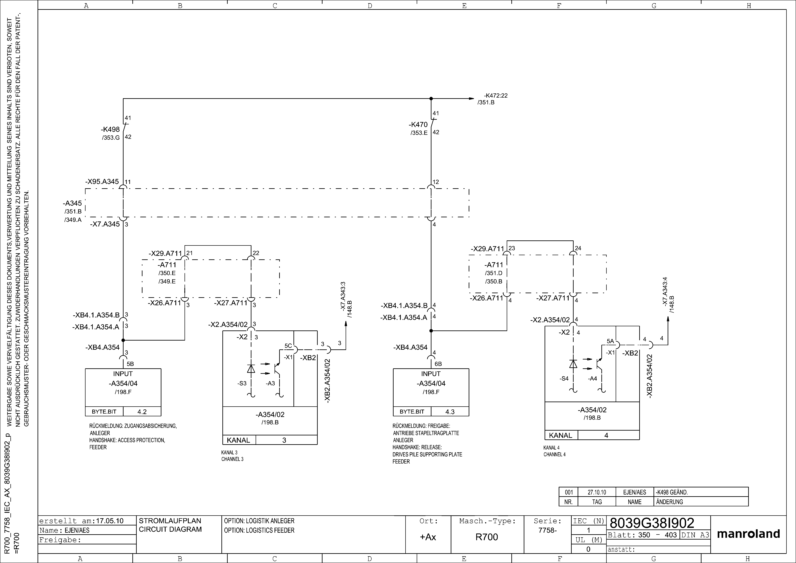

# +Ax — Sheet 350 of 403 — OPTION: LOGISTIK ANLEGER

**OPTION: LOGISTICS FEEDER**

> Part of the manroland **R700** printing press IEC/UL circuit diagrams.
> Drawing class: **Stromlaufplan / Circuit diagram** (DIN A3).
> Document `+Ax` covers the **Central control console** machine section.

## At a glance

| Field | Value |
|---|---|
| Document | `+Ax`  (8039G38I902) |
| Sheet | **350** of 403 |
| Section (DE) | OPTION: LOGISTIK ANLEGER |
| Section (EN) | OPTION: LOGISTICS FEEDER |
| Section type | CIRCUIT — Circuit diagram |
| Machine type | `R700` |
| Series | `7758` |
| Created | 17.05.10 |
| Replaces | — |
| Columns used | A, B, C, D, E, F, G |
| Path numbers | — |
| Labels on sheet | 121 |
| Cross-refs out | 15 |
| Cross-refs in | 37 |

**Previous:** [+Ax sheet 349](SHEET_0349.md) · **Next:** [+Ax sheet 351](SHEET_0351.md) · **Document TOC:** [_TOC.md](_TOC.md)  (+Ax) · **Master TOC:** [all sheets](../_MASTER_TOC.md)

## Sheet image (300 DPI, exact vector render)



_Rendered directly from the PDF vector layer at 300 DPI (1-bit), no OCR and no resampling. Use it to confirm anything ambiguous in the text below._

## Cross-references on this sheet

Each entry is a wire leaving this sheet. The printed token is `/sheet.column`; the link resolves to that sheet inside the same document.

| Ref | Target sheet | Col | Path | Destination on target | Target section | From col |
|---|---|---|---|---|---|---|
| `/351.B` | [+Ax sheet 351](SHEET_0351.md) | B | — | — | OPTION: LOGISTIK ANLEGER | E |
| `/353.E` | [+Ax sheet 353](SHEET_0353.md) | E | — | — | OPTION: LOGISTIK ANLEGER | E |
| `/353.G` | [+Ax sheet 353](SHEET_0353.md) | G | — | — | OPTION: LOGISTIK ANLEGER | A |
| `/351.B` | [+Ax sheet 351](SHEET_0351.md) | B | — | — | OPTION: LOGISTIK ANLEGER | A |
| `/349.A` | [+Ax sheet 349](SHEET_0349.md) | A | — | — | OPTION: LOGISTIK ANLEGER | A |
| `/350.E` | [+Ax sheet 350](SHEET_0350.md) | E | — | — | OPTION: LOGISTIK ANLEGER | B |
| `/349.E` | [+Ax sheet 349](SHEET_0349.md) | E | — | — | OPTION: LOGISTIK ANLEGER | B |
| `/351.D` | [+Ax sheet 351](SHEET_0351.md) | D | — | — | OPTION: LOGISTIK ANLEGER | E |
| `/350.B` | [+Ax sheet 350](SHEET_0350.md) | B | — | — | OPTION: LOGISTIK ANLEGER | E |
| `/148.B` | [+Ax sheet 148](SHEET_0148.md) | B | — | X7.A343:4 | ÜBERWACHUNGSRECHNER SICHERHEITSBUS | G |
| `/148.B` | [+Ax sheet 148](SHEET_0148.md) | B | — | X7.A343:3 | ÜBERWACHUNGSRECHNER SICHERHEITSBUS | D |
| `/198.F` | [+Ax sheet 198](SHEET_0198.md) | F | — | — | REFERENZMODUL | A |
| `/198.F` | [+Ax sheet 198](SHEET_0198.md) | F | — | — | REFERENZMODUL | E |
| `/198.B` | [+Ax sheet 198](SHEET_0198.md) | B | — | — | REFERENZMODUL | F |
| `/198.B` | [+Ax sheet 198](SHEET_0198.md) | B | — | — | REFERENZMODUL | C |

### Incoming references (sheets that point here)

Every other sheet that sends a wire to this one. `Back-ref` is the token printed on *that* sheet; `Path` is its line number.

| From sheet | Cols | Back-ref | Path | Refs | What continues there |
|---|---|---|---|---|---|
| [+Ax#148](SHEET_0148.md) | B | `/148.B` | — | 2 | X7.A343:3; X7.A343:4 |
| [+Ax#198](SHEET_0198.md) | B, F | `/198.B`, `/198.F` | — | 4 | — |
| [+Ax#219](SHEET_0219.md) | C, E | `/219.C`, `/219.E` | — | 4 | — |
| [+Ax#228](SHEET_0228.md) | A, B, C | `/228.A`, `/228.B`, `/228.C` | — | 6 | — |
| [+Ax#235](SHEET_0235.md) | H | `/235.H` | — | 2 | — |
| [+Ax#269](SHEET_0269.md) | H | `/269.H` | — | 2 | — |
| [+Ax#271](SHEET_0271.md) | A | `/271.A` | — | 2 | — |
| [+Ax#274](SHEET_0274.md) | A | `/274.A` | — | 4 | — |
| [+Ax#290](SHEET_0290.md) | A | `/290.A` | — | 2 | — |
| [+Ax#349](SHEET_0349.md) | A, E | `/349.A`, `/349.E` | — | 2 | — |
| [+Ax#350](SHEET_0350.md) | B, E | `/350.B`, `/350.E` | — | 2 | — |
| [+Ax#351](SHEET_0351.md) | B, C | `/351.B`, `/351.C` | — | 3 | K472:22 |
| [+Ax#353](SHEET_0353.md) | E, G | `/353.E`, `/353.G` | — | 2 | — |


## Devices on this sheet

| Tag | Class | Class meaning (IEC) | Col | Sub | Terminal | Sign |
|---|---|---|---|---|---|---|
| `A354/04` | A | Baugruppe / assembly, module, PC board | A | 04 | — | — |
| `A354/04` | A | Baugruppe / assembly, module, PC board | E | 04 | — | — |
| `A345` | A | Baugruppe / assembly, module, PC board | A | — | — | — |
| `K470` | K | Relais / relay, contactor | E | — | — | — |
| `S3` | S | Schalter / switch | C | — | — | — |
| `A3` | A | Baugruppe / assembly, module, PC board | C | — | — | — |
| `X1` | X | Klemme / terminal, plug connector | C | — | — | — |
| `X2` | X | Klemme / terminal, plug connector | C | — | — | — |
| `XB2` | XB |  | C | — | — | — |
| `A354/02` | A | Baugruppe / assembly, module, PC board | C | 02 | — | — |
| `A711` | A | Baugruppe / assembly, module, PC board | B | — | — | — |
| `S4` | S | Schalter / switch | F | — | — | — |
| `A4` | A | Baugruppe / assembly, module, PC board | F | — | — | — |
| `X1` | X | Klemme / terminal, plug connector | G | — | — | — |
| `X2` | X | Klemme / terminal, plug connector | F | — | — | — |
| `XB2` | XB |  | G | — | — | — |
| `A354/02` | A | Baugruppe / assembly, module, PC board | F | 02 | — | — |
| `A711` | A | Baugruppe / assembly, module, PC board | E | — | — | — |
| `K498` | K | Relais / relay, contactor | A | — | — | — |
| `K472:22` | K | Relais / relay, contactor | E | — | 22 | — |
| `4.2` | — | cross-device reference | B | — | — | — |
| `XB4.A354` | — | cross-device reference | A | — | — | — |
| `4.3` | — | cross-device reference | E | — | — | — |
| `XB4.A354` | — | cross-device reference | D | — | — | — |
| `X95.A345` | — | cross-device reference | A | — | — | — |
| `X7.A345` | — | cross-device reference | A | — | — | — |
| `X29.A711` | — | cross-device reference | B | — | — | — |
| `X27.A711` | — | cross-device reference | C | — | — | — |
| `X26.A711` | — | cross-device reference | B | — | — | — |
| `XB4.1.A354.B` | — | cross-device reference | A | — | — | — |
| `XB4.1.A354.A` | — | cross-device reference | A | — | — | — |
| `X29.A711` | — | cross-device reference | E | — | — | — |
| `X27.A711` | — | cross-device reference | F | — | — | — |
| `X26.A711` | — | cross-device reference | E | — | — | — |
| `XB4.1.A354.B` | — | cross-device reference | D | — | — | — |
| `XB4.1.A354.A` | — | cross-device reference | D | — | — | — |
| `NR.` | — | cross-device reference | F | — | — | — |
| `27.10.10` | — | cross-device reference | F | — | — | — |
| `X7.A343:3` | — | cross-device reference | D | — | 3 | — |
| `X7.A343:4` | — | cross-device reference | G | — | 4 | — |

## Potentials / nets

_No named potentials on this sheet._

## Wire-end annotations (grouped as printed)

A wire that continues elsewhere is annotated with a small cluster: the destination description, the path/line number `#NN`, and the `/sheet.column` cross reference. Each row below is one such cluster exactly as it is grouped on the drawing.

| Col | Y | Path | Cross-ref | Text on the wire |
|---|---|---|---|---|
| E | 139.2 | — | — | `K472:22` |
| E | 149.1 | — | `/351.B` | — |
| E | 165.4 | — | — | `41` |
| A | 172.5 | — | — | `41` |
| E | 181.7 | — | — | `K470 42` |
| A | 188.8 | — | — | `K498 42` |
| E | 194.8 | — | `/353.E` | — |
| A | 201.9 | — | `/353.G` | — |
| A | 266.8 | — | — | `X95.A345 11` |
| E | 268.2 | — | — | `12` |
| A | 299.4 | — | — | `A345` |
| A | 312.4 | — | `/351.B`, `/349.A` | — |
| A | 330.6 | — | — | `X7.A345 3` |
| E | 332.0 | — | — | `4` |
| F | 367.4 | — | — | `X29.A711 23 24` |
| B | 374.5 | — | — | `X29.A711 21 22` |
| B | 391.5 | — | — | `A711` |
| E | 391.5 | — | — | `A711` |
| B | 404.6 | — | `/350.E`, `/349.E` | — |
| E | 404.6 | — | `/351.D`, `/350.B` | — |
| G | 414.1 | — | `/148.B` | `X7.A343:4` |
| D | 421.2 | — | `/148.B` | `X7.A343:3` |
| F | 441.1 | — | — | `X26.A711 4 X27.A711 4` |
| B | 448.2 | — | — | `X26.A711 3 X27.A711 3` |
| D | 452.4 | — | — | `XB4.1.A354.B 4` |
| A | 466.6 | — | — | `XB4.1.A354.B 3` |
| D | 469.5 | — | — | `XB4.1.A354.A 4` |
| F | 473.7 | — | — | `X2.A354/02 4` |
| C | 480.8 | — | — | `X2.A354/02 3` |
| A | 483.6 | — | — | `XB4.1.A354.A 3` |
| F | 492.1 | — | — | `X2` |
| G | 493.6 | — | — | `4 4` |
| C | 499.2 | — | — | `X2` |
| C | 500.6 | — | — | `3 3` |
| G | 502.1 | — | — | `4` |
| G | 506.2 | — | — | `5A` |
| D | 509.1 | — | — | `3` |
| C | 513.4 | — | — | `5C` |
| A | 514.8 | — | — | `XB4.A354 3` |
| D | 514.8 | — | — | `XB4.A354 4` |
| G | 523.3 | — | — | `X1` |
| G | 523.3 | — | — | `XB2` |
| G | 529.5 | — | — | `XB2.A354/02` |
| C | 530.4 | — | — | `X1` |
| C | 530.4 | — | — | `XB2` |
| D | 536.6 | — | — | `XB2.A354/02` |
| A | 540.3 | — | — | `5B` |
| E | 540.3 | — | — | `6B` |
| A | 554.8 | — | — | `INPUT` |
| E | 554.8 | — | — | `INPUT` |
| F | 562.3 | — | — | `S4 A4` |
| A | 568.6 | — | — | `A354/04` |
| E | 568.6 | — | — | `A354/04` |
| C | 569.4 | — | — | `S3 A3` |
| A | 582.4 | — | `/198.F` | — |
| E | 582.4 | — | `/198.F` | — |
| F | 608.3 | — | — | `A354/02` |
| A | 611.5 | — | — | `BYTE.BIT 4.2` |
| E | 611.5 | — | — | `BYTE.BIT 4.3` |
| C | 615.4 | — | — | `A354/02` |
| F | 620.7 | — | `/198.B` | — |
| C | 627.8 | — | `/198.B` | — |
| A | 634.2 | — | — | `RÜCKMELDUNG: ZUGANGSABSICHERUNG,` |
| E | 634.2 | — | — | `RÜCKMELDUNG: FREIGABE:` |
| A | 644.8 | — | — | `HANDSHAKE: ACCESS PROTECTION, FEEDER ANLEGER` |
| E | 644.8 | — | — | `HANDSHAKE: RELEASE: DRIVES PILE SUPPORTING PLATE FEEDER ANTRIEBE STAPELTRAGPLATTE ANLEGER` |
| F | 646.6 | — | — | `KANAL 4` |
| C | 653.7 | — | — | `KANAL 3` |
| F | 666.9 | — | — | `KANAL 4 CHANNEL 4` |
| C | 674.0 | — | — | `KANAL 3 CHANNEL 3` |
| G | 733.0 | — | — | `001 27.10.10 EJEN/AES K498 GEÄND.` |
| G | 747.1 | — | — | `NR. TAG NAME ÄNDERUNG` |


## Reconstructed tables

This sheet carries tabular content (pin map / terminal assignment / index). The grid below was rebuilt from the drawing's own rule lines, so each row is exactly one physical row of the table.

### Table 1 — 10 data rows × 19 columns (at x=127.6, y=147.4)

| K498 /353.G X95.A345 X7.A345 | 41 42 11 3 |  |  |  |  |  |  |  |  | K470 /353.E | 41 42 12 4 | /351.B |  |  |  |  |  |  |
|---|---|---|---|---|---|---|---|---|---|---|---|---|---|---|---|---|---|---|
| `XB4.1.A354.B` | `3` | `X29.A711 A711 /350.E /349.E X26.A711` | `21 3` | `X27.A711 X2.A354/02` | `22 3 3` |  |  | `X7.A343:3` | `/148.B` | `XB4.1.A354.B XB4.1.A354.A` | `4 4` | `X29.A711 A711 /351.D /350.B X26.A711` | `23 4` | `X27.A711 X2.A354/02` | `24 4 4` |  |  | `X7.A343:4` |
| `XB4.1.A354.A` | `3` |  |  |  |  |  |  |  |  |  |  |  |  |  |  |  |  |  |
|  |  |  |  | `X2` | `3` |  |  |  |  |  |  |  |  | `X2` | `4` |  |  | `4 4` |
| `XB4.A354` | `3 5B` |  |  |  |  | `5C X1` | `XB2` | `3 3` |  | `XB4.A354` | `4 6B` |  |  |  |  | `5A X1` | `XB2` |  |
| `INPUT` | `A354/04 /198.F` |  |  | `S3` | `A3` |  |  | `XB2.A354/02` |  | `INPUT` | `A354/04 /198.F` |  |  | `S4` | `A4` |  |  | `XB2.A354/02` |
| `BYTE.BIT` | `4.2` |  |  |  | `A354/02` |  |  |  |  | `BYTE.BIT` | `4.3` |  |  |  | `A354/02` |  |  |  |
| `RÜCKMELDUNG:` | `ZUGANGSABSICHERUNG,` |  |  |  | `/198.B` |  |  |  |  | `RÜCKMELDUNG:` | `FREIGABE:` |  |  |  | `/198.B` |  |  |  |
| `ANLEGER` |  |  |  |  |  |  |  |  |  | `ANTRIEBE` | `STAPELTRAGPLATTE` |  |  |  |  |  |  |  |
|  |  |  |  |  |  |  |  |  |  |  |  |  |  | `KANAL` |  | `4` |  |  |
| `HANDSHAKE:` | `ACCESS PROTECTION,` |  |  | `KANAL` |  | `3` |  |  |  | `ANLEGER` |  |  |  |  |  |  |  |  |


## Notes and free text on this sheet

| Text | Col | Y (pt) |
|---|---|---|
| `5B` | A | 540.27 |
| `INPUT` | A | 554.81 |
| `BYTE.BIT` | A | 612.06 |
| `RÜCKMELDUNG: ZUGANGSABSICHERUNG,` | A | 634.18 |
| `ANLEGER` | A | 644.81 |
| `HANDSHAKE: ACCESS PROTECTION,` | A | 655.43 |
| `FEEDER` | A | 666.04 |
| `6B` | E | 540.27 |
| `INPUT` | E | 554.81 |
| `BYTE.BIT` | D | 612.06 |
| `RÜCKMELDUNG: FREIGABE:` | E | 634.17 |
| `ANTRIEBE STAPELTRAGPLATTE` | E | 644.79 |
| `ANLEGER` | D | 655.44 |
| `HANDSHAKE: RELEASE:` | E | 666.05 |
| `DRIVES PILE SUPPORTING PLATE` | E | 676.68 |
| `FEEDER` | D | 687.3 |
| `KANAL 3` | C | 674.01 |
| `CHANNEL 3` | C | 683.95 |
| `5C` | C | 513.4 |
| `KANAL` | C | 653.68 |
| `X2.A354/02` | C | 480.78 |
| `XB2.A354/02` | D | 536.6 |
| `KANAL 4` | F | 666.92 |
| `CHANNEL 4` | F | 676.87 |
| `5A` | G | 506.25 |
| `KANAL` | F | 646.6 |
| `X2.A354/02` | F | 473.7 |
| `XB2.A354/02` | G | 529.51 |
| `TAG` | F | 747.27 |
| `NAME` | G | 747.25 |
| `ÄNDERUNG` | G | 747.31 |
| `EJEN/AES` | G | 733.09 |
| `K498 GEÄND.` | G | 733.11 |

## Complete label inventory (exact text from the drawing)

Every text object inside the drawing area of this sheet, in DIN reading order (column A→H, then top→bottom). This is the authoritative list: if a string is not here it is not printed on this sheet.

| Col | Y | X | Dir | Type | Text |
|---|---|---|---|---|---|
| A | 172.5 | 186.8 | → | number | `41` |
| A | 188.8 | 150.8 | → | device tag | `K498` |
| A | 200.9 | 186.8 | → | number | `42` |
| A | 201.9 | 152.8 | → | cross-reference | `/353.G` |
| A | 266.8 | 127.6 | → | device ref | `X95.A345` |
| A | 268.2 | 186.2 | → | number | `11` |
| A | 299.4 | 94.1 | → | device tag | `A345` |
| A | 312.4 | 96.7 | → | cross-reference | `/351.B` |
| A | 324.8 | 96.4 | → | cross-reference | `/349.A` |
| A | 330.5 | 134.9 | → | device ref | `X7.A345` |
| A | 332.0 | 186.8 | → | number | `3` |
| A | 466.6 | 109.1 | → | device ref | `XB4.1.A354.B` |
| A | 466.6 | 186.8 | → | number | `3` |
| A | 483.6 | 186.8 | → | number | `3` |
| A | 484.3 | 108.3 | → | device ref | `XB4.1.A354.A` |
| A | 514.8 | 127.8 | → | device ref | `XB4.A354` |
| A | 523.3 | 186.8 | → | number | `3` |
| A | 540.3 | 189.6 | → | text | `5B` |
| A | 554.8 | 169.4 | → | text | `INPUT` |
| A | 568.7 | 162.9 | → | device tag | `A354/04` |
| A | 582.4 | 171.9 | → | cross-reference | `/198.F` |
| A | 612.1 | 137.5 | → | text | `BYTE.BIT` |
| A | 634.2 | 133.8 | → | text | `RÜCKMELDUNG: ZUGANGSABSICHERUNG,` |
| A | 644.8 | 134.6 | → | text | `ANLEGER` |
| A | 655.4 | 133.8 | → | text | `HANDSHAKE: ACCESS PROTECTION,` |
| A | 666.0 | 133.8 | → | text | `FEEDER` |
| B | 374.5 | 222.5 | → | device ref | `X29.A711` |
| B | 374.5 | 278.9 | → | number | `21` |
| B | 391.5 | 235.8 | → | device tag | `A711` |
| B | 404.6 | 237.3 | → | cross-reference | `/350.E` |
| B | 417.0 | 237.3 | → | cross-reference | `/349.E` |
| B | 448.2 | 221.1 | → | device ref | `X26.A711` |
| B | 452.5 | 278.9 | → | number | `3` |
| B | 611.5 | 205.8 | → | device ref | `4.2` |
| C | 374.5 | 378.1 | → | number | `22` |
| C | 448.2 | 320.3 | → | device ref | `X27.A711` |
| C | 452.5 | 378.1 | → | number | `3` |
| C | 480.8 | 311.5 | → | text | `X2.A354/02` |
| C | 480.8 | 378.1 | → | number | `3` |
| C | 499.2 | 354.0 | → | device tag | `X2` |
| C | 500.6 | 381.0 | → | number | `3` |
| C | 513.4 | 425.8 | → | text | `5C` |
| C | 530.4 | 424.6 | → | device tag | `X1` |
| C | 530.4 | 449.0 | → | device tag | `XB2` |
| C | 569.3 | 355.2 | → | device tag | `S3` |
| C | 569.3 | 397.7 | → | device tag | `A3` |
| C | 615.4 | 382.5 | → | device tag | `A354/02` |
| C | 627.8 | 391.3 | → | cross-reference | `/198.B` |
| C | 653.7 | 339.3 | → | text | `KANAL` |
| C | 653.7 | 422.2 | → | number | `3` |
| C | 674.0 | 331.1 | → | text | `KANAL 3` |
| C | 684.0 | 331.4 | → | text | `CHANNEL 3` |
| D | 421.2 | 509.1 | ↕ | device ref | `X7.A343:3` |
| D | 449.3 | 519.0 | ↕ | cross-reference | `/148.B` |
| D | 452.4 | 569.8 | → | device ref | `XB4.1.A354.B` |
| D | 470.2 | 568.9 | → | device ref | `XB4.1.A354.A` |
| D | 509.1 | 505.7 | → | number | `3` |
| D | 510.6 | 480.2 | → | number | `3` |
| D | 514.8 | 588.5 | → | device ref | `XB4.A354` |
| D | 536.6 | 485.0 | ↕ | text | `XB2.A354/02` |
| D | 612.1 | 598.1 | → | text | `BYTE.BIT` |
| D | 655.4 | 588.2 | → | text | `ANLEGER` |
| D | 687.3 | 587.3 | → | text | `FEEDER` |
| E | 139.2 | 724.0 | → | device tag | `K472:22` |
| E | 149.1 | 714.3 | → | cross-reference | `/351.B` |
| E | 165.4 | 647.4 | → | number | `41` |
| E | 181.7 | 611.4 | → | device tag | `K470` |
| E | 193.8 | 647.4 | → | number | `42` |
| E | 194.8 | 614.3 | → | cross-reference | `/353.E` |
| E | 268.2 | 646.9 | → | number | `12` |
| E | 332.0 | 647.4 | → | number | `4` |
| E | 367.4 | 704.4 | → | device ref | `X29.A711` |
| E | 391.5 | 724.8 | → | device tag | `A711` |
| E | 404.6 | 725.7 | → | cross-reference | `/351.D` |
| E | 417.0 | 726.0 | → | cross-reference | `/350.B` |
| E | 441.1 | 703.0 | → | device ref | `X26.A711` |
| E | 445.4 | 760.8 | → | number | `4` |
| E | 452.5 | 647.4 | → | number | `4` |
| E | 469.5 | 647.4 | → | number | `4` |
| E | 523.3 | 647.4 | → | number | `4` |
| E | 540.3 | 650.3 | → | text | `6B` |
| E | 554.8 | 630.0 | → | text | `INPUT` |
| E | 568.7 | 623.5 | → | device tag | `A354/04` |
| E | 582.4 | 632.6 | → | cross-reference | `/198.F` |
| E | 611.5 | 666.4 | → | device ref | `4.3` |
| E | 634.2 | 587.3 | → | text | `RÜCKMELDUNG: FREIGABE:` |
| E | 644.8 | 588.2 | → | text | `ANTRIEBE STAPELTRAGPLATTE` |
| E | 666.0 | 587.3 | → | text | `HANDSHAKE: RELEASE:` |
| E | 676.7 | 587.3 | → | text | `DRIVES PILE SUPPORTING PLATE` |
| F | 367.4 | 760.8 | → | number | `23` |
| F | 367.4 | 860.0 | → | number | `24` |
| F | 441.1 | 802.2 | → | device ref | `X27.A711` |
| F | 445.4 | 860.0 | → | number | `4` |
| F | 473.7 | 793.4 | → | text | `X2.A354/02` |
| F | 473.7 | 860.0 | → | number | `4` |
| F | 492.1 | 835.9 | → | device tag | `X2` |
| F | 493.6 | 862.9 | → | number | `4` |
| F | 562.3 | 837.1 | → | device tag | `S4` |
| F | 562.3 | 879.6 | → | device tag | `A4` |
| F | 608.3 | 864.4 | → | device tag | `A354/02` |
| F | 620.7 | 873.2 | → | cross-reference | `/198.B` |
| F | 646.6 | 821.2 | → | text | `KANAL` |
| F | 666.9 | 813.0 | → | text | `KANAL 4` |
| F | 676.9 | 813.3 | → | text | `CHANNEL 4` |
| F | 733.0 | 845.2 | → | number | `001` |
| F | 733.1 | 879.3 | → | device ref | `27.10.10` |
| F | 747.1 | 844.2 | → | device ref | `NR.` |
| F | 747.3 | 885.8 | → | text | `TAG` |
| G | 414.1 | 991.0 | ↕ | device ref | `X7.A343:4` |
| G | 442.2 | 1000.9 | ↕ | cross-reference | `/148.B` |
| G | 502.1 | 987.6 | → | number | `4` |
| G | 503.5 | 962.1 | → | number | `4` |
| G | 506.3 | 907.7 | → | text | `5A` |
| G | 523.3 | 906.5 | → | device tag | `X1` |
| G | 523.3 | 930.9 | → | device tag | `XB2` |
| G | 529.5 | 966.9 | ↕ | text | `XB2.A354/02` |
| G | 646.6 | 904.3 | → | number | `4` |
| G | 733.1 | 932.4 | → | text | `EJEN/AES` |
| G | 733.1 | 981.2 | → | text | `K498 GEÄND.` |
| G | 747.3 | 939.2 | → | text | `NAME` |
| G | 747.3 | 981.8 | → | text | `ÄNDERUNG` |

## Reading-order text block

The same content as a plain block, grouped by DIN column — convenient to paste or to match against a visual description.

```text
=== Column A ===
 172.5  186.8  numeric      41
 188.8  150.8  devtag       K498
 200.9  186.8  numeric      42
 201.9  152.8  xref         /353.G
 266.8  127.6  devref       X95.A345
 268.2  186.2  numeric      11
 299.4   94.1  devtag       A345
 312.4   96.7  xref         /351.B
 324.8   96.4  xref         /349.A
 330.5  134.9  devref       X7.A345
 332.0  186.8  numeric      3
 466.6  109.1  devref       XB4.1.A354.B
 466.6  186.8  numeric      3
 483.6  186.8  numeric      3
 484.3  108.3  devref       XB4.1.A354.A
 514.8  127.8  devref       XB4.A354
 523.3  186.8  numeric      3
 540.3  189.6  text         5B
 554.8  169.4  text         INPUT
 568.7  162.9  devtag       A354/04
 582.4  171.9  xref         /198.F
 612.1  137.5  text         BYTE.BIT
 634.2  133.8  text         RÜCKMELDUNG: ZUGANGSABSICHERUNG,
 644.8  134.6  text         ANLEGER
 655.4  133.8  text         HANDSHAKE: ACCESS PROTECTION,
 666.0  133.8  text         FEEDER
=== Column B ===
 374.5  222.5  devref       X29.A711
 374.5  278.9  numeric      21
 391.5  235.8  devtag       A711
 404.6  237.3  xref         /350.E
 417.0  237.3  xref         /349.E
 448.2  221.1  devref       X26.A711
 452.5  278.9  numeric      3
 611.5  205.8  devref       4.2
=== Column C ===
 374.5  378.1  numeric      22
 448.2  320.3  devref       X27.A711
 452.5  378.1  numeric      3
 480.8  311.5  text         X2.A354/02
 480.8  378.1  numeric      3
 499.2  354.0  devtag       X2
 500.6  381.0  numeric      3
 513.4  425.8  text         5C
 530.4  424.6  devtag       X1
 530.4  449.0  devtag       XB2
 569.3  355.2  devtag       S3
 569.3  397.7  devtag       A3
 615.4  382.5  devtag       A354/02
 627.8  391.3  xref         /198.B
 653.7  339.3  text         KANAL
 653.7  422.2  numeric      3
 674.0  331.1  text         KANAL 3
 684.0  331.4  text         CHANNEL 3
=== Column D ===
 421.2  509.1  devref       X7.A343:3
 449.3  519.0  xref         /148.B
 452.4  569.8  devref       XB4.1.A354.B
 470.2  568.9  devref       XB4.1.A354.A
 509.1  505.7  numeric      3
 510.6  480.2  numeric      3
 514.8  588.5  devref       XB4.A354
 536.6  485.0  text         XB2.A354/02
 612.1  598.1  text         BYTE.BIT
 655.4  588.2  text         ANLEGER
 687.3  587.3  text         FEEDER
=== Column E ===
 139.2  724.0  devtag       K472:22
 149.1  714.3  xref         /351.B
 165.4  647.4  numeric      41
 181.7  611.4  devtag       K470
 193.8  647.4  numeric      42
 194.8  614.3  xref         /353.E
 268.2  646.9  numeric      12
 332.0  647.4  numeric      4
 367.4  704.4  devref       X29.A711
 391.5  724.8  devtag       A711
 404.6  725.7  xref         /351.D
 417.0  726.0  xref         /350.B
 441.1  703.0  devref       X26.A711
 445.4  760.8  numeric      4
 452.5  647.4  numeric      4
 469.5  647.4  numeric      4
 523.3  647.4  numeric      4
 540.3  650.3  text         6B
 554.8  630.0  text         INPUT
 568.7  623.5  devtag       A354/04
 582.4  632.6  xref         /198.F
 611.5  666.4  devref       4.3
 634.2  587.3  text         RÜCKMELDUNG: FREIGABE:
 644.8  588.2  text         ANTRIEBE STAPELTRAGPLATTE
 666.0  587.3  text         HANDSHAKE: RELEASE:
 676.7  587.3  text         DRIVES PILE SUPPORTING PLATE
=== Column F ===
 367.4  760.8  numeric      23
 367.4  860.0  numeric      24
 441.1  802.2  devref       X27.A711
 445.4  860.0  numeric      4
 473.7  793.4  text         X2.A354/02
 473.7  860.0  numeric      4
 492.1  835.9  devtag       X2
 493.6  862.9  numeric      4
 562.3  837.1  devtag       S4
 562.3  879.6  devtag       A4
 608.3  864.4  devtag       A354/02
 620.7  873.2  xref         /198.B
 646.6  821.2  text         KANAL
 666.9  813.0  text         KANAL 4
 676.9  813.3  text         CHANNEL 4
 733.0  845.2  numeric      001
 733.1  879.3  devref       27.10.10
 747.1  844.2  devref       NR.
 747.3  885.8  text         TAG
=== Column G ===
 414.1  991.0  devref       X7.A343:4
 442.2 1000.9  xref         /148.B
 502.1  987.6  numeric      4
 503.5  962.1  numeric      4
 506.3  907.7  text         5A
 523.3  906.5  devtag       X1
 523.3  930.9  devtag       XB2
 529.5  966.9  text         XB2.A354/02
 646.6  904.3  numeric      4
 733.1  932.4  text         EJEN/AES
 733.1  981.2  text         K498 GEÄND.
 747.3  939.2  text         NAME
 747.3  981.8  text         ÄNDERUNG
```

---
_Generated from the PDF vector text layer; no OCR. Source: `R700_7758_IEC_AX_8039G38I902_p`, sheet 350._
