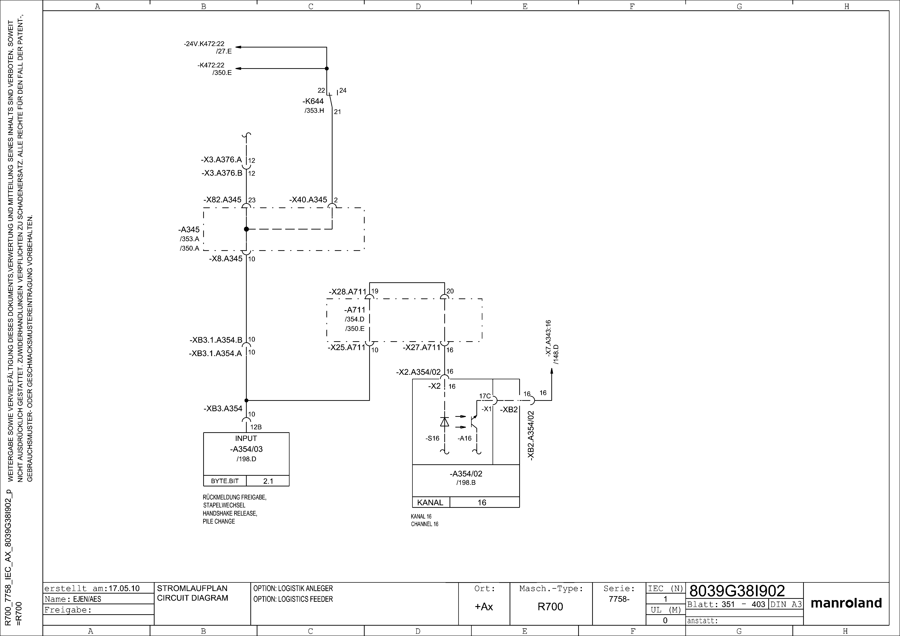

# +Ax — Sheet 351 of 403 — OPTION: LOGISTIK ANLEGER

**OPTION: LOGISTICS FEEDER**

> Part of the manroland **R700** printing press IEC/UL circuit diagrams.
> Drawing class: **Stromlaufplan / Circuit diagram** (DIN A3).
> Document `+Ax` covers the **Central control console** machine section.

## At a glance

| Field | Value |
|---|---|
| Document | `+Ax`  (8039G38I902) |
| Sheet | **351** of 403 |
| Section (DE) | OPTION: LOGISTIK ANLEGER |
| Section (EN) | OPTION: LOGISTICS FEEDER |
| Section type | CIRCUIT — Circuit diagram |
| Machine type | `R700` |
| Series | `7758` |
| Created | 17.05.10 |
| Replaces | — |
| Columns used | B, C, D, E |
| Path numbers | — |
| Labels on sheet | 68 |
| Cross-refs out | 10 |
| Cross-refs in | 24 |

**Previous:** [+Ax sheet 350](SHEET_0350.md) · **Next:** [+Ax sheet 352](SHEET_0352.md) · **Document TOC:** [_TOC.md](_TOC.md)  (+Ax) · **Master TOC:** [all sheets](../_MASTER_TOC.md)

## Sheet image (300 DPI, exact vector render)



_Rendered directly from the PDF vector layer at 300 DPI (1-bit), no OCR and no resampling. Use it to confirm anything ambiguous in the text below._

## Cross-references on this sheet

Each entry is a wire leaving this sheet. The printed token is `/sheet.column`; the link resolves to that sheet inside the same document.

| Ref | Target sheet | Col | Path | Destination on target | Target section | From col |
|---|---|---|---|---|---|---|
| `/27.E` | [+Ax sheet 27](SHEET_0027.md) | E | — | 24V.K472:22 | SPANNUNGSVERSORGUNG, SCHALTSCHRANKBELÜFTUNG | B |
| `/350.E` | [+Ax sheet 350](SHEET_0350.md) | E | — | K472:22 | OPTION: LOGISTIK ANLEGER | B |
| `/353.H` | [+Ax sheet 353](SHEET_0353.md) | H | — | — | OPTION: LOGISTIK ANLEGER | C |
| `/353.A` | [+Ax sheet 353](SHEET_0353.md) | A | — | — | OPTION: LOGISTIK ANLEGER | B |
| `/350.A` | [+Ax sheet 350](SHEET_0350.md) | A | — | — | OPTION: LOGISTIK ANLEGER | B |
| `/354.D` | [+Ax sheet 354](SHEET_0354.md) | D | — | — | OPTION: LOGISTIK ANLEGER | C |
| `/148.D` | [+Ax sheet 148](SHEET_0148.md) | D | — | X7.A343:16 | ÜBERWACHUNGSRECHNER SICHERHEITSBUS | E |
| `/350.E` | [+Ax sheet 350](SHEET_0350.md) | E | — | — | OPTION: LOGISTIK ANLEGER | C |
| `/198.D` | [+Ax sheet 198](SHEET_0198.md) | D | — | — | REFERENZMODUL | B |
| `/198.B` | [+Ax sheet 198](SHEET_0198.md) | B | — | — | REFERENZMODUL | D |

### Incoming references (sheets that point here)

Every other sheet that sends a wire to this one. `Back-ref` is the token printed on *that* sheet; `Path` is its line number.

| From sheet | Cols | Back-ref | Path | Refs | What continues there |
|---|---|---|---|---|---|
| [+Ax#27](SHEET_0027.md) | E | `/27.E` | — | 1 | 24V.K472:22 |
| [+Ax#148](SHEET_0148.md) | D | `/148.D` | — | 1 | X7.A343:16 |
| [+Ax#198](SHEET_0198.md) | B, D | `/198.B`, `/198.D` | — | 2 | — |
| [+Ax#219](SHEET_0219.md) | C, E | `/219.C`, `/219.E` | — | 2 | — |
| [+Ax#224](SHEET_0224.md) | A, B, C, E, F | `/224.A`, `/224.B`, `/224.C`, `/224.E`, `/224.F` | — | 5 | — |
| [+Ax#238](SHEET_0238.md) | A | `/238.A` | — | 1 | — |
| [+Ax#268](SHEET_0268.md) | C | `/268.C` | — | 1 | — |
| [+Ax#271](SHEET_0271.md) | A | `/271.A` | — | 1 | — |
| [+Ax#272](SHEET_0272.md) | G | `/272.G` | — | 2 | — |
| [+Ax#280](SHEET_0280.md) | D | `/280.D` | — | 1 | — |
| [+Ax#286](SHEET_0286.md) | F | `/286.F` | — | 1 | — |
| [+Ax#350](SHEET_0350.md) | A, E | `/350.A`, `/350.E` | — | 3 | — |
| [+Ax#353](SHEET_0353.md) | A, H | `/353.A`, `/353.H` | — | 2 | — |
| [+Ax#354](SHEET_0354.md) | D | `/354.D` | — | 1 | — |


## Devices on this sheet

| Tag | Class | Class meaning (IEC) | Col | Sub | Terminal | Sign |
|---|---|---|---|---|---|---|
| `A345` | A | Baugruppe / assembly, module, PC board | B | — | — | — |
| `K644` | K | Relais / relay, contactor | C | — | — | — |
| `A354/03` | A | Baugruppe / assembly, module, PC board | B | 03 | — | — |
| `S16` | S | Schalter / switch | D | — | — | — |
| `A16` | A | Baugruppe / assembly, module, PC board | D | — | — | — |
| `X1` | X | Klemme / terminal, plug connector | E | — | — | — |
| `X2` | X | Klemme / terminal, plug connector | D | — | — | — |
| `XB2` | XB |  | E | — | — | — |
| `A354/02` | A | Baugruppe / assembly, module, PC board | D | 02 | — | — |
| `A711` | A | Baugruppe / assembly, module, PC board | C | — | — | — |
| `K472:22` | K | Relais / relay, contactor | B | — | 22 | — |
| `X8.A345` | — | cross-device reference | B | — | — | — |
| `X82.A345` | — | cross-device reference | B | — | — | — |
| `X40.A345` | — | cross-device reference | C | — | — | — |
| `X3.A376.B` | — | cross-device reference | B | — | — | — |
| `X3.A376.A` | — | cross-device reference | B | — | — | — |
| `2.1` | — | cross-device reference | C | — | — | — |
| `XB3.A354` | — | cross-device reference | B | — | — | — |
| `X28.A711` | — | cross-device reference | C | — | — | — |
| `X27.A711` | — | cross-device reference | D | — | — | — |
| `X25.A711` | — | cross-device reference | C | — | — | — |
| `XB3.1.A354.B` | — | cross-device reference | B | — | — | — |
| `XB3.1.A354.A` | — | cross-device reference | B | — | — | — |
| `X7.A343:16` | — | cross-device reference | E | — | 16 | — |

## Potentials / nets

| Potential | Count | Columns | Attached devices | Terminals |
|---|---|---|---|---|
| `24V` | 1 | B | `K472` | `22` |


A potential such as `L24+/4` or `M24+` is a named supply/return rail; every place it appears on this sheet is electrically common.

## Wire-end annotations (grouped as printed)

A wire that continues elsewhere is annotated with a small cluster: the destination description, the path/line number `#NN`, and the `/sheet.column` cross reference. Each row below is one such cluster exactly as it is grouped on the drawing.

| Col | Y | Path | Cross-ref | Text on the wire |
|---|---|---|---|---|
| B | 54.1 | — | `/27.E` | `24V.K472:22` |
| B | 82.5 | — | `/350.E` | `K472:22` |
| C | 115.8 | — | — | `K644 24` |
| C | 115.8 | — | — | `22` |
| C | 142.4 | — | `/353.H` | — |
| C | 144.2 | — | — | `21` |
| B | 206.5 | — | — | `X3.A376.A 12` |
| B | 224.2 | — | — | `X3.A376.B 12` |
| C | 259.7 | — | — | `X82.A345 23 X40.A345 2` |
| B | 299.4 | — | — | `A345` |
| B | 312.4 | — | `/353.A`, `/350.A` | — |
| B | 337.6 | — | — | `X8.A345 10` |
| D | 381.6 | — | — | `X28.A711 19 20` |
| C | 405.7 | — | — | `A711` |
| C | 418.8 | — | `/354.D` | — |
| E | 423.5 | — | `/148.D` | `X7.A343:16` |
| C | 431.1 | — | `/350.E` | — |
| B | 445.4 | — | — | `XB3.1.A354.B 10` |
| D | 455.3 | — | — | `X25.A711 10 X27.A711 16` |
| B | 462.4 | — | — | `XB3.1.A354.A 10` |
| D | 487.9 | — | — | `X2.A354/02 16` |
| D | 506.3 | — | — | `X2` |
| E | 507.7 | — | — | `16 16` |
| E | 516.2 | — | — | `16` |
| E | 520.5 | — | — | `17C` |
| B | 536.1 | — | — | `XB3.A354 10` |
| E | 537.5 | — | — | `X1` |
| E | 537.5 | — | — | `XB2` |
| E | 543.7 | — | — | `XB2.A354/02` |
| B | 561.5 | — | — | `12B` |
| B | 576.1 | — | — | `INPUT` |
| D | 576.4 | — | — | `S16 A16` |
| B | 589.9 | — | — | `A354/03` |
| B | 603.7 | — | `/198.D` | — |
| D | 622.5 | — | — | `A354/02` |
| B | 632.7 | — | — | `BYTE.BIT 2.1` |
| D | 634.9 | — | `/198.B` | — |
| B | 655.4 | — | — | `RÜCKMELDUNG FREIGABE,` |
| D | 660.7 | — | — | `KANAL 16` |
| B | 666.0 | — | — | `HANDSHAKE RELEASE, PILE CHANGE STAPELWECHSEL` |
| D | 681.1 | — | — | `KANAL 16 CHANNEL 16` |


## Reconstructed tables

This sheet carries tabular content (pin map / terminal assignment / index). The grid below was rebuilt from the drawing's own rule lines, so each row is exactly one physical row of the table.

### Table 1 — 6 data rows × 3 columns (at x=269.3, y=62.4) — **/27.E K472:22**

| /350.E X3.A376.A X3.A376.B X82.A345 | 12 12 23 | 22 K644 /353.H X40.A345 |
|---|---|---|
| `X8.A345` | `10` |  |
| `XB3.1.A354.B XB3.1.A354.A` | `10 10` |  |
| `XB3.A354` | `10 12B` |  |
| `INPUT` | `A354/03 /198.D` |  |
| `BYTE.BIT` | `2.1` |  |
| `RÜCKMELDUNG STAPELWECHSEL` | `FREIGABE,` |  |


### Table 2 — 6 data rows × 7 columns (at x=439.4, y=62.4) — **24 21 2**

| X28.A711 A711 /354.D /350.E X25.A711 | 19 10 | X27.A711 X2.A354/02 | 20 16 16 |  |  | X7.A343:16 |
|---|---|---|---|---|---|---|
|  |  | `X2` | `16` | `17C` |  | `16 16` |
|  |  |  |  | `X1` | `XB2` |  |
|  |  | `S16` | `A16` |  |  | `XB2.A354/02` |
|  |  |  | `A354/02` |  |  |  |
|  |  |  | `/198.B` |  |  |  |
|  |  | `KANAL` |  | `16` |  |  |


## Notes and free text on this sheet

| Text | Col | Y (pt) |
|---|---|---|
| `12B` | B | 561.55 |
| `INPUT` | B | 576.07 |
| `BYTE.BIT` | B | 633.32 |
| `RÜCKMELDUNG FREIGABE,` | B | 655.43 |
| `STAPELWECHSEL` | B | 666.03 |
| `HANDSHAKE RELEASE,` | B | 676.67 |
| `PILE CHANGE` | B | 687.31 |
| `KANAL 16` | D | 681.1 |
| `CHANNEL 16` | D | 691.04 |
| `17C` | E | 520.49 |
| `KANAL` | D | 660.77 |
| `X2.A354/02` | D | 487.87 |
| `XB2.A354/02` | E | 543.69 |

## Complete label inventory (exact text from the drawing)

Every text object inside the drawing area of this sheet, in DIN reading order (column A→H, then top→bottom). This is the authoritative list: if a string is not here it is not printed on this sheet.

| Col | Y | X | Dir | Type | Text |
|---|---|---|---|---|---|
| B | 54.1 | 243.2 | → | potential | `24V.K472:22` |
| B | 64.0 | 286.0 | → | cross-reference | `/27.E` |
| B | 82.5 | 261.4 | → | device tag | `K472:22` |
| B | 92.4 | 281.2 | → | cross-reference | `/350.E` |
| B | 206.5 | 265.9 | → | device ref | `X3.A376.A` |
| B | 208.7 | 328.0 | → | number | `12` |
| B | 224.3 | 266.7 | → | device ref | `X3.A376.B` |
| B | 225.7 | 328.0 | → | number | `12` |
| B | 259.7 | 269.3 | → | device ref | `X82.A345` |
| B | 261.1 | 328.5 | → | number | `23` |
| B | 299.4 | 235.8 | → | device tag | `A345` |
| B | 312.4 | 238.1 | → | cross-reference | `/353.A` |
| B | 324.8 | 238.1 | → | cross-reference | `/350.A` |
| B | 337.6 | 276.7 | → | device ref | `X8.A345` |
| B | 339.1 | 328.0 | → | number | `10` |
| B | 445.4 | 250.9 | → | device ref | `XB3.1.A354.B` |
| B | 445.4 | 328.0 | → | number | `10` |
| B | 462.4 | 328.0 | → | number | `10` |
| B | 463.1 | 250.0 | → | device ref | `XB3.1.A354.A` |
| B | 536.1 | 269.6 | → | device ref | `XB3.A354` |
| B | 544.6 | 328.0 | → | number | `10` |
| B | 561.5 | 330.8 | → | text | `12B` |
| B | 576.1 | 311.1 | → | text | `INPUT` |
| B | 589.9 | 304.6 | → | device tag | `A354/03` |
| B | 603.7 | 313.2 | → | cross-reference | `/198.D` |
| B | 633.3 | 279.2 | → | text | `BYTE.BIT` |
| B | 655.4 | 268.4 | → | text | `RÜCKMELDUNG FREIGABE,` |
| B | 666.0 | 269.0 | → | text | `STAPELWECHSEL` |
| B | 676.7 | 268.4 | → | text | `HANDSHAKE RELEASE,` |
| B | 687.3 | 268.4 | → | text | `PILE CHANGE` |
| C | 115.8 | 420.4 | → | number | `22` |
| C | 115.8 | 449.0 | → | number | `24` |
| C | 129.3 | 400.3 | → | device tag | `K644` |
| C | 142.4 | 403.1 | → | cross-reference | `/353.H` |
| C | 144.2 | 441.9 | → | number | `21` |
| C | 259.7 | 382.7 | → | device ref | `X40.A345` |
| C | 261.1 | 441.9 | → | number | `2` |
| C | 381.6 | 435.1 | → | device ref | `X28.A711` |
| C | 405.7 | 455.5 | → | device tag | `A711` |
| C | 418.8 | 456.4 | → | cross-reference | `/354.D` |
| C | 431.1 | 456.9 | → | cross-reference | `/350.E` |
| C | 455.3 | 433.7 | → | device ref | `X25.A711` |
| C | 632.7 | 348.4 | → | device ref | `2.1` |
| D | 381.6 | 491.0 | → | number | `19` |
| D | 381.6 | 590.7 | → | number | `20` |
| D | 455.3 | 532.9 | → | device ref | `X27.A711` |
| D | 459.5 | 491.0 | → | number | `10` |
| D | 459.5 | 590.2 | → | number | `16` |
| D | 487.9 | 524.1 | → | text | `X2.A354/02` |
| D | 487.9 | 590.2 | → | number | `16` |
| D | 506.3 | 566.6 | → | device tag | `X2` |
| D | 507.7 | 593.0 | → | number | `16` |
| D | 576.4 | 563.0 | → | device tag | `S16` |
| D | 576.4 | 605.5 | → | device tag | `A16` |
| D | 622.5 | 595.1 | → | device tag | `A354/02` |
| D | 634.9 | 603.9 | → | cross-reference | `/198.B` |
| D | 660.8 | 551.9 | → | text | `KANAL` |
| D | 681.1 | 543.7 | → | text | `KANAL 16` |
| D | 691.0 | 544.0 | → | text | `CHANNEL 16` |
| E | 423.5 | 721.7 | ↕ | device ref | `X7.A343:16` |
| E | 456.1 | 731.6 | ↕ | cross-reference | `/148.D` |
| E | 516.2 | 713.5 | → | number | `16` |
| E | 517.6 | 692.2 | → | number | `16` |
| E | 520.5 | 633.5 | → | text | `17C` |
| E | 537.5 | 637.2 | → | device tag | `X1` |
| E | 537.5 | 661.6 | → | device tag | `XB2` |
| E | 543.7 | 697.6 | ↕ | text | `XB2.A354/02` |
| E | 660.7 | 631.6 | → | number | `16` |

## Reading-order text block

The same content as a plain block, grouped by DIN column — convenient to paste or to match against a visual description.

```text
=== Column B ===
  54.1  243.2  net          24V.K472:22
  64.0  286.0  xref         /27.E
  82.5  261.4  devtag       K472:22
  92.4  281.2  xref         /350.E
 206.5  265.9  devref       X3.A376.A
 208.7  328.0  numeric      12
 224.3  266.7  devref       X3.A376.B
 225.7  328.0  numeric      12
 259.7  269.3  devref       X82.A345
 261.1  328.5  numeric      23
 299.4  235.8  devtag       A345
 312.4  238.1  xref         /353.A
 324.8  238.1  xref         /350.A
 337.6  276.7  devref       X8.A345
 339.1  328.0  numeric      10
 445.4  250.9  devref       XB3.1.A354.B
 445.4  328.0  numeric      10
 462.4  328.0  numeric      10
 463.1  250.0  devref       XB3.1.A354.A
 536.1  269.6  devref       XB3.A354
 544.6  328.0  numeric      10
 561.5  330.8  text         12B
 576.1  311.1  text         INPUT
 589.9  304.6  devtag       A354/03
 603.7  313.2  xref         /198.D
 633.3  279.2  text         BYTE.BIT
 655.4  268.4  text         RÜCKMELDUNG FREIGABE,
 666.0  269.0  text         STAPELWECHSEL
 676.7  268.4  text         HANDSHAKE RELEASE,
 687.3  268.4  text         PILE CHANGE
=== Column C ===
 115.8  420.4  numeric      22
 115.8  449.0  numeric      24
 129.3  400.3  devtag       K644
 142.4  403.1  xref         /353.H
 144.2  441.9  numeric      21
 259.7  382.7  devref       X40.A345
 261.1  441.9  numeric      2
 381.6  435.1  devref       X28.A711
 405.7  455.5  devtag       A711
 418.8  456.4  xref         /354.D
 431.1  456.9  xref         /350.E
 455.3  433.7  devref       X25.A711
 632.7  348.4  devref       2.1
=== Column D ===
 381.6  491.0  numeric      19
 381.6  590.7  numeric      20
 455.3  532.9  devref       X27.A711
 459.5  491.0  numeric      10
 459.5  590.2  numeric      16
 487.9  524.1  text         X2.A354/02
 487.9  590.2  numeric      16
 506.3  566.6  devtag       X2
 507.7  593.0  numeric      16
 576.4  563.0  devtag       S16
 576.4  605.5  devtag       A16
 622.5  595.1  devtag       A354/02
 634.9  603.9  xref         /198.B
 660.8  551.9  text         KANAL
 681.1  543.7  text         KANAL 16
 691.0  544.0  text         CHANNEL 16
=== Column E ===
 423.5  721.7  devref       X7.A343:16
 456.1  731.6  xref         /148.D
 516.2  713.5  numeric      16
 517.6  692.2  numeric      16
 520.5  633.5  text         17C
 537.5  637.2  devtag       X1
 537.5  661.6  devtag       XB2
 543.7  697.6  text         XB2.A354/02
 660.7  631.6  numeric      16
```

---
_Generated from the PDF vector text layer; no OCR. Source: `R700_7758_IEC_AX_8039G38I902_p`, sheet 351._
