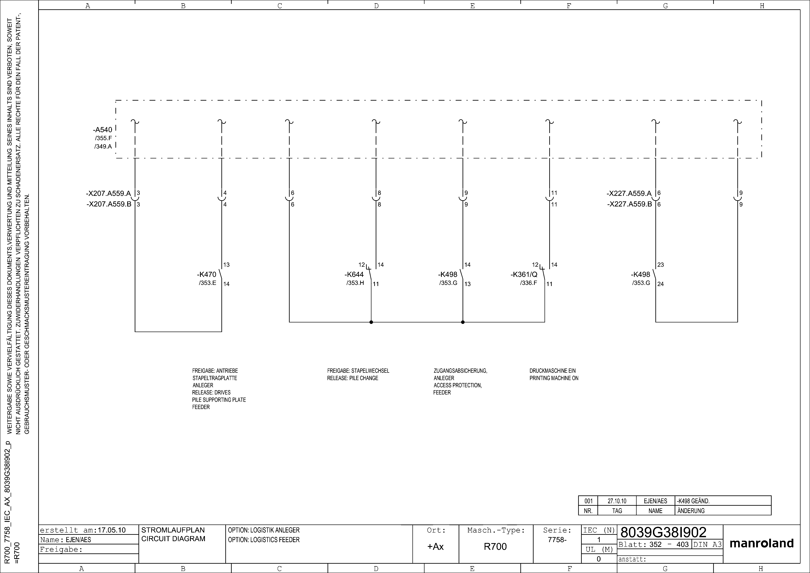

# +Ax — Sheet 352 of 403 — OPTION: LOGISTIK ANLEGER

**OPTION: LOGISTICS FEEDER**

> Part of the manroland **R700** printing press IEC/UL circuit diagrams.
> Drawing class: **Stromlaufplan / Circuit diagram** (DIN A3).
> Document `+Ax` covers the **Central control console** machine section.

## At a glance

| Field | Value |
|---|---|
| Document | `+Ax`  (8039G38I902) |
| Sheet | **352** of 403 |
| Section (DE) | OPTION: LOGISTIK ANLEGER |
| Section (EN) | OPTION: LOGISTICS FEEDER |
| Section type | CIRCUIT — Circuit diagram |
| Machine type | `R700` |
| Series | `7758` |
| Created | 17.05.10 |
| Replaces | — |
| Columns used | A, B, C, D, E, F, G, H |
| Path numbers | — |
| Labels on sheet | 67 |
| Cross-refs out | 7 |
| Cross-refs in | 21 |

**Previous:** [+Ax sheet 351](SHEET_0351.md) · **Next:** [+Ax sheet 353](SHEET_0353.md) · **Document TOC:** [_TOC.md](_TOC.md)  (+Ax) · **Master TOC:** [all sheets](../_MASTER_TOC.md)

## Sheet image (300 DPI, exact vector render)



_Rendered directly from the PDF vector layer at 300 DPI (1-bit), no OCR and no resampling. Use it to confirm anything ambiguous in the text below._

## Cross-references on this sheet

Each entry is a wire leaving this sheet. The printed token is `/sheet.column`; the link resolves to that sheet inside the same document.

| Ref | Target sheet | Col | Path | Destination on target | Target section | From col |
|---|---|---|---|---|---|---|
| `/355.F` | [+Ax sheet 355](SHEET_0355.md) | F | — | — | OPTION: LOGISTIK ANLEGER | A |
| `/349.A` | [+Ax sheet 349](SHEET_0349.md) | A | — | — | OPTION: LOGISTIK ANLEGER | A |
| `/353.E` | [+Ax sheet 353](SHEET_0353.md) | E | — | — | OPTION: LOGISTIK ANLEGER | B |
| `/336.F` | [+Ax sheet 336](SHEET_0336.md) | F | — | — | OPTION: LOGISTIK ANLEGER / | F |
| `/353.G` | [+Ax sheet 353](SHEET_0353.md) | G | — | — | OPTION: LOGISTIK ANLEGER | E |
| `/353.G` | [+Ax sheet 353](SHEET_0353.md) | G | — | — | OPTION: LOGISTIK ANLEGER | G |
| `/353.H` | [+Ax sheet 353](SHEET_0353.md) | H | — | — | OPTION: LOGISTIK ANLEGER | D |

### Incoming references (sheets that point here)

Every other sheet that sends a wire to this one. `Back-ref` is the token printed on *that* sheet; `Path` is its line number.

| From sheet | Cols | Back-ref | Path | Refs | What continues there |
|---|---|---|---|---|---|
| [+Ax#292](SHEET_0292.md) | E, F | `/292.E`, `/292.F` | — | 12 | — |
| [+Ax#294](SHEET_0294.md) | B, C | `/294.B`, `/294.C` | — | 4 | — |
| [+Ax#349](SHEET_0349.md) | A | `/349.A` | — | 1 | — |
| [+Ax#353](SHEET_0353.md) | E, G | `/353.E`, `/353.G` | — | 3 | — |
| [+Ax#355](SHEET_0355.md) | F | `/355.F` | — | 1 | — |


## Devices on this sheet

| Tag | Class | Class meaning (IEC) | Col | Sub | Terminal | Sign |
|---|---|---|---|---|---|---|
| `A540` | A | Baugruppe / assembly, module, PC board | A | — | — | — |
| `K644` | K | Relais / relay, contactor | D | — | — | — |
| `K470` | K | Relais / relay, contactor | B | — | — | — |
| `K498` | K | Relais / relay, contactor | E | — | — | — |
| `K498` | K | Relais / relay, contactor | G | — | — | — |
| `X227.A559.B` | — | cross-device reference | G | — | — | — |
| `X227.A559.A` | — | cross-device reference | G | — | — | — |
| `X207.A559.B` | — | cross-device reference | A | — | — | — |
| `X207.A559.A` | — | cross-device reference | A | — | — | — |
| `NR.` | — | cross-device reference | F | — | — | — |
| `27.10.10` | — | cross-device reference | F | — | — | — |

## Potentials / nets

_No named potentials on this sheet._

## Wire-end annotations (grouped as printed)

A wire that continues elsewhere is annotated with a small cluster: the destination description, the path/line number `#NN`, and the `/sheet.column` cross reference. Each row below is one such cluster exactly as it is grouped on the drawing.

| Col | Y | Path | Cross-ref | Text on the wire |
|---|---|---|---|---|
| A | 186.0 | — | — | `A540` |
| A | 199.1 | — | `/355.F`, `/349.A` | — |
| A | 279.5 | — | — | `X207.A559.A 3` |
| B | 279.5 | — | — | `4` |
| C | 279.5 | — | — | `6` |
| D | 279.5 | — | — | `8` |
| E | 279.5 | — | — | `9` |
| F | 279.5 | — | — | `11` |
| G | 279.5 | — | — | `X227.A559.A 6` |
| H | 279.5 | — | — | `9` |
| A | 295.1 | — | — | `X207.A559.B 3` |
| G | 295.1 | — | — | `X227.A559.B 6` |
| B | 296.5 | — | — | `4` |
| C | 296.5 | — | — | `6` |
| D | 296.5 | — | — | `8` |
| E | 296.5 | — | — | `9` |
| F | 296.5 | — | — | `11` |
| H | 296.5 | — | — | `9` |
| B | 385.1 | — | — | `13` |
| D | 385.1 | — | — | `K644 14` |
| D | 385.1 | — | — | `12` |
| E | 385.1 | — | — | `14` |
| F | 385.1 | — | — | `K361/Q 14` |
| F | 385.1 | — | — | `12` |
| G | 385.1 | — | — | `23` |
| B | 398.6 | — | — | `K470 14` |
| E | 398.6 | — | — | `K498 13` |
| G | 398.6 | — | — | `K498 24` |
| B | 411.6 | — | `/353.E` | — |
| F | 411.6 | — | `/336.F` | — |
| D | 411.7 | — | `/353.H` | — |
| E | 411.7 | — | `/353.G` | — |
| G | 411.7 | — | `/353.G` | — |
| D | 413.5 | — | — | `11` |
| F | 413.5 | — | — | `11` |
| D | 542.0 | — | — | `FREIGABE: ANTRIEBE DRUCKMASCHINE EIN PRINTING MACHINE ON` |
| D | 542.0 | — | — | `FREIGABE: STAPELWECHSEL RELEASE: PILE CHANGE` |
| E | 542.0 | — | — | `FEEDER ZUGANGSABSICHERUNG, ANLEGER ACCESS PROTECTION,` |
| B | 552.7 | — | — | `RELEASE: DRIVES PILE SUPPORTING PLATE FEEDER STAPELTRAGPLATTE ANLEGER` |
| G | 733.0 | — | — | `001 27.10.10 EJEN/AES K498 GEÄND.` |
| G | 747.1 | — | — | `NR. TAG NAME ÄNDERUNG` |


## Notes and free text on this sheet

| Text | Col | Y (pt) |
|---|---|---|
| `K361/Q` | F | 398.59 |
| `TAG` | G | 747.27 |
| `NAME` | G | 747.25 |
| `ÄNDERUNG` | G | 747.31 |
| `EJEN/AES` | G | 733.09 |
| `K498 GEÄND.` | G | 733.11 |
| `DRUCKMASCHINE EIN` | F | 542.05 |
| `PRINTING MACHINE ON` | F | 552.68 |
| `FREIGABE: ANTRIEBE` | B | 542.01 |
| `STAPELTRAGPLATTE` | B | 552.66 |
| `ANLEGER` | B | 563.32 |
| `RELEASE: DRIVES` | B | 573.91 |
| `PILE SUPPORTING PLATE` | B | 584.56 |
| `FEEDER` | B | 595.18 |
| `FREIGABE: STAPELWECHSEL` | D | 542.01 |
| `RELEASE: PILE CHANGE` | D | 552.66 |
| `ZUGANGSABSICHERUNG,` | E | 542.05 |
| `ANLEGER` | E | 552.69 |
| `ACCESS PROTECTION,` | E | 563.3 |
| `FEEDER` | E | 573.91 |

## Complete label inventory (exact text from the drawing)

Every text object inside the drawing area of this sheet, in DIN reading order (column A→H, then top→bottom). This is the authoritative list: if a string is not here it is not printed on this sheet.

| Col | Y | X | Dir | Type | Text |
|---|---|---|---|---|---|
| A | 186.0 | 136.6 | → | device tag | `A540` |
| A | 199.1 | 139.7 | → | cross-reference | `/355.F` |
| A | 211.4 | 138.9 | → | cross-reference | `/349.A` |
| A | 279.5 | 126.4 | → | device ref | `X207.A559.A` |
| A | 295.1 | 127.3 | → | device ref | `X207.A559.B` |
| B | 279.5 | 201.0 | → | number | `3` |
| B | 279.5 | 328.5 | → | number | `4` |
| B | 296.5 | 201.0 | → | number | `3` |
| B | 296.5 | 328.5 | → | number | `4` |
| B | 385.1 | 328.0 | → | number | `13` |
| B | 398.6 | 289.7 | → | device tag | `K470` |
| B | 411.6 | 292.5 | → | cross-reference | `/353.E` |
| B | 413.5 | 328.0 | → | number | `14` |
| B | 542.0 | 282.6 | → | text | `FREIGABE: ANTRIEBE` |
| B | 552.7 | 283.2 | → | text | `STAPELTRAGPLATTE` |
| B | 563.3 | 283.5 | → | text | `ANLEGER` |
| B | 573.9 | 282.6 | → | text | `RELEASE: DRIVES` |
| B | 584.6 | 282.6 | → | text | `PILE SUPPORTING PLATE` |
| B | 595.2 | 282.6 | → | text | `FEEDER` |
| C | 279.5 | 427.7 | → | number | `6` |
| C | 296.5 | 427.7 | → | number | `6` |
| D | 279.5 | 555.3 | → | number | `8` |
| D | 296.5 | 555.3 | → | number | `8` |
| D | 385.1 | 526.7 | → | number | `12` |
| D | 385.1 | 554.7 | → | number | `14` |
| D | 398.6 | 506.6 | → | device tag | `K644` |
| D | 411.7 | 509.4 | → | cross-reference | `/353.H` |
| D | 413.5 | 547.7 | → | number | `11` |
| D | 542.0 | 481.0 | → | text | `FREIGABE: STAPELWECHSEL` |
| D | 552.7 | 481.0 | → | text | `RELEASE: PILE CHANGE` |
| E | 279.5 | 682.9 | → | number | `9` |
| E | 296.5 | 682.9 | → | number | `9` |
| E | 385.1 | 682.3 | → | number | `14` |
| E | 398.6 | 644.0 | → | device tag | `K498` |
| E | 411.7 | 646.0 | → | cross-reference | `/353.G` |
| E | 413.5 | 682.3 | → | number | `13` |
| E | 542.1 | 637.8 | → | text | `ZUGANGSABSICHERUNG,` |
| E | 552.7 | 637.8 | → | text | `ANLEGER` |
| E | 563.3 | 637.8 | → | text | `ACCESS PROTECTION,` |
| E | 573.9 | 636.9 | → | text | `FEEDER` |
| F | 279.5 | 809.9 | → | number | `11` |
| F | 296.5 | 809.9 | → | number | `11` |
| F | 385.1 | 781.8 | → | number | `12` |
| F | 385.1 | 809.9 | → | number | `14` |
| F | 398.6 | 750.6 | → | text | `K361/Q` |
| F | 411.7 | 764.8 | → | cross-reference | `/336.F` |
| F | 413.5 | 802.8 | → | number | `11` |
| F | 542.0 | 778.7 | → | text | `DRUCKMASCHINE EIN` |
| F | 552.7 | 778.7 | → | text | `PRINTING MACHINE ON` |
| F | 733.0 | 859.4 | → | number | `001` |
| F | 733.1 | 893.5 | → | device ref | `27.10.10` |
| F | 747.1 | 858.4 | → | device ref | `NR.` |
| G | 279.5 | 891.8 | → | device ref | `X227.A559.A` |
| G | 279.5 | 966.3 | → | number | `6` |
| G | 295.1 | 892.6 | → | device ref | `X227.A559.B` |
| G | 296.5 | 966.3 | → | number | `6` |
| G | 385.1 | 966.3 | → | number | `23` |
| G | 398.6 | 927.5 | → | device tag | `K498` |
| G | 411.7 | 929.5 | → | cross-reference | `/353.G` |
| G | 413.5 | 966.3 | → | number | `24` |
| G | 733.1 | 946.5 | → | text | `EJEN/AES` |
| G | 733.1 | 995.4 | → | text | `K498 GEÄND.` |
| G | 747.3 | 900.0 | → | text | `TAG` |
| G | 747.3 | 953.4 | → | text | `NAME` |
| G | 747.3 | 996.0 | → | text | `ÄNDERUNG` |
| H | 279.5 | 1086.8 | → | number | `9` |
| H | 296.5 | 1086.8 | → | number | `9` |

## Reading-order text block

The same content as a plain block, grouped by DIN column — convenient to paste or to match against a visual description.

```text
=== Column A ===
 186.0  136.6  devtag       A540
 199.1  139.7  xref         /355.F
 211.4  138.9  xref         /349.A
 279.5  126.4  devref       X207.A559.A
 295.1  127.3  devref       X207.A559.B
=== Column B ===
 279.5  201.0  numeric      3
 279.5  328.5  numeric      4
 296.5  201.0  numeric      3
 296.5  328.5  numeric      4
 385.1  328.0  numeric      13
 398.6  289.7  devtag       K470
 411.6  292.5  xref         /353.E
 413.5  328.0  numeric      14
 542.0  282.6  text         FREIGABE: ANTRIEBE
 552.7  283.2  text         STAPELTRAGPLATTE
 563.3  283.5  text         ANLEGER
 573.9  282.6  text         RELEASE: DRIVES
 584.6  282.6  text         PILE SUPPORTING PLATE
 595.2  282.6  text         FEEDER
=== Column C ===
 279.5  427.7  numeric      6
 296.5  427.7  numeric      6
=== Column D ===
 279.5  555.3  numeric      8
 296.5  555.3  numeric      8
 385.1  526.7  numeric      12
 385.1  554.7  numeric      14
 398.6  506.6  devtag       K644
 411.7  509.4  xref         /353.H
 413.5  547.7  numeric      11
 542.0  481.0  text         FREIGABE: STAPELWECHSEL
 552.7  481.0  text         RELEASE: PILE CHANGE
=== Column E ===
 279.5  682.9  numeric      9
 296.5  682.9  numeric      9
 385.1  682.3  numeric      14
 398.6  644.0  devtag       K498
 411.7  646.0  xref         /353.G
 413.5  682.3  numeric      13
 542.1  637.8  text         ZUGANGSABSICHERUNG,
 552.7  637.8  text         ANLEGER
 563.3  637.8  text         ACCESS PROTECTION,
 573.9  636.9  text         FEEDER
=== Column F ===
 279.5  809.9  numeric      11
 296.5  809.9  numeric      11
 385.1  781.8  numeric      12
 385.1  809.9  numeric      14
 398.6  750.6  text         K361/Q
 411.7  764.8  xref         /336.F
 413.5  802.8  numeric      11
 542.0  778.7  text         DRUCKMASCHINE EIN
 552.7  778.7  text         PRINTING MACHINE ON
 733.0  859.4  numeric      001
 733.1  893.5  devref       27.10.10
 747.1  858.4  devref       NR.
=== Column G ===
 279.5  891.8  devref       X227.A559.A
 279.5  966.3  numeric      6
 295.1  892.6  devref       X227.A559.B
 296.5  966.3  numeric      6
 385.1  966.3  numeric      23
 398.6  927.5  devtag       K498
 411.7  929.5  xref         /353.G
 413.5  966.3  numeric      24
 733.1  946.5  text         EJEN/AES
 733.1  995.4  text         K498 GEÄND.
 747.3  900.0  text         TAG
 747.3  953.4  text         NAME
 747.3  996.0  text         ÄNDERUNG
=== Column H ===
 279.5 1086.8  numeric      9
 296.5 1086.8  numeric      9
```

---
_Generated from the PDF vector text layer; no OCR. Source: `R700_7758_IEC_AX_8039G38I902_p`, sheet 352._
