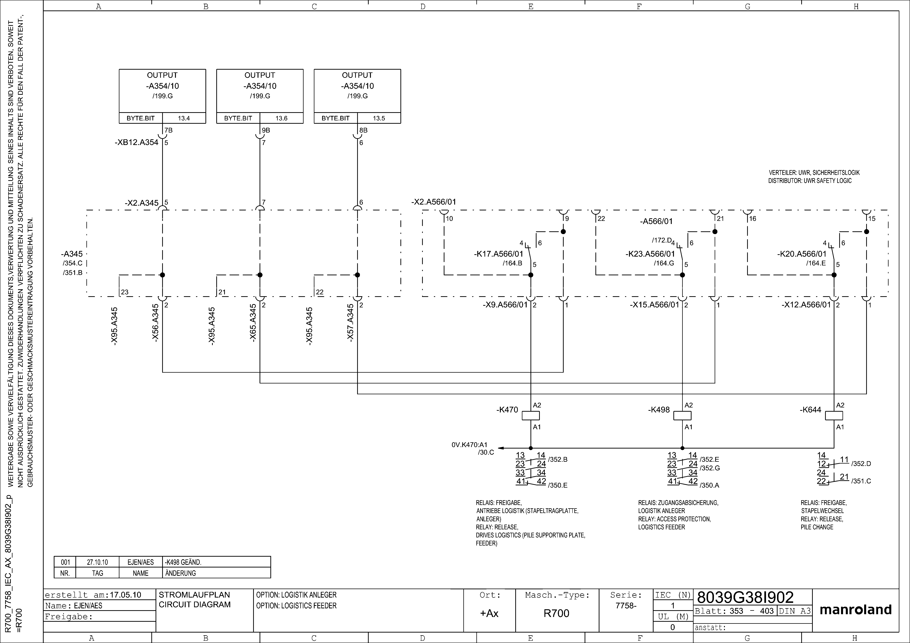

# +Ax — Sheet 353 of 403 — OPTION: LOGISTIK ANLEGER

**OPTION: LOGISTICS FEEDER**

> Part of the manroland **R700** printing press IEC/UL circuit diagrams.
> Drawing class: **Stromlaufplan / Circuit diagram** (DIN A3).
> Document `+Ax` covers the **Central control console** machine section.

## At a glance

| Field | Value |
|---|---|
| Document | `+Ax`  (8039G38I902) |
| Sheet | **353** of 403 |
| Section (DE) | OPTION: LOGISTIK ANLEGER |
| Section (EN) | OPTION: LOGISTICS FEEDER |
| Section type | CIRCUIT — Circuit diagram |
| Machine type | `R700` |
| Series | `7758` |
| Created | 17.05.10 |
| Replaces | — |
| Columns used | A, B, C, D, E, F, G, H |
| Path numbers | — |
| Labels on sheet | 137 |
| Cross-refs out | 16 |
| Cross-refs in | 40 |

**Previous:** [+Ax sheet 352](SHEET_0352.md) · **Next:** [+Ax sheet 354](SHEET_0354.md) · **Document TOC:** [_TOC.md](_TOC.md)  (+Ax) · **Master TOC:** [all sheets](../_MASTER_TOC.md)

## Sheet image (300 DPI, exact vector render)



_Rendered directly from the PDF vector layer at 300 DPI (1-bit), no OCR and no resampling. Use it to confirm anything ambiguous in the text below._

## Cross-references on this sheet

Each entry is a wire leaving this sheet. The printed token is `/sheet.column`; the link resolves to that sheet inside the same document.

| Ref | Target sheet | Col | Path | Destination on target | Target section | From col |
|---|---|---|---|---|---|---|
| `/199.G` | [+Ax sheet 199](SHEET_0199.md) | G | — | — | REFERENZMODUL | B |
| `/199.G` | [+Ax sheet 199](SHEET_0199.md) | G | — | — | REFERENZMODUL | C |
| `/199.G` | [+Ax sheet 199](SHEET_0199.md) | G | — | — | REFERENZMODUL | C |
| `/172.D` | [+Ax sheet 172](SHEET_0172.md) | D | — | — | ÜBERWACHUNGSRECHNER/RÜCKMELDUNG NOT AUS | F |
| `/164.B` | [+Ax sheet 164](SHEET_0164.md) | B | — | — | ÜBERWACHUNGSRECHNER/ANSTEUERUNG NOT AUS | E |
| `/164.E` | [+Ax sheet 164](SHEET_0164.md) | E | — | — | ÜBERWACHUNGSRECHNER/ANSTEUERUNG NOT AUS | H |
| `/164.G` | [+Ax sheet 164](SHEET_0164.md) | G | — | — | ÜBERWACHUNGSRECHNER/ANSTEUERUNG NOT AUS | F |
| `/354.C` | [+Ax sheet 354](SHEET_0354.md) | C | — | — | OPTION: LOGISTIK ANLEGER | A |
| `/351.B` | [+Ax sheet 351](SHEET_0351.md) | B | — | — | OPTION: LOGISTIK ANLEGER | A |
| `/30.C` | [+Ax sheet 30](SHEET_0030.md) | C | — | 0V.K470:A1 | SPANNUNGSVERSORGUNG, SCHALTSCHRANKBELÜFTUNG | D |
| `/352.B` | [+Ax sheet 352](SHEET_0352.md) | B | — | — | OPTION: LOGISTIK ANLEGER | E |
| `/352.E` | [+Ax sheet 352](SHEET_0352.md) | E | — | — | OPTION: LOGISTIK ANLEGER | G |
| `/352.G` | [+Ax sheet 352](SHEET_0352.md) | G | — | — | OPTION: LOGISTIK ANLEGER | G |
| `/351.C` | [+Ax sheet 351](SHEET_0351.md) | C | — | — | OPTION: LOGISTIK ANLEGER | H |
| `/350.E` | [+Ax sheet 350](SHEET_0350.md) | E | — | — | OPTION: LOGISTIK ANLEGER | E |
| `/350.A` | [+Ax sheet 350](SHEET_0350.md) | A | — | — | OPTION: LOGISTIK ANLEGER | G |

### Incoming references (sheets that point here)

Every other sheet that sends a wire to this one. `Back-ref` is the token printed on *that* sheet; `Path` is its line number.

| From sheet | Cols | Back-ref | Path | Refs | What continues there |
|---|---|---|---|---|---|
| [+Ax#30](SHEET_0030.md) | C | `/30.C` | — | 1 | 0V.K470:A1 |
| [+Ax#164](SHEET_0164.md) | B, E, G | `/164.B`, `/164.E`, `/164.G` | — | 3 | — |
| [+Ax#172](SHEET_0172.md) | D | `/172.D` | — | 1 | — |
| [+Ax#199](SHEET_0199.md) | G | `/199.G` | — | 3 | — |
| [+Ax#217](SHEET_0217.md) | H | `/217.H` | — | 3 | — |
| [+Ax#221](SHEET_0221.md) | A | `/221.A` | — | 5 | — |
| [+Ax#242](SHEET_0242.md) | F | `/242.F` | — | 2 | — |
| [+Ax#248](SHEET_0248.md) | F | `/248.F` | — | 3 | — |
| [+Ax#249](SHEET_0249.md) | C | `/249.C` | — | 2 | — |
| [+Ax#253](SHEET_0253.md) | F | `/253.F` | — | 2 | — |
| [+Ax#284](SHEET_0284.md) | A, H | `/284.A`, `/284.H` | — | 3 | — |
| [+Ax#290](SHEET_0290.md) | A | `/290.A` | — | 3 | — |
| [+Ax#350](SHEET_0350.md) | A, E | `/350.A`, `/350.E` | — | 2 | — |
| [+Ax#351](SHEET_0351.md) | B, C | `/351.B`, `/351.C` | — | 2 | — |
| [+Ax#352](SHEET_0352.md) | B, D, E, G | `/352.B`, `/352.D`, `/352.E`, `/352.G` | — | 4 | — |
| [+Ax#354](SHEET_0354.md) | C | `/354.C` | — | 1 | — |


## Devices on this sheet

| Tag | Class | Class meaning (IEC) | Col | Sub | Terminal | Sign |
|---|---|---|---|---|---|---|
| `A566/01` | A | Baugruppe / assembly, module, PC board | F | 01 | — | — |
| `A2` | A | Baugruppe / assembly, module, PC board | E | — | — | — |
| `A1` | A | Baugruppe / assembly, module, PC board | E | — | — | — |
| `K470` | K | Relais / relay, contactor | E | — | — | — |
| `A2` | A | Baugruppe / assembly, module, PC board | F | — | — | — |
| `A1` | A | Baugruppe / assembly, module, PC board | F | — | — | — |
| `K498` | K | Relais / relay, contactor | F | — | — | — |
| `A2` | A | Baugruppe / assembly, module, PC board | H | — | — | — |
| `A1` | A | Baugruppe / assembly, module, PC board | H | — | — | — |
| `K644` | K | Relais / relay, contactor | H | — | — | — |
| `A345` | A | Baugruppe / assembly, module, PC board | A | — | — | — |
| `A354/10` | A | Baugruppe / assembly, module, PC board | B | 10 | — | — |
| `A354/10` | A | Baugruppe / assembly, module, PC board | B | 10 | — | — |
| `A354/10` | A | Baugruppe / assembly, module, PC board | C | 10 | — | — |
| `13.4` | — | cross-device reference | B | — | — | — |
| `XB12.A354` | — | cross-device reference | A | — | — | — |
| `X56.A345` | — | cross-device reference | B | — | — | — |
| `X2.A345` | — | cross-device reference | A | — | — | — |
| `13.6` | — | cross-device reference | C | — | — | — |
| `X65.A345` | — | cross-device reference | B | — | — | — |
| `13.5` | — | cross-device reference | D | — | — | — |
| `X57.A345` | — | cross-device reference | C | — | — | — |
| `NR.` | — | cross-device reference | A | — | — | — |
| `27.10.10` | — | cross-device reference | A | — | — | — |
| `X95.A345` | — | cross-device reference | A | — | — | — |
| `X95.A345` | — | cross-device reference | B | — | — | — |
| `X95.A345` | — | cross-device reference | C | — | — | — |

## Potentials / nets

| Potential | Count | Columns | Attached devices | Terminals |
|---|---|---|---|---|
| `0V` | 1 | D | `K470` | `A1` |


A potential such as `L24+/4` or `M24+` is a named supply/return rail; every place it appears on this sheet is electrically common.

## Wire-end annotations (grouped as printed)

A wire that continues elsewhere is annotated with a small cluster: the destination description, the path/line number `#NN`, and the `/sheet.column` cross reference. Each row below is one such cluster exactly as it is grouped on the drawing.

| Col | Y | Path | Cross-ref | Text on the wire |
|---|---|---|---|---|
| B | 94.2 | — | — | `OUTPUT` |
| B | 94.2 | — | — | `OUTPUT` |
| C | 94.2 | — | — | `OUTPUT` |
| B | 108.0 | — | — | `A354/10` |
| B | 108.0 | — | — | `A354/10` |
| C | 108.0 | — | — | `A354/10` |
| B | 121.8 | — | `/199.G` | — |
| C | 121.8 | — | `/199.G` | — |
| C | 121.8 | — | `/199.G` | — |
| B | 151.4 | — | — | `BYTE.BIT 13.4` |
| B | 151.4 | — | — | `BYTE.BIT 13.6` |
| C | 151.4 | — | — | `BYTE.BIT 13.5` |
| B | 166.8 | — | — | `7B` |
| C | 166.8 | — | — | `9B` |
| C | 166.8 | — | — | `8B` |
| A | 181.7 | — | — | `XB12.A354 5` |
| C | 183.2 | — | — | `7` |
| C | 183.2 | — | — | `6` |
| H | 223.1 | — | — | `DISTRIBUTOR: UWR SAFETY LOGIC VERTEILER: UWR, SICHERHEITSLOGIK` |
| D | 259.7 | — | — | `X2.A566/01` |
| A | 261.1 | — | — | `X2.A345 5` |
| C | 261.1 | — | — | `7` |
| C | 261.1 | — | — | `6` |
| D | 282.4 | — | — | `10` |
| E | 282.4 | — | — | `9` |
| F | 282.4 | — | — | `22` |
| G | 282.4 | — | — | `A566/01 15` |
| G | 282.4 | — | — | `21` |
| G | 282.4 | — | — | `16` |
| F | 310.7 | — | `/172.D` | — |
| E | 314.3 | — | — | `K17.A566/01 6` |
| E | 314.3 | — | — | `4` |
| F | 314.3 | — | — | `K23.A566/01 6` |
| F | 314.3 | — | — | `4` |
| H | 314.3 | — | — | `K20.A566/01 6` |
| H | 314.3 | — | — | `4` |
| A | 327.7 | — | — | `A345` |
| A | 340.8 | — | `/354.C`, `/351.B` | — |
| E | 340.8 | — | `/164.B` | — |
| F | 340.8 | — | `/164.G` | — |
| H | 340.8 | — | `/164.E` | — |
| E | 342.6 | — | — | `5` |
| F | 342.6 | — | — | `5` |
| H | 342.6 | — | — | `5` |
| B | 378.8 | — | — | `23 21 22` |
| E | 394.3 | — | — | `X9.A566/01 2` |
| F | 394.3 | — | — | `X15.A566/01 2` |
| H | 394.3 | — | — | `X12.A566/01 2` |
| B | 395.8 | — | — | `2` |
| C | 395.8 | — | — | `2` |
| C | 395.8 | — | — | `2` |
| E | 395.8 | — | — | `1` |
| G | 395.8 | — | — | `1` |
| H | 395.8 | — | — | `1` |
| B | 397.7 | — | — | `X56.A345` |
| B | 397.7 | — | — | `X65.A345` |
| C | 397.7 | — | — | `X57.A345` |
| A | 401.9 | — | — | `X95.A345` |
| B | 401.9 | — | — | `X95.A345` |
| C | 401.9 | — | — | `X95.A345` |
| E | 526.8 | — | — | `A2` |
| F | 526.8 | — | — | `A2` |
| H | 526.8 | — | — | `A2` |
| E | 531.8 | — | — | `K470` |
| F | 531.8 | — | — | `K498` |
| H | 531.8 | — | — | `K644` |
| E | 555.1 | — | — | `A1` |
| F | 555.1 | — | — | `A1` |
| H | 555.1 | — | — | `A1` |
| D | 578.5 | — | `/30.C` | `0V.K470:A1` |
| E | 591.3 | — | — | `13 14` |
| F | 591.3 | — | — | `13 14` |
| H | 591.3 | — | — | `14 12 24 22 21` |
| H | 597.0 | — | — | `11 /352.D` |
| E | 597.7 | — | `/352.B` | — |
| G | 597.7 | — | `/352.E`, `/352.G` | — |
| E | 602.6 | — | — | `23 33 34 24` |
| F | 602.6 | — | — | `23 33 34 24` |
| E | 625.3 | — | — | `41 42` |
| F | 625.3 | — | — | `41 42` |
| H | 626.0 | — | `/351.C` | — |
| E | 631.7 | — | `/350.E` | — |
| G | 631.7 | — | `/350.A` | — |
| E | 655.4 | — | — | `RELAIS: FREIGABE,` |
| F | 655.4 | — | — | `RELAIS: ZUGANGSABSICHERUNG, LOGISTIK ANLEGER RELAY: ACCESS PROTECTION, LOGISTICS FEEDER` |
| H | 655.4 | — | — | `RELAIS: FREIGABE,` |
| E | 666.0 | — | — | `RELAY: RELEASE, DRIVES LOGISTICS (PILE SUPPORTING PLATE, FEEDER) ANTRIEBE LOGISTIK (STAPELTRAGPLATTE, ANLEGER)` |
| H | 666.0 | — | — | `RELAY: RELEASE, PILE CHANGE STAPELWECHSEL` |
| A | 733.0 | — | — | `001 27.10.10 EJEN/AES K498 GEÄND.` |
| A | 747.1 | — | — | `NR. TAG NAME ÄNDERUNG` |


## Reconstructed tables

This sheet carries tabular content (pin map / terminal assignment / index). The grid below was rebuilt from the drawing's own rule lines, so each row is exactly one physical row of the table.

### Table 1 — 3 data rows × 9 columns (at x=155.9, y=90.7)

| OUTPUT | A354/10 /199.G |  | OUTPUT | A354/10 /199.G |  | OUTPUT | A354/10 /199.G |  |
|---|---|---|---|---|---|---|---|---|
| `BYTE.BIT` | `13.4` |  | `BYTE.BIT` | `13.6` |  | `BYTE.BIT` | `13.5` |  |
| `XB12.A354 X2.A345` | `7B 5 5` |  |  | `9B 7 7` |  |  | `8B 6 6` | `X2.A566/01` |
| `23 X56.A345` | `2` | `X95.A345` | `21 X65.A345` | `2` | `X95.A345` | `22 X57.A345` | `2` |  |


### Table 2 — 1 data rows × 2 columns (at x=694.5, y=360.0)

| 2 | 1 |
|---|---|
| `A2 A1` |  |


### Table 3 — 1 data rows × 2 columns (at x=892.9, y=360.0)

| 2 | 1 |
|---|---|
| `A2 A1` |  |


## Notes and free text on this sheet

| Text | Col | Y (pt) |
|---|---|---|
| `X9.A566/01` | E | 394.33 |
| `K17.A566/01` | E | 327.71 |
| `X15.A566/01` | F | 394.32 |
| `K23.A566/01` | F | 327.71 |
| `X12.A566/01` | H | 394.32 |
| `K20.A566/01` | H | 327.71 |
| `VERTEILER: UWR, SICHERHEITSLOGIK` | H | 223.14 |
| `DISTRIBUTOR: UWR SAFETY LOGIC` | H | 233.76 |
| `RELAIS: FREIGABE,` | E | 655.39 |
| `ANTRIEBE LOGISTIK (STAPELTRAGPLATTE,` | E | 666.05 |
| `ANLEGER)` | E | 676.7 |
| `RELAY: RELEASE,` | E | 687.29 |
| `DRIVES LOGISTICS (PILE SUPPORTING PLATE,` | E | 697.95 |
| `FEEDER)` | E | 708.57 |
| `RELAIS: ZUGANGSABSICHERUNG,` | F | 655.42 |
| `LOGISTIK ANLEGER` | F | 666.05 |
| `RELAY: ACCESS PROTECTION,` | F | 676.68 |
| `LOGISTICS FEEDER` | F | 687.31 |
| `11 /352.D` | H | 596.96 |
| `RELAIS: FREIGABE,` | H | 655.39 |
| `STAPELWECHSEL` | H | 666.03 |
| `RELAY: RELEASE,` | H | 676.66 |
| `PILE CHANGE` | H | 687.31 |
| `7B` | B | 166.81 |
| `OUTPUT` | B | 94.16 |
| `BYTE.BIT` | A | 151.43 |
| `9B` | C | 166.81 |
| `BYTE.BIT` | B | 151.43 |
| `8B` | C | 166.81 |
| `OUTPUT` | C | 94.16 |
| `BYTE.BIT` | C | 151.43 |
| `TAG` | A | 747.27 |
| `NAME` | A | 747.25 |
| `ÄNDERUNG` | B | 747.31 |
| `EJEN/AES` | A | 733.09 |
| `K498 GEÄND.` | B | 733.11 |
| `X2.A566/01` | D | 259.68 |

## Complete label inventory (exact text from the drawing)

Every text object inside the drawing area of this sheet, in DIN reading order (column A→H, then top→bottom). This is the authoritative list: if a string is not here it is not printed on this sheet.

| Col | Y | X | Dir | Type | Text |
|---|---|---|---|---|---|
| A | 151.4 | 165.8 | → | text | `BYTE.BIT` |
| A | 181.7 | 150.2 | → | device ref | `XB12.A354` |
| A | 261.1 | 163.3 | → | device ref | `X2.A345` |
| A | 327.7 | 79.9 | → | device tag | `A345` |
| A | 340.8 | 82.2 | → | cross-reference | `/354.C` |
| A | 353.2 | 82.5 | → | cross-reference | `/351.B` |
| A | 378.7 | 158.5 | → | number | `23` |
| A | 402.0 | 144.9 | ↕ | device ref | `X95.A345` |
| A | 733.0 | 79.8 | → | number | `001` |
| A | 733.1 | 114.0 | → | device ref | `27.10.10` |
| A | 733.1 | 167.0 | → | text | `EJEN/AES` |
| A | 747.1 | 78.9 | → | device ref | `NR.` |
| A | 747.3 | 120.4 | → | text | `TAG` |
| A | 747.3 | 173.8 | → | text | `NAME` |
| B | 94.2 | 192.3 | → | text | `OUTPUT` |
| B | 94.2 | 319.9 | → | text | `OUTPUT` |
| B | 108.0 | 191.2 | → | device tag | `A354/10` |
| B | 108.0 | 318.8 | → | device tag | `A354/10` |
| B | 121.8 | 199.7 | → | cross-reference | `/199.G` |
| B | 151.4 | 293.4 | → | text | `BYTE.BIT` |
| B | 151.5 | 232.7 | → | device ref | `13.4` |
| B | 166.8 | 215.1 | → | text | `7B` |
| B | 183.2 | 215.1 | → | number | `5` |
| B | 261.1 | 215.1 | → | number | `5` |
| B | 378.7 | 286.0 | → | number | `21` |
| B | 395.8 | 215.1 | → | number | `2` |
| B | 397.7 | 198.7 | ↕ | device ref | `X56.A345` |
| B | 397.7 | 326.3 | ↕ | device ref | `X65.A345` |
| B | 402.0 | 272.4 | ↕ | device ref | `X95.A345` |
| B | 733.1 | 215.9 | → | text | `K498 GEÄND.` |
| B | 747.3 | 216.4 | → | text | `ÄNDERUNG` |
| C | 94.2 | 447.4 | → | text | `OUTPUT` |
| C | 108.0 | 446.3 | → | device tag | `A354/10` |
| C | 121.8 | 327.3 | → | cross-reference | `/199.G` |
| C | 121.8 | 454.8 | → | cross-reference | `/199.G` |
| C | 151.4 | 420.9 | → | text | `BYTE.BIT` |
| C | 151.5 | 360.3 | → | device ref | `13.6` |
| C | 166.8 | 342.7 | → | text | `9B` |
| C | 166.8 | 470.3 | → | text | `8B` |
| C | 183.2 | 342.7 | → | number | `7` |
| C | 183.2 | 470.3 | → | number | `6` |
| C | 261.1 | 342.7 | → | number | `7` |
| C | 261.1 | 470.3 | → | number | `6` |
| C | 378.7 | 413.6 | → | number | `22` |
| C | 395.8 | 342.7 | → | number | `2` |
| C | 395.8 | 470.3 | → | number | `2` |
| C | 397.7 | 453.8 | ↕ | device ref | `X57.A345` |
| C | 402.0 | 400.0 | ↕ | device ref | `X95.A345` |
| D | 151.5 | 487.8 | → | device ref | `13.5` |
| D | 259.7 | 538.3 | → | text | `X2.A566/01` |
| D | 282.4 | 583.1 | → | number | `10` |
| D | 578.5 | 591.0 | → | potential | `0V.K470:A1` |
| E | 282.4 | 739.6 | → | number | `9` |
| E | 314.3 | 680.0 | → | number | `4` |
| E | 314.3 | 704.1 | → | number | `6` |
| E | 327.7 | 620.2 | → | text | `K17.A566/01` |
| E | 340.8 | 657.9 | → | cross-reference | `/164.B` |
| E | 342.6 | 697.0 | → | number | `5` |
| E | 394.3 | 631.8 | → | text | `X9.A566/01` |
| E | 395.8 | 697.0 | → | number | `2` |
| E | 395.8 | 739.0 | → | number | `1` |
| E | 526.8 | 697.3 | → | device tag | `A2` |
| E | 531.8 | 649.7 | → | device tag | `K470` |
| E | 555.2 | 697.3 | → | device tag | `A1` |
| E | 588.5 | 625.6 | → | cross-reference | `/30.C` |
| E | 591.3 | 674.6 | → | number | `13` |
| E | 591.3 | 701.9 | → | number | `14` |
| E | 597.7 | 717.2 | → | cross-reference | `/352.B` |
| E | 602.6 | 674.6 | → | number | `23` |
| E | 602.6 | 702.7 | → | number | `24` |
| E | 614.0 | 674.6 | → | number | `33` |
| E | 614.0 | 702.4 | → | number | `34` |
| E | 625.3 | 676.1 | → | number | `41` |
| E | 625.3 | 702.7 | → | number | `42` |
| E | 631.7 | 717.2 | → | cross-reference | `/350.E` |
| E | 655.4 | 622.8 | → | text | `RELAIS: FREIGABE,` |
| E | 666.1 | 623.6 | → | text | `ANTRIEBE LOGISTIK (STAPELTRAGPLATTE,` |
| E | 676.7 | 623.6 | → | text | `ANLEGER)` |
| E | 687.3 | 622.8 | → | text | `RELAY: RELEASE,` |
| E | 697.9 | 622.8 | → | text | `DRIVES LOGISTICS (PILE SUPPORTING PLATE,` |
| E | 708.6 | 622.8 | → | text | `FEEDER)` |
| F | 282.4 | 782.1 | → | number | `22` |
| F | 285.2 | 837.6 | → | device tag | `A566/01` |
| F | 310.7 | 853.2 | → | cross-reference | `/172.D` |
| F | 314.3 | 878.5 | → | number | `4` |
| F | 314.3 | 902.6 | → | number | `6` |
| F | 327.7 | 818.6 | → | text | `K23.A566/01` |
| F | 340.8 | 855.8 | → | cross-reference | `/164.G` |
| F | 342.6 | 895.5 | → | number | `5` |
| F | 394.3 | 824.3 | → | text | `X15.A566/01` |
| F | 395.8 | 895.5 | → | number | `2` |
| F | 526.8 | 895.7 | → | device tag | `A2` |
| F | 531.8 | 848.1 | → | device tag | `K498` |
| F | 555.2 | 895.7 | → | device tag | `A1` |
| F | 591.3 | 873.1 | → | number | `13` |
| F | 591.3 | 900.3 | → | number | `14` |
| F | 602.6 | 873.1 | → | number | `23` |
| F | 602.6 | 901.1 | → | number | `24` |
| F | 614.0 | 873.1 | → | number | `33` |
| F | 614.0 | 900.9 | → | number | `34` |
| F | 625.3 | 874.5 | → | number | `41` |
| F | 625.3 | 901.1 | → | number | `42` |
| F | 655.4 | 835.4 | → | text | `RELAIS: ZUGANGSABSICHERUNG,` |
| F | 666.0 | 835.4 | → | text | `LOGISTIK ANLEGER` |
| F | 676.7 | 835.4 | → | text | `RELAY: ACCESS PROTECTION,` |
| F | 687.3 | 835.4 | → | text | `LOGISTICS FEEDER` |
| G | 282.4 | 938.0 | → | number | `21` |
| G | 282.4 | 979.9 | → | number | `16` |
| G | 395.8 | 937.4 | → | number | `1` |
| G | 597.7 | 915.6 | → | cross-reference | `/352.E` |
| G | 609.0 | 915.6 | → | cross-reference | `/352.G` |
| G | 631.7 | 915.6 | → | cross-reference | `/350.A` |
| H | 223.1 | 1006.3 | → | text | `VERTEILER: UWR, SICHERHEITSLOGIK` |
| H | 233.8 | 1005.4 | → | text | `DISTRIBUTOR: UWR SAFETY LOGIC` |
| H | 282.4 | 1135.8 | → | number | `15` |
| H | 314.3 | 1076.9 | → | number | `4` |
| H | 314.3 | 1101.0 | → | number | `6` |
| H | 327.7 | 1017.1 | → | text | `K20.A566/01` |
| H | 340.8 | 1055.1 | → | cross-reference | `/164.E` |
| H | 342.6 | 1093.9 | → | number | `5` |
| H | 394.3 | 1022.7 | → | text | `X12.A566/01` |
| H | 395.8 | 1093.9 | → | number | `2` |
| H | 395.8 | 1135.8 | → | number | `1` |
| H | 526.8 | 1094.2 | → | device tag | `A2` |
| H | 531.8 | 1046.6 | → | device tag | `K644` |
| H | 555.2 | 1094.2 | → | device tag | `A1` |
| H | 591.3 | 1068.7 | → | number | `14` |
| H | 597.0 | 1098.7 | → | text | `11 /352.D` |
| H | 602.6 | 1068.7 | → | number | `12` |
| H | 614.0 | 1068.7 | → | number | `24` |
| H | 619.6 | 1099.0 | → | number | `21` |
| H | 625.3 | 1068.7 | → | number | `22` |
| H | 626.0 | 1114.0 | → | cross-reference | `/351.C` |
| H | 655.4 | 1048.0 | → | text | `RELAIS: FREIGABE,` |
| H | 666.0 | 1048.5 | → | text | `STAPELWECHSEL` |
| H | 676.7 | 1048.0 | → | text | `RELAY: RELEASE,` |
| H | 687.3 | 1048.0 | → | text | `PILE CHANGE` |

## Reading-order text block

The same content as a plain block, grouped by DIN column — convenient to paste or to match against a visual description.

```text
=== Column A ===
 151.4  165.8  text         BYTE.BIT
 181.7  150.2  devref       XB12.A354
 261.1  163.3  devref       X2.A345
 327.7   79.9  devtag       A345
 340.8   82.2  xref         /354.C
 353.2   82.5  xref         /351.B
 378.7  158.5  numeric      23
 402.0  144.9  devref       X95.A345
 733.0   79.8  numeric      001
 733.1  114.0  devref       27.10.10
 733.1  167.0  text         EJEN/AES
 747.1   78.9  devref       NR.
 747.3  120.4  text         TAG
 747.3  173.8  text         NAME
=== Column B ===
  94.2  192.3  text         OUTPUT
  94.2  319.9  text         OUTPUT
 108.0  191.2  devtag       A354/10
 108.0  318.8  devtag       A354/10
 121.8  199.7  xref         /199.G
 151.4  293.4  text         BYTE.BIT
 151.5  232.7  devref       13.4
 166.8  215.1  text         7B
 183.2  215.1  numeric      5
 261.1  215.1  numeric      5
 378.7  286.0  numeric      21
 395.8  215.1  numeric      2
 397.7  198.7  devref       X56.A345
 397.7  326.3  devref       X65.A345
 402.0  272.4  devref       X95.A345
 733.1  215.9  text         K498 GEÄND.
 747.3  216.4  text         ÄNDERUNG
=== Column C ===
  94.2  447.4  text         OUTPUT
 108.0  446.3  devtag       A354/10
 121.8  327.3  xref         /199.G
 121.8  454.8  xref         /199.G
 151.4  420.9  text         BYTE.BIT
 151.5  360.3  devref       13.6
 166.8  342.7  text         9B
 166.8  470.3  text         8B
 183.2  342.7  numeric      7
 183.2  470.3  numeric      6
 261.1  342.7  numeric      7
 261.1  470.3  numeric      6
 378.7  413.6  numeric      22
 395.8  342.7  numeric      2
 395.8  470.3  numeric      2
 397.7  453.8  devref       X57.A345
 402.0  400.0  devref       X95.A345
=== Column D ===
 151.5  487.8  devref       13.5
 259.7  538.3  text         X2.A566/01
 282.4  583.1  numeric      10
 578.5  591.0  net          0V.K470:A1
=== Column E ===
 282.4  739.6  numeric      9
 314.3  680.0  numeric      4
 314.3  704.1  numeric      6
 327.7  620.2  text         K17.A566/01
 340.8  657.9  xref         /164.B
 342.6  697.0  numeric      5
 394.3  631.8  text         X9.A566/01
 395.8  697.0  numeric      2
 395.8  739.0  numeric      1
 526.8  697.3  devtag       A2
 531.8  649.7  devtag       K470
 555.2  697.3  devtag       A1
 588.5  625.6  xref         /30.C
 591.3  674.6  numeric      13
 591.3  701.9  numeric      14
 597.7  717.2  xref         /352.B
 602.6  674.6  numeric      23
 602.6  702.7  numeric      24
 614.0  674.6  numeric      33
 614.0  702.4  numeric      34
 625.3  676.1  numeric      41
 625.3  702.7  numeric      42
 631.7  717.2  xref         /350.E
 655.4  622.8  text         RELAIS: FREIGABE,
 666.1  623.6  text         ANTRIEBE LOGISTIK (STAPELTRAGPLATTE,
 676.7  623.6  text         ANLEGER)
 687.3  622.8  text         RELAY: RELEASE,
 697.9  622.8  text         DRIVES LOGISTICS (PILE SUPPORTING PLATE,
 708.6  622.8  text         FEEDER)
=== Column F ===
 282.4  782.1  numeric      22
 285.2  837.6  devtag       A566/01
 310.7  853.2  xref         /172.D
 314.3  878.5  numeric      4
 314.3  902.6  numeric      6
 327.7  818.6  text         K23.A566/01
 340.8  855.8  xref         /164.G
 342.6  895.5  numeric      5
 394.3  824.3  text         X15.A566/01
 395.8  895.5  numeric      2
 526.8  895.7  devtag       A2
 531.8  848.1  devtag       K498
 555.2  895.7  devtag       A1
 591.3  873.1  numeric      13
 591.3  900.3  numeric      14
 602.6  873.1  numeric      23
 602.6  901.1  numeric      24
 614.0  873.1  numeric      33
 614.0  900.9  numeric      34
 625.3  874.5  numeric      41
 625.3  901.1  numeric      42
 655.4  835.4  text         RELAIS: ZUGANGSABSICHERUNG,
 666.0  835.4  text         LOGISTIK ANLEGER
 676.7  835.4  text         RELAY: ACCESS PROTECTION,
 687.3  835.4  text         LOGISTICS FEEDER
=== Column G ===
 282.4  938.0  numeric      21
 282.4  979.9  numeric      16
 395.8  937.4  numeric      1
 597.7  915.6  xref         /352.E
 609.0  915.6  xref         /352.G
 631.7  915.6  xref         /350.A
=== Column H ===
 223.1 1006.3  text         VERTEILER: UWR, SICHERHEITSLOGIK
 233.8 1005.4  text         DISTRIBUTOR: UWR SAFETY LOGIC
 282.4 1135.8  numeric      15
 314.3 1076.9  numeric      4
 314.3 1101.0  numeric      6
 327.7 1017.1  text         K20.A566/01
 340.8 1055.1  xref         /164.E
 342.6 1093.9  numeric      5
 394.3 1022.7  text         X12.A566/01
 395.8 1093.9  numeric      2
 395.8 1135.8  numeric      1
 526.8 1094.2  devtag       A2
 531.8 1046.6  devtag       K644
 555.2 1094.2  devtag       A1
 591.3 1068.7  numeric      14
 597.0 1098.7  text         11 /352.D
 602.6 1068.7  numeric      12
 614.0 1068.7  numeric      24
 619.6 1099.0  numeric      21
 625.3 1068.7  numeric      22
 626.0 1114.0  xref         /351.C
 655.4 1048.0  text         RELAIS: FREIGABE,
 666.0 1048.5  text         STAPELWECHSEL
 676.7 1048.0  text         RELAY: RELEASE,
 687.3 1048.0  text         PILE CHANGE
```

---
_Generated from the PDF vector text layer; no OCR. Source: `R700_7758_IEC_AX_8039G38I902_p`, sheet 353._
