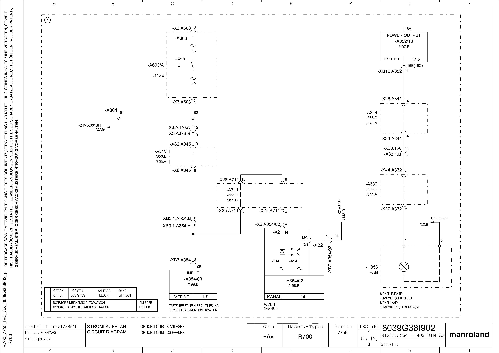

# +Ax — Sheet 354 of 403 — OPTION: LOGISTIK ANLEGER

**OPTION: LOGISTICS FEEDER**

> Part of the manroland **R700** printing press IEC/UL circuit diagrams.
> Drawing class: **Stromlaufplan / Circuit diagram** (DIN A3).
> Document `+Ax` covers the **Central control console** machine section.

## At a glance

| Field | Value |
|---|---|
| Document | `+Ax`  (8039G38I902) |
| Sheet | **354** of 403 |
| Section (DE) | OPTION: LOGISTIK ANLEGER |
| Section (EN) | OPTION: LOGISTICS FEEDER |
| Section type | CIRCUIT — Circuit diagram |
| Machine type | `R700` |
| Series | `7758` |
| Created | 17.05.10 |
| Replaces | — |
| Columns used | A, B, C, D, E, F, G, H |
| Path numbers | — |
| Labels on sheet | 119 |
| Cross-refs out | 15 |
| Cross-refs in | 37 |

**Previous:** [+Ax sheet 353](SHEET_0353.md) · **Next:** [+Ax sheet 355](SHEET_0355.md) · **Document TOC:** [_TOC.md](_TOC.md)  (+Ax) · **Master TOC:** [all sheets](../_MASTER_TOC.md)

## Sheet image (300 DPI, exact vector render)



_Rendered directly from the PDF vector layer at 300 DPI (1-bit), no OCR and no resampling. Use it to confirm anything ambiguous in the text below._

## Cross-references on this sheet

Each entry is a wire leaving this sheet. The printed token is `/sheet.column`; the link resolves to that sheet inside the same document.

| Ref | Target sheet | Col | Path | Destination on target | Target section | From col |
|---|---|---|---|---|---|---|
| `/197.F` | [+Ax sheet 197](SHEET_0197.md) | F | — | — | REFERENZMODUL | G |
| `/115.E` | [+Ax sheet 115](SHEET_0115.md) | E | — | — | HANDTERMINAL | C |
| `/355.D` | [+Ax sheet 355](SHEET_0355.md) | D | — | — | OPTION: LOGISTIK ANLEGER | F |
| `/341.A` | [+Ax sheet 341](SHEET_0341.md) | A | — | — | OPTION: INLINESHEETER RS104 S | F |
| `/27.G` | [+Ax sheet 27](SHEET_0027.md) | G | — | 24V.X001:61 | SPANNUNGSVERSORGUNG, SCHALTSCHRANKBELÜFTUNG | B |
| `/356.B` | [+Ax sheet 356](SHEET_0356.md) | B | — | — | OPTION: LOGISTIK ANLEGER | C |
| `/353.A` | [+Ax sheet 353](SHEET_0353.md) | A | — | — | OPTION: LOGISTIK ANLEGER | C |
| `/355.D` | [+Ax sheet 355](SHEET_0355.md) | D | — | — | OPTION: LOGISTIK ANLEGER | F |
| `/341.A` | [+Ax sheet 341](SHEET_0341.md) | A | — | — | OPTION: INLINESHEETER RS104 S | F |
| `/355.E` | [+Ax sheet 355](SHEET_0355.md) | E | — | — | OPTION: LOGISTIK ANLEGER | D |
| `/351.D` | [+Ax sheet 351](SHEET_0351.md) | D | — | — | OPTION: LOGISTIK ANLEGER | D |
| `/148.D` | [+Ax sheet 148](SHEET_0148.md) | D | — | X7.A343:14 | ÜBERWACHUNGSRECHNER SICHERHEITSBUS | F |
| `/32.B` | [+Ax sheet 32](SHEET_0032.md) | B | — | — | SPANNUNGSVERSORGUNG, SCHALTSCHRANKBELÜFTUNG | G |
| `/198.D` | [+Ax sheet 198](SHEET_0198.md) | D | — | — | REFERENZMODUL | C |
| `/198.B` | [+Ax sheet 198](SHEET_0198.md) | B | — | — | REFERENZMODUL | E |

### Incoming references (sheets that point here)

Every other sheet that sends a wire to this one. `Back-ref` is the token printed on *that* sheet; `Path` is its line number.

| From sheet | Cols | Back-ref | Path | Refs | What continues there |
|---|---|---|---|---|---|
| [+Ax#27](SHEET_0027.md) | G | `/27.G` | — | 1 | — |
| [+Ax#32](SHEET_0032.md) | B | `/32.B` | — | 1 | — |
| [+Ax#115](SHEET_0115.md) | E | `/115.E` | — | 1 | — |
| [+Ax#148](SHEET_0148.md) | D | `/148.D` | — | 1 | X7.A343:14 |
| [+Ax#197](SHEET_0197.md) | F | `/197.F` | — | 1 | — |
| [+Ax#198](SHEET_0198.md) | B, D | `/198.B`, `/198.D` | — | 2 | — |
| [+Ax#219](SHEET_0219.md) | C, E | `/219.C`, `/219.E` | — | 2 | — |
| [+Ax#224](SHEET_0224.md) | A, B, C, E, F | `/224.A`, `/224.B`, `/224.C`, `/224.E`, `/224.F` | — | 5 | — |
| [+Ax#225](SHEET_0225.md) | F | `/225.F` | — | 2 | — |
| [+Ax#238](SHEET_0238.md) | A | `/238.A` | — | 1 | — |
| [+Ax#253](SHEET_0253.md) | A | `/253.A` | — | 1 | — |
| [+Ax#268](SHEET_0268.md) | C | `/268.C` | — | 1 | — |
| [+Ax#270](SHEET_0270.md) | B | `/270.B` | — | 1 | — |
| [+Ax#271](SHEET_0271.md) | A, H | `/271.A`, `/271.H` | — | 2 | — |
| [+Ax#272](SHEET_0272.md) | G | `/272.G` | — | 2 | — |
| [+Ax#276](SHEET_0276.md) | A, B, E | `/276.A`, `/276.B`, `/276.E` | — | 3 | — |
| [+Ax#281](SHEET_0281.md) | H | `/281.H` | — | 1 | — |
| [+Ax#286](SHEET_0286.md) | F | `/286.F` | — | 1 | — |
| [+Ax#341](SHEET_0341.md) | A | `/341.A` | — | 2 | — |
| [+Ax#351](SHEET_0351.md) | C | `/351.C` | — | 1 | — |
| [+Ax#353](SHEET_0353.md) | A | `/353.A` | — | 1 | — |
| [+Ax#355](SHEET_0355.md) | D, E | `/355.D`, `/355.E` | — | 3 | A711 |
| [+Ax#356](SHEET_0356.md) | B | `/356.B` | — | 1 | — |


## Devices on this sheet

| Tag | Class | Class meaning (IEC) | Col | Sub | Terminal | Sign |
|---|---|---|---|---|---|---|
| `X001` | X | Klemme / terminal, plug connector | B | — | — | — |
| `A354/03` | A | Baugruppe / assembly, module, PC board | C | 03 | — | — |
| `A345` | A | Baugruppe / assembly, module, PC board | C | — | — | — |
| `A352/13` | A | Baugruppe / assembly, module, PC board | G | 13 | — | — |
| `A332` | A | Baugruppe / assembly, module, PC board | F | — | — | — |
| `A344` | A | Baugruppe / assembly, module, PC board | F | — | — | — |
| `S14` | S | Schalter / switch | E | — | — | — |
| `A14` | A | Baugruppe / assembly, module, PC board | E | — | — | — |
| `X1` | X | Klemme / terminal, plug connector | E | — | — | — |
| `X2` | X | Klemme / terminal, plug connector | E | — | — | — |
| `XB2` | XB |  | E | — | — | — |
| `A354/02` | A | Baugruppe / assembly, module, PC board | E | 02 | — | — |
| `A711` | A | Baugruppe / assembly, module, PC board | D | — | — | — |
| `A603` | A | Baugruppe / assembly, module, PC board | C | — | — | — |
| `S218` | S | Schalter / switch | C | — | — | — |
| `X3.A603` | — | cross-device reference | C | — | — | — |
| `X3.A603` | — | cross-device reference | C | — | — | — |
| `1.7` | — | cross-device reference | D | — | — | — |
| `XB3.A354` | — | cross-device reference | C | — | — | — |
| `X82.A345` | — | cross-device reference | C | — | — | — |
| `X8.A345` | — | cross-device reference | C | — | — | — |
| `X3.A376.B` | — | cross-device reference | C | — | — | — |
| `X3.A376.A` | — | cross-device reference | C | — | — | — |
| `17.5` | — | cross-device reference | G | — | — | — |
| `XB15.A352` | — | cross-device reference | G | — | — | — |
| `X27.A332` | — | cross-device reference | G | — | — | — |
| `X33.A344` | — | cross-device reference | G | — | — | — |
| `X33.1.B` | — | cross-device reference | G | — | — | — |
| `X33.1.A` | — | cross-device reference | G | — | — | — |
| `X28.A344` | — | cross-device reference | G | — | — | — |
| `X44.A332` | — | cross-device reference | G | — | — | — |
| `X28.A711` | — | cross-device reference | D | — | — | — |
| `X27.A711` | — | cross-device reference | E | — | — | — |
| `X25.A711` | — | cross-device reference | D | — | — | — |
| `XB3.1.A354.B` | — | cross-device reference | C | — | — | — |
| `XB3.1.A354.A` | — | cross-device reference | C | — | — | — |
| `X7.A343:14` | — | cross-device reference | F | — | 14 | — |

## Potentials / nets

| Potential | Count | Columns | Attached devices | Terminals |
|---|---|---|---|---|
| `0V` | 1 | H | `H056` | `0` |
| `24V` | 1 | B | `X001` | `61` |
| `H056` | 1 | F | — | — |


A potential such as `L24+/4` or `M24+` is a named supply/return rail; every place it appears on this sheet is electrically common.

## Wire-end annotations (grouped as printed)

A wire that continues elsewhere is annotated with a small cluster: the destination description, the path/line number `#NN`, and the `/sheet.column` cross reference. Each row below is one such cluster exactly as it is grouped on the drawing.

| Col | Y | Path | Cross-ref | Text on the wire |
|---|---|---|---|---|
| A | 45.1 | — | — | `1` |
| C | 62.7 | — | — | `X3.A603 2` |
| G | 64.8 | — | — | `16A` |
| G | 79.9 | — | — | `POWER OUTPUT` |
| C | 86.8 | — | — | `A603` |
| G | 93.8 | — | — | `A352/13` |
| G | 107.6 | — | `/197.F` | — |
| G | 136.7 | — | — | `BYTE.BIT 17.5` |
| C | 137.1 | — | — | `S218` |
| C | 150.6 | — | — | `A603/A` |
| G | 152.7 | — | — | `16B(16C)` |
| G | 164.7 | — | — | `XB15.A352 14` |
| C | 176.0 | — | `/115.E` | — |
| G | 230.6 | — | — | `X28.A344 14` |
| C | 238.4 | — | — | `X3.A603 1` |
| C | 258.0 | — | — | `X001 61 62` |
| F | 263.9 | — | — | `A344` |
| F | 277.0 | — | `/355.D`, `/341.A` | — |
| B | 295.1 | — | `/27.G` | `24V.X001:61` |
| C | 299.4 | — | — | `X3.A376.A 10` |
| C | 313.6 | — | — | `X3.A376.B 10` |
| G | 320.6 | — | — | `X33.A344 14` |
| C | 339.0 | — | — | `X82.A345 19` |
| G | 349.0 | — | — | `X33.1.A 14` |
| C | 356.1 | — | — | `A345` |
| G | 363.2 | — | — | `X33.1.B 14` |
| C | 369.1 | — | `/356.B`, `/353.A` | — |
| G | 400.7 | — | — | `X44.A332 14` |
| C | 401.4 | — | — | `X8.A345 8` |
| D | 424.1 | — | — | `X28.A711 15 16` |
| F | 434.0 | — | — | `A332` |
| F | 447.1 | — | `/355.D`, `/341.A` | — |
| D | 448.2 | — | — | `A711` |
| D | 461.2 | — | `/355.E`, `/351.D` | — |
| F | 466.0 | — | `/148.D` | `X7.A343:14` |
| G | 493.5 | — | — | `X27.A332 2` |
| D | 497.8 | — | — | `X25.A711 8 X27.A711 14` |
| C | 516.2 | — | — | `XB3.1.A354.B 8` |
| H | 516.2 | — | — | `0V.H056:0` |
| E | 530.4 | — | — | `X2.A354/02 14` |
| G | 531.7 | — | `/32.B` | — |
| C | 533.2 | — | — | `XB3.1.A354.A 8` |
| E | 548.8 | — | — | `X2` |
| E | 550.2 | — | — | `14 14` |
| F | 558.8 | — | — | `14` |
| E | 563.0 | — | — | `18C` |
| G | 569.4 | — | — | `1 0` |
| E | 580.0 | — | — | `X1` |
| E | 580.0 | — | — | `XB2` |
| F | 586.2 | — | — | `XB2.A354/02` |
| C | 615.4 | — | — | `XB3.A354 8` |
| E | 619.0 | — | — | `S14 A14` |
| C | 632.4 | — | — | `10B` |
| F | 632.4 | — | — | `H056` |
| F | 645.1 | — | — | `+AB` |
| C | 646.9 | — | — | `INPUT` |
| C | 660.8 | — | — | `A354/03` |
| E | 665.0 | — | — | `A354/02` |
| C | 674.6 | — | `/198.D` | — |
| E | 677.4 | — | `/198.B` | — |
| A | 690.8 | — | — | `1 OPTION OPTION` |
| A | 690.8 | — | — | `LOGISTIK LOGISTICS` |
| B | 690.9 | — | — | `FEEDER ANLEGER` |
| B | 690.9 | — | — | `OHNE WITHOUT` |
| G | 698.0 | — | — | `PERSONENSCHUTZFELD SIGNALLEUCHTE:` |
| E | 703.3 | — | — | `KANAL 14` |
| C | 703.6 | — | — | `BYTE.BIT 1.7` |
| A | 719.2 | — | — | `NONSTOP EINRICHTUNG AUTOMATISCH NONSTOP DEVICE AUTOMATIC OPERATION` |
| C | 719.2 | — | — | `FEEDER ANLEGER` |
| G | 719.2 | — | — | `PERSONAL PROTECTING ZONE SIGNAL LAMP:` |
| E | 723.6 | — | — | `KANAL 14 CHANNEL 14` |
| C | 726.3 | — | — | `KEY: RESET / ERROR CONFIRMATION TASTE: RESET / FEHLERQUITTIERUNG` |


## Reconstructed tables

This sheet carries tabular content (pin map / terminal assignment / index). The grid below was rebuilt from the drawing's own rule lines, so each row is exactly one physical row of the table.

### Table 1 — 10 data rows × 12 columns (at x=403.9, y=48.2)

| X3.A603 | 2 |  |  |  |  |  |  |  |  |  | 16A |
|---|---|---|---|---|---|---|---|---|---|---|---|
| `A603` |  |  |  |  |  |  |  |  |  | `POWER` | `OUTPUT A352/13 /197.F` |
| `S218` |  |  |  |  |  |  |  |  |  | `BYTE.BIT` | `17.5` |
| `X3.A603 X3.A376.A X3.A376.B X82.A345 X8.A345` | `1 62 10 10 19 8` |  |  |  |  |  |  |  | `A344 /355.D /341.A` | `XB15.A352 X28.A344 X33.A344 X33.1.A X33.1.B X44.A332` | `16B(16C) 14 14 14 14 14 14` |
| `XB3.1.A354.B XB3.1.A354.A` | `8 8` | `X28.A711 A711 /355.E /351.D X25.A711` | `15 8` | `X27.A711 X2.A354/02` | `16 14 14` |  |  | `X7.A343:14` | `A332 /355.D /341.A /148.D` | `X27.A332` | `2 /32.B` |
|  |  |  |  | `X2` | `14` |  |  |  |  |  |  |
| `XB3.A354` | `8 10B` |  |  | `S14` | `A14` | `18C X1` | `XB2` | `14 14 XB2.A354/02` | `H056` |  | `1` |
| `INPUT` |  |  |  |  |  |  |  |  | `+AB` |  |  |
|  | `A354/03` |  |  |  | `A354/02` |  |  |  |  |  |  |
|  | `/198.D` |  |  |  | `/198.B` |  |  |  |  |  |  |
| `BYTE.BIT` | `1.7` |  |  | `KANAL` |  | `14` |  |  |  | `SIGNALLEUCHTE: PERSONENSCHUTZFELD` |  |


## Notes and free text on this sheet

| Text | Col | Y (pt) |
|---|---|---|
| `A603/A` | C | 150.55 |
| `10B` | C | 632.41 |
| `INPUT` | C | 646.94 |
| `BYTE.BIT` | C | 704.19 |
| `TASTE: RESET / FEHLERQUITTIERUNG` | C | 726.29 |
| `KEY: RESET / ERROR CONFIRMATION` | C | 736.92 |
| `+AB` | F | 645.11 |
| `SIGNALLEUCHTE:` | G | 697.95 |
| `PERSONENSCHUTZFELD` | G | 708.59 |
| `SIGNAL LAMP:` | G | 719.2 |
| `PERSONAL PROTECTING ZONE` | G | 729.85 |
| `16A` | G | 64.77 |
| `16B(16C)` | G | 152.68 |
| `POWER OUTPUT` | G | 79.93 |
| `BYTE.BIT` | G | 137.26 |
| `KANAL 14` | E | 723.62 |
| `CHANNEL 14` | E | 733.56 |
| `18C` | E | 563.01 |
| `KANAL` | E | 703.29 |
| `X2.A354/02` | E | 530.39 |
| `XB2.A354/02` | F | 586.21 |
| `NONSTOP EINRICHTUNG AUTOMATISCH` | A | 719.22 |
| `NONSTOP DEVICE AUTOMATIC OPERATION` | A | 729.84 |
| `OPTION` | A | 690.83 |
| `LOGISTIK` | A | 690.83 |
| `LOGISTICS` | A | 701.46 |
| `ANLEGER` | B | 690.87 |
| `FEEDER` | B | 701.47 |
| `OHNE` | B | 690.86 |
| `WITHOUT` | B | 701.46 |
| `ANLEGER` | C | 719.22 |
| `FEEDER` | C | 729.81 |

## Complete label inventory (exact text from the drawing)

Every text object inside the drawing area of this sheet, in DIN reading order (column A→H, then top→bottom). This is the authoritative list: if a string is not here it is not printed on this sheet.

| Col | Y | X | Dir | Type | Text |
|---|---|---|---|---|---|
| A | 45.1 | 111.6 | → | number | `1` |
| A | 690.8 | 127.3 | → | text | `OPTION` |
| A | 690.8 | 169.2 | → | text | `LOGISTIK` |
| A | 701.5 | 127.3 | → | text | `OPTION` |
| A | 701.5 | 169.2 | → | text | `LOGISTICS` |
| A | 710.3 | 110.8 | → | number | `1` |
| A | 719.2 | 126.7 | → | text | `NONSTOP EINRICHTUNG AUTOMATISCH` |
| A | 729.8 | 126.7 | → | text | `NONSTOP DEVICE AUTOMATIC OPERATION` |
| B | 258.0 | 250.0 | → | device tag | `X001` |
| B | 264.7 | 286.0 | → | number | `61` |
| B | 295.1 | 187.7 | → | potential | `24V.X001:61` |
| B | 305.0 | 228.5 | → | cross-reference | `/27.G` |
| B | 690.9 | 233.9 | → | text | `ANLEGER` |
| B | 690.9 | 283.2 | → | text | `OHNE` |
| B | 701.5 | 233.0 | → | text | `FEEDER` |
| B | 701.5 | 283.5 | → | text | `WITHOUT` |
| C | 62.7 | 411.3 | → | device ref | `X3.A603` |
| C | 62.7 | 463.2 | → | number | `2` |
| C | 86.8 | 417.8 | → | device tag | `A603` |
| C | 137.1 | 417.8 | → | device tag | `S218` |
| C | 150.6 | 352.6 | → | text | `A603/A` |
| C | 176.0 | 366.2 | → | cross-reference | `/115.E` |
| C | 238.4 | 411.3 | → | device ref | `X3.A603` |
| C | 239.9 | 462.6 | → | number | `1` |
| C | 264.7 | 463.2 | → | number | `62` |
| C | 299.4 | 399.1 | → | device ref | `X3.A376.A` |
| C | 300.8 | 462.6 | → | number | `10` |
| C | 313.5 | 400.0 | → | device ref | `X3.A376.B` |
| C | 317.8 | 462.6 | → | number | `10` |
| C | 339.0 | 405.4 | → | device ref | `X82.A345` |
| C | 339.1 | 462.6 | → | number | `19` |
| C | 356.1 | 369.1 | → | device tag | `A345` |
| C | 369.1 | 371.6 | → | cross-reference | `/356.B` |
| C | 381.5 | 371.3 | → | cross-reference | `/353.A` |
| C | 401.4 | 411.3 | → | device ref | `X8.A345` |
| C | 402.8 | 463.2 | → | number | `8` |
| C | 516.2 | 385.5 | → | device ref | `XB3.1.A354.B` |
| C | 516.2 | 463.2 | → | number | `8` |
| C | 533.2 | 463.2 | → | number | `8` |
| C | 533.9 | 384.7 | → | device ref | `XB3.1.A354.A` |
| C | 615.4 | 404.2 | → | device ref | `XB3.A354` |
| C | 615.4 | 463.2 | → | number | `8` |
| C | 632.4 | 465.4 | → | text | `10B` |
| C | 646.9 | 445.7 | → | text | `INPUT` |
| C | 660.8 | 439.2 | → | device tag | `A354/03` |
| C | 674.6 | 447.9 | → | cross-reference | `/198.D` |
| C | 704.2 | 413.9 | → | text | `BYTE.BIT` |
| C | 719.2 | 333.1 | → | text | `ANLEGER` |
| C | 726.3 | 403.7 | → | text | `TASTE: RESET / FEHLERQUITTIERUNG` |
| C | 729.8 | 332.2 | → | text | `FEEDER` |
| C | 736.9 | 403.1 | → | text | `KEY: RESET / ERROR CONFIRMATION` |
| D | 424.1 | 520.2 | → | device ref | `X28.A711` |
| D | 424.1 | 576.0 | → | number | `15` |
| D | 448.2 | 540.6 | → | device tag | `A711` |
| D | 461.2 | 542.0 | → | cross-reference | `/355.E` |
| D | 473.7 | 541.4 | → | cross-reference | `/351.D` |
| D | 497.8 | 518.7 | → | device ref | `X25.A711` |
| D | 502.1 | 576.6 | → | number | `8` |
| D | 703.6 | 481.9 | → | device ref | `1.7` |
| E | 424.1 | 675.2 | → | number | `16` |
| E | 497.8 | 618.0 | → | device ref | `X27.A711` |
| E | 502.1 | 675.2 | → | number | `14` |
| E | 530.4 | 609.2 | → | text | `X2.A354/02` |
| E | 530.4 | 675.2 | → | number | `14` |
| E | 548.8 | 651.7 | → | device tag | `X2` |
| E | 550.2 | 678.0 | → | number | `14` |
| E | 563.0 | 718.6 | → | text | `18C` |
| E | 580.0 | 722.3 | → | device tag | `X1` |
| E | 580.0 | 746.6 | → | device tag | `XB2` |
| E | 619.0 | 648.0 | → | device tag | `S14` |
| E | 619.0 | 690.5 | → | device tag | `A14` |
| E | 665.0 | 680.2 | → | device tag | `A354/02` |
| E | 677.4 | 689.0 | → | cross-reference | `/198.B` |
| E | 703.3 | 636.9 | → | text | `KANAL` |
| E | 703.3 | 716.6 | → | number | `14` |
| E | 723.6 | 628.7 | → | text | `KANAL 14` |
| E | 733.6 | 629.0 | → | text | `CHANNEL 14` |
| F | 263.9 | 872.2 | → | device tag | `A344` |
| F | 277.0 | 874.5 | → | cross-reference | `/355.D` |
| F | 289.4 | 874.5 | → | cross-reference | `/341.A` |
| F | 434.0 | 872.2 | → | device tag | `A332` |
| F | 447.1 | 874.5 | → | cross-reference | `/355.D` |
| F | 459.5 | 874.5 | → | cross-reference | `/341.A` |
| F | 466.0 | 806.7 | ↕ | device ref | `X7.A343:14` |
| F | 498.6 | 816.7 | ↕ | cross-reference | `/148.D` |
| F | 558.7 | 798.5 | → | number | `14` |
| F | 560.2 | 777.3 | → | number | `14` |
| F | 586.2 | 782.7 | ↕ | text | `XB2.A354/02` |
| F | 632.4 | 873.1 | → | potential | `H056` |
| F | 645.1 | 881.6 | → | text | `+AB` |
| G | 64.8 | 965.8 | → | text | `16A` |
| G | 79.9 | 923.0 | → | text | `POWER OUTPUT` |
| G | 93.8 | 942.4 | → | device tag | `A352/13` |
| G | 107.6 | 951.4 | → | cross-reference | `/197.F` |
| G | 136.7 | 982.3 | → | device ref | `17.5` |
| G | 137.3 | 917.0 | → | text | `BYTE.BIT` |
| G | 152.7 | 971.4 | → | text | `16B(16C)` |
| G | 164.7 | 965.8 | → | number | `14` |
| G | 165.4 | 901.4 | → | device ref | `XB15.A352` |
| G | 230.6 | 908.5 | → | device ref | `X28.A344` |
| G | 237.0 | 965.8 | → | number | `14` |
| G | 320.6 | 965.8 | → | number | `14` |
| G | 325.6 | 908.5 | → | device ref | `X33.A344` |
| G | 349.0 | 915.3 | → | device ref | `X33.1.A` |
| G | 350.4 | 965.8 | → | number | `14` |
| G | 363.2 | 916.2 | → | device ref | `X33.1.B` |
| G | 367.4 | 965.8 | → | number | `14` |
| G | 400.7 | 908.5 | → | device ref | `X44.A332` |
| G | 407.1 | 965.8 | → | number | `14` |
| G | 493.5 | 908.5 | → | device ref | `X27.A332` |
| G | 495.0 | 966.3 | → | number | `2` |
| G | 531.7 | 1001.5 | → | cross-reference | `/32.B` |
| G | 569.4 | 965.8 | → | number | `1` |
| G | 697.9 | 906.8 | → | text | `SIGNALLEUCHTE:` |
| G | 708.6 | 906.2 | → | text | `PERSONENSCHUTZFELD` |
| G | 719.2 | 906.8 | → | text | `SIGNAL LAMP:` |
| G | 729.8 | 906.2 | → | text | `PERSONAL PROTECTING ZONE` |
| H | 516.2 | 1029.0 | → | potential | `0V.H056:0` |
| H | 569.4 | 1051.4 | → | number | `0` |

## Reading-order text block

The same content as a plain block, grouped by DIN column — convenient to paste or to match against a visual description.

```text
=== Column A ===
  45.1  111.6  numeric      1
 690.8  127.3  text         OPTION
 690.8  169.2  text         LOGISTIK
 701.5  127.3  text         OPTION
 701.5  169.2  text         LOGISTICS
 710.3  110.8  numeric      1
 719.2  126.7  text         NONSTOP EINRICHTUNG AUTOMATISCH
 729.8  126.7  text         NONSTOP DEVICE AUTOMATIC OPERATION
=== Column B ===
 258.0  250.0  devtag       X001
 264.7  286.0  numeric      61
 295.1  187.7  net          24V.X001:61
 305.0  228.5  xref         /27.G
 690.9  233.9  text         ANLEGER
 690.9  283.2  text         OHNE
 701.5  233.0  text         FEEDER
 701.5  283.5  text         WITHOUT
=== Column C ===
  62.7  411.3  devref       X3.A603
  62.7  463.2  numeric      2
  86.8  417.8  devtag       A603
 137.1  417.8  devtag       S218
 150.6  352.6  text         A603/A
 176.0  366.2  xref         /115.E
 238.4  411.3  devref       X3.A603
 239.9  462.6  numeric      1
 264.7  463.2  numeric      62
 299.4  399.1  devref       X3.A376.A
 300.8  462.6  numeric      10
 313.5  400.0  devref       X3.A376.B
 317.8  462.6  numeric      10
 339.0  405.4  devref       X82.A345
 339.1  462.6  numeric      19
 356.1  369.1  devtag       A345
 369.1  371.6  xref         /356.B
 381.5  371.3  xref         /353.A
 401.4  411.3  devref       X8.A345
 402.8  463.2  numeric      8
 516.2  385.5  devref       XB3.1.A354.B
 516.2  463.2  numeric      8
 533.2  463.2  numeric      8
 533.9  384.7  devref       XB3.1.A354.A
 615.4  404.2  devref       XB3.A354
 615.4  463.2  numeric      8
 632.4  465.4  text         10B
 646.9  445.7  text         INPUT
 660.8  439.2  devtag       A354/03
 674.6  447.9  xref         /198.D
 704.2  413.9  text         BYTE.BIT
 719.2  333.1  text         ANLEGER
 726.3  403.7  text         TASTE: RESET / FEHLERQUITTIERUNG
 729.8  332.2  text         FEEDER
 736.9  403.1  text         KEY: RESET / ERROR CONFIRMATION
=== Column D ===
 424.1  520.2  devref       X28.A711
 424.1  576.0  numeric      15
 448.2  540.6  devtag       A711
 461.2  542.0  xref         /355.E
 473.7  541.4  xref         /351.D
 497.8  518.7  devref       X25.A711
 502.1  576.6  numeric      8
 703.6  481.9  devref       1.7
=== Column E ===
 424.1  675.2  numeric      16
 497.8  618.0  devref       X27.A711
 502.1  675.2  numeric      14
 530.4  609.2  text         X2.A354/02
 530.4  675.2  numeric      14
 548.8  651.7  devtag       X2
 550.2  678.0  numeric      14
 563.0  718.6  text         18C
 580.0  722.3  devtag       X1
 580.0  746.6  devtag       XB2
 619.0  648.0  devtag       S14
 619.0  690.5  devtag       A14
 665.0  680.2  devtag       A354/02
 677.4  689.0  xref         /198.B
 703.3  636.9  text         KANAL
 703.3  716.6  numeric      14
 723.6  628.7  text         KANAL 14
 733.6  629.0  text         CHANNEL 14
=== Column F ===
 263.9  872.2  devtag       A344
 277.0  874.5  xref         /355.D
 289.4  874.5  xref         /341.A
 434.0  872.2  devtag       A332
 447.1  874.5  xref         /355.D
 459.5  874.5  xref         /341.A
 466.0  806.7  devref       X7.A343:14
 498.6  816.7  xref         /148.D
 558.7  798.5  numeric      14
 560.2  777.3  numeric      14
 586.2  782.7  text         XB2.A354/02
 632.4  873.1  net          H056
 645.1  881.6  text         +AB
=== Column G ===
  64.8  965.8  text         16A
  79.9  923.0  text         POWER OUTPUT
  93.8  942.4  devtag       A352/13
 107.6  951.4  xref         /197.F
 136.7  982.3  devref       17.5
 137.3  917.0  text         BYTE.BIT
 152.7  971.4  text         16B(16C)
 164.7  965.8  numeric      14
 165.4  901.4  devref       XB15.A352
 230.6  908.5  devref       X28.A344
 237.0  965.8  numeric      14
 320.6  965.8  numeric      14
 325.6  908.5  devref       X33.A344
 349.0  915.3  devref       X33.1.A
 350.4  965.8  numeric      14
 363.2  916.2  devref       X33.1.B
 367.4  965.8  numeric      14
 400.7  908.5  devref       X44.A332
 407.1  965.8  numeric      14
 493.5  908.5  devref       X27.A332
 495.0  966.3  numeric      2
 531.7 1001.5  xref         /32.B
 569.4  965.8  numeric      1
 697.9  906.8  text         SIGNALLEUCHTE:
 708.6  906.2  text         PERSONENSCHUTZFELD
 719.2  906.8  text         SIGNAL LAMP:
 729.8  906.2  text         PERSONAL PROTECTING ZONE
=== Column H ===
 516.2 1029.0  net          0V.H056:0
 569.4 1051.4  numeric      0
```

---
_Generated from the PDF vector text layer; no OCR. Source: `R700_7758_IEC_AX_8039G38I902_p`, sheet 354._
