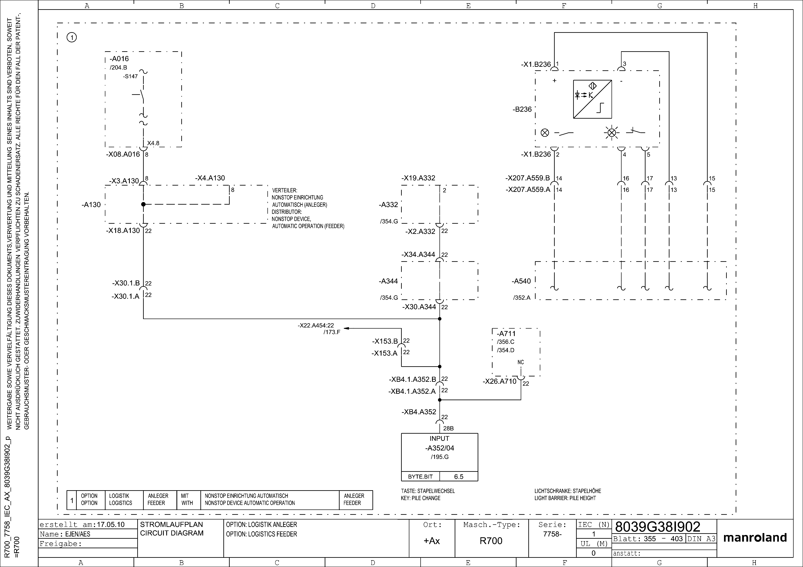

# +Ax — Sheet 355 of 403 — OPTION: LOGISTIK ANLEGER

**OPTION: LOGISTICS FEEDER**

> Part of the manroland **R700** printing press IEC/UL circuit diagrams.
> Drawing class: **Stromlaufplan / Circuit diagram** (DIN A3).
> Document `+Ax` covers the **Central control console** machine section.

## At a glance

| Field | Value |
|---|---|
| Document | `+Ax`  (8039G38I902) |
| Sheet | **355** of 403 |
| Section (DE) | OPTION: LOGISTIK ANLEGER |
| Section (EN) | OPTION: LOGISTICS FEEDER |
| Section type | CIRCUIT — Circuit diagram |
| Machine type | `R700` |
| Series | `7758` |
| Created | 17.05.10 |
| Replaces | — |
| Columns used | A, B, C, D, E, F, G, H |
| Path numbers | — |
| Labels on sheet | 100 |
| Cross-refs out | 8 |
| Cross-refs in | 39 |

**Previous:** [+Ax sheet 354](SHEET_0354.md) · **Next:** [+Ax sheet 356](SHEET_0356.md) · **Document TOC:** [_TOC.md](_TOC.md)  (+Ax) · **Master TOC:** [all sheets](../_MASTER_TOC.md)

## Sheet image (300 DPI, exact vector render)



_Rendered directly from the PDF vector layer at 300 DPI (1-bit), no OCR and no resampling. Use it to confirm anything ambiguous in the text below._

## Cross-references on this sheet

Each entry is a wire leaving this sheet. The printed token is `/sheet.column`; the link resolves to that sheet inside the same document.

| Ref | Target sheet | Col | Path | Destination on target | Target section | From col |
|---|---|---|---|---|---|---|
| `/204.B` | [+Ax sheet 204](SHEET_0204.md) | B | — | A016 | REFERENZMODUL | A |
| `/354.G` | [+Ax sheet 354](SHEET_0354.md) | G | — | — | OPTION: LOGISTIK ANLEGER | D |
| `/352.A` | [+Ax sheet 352](SHEET_0352.md) | A | — | — | OPTION: LOGISTIK ANLEGER | F |
| `/354.G` | [+Ax sheet 354](SHEET_0354.md) | G | — | — | OPTION: LOGISTIK ANLEGER | D |
| `/173.F` | [+Ax sheet 173](SHEET_0173.md) | F | — | X22.A454:22 | RESERVE | C |
| `/356.C` | [+Ax sheet 356](SHEET_0356.md) | C | — | A711 | OPTION: LOGISTIK ANLEGER | E |
| `/354.D` | [+Ax sheet 354](SHEET_0354.md) | D | — | A711 | OPTION: LOGISTIK ANLEGER | E |
| `/195.G` | [+Ax sheet 195](SHEET_0195.md) | G | — | — | REFERENZMODUL | E |

### Incoming references (sheets that point here)

Every other sheet that sends a wire to this one. `Back-ref` is the token printed on *that* sheet; `Path` is its line number.

| From sheet | Cols | Back-ref | Path | Refs | What continues there |
|---|---|---|---|---|---|
| [+Ax#173](SHEET_0173.md) | F | `/173.F` | — | 1 | — |
| [+Ax#195](SHEET_0195.md) | G | `/195.G` | — | 1 | — |
| [+Ax#204](SHEET_0204.md) | B | `/204.B` | — | 1 | — |
| [+Ax#213](SHEET_0213.md) | A | `/213.A` | — | 5 | — |
| [+Ax#217](SHEET_0217.md) | F | `/217.F` | — | 1 | — |
| [+Ax#222](SHEET_0222.md) | B | `/222.B` | — | 1 | — |
| [+Ax#226](SHEET_0226.md) | B | `/226.B` | — | 1 | — |
| [+Ax#227](SHEET_0227.md) | E, F, G | `/227.E`, `/227.F`, `/227.G` | — | 3 | — |
| [+Ax#237](SHEET_0237.md) | A | `/237.A` | — | 1 | — |
| [+Ax#256](SHEET_0256.md) | B | `/256.B` | — | 1 | — |
| [+Ax#258](SHEET_0258.md) | C | `/258.C` | — | 1 | — |
| [+Ax#269](SHEET_0269.md) | G | `/269.G` | — | 1 | — |
| [+Ax#274](SHEET_0274.md) | D, E, F | `/274.D`, `/274.E`, `/274.F` | — | 3 | — |
| [+Ax#278](SHEET_0278.md) | A | `/278.A` | — | 1 | — |
| [+Ax#290](SHEET_0290.md) | C, E | `/290.C`, `/290.E` | — | 2 | — |
| [+Ax#292](SHEET_0292.md) | E, F | `/292.E`, `/292.F` | — | 10 | — |
| [+Ax#352](SHEET_0352.md) | A | `/352.A` | — | 1 | — |
| [+Ax#354](SHEET_0354.md) | D, F | `/354.D`, `/354.F` | — | 3 | — |
| [+Ax#356](SHEET_0356.md) | C | `/356.C` | — | 1 | — |


## Devices on this sheet

| Tag | Class | Class meaning (IEC) | Col | Sub | Terminal | Sign |
|---|---|---|---|---|---|---|
| `B236` | B | Umformer / transducer, sensor | F | — | — | — |
| `S147` | S | Schalter / switch | A | — | — | — |
| `A016` | A | Baugruppe / assembly, module, PC board | A | — | — | — |
| `A130` | A | Baugruppe / assembly, module, PC board | A | — | — | — |
| `A540` | A | Baugruppe / assembly, module, PC board | F | — | — | — |
| `A332` | A | Baugruppe / assembly, module, PC board | D | — | — | — |
| `A344` | A | Baugruppe / assembly, module, PC board | D | — | — | — |
| `A352/04` | A | Baugruppe / assembly, module, PC board | E | 04 | — | — |
| `A711` | A | Baugruppe / assembly, module, PC board | E | — | — | — |
| `X1.B236` | — | cross-device reference | F | — | — | — |
| `X1.B236` | — | cross-device reference | F | — | — | — |
| `X08.A016` | — | cross-device reference | A | — | — | — |
| `X4.8` | — | cross-device reference | B | — | — | — |
| `X30.A344` | — | cross-device reference | D | — | — | — |
| `X34.A344` | — | cross-device reference | D | — | — | — |
| `X2.A332` | — | cross-device reference | D | — | — | — |
| `X3.A130` | — | cross-device reference | A | — | — | — |
| `X18.A130` | — | cross-device reference | A | — | — | — |
| `X30.1.B` | — | cross-device reference | A | — | — | — |
| `X30.1.A` | — | cross-device reference | A | — | — | — |
| `X207.A559.A` | — | cross-device reference | F | — | — | — |
| `X207.A559.B` | — | cross-device reference | F | — | — | — |
| `X153.A` | — | cross-device reference | D | — | — | — |
| `X153.B` | — | cross-device reference | D | — | — | — |
| `6.5` | — | cross-device reference | E | — | — | — |
| `XB4.A352` | — | cross-device reference | D | — | — | — |
| `XB4.1.A352.B` | — | cross-device reference | D | — | — | — |
| `XB4.1.A352.A` | — | cross-device reference | D | — | — | — |
| `X26.A710` | — | cross-device reference | E | — | — | — |
| `X22.A454:22` | — | cross-device reference | C | — | 22 | — |
| `X19.A332` | — | cross-device reference | D | — | — | — |
| `X4.A130` | — | cross-device reference | B | — | — | — |

## Potentials / nets

_No named potentials on this sheet._

## Wire-end annotations (grouped as printed)

A wire that continues elsewhere is annotated with a small cluster: the destination description, the path/line number `#NN`, and the `/sheet.column` cross reference. Each row below is one such cluster exactly as it is grouped on the drawing.

| Col | Y | Path | Cross-ref | Text on the wire |
|---|---|---|---|---|
| A | 52.2 | — | — | `1` |
| A | 82.5 | — | `/204.B` | `A016` |
| F | 91.0 | — | — | `X1.B236 1 3` |
| A | 109.9 | — | — | `S147` |
| F | 115.1 | — | — | `+` |
| F | 157.6 | — | — | `B236` |
| B | 208.6 | — | — | `X4.8` |
| A | 224.2 | — | — | `X08.A016 8` |
| F | 224.2 | — | — | `X1.B236 2 4` |
| G | 225.7 | — | — | `5` |
| C | 259.7 | — | — | `X4.A130 X19.A332` |
| F | 259.7 | — | — | `X207.A559.B 14` |
| A | 261.1 | — | — | `X3.A130 8` |
| G | 261.1 | — | — | `16` |
| G | 261.1 | — | — | `17` |
| G | 261.1 | — | — | `13` |
| H | 261.1 | — | — | `15` |
| F | 276.7 | — | — | `X207.A559.A 14` |
| C | 278.1 | — | — | `8` |
| G | 278.1 | — | — | `16` |
| G | 278.1 | — | — | `17` |
| G | 278.1 | — | — | `13` |
| H | 278.1 | — | — | `15` |
| E | 278.8 | — | — | `2` |
| C | 279.8 | — | — | `NONSTOP EINRICHTUNG VERTEILER:` |
| A | 299.4 | — | — | `A130` |
| D | 299.4 | — | — | `A332` |
| C | 301.1 | — | — | `DISTRIBUTOR: NONSTOP DEVICE, AUTOMATISCH (ANLEGER)` |
| D | 324.9 | — | `/354.G` | — |
| C | 333.0 | — | — | `AUTOMATIC OPERATION (FEEDER)` |
| A | 337.6 | — | — | `X18.A130 22` |
| E | 339.1 | — | — | `X2.A332 22` |
| E | 373.1 | — | — | `X34.A344 22` |
| D | 412.7 | — | — | `A344` |
| F | 412.7 | — | — | `A540` |
| A | 415.6 | — | — | `X30.1.B 22` |
| A | 434.0 | — | — | `X30.1.A 22` |
| D | 438.2 | — | `/354.G` | — |
| F | 438.2 | — | `/352.A` | — |
| E | 451.0 | — | — | `X30.A344 22` |
| C | 479.3 | — | `/173.F` | `X22.A454:22` |
| E | 490.7 | — | `/356.C`, `/354.D` | `A711` |
| D | 502.1 | — | — | `X153.B 22` |
| D | 519.1 | — | — | `X153.A 22` |
| F | 534.9 | — | — | `NC` |
| D | 558.7 | — | — | `XB4.1.A352.B 22` |
| E | 561.6 | — | — | `X26.A710 22` |
| D | 575.8 | — | — | `XB4.1.A352.A 22` |
| E | 606.9 | — | — | `XB4.A352 22` |
| E | 632.4 | — | — | `28B` |
| E | 646.9 | — | — | `INPUT` |
| E | 660.8 | — | — | `A352/04` |
| E | 674.6 | — | `/195.G` | — |
| E | 703.6 | — | — | `BYTE.BIT 6.5` |
| E | 726.3 | — | — | `KEY: PILE CHANGE TASTE: STAPELWECHSEL` |
| F | 726.3 | — | — | `LICHTSCHRANKE: STAPELHÖHE LIGHT BARRIER: PILE HEIGHT` |
| A | 733.4 | — | — | `1 OPTION OPTION` |
| A | 733.4 | — | — | `LOGISTIK LOGISTICS` |
| B | 733.4 | — | — | `FEEDER ANLEGER` |
| B | 733.4 | — | — | `MIT` |
| C | 733.4 | — | — | `NONSTOP EINRICHTUNG AUTOMATISCH NONSTOP DEVICE AUTOMATIC OPERATION` |
| D | 733.4 | — | — | `FEEDER ANLEGER` |
| B | 743.9 | — | — | `WITH` |


## Reconstructed tables

This sheet carries tabular content (pin map / terminal assignment / index). The grid below was rebuilt from the drawing's own rule lines, so each row is exactly one physical row of the table.

### Table 1 — 2 data rows × 2 columns (at x=155.9, y=76.5)

| A016 /204.B S147 | X4.8 |
|---|---|
| `X08.A016 X3.A130` | `8 8` |
| `X18.A130 X30.1.B X30.1.A` | `22 22 22` |


### Table 2 — 7 data rows × 5 columns (at x=595.3, y=48.2)

|  |  |  | X1.B236 | 1 |
|---|---|---|---|---|
|  |  |  | `B236` | `+` |
| `X19.A332 X2.A332 X34.A344 X30.A344` | `2 22 22 22` |  | `X1.B236 X207.A559.B X207.A559.A A540 /352.A` | `2 14 14` |
| `22 22` |  | `A711 /356.C /354.D NC` |  |  |
| `XB4.1.A352.B XB4.1.A352.A` | `22 22` | `X26.A710` | `22` |  |
| `XB4.A352` | `22 28B` |  |  |  |
| `INPUT` | `A352/04 /195.G` |  |  |  |
| `BYTE.BIT` | `6.5` |  |  |  |


### Table 3 — 0 data rows × 3 columns (at x=921.3, y=48.2) — **3**

_none_


## Notes and free text on this sheet

| Text | Col | Y (pt) |
|---|---|---|
| `LICHTSCHRANKE: STAPELHÖHE` | F | 726.29 |
| `LIGHT BARRIER: PILE HEIGHT` | F | 736.92 |
| `VERTEILER:` | C | 279.82 |
| `NONSTOP EINRICHTUNG` | C | 290.48 |
| `AUTOMATISCH (ANLEGER)` | C | 301.12 |
| `DISTRIBUTOR:` | C | 311.72 |
| `NONSTOP DEVICE,` | C | 322.35 |
| `AUTOMATIC OPERATION (FEEDER)` | C | 333.01 |
| `28B` | E | 632.41 |
| `INPUT` | E | 646.94 |
| `BYTE.BIT` | D | 704.19 |
| `TASTE: STAPELWECHSEL` | E | 726.26 |
| `KEY: PILE CHANGE` | E | 736.9 |
| `OPTION` | A | 733.35 |
| `LOGISTIK` | A | 733.35 |
| `LOGISTICS` | A | 743.98 |
| `ANLEGER` | B | 733.39 |
| `FEEDER` | B | 743.99 |
| `MIT` | B | 733.35 |
| `WITH` | B | 743.89 |
| `NONSTOP EINRICHTUNG AUTOMATISCH` | C | 733.39 |
| `NONSTOP DEVICE AUTOMATIC OPERATION` | C | 744.01 |
| `ANLEGER` | D | 733.39 |
| `FEEDER` | D | 743.99 |
| `NC` | F | 534.92 |

## Complete label inventory (exact text from the drawing)

Every text object inside the drawing area of this sheet, in DIN reading order (column A→H, then top→bottom). This is the authoritative list: if a string is not here it is not printed on this sheet.

| Col | Y | X | Dir | Type | Text |
|---|---|---|---|---|---|
| A | 52.2 | 104.5 | → | number | `1` |
| A | 82.5 | 162.7 | → | device tag | `A016` |
| A | 96.3 | 163.0 | → | cross-reference | `/204.B` |
| A | 109.9 | 182.6 | → | device tag | `S147` |
| A | 224.2 | 157.3 | → | device ref | `X08.A016` |
| A | 263.9 | 161.9 | → | device ref | `X3.A130` |
| A | 299.4 | 121.0 | → | device tag | `A130` |
| A | 337.6 | 157.3 | → | device ref | `X18.A130` |
| A | 415.6 | 166.4 | → | device ref | `X30.1.B` |
| A | 435.4 | 165.5 | → | device ref | `X30.1.A` |
| A | 733.4 | 120.2 | → | text | `OPTION` |
| A | 733.4 | 162.1 | → | text | `LOGISTIK` |
| A | 738.7 | 103.7 | → | number | `1` |
| A | 744.0 | 120.2 | → | text | `OPTION` |
| A | 744.0 | 162.1 | → | text | `LOGISTICS` |
| B | 208.6 | 218.3 | → | device ref | `X4.8` |
| B | 225.7 | 215.1 | → | number | `8` |
| B | 259.7 | 289.4 | → | device ref | `X4.A130` |
| B | 261.1 | 215.1 | → | number | `8` |
| B | 339.1 | 215.1 | → | number | `22` |
| B | 417.0 | 215.1 | → | number | `22` |
| B | 434.0 | 215.1 | → | number | `22` |
| B | 733.4 | 219.7 | → | text | `ANLEGER` |
| B | 733.4 | 268.7 | → | text | `MIT` |
| B | 743.9 | 269.3 | → | text | `WITH` |
| B | 744.0 | 218.8 | → | text | `FEEDER` |
| C | 278.1 | 342.7 | → | number | `8` |
| C | 279.8 | 403.9 | → | text | `VERTEILER:` |
| C | 290.5 | 403.1 | → | text | `NONSTOP EINRICHTUNG` |
| C | 301.1 | 403.9 | → | text | `AUTOMATISCH (ANLEGER)` |
| C | 311.7 | 403.1 | → | text | `DISTRIBUTOR:` |
| C | 322.3 | 403.1 | → | text | `NONSTOP DEVICE,` |
| C | 333.0 | 403.9 | → | text | `AUTOMATIC OPERATION (FEEDER)` |
| C | 479.3 | 441.6 | → | device ref | `X22.A454:22` |
| C | 733.4 | 303.9 | → | text | `NONSTOP EINRICHTUNG AUTOMATISCH` |
| C | 744.0 | 303.9 | → | text | `NONSTOP DEVICE AUTOMATIC OPERATION` |
| D | 259.7 | 595.3 | → | device ref | `X19.A332` |
| D | 299.4 | 561.8 | → | device tag | `A332` |
| D | 324.8 | 563.8 | → | cross-reference | `/354.G` |
| D | 339.0 | 601.2 | → | device ref | `X2.A332` |
| D | 373.1 | 595.3 | → | device ref | `X34.A344` |
| D | 412.7 | 561.8 | → | device tag | `A344` |
| D | 438.2 | 563.8 | → | cross-reference | `/354.G` |
| D | 451.0 | 596.7 | → | device ref | `X30.A344` |
| D | 489.2 | 479.9 | → | cross-reference | `/173.F` |
| D | 502.0 | 551.9 | → | device ref | `X153.B` |
| D | 502.1 | 597.8 | → | number | `22` |
| D | 519.1 | 597.8 | → | number | `22` |
| D | 519.8 | 551.1 | → | device ref | `X153.A` |
| D | 558.7 | 576.9 | → | device ref | `XB4.1.A352.B` |
| D | 576.5 | 576.0 | → | device ref | `XB4.1.A352.A` |
| D | 606.9 | 595.6 | → | device ref | `XB4.A352` |
| D | 704.2 | 605.2 | → | text | `BYTE.BIT` |
| D | 733.4 | 510.2 | → | text | `ANLEGER` |
| D | 744.0 | 509.4 | → | text | `FEEDER` |
| E | 278.8 | 656.8 | → | number | `2` |
| E | 339.1 | 654.5 | → | number | `22` |
| E | 374.5 | 654.5 | → | number | `22` |
| E | 452.5 | 654.5 | → | number | `22` |
| E | 490.7 | 736.7 | → | device tag | `A711` |
| E | 503.8 | 737.0 | → | cross-reference | `/356.C` |
| E | 516.2 | 737.0 | → | cross-reference | `/354.D` |
| E | 558.7 | 654.5 | → | number | `22` |
| E | 561.6 | 715.7 | → | device ref | `X26.A710` |
| E | 575.8 | 654.5 | → | number | `22` |
| E | 615.4 | 654.5 | → | number | `22` |
| E | 632.4 | 657.4 | → | text | `28B` |
| E | 646.9 | 637.1 | → | text | `INPUT` |
| E | 660.8 | 630.6 | → | device tag | `A352/04` |
| E | 674.6 | 639.1 | → | cross-reference | `/195.G` |
| E | 703.6 | 673.5 | → | device ref | `6.5` |
| E | 726.3 | 595.0 | → | text | `TASTE: STAPELWECHSEL` |
| E | 736.9 | 594.4 | → | text | `KEY: PILE CHANGE` |
| F | 91.0 | 772.7 | → | device ref | `X1.B236` |
| F | 91.0 | 824.0 | → | number | `1` |
| F | 115.1 | 819.1 | → | number | `+` |
| F | 157.6 | 760.3 | → | device tag | `B236` |
| F | 224.2 | 772.7 | → | device ref | `X1.B236` |
| F | 225.7 | 824.6 | → | number | `2` |
| F | 259.7 | 749.5 | → | device ref | `X207.A559.B` |
| F | 261.1 | 824.0 | → | number | `14` |
| F | 276.7 | 750.0 | → | device ref | `X207.A559.A` |
| F | 278.1 | 824.0 | → | number | `14` |
| F | 412.7 | 758.8 | → | device tag | `A540` |
| F | 438.2 | 761.1 | → | cross-reference | `/352.A` |
| F | 534.9 | 767.6 | → | text | `NC` |
| F | 565.8 | 775.0 | → | number | `22` |
| F | 726.3 | 792.9 | → | text | `LICHTSCHRANKE: STAPELHÖHE` |
| F | 736.9 | 792.9 | → | text | `LIGHT BARRIER: PILE HEIGHT` |
| G | 91.0 | 923.8 | → | number | `3` |
| G | 225.7 | 923.8 | → | number | `4` |
| G | 225.7 | 959.2 | → | number | `5` |
| G | 261.1 | 923.2 | → | number | `16` |
| G | 261.1 | 958.7 | → | number | `17` |
| G | 261.1 | 994.1 | → | number | `13` |
| G | 278.1 | 923.2 | → | number | `16` |
| G | 278.1 | 958.7 | → | number | `17` |
| G | 278.1 | 994.1 | → | number | `13` |
| H | 261.1 | 1050.8 | → | number | `15` |
| H | 278.1 | 1050.8 | → | number | `15` |

## Reading-order text block

The same content as a plain block, grouped by DIN column — convenient to paste or to match against a visual description.

```text
=== Column A ===
  52.2  104.5  numeric      1
  82.5  162.7  devtag       A016
  96.3  163.0  xref         /204.B
 109.9  182.6  devtag       S147
 224.2  157.3  devref       X08.A016
 263.9  161.9  devref       X3.A130
 299.4  121.0  devtag       A130
 337.6  157.3  devref       X18.A130
 415.6  166.4  devref       X30.1.B
 435.4  165.5  devref       X30.1.A
 733.4  120.2  text         OPTION
 733.4  162.1  text         LOGISTIK
 738.7  103.7  numeric      1
 744.0  120.2  text         OPTION
 744.0  162.1  text         LOGISTICS
=== Column B ===
 208.6  218.3  devref       X4.8
 225.7  215.1  numeric      8
 259.7  289.4  devref       X4.A130
 261.1  215.1  numeric      8
 339.1  215.1  numeric      22
 417.0  215.1  numeric      22
 434.0  215.1  numeric      22
 733.4  219.7  text         ANLEGER
 733.4  268.7  text         MIT
 743.9  269.3  text         WITH
 744.0  218.8  text         FEEDER
=== Column C ===
 278.1  342.7  numeric      8
 279.8  403.9  text         VERTEILER:
 290.5  403.1  text         NONSTOP EINRICHTUNG
 301.1  403.9  text         AUTOMATISCH (ANLEGER)
 311.7  403.1  text         DISTRIBUTOR:
 322.3  403.1  text         NONSTOP DEVICE,
 333.0  403.9  text         AUTOMATIC OPERATION (FEEDER)
 479.3  441.6  devref       X22.A454:22
 733.4  303.9  text         NONSTOP EINRICHTUNG AUTOMATISCH
 744.0  303.9  text         NONSTOP DEVICE AUTOMATIC OPERATION
=== Column D ===
 259.7  595.3  devref       X19.A332
 299.4  561.8  devtag       A332
 324.8  563.8  xref         /354.G
 339.0  601.2  devref       X2.A332
 373.1  595.3  devref       X34.A344
 412.7  561.8  devtag       A344
 438.2  563.8  xref         /354.G
 451.0  596.7  devref       X30.A344
 489.2  479.9  xref         /173.F
 502.0  551.9  devref       X153.B
 502.1  597.8  numeric      22
 519.1  597.8  numeric      22
 519.8  551.1  devref       X153.A
 558.7  576.9  devref       XB4.1.A352.B
 576.5  576.0  devref       XB4.1.A352.A
 606.9  595.6  devref       XB4.A352
 704.2  605.2  text         BYTE.BIT
 733.4  510.2  text         ANLEGER
 744.0  509.4  text         FEEDER
=== Column E ===
 278.8  656.8  numeric      2
 339.1  654.5  numeric      22
 374.5  654.5  numeric      22
 452.5  654.5  numeric      22
 490.7  736.7  devtag       A711
 503.8  737.0  xref         /356.C
 516.2  737.0  xref         /354.D
 558.7  654.5  numeric      22
 561.6  715.7  devref       X26.A710
 575.8  654.5  numeric      22
 615.4  654.5  numeric      22
 632.4  657.4  text         28B
 646.9  637.1  text         INPUT
 660.8  630.6  devtag       A352/04
 674.6  639.1  xref         /195.G
 703.6  673.5  devref       6.5
 726.3  595.0  text         TASTE: STAPELWECHSEL
 736.9  594.4  text         KEY: PILE CHANGE
=== Column F ===
  91.0  772.7  devref       X1.B236
  91.0  824.0  numeric      1
 115.1  819.1  numeric      +
 157.6  760.3  devtag       B236
 224.2  772.7  devref       X1.B236
 225.7  824.6  numeric      2
 259.7  749.5  devref       X207.A559.B
 261.1  824.0  numeric      14
 276.7  750.0  devref       X207.A559.A
 278.1  824.0  numeric      14
 412.7  758.8  devtag       A540
 438.2  761.1  xref         /352.A
 534.9  767.6  text         NC
 565.8  775.0  numeric      22
 726.3  792.9  text         LICHTSCHRANKE: STAPELHÖHE
 736.9  792.9  text         LIGHT BARRIER: PILE HEIGHT
=== Column G ===
  91.0  923.8  numeric      3
 225.7  923.8  numeric      4
 225.7  959.2  numeric      5
 261.1  923.2  numeric      16
 261.1  958.7  numeric      17
 261.1  994.1  numeric      13
 278.1  923.2  numeric      16
 278.1  958.7  numeric      17
 278.1  994.1  numeric      13
=== Column H ===
 261.1 1050.8  numeric      15
 278.1 1050.8  numeric      15
```

---
_Generated from the PDF vector text layer; no OCR. Source: `R700_7758_IEC_AX_8039G38I902_p`, sheet 355._
