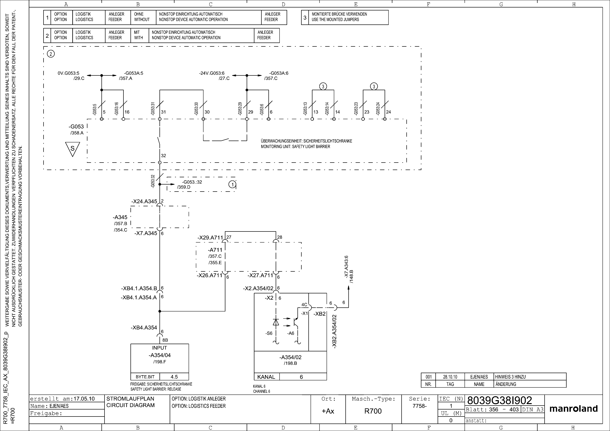

# +Ax — Sheet 356 of 403 — OPTION: LOGISTIK ANLEGER

**OPTION: LOGISTICS FEEDER**

> Part of the manroland **R700** printing press IEC/UL circuit diagrams.
> Drawing class: **Stromlaufplan / Circuit diagram** (DIN A3).
> Document `+Ax` covers the **Central control console** machine section.

## At a glance

| Field | Value |
|---|---|
| Document | `+Ax`  (8039G38I902) |
| Sheet | **356** of 403 |
| Section (DE) | OPTION: LOGISTIK ANLEGER |
| Section (EN) | OPTION: LOGISTICS FEEDER |
| Section type | CIRCUIT — Circuit diagram |
| Machine type | `R700` |
| Series | `7758` |
| Created | 17.05.10 |
| Replaces | — |
| Columns used | A, B, C, D, E, F, G |
| Path numbers | — |
| Labels on sheet | 129 |
| Cross-refs out | 13 |
| Cross-refs in | 24 |

**Previous:** [+Ax sheet 355](SHEET_0355.md) · **Next:** [+Ax sheet 357](SHEET_0357.md) · **Document TOC:** [_TOC.md](_TOC.md)  (+Ax) · **Master TOC:** [all sheets](../_MASTER_TOC.md)

## Sheet image (300 DPI, exact vector render)



_Rendered directly from the PDF vector layer at 300 DPI (1-bit), no OCR and no resampling. Use it to confirm anything ambiguous in the text below._

## Cross-references on this sheet

Each entry is a wire leaving this sheet. The printed token is `/sheet.column`; the link resolves to that sheet inside the same document.

| Ref | Target sheet | Col | Path | Destination on target | Target section | From col |
|---|---|---|---|---|---|---|
| `/29.C` | [+Ax sheet 29](SHEET_0029.md) | C | — | 0V.G053:5 24V.G053:6 G053A:5 | SPANNUNGSVERSORGUNG, SCHALTSCHRANKBELÜFTUNG | B |
| `/27.C` | [+Ax sheet 27](SHEET_0027.md) | C | — | 0V.G053:5 24V.G053:6 G053A:5 | SPANNUNGSVERSORGUNG, SCHALTSCHRANKBELÜFTUNG | B |
| `/357.A` | [+Ax sheet 357](SHEET_0357.md) | A | — | G053A:6 | OPTION: LOGISTIK ANLEGER | C |
| `/357.C` | [+Ax sheet 357](SHEET_0357.md) | C | — | — | OPTION: LOGISTIK ANLEGER | D |
| `/358.A` | [+Ax sheet 358](SHEET_0358.md) | A | — | — | OPTION: LOGISTIK ANLEGER | A |
| `/359.D` | [+Ax sheet 359](SHEET_0359.md) | D | — | — | OPTION: LOGISTIK ANLEGER | C |
| `/357.B` | [+Ax sheet 357](SHEET_0357.md) | B | — | — | OPTION: LOGISTIK ANLEGER | B |
| `/354.C` | [+Ax sheet 354](SHEET_0354.md) | C | — | — | OPTION: LOGISTIK ANLEGER | B |
| `/357.C` | [+Ax sheet 357](SHEET_0357.md) | C | — | — | OPTION: LOGISTIK ANLEGER | C |
| `/148.B` | [+Ax sheet 148](SHEET_0148.md) | B | — | X7.A343:6 | ÜBERWACHUNGSRECHNER SICHERHEITSBUS | E |
| `/355.E` | [+Ax sheet 355](SHEET_0355.md) | E | — | — | OPTION: LOGISTIK ANLEGER | C |
| `/198.F` | [+Ax sheet 198](SHEET_0198.md) | F | — | — | REFERENZMODUL | B |
| `/198.B` | [+Ax sheet 198](SHEET_0198.md) | B | — | — | REFERENZMODUL | D |

### Incoming references (sheets that point here)

Every other sheet that sends a wire to this one. `Back-ref` is the token printed on *that* sheet; `Path` is its line number.

| From sheet | Cols | Back-ref | Path | Refs | What continues there |
|---|---|---|---|---|---|
| [+Ax#27](SHEET_0027.md) | C | `/27.C` | — | 1 | 24V.G053:6 |
| [+Ax#29](SHEET_0029.md) | C | `/29.C` | — | 1 | 0V.G053:5 |
| [+Ax#148](SHEET_0148.md) | B | `/148.B` | — | 1 | X7.A343:6 |
| [+Ax#198](SHEET_0198.md) | B, F | `/198.B`, `/198.F` | — | 2 | — |
| [+Ax#219](SHEET_0219.md) | C, E | `/219.C`, `/219.E` | — | 2 | — |
| [+Ax#228](SHEET_0228.md) | A, B, C | `/228.A`, `/228.B`, `/228.C` | — | 3 | — |
| [+Ax#235](SHEET_0235.md) | H | `/235.H` | — | 1 | — |
| [+Ax#266](SHEET_0266.md) | A | `/266.A` | — | 1 | — |
| [+Ax#269](SHEET_0269.md) | H | `/269.H` | — | 1 | — |
| [+Ax#271](SHEET_0271.md) | A | `/271.A` | — | 1 | — |
| [+Ax#274](SHEET_0274.md) | B | `/274.B` | — | 2 | — |
| [+Ax#354](SHEET_0354.md) | C | `/354.C` | — | 1 | — |
| [+Ax#355](SHEET_0355.md) | E | `/355.E` | — | 1 | A711 |
| [+Ax#357](SHEET_0357.md) | B, C | `/357.B`, `/357.C` | — | 4 | G053A:5 G053A:6 |
| [+Ax#358](SHEET_0358.md) | A | `/358.A` | — | 1 | — |
| [+Ax#359](SHEET_0359.md) | D | `/359.D` | — | 1 | G053.:32 |


## Devices on this sheet

| Tag | Class | Class meaning (IEC) | Col | Sub | Terminal | Sign |
|---|---|---|---|---|---|---|
| `A345` | A | Baugruppe / assembly, module, PC board | B | — | — | — |
| `G053` | G | Stromversorgung / power supply | A | — | — | — |
| `A354/04` | A | Baugruppe / assembly, module, PC board | B | 04 | — | — |
| `S6` | S | Schalter / switch | D | — | — | — |
| `A6` | A | Baugruppe / assembly, module, PC board | D | — | — | — |
| `X1` | X | Klemme / terminal, plug connector | D | — | — | — |
| `X2` | X | Klemme / terminal, plug connector | D | — | — | — |
| `XB2` | XB |  | E | — | — | — |
| `A354/02` | A | Baugruppe / assembly, module, PC board | D | 02 | — | — |
| `A711` | A | Baugruppe / assembly, module, PC board | C | — | — | — |
| `G053:32` | G | Stromversorgung / power supply | B | — | 32 | — |
| `G053:5` | G | Stromversorgung / power supply | A | — | 5 | — |
| `G053:16` | G | Stromversorgung / power supply | B | — | 16 | — |
| `G053:31` | G | Stromversorgung / power supply | B | — | 31 | — |
| `G053:30` | G | Stromversorgung / power supply | C | — | 30 | — |
| `G053:29` | G | Stromversorgung / power supply | C | — | 29 | — |
| `G053:6` | G | Stromversorgung / power supply | D | — | 6 | — |
| `G053:13` | G | Stromversorgung / power supply | D | — | 13 | — |
| `G053:14` | G | Stromversorgung / power supply | E | — | 14 | — |
| `G053:23` | G | Stromversorgung / power supply | E | — | 23 | — |
| `G053:24` | G | Stromversorgung / power supply | E | — | 24 | — |
| `X24.A345` | — | cross-device reference | B | — | — | — |
| `4.5` | — | cross-device reference | B | — | — | — |
| `XB4.A354` | — | cross-device reference | B | — | — | — |
| `X7.A345` | — | cross-device reference | B | — | — | — |
| `XB4.1.A354.B` | — | cross-device reference | B | — | — | — |
| `XB4.1.A354.A` | — | cross-device reference | B | — | — | — |
| `X29.A711` | — | cross-device reference | C | — | — | — |
| `X27.A711` | — | cross-device reference | D | — | — | — |
| `X26.A711` | — | cross-device reference | C | — | — | — |
| `NR.` | — | cross-device reference | F | — | — | — |
| `28.10.10` | — | cross-device reference | F | — | — | — |
| `X7.A343:6` | — | cross-device reference | E | — | 6 | — |

## Potentials / nets

| Potential | Count | Columns | Attached devices | Terminals |
|---|---|---|---|---|
| `0V` | 1 | A | `G053` | `5` |
| `24V` | 1 | C | `G053` | `6` |


A potential such as `L24+/4` or `M24+` is a named supply/return rail; every place it appears on this sheet is electrically common.

## Wire-end annotations (grouped as printed)

A wire that continues elsewhere is annotated with a small cluster: the destination description, the path/line number `#NN`, and the `/sheet.column` cross reference. Each row below is one such cluster exactly as it is grouped on the drawing.

| Col | Y | Path | Cross-ref | Text on the wire |
|---|---|---|---|---|
| B | 24.7 | — | — | `1 FEEDER ANLEGER` |
| A | 24.7 | — | — | `OPTION OPTION` |
| A | 24.7 | — | — | `LOGISTIK LOGISTICS` |
| B | 24.7 | — | — | `FEEDER ANLEGER` |
| B | 24.7 | — | — | `OHNE WITHOUT` |
| C | 24.7 | — | — | `NONSTOP EINRICHTUNG AUTOMATISCH NONSTOP DEVICE AUTOMATIC OPERATION` |
| E | 24.7 | — | — | `3 USE THE MOUNTED JUMPERS MONTIERTE BRÜCKE VERWENDEN` |
| A | 60.1 | — | — | `2 OPTION OPTION` |
| A | 60.1 | — | — | `LOGISTIK LOGISTICS` |
| B | 60.1 | — | — | `MIT` |
| B | 60.2 | — | — | `FEEDER ANLEGER` |
| C | 60.2 | — | — | `NONSTOP EINRICHTUNG AUTOMATISCH NONSTOP DEVICE AUTOMATIC OPERATION` |
| D | 60.2 | — | — | `FEEDER ANLEGER` |
| B | 70.7 | — | — | `WITH` |
| A | 102.3 | — | — | `2` |
| B | 139.2 | — | `/29.C`, `/27.C` | `0V.G053:5 G053A:5 24V.G053:6` |
| C | 139.2 | — | `/357.A` | `G053A:6` |
| D | 149.1 | — | `/357.C` | — |
| E | 166.1 | — | — | `3` |
| E | 166.1 | — | — | `3` |
| B | 199.3 | — | — | `G053:31` |
| B | 199.7 | — | — | `G053:16` |
| C | 199.7 | — | — | `G053:30` |
| C | 199.7 | — | — | `G053:29` |
| D | 199.7 | — | — | `G053:13` |
| E | 199.7 | — | — | `G053:14` |
| E | 199.7 | — | — | `G053:23` |
| E | 199.7 | — | — | `G053:24` |
| A | 203.1 | — | — | `G053:5` |
| D | 203.1 | — | — | `G053:6` |
| C | 215.1 | — | — | `5 31 30 29` |
| C | 215.1 | — | — | `16 6` |
| D | 215.1 | — | — | `13` |
| E | 215.1 | — | — | `14 23 24` |
| A | 242.7 | — | — | `G053` |
| A | 255.7 | — | `/358.A` | — |
| D | 272.8 | — | — | `ÜBERWACHUNGSEINHEIT: SICHERHEITSLICHTSCHRANKE MONITORING UNIT: SAFETY LIGHT BARRIER` |
| A | 284.6 | — | — | `S` |
| B | 300.1 | — | — | `32` |
| B | 341.4 | — | — | `G053:32` |
| C | 351.8 | — | — | `G053.:32` |
| C | 356.9 | — | — | `1` |
| C | 361.7 | — | `/359.D` | — |
| B | 388.6 | — | — | `X24.A345 2` |
| B | 419.8 | — | — | `A345` |
| B | 432.9 | — | `/357.B`, `/354.C` | — |
| B | 451.0 | — | — | `X7.A345 6` |
| C | 459.5 | — | — | `X29.A711 27 28` |
| C | 483.6 | — | — | `A711` |
| C | 496.7 | — | `/357.C` | — |
| E | 499.2 | — | `/148.B` | `X7.A343:6` |
| C | 509.1 | — | `/355.E` | — |
| C | 533.2 | — | — | `X26.A711 6 X27.A711 6` |
| B | 558.7 | — | — | `XB4.1.A354.B 6` |
| D | 558.7 | — | — | `X2.A354/02 6` |
| B | 575.8 | — | — | `XB4.1.A354.A 6` |
| D | 577.2 | — | — | `X2` |
| D | 578.6 | — | — | `6 6` |
| E | 587.1 | — | — | `6` |
| D | 591.4 | — | — | `4C` |
| D | 608.3 | — | — | `X1` |
| E | 608.4 | — | — | `XB2` |
| E | 614.5 | — | — | `XB2.A354/02` |
| B | 635.3 | — | — | `XB4.A354 6` |
| D | 647.3 | — | — | `S6 A6` |
| B | 660.7 | — | — | `8B` |
| B | 675.3 | — | — | `INPUT` |
| B | 689.1 | — | — | `A354/04` |
| D | 693.4 | — | — | `A354/02` |
| B | 702.9 | — | `/198.F` | — |
| D | 705.7 | — | `/198.B` | — |
| D | 731.6 | — | — | `KANAL 6` |
| B | 732.0 | — | — | `BYTE.BIT 4.5` |
| G | 733.0 | — | — | `001 28.10.10 EJEN/AES HINWEIS 3 HINZU` |
| G | 747.1 | — | — | `NR. TAG NAME ÄNDERUNG` |
| B | 747.7 | — | — | `FREIGABE: SICHERHEITSLICHTSCHRANKE SAFETY LIGHT BARRIER: RELEASE` |
| D | 752.0 | — | — | `KANAL 6 CHANNEL 6` |


## Reconstructed tables

This sheet carries tabular content (pin map / terminal assignment / index). The grid below was rebuilt from the drawing's own rule lines, so each row is exactly one physical row of the table.

### Table 1 — 6 data rows × 18 columns (at x=198.4, y=175.7)

| G053:16 5 A345 /357.B /354.C | 16 | G053:31 G053:32 X24.A345 | 31 32 /359.D 2 | G053:30 G053.:32 | 30 | G053:29 1 | 29 | G053:6 | 6 MONITORING | ÜBERWACHUNGSEINHEIT: UNIT: | G053:13 SAFETY | LIGHT | 13 BARRIER | G053:14 SICHERHEITSLICHTSCHRANKE | 14 | G053:23 | G053:24 23 |
|---|---|---|---|---|---|---|---|---|---|---|---|---|---|---|---|---|---|
|  |  | `X7.A345 XB4.1.A354.B` | `6 6` |  | `X29.A711 A711 /357.C /355.E X26.A711` | `27 6` |  | `X27.A711 X2.A354/02` |  | `28 6 6` |  |  |  |  | `X7.A343:6` | `/148.B` |  |
|  |  | `XB4.1.A354.A` | `6` |  |  |  |  |  | `X2` | `6` | `4C` |  |  | `6` | `6` |  |  |
|  |  | `XB4.A354` | `6 8B` |  |  |  |  |  | `S6` | `A6` | `X1` |  | `XB2` |  | `XB2.A354/02` |  |  |
|  |  | `INPUT` |  |  |  |  |  |  |  |  |  |  |  |  |  |  |  |
|  |  |  | `A354/04 /198.F` |  |  |  |  |  |  | `A354/02 /198.B` |  |  |  |  |  |  |  |
|  |  | `BYTE.BIT` | `4.5` |  |  |  |  | `KANAL` |  |  | `6` |  |  |  |  |  |  |


## Notes and free text on this sheet

| Text | Col | Y (pt) |
|---|---|---|
| `ÜBERWACHUNGSEINHEIT: SICHERHEITSLICHTSCHRANKE` | D | 272.75 |
| `MONITORING UNIT: SAFETY LIGHT BARRIER` | D | 283.39 |
| `8B` | B | 660.74 |
| `INPUT` | B | 675.28 |
| `BYTE.BIT` | B | 732.53 |
| `FREIGABE: SICHERHEITSLICHTSCHRANKE` | B | 747.72 |
| `SAFETY LIGHT BARRIER: RELEASE` | B | 757.67 |
| `KANAL 6` | D | 751.96 |
| `CHANNEL 6` | D | 761.91 |
| `4C` | D | 591.35 |
| `KANAL` | D | 731.64 |
| `X2.A354/02` | D | 558.73 |
| `XB2.A354/02` | E | 614.55 |
| `TAG` | F | 747.27 |
| `NAME` | G | 747.25 |
| `ÄNDERUNG` | G | 747.31 |
| `EJEN/AES` | G | 733.09 |
| `HINWEIS 3 HINZU` | G | 733.1 |
| `G053.:32` | C | 351.79 |
| `G053A:6` | D | 139.19 |
| `G053A:5` | B | 139.19 |
| `S` | A | 284.55 |
| `OPTION` | A | 60.13 |
| `LOGISTIK` | A | 60.12 |
| `LOGISTICS` | A | 70.75 |
| `ANLEGER` | B | 60.16 |
| `FEEDER` | B | 70.76 |
| `MIT` | B | 60.12 |
| `WITH` | B | 70.66 |
| `NONSTOP EINRICHTUNG AUTOMATISCH` | C | 60.16 |
| `NONSTOP DEVICE AUTOMATIC OPERATION` | C | 70.78 |
| `ANLEGER` | D | 60.16 |
| `FEEDER` | D | 70.76 |
| `OHNE` | B | 24.71 |
| `WITHOUT` | B | 35.31 |
| `MONTIERTE BRÜCKE VERWENDEN` | E | 24.71 |
| `USE THE MOUNTED JUMPERS` | E | 35.36 |

## Complete label inventory (exact text from the drawing)

Every text object inside the drawing area of this sheet, in DIN reading order (column A→H, then top→bottom). This is the authoritative list: if a string is not here it is not printed on this sheet.

| Col | Y | X | Dir | Type | Text |
|---|---|---|---|---|---|
| A | 24.7 | 106.0 | → | text | `OPTION` |
| A | 24.7 | 148.0 | → | text | `LOGISTIK` |
| A | 30.0 | 89.6 | → | number | `1` |
| A | 35.3 | 106.0 | → | text | `OPTION` |
| A | 35.3 | 148.0 | → | text | `LOGISTICS` |
| A | 60.1 | 106.0 | → | text | `OPTION` |
| A | 60.1 | 148.0 | → | text | `LOGISTIK` |
| A | 65.5 | 89.3 | → | number | `2` |
| A | 70.8 | 106.0 | → | text | `OPTION` |
| A | 70.8 | 148.0 | → | text | `LOGISTICS` |
| A | 102.3 | 97.2 | → | number | `2` |
| A | 139.2 | 112.8 | → | potential | `0V.G053:5` |
| A | 149.1 | 143.7 | → | cross-reference | `/29.C` |
| A | 203.1 | 182.1 | ↕ | device tag | `G053:5` |
| A | 242.7 | 134.1 | → | device tag | `G053` |
| A | 255.7 | 137.5 | → | cross-reference | `/358.A` |
| A | 284.6 | 137.6 | → | text | `S` |
| B | 24.7 | 212.6 | → | text | `ANLEGER` |
| B | 24.7 | 261.9 | → | text | `OHNE` |
| B | 35.3 | 211.7 | → | text | `FEEDER` |
| B | 35.3 | 262.2 | → | text | `WITHOUT` |
| B | 60.1 | 261.6 | → | text | `MIT` |
| B | 60.2 | 212.6 | → | text | `ANLEGER` |
| B | 70.7 | 262.2 | → | text | `WITH` |
| B | 70.8 | 211.7 | → | text | `FEEDER` |
| B | 139.2 | 242.1 | → | text | `G053A:5` |
| B | 149.1 | 232.4 | → | cross-reference | `/357.A` |
| B | 199.3 | 295.4 | ↕ | device tag | `G053:31` |
| B | 199.7 | 224.6 | ↕ | device tag | `G053:16` |
| B | 215.0 | 201.0 | → | number | `5` |
| B | 215.0 | 242.9 | → | number | `16` |
| B | 215.0 | 314.4 | → | number | `31` |
| B | 300.1 | 314.4 | → | number | `32` |
| B | 341.4 | 295.4 | ↕ | device tag | `G053:32` |
| B | 388.7 | 256.5 | → | device ref | `X24.A345` |
| B | 388.7 | 314.4 | → | number | `2` |
| B | 419.8 | 220.3 | → | device tag | `A345` |
| B | 432.9 | 222.8 | → | cross-reference | `/357.B` |
| B | 445.3 | 222.5 | → | cross-reference | `/354.C` |
| B | 451.0 | 262.5 | → | device ref | `X7.A345` |
| B | 452.5 | 314.4 | → | number | `6` |
| B | 558.7 | 236.7 | → | device ref | `XB4.1.A354.B` |
| B | 558.7 | 314.4 | → | number | `6` |
| B | 575.8 | 314.4 | → | number | `6` |
| B | 576.5 | 235.8 | → | device ref | `XB4.1.A354.A` |
| B | 635.3 | 255.4 | → | device ref | `XB4.A354` |
| B | 643.8 | 314.4 | → | number | `6` |
| B | 660.7 | 317.2 | → | text | `8B` |
| B | 675.3 | 296.9 | → | text | `INPUT` |
| B | 689.1 | 290.4 | → | device tag | `A354/04` |
| B | 702.9 | 299.5 | → | cross-reference | `/198.F` |
| B | 732.0 | 333.4 | → | device ref | `4.5` |
| B | 732.5 | 265.0 | → | text | `BYTE.BIT` |
| B | 747.7 | 254.6 | → | text | `FREIGABE: SICHERHEITSLICHTSCHRANKE` |
| B | 757.7 | 254.8 | → | text | `SAFETY LIGHT BARRIER: RELEASE` |
| C | 24.7 | 311.0 | → | text | `NONSTOP EINRICHTUNG AUTOMATISCH` |
| C | 35.4 | 311.0 | → | text | `NONSTOP DEVICE AUTOMATIC OPERATION` |
| C | 60.2 | 296.8 | → | text | `NONSTOP EINRICHTUNG AUTOMATISCH` |
| C | 70.8 | 296.8 | → | text | `NONSTOP DEVICE AUTOMATIC OPERATION` |
| C | 139.2 | 388.6 | → | potential | `24V.G053:6` |
| C | 149.1 | 427.2 | → | cross-reference | `/27.C` |
| C | 199.7 | 380.5 | ↕ | device tag | `G053:30` |
| C | 199.7 | 465.5 | ↕ | device tag | `G053:29` |
| C | 215.0 | 399.4 | → | number | `30` |
| C | 351.8 | 355.5 | → | text | `G053.:32` |
| C | 356.9 | 451.8 | → | number | `1` |
| C | 361.7 | 345.8 | → | cross-reference | `/359.D` |
| C | 459.5 | 385.5 | → | device ref | `X29.A711` |
| C | 459.5 | 441.9 | → | number | `27` |
| C | 483.6 | 405.9 | → | device tag | `A711` |
| C | 496.7 | 406.8 | → | cross-reference | `/357.C` |
| C | 509.1 | 407.3 | → | cross-reference | `/355.E` |
| C | 533.2 | 384.1 | → | device ref | `X26.A711` |
| C | 537.5 | 441.9 | → | number | `6` |
| D | 24.7 | 517.3 | → | text | `ANLEGER` |
| D | 30.0 | 592.3 | → | number | `3` |
| D | 35.3 | 516.5 | → | text | `FEEDER` |
| D | 60.2 | 503.1 | → | text | `ANLEGER` |
| D | 70.8 | 502.3 | → | text | `FEEDER` |
| D | 139.2 | 525.5 | → | text | `G053A:6` |
| D | 149.1 | 515.9 | → | cross-reference | `/357.C` |
| D | 199.7 | 593.1 | ↕ | device tag | `G053:13` |
| D | 203.1 | 508.0 | ↕ | device tag | `G053:6` |
| D | 215.0 | 484.4 | → | number | `29` |
| D | 215.0 | 527.0 | → | number | `6` |
| D | 215.0 | 611.4 | → | number | `13` |
| D | 272.8 | 509.4 | → | text | `ÜBERWACHUNGSEINHEIT: SICHERHEITSLICHTSCHRANKE` |
| D | 283.4 | 509.7 | → | text | `MONITORING UNIT: SAFETY LIGHT BARRIER` |
| D | 459.5 | 541.1 | → | number | `28` |
| D | 533.2 | 483.3 | → | device ref | `X27.A711` |
| D | 537.5 | 541.1 | → | number | `6` |
| D | 558.7 | 474.5 | → | text | `X2.A354/02` |
| D | 558.7 | 541.1 | → | number | `6` |
| D | 577.2 | 517.0 | → | device tag | `X2` |
| D | 578.6 | 544.0 | → | number | `6` |
| D | 591.4 | 588.8 | → | text | `4C` |
| D | 608.3 | 587.6 | → | device tag | `X1` |
| D | 647.3 | 518.2 | → | device tag | `S6` |
| D | 647.3 | 560.7 | → | device tag | `A6` |
| D | 693.4 | 545.5 | → | device tag | `A354/02` |
| D | 705.7 | 554.3 | → | cross-reference | `/198.B` |
| D | 731.6 | 502.3 | → | text | `KANAL` |
| D | 731.6 | 585.4 | → | number | `6` |
| D | 752.0 | 494.1 | → | text | `KANAL 6` |
| D | 761.9 | 494.4 | → | text | `CHANNEL 6` |
| E | 24.7 | 608.9 | → | text | `MONTIERTE BRÜCKE VERWENDEN` |
| E | 35.4 | 608.6 | → | text | `USE THE MOUNTED JUMPERS` |
| E | 166.1 | 628.7 | → | number | `3` |
| E | 166.1 | 727.9 | → | number | `3` |
| E | 199.7 | 635.6 | ↕ | device tag | `G053:14` |
| E | 199.7 | 692.3 | ↕ | device tag | `G053:23` |
| E | 199.7 | 734.8 | ↕ | device tag | `G053:24` |
| E | 215.0 | 654.0 | → | number | `14` |
| E | 215.0 | 711.2 | → | number | `23` |
| E | 215.0 | 753.7 | → | number | `24` |
| E | 499.2 | 672.1 | ↕ | device ref | `X7.A343:6` |
| E | 527.2 | 682.0 | ↕ | cross-reference | `/148.B` |
| E | 587.1 | 668.7 | → | number | `6` |
| E | 588.5 | 643.2 | → | number | `6` |
| E | 608.3 | 612.0 | → | device tag | `XB2` |
| E | 614.6 | 648.0 | ↕ | text | `XB2.A354/02` |
| F | 733.0 | 831.0 | → | number | `001` |
| F | 733.1 | 865.2 | → | device ref | `28.10.10` |
| F | 747.1 | 830.0 | → | device ref | `NR.` |
| F | 747.3 | 871.6 | → | text | `TAG` |
| G | 733.1 | 918.2 | → | text | `EJEN/AES` |
| G | 733.1 | 966.5 | → | text | `HINWEIS 3 HINZU` |
| G | 747.3 | 925.0 | → | text | `NAME` |
| G | 747.3 | 967.6 | → | text | `ÄNDERUNG` |

## Reading-order text block

The same content as a plain block, grouped by DIN column — convenient to paste or to match against a visual description.

```text
=== Column A ===
  24.7  106.0  text         OPTION
  24.7  148.0  text         LOGISTIK
  30.0   89.6  numeric      1
  35.3  106.0  text         OPTION
  35.3  148.0  text         LOGISTICS
  60.1  106.0  text         OPTION
  60.1  148.0  text         LOGISTIK
  65.5   89.3  numeric      2
  70.8  106.0  text         OPTION
  70.8  148.0  text         LOGISTICS
 102.3   97.2  numeric      2
 139.2  112.8  net          0V.G053:5
 149.1  143.7  xref         /29.C
 203.1  182.1  devtag       G053:5
 242.7  134.1  devtag       G053
 255.7  137.5  xref         /358.A
 284.6  137.6  text         S
=== Column B ===
  24.7  212.6  text         ANLEGER
  24.7  261.9  text         OHNE
  35.3  211.7  text         FEEDER
  35.3  262.2  text         WITHOUT
  60.1  261.6  text         MIT
  60.2  212.6  text         ANLEGER
  70.7  262.2  text         WITH
  70.8  211.7  text         FEEDER
 139.2  242.1  text         G053A:5
 149.1  232.4  xref         /357.A
 199.3  295.4  devtag       G053:31
 199.7  224.6  devtag       G053:16
 215.0  201.0  numeric      5
 215.0  242.9  numeric      16
 215.0  314.4  numeric      31
 300.1  314.4  numeric      32
 341.4  295.4  devtag       G053:32
 388.7  256.5  devref       X24.A345
 388.7  314.4  numeric      2
 419.8  220.3  devtag       A345
 432.9  222.8  xref         /357.B
 445.3  222.5  xref         /354.C
 451.0  262.5  devref       X7.A345
 452.5  314.4  numeric      6
 558.7  236.7  devref       XB4.1.A354.B
 558.7  314.4  numeric      6
 575.8  314.4  numeric      6
 576.5  235.8  devref       XB4.1.A354.A
 635.3  255.4  devref       XB4.A354
 643.8  314.4  numeric      6
 660.7  317.2  text         8B
 675.3  296.9  text         INPUT
 689.1  290.4  devtag       A354/04
 702.9  299.5  xref         /198.F
 732.0  333.4  devref       4.5
 732.5  265.0  text         BYTE.BIT
 747.7  254.6  text         FREIGABE: SICHERHEITSLICHTSCHRANKE
 757.7  254.8  text         SAFETY LIGHT BARRIER: RELEASE
=== Column C ===
  24.7  311.0  text         NONSTOP EINRICHTUNG AUTOMATISCH
  35.4  311.0  text         NONSTOP DEVICE AUTOMATIC OPERATION
  60.2  296.8  text         NONSTOP EINRICHTUNG AUTOMATISCH
  70.8  296.8  text         NONSTOP DEVICE AUTOMATIC OPERATION
 139.2  388.6  net          24V.G053:6
 149.1  427.2  xref         /27.C
 199.7  380.5  devtag       G053:30
 199.7  465.5  devtag       G053:29
 215.0  399.4  numeric      30
 351.8  355.5  text         G053.:32
 356.9  451.8  numeric      1
 361.7  345.8  xref         /359.D
 459.5  385.5  devref       X29.A711
 459.5  441.9  numeric      27
 483.6  405.9  devtag       A711
 496.7  406.8  xref         /357.C
 509.1  407.3  xref         /355.E
 533.2  384.1  devref       X26.A711
 537.5  441.9  numeric      6
=== Column D ===
  24.7  517.3  text         ANLEGER
  30.0  592.3  numeric      3
  35.3  516.5  text         FEEDER
  60.2  503.1  text         ANLEGER
  70.8  502.3  text         FEEDER
 139.2  525.5  text         G053A:6
 149.1  515.9  xref         /357.C
 199.7  593.1  devtag       G053:13
 203.1  508.0  devtag       G053:6
 215.0  484.4  numeric      29
 215.0  527.0  numeric      6
 215.0  611.4  numeric      13
 272.8  509.4  text         ÜBERWACHUNGSEINHEIT: SICHERHEITSLICHTSCHRANKE
 283.4  509.7  text         MONITORING UNIT: SAFETY LIGHT BARRIER
 459.5  541.1  numeric      28
 533.2  483.3  devref       X27.A711
 537.5  541.1  numeric      6
 558.7  474.5  text         X2.A354/02
 558.7  541.1  numeric      6
 577.2  517.0  devtag       X2
 578.6  544.0  numeric      6
 591.4  588.8  text         4C
 608.3  587.6  devtag       X1
 647.3  518.2  devtag       S6
 647.3  560.7  devtag       A6
 693.4  545.5  devtag       A354/02
 705.7  554.3  xref         /198.B
 731.6  502.3  text         KANAL
 731.6  585.4  numeric      6
 752.0  494.1  text         KANAL 6
 761.9  494.4  text         CHANNEL 6
=== Column E ===
  24.7  608.9  text         MONTIERTE BRÜCKE VERWENDEN
  35.4  608.6  text         USE THE MOUNTED JUMPERS
 166.1  628.7  numeric      3
 166.1  727.9  numeric      3
 199.7  635.6  devtag       G053:14
 199.7  692.3  devtag       G053:23
 199.7  734.8  devtag       G053:24
 215.0  654.0  numeric      14
 215.0  711.2  numeric      23
 215.0  753.7  numeric      24
 499.2  672.1  devref       X7.A343:6
 527.2  682.0  xref         /148.B
 587.1  668.7  numeric      6
 588.5  643.2  numeric      6
 608.3  612.0  devtag       XB2
 614.6  648.0  text         XB2.A354/02
=== Column F ===
 733.0  831.0  numeric      001
 733.1  865.2  devref       28.10.10
 747.1  830.0  devref       NR.
 747.3  871.6  text         TAG
=== Column G ===
 733.1  918.2  text         EJEN/AES
 733.1  966.5  text         HINWEIS 3 HINZU
 747.3  925.0  text         NAME
 747.3  967.6  text         ÄNDERUNG
```

---
_Generated from the PDF vector text layer; no OCR. Source: `R700_7758_IEC_AX_8039G38I902_p`, sheet 356._
