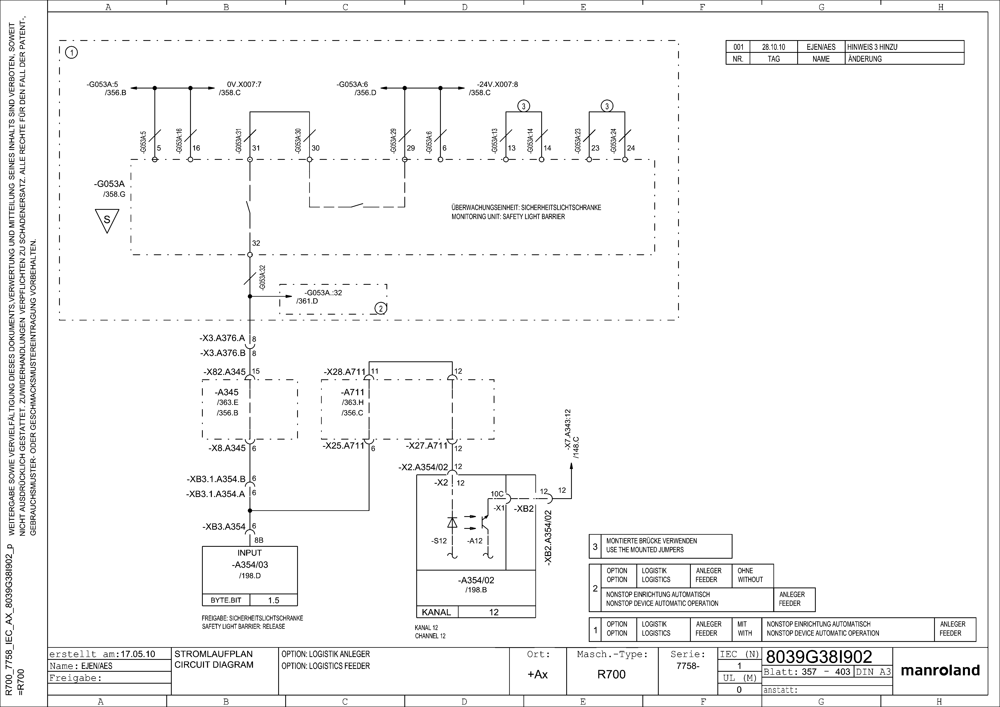

# +Ax — Sheet 357 of 403 — OPTION: LOGISTIK ANLEGER

**OPTION: LOGISTICS FEEDER**

> Part of the manroland **R700** printing press IEC/UL circuit diagrams.
> Drawing class: **Stromlaufplan / Circuit diagram** (DIN A3).
> Document `+Ax` covers the **Central control console** machine section.

## At a glance

| Field | Value |
|---|---|
| Document | `+Ax`  (8039G38I902) |
| Sheet | **357** of 403 |
| Section (DE) | OPTION: LOGISTIK ANLEGER |
| Section (EN) | OPTION: LOGISTICS FEEDER |
| Section type | CIRCUIT — Circuit diagram |
| Machine type | `R700` |
| Series | `7758` |
| Created | 17.05.10 |
| Replaces | — |
| Columns used | A, B, C, D, E, F, G, H |
| Path numbers | — |
| Labels on sheet | 133 |
| Cross-refs out | 13 |
| Cross-refs in | 26 |

**Previous:** [+Ax sheet 356](SHEET_0356.md) · **Next:** [+Ax sheet 358](SHEET_0358.md) · **Document TOC:** [_TOC.md](_TOC.md)  (+Ax) · **Master TOC:** [all sheets](../_MASTER_TOC.md)

## Sheet image (300 DPI, exact vector render)



_Rendered directly from the PDF vector layer at 300 DPI (1-bit), no OCR and no resampling. Use it to confirm anything ambiguous in the text below._

## Cross-references on this sheet

Each entry is a wire leaving this sheet. The printed token is `/sheet.column`; the link resolves to that sheet inside the same document.

| Ref | Target sheet | Col | Path | Destination on target | Target section | From col |
|---|---|---|---|---|---|---|
| `/358.C` | [+Ax sheet 358](SHEET_0358.md) | C | — | 0V.X007:7 | OPTION: LOGISTIK ANLEGER | C |
| `/356.B` | [+Ax sheet 356](SHEET_0356.md) | B | — | G053A:5 G053A:6 | OPTION: LOGISTIK ANLEGER | B |
| `/356.D` | [+Ax sheet 356](SHEET_0356.md) | D | — | G053A:5 G053A:6 | OPTION: LOGISTIK ANLEGER | B |
| `/358.C` | [+Ax sheet 358](SHEET_0358.md) | C | — | — | OPTION: LOGISTIK ANLEGER | B |
| `/358.G` | [+Ax sheet 358](SHEET_0358.md) | G | — | — | OPTION: LOGISTIK ANLEGER | A |
| `/361.D` | [+Ax sheet 361](SHEET_0361.md) | D | — | — | OPTION: LOGISTIK ANLEGER | C |
| `/363.E` | [+Ax sheet 363](SHEET_0363.md) | E | — | — | OPTION: LOGISTIK AUSLEGER | B |
| `/356.B` | [+Ax sheet 356](SHEET_0356.md) | B | — | — | OPTION: LOGISTIK ANLEGER | B |
| `/363.H` | [+Ax sheet 363](SHEET_0363.md) | H | — | — | OPTION: LOGISTIK AUSLEGER | C |
| `/356.C` | [+Ax sheet 356](SHEET_0356.md) | C | — | — | OPTION: LOGISTIK ANLEGER | C |
| `/148.C` | [+Ax sheet 148](SHEET_0148.md) | C | — | X7.A343:12 | ÜBERWACHUNGSRECHNER SICHERHEITSBUS | E |
| `/198.D` | [+Ax sheet 198](SHEET_0198.md) | D | — | — | REFERENZMODUL | B |
| `/198.B` | [+Ax sheet 198](SHEET_0198.md) | B | — | — | REFERENZMODUL | D |

### Incoming references (sheets that point here)

Every other sheet that sends a wire to this one. `Back-ref` is the token printed on *that* sheet; `Path` is its line number.

| From sheet | Cols | Back-ref | Path | Refs | What continues there |
|---|---|---|---|---|---|
| [+Ax#148](SHEET_0148.md) | C | `/148.C` | — | 1 | X7.A343:12 |
| [+Ax#198](SHEET_0198.md) | B, D | `/198.B`, `/198.D` | — | 2 | — |
| [+Ax#219](SHEET_0219.md) | C, E | `/219.C`, `/219.E` | — | 2 | — |
| [+Ax#224](SHEET_0224.md) | A, B, C, E, F | `/224.A`, `/224.B`, `/224.C`, `/224.E`, `/224.F` | — | 5 | — |
| [+Ax#238](SHEET_0238.md) | A | `/238.A` | — | 1 | — |
| [+Ax#268](SHEET_0268.md) | C | `/268.C` | — | 1 | — |
| [+Ax#271](SHEET_0271.md) | A | `/271.A` | — | 1 | — |
| [+Ax#272](SHEET_0272.md) | G | `/272.G` | — | 2 | — |
| [+Ax#286](SHEET_0286.md) | F | `/286.F` | — | 1 | — |
| [+Ax#356](SHEET_0356.md) | B, C, D | `/356.B`, `/356.C`, `/356.D` | — | 4 | G053A:6 |
| [+Ax#358](SHEET_0358.md) | B, F | `/358.B`, `/358.F` | — | 3 | 0V.X007:7; 24V.X007:8 |
| [+Ax#361](SHEET_0361.md) | D | `/361.D` | — | 1 | G053A.:32 |
| [+Ax#363](SHEET_0363.md) | E, H | `/363.E`, `/363.H` | — | 2 | A711 |


## Devices on this sheet

| Tag | Class | Class meaning (IEC) | Col | Sub | Terminal | Sign |
|---|---|---|---|---|---|---|
| `A345` | A | Baugruppe / assembly, module, PC board | B | — | — | — |
| `A354/03` | A | Baugruppe / assembly, module, PC board | B | 03 | — | — |
| `S12` | S | Schalter / switch | D | — | — | — |
| `A12` | A | Baugruppe / assembly, module, PC board | D | — | — | — |
| `X1` | X | Klemme / terminal, plug connector | D | — | — | — |
| `X2` | X | Klemme / terminal, plug connector | D | — | — | — |
| `XB2` | XB |  | E | — | — | — |
| `A354/02` | A | Baugruppe / assembly, module, PC board | D | 02 | — | — |
| `A711` | A | Baugruppe / assembly, module, PC board | C | — | — | — |
| `X3.A376.A` | — | cross-device reference | B | — | — | — |
| `X3.A376.B` | — | cross-device reference | B | — | — | — |
| `X8.A345` | — | cross-device reference | B | — | — | — |
| `X82.A345` | — | cross-device reference | B | — | — | — |
| `1.5` | — | cross-device reference | B | — | — | — |
| `XB3.A354` | — | cross-device reference | B | — | — | — |
| `X27.A711` | — | cross-device reference | D | — | — | — |
| `X25.A711` | — | cross-device reference | C | — | — | — |
| `XB3.1.A354.B` | — | cross-device reference | B | — | — | — |
| `XB3.1.A354.A` | — | cross-device reference | B | — | — | — |
| `X28.A711` | — | cross-device reference | C | — | — | — |
| `NR.` | — | cross-device reference | F | — | — | — |
| `28.10.10` | — | cross-device reference | G | — | — | — |
| `X7.A343:12` | — | cross-device reference | E | — | 12 | — |

## Potentials / nets

| Potential | Count | Columns | Attached devices | Terminals |
|---|---|---|---|---|
| `0V` | 1 | B | `X007` | `7` |
| `24V` | 1 | D | `X007` | `8` |


A potential such as `L24+/4` or `M24+` is a named supply/return rail; every place it appears on this sheet is electrically common.

## Wire-end annotations (grouped as printed)

A wire that continues elsewhere is annotated with a small cluster: the destination description, the path/line number `#NN`, and the `/sheet.column` cross reference. Each row below is one such cluster exactly as it is grouped on the drawing.

| Col | Y | Path | Cross-ref | Text on the wire |
|---|---|---|---|---|
| G | 52.7 | — | — | `001 28.10.10 EJEN/AES HINWEIS 3 HINZU` |
| A | 59.3 | — | — | `1` |
| G | 66.8 | — | — | `NR. TAG NAME ÄNDERUNG` |
| B | 96.7 | — | `/356.B`, `/356.D` | `G053A:5 G053A:6` |
| C | 96.7 | — | `/358.C` | `0V.X007:7` |
| D | 96.7 | — | — | `24V.X007:8` |
| B | 106.6 | — | `/358.C` | — |
| D | 123.6 | — | — | `3` |
| E | 123.6 | — | — | `3` |
| B | 152.6 | — | — | `G053A:31` |
| B | 153.0 | — | — | `G053A:16` |
| C | 153.0 | — | — | `G053A:30` |
| C | 153.0 | — | — | `G053A:29` |
| D | 153.0 | — | — | `G053A:13` |
| E | 153.0 | — | — | `G053A:14` |
| E | 153.0 | — | — | `G053A:23` |
| E | 153.0 | — | — | `G053A:24` |
| A | 156.4 | — | — | `G053A:5` |
| D | 156.4 | — | — | `G053A:6` |
| B | 172.5 | — | — | `5 31` |
| C | 172.5 | — | — | `16 30 29 6` |
| E | 172.5 | — | — | `13 14 23 24` |
| A | 214.3 | — | — | `G053A` |
| A | 227.4 | — | `/358.G` | — |
| E | 244.4 | — | — | `ÜBERWACHUNGSEINHEIT: SICHERHEITSLICHTSCHRANKE MONITORING UNIT: SAFETY LIGHT BARRIER` |
| A | 256.2 | — | — | `S` |
| B | 285.9 | — | — | `32` |
| B | 315.9 | — | — | `G053A:32` |
| C | 344.7 | — | — | `G053A.:32` |
| C | 354.6 | — | `/361.D` | — |
| C | 364.5 | — | — | `2` |
| B | 397.9 | — | — | `X3.A376.A 8` |
| B | 415.6 | — | — | `X3.A376.B 8` |
| B | 438.3 | — | — | `X82.A345 15` |
| C | 438.3 | — | — | `X28.A711 11 12` |
| B | 462.4 | — | — | `A345` |
| C | 462.4 | — | — | `A711` |
| B | 475.4 | — | `/363.E`, `/356.B` | — |
| C | 475.4 | — | `/363.H`, `/356.C` | — |
| E | 487.3 | — | `/148.C` | `X7.A343:12` |
| C | 526.1 | — | — | `X25.A711 6 X27.A711 12` |
| B | 529.0 | — | — | `X8.A345 6` |
| D | 551.6 | — | — | `X2.A354/02 12` |
| B | 565.8 | — | — | `XB3.1.A354.B 6` |
| D | 570.1 | — | — | `X2` |
| D | 571.5 | — | — | `12 12` |
| E | 580.0 | — | — | `12` |
| B | 582.8 | — | — | `XB3.1.A354.A 6` |
| D | 584.3 | — | — | `10C` |
| D | 601.2 | — | — | `X1` |
| E | 601.3 | — | — | `XB2` |
| E | 607.5 | — | — | `XB2.A354/02` |
| B | 622.5 | — | — | `XB3.A354 6` |
| B | 639.5 | — | — | `8B` |
| D | 640.2 | — | — | `S12 A12` |
| F | 641.2 | — | — | `3 USE THE MOUNTED JUMPERS MONTIERTE BRÜCKE VERWENDEN` |
| B | 654.0 | — | — | `INPUT` |
| B | 667.9 | — | — | `A354/03` |
| E | 676.7 | — | — | `OPTION OPTION` |
| F | 676.7 | — | — | `LOGISTIK LOGISTICS` |
| F | 676.7 | — | — | `FEEDER ANLEGER` |
| F | 676.7 | — | — | `OHNE WITHOUT` |
| B | 681.7 | — | `/198.D` | — |
| D | 686.3 | — | — | `A354/02` |
| E | 696.2 | — | — | `2` |
| D | 698.6 | — | `/198.B` | — |
| F | 705.0 | — | — | `NONSTOP EINRICHTUNG AUTOMATISCH NONSTOP DEVICE AUTOMATIC OPERATION` |
| G | 705.0 | — | — | `FEEDER ANLEGER` |
| B | 710.7 | — | — | `BYTE.BIT 1.5` |
| D | 724.5 | — | — | `KANAL 12` |
| B | 733.5 | — | — | `FREIGABE: SICHERHEITSLICHTSCHRANKE SAFETY LIGHT BARRIER: RELEASE` |
| E | 740.4 | — | — | `1 OPTION OPTION` |
| F | 740.4 | — | — | `LOGISTIK LOGISTICS` |
| F | 740.4 | — | — | `MIT` |
| F | 740.5 | — | — | `FEEDER ANLEGER` |
| G | 740.5 | — | — | `NONSTOP EINRICHTUNG AUTOMATISCH NONSTOP DEVICE AUTOMATIC OPERATION` |
| H | 740.5 | — | — | `FEEDER ANLEGER` |
| D | 744.9 | — | — | `KANAL 12 CHANNEL 12` |
| F | 751.0 | — | — | `WITH` |


## Reconstructed tables

This sheet carries tabular content (pin map / terminal assignment / index). The grid below was rebuilt from the drawing's own rule lines, so each row is exactly one physical row of the table.

### Table 1 — 9 data rows × 13 columns (at x=184.3, y=104.9)

|  |  | /358.C |  |  | /356.D |  |  |  |  | /358.C |  | 3 |
|---|---|---|---|---|---|---|---|---|---|---|---|---|
| `G053A:16 5` | `16` | `G053A:31` | `31` | `G053A:30` | `30` | `G053A:29` | `29` | `G053A:6` | `6` |  | `G053A:13` | `G053A:14 13` |
|  |  | `X3.A376.A X3.A376.B` | `32 G053A:32 8 8` | `/361.D` | `G053A.:32` | `2` |  |  |  | `ÜBERWACHUNGSEINHEIT: MONITORING` | `UNIT:` | `SAFETY LIGHT` |
|  |  | `X82.A345 A345 /363.E /356.B X8.A345` | `15 6` |  | `X28.A711 A711 /363.H /356.C X25.A711` | `11 6` |  | `X27.A711 X2.A354/02` |  | `12 12 12` |  |  |
|  |  | `XB3.1.A354.B XB3.1.A354.A` | `6 6` |  |  |  |  |  | `X2` | `12` | `10C X1` | `XB2` |
|  |  | `XB3.A354` | `6 8B` |  |  |  |  | `S12` |  | `A12` |  |  |
|  |  | `INPUT` | `A354/03` |  |  |  |  |  |  |  |  |  |
|  |  |  | `/198.D` |  |  |  |  |  |  | `A354/02 /198.B` |  |  |
|  |  | `BYTE.BIT` | `1.5` |  |  |  |  |  |  |  |  |  |
|  |  |  |  |  |  |  |  | `KANAL` |  |  | `12` |  |


### Table 2 — 7 data rows × 3 columns (at x=644.9, y=104.9) — **3**

| 14 | G053A:23 | G053A:24 23 |
|---|---|---|
| `SICHERHEITSLICHTSCHRANKE BARRIER` |  |  |
| `X7.A343:12` | `/148.C` |  |
| `12 12` |  |  |
| `XB2.A354/02` |  | `MONTIERTE` |
|  |  | `3 USE THE` |
|  |  | `OPTION OPTION 2` |
|  |  | `NONSTOP NONSTOP` |


## Notes and free text on this sheet

| Text | Col | Y (pt) |
|---|---|---|
| `G053A` | A | 214.32 |
| `ÜBERWACHUNGSEINHEIT: SICHERHEITSLICHTSCHRANKE` | E | 244.4 |
| `MONITORING UNIT: SAFETY LIGHT BARRIER` | D | 255.04 |
| `8B` | B | 639.48 |
| `INPUT` | B | 654.02 |
| `BYTE.BIT` | B | 711.27 |
| `FREIGABE: SICHERHEITSLICHTSCHRANKE` | B | 733.55 |
| `SAFETY LIGHT BARRIER: RELEASE` | B | 743.49 |
| `KANAL 12` | D | 744.87 |
| `CHANNEL 12` | D | 754.82 |
| `10C` | D | 584.27 |
| `KANAL` | D | 724.55 |
| `X2.A354/02` | D | 551.65 |
| `XB2.A354/02` | E | 607.47 |
| `TAG` | G | 66.95 |
| `NAME` | G | 66.94 |
| `ÄNDERUNG` | G | 67 |
| `EJEN/AES` | G | 52.78 |
| `HINWEIS 3 HINZU` | G | 52.78 |
| `G053A:6` | C | 96.67 |
| `G053A:5` | A | 96.67 |
| `G053A.:32` | C | 344.7 |
| `S` | A | 256.21 |
| `G053A:32` | B | 315.88 |
| `G053A:6` | D | 156.39 |
| `G053A:29` | C | 152.97 |
| `G053A:30` | C | 152.97 |
| `G053A:31` | B | 152.55 |
| `G053A:16` | B | 152.97 |
| `OPTION` | E | 740.44 |
| `LOGISTIK` | F | 740.44 |
| `LOGISTICS` | F | 751.07 |
| `ANLEGER` | F | 740.48 |
| `FEEDER` | F | 751.07 |
| `MIT` | F | 740.44 |
| `WITH` | F | 750.97 |
| `NONSTOP EINRICHTUNG AUTOMATISCH` | G | 740.48 |
| `NONSTOP DEVICE AUTOMATIC OPERATION` | G | 751.1 |
| `ANLEGER` | H | 740.48 |
| `FEEDER` | H | 751.07 |
| `OHNE` | F | 676.68 |
| `WITHOUT` | F | 687.28 |
| `NONSTOP EINRICHTUNG AUTOMATISCH` | F | 705.04 |
| `NONSTOP DEVICE AUTOMATIC OPERATION` | F | 715.67 |
| `ANLEGER` | G | 705.04 |
| `FEEDER` | G | 715.64 |
| `G053A:13` | D | 152.97 |
| `G053A:14` | E | 152.97 |
| `G053A:23` | E | 152.97 |
| `G053A:24` | E | 152.97 |
| `MONTIERTE BRÜCKE VERWENDEN` | F | 641.25 |
| `USE THE MOUNTED JUMPERS` | F | 651.89 |

## Complete label inventory (exact text from the drawing)

Every text object inside the drawing area of this sheet, in DIN reading order (column A→H, then top→bottom). This is the authoritative list: if a string is not here it is not printed on this sheet.

| Col | Y | X | Dir | Type | Text |
|---|---|---|---|---|---|
| A | 59.3 | 83.3 | → | number | `1` |
| A | 96.7 | 103.2 | → | text | `G053A:5` |
| A | 106.6 | 125.0 | → | cross-reference | `/356.B` |
| A | 156.4 | 167.9 | ↕ | text | `G053A:5` |
| A | 172.5 | 186.8 | → | number | `5` |
| A | 214.3 | 112.0 | → | text | `G053A` |
| A | 227.4 | 123.0 | → | cross-reference | `/358.G` |
| A | 256.2 | 123.4 | → | text | `S` |
| B | 96.7 | 270.4 | → | potential | `0V.X007:7` |
| B | 106.6 | 260.8 | → | cross-reference | `/358.C` |
| B | 152.6 | 281.2 | ↕ | text | `G053A:31` |
| B | 153.0 | 210.4 | ↕ | text | `G053A:16` |
| B | 172.5 | 228.8 | → | number | `16` |
| B | 172.5 | 300.2 | → | number | `31` |
| B | 285.9 | 300.2 | → | number | `32` |
| B | 315.9 | 309.6 | ↕ | text | `G053A:32` |
| B | 397.9 | 237.5 | → | device ref | `X3.A376.A` |
| B | 400.0 | 300.2 | → | number | `8` |
| B | 415.6 | 238.4 | → | device ref | `X3.A376.B` |
| B | 417.0 | 300.2 | → | number | `8` |
| B | 438.3 | 242.4 | → | device ref | `X82.A345` |
| B | 438.3 | 299.6 | → | number | `15` |
| B | 462.3 | 255.7 | → | device tag | `A345` |
| B | 475.4 | 258.5 | → | cross-reference | `/363.E` |
| B | 487.8 | 258.2 | → | cross-reference | `/356.B` |
| B | 529.0 | 248.3 | → | device ref | `X8.A345` |
| B | 530.4 | 300.2 | → | number | `6` |
| B | 565.8 | 222.5 | → | device ref | `XB3.1.A354.B` |
| B | 565.8 | 300.2 | → | number | `6` |
| B | 582.8 | 300.2 | → | number | `6` |
| B | 583.5 | 221.7 | → | device ref | `XB3.1.A354.A` |
| B | 622.5 | 241.2 | → | device ref | `XB3.A354` |
| B | 622.5 | 300.2 | → | number | `6` |
| B | 639.5 | 303.0 | → | text | `8B` |
| B | 654.0 | 282.8 | → | text | `INPUT` |
| B | 667.9 | 276.2 | → | device tag | `A354/03` |
| B | 681.7 | 284.9 | → | cross-reference | `/198.D` |
| B | 710.7 | 318.9 | → | device ref | `1.5` |
| B | 711.3 | 250.9 | → | text | `BYTE.BIT` |
| B | 733.5 | 240.4 | → | text | `FREIGABE: SICHERHEITSLICHTSCHRANKE` |
| B | 743.5 | 240.7 | → | text | `SAFETY LIGHT BARRIER: RELEASE` |
| C | 96.7 | 400.8 | → | text | `G053A:6` |
| C | 106.6 | 422.4 | → | cross-reference | `/356.D` |
| C | 153.0 | 352.1 | ↕ | text | `G053A:30` |
| C | 153.0 | 465.5 | ↕ | text | `G053A:29` |
| C | 172.5 | 371.1 | → | number | `30` |
| C | 344.7 | 362.6 | → | text | `G053A.:32` |
| C | 354.6 | 352.9 | → | cross-reference | `/361.D` |
| C | 364.5 | 451.5 | → | number | `2` |
| C | 438.3 | 385.5 | → | device ref | `X28.A711` |
| C | 438.3 | 441.4 | → | number | `11` |
| C | 462.3 | 405.9 | → | device tag | `A711` |
| C | 475.4 | 407.3 | → | cross-reference | `/363.H` |
| C | 487.8 | 406.8 | → | cross-reference | `/356.C` |
| C | 526.1 | 384.1 | → | device ref | `X25.A711` |
| C | 530.4 | 441.9 | → | number | `6` |
| D | 96.7 | 568.1 | → | potential | `24V.X007:8` |
| D | 106.6 | 558.4 | → | cross-reference | `/358.C` |
| D | 123.6 | 621.6 | → | number | `3` |
| D | 153.0 | 586.0 | ↕ | text | `G053A:13` |
| D | 156.4 | 508.0 | ↕ | text | `G053A:6` |
| D | 172.5 | 484.4 | → | number | `29` |
| D | 172.5 | 527.0 | → | number | `6` |
| D | 172.5 | 604.3 | → | number | `13` |
| D | 255.0 | 538.0 | → | text | `MONITORING UNIT: SAFETY LIGHT BARRIER` |
| D | 438.3 | 540.6 | → | number | `12` |
| D | 526.1 | 483.3 | → | device ref | `X27.A711` |
| D | 530.4 | 540.6 | → | number | `12` |
| D | 551.6 | 474.5 | → | text | `X2.A354/02` |
| D | 551.7 | 540.6 | → | number | `12` |
| D | 570.1 | 517.0 | → | device tag | `X2` |
| D | 571.5 | 543.4 | → | number | `12` |
| D | 584.3 | 583.9 | → | text | `10C` |
| D | 601.2 | 587.6 | → | device tag | `X1` |
| D | 640.2 | 513.6 | → | device tag | `S12` |
| D | 640.2 | 556.2 | → | device tag | `A12` |
| D | 686.3 | 545.5 | → | device tag | `A354/02` |
| D | 698.6 | 554.3 | → | cross-reference | `/198.B` |
| D | 724.5 | 582.0 | → | number | `12` |
| D | 724.6 | 502.3 | → | text | `KANAL` |
| D | 744.9 | 494.1 | → | text | `KANAL 12` |
| D | 754.8 | 494.4 | → | text | `CHANNEL 12` |
| E | 123.6 | 720.8 | → | number | `3` |
| E | 153.0 | 628.5 | ↕ | text | `G053A:14` |
| E | 153.0 | 685.2 | ↕ | text | `G053A:23` |
| E | 153.0 | 727.7 | ↕ | text | `G053A:24` |
| E | 172.5 | 646.9 | → | number | `14` |
| E | 172.5 | 704.1 | → | number | `23` |
| E | 172.5 | 746.6 | → | number | `24` |
| E | 244.4 | 537.7 | → | text | `ÜBERWACHUNGSEINHEIT: SICHERHEITSLICHTSCHRANKE` |
| E | 487.3 | 672.1 | ↕ | device ref | `X7.A343:12` |
| E | 519.9 | 682.0 | ↕ | cross-reference | `/148.C` |
| E | 580.0 | 664.2 | → | number | `12` |
| E | 581.4 | 642.6 | → | number | `12` |
| E | 601.3 | 612.0 | → | device tag | `XB2` |
| E | 607.5 | 648.0 | ↕ | text | `XB2.A354/02` |
| E | 646.6 | 705.7 | → | number | `3` |
| E | 676.7 | 722.6 | → | text | `OPTION` |
| E | 687.3 | 722.6 | → | text | `OPTION` |
| E | 696.2 | 705.8 | → | number | `2` |
| E | 740.4 | 722.6 | → | text | `OPTION` |
| E | 745.8 | 706.1 | → | number | `1` |
| E | 751.1 | 722.6 | → | text | `OPTION` |
| F | 52.7 | 873.5 | → | number | `001` |
| F | 66.8 | 872.6 | → | device ref | `NR.` |
| F | 641.2 | 722.3 | → | text | `MONTIERTE BRÜCKE VERWENDEN` |
| F | 651.9 | 722.0 | → | text | `USE THE MOUNTED JUMPERS` |
| F | 676.7 | 764.5 | → | text | `LOGISTIK` |
| F | 676.7 | 829.1 | → | text | `ANLEGER` |
| F | 676.7 | 878.5 | → | text | `OHNE` |
| F | 687.3 | 764.5 | → | text | `LOGISTICS` |
| F | 687.3 | 828.3 | → | text | `FEEDER` |
| F | 687.3 | 878.7 | → | text | `WITHOUT` |
| F | 705.0 | 722.0 | → | text | `NONSTOP EINRICHTUNG AUTOMATISCH` |
| F | 715.7 | 722.0 | → | text | `NONSTOP DEVICE AUTOMATIC OPERATION` |
| F | 740.4 | 764.5 | → | text | `LOGISTIK` |
| F | 740.4 | 878.2 | → | text | `MIT` |
| F | 740.5 | 829.1 | → | text | `ANLEGER` |
| F | 751.0 | 878.7 | → | text | `WITH` |
| F | 751.1 | 764.5 | → | text | `LOGISTICS` |
| F | 751.1 | 828.3 | → | text | `FEEDER` |
| G | 52.8 | 907.7 | → | device ref | `28.10.10` |
| G | 52.8 | 960.7 | → | text | `EJEN/AES` |
| G | 52.8 | 1009.0 | → | text | `HINWEIS 3 HINZU` |
| G | 66.9 | 967.5 | → | text | `NAME` |
| G | 67.0 | 914.1 | → | text | `TAG` |
| G | 67.0 | 1010.1 | → | text | `ÄNDERUNG` |
| G | 705.0 | 928.3 | → | text | `ANLEGER` |
| G | 715.6 | 927.5 | → | text | `FEEDER` |
| G | 740.5 | 913.3 | → | text | `NONSTOP EINRICHTUNG AUTOMATISCH` |
| G | 751.1 | 913.3 | → | text | `NONSTOP DEVICE AUTOMATIC OPERATION` |
| H | 740.5 | 1119.7 | → | text | `ANLEGER` |
| H | 751.1 | 1118.8 | → | text | `FEEDER` |

## Reading-order text block

The same content as a plain block, grouped by DIN column — convenient to paste or to match against a visual description.

```text
=== Column A ===
  59.3   83.3  numeric      1
  96.7  103.2  text         G053A:5
 106.6  125.0  xref         /356.B
 156.4  167.9  text         G053A:5
 172.5  186.8  numeric      5
 214.3  112.0  text         G053A
 227.4  123.0  xref         /358.G
 256.2  123.4  text         S
=== Column B ===
  96.7  270.4  net          0V.X007:7
 106.6  260.8  xref         /358.C
 152.6  281.2  text         G053A:31
 153.0  210.4  text         G053A:16
 172.5  228.8  numeric      16
 172.5  300.2  numeric      31
 285.9  300.2  numeric      32
 315.9  309.6  text         G053A:32
 397.9  237.5  devref       X3.A376.A
 400.0  300.2  numeric      8
 415.6  238.4  devref       X3.A376.B
 417.0  300.2  numeric      8
 438.3  242.4  devref       X82.A345
 438.3  299.6  numeric      15
 462.3  255.7  devtag       A345
 475.4  258.5  xref         /363.E
 487.8  258.2  xref         /356.B
 529.0  248.3  devref       X8.A345
 530.4  300.2  numeric      6
 565.8  222.5  devref       XB3.1.A354.B
 565.8  300.2  numeric      6
 582.8  300.2  numeric      6
 583.5  221.7  devref       XB3.1.A354.A
 622.5  241.2  devref       XB3.A354
 622.5  300.2  numeric      6
 639.5  303.0  text         8B
 654.0  282.8  text         INPUT
 667.9  276.2  devtag       A354/03
 681.7  284.9  xref         /198.D
 710.7  318.9  devref       1.5
 711.3  250.9  text         BYTE.BIT
 733.5  240.4  text         FREIGABE: SICHERHEITSLICHTSCHRANKE
 743.5  240.7  text         SAFETY LIGHT BARRIER: RELEASE
=== Column C ===
  96.7  400.8  text         G053A:6
 106.6  422.4  xref         /356.D
 153.0  352.1  text         G053A:30
 153.0  465.5  text         G053A:29
 172.5  371.1  numeric      30
 344.7  362.6  text         G053A.:32
 354.6  352.9  xref         /361.D
 364.5  451.5  numeric      2
 438.3  385.5  devref       X28.A711
 438.3  441.4  numeric      11
 462.3  405.9  devtag       A711
 475.4  407.3  xref         /363.H
 487.8  406.8  xref         /356.C
 526.1  384.1  devref       X25.A711
 530.4  441.9  numeric      6
=== Column D ===
  96.7  568.1  net          24V.X007:8
 106.6  558.4  xref         /358.C
 123.6  621.6  numeric      3
 153.0  586.0  text         G053A:13
 156.4  508.0  text         G053A:6
 172.5  484.4  numeric      29
 172.5  527.0  numeric      6
 172.5  604.3  numeric      13
 255.0  538.0  text         MONITORING UNIT: SAFETY LIGHT BARRIER
 438.3  540.6  numeric      12
 526.1  483.3  devref       X27.A711
 530.4  540.6  numeric      12
 551.6  474.5  text         X2.A354/02
 551.7  540.6  numeric      12
 570.1  517.0  devtag       X2
 571.5  543.4  numeric      12
 584.3  583.9  text         10C
 601.2  587.6  devtag       X1
 640.2  513.6  devtag       S12
 640.2  556.2  devtag       A12
 686.3  545.5  devtag       A354/02
 698.6  554.3  xref         /198.B
 724.5  582.0  numeric      12
 724.6  502.3  text         KANAL
 744.9  494.1  text         KANAL 12
 754.8  494.4  text         CHANNEL 12
=== Column E ===
 123.6  720.8  numeric      3
 153.0  628.5  text         G053A:14
 153.0  685.2  text         G053A:23
 153.0  727.7  text         G053A:24
 172.5  646.9  numeric      14
 172.5  704.1  numeric      23
 172.5  746.6  numeric      24
 244.4  537.7  text         ÜBERWACHUNGSEINHEIT: SICHERHEITSLICHTSCHRANKE
 487.3  672.1  devref       X7.A343:12
 519.9  682.0  xref         /148.C
 580.0  664.2  numeric      12
 581.4  642.6  numeric      12
 601.3  612.0  devtag       XB2
 607.5  648.0  text         XB2.A354/02
 646.6  705.7  numeric      3
 676.7  722.6  text         OPTION
 687.3  722.6  text         OPTION
 696.2  705.8  numeric      2
 740.4  722.6  text         OPTION
 745.8  706.1  numeric      1
 751.1  722.6  text         OPTION
=== Column F ===
  52.7  873.5  numeric      001
  66.8  872.6  devref       NR.
 641.2  722.3  text         MONTIERTE BRÜCKE VERWENDEN
 651.9  722.0  text         USE THE MOUNTED JUMPERS
 676.7  764.5  text         LOGISTIK
 676.7  829.1  text         ANLEGER
 676.7  878.5  text         OHNE
 687.3  764.5  text         LOGISTICS
 687.3  828.3  text         FEEDER
 687.3  878.7  text         WITHOUT
 705.0  722.0  text         NONSTOP EINRICHTUNG AUTOMATISCH
 715.7  722.0  text         NONSTOP DEVICE AUTOMATIC OPERATION
 740.4  764.5  text         LOGISTIK
 740.4  878.2  text         MIT
 740.5  829.1  text         ANLEGER
 751.0  878.7  text         WITH
 751.1  764.5  text         LOGISTICS
 751.1  828.3  text         FEEDER
=== Column G ===
  52.8  907.7  devref       28.10.10
  52.8  960.7  text         EJEN/AES
  52.8 1009.0  text         HINWEIS 3 HINZU
  66.9  967.5  text         NAME
  67.0  914.1  text         TAG
  67.0 1010.1  text         ÄNDERUNG
 705.0  928.3  text         ANLEGER
 715.6  927.5  text         FEEDER
 740.5  913.3  text         NONSTOP EINRICHTUNG AUTOMATISCH
 751.1  913.3  text         NONSTOP DEVICE AUTOMATIC OPERATION
=== Column H ===
 740.5 1119.7  text         ANLEGER
 751.1 1118.8  text         FEEDER
```

---
_Generated from the PDF vector text layer; no OCR. Source: `R700_7758_IEC_AX_8039G38I902_p`, sheet 357._
