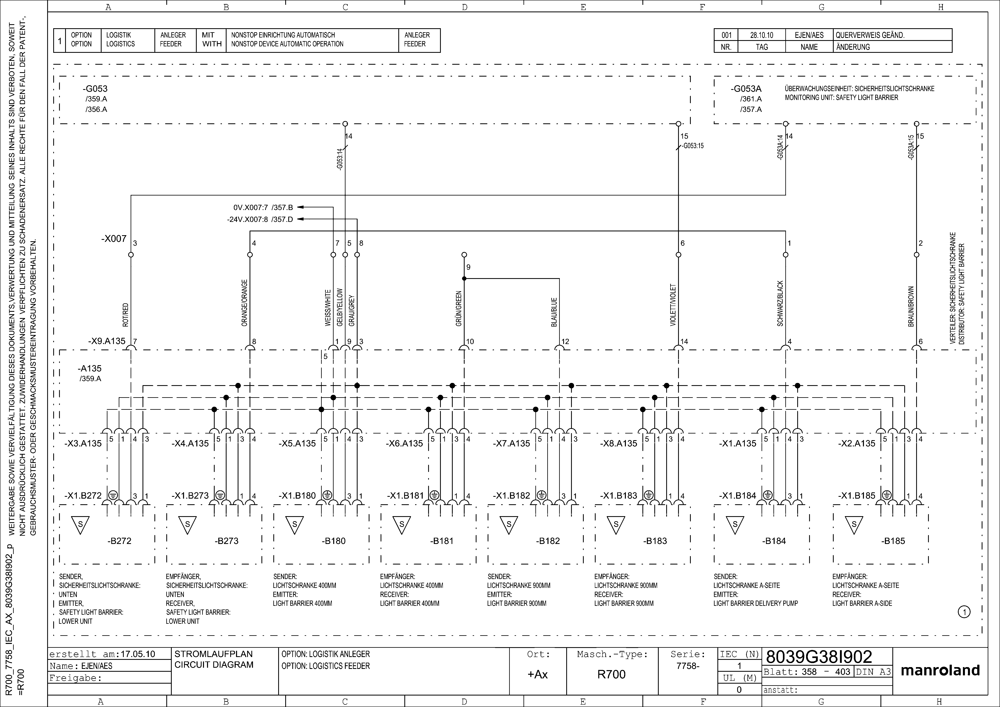

# +Ax — Sheet 358 of 403 — OPTION: LOGISTIK ANLEGER

**OPTION: LOGISTICS FEEDER**

> Part of the manroland **R700** printing press IEC/UL circuit diagrams.
> Drawing class: **Stromlaufplan / Circuit diagram** (DIN A3).
> Document `+Ax` covers the **Central control console** machine section.

## At a glance

| Field | Value |
|---|---|
| Document | `+Ax`  (8039G38I902) |
| Sheet | **358** of 403 |
| Section (DE) | OPTION: LOGISTIK ANLEGER |
| Section (EN) | OPTION: LOGISTICS FEEDER |
| Section type | CIRCUIT — Circuit diagram |
| Machine type | `R700` |
| Series | `7758` |
| Created | 17.05.10 |
| Replaces | — |
| Columns used | A, B, C, D, E, F, G, H |
| Path numbers | — |
| Labels on sheet | 194 |
| Cross-refs out | 7 |
| Cross-refs in | 27 |

**Previous:** [+Ax sheet 357](SHEET_0357.md) · **Next:** [+Ax sheet 359](SHEET_0359.md) · **Document TOC:** [_TOC.md](_TOC.md)  (+Ax) · **Master TOC:** [all sheets](../_MASTER_TOC.md)

## Sheet image (300 DPI, exact vector render)



_Rendered directly from the PDF vector layer at 300 DPI (1-bit), no OCR and no resampling. Use it to confirm anything ambiguous in the text below._

## Cross-references on this sheet

Each entry is a wire leaving this sheet. The printed token is `/sheet.column`; the link resolves to that sheet inside the same document.

| Ref | Target sheet | Col | Path | Destination on target | Target section | From col |
|---|---|---|---|---|---|---|
| `/359.A` | [+Ax sheet 359](SHEET_0359.md) | A | — | — | OPTION: LOGISTIK ANLEGER | A |
| `/356.A` | [+Ax sheet 356](SHEET_0356.md) | A | — | — | OPTION: LOGISTIK ANLEGER | A |
| `/361.A` | [+Ax sheet 361](SHEET_0361.md) | A | — | — | OPTION: LOGISTIK ANLEGER | F |
| `/357.A` | [+Ax sheet 357](SHEET_0357.md) | A | — | — | OPTION: LOGISTIK ANLEGER | F |
| `/357.B` | [+Ax sheet 357](SHEET_0357.md) | B | — | 0V.X007:7 | OPTION: LOGISTIK ANLEGER | B |
| `/357.D` | [+Ax sheet 357](SHEET_0357.md) | D | — | 24V.X007:8 | OPTION: LOGISTIK ANLEGER | B |
| `/359.A` | [+Ax sheet 359](SHEET_0359.md) | A | — | — | OPTION: LOGISTIK ANLEGER | A |

### Incoming references (sheets that point here)

Every other sheet that sends a wire to this one. `Back-ref` is the token printed on *that* sheet; `Path` is its line number.

| From sheet | Cols | Back-ref | Path | Refs | What continues there |
|---|---|---|---|---|---|
| [+Ax#212](SHEET_0212.md) | B, C, E, F, G, H | `/212.B`, `/212.C`, `/212.E`, `/212.F`, `/212.G`, `/212.H` | — | 18 | — |
| [+Ax#213](SHEET_0213.md) | B, C | `/213.B`, `/213.C` | — | 2 | — |
| [+Ax#356](SHEET_0356.md) | A | `/356.A` | — | 1 | — |
| [+Ax#357](SHEET_0357.md) | A, B, C | `/357.A`, `/357.B`, `/357.C` | — | 3 | 0V.X007:7 |
| [+Ax#359](SHEET_0359.md) | A | `/359.A` | — | 2 | — |
| [+Ax#361](SHEET_0361.md) | A | `/361.A` | — | 1 | — |


## Devices on this sheet

| Tag | Class | Class meaning (IEC) | Col | Sub | Terminal | Sign |
|---|---|---|---|---|---|---|
| `B180` | B | Umformer / transducer, sensor | C | — | — | — |
| `B181` | B | Umformer / transducer, sensor | D | — | — | — |
| `B182` | B | Umformer / transducer, sensor | E | — | — | — |
| `B183` | B | Umformer / transducer, sensor | F | — | — | — |
| `B185` | B | Umformer / transducer, sensor | H | — | — | — |
| `B184` | B | Umformer / transducer, sensor | G | — | — | — |
| `G053` | G | Stromversorgung / power supply | A | — | — | — |
| `B272` | B | Umformer / transducer, sensor | A | — | — | — |
| `B273` | B | Umformer / transducer, sensor | B | — | — | — |
| `A135` | A | Baugruppe / assembly, module, PC board | A | — | — | — |
| `X007` | X | Klemme / terminal, plug connector | A | — | — | — |
| `G053:15` | G | Stromversorgung / power supply | F | — | 15 | — |
| `G053:14` | G | Stromversorgung / power supply | C | — | 14 | — |
| `X1.B180` | — | cross-device reference | C | — | — | — |
| `X1.B181` | — | cross-device reference | D | — | — | — |
| `X1.B182` | — | cross-device reference | D | — | — | — |
| `X1.B183` | — | cross-device reference | E | — | — | — |
| `X1.B185` | — | cross-device reference | G | — | — | — |
| `X1.B184` | — | cross-device reference | F | — | — | — |
| `X1.B272` | — | cross-device reference | A | — | — | — |
| `X1.B273` | — | cross-device reference | B | — | — | — |
| `NR.` | — | cross-device reference | F | — | — | — |
| `28.10.10` | — | cross-device reference | F | — | — | — |
| `X4.A135` | — | cross-device reference | B | — | — | — |
| `X3.A135` | — | cross-device reference | A | — | — | — |
| `X5.A135` | — | cross-device reference | C | — | — | — |
| `X6.A135` | — | cross-device reference | C | — | — | — |
| `X7.A135` | — | cross-device reference | D | — | — | — |
| `X8.A135` | — | cross-device reference | E | — | — | — |
| `X9.A135` | — | cross-device reference | A | — | — | — |
| `X1.A135` | — | cross-device reference | F | — | — | — |
| `X2.A135` | — | cross-device reference | G | — | — | — |

## Potentials / nets

| Potential | Count | Columns | Attached devices | Terminals |
|---|---|---|---|---|
| `0V` | 1 | B | `X007` | `7` |
| `24V` | 1 | B | `X007` | `8` |


A potential such as `L24+/4` or `M24+` is a named supply/return rail; every place it appears on this sheet is electrically common.

## Wire-end annotations (grouped as printed)

A wire that continues elsewhere is annotated with a small cluster: the destination description, the path/line number `#NN`, and the `/sheet.column` cross reference. Each row below is one such cluster exactly as it is grouped on the drawing.

| Col | Y | Path | Cross-ref | Text on the wire |
|---|---|---|---|---|
| B | 37.9 | — | — | `MIT` |
| G | 38.5 | — | — | `001 28.10.10 EJEN/AES QUERVERWEIS GEÄND.` |
| A | 38.9 | — | — | `1 OPTION OPTION` |
| A | 38.9 | — | — | `LOGISTIK LOGISTICS` |
| B | 38.9 | — | — | `FEEDER ANLEGER` |
| C | 38.9 | — | — | `NONSTOP EINRICHTUNG AUTOMATISCH NONSTOP DEVICE AUTOMATIC OPERATION` |
| D | 38.9 | — | — | `FEEDER ANLEGER` |
| B | 48.4 | — | — | `WITH` |
| G | 52.7 | — | — | `NR. TAG NAME ÄNDERUNG` |
| A | 100.9 | — | — | `G053` |
| F | 100.9 | — | — | `G053A` |
| G | 102.7 | — | — | `ÜBERWACHUNGSEINHEIT: SICHERHEITSLICHTSCHRANKE MONITORING UNIT: SAFETY LIGHT BARRIER` |
| A | 114.0 | — | `/359.A`, `/356.A` | — |
| F | 114.0 | — | `/361.A`, `/357.A` | — |
| E | 158.4 | — | — | `14 15 15` |
| G | 158.4 | — | — | `14` |
| G | 160.7 | — | — | `G053A:14` |
| H | 160.7 | — | — | `G053A:15` |
| F | 170.7 | — | — | `G053:15` |
| C | 177.0 | — | — | `G053:14` |
| B | 243.3 | — | `/357.B` | `0V.X007:7` |
| B | 257.5 | — | `/357.D` | `24V.X007:8` |
| H | 276.4 | — | — | `VERTEILER: SICHERHEITSLICHTSCHRANKE` |
| D | 279.3 | — | — | `X007 3 4 7 5 8 6 1` |
| H | 285.9 | — | — | `2` |
| H | 290.0 | — | — | `DISTRIBUTOR: SAFETY LIGHT BARRIER` |
| D | 314.3 | — | — | `9` |
| B | 332.6 | — | — | `ORANGE/ORANGE` |
| G | 334.2 | — | — | `SCHWARZ/BLACK` |
| F | 337.9 | — | — | `VIOLETT/VIOLET` |
| H | 340.8 | — | — | `BRAUN/BROWN` |
| C | 343.4 | — | — | `GELB/YELLOW` |
| C | 344.7 | — | — | `WEISS/WHITE` |
| D | 346.2 | — | — | `GRÜN/GREEN` |
| C | 351.1 | — | — | `GRAU/GREY` |
| E | 354.4 | — | — | `BLAU/BLUE` |
| A | 360.9 | — | — | `ROT/RED` |
| A | 401.4 | — | — | `X9.A135` |
| B | 402.8 | — | — | `7 8` |
| C | 402.8 | — | — | `1 9 3` |
| D | 402.8 | — | — | `10` |
| E | 402.8 | — | — | `12` |
| F | 402.8 | — | — | `14` |
| G | 402.8 | — | — | `4` |
| H | 402.8 | — | — | `6` |
| C | 420.6 | — | — | `5` |
| A | 434.0 | — | — | `A135` |
| A | 447.1 | — | `/359.A` | — |
| B | 519.1 | — | — | `5 1 4 3 5 1 3 4` |
| C | 519.1 | — | — | `5 1 4 3` |
| D | 519.1 | — | — | `5 1 3 4` |
| E | 519.1 | — | — | `5 1 4 3` |
| F | 519.1 | — | — | `5 1 3 4` |
| G | 519.1 | — | — | `5 1 4 3` |
| H | 519.1 | — | — | `5 1 3 4` |
| C | 523.3 | — | — | `X3.A135 X4.A135 X5.A135 X6.A135 X7.A135 X8.A135` |
| G | 523.3 | — | — | `X1.A135 X2.A135` |
| A | 585.7 | — | — | `X1.B272 3 1` |
| B | 585.7 | — | — | `X1.B273 1 4` |
| C | 585.7 | — | — | `X1.B180 3 1` |
| D | 585.7 | — | — | `X1.B181 1 4` |
| E | 585.7 | — | — | `X1.B182 3 1` |
| E | 585.7 | — | — | `X1.B183 1 4` |
| F | 585.7 | — | — | `X1.B184 3 1` |
| G | 585.7 | — | — | `X1.B185 1 4` |
| A | 620.3 | — | — | `S S` |
| E | 620.3 | — | — | `S S S S S S` |
| A | 639.5 | — | — | `B272` |
| B | 639.5 | — | — | `B273` |
| C | 639.5 | — | — | `B180` |
| D | 639.5 | — | — | `B181` |
| E | 639.5 | — | — | `B182` |
| F | 639.5 | — | — | `B183` |
| G | 639.5 | — | — | `B184` |
| H | 639.5 | — | — | `B185` |
| A | 683.8 | — | — | `UNTEN EMITTER, SENDER, SICHERHEITSLICHTSCHRANKE:` |
| B | 683.8 | — | — | `EMPFÄNGER,` |
| C | 683.8 | — | — | `LICHTSCHRANKE 400MM EMITTER: LIGHT BARRIER 400MM SENDER:` |
| D | 683.8 | — | — | `EMPFÄNGER: LICHTSCHRANKE 400MM RECEIVER: LIGHT BARRIER 400MM` |
| D | 683.8 | — | — | `LICHTSCHRANKE 900MM EMITTER: LIGHT BARRIER 900MM SENDER:` |
| E | 683.8 | — | — | `EMPFÄNGER: LICHTSCHRANKE 900MM RECEIVER: LIGHT BARRIER 900MM` |
| F | 683.8 | — | — | `LICHTSCHRANKE A SEITE EMITTER: LIGHT BARRIER DELIVERY PUMP SENDER:` |
| G | 683.8 | — | — | `EMPFÄNGER: LICHTSCHRANKE A SEITE RECEIVER: LIGHT BARRIER A SIDE` |
| B | 694.4 | — | — | `UNTEN RECEIVER, SICHERHEITSLICHTSCHRANKE:` |
| H | 725.5 | — | — | `1` |
| A | 726.3 | — | — | `LOWER UNIT SAFETY LIGHT BARRIER:` |
| B | 726.3 | — | — | `LOWER UNIT SAFETY LIGHT BARRIER:` |


## Reconstructed tables

This sheet carries tabular content (pin map / terminal assignment / index). The grid below was rebuilt from the drawing's own rule lines, so each row is exactly one physical row of the table.

### Table 1 — 1 data rows × 3 columns (at x=127.6, y=232.4)

| X007 |  | 3 |
|---|---|---|
|  | `ROT/RED` | `7` |


### Table 2 — 2 data rows × 6 columns (at x=283.5, y=232.4) — **/357.B 0V.X007:7**

| 24V.X007:8 | /357.D |  |  |  |  |
|---|---|---|---|---|---|
|  | `4` |  | `7` | `5` | `8` |
| `ORANGE/ORANGE` | `8` | `WEISS/WHITE 5` | `GELB/YELLOW 1` | `GRAU/GREY 9` | `3` |


### Table 3 — 0 data rows × 2 columns (at x=538.6, y=232.4) — **9**

_none_


### Table 4 — 0 data rows × 2 columns (at x=793.7, y=232.4) — **6**

_none_


### Table 5 — 0 data rows × 2 columns (at x=921.3, y=232.4) — **1**

_none_


## Notes and free text on this sheet

| Text | Col | Y (pt) |
|---|---|---|
| `SENDER:` | B | 683.75 |
| `LICHTSCHRANKE 400MM` | C | 694.43 |
| `EMITTER:` | B | 705 |
| `LIGHT BARRIER 400MM` | C | 715.69 |
| `EMPFÄNGER:` | C | 683.76 |
| `LICHTSCHRANKE 400MM` | D | 694.43 |
| `RECEIVER:` | C | 705 |
| `LIGHT BARRIER 400MM` | D | 715.69 |
| `SENDER:` | D | 683.75 |
| `LICHTSCHRANKE 900MM` | D | 694.43 |
| `EMITTER:` | D | 705 |
| `LIGHT BARRIER 900MM` | D | 715.69 |
| `EMPFÄNGER:` | E | 683.76 |
| `LICHTSCHRANKE 900MM` | E | 694.43 |
| `RECEIVER:` | E | 705 |
| `LIGHT BARRIER 900MM` | E | 715.69 |
| `EMPFÄNGER:` | G | 683.76 |
| `LICHTSCHRANKE A SEITE` | G | 694.4 |
| `RECEIVER:` | G | 705 |
| `LIGHT BARRIER A SIDE` | G | 715.66 |
| `SENDER:` | F | 683.75 |
| `LICHTSCHRANKE A SEITE` | F | 694.4 |
| `EMITTER:` | F | 705 |
| `LIGHT BARRIER DELIVERY PUMP` | F | 715.67 |
| `G053A` | F | 100.94 |
| `ÜBERWACHUNGSEINHEIT: SICHERHEITSLICHTSCHRANKE` | G | 102.67 |
| `MONITORING UNIT: SAFETY LIGHT BARRIER` | G | 113.31 |
| `SENDER,` | A | 683.75 |
| `SICHERHEITSLICHTSCHRANKE:` | A | 694.41 |
| `UNTEN` | A | 705.01 |
| `EMITTER,` | A | 715.63 |
| `SAFETY LIGHT BARRIER:` | A | 726.29 |
| `LOWER UNIT` | A | 736.9 |
| `EMPFÄNGER,` | B | 683.76 |
| `SICHERHEITSLICHTSCHRANKE:` | B | 694.41 |
| `UNTEN` | B | 705.01 |
| `RECEIVER,` | B | 715.63 |
| `SAFETY LIGHT BARRIER:` | B | 726.29 |
| `LOWER UNIT` | B | 736.9 |
| `VERTEILER: SICHERHEITSLICHTSCHRANKE` | H | 276.41 |
| `DISTRIBUTOR: SAFETY LIGHT BARRIER` | H | 289.97 |
| `TAG` | G | 52.78 |
| `NAME` | G | 52.76 |
| `ÄNDERUNG` | G | 52.82 |
| `EJEN/AES` | G | 38.6 |
| `QUERVERWEIS GEÄND.` | G | 38.61 |
| `S` | C | 620.31 |
| `S` | D | 620.31 |
| `S` | E | 620.31 |
| `S` | G | 620.31 |
| `S` | F | 620.31 |
| `OPTION` | A | 38.87 |
| `LOGISTIK` | A | 38.86 |
| `LOGISTICS` | A | 49.5 |
| `ANLEGER` | B | 38.9 |
| `FEEDER` | B | 49.5 |
| `MIT` | B | 37.86 |
| `WITH` | B | 48.35 |
| `NONSTOP EINRICHTUNG AUTOMATISCH` | B | 38.9 |
| `NONSTOP DEVICE AUTOMATIC OPERATION` | C | 49.52 |
| `ANLEGER` | D | 38.9 |
| `FEEDER` | D | 49.5 |
| `S` | A | 620.31 |
| `S` | B | 620.31 |
| `G053A:14` | G | 160.67 |
| `G053A:15` | H | 160.67 |
| `ROT/RED` | A | 360.89 |
| `ORANGE/ORANGE` | B | 332.63 |
| `WEISS/WHITE` | C | 344.71 |
| `GELB/YELLOW` | C | 343.38 |
| `GRAU/GREY` | C | 351.12 |
| `GRÜN/GREEN` | D | 346.24 |
| `BLAU/BLUE` | E | 354.37 |
| `VIOLETT/VIOLET` | F | 337.95 |
| `BRAUN/BROWN` | H | 340.8 |
| `SCHWARZ/BLACK` | G | 334.21 |

## Complete label inventory (exact text from the drawing)

Every text object inside the drawing area of this sheet, in DIN reading order (column A→H, then top→bottom). This is the authoritative list: if a string is not here it is not printed on this sheet.

| Col | Y | X | Dir | Type | Text |
|---|---|---|---|---|---|
| A | 38.9 | 84.8 | → | text | `OPTION` |
| A | 38.9 | 126.7 | → | text | `LOGISTIK` |
| A | 44.2 | 68.3 | → | number | `1` |
| A | 49.5 | 84.8 | → | text | `OPTION` |
| A | 49.5 | 126.7 | → | text | `LOGISTICS` |
| A | 100.9 | 98.6 | → | device tag | `G053` |
| A | 114.0 | 102.0 | → | cross-reference | `/359.A` |
| A | 126.4 | 102.0 | → | cross-reference | `/356.A` |
| A | 279.3 | 120.8 | → | device tag | `X007` |
| A | 285.9 | 158.5 | → | number | `3` |
| A | 360.9 | 146.6 | ↕ | text | `ROT/RED` |
| A | 401.4 | 105.2 | → | device ref | `X9.A135` |
| A | 402.8 | 158.5 | → | number | `7` |
| A | 434.0 | 92.7 | → | device tag | `A135` |
| A | 447.1 | 95.0 | → | cross-reference | `/359.A` |
| A | 519.1 | 130.1 | → | number | `5` |
| A | 519.1 | 143.7 | → | number | `1` |
| A | 519.1 | 158.5 | → | number | `4` |
| A | 519.1 | 172.6 | → | number | `3` |
| A | 523.3 | 76.8 | → | device ref | `X3.A135` |
| A | 585.7 | 76.8 | → | device ref | `X1.B272` |
| A | 587.1 | 158.5 | → | number | `3` |
| A | 587.1 | 172.1 | → | number | `1` |
| A | 620.3 | 92.8 | → | text | `S` |
| A | 639.5 | 128.1 | → | device tag | `B272` |
| A | 683.8 | 70.6 | → | text | `SENDER,` |
| A | 694.4 | 70.6 | → | text | `SICHERHEITSLICHTSCHRANKE:` |
| A | 705.0 | 70.0 | → | text | `UNTEN` |
| A | 715.6 | 70.0 | → | text | `EMITTER,` |
| A | 726.3 | 70.6 | → | text | `SAFETY LIGHT BARRIER:` |
| A | 736.9 | 70.0 | → | text | `LOWER UNIT` |
| B | 37.9 | 240.4 | → | text | `MIT` |
| B | 38.9 | 191.3 | → | text | `ANLEGER` |
| B | 38.9 | 275.5 | → | text | `NONSTOP EINRICHTUNG AUTOMATISCH` |
| B | 48.4 | 240.9 | → | text | `WITH` |
| B | 49.5 | 190.5 | → | text | `FEEDER` |
| B | 243.3 | 278.1 | → | potential | `0V.X007:7` |
| B | 243.3 | 323.4 | → | cross-reference | `/357.B` |
| B | 257.5 | 270.4 | → | potential | `24V.X007:8` |
| B | 257.5 | 323.1 | → | cross-reference | `/357.D` |
| B | 285.9 | 300.2 | → | number | `4` |
| B | 332.6 | 288.3 | ↕ | text | `ORANGE/ORANGE` |
| B | 402.8 | 300.2 | → | number | `8` |
| B | 519.1 | 257.7 | → | number | `5` |
| B | 519.1 | 271.3 | → | number | `1` |
| B | 519.1 | 286.0 | → | number | `3` |
| B | 519.1 | 300.2 | → | number | `4` |
| B | 523.3 | 204.4 | → | device ref | `X4.A135` |
| B | 585.7 | 204.4 | → | device ref | `X1.B273` |
| B | 587.1 | 285.4 | → | number | `1` |
| B | 587.1 | 300.2 | → | number | `4` |
| B | 620.3 | 220.4 | → | text | `S` |
| B | 639.5 | 255.7 | → | device tag | `B273` |
| B | 683.8 | 197.6 | → | text | `EMPFÄNGER,` |
| B | 683.8 | 325.7 | → | text | `SENDER:` |
| B | 694.4 | 198.1 | → | text | `SICHERHEITSLICHTSCHRANKE:` |
| B | 705.0 | 197.6 | → | text | `UNTEN` |
| B | 705.0 | 325.1 | → | text | `EMITTER:` |
| B | 715.6 | 197.6 | → | text | `RECEIVER,` |
| B | 726.3 | 198.1 | → | text | `SAFETY LIGHT BARRIER:` |
| B | 736.9 | 197.6 | → | text | `LOWER UNIT` |
| C | 49.5 | 275.5 | → | text | `NONSTOP DEVICE AUTOMATIC OPERATION` |
| C | 158.4 | 410.2 | → | number | `14` |
| C | 177.0 | 401.8 | ↕ | device tag | `G053:14` |
| C | 285.9 | 399.4 | → | number | `7` |
| C | 285.9 | 413.6 | → | number | `5` |
| C | 285.9 | 427.7 | → | number | `8` |
| C | 343.4 | 401.7 | ↕ | text | `GELB/YELLOW` |
| C | 344.7 | 387.5 | ↕ | text | `WEISS/WHITE` |
| C | 351.1 | 415.9 | ↕ | text | `GRAU/GREY` |
| C | 402.8 | 398.8 | → | number | `1` |
| C | 402.8 | 413.6 | → | number | `9` |
| C | 402.8 | 427.7 | → | number | `3` |
| C | 420.6 | 385.2 | → | number | `5` |
| C | 519.1 | 385.2 | → | number | `5` |
| C | 519.1 | 398.8 | → | number | `1` |
| C | 519.1 | 413.6 | → | number | `4` |
| C | 519.1 | 427.7 | → | number | `3` |
| C | 523.3 | 331.9 | → | device ref | `X5.A135` |
| C | 523.3 | 459.5 | → | device ref | `X6.A135` |
| C | 585.7 | 331.9 | → | device ref | `X1.B180` |
| C | 587.1 | 413.6 | → | number | `3` |
| C | 587.1 | 427.2 | → | number | `1` |
| C | 620.3 | 348.0 | → | text | `S` |
| C | 620.3 | 475.5 | → | text | `S` |
| C | 639.5 | 383.2 | → | device tag | `B180` |
| C | 683.8 | 452.7 | → | text | `EMPFÄNGER:` |
| C | 694.4 | 325.1 | → | text | `LICHTSCHRANKE 400MM` |
| C | 705.0 | 452.7 | → | text | `RECEIVER:` |
| C | 715.7 | 325.1 | → | text | `LIGHT BARRIER 400MM` |
| D | 38.9 | 481.9 | → | text | `ANLEGER` |
| D | 49.5 | 481.0 | → | text | `FEEDER` |
| D | 314.3 | 555.3 | → | number | `9` |
| D | 346.2 | 543.5 | ↕ | text | `GRÜN/GREEN` |
| D | 402.8 | 554.7 | → | number | `10` |
| D | 519.1 | 512.8 | → | number | `5` |
| D | 519.1 | 526.4 | → | number | `1` |
| D | 519.1 | 541.1 | → | number | `3` |
| D | 519.1 | 555.3 | → | number | `4` |
| D | 523.3 | 587.1 | → | device ref | `X7.A135` |
| D | 585.7 | 460.9 | → | device ref | `X1.B181` |
| D | 585.7 | 587.1 | → | device ref | `X1.B182` |
| D | 587.1 | 540.6 | → | number | `1` |
| D | 587.1 | 555.3 | → | number | `4` |
| D | 620.3 | 603.1 | → | text | `S` |
| D | 639.5 | 512.2 | → | device tag | `B181` |
| D | 683.8 | 580.8 | → | text | `SENDER:` |
| D | 694.4 | 452.7 | → | text | `LICHTSCHRANKE 400MM` |
| D | 694.4 | 580.3 | → | text | `LICHTSCHRANKE 900MM` |
| D | 705.0 | 580.3 | → | text | `EMITTER:` |
| D | 715.7 | 452.7 | → | text | `LIGHT BARRIER 400MM` |
| D | 715.7 | 580.3 | → | text | `LIGHT BARRIER 900MM` |
| E | 354.4 | 656.8 | ↕ | text | `BLAU/BLUE` |
| E | 402.8 | 668.1 | → | number | `12` |
| E | 519.1 | 640.3 | → | number | `5` |
| E | 519.1 | 654.0 | → | number | `1` |
| E | 519.1 | 668.7 | → | number | `4` |
| E | 519.1 | 682.9 | → | number | `3` |
| E | 523.3 | 714.6 | → | device ref | `X8.A135` |
| E | 585.7 | 714.6 | → | device ref | `X1.B183` |
| E | 587.1 | 668.7 | → | number | `3` |
| E | 587.1 | 682.3 | → | number | `1` |
| E | 620.3 | 730.6 | → | text | `S` |
| E | 639.5 | 638.4 | → | device tag | `B182` |
| E | 683.8 | 707.8 | → | text | `EMPFÄNGER:` |
| E | 694.4 | 707.8 | → | text | `LICHTSCHRANKE 900MM` |
| E | 705.0 | 707.8 | → | text | `RECEIVER:` |
| E | 715.7 | 707.8 | → | text | `LIGHT BARRIER 900MM` |
| F | 38.5 | 859.4 | → | number | `001` |
| F | 38.7 | 893.5 | → | device ref | `28.10.10` |
| F | 52.7 | 858.4 | → | device ref | `NR.` |
| F | 100.9 | 870.2 | → | text | `G053A` |
| F | 114.0 | 881.6 | → | cross-reference | `/361.A` |
| F | 126.4 | 881.6 | → | cross-reference | `/357.A` |
| F | 158.4 | 809.9 | → | number | `15` |
| F | 170.7 | 811.8 | → | device tag | `G053:15` |
| F | 285.9 | 810.4 | → | number | `6` |
| F | 337.9 | 798.6 | ↕ | text | `VIOLETT/VIOLET` |
| F | 402.8 | 809.9 | → | number | `14` |
| F | 519.1 | 767.9 | → | number | `5` |
| F | 519.1 | 781.5 | → | number | `1` |
| F | 519.1 | 796.3 | → | number | `3` |
| F | 519.1 | 810.4 | → | number | `4` |
| F | 523.3 | 856.3 | → | device ref | `X1.A135` |
| F | 585.7 | 856.3 | → | device ref | `X1.B184` |
| F | 587.1 | 795.7 | → | number | `1` |
| F | 587.1 | 810.4 | → | number | `4` |
| F | 620.3 | 872.4 | → | text | `S` |
| F | 639.5 | 765.9 | → | device tag | `B183` |
| F | 683.8 | 850.1 | → | text | `SENDER:` |
| F | 694.4 | 849.5 | → | text | `LICHTSCHRANKE A SEITE` |
| F | 705.0 | 849.5 | → | text | `EMITTER:` |
| F | 715.7 | 849.5 | → | text | `LIGHT BARRIER DELIVERY PUMP` |
| G | 38.6 | 946.5 | → | text | `EJEN/AES` |
| G | 38.6 | 995.1 | → | text | `QUERVERWEIS GEÄND.` |
| G | 52.8 | 900.0 | → | text | `TAG` |
| G | 52.8 | 953.4 | → | text | `NAME` |
| G | 52.8 | 996.0 | → | text | `ÄNDERUNG` |
| G | 102.7 | 934.6 | → | text | `ÜBERWACHUNGSEINHEIT: SICHERHEITSLICHTSCHRANKE` |
| G | 113.3 | 934.9 | → | text | `MONITORING UNIT: SAFETY LIGHT BARRIER` |
| G | 158.4 | 934.6 | → | number | `14` |
| G | 160.7 | 926.2 | ↕ | text | `G053A:14` |
| G | 285.9 | 937.4 | → | number | `1` |
| G | 334.2 | 926.1 | ↕ | text | `SCHWARZ/BLACK` |
| G | 402.8 | 938.0 | → | number | `4` |
| G | 519.1 | 909.6 | → | number | `5` |
| G | 519.1 | 923.2 | → | number | `1` |
| G | 519.1 | 938.0 | → | number | `4` |
| G | 519.1 | 952.2 | → | number | `3` |
| G | 523.3 | 998.1 | → | device ref | `X2.A135` |
| G | 585.7 | 998.1 | → | device ref | `X1.B185` |
| G | 587.1 | 938.0 | → | number | `3` |
| G | 587.1 | 951.6 | → | number | `1` |
| G | 620.3 | 1014.1 | → | text | `S` |
| G | 639.5 | 907.7 | → | device tag | `B184` |
| G | 683.8 | 991.3 | → | text | `EMPFÄNGER:` |
| G | 694.4 | 991.3 | → | text | `LICHTSCHRANKE A SEITE` |
| G | 705.0 | 991.3 | → | text | `RECEIVER:` |
| G | 715.7 | 991.3 | → | text | `LIGHT BARRIER A SIDE` |
| H | 158.4 | 1090.5 | → | number | `15` |
| H | 160.7 | 1082.1 | ↕ | text | `G053A:15` |
| H | 276.4 | 1131.7 | ↕ | text | `VERTEILER: SICHERHEITSLICHTSCHRANKE` |
| H | 285.9 | 1093.9 | → | number | `2` |
| H | 290.0 | 1142.3 | ↕ | text | `DISTRIBUTOR: SAFETY LIGHT BARRIER` |
| H | 340.8 | 1082.0 | ↕ | text | `BRAUN/BROWN` |
| H | 402.8 | 1093.9 | → | number | `6` |
| H | 519.1 | 1051.4 | → | number | `5` |
| H | 519.1 | 1065.0 | → | number | `1` |
| H | 519.1 | 1079.7 | → | number | `3` |
| H | 519.1 | 1093.9 | → | number | `4` |
| H | 587.1 | 1079.1 | → | number | `1` |
| H | 587.1 | 1093.9 | → | number | `4` |
| H | 639.5 | 1049.4 | → | device tag | `B185` |
| H | 725.4 | 1146.3 | → | number | `1` |

## Reading-order text block

The same content as a plain block, grouped by DIN column — convenient to paste or to match against a visual description.

```text
=== Column A ===
  38.9   84.8  text         OPTION
  38.9  126.7  text         LOGISTIK
  44.2   68.3  numeric      1
  49.5   84.8  text         OPTION
  49.5  126.7  text         LOGISTICS
 100.9   98.6  devtag       G053
 114.0  102.0  xref         /359.A
 126.4  102.0  xref         /356.A
 279.3  120.8  devtag       X007
 285.9  158.5  numeric      3
 360.9  146.6  text         ROT/RED
 401.4  105.2  devref       X9.A135
 402.8  158.5  numeric      7
 434.0   92.7  devtag       A135
 447.1   95.0  xref         /359.A
 519.1  130.1  numeric      5
 519.1  143.7  numeric      1
 519.1  158.5  numeric      4
 519.1  172.6  numeric      3
 523.3   76.8  devref       X3.A135
 585.7   76.8  devref       X1.B272
 587.1  158.5  numeric      3
 587.1  172.1  numeric      1
 620.3   92.8  text         S
 639.5  128.1  devtag       B272
 683.8   70.6  text         SENDER,
 694.4   70.6  text         SICHERHEITSLICHTSCHRANKE:
 705.0   70.0  text         UNTEN
 715.6   70.0  text         EMITTER,
 726.3   70.6  text         SAFETY LIGHT BARRIER:
 736.9   70.0  text         LOWER UNIT
=== Column B ===
  37.9  240.4  text         MIT
  38.9  191.3  text         ANLEGER
  38.9  275.5  text         NONSTOP EINRICHTUNG AUTOMATISCH
  48.4  240.9  text         WITH
  49.5  190.5  text         FEEDER
 243.3  278.1  net          0V.X007:7
 243.3  323.4  xref         /357.B
 257.5  270.4  net          24V.X007:8
 257.5  323.1  xref         /357.D
 285.9  300.2  numeric      4
 332.6  288.3  text         ORANGE/ORANGE
 402.8  300.2  numeric      8
 519.1  257.7  numeric      5
 519.1  271.3  numeric      1
 519.1  286.0  numeric      3
 519.1  300.2  numeric      4
 523.3  204.4  devref       X4.A135
 585.7  204.4  devref       X1.B273
 587.1  285.4  numeric      1
 587.1  300.2  numeric      4
 620.3  220.4  text         S
 639.5  255.7  devtag       B273
 683.8  197.6  text         EMPFÄNGER,
 683.8  325.7  text         SENDER:
 694.4  198.1  text         SICHERHEITSLICHTSCHRANKE:
 705.0  197.6  text         UNTEN
 705.0  325.1  text         EMITTER:
 715.6  197.6  text         RECEIVER,
 726.3  198.1  text         SAFETY LIGHT BARRIER:
 736.9  197.6  text         LOWER UNIT
=== Column C ===
  49.5  275.5  text         NONSTOP DEVICE AUTOMATIC OPERATION
 158.4  410.2  numeric      14
 177.0  401.8  devtag       G053:14
 285.9  399.4  numeric      7
 285.9  413.6  numeric      5
 285.9  427.7  numeric      8
 343.4  401.7  text         GELB/YELLOW
 344.7  387.5  text         WEISS/WHITE
 351.1  415.9  text         GRAU/GREY
 402.8  398.8  numeric      1
 402.8  413.6  numeric      9
 402.8  427.7  numeric      3
 420.6  385.2  numeric      5
 519.1  385.2  numeric      5
 519.1  398.8  numeric      1
 519.1  413.6  numeric      4
 519.1  427.7  numeric      3
 523.3  331.9  devref       X5.A135
 523.3  459.5  devref       X6.A135
 585.7  331.9  devref       X1.B180
 587.1  413.6  numeric      3
 587.1  427.2  numeric      1
 620.3  348.0  text         S
 620.3  475.5  text         S
 639.5  383.2  devtag       B180
 683.8  452.7  text         EMPFÄNGER:
 694.4  325.1  text         LICHTSCHRANKE 400MM
 705.0  452.7  text         RECEIVER:
 715.7  325.1  text         LIGHT BARRIER 400MM
=== Column D ===
  38.9  481.9  text         ANLEGER
  49.5  481.0  text         FEEDER
 314.3  555.3  numeric      9
 346.2  543.5  text         GRÜN/GREEN
 402.8  554.7  numeric      10
 519.1  512.8  numeric      5
 519.1  526.4  numeric      1
 519.1  541.1  numeric      3
 519.1  555.3  numeric      4
 523.3  587.1  devref       X7.A135
 585.7  460.9  devref       X1.B181
 585.7  587.1  devref       X1.B182
 587.1  540.6  numeric      1
 587.1  555.3  numeric      4
 620.3  603.1  text         S
 639.5  512.2  devtag       B181
 683.8  580.8  text         SENDER:
 694.4  452.7  text         LICHTSCHRANKE 400MM
 694.4  580.3  text         LICHTSCHRANKE 900MM
 705.0  580.3  text         EMITTER:
 715.7  452.7  text         LIGHT BARRIER 400MM
 715.7  580.3  text         LIGHT BARRIER 900MM
=== Column E ===
 354.4  656.8  text         BLAU/BLUE
 402.8  668.1  numeric      12
 519.1  640.3  numeric      5
 519.1  654.0  numeric      1
 519.1  668.7  numeric      4
 519.1  682.9  numeric      3
 523.3  714.6  devref       X8.A135
 585.7  714.6  devref       X1.B183
 587.1  668.7  numeric      3
 587.1  682.3  numeric      1
 620.3  730.6  text         S
 639.5  638.4  devtag       B182
 683.8  707.8  text         EMPFÄNGER:
 694.4  707.8  text         LICHTSCHRANKE 900MM
 705.0  707.8  text         RECEIVER:
 715.7  707.8  text         LIGHT BARRIER 900MM
=== Column F ===
  38.5  859.4  numeric      001
  38.7  893.5  devref       28.10.10
  52.7  858.4  devref       NR.
 100.9  870.2  text         G053A
 114.0  881.6  xref         /361.A
 126.4  881.6  xref         /357.A
 158.4  809.9  numeric      15
 170.7  811.8  devtag       G053:15
 285.9  810.4  numeric      6
 337.9  798.6  text         VIOLETT/VIOLET
 402.8  809.9  numeric      14
 519.1  767.9  numeric      5
 519.1  781.5  numeric      1
 519.1  796.3  numeric      3
 519.1  810.4  numeric      4
 523.3  856.3  devref       X1.A135
 585.7  856.3  devref       X1.B184
 587.1  795.7  numeric      1
 587.1  810.4  numeric      4
 620.3  872.4  text         S
 639.5  765.9  devtag       B183
 683.8  850.1  text         SENDER:
 694.4  849.5  text         LICHTSCHRANKE A SEITE
 705.0  849.5  text         EMITTER:
 715.7  849.5  text         LIGHT BARRIER DELIVERY PUMP
=== Column G ===
  38.6  946.5  text         EJEN/AES
  38.6  995.1  text         QUERVERWEIS GEÄND.
  52.8  900.0  text         TAG
  52.8  953.4  text         NAME
  52.8  996.0  text         ÄNDERUNG
 102.7  934.6  text         ÜBERWACHUNGSEINHEIT: SICHERHEITSLICHTSCHRANKE
 113.3  934.9  text         MONITORING UNIT: SAFETY LIGHT BARRIER
 158.4  934.6  numeric      14
 160.7  926.2  text         G053A:14
 285.9  937.4  numeric      1
 334.2  926.1  text         SCHWARZ/BLACK
 402.8  938.0  numeric      4
 519.1  909.6  numeric      5
 519.1  923.2  numeric      1
 519.1  938.0  numeric      4
 519.1  952.2  numeric      3
 523.3  998.1  devref       X2.A135
 585.7  998.1  devref       X1.B185
 587.1  938.0  numeric      3
 587.1  951.6  numeric      1
 620.3 1014.1  text         S
 639.5  907.7  devtag       B184
 683.8  991.3  text         EMPFÄNGER:
 694.4  991.3  text         LICHTSCHRANKE A SEITE
 705.0  991.3  text         RECEIVER:
 715.7  991.3  text         LIGHT BARRIER A SIDE
=== Column H ===
 158.4 1090.5  numeric      15
 160.7 1082.1  text         G053A:15
 276.4 1131.7  text         VERTEILER: SICHERHEITSLICHTSCHRANKE
 285.9 1093.9  numeric      2
 290.0 1142.3  text         DISTRIBUTOR: SAFETY LIGHT BARRIER
 340.8 1082.0  text         BRAUN/BROWN
 402.8 1093.9  numeric      6
 519.1 1051.4  numeric      5
 519.1 1065.0  numeric      1
 519.1 1079.7  numeric      3
 519.1 1093.9  numeric      4
 587.1 1079.1  numeric      1
 587.1 1093.9  numeric      4
 639.5 1049.4  devtag       B185
 725.4 1146.3  numeric      1
```

---
_Generated from the PDF vector text layer; no OCR. Source: `R700_7758_IEC_AX_8039G38I902_p`, sheet 358._
