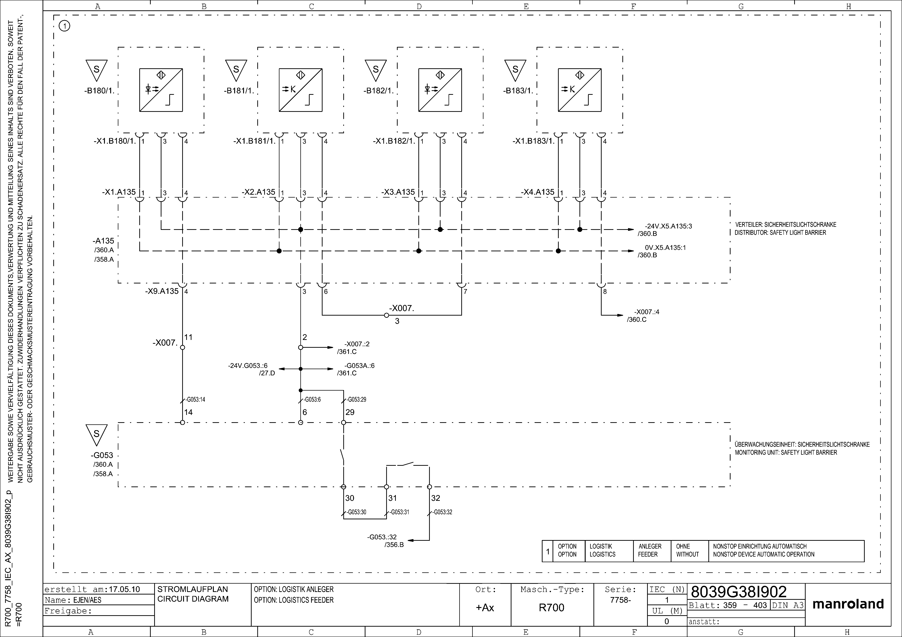

# +Ax — Sheet 359 of 403 — OPTION: LOGISTIK ANLEGER

**OPTION: LOGISTICS FEEDER**

> Part of the manroland **R700** printing press IEC/UL circuit diagrams.
> Drawing class: **Stromlaufplan / Circuit diagram** (DIN A3).
> Document `+Ax` covers the **Central control console** machine section.

## At a glance

| Field | Value |
|---|---|
| Document | `+Ax`  (8039G38I902) |
| Sheet | **359** of 403 |
| Section (DE) | OPTION: LOGISTIK ANLEGER |
| Section (EN) | OPTION: LOGISTICS FEEDER |
| Section type | CIRCUIT — Circuit diagram |
| Machine type | `R700` |
| Series | `7758` |
| Created | 17.05.10 |
| Replaces | — |
| Columns used | A, B, C, D, E, F, G, H |
| Path numbers | — |
| Labels on sheet | 100 |
| Cross-refs out | 11 |
| Cross-refs in | 40 |

**Previous:** [+Ax sheet 358](SHEET_0358.md) · **Next:** [+Ax sheet 360](SHEET_0360.md) · **Document TOC:** [_TOC.md](_TOC.md)  (+Ax) · **Master TOC:** [all sheets](../_MASTER_TOC.md)

## Sheet image (300 DPI, exact vector render)



_Rendered directly from the PDF vector layer at 300 DPI (1-bit), no OCR and no resampling. Use it to confirm anything ambiguous in the text below._

## Cross-references on this sheet

Each entry is a wire leaving this sheet. The printed token is `/sheet.column`; the link resolves to that sheet inside the same document.

| Ref | Target sheet | Col | Path | Destination on target | Target section | From col |
|---|---|---|---|---|---|---|
| `/360.B` | [+Ax sheet 360](SHEET_0360.md) | B | — | — | OPTION: LOGISTIK ANLEGER | F |
| `/360.A` | [+Ax sheet 360](SHEET_0360.md) | A | — | — | OPTION: LOGISTIK ANLEGER | A |
| `/358.A` | [+Ax sheet 358](SHEET_0358.md) | A | — | — | OPTION: LOGISTIK ANLEGER | A |
| `/360.B` | [+Ax sheet 360](SHEET_0360.md) | B | — | — | OPTION: LOGISTIK ANLEGER | F |
| `/360.C` | [+Ax sheet 360](SHEET_0360.md) | C | — | — | OPTION: LOGISTIK ANLEGER | F |
| `/361.C` | [+Ax sheet 361](SHEET_0361.md) | C | — | — | OPTION: LOGISTIK ANLEGER | C |
| `/27.D` | [+Ax sheet 27](SHEET_0027.md) | D | — | 24V.G053.:6 | SPANNUNGSVERSORGUNG, SCHALTSCHRANKBELÜFTUNG | B |
| `/361.C` | [+Ax sheet 361](SHEET_0361.md) | C | — | — | OPTION: LOGISTIK ANLEGER | C |
| `/360.A` | [+Ax sheet 360](SHEET_0360.md) | A | — | — | OPTION: LOGISTIK ANLEGER | A |
| `/358.A` | [+Ax sheet 358](SHEET_0358.md) | A | — | — | OPTION: LOGISTIK ANLEGER | A |
| `/356.B` | [+Ax sheet 356](SHEET_0356.md) | B | — | G053.:32 | OPTION: LOGISTIK ANLEGER | D |

### Incoming references (sheets that point here)

Every other sheet that sends a wire to this one. `Back-ref` is the token printed on *that* sheet; `Path` is its line number.

| From sheet | Cols | Back-ref | Path | Refs | What continues there |
|---|---|---|---|---|---|
| [+Ax#27](SHEET_0027.md) | D | `/27.D` | — | 1 | 24V.G053.:6 |
| [+Ax#206](SHEET_0206.md) | D | `/206.D` | — | 3 | — |
| [+Ax#212](SHEET_0212.md) | B, C, E, F | `/212.B`, `/212.C`, `/212.E`, `/212.F` | — | 12 | — |
| [+Ax#217](SHEET_0217.md) | C | `/217.C` | — | 3 | — |
| [+Ax#222](SHEET_0222.md) | C | `/222.C` | — | 3 | — |
| [+Ax#226](SHEET_0226.md) | C | `/226.C` | — | 3 | — |
| [+Ax#240](SHEET_0240.md) | B | `/240.B` | — | 5 | — |
| [+Ax#356](SHEET_0356.md) | C | `/356.C` | — | 1 | — |
| [+Ax#358](SHEET_0358.md) | A | `/358.A` | — | 2 | — |
| [+Ax#360](SHEET_0360.md) | A, B, C | `/360.A`, `/360.B`, `/360.C` | — | 5 | 0V.X5.A135:1; 24V.X5.A135:3; X007.:4 G053A.:5 |
| [+Ax#361](SHEET_0361.md) | B, C | `/361.B`, `/361.C` | — | 2 | G053A.:6; X007.:2 |


## Devices on this sheet

| Tag | Class | Class meaning (IEC) | Col | Sub | Terminal | Sign |
|---|---|---|---|---|---|---|
| `A135` | A | Baugruppe / assembly, module, PC board | A | — | — | — |
| `G053` | G | Stromversorgung / power supply | A | — | — | — |
| `G053:14` | G | Stromversorgung / power supply | B | — | 14 | — |
| `G053:6` | G | Stromversorgung / power supply | C | — | 6 | — |
| `G053:29` | G | Stromversorgung / power supply | C | — | 29 | — |
| `G053:30` | G | Stromversorgung / power supply | C | — | 30 | — |
| `G053:31` | G | Stromversorgung / power supply | D | — | 31 | — |
| `G053:32` | G | Stromversorgung / power supply | D | — | 32 | — |
| `B180/1.` | — | cross-device reference | A | — | — | — |
| `B181/1.` | — | cross-device reference | B | — | — | — |
| `B182/1.` | — | cross-device reference | D | — | — | — |
| `B183/1.` | — | cross-device reference | E | — | — | — |
| `X1.A135` | — | cross-device reference | A | — | — | — |
| `X9.A135` | — | cross-device reference | B | — | — | — |
| `X007.` | — | cross-device reference | B | — | — | — |
| `X2.A135` | — | cross-device reference | C | — | — | — |
| `X3.A135` | — | cross-device reference | D | — | — | — |
| `X4.A135` | — | cross-device reference | E | — | — | — |
| `X007.` | — | cross-device reference | D | — | — | — |

## Potentials / nets

| Potential | Count | Columns | Attached devices | Terminals |
|---|---|---|---|---|
| `0V` | 1 | F | `A135`, `X5` | `1` |
| `24V` | 1 | F | `A135`, `X5` | `3` |


A potential such as `L24+/4` or `M24+` is a named supply/return rail; every place it appears on this sheet is electrically common.

## Wire-end annotations (grouped as printed)

A wire that continues elsewhere is annotated with a small cluster: the destination description, the path/line number `#NN`, and the `/sheet.column` cross reference. Each row below is one such cluster exactly as it is grouped on the drawing.

| Col | Y | Path | Cross-ref | Text on the wire |
|---|---|---|---|---|
| A | 31.0 | — | — | `1` |
| C | 86.1 | — | — | `S S S S` |
| A | 115.1 | — | — | `B180/1.` |
| B | 115.1 | — | — | `B181/1.` |
| D | 115.1 | — | — | `B182/1.` |
| E | 115.1 | — | — | `B183/1.` |
| A | 181.7 | — | — | `X1.B180/1. 1 3 4` |
| C | 181.7 | — | — | `X1.B181/1. 1 3 4` |
| D | 181.7 | — | — | `X1.B182/1. 1 3 4` |
| E | 181.7 | — | — | `X1.B183/1. 1 3 4` |
| A | 249.1 | — | — | `X1.A135 1 3 4` |
| C | 249.1 | — | — | `X2.A135 1 3 4` |
| D | 249.1 | — | — | `X3.A135 1 3 4` |
| E | 249.1 | — | — | `X4.A135 1 3 4` |
| G | 294.0 | — | — | `DISTRIBUTOR: SAFETY LIGHT BARRIER VERTEILER: SICHERHEITSLICHTSCHRANKE` |
| F | 295.1 | — | — | `24V.X5.A135:3` |
| F | 305.0 | — | `/360.B` | — |
| A | 313.5 | — | — | `A135` |
| F | 323.4 | — | — | `0V.X5.A135:1` |
| A | 326.6 | — | `/360.A`, `/358.A` | — |
| F | 333.3 | — | `/360.B` | — |
| B | 380.1 | — | — | `X9.A135 4` |
| C | 381.6 | — | — | `3 6` |
| D | 381.6 | — | — | `7` |
| F | 381.6 | — | — | `8` |
| D | 402.3 | — | — | `X007.` |
| F | 408.5 | — | — | `X007.:4` |
| F | 418.4 | — | `/360.C` | — |
| D | 419.8 | — | — | `3` |
| B | 441.1 | — | — | `X007. 11` |
| C | 441.1 | — | — | `2` |
| C | 451.0 | — | — | `X007.:2` |
| C | 460.9 | — | `/361.C` | — |
| B | 479.3 | — | `/27.D` | `24V.G053.:6` |
| C | 479.3 | — | — | `G053A.:6` |
| C | 489.3 | — | `/361.C` | — |
| C | 525.0 | — | — | `G053:14 G053:6 G053:29` |
| B | 540.3 | — | — | `14 6` |
| C | 540.3 | — | — | `29` |
| A | 568.0 | — | — | `S` |
| H | 584.6 | — | — | `ÜBERWACHUNGSEINHEIT: SICHERHEITSLICHTSCHRANKE MONITORING UNIT: SAFETY LIGHT BARRIER` |
| A | 597.0 | — | — | `G053` |
| A | 610.1 | — | `/360.A`, `/358.A` | — |
| D | 653.7 | — | — | `30 31 32` |
| D | 673.8 | — | — | `G053:30 G053:31 G053:32` |
| D | 706.1 | — | `/356.B` | `G053.:32` |
| F | 719.2 | — | — | `1 NONSTOP EINRICHTUNG AUTOMATISCH NONSTOP DEVICE AUTOMATIC OPERATION` |
| E | 719.2 | — | — | `OPTION OPTION` |
| F | 719.2 | — | — | `LOGISTIK LOGISTICS` |
| F | 719.2 | — | — | `FEEDER ANLEGER` |
| G | 719.2 | — | — | `OHNE WITHOUT` |


## Reconstructed tables

This sheet carries tabular content (pin map / terminal assignment / index). The grid below was rebuilt from the drawing's own rule lines, so each row is exactly one physical row of the table.

### Table 1 — 3 data rows × 8 columns (at x=368.5, y=90.7) — **S B182/1.**

| 1 1 | 3 3 | 4 4 |  | X1.B182/1. X3.A135 | 1 1 |  | 3 3 |
|---|---|---|---|---|---|---|---|
|  | `3` | `6` |  | `X007.` |  |  |  |
|  | `2` |  | `X007.:2 /361.C G053A.:6 /361.C` | `3` |  |  |  |
|  | `G053:6 6` |  | `G053:29 29 30 G053:30` | `31 G053:31` |  | `32` | `G053:32` |


## Notes and free text on this sheet

| Text | Col | Y (pt) |
|---|---|---|
| `X1.B180/1.` | A | 181.74 |
| `X1.B181/1.` | B | 181.74 |
| `X1.B182/1.` | D | 181.74 |
| `X1.B183/1.` | E | 181.74 |
| `VERTEILER: SICHERHEITSLICHTSCHRANKE` | G | 294.02 |
| `DISTRIBUTOR: SAFETY LIGHT BARRIER` | G | 304.64 |
| `ÜBERWACHUNGSEINHEIT: SICHERHEITSLICHTSCHRANKE` | H | 584.56 |
| `MONITORING UNIT: SAFETY LIGHT BARRIER` | G | 595.2 |
| `G053.:32` | D | 706.13 |
| `G053A.:6` | C | 479.34 |
| `X007.:4` | F | 408.47 |
| `X007.:2` | C | 450.99 |
| `24V.G053.:6` | B | 479.34 |
| `S` | A | 568.02 |
| `S` | B | 86.13 |
| `S` | D | 86.13 |
| `S` | E | 86.13 |
| `OPTION` | E | 719.18 |
| `LOGISTIK` | F | 719.18 |
| `LOGISTICS` | F | 729.81 |
| `ANLEGER` | F | 719.22 |
| `FEEDER` | F | 729.81 |
| `OHNE` | F | 719.2 |
| `WITHOUT` | G | 729.8 |
| `NONSTOP EINRICHTUNG AUTOMATISCH` | G | 719.22 |
| `NONSTOP DEVICE AUTOMATIC OPERATION` | G | 729.84 |

## Complete label inventory (exact text from the drawing)

Every text object inside the drawing area of this sheet, in DIN reading order (column A→H, then top→bottom). This is the authoritative list: if a string is not here it is not printed on this sheet.

| Col | Y | X | Dir | Type | Text |
|---|---|---|---|---|---|
| A | 31.0 | 83.3 | → | number | `1` |
| A | 86.1 | 123.4 | → | text | `S` |
| A | 115.1 | 111.4 | → | device ref | `B180/1.` |
| A | 181.7 | 123.9 | → | text | `X1.B180/1.` |
| A | 183.2 | 186.2 | → | number | `1` |
| A | 249.0 | 134.9 | → | device ref | `X1.A135` |
| A | 251.2 | 186.2 | → | number | `1` |
| A | 313.5 | 122.5 | → | device tag | `A135` |
| A | 326.6 | 124.7 | → | cross-reference | `/360.A` |
| A | 339.0 | 124.7 | → | cross-reference | `/358.A` |
| A | 568.0 | 123.4 | → | text | `S` |
| A | 597.0 | 119.9 | → | device tag | `G053` |
| A | 610.1 | 123.3 | → | cross-reference | `/360.A` |
| A | 622.5 | 123.3 | → | cross-reference | `/358.A` |
| B | 86.1 | 307.7 | → | text | `S` |
| B | 115.1 | 295.7 | → | device ref | `B181/1.` |
| B | 181.7 | 308.1 | → | text | `X1.B181/1.` |
| B | 183.2 | 215.1 | → | number | `3` |
| B | 183.2 | 243.5 | → | number | `4` |
| B | 251.2 | 215.1 | → | number | `3` |
| B | 251.2 | 243.5 | → | number | `4` |
| B | 380.2 | 191.6 | → | device ref | `X9.A135` |
| B | 381.6 | 243.5 | → | number | `4` |
| B | 441.1 | 242.6 | → | number | `11` |
| B | 447.9 | 201.5 | → | device ref | `X007.` |
| B | 479.3 | 301.0 | → | text | `24V.G053.:6` |
| B | 525.1 | 244.9 | → | device tag | `G053:14` |
| B | 540.3 | 242.6 | → | number | `14` |
| C | 183.2 | 370.5 | → | number | `1` |
| C | 183.2 | 399.4 | → | number | `3` |
| C | 183.2 | 427.7 | → | number | `4` |
| C | 249.0 | 319.2 | → | device ref | `X2.A135` |
| C | 251.2 | 370.5 | → | number | `1` |
| C | 251.2 | 399.4 | → | number | `3` |
| C | 251.2 | 427.7 | → | number | `4` |
| C | 381.6 | 399.4 | → | number | `3` |
| C | 381.6 | 427.7 | → | number | `6` |
| C | 441.1 | 399.4 | → | number | `2` |
| C | 451.0 | 454.7 | → | text | `X007.:2` |
| C | 460.9 | 445.0 | → | cross-reference | `/361.C` |
| C | 479.3 | 454.7 | → | text | `G053A.:6` |
| C | 489.3 | 342.1 | → | cross-reference | `/27.D` |
| C | 489.3 | 445.0 | → | cross-reference | `/361.C` |
| C | 525.1 | 400.8 | → | device tag | `G053:6` |
| C | 525.1 | 457.5 | → | device tag | `G053:29` |
| C | 540.3 | 399.4 | → | number | `6` |
| C | 540.3 | 456.1 | → | number | `29` |
| C | 653.7 | 455.8 | → | number | `30` |
| C | 673.9 | 457.5 | → | device tag | `G053:30` |
| D | 86.1 | 492.0 | → | text | `S` |
| D | 115.1 | 479.9 | → | device ref | `B182/1.` |
| D | 181.7 | 492.4 | → | text | `X1.B182/1.` |
| D | 183.2 | 554.7 | → | number | `1` |
| D | 183.2 | 583.7 | → | number | `3` |
| D | 183.2 | 612.0 | → | number | `4` |
| D | 249.0 | 503.4 | → | device ref | `X3.A135` |
| D | 251.2 | 554.7 | → | number | `1` |
| D | 251.2 | 583.7 | → | number | `3` |
| D | 251.2 | 612.0 | → | number | `4` |
| D | 381.6 | 612.0 | → | number | `7` |
| D | 402.3 | 513.8 | → | device ref | `X007.` |
| D | 419.8 | 521.4 | → | number | `3` |
| D | 653.7 | 512.5 | → | number | `31` |
| D | 653.7 | 569.2 | → | number | `32` |
| D | 673.8 | 514.2 | → | device tag | `G053:31` |
| D | 673.9 | 570.9 | → | device tag | `G053:32` |
| D | 706.1 | 484.7 | → | text | `G053.:32` |
| D | 716.0 | 507.7 | → | cross-reference | `/356.B` |
| E | 86.1 | 676.2 | → | text | `S` |
| E | 115.1 | 664.2 | → | device ref | `B183/1.` |
| E | 181.7 | 676.6 | → | text | `X1.B183/1.` |
| E | 183.2 | 739.0 | → | number | `1` |
| E | 249.0 | 687.7 | → | device ref | `X4.A135` |
| E | 251.2 | 739.0 | → | number | `1` |
| E | 719.2 | 736.7 | → | text | `OPTION` |
| E | 724.5 | 720.3 | → | number | `1` |
| E | 729.8 | 736.7 | → | text | `OPTION` |
| F | 183.2 | 767.9 | → | number | `3` |
| F | 183.2 | 796.3 | → | number | `4` |
| F | 251.2 | 767.9 | → | number | `3` |
| F | 251.2 | 796.3 | → | number | `4` |
| F | 295.1 | 851.5 | → | potential | `24V.X5.A135:3` |
| F | 305.0 | 841.9 | → | cross-reference | `/360.B` |
| F | 323.4 | 851.5 | → | potential | `0V.X5.A135:1` |
| F | 333.3 | 841.9 | → | cross-reference | `/360.B` |
| F | 381.6 | 796.3 | → | number | `8` |
| F | 408.5 | 837.4 | → | text | `X007.:4` |
| F | 418.4 | 827.7 | → | cross-reference | `/360.C` |
| F | 719.2 | 778.7 | → | text | `LOGISTIK` |
| F | 719.2 | 843.3 | → | text | `ANLEGER` |
| F | 719.2 | 892.6 | → | text | `OHNE` |
| F | 729.8 | 778.7 | → | text | `LOGISTICS` |
| F | 729.8 | 842.5 | → | text | `FEEDER` |
| G | 294.0 | 970.9 | → | text | `VERTEILER: SICHERHEITSLICHTSCHRANKE` |
| G | 304.6 | 970.0 | → | text | `DISTRIBUTOR: SAFETY LIGHT BARRIER` |
| G | 595.2 | 970.3 | → | text | `MONITORING UNIT: SAFETY LIGHT BARRIER` |
| G | 719.2 | 941.7 | → | text | `NONSTOP EINRICHTUNG AUTOMATISCH` |
| G | 729.8 | 892.9 | → | text | `WITHOUT` |
| G | 729.8 | 941.7 | → | text | `NONSTOP DEVICE AUTOMATIC OPERATION` |
| H | 584.6 | 970.0 | → | text | `ÜBERWACHUNGSEINHEIT: SICHERHEITSLICHTSCHRANKE` |

## Reading-order text block

The same content as a plain block, grouped by DIN column — convenient to paste or to match against a visual description.

```text
=== Column A ===
  31.0   83.3  numeric      1
  86.1  123.4  text         S
 115.1  111.4  devref       B180/1.
 181.7  123.9  text         X1.B180/1.
 183.2  186.2  numeric      1
 249.0  134.9  devref       X1.A135
 251.2  186.2  numeric      1
 313.5  122.5  devtag       A135
 326.6  124.7  xref         /360.A
 339.0  124.7  xref         /358.A
 568.0  123.4  text         S
 597.0  119.9  devtag       G053
 610.1  123.3  xref         /360.A
 622.5  123.3  xref         /358.A
=== Column B ===
  86.1  307.7  text         S
 115.1  295.7  devref       B181/1.
 181.7  308.1  text         X1.B181/1.
 183.2  215.1  numeric      3
 183.2  243.5  numeric      4
 251.2  215.1  numeric      3
 251.2  243.5  numeric      4
 380.2  191.6  devref       X9.A135
 381.6  243.5  numeric      4
 441.1  242.6  numeric      11
 447.9  201.5  devref       X007.
 479.3  301.0  text         24V.G053.:6
 525.1  244.9  devtag       G053:14
 540.3  242.6  numeric      14
=== Column C ===
 183.2  370.5  numeric      1
 183.2  399.4  numeric      3
 183.2  427.7  numeric      4
 249.0  319.2  devref       X2.A135
 251.2  370.5  numeric      1
 251.2  399.4  numeric      3
 251.2  427.7  numeric      4
 381.6  399.4  numeric      3
 381.6  427.7  numeric      6
 441.1  399.4  numeric      2
 451.0  454.7  text         X007.:2
 460.9  445.0  xref         /361.C
 479.3  454.7  text         G053A.:6
 489.3  342.1  xref         /27.D
 489.3  445.0  xref         /361.C
 525.1  400.8  devtag       G053:6
 525.1  457.5  devtag       G053:29
 540.3  399.4  numeric      6
 540.3  456.1  numeric      29
 653.7  455.8  numeric      30
 673.9  457.5  devtag       G053:30
=== Column D ===
  86.1  492.0  text         S
 115.1  479.9  devref       B182/1.
 181.7  492.4  text         X1.B182/1.
 183.2  554.7  numeric      1
 183.2  583.7  numeric      3
 183.2  612.0  numeric      4
 249.0  503.4  devref       X3.A135
 251.2  554.7  numeric      1
 251.2  583.7  numeric      3
 251.2  612.0  numeric      4
 381.6  612.0  numeric      7
 402.3  513.8  devref       X007.
 419.8  521.4  numeric      3
 653.7  512.5  numeric      31
 653.7  569.2  numeric      32
 673.8  514.2  devtag       G053:31
 673.9  570.9  devtag       G053:32
 706.1  484.7  text         G053.:32
 716.0  507.7  xref         /356.B
=== Column E ===
  86.1  676.2  text         S
 115.1  664.2  devref       B183/1.
 181.7  676.6  text         X1.B183/1.
 183.2  739.0  numeric      1
 249.0  687.7  devref       X4.A135
 251.2  739.0  numeric      1
 719.2  736.7  text         OPTION
 724.5  720.3  numeric      1
 729.8  736.7  text         OPTION
=== Column F ===
 183.2  767.9  numeric      3
 183.2  796.3  numeric      4
 251.2  767.9  numeric      3
 251.2  796.3  numeric      4
 295.1  851.5  net          24V.X5.A135:3
 305.0  841.9  xref         /360.B
 323.4  851.5  net          0V.X5.A135:1
 333.3  841.9  xref         /360.B
 381.6  796.3  numeric      8
 408.5  837.4  text         X007.:4
 418.4  827.7  xref         /360.C
 719.2  778.7  text         LOGISTIK
 719.2  843.3  text         ANLEGER
 719.2  892.6  text         OHNE
 729.8  778.7  text         LOGISTICS
 729.8  842.5  text         FEEDER
=== Column G ===
 294.0  970.9  text         VERTEILER: SICHERHEITSLICHTSCHRANKE
 304.6  970.0  text         DISTRIBUTOR: SAFETY LIGHT BARRIER
 595.2  970.3  text         MONITORING UNIT: SAFETY LIGHT BARRIER
 719.2  941.7  text         NONSTOP EINRICHTUNG AUTOMATISCH
 729.8  892.9  text         WITHOUT
 729.8  941.7  text         NONSTOP DEVICE AUTOMATIC OPERATION
=== Column H ===
 584.6  970.0  text         ÜBERWACHUNGSEINHEIT: SICHERHEITSLICHTSCHRANKE
```

---
_Generated from the PDF vector text layer; no OCR. Source: `R700_7758_IEC_AX_8039G38I902_p`, sheet 359._
