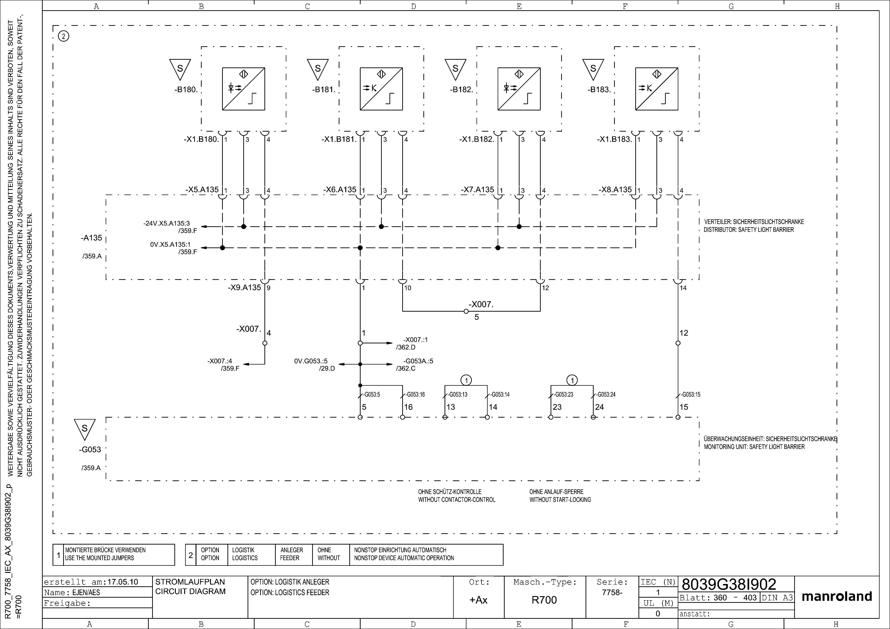

# +Ax — Sheet 360 of 403 — OPTION: LOGISTIK ANLEGER

**OPTION: LOGISTICS FEEDER**

> Part of the manroland **R700** printing press IEC/UL circuit diagrams.
> Drawing class: **Stromlaufplan / Circuit diagram** (DIN A3).
> Document `+Ax` covers the **Central control console** machine section.

## At a glance

| Field | Value |
|---|---|
| Document | `+Ax`  (8039G38I902) |
| Sheet | **360** of 403 |
| Section (DE) | OPTION: LOGISTIK ANLEGER |
| Section (EN) | OPTION: LOGISTICS FEEDER |
| Section type | CIRCUIT — Circuit diagram |
| Machine type | `R700` |
| Series | `7758` |
| Created | 17.05.10 |
| Replaces | — |
| Columns used | A, B, C, D, E, F, G |
| Path numbers | — |
| Labels on sheet | 108 |
| Cross-refs out | 8 |
| Cross-refs in | 37 |

**Previous:** [+Ax sheet 359](SHEET_0359.md) · **Next:** [+Ax sheet 361](SHEET_0361.md) · **Document TOC:** [_TOC.md](_TOC.md)  (+Ax) · **Master TOC:** [all sheets](../_MASTER_TOC.md)

## Sheet image (300 DPI, exact vector render)



_Rendered directly from the PDF vector layer at 300 DPI (1-bit), no OCR and no resampling. Use it to confirm anything ambiguous in the text below._

## Cross-references on this sheet

Each entry is a wire leaving this sheet. The printed token is `/sheet.column`; the link resolves to that sheet inside the same document.

| Ref | Target sheet | Col | Path | Destination on target | Target section | From col |
|---|---|---|---|---|---|---|
| `/359.F` | [+Ax sheet 359](SHEET_0359.md) | F | — | 24V.X5.A135:3 | OPTION: LOGISTIK ANLEGER | B |
| `/359.F` | [+Ax sheet 359](SHEET_0359.md) | F | — | 0V.X5.A135:1 | OPTION: LOGISTIK ANLEGER | B |
| `/359.A` | [+Ax sheet 359](SHEET_0359.md) | A | — | — | OPTION: LOGISTIK ANLEGER | A |
| `/362.D` | [+Ax sheet 362](SHEET_0362.md) | D | — | — | OPTION: LOGISTIK ANLEGER | D |
| `/29.D` | [+Ax sheet 29](SHEET_0029.md) | D | — | 0V.G053.:5 | SPANNUNGSVERSORGUNG, SCHALTSCHRANKBELÜFTUNG | C |
| `/359.F` | [+Ax sheet 359](SHEET_0359.md) | F | — | X007.:4 G053A.:5 | OPTION: LOGISTIK ANLEGER | C |
| `/362.C` | [+Ax sheet 362](SHEET_0362.md) | C | — | — | OPTION: LOGISTIK ANLEGER | D |
| `/359.A` | [+Ax sheet 359](SHEET_0359.md) | A | — | — | OPTION: LOGISTIK ANLEGER | A |

### Incoming references (sheets that point here)

Every other sheet that sends a wire to this one. `Back-ref` is the token printed on *that* sheet; `Path` is its line number.

| From sheet | Cols | Back-ref | Path | Refs | What continues there |
|---|---|---|---|---|---|
| [+Ax#29](SHEET_0029.md) | D | `/29.D` | — | 1 | 0V.G053.:5 |
| [+Ax#212](SHEET_0212.md) | B, C, E, F | `/212.B`, `/212.C`, `/212.E`, `/212.F` | — | 12 | — |
| [+Ax#230](SHEET_0230.md) | B | `/230.B` | — | 3 | — |
| [+Ax#233](SHEET_0233.md) | B | `/233.B` | — | 3 | — |
| [+Ax#235](SHEET_0235.md) | B | `/235.B` | — | 3 | — |
| [+Ax#237](SHEET_0237.md) | C | `/237.C` | — | 3 | — |
| [+Ax#240](SHEET_0240.md) | B | `/240.B` | — | 5 | — |
| [+Ax#359](SHEET_0359.md) | A, F | `/359.A`, `/359.F` | — | 5 | — |
| [+Ax#362](SHEET_0362.md) | B, C | `/362.B`, `/362.C` | — | 2 | G053A.:5; X007.:1 |


## Devices on this sheet

| Tag | Class | Class meaning (IEC) | Col | Sub | Terminal | Sign |
|---|---|---|---|---|---|---|
| `A135` | A | Baugruppe / assembly, module, PC board | A | — | — | — |
| `G053` | G | Stromversorgung / power supply | A | — | — | — |
| `G053:5` | G | Stromversorgung / power supply | D | — | 5 | — |
| `G053:16` | G | Stromversorgung / power supply | D | — | 16 | — |
| `G053:13` | G | Stromversorgung / power supply | D | — | 13 | — |
| `G053:14` | G | Stromversorgung / power supply | E | — | 14 | — |
| `G053:23` | G | Stromversorgung / power supply | E | — | 23 | — |
| `G053:24` | G | Stromversorgung / power supply | F | — | 24 | — |
| `G053:15` | G | Stromversorgung / power supply | G | — | 15 | — |
| `B180.` | — | cross-device reference | B | — | — | — |
| `X1.B180.` | — | cross-device reference | B | — | — | — |
| `B181.` | — | cross-device reference | C | — | — | — |
| `X1.B181.` | — | cross-device reference | C | — | — | — |
| `B182.` | — | cross-device reference | D | — | — | — |
| `X1.B182.` | — | cross-device reference | E | — | — | — |
| `B183.` | — | cross-device reference | F | — | — | — |
| `X1.B183.` | — | cross-device reference | F | — | — | — |
| `X5.A135` | — | cross-device reference | B | — | — | — |
| `X9.A135` | — | cross-device reference | B | — | — | — |
| `X6.A135` | — | cross-device reference | C | — | — | — |
| `X7.A135` | — | cross-device reference | E | — | — | — |
| `X8.A135` | — | cross-device reference | F | — | — | — |
| `X007.` | — | cross-device reference | E | — | — | — |
| `X007.` | — | cross-device reference | B | — | — | — |

## Potentials / nets

| Potential | Count | Columns | Attached devices | Terminals |
|---|---|---|---|---|
| `0V` | 1 | B | `A135`, `X5` | `1` |
| `24V` | 1 | B | `A135`, `X5` | `3` |


A potential such as `L24+/4` or `M24+` is a named supply/return rail; every place it appears on this sheet is electrically common.

## Wire-end annotations (grouped as printed)

A wire that continues elsewhere is annotated with a small cluster: the destination description, the path/line number `#NN`, and the `/sheet.column` cross reference. Each row below is one such cluster exactly as it is grouped on the drawing.

| Col | Y | Path | Cross-ref | Text on the wire |
|---|---|---|---|---|
| A | 45.6 | — | — | `2` |
| D | 86.1 | — | — | `S S S S` |
| B | 115.1 | — | — | `B180.` |
| C | 115.1 | — | — | `B181.` |
| D | 115.1 | — | — | `B182.` |
| F | 115.1 | — | — | `B183.` |
| B | 181.7 | — | — | `X1.B180. 1 3 4` |
| D | 181.7 | — | — | `X1.B181. 1 3 4` |
| E | 181.7 | — | — | `X1.B182. 1 3 4` |
| F | 181.7 | — | — | `X1.B183. 1 3 4` |
| B | 249.1 | — | — | `X5.A135 1 3 4` |
| D | 249.1 | — | — | `X6.A135 1 3 4` |
| E | 249.1 | — | — | `X7.A135 1 3 4` |
| F | 249.1 | — | — | `X8.A135 1 3 4` |
| G | 294.0 | — | — | `DISTRIBUTOR: SAFETY LIGHT BARRIER VERTEILER: SICHERHEITSLICHTSCHRANKE` |
| B | 295.1 | — | `/359.F` | `24V.X5.A135:3` |
| A | 313.5 | — | — | `A135` |
| B | 323.4 | — | `/359.F` | `0V.X5.A135:1` |
| A | 339.0 | — | `/359.A` | — |
| B | 380.1 | — | — | `X9.A135 9` |
| D | 381.6 | — | — | `1` |
| D | 381.6 | — | — | `10` |
| E | 381.6 | — | — | `12` |
| G | 381.6 | — | — | `14` |
| E | 402.3 | — | — | `X007.` |
| E | 419.8 | — | — | `5` |
| B | 435.2 | — | — | `X007. 4` |
| D | 441.1 | — | — | `1` |
| G | 441.1 | — | — | `12` |
| D | 451.0 | — | — | `X007.:1` |
| D | 460.9 | — | `/362.D` | — |
| C | 479.3 | — | `/359.F` | `X007.:4 G053A.:5` |
| C | 479.3 | — | `/29.D` | `0V.G053.:5` |
| D | 489.3 | — | `/362.C` | — |
| E | 505.8 | — | — | `1 1` |
| D | 525.0 | — | — | `G053:5 G053:16` |
| E | 525.1 | — | — | `G053:13 G053:14 G053:23 G053:24` |
| G | 525.1 | — | — | `G053:15` |
| E | 540.3 | — | — | `5 15` |
| E | 540.3 | — | — | `16 13 14 23 24` |
| A | 568.0 | — | — | `S` |
| G | 584.6 | — | — | `ÜBERWACHUNGSEINHEIT: SICHERHEITSLICHTSCHRANKE MONITORING UNIT: SAFETY LIGHT BARRIER` |
| A | 597.0 | — | — | `G053` |
| A | 622.5 | — | `/359.A` | — |
| E | 655.4 | — | — | `OHNE ANLAUF SPERRE WITHOUT START LOCKING` |
| D | 655.5 | — | — | `OHNE SCHÜTZ KONTROLLE WITHOUT CONTACTOR CONTROL` |
| A | 733.4 | — | — | `1 USE THE MOUNTED JUMPERS MONTIERTE BRÜCKE VERWENDEN` |
| C | 733.4 | — | — | `2 NONSTOP EINRICHTUNG AUTOMATISCH NONSTOP DEVICE AUTOMATIC OPERATION` |
| B | 733.4 | — | — | `OPTION OPTION` |
| B | 733.4 | — | — | `LOGISTIK LOGISTICS` |
| C | 733.4 | — | — | `FEEDER ANLEGER` |
| C | 733.4 | — | — | `OHNE WITHOUT` |


## Reconstructed tables

This sheet carries tabular content (pin map / terminal assignment / index). The grid below was rebuilt from the drawing's own rule lines, so each row is exactly one physical row of the table.

### Table 1 — 2 data rows × 4 columns (at x=481.9, y=90.7) — **S B182.**

| 1 1 | 3 3 | 4 4 | X1.B182. X7.A135 |
|---|---|---|---|
| `1` |  | `10` | `X007.` |
| `1` |  | `X007.:1 /362.D G053A.:5 /362.C` | `5 1` |


### Table 2 — 2 data rows × 7 columns (at x=666.1, y=90.7) — **S B183.**

| 1 1 | 3 3 | 4 4 |  | X1.B183. X8.A135 | 1 1 | 3 3 |
|---|---|---|---|---|---|---|
|  |  | `12` |  |  |  |  |
|  |  |  | `1` |  |  |  |


## Notes and free text on this sheet

| Text | Col | Y (pt) |
|---|---|---|
| `VERTEILER: SICHERHEITSLICHTSCHRANKE` | G | 294.02 |
| `DISTRIBUTOR: SAFETY LIGHT BARRIER` | G | 304.64 |
| `ÜBERWACHUNGSEINHEIT: SICHERHEITSLICHTSCHRANKE` | G | 584.56 |
| `MONITORING UNIT: SAFETY LIGHT BARRIER` | G | 595.2 |
| `G053A.:5` | D | 479.34 |
| `X007.:4` | B | 479.34 |
| `X007.:1` | D | 450.99 |
| `0V.G053.:5` | C | 479.33 |
| `MONTIERTE BRÜCKE VERWENDEN` | A | 733.37 |
| `USE THE MOUNTED JUMPERS` | A | 744.02 |
| `S` | A | 568.02 |
| `S` | B | 86.13 |
| `S` | C | 86.13 |
| `S` | D | 86.13 |
| `S` | F | 86.13 |
| `OHNE ANLAUF SPERRE` | E | 655.44 |
| `WITHOUT START LOCKING` | E | 666.05 |
| `OHNE SCHÜTZ KONTROLLE` | D | 655.45 |
| `WITHOUT CONTACTOR CONTROL` | D | 666.08 |
| `OPTION` | B | 733.35 |
| `LOGISTIK` | B | 733.35 |
| `LOGISTICS` | B | 743.98 |
| `ANLEGER` | C | 733.39 |
| `FEEDER` | C | 743.99 |
| `OHNE` | C | 733.37 |
| `WITHOUT` | C | 743.97 |
| `NONSTOP EINRICHTUNG AUTOMATISCH` | D | 733.39 |
| `NONSTOP DEVICE AUTOMATIC OPERATION` | D | 744.01 |

## Complete label inventory (exact text from the drawing)

Every text object inside the drawing area of this sheet, in DIN reading order (column A→H, then top→bottom). This is the authoritative list: if a string is not here it is not printed on this sheet.

| Col | Y | X | Dir | Type | Text |
|---|---|---|---|---|---|
| A | 45.6 | 83.0 | → | number | `2` |
| A | 313.5 | 108.3 | → | device tag | `A135` |
| A | 339.0 | 110.6 | → | cross-reference | `/359.A` |
| A | 568.0 | 109.3 | → | text | `S` |
| A | 597.0 | 105.7 | → | device tag | `G053` |
| A | 622.5 | 109.1 | → | cross-reference | `/359.A` |
| A | 733.4 | 87.3 | → | text | `MONTIERTE BRÜCKE VERWENDEN` |
| A | 738.7 | 75.4 | → | number | `1` |
| A | 744.0 | 87.0 | → | text | `USE THE MOUNTED JUMPERS` |
| B | 86.1 | 236.8 | → | text | `S` |
| B | 115.1 | 233.6 | → | device ref | `B180.` |
| B | 181.7 | 246.0 | → | device ref | `X1.B180.` |
| B | 183.2 | 299.6 | → | number | `1` |
| B | 183.2 | 328.5 | → | number | `3` |
| B | 249.0 | 248.3 | → | device ref | `X5.A135` |
| B | 251.2 | 299.6 | → | number | `1` |
| B | 251.2 | 328.5 | → | number | `3` |
| B | 295.1 | 191.9 | → | potential | `24V.X5.A135:3` |
| B | 305.0 | 239.0 | → | cross-reference | `/359.F` |
| B | 323.4 | 201.0 | → | potential | `0V.X5.A135:1` |
| B | 333.3 | 239.0 | → | cross-reference | `/359.F` |
| B | 380.2 | 305.0 | → | device ref | `X9.A135` |
| B | 435.2 | 316.3 | → | device ref | `X007.` |
| B | 479.3 | 277.5 | → | text | `X007.:4` |
| B | 489.2 | 295.7 | → | cross-reference | `/359.F` |
| B | 733.4 | 269.0 | → | text | `OPTION` |
| B | 733.4 | 311.0 | → | text | `LOGISTIK` |
| B | 738.7 | 252.3 | → | number | `2` |
| B | 744.0 | 269.0 | → | text | `OPTION` |
| B | 744.0 | 311.0 | → | text | `LOGISTICS` |
| C | 86.1 | 421.1 | → | text | `S` |
| C | 115.1 | 417.8 | → | device ref | `B181.` |
| C | 181.7 | 430.3 | → | device ref | `X1.B181.` |
| C | 183.2 | 356.9 | → | number | `4` |
| C | 249.0 | 432.6 | → | device ref | `X6.A135` |
| C | 251.2 | 356.9 | → | number | `4` |
| C | 381.6 | 356.9 | → | number | `9` |
| C | 441.1 | 356.9 | → | number | `4` |
| C | 479.3 | 393.7 | → | text | `0V.G053.:5` |
| C | 489.3 | 427.2 | → | cross-reference | `/29.D` |
| C | 733.4 | 375.6 | → | text | `ANLEGER` |
| C | 733.4 | 424.9 | → | text | `OHNE` |
| C | 744.0 | 374.7 | → | text | `FEEDER` |
| C | 744.0 | 425.2 | → | text | `WITHOUT` |
| D | 86.1 | 605.3 | → | text | `S` |
| D | 115.1 | 602.1 | → | device ref | `B182.` |
| D | 183.2 | 483.9 | → | number | `1` |
| D | 183.2 | 512.8 | → | number | `3` |
| D | 183.2 | 541.1 | → | number | `4` |
| D | 251.2 | 483.9 | → | number | `1` |
| D | 251.2 | 512.8 | → | number | `3` |
| D | 251.2 | 541.1 | → | number | `4` |
| D | 381.6 | 483.9 | → | number | `1` |
| D | 381.6 | 540.6 | → | number | `10` |
| D | 441.1 | 483.6 | → | number | `1` |
| D | 451.0 | 539.7 | → | text | `X007.:1` |
| D | 460.9 | 530.1 | → | cross-reference | `/362.D` |
| D | 479.3 | 539.7 | → | text | `G053A.:5` |
| D | 489.3 | 530.1 | → | cross-reference | `/362.C` |
| D | 525.1 | 485.9 | → | device tag | `G053:5` |
| D | 525.1 | 542.6 | → | device tag | `G053:16` |
| D | 525.1 | 599.2 | → | device tag | `G053:13` |
| D | 540.3 | 484.2 | → | number | `5` |
| D | 540.3 | 540.3 | → | number | `16` |
| D | 540.3 | 597.0 | → | number | `13` |
| D | 655.4 | 559.6 | → | text | `OHNE SCHÜTZ KONTROLLE` |
| D | 666.1 | 559.8 | → | text | `WITHOUT CONTACTOR CONTROL` |
| D | 733.4 | 474.0 | → | text | `NONSTOP EINRICHTUNG AUTOMATISCH` |
| D | 744.0 | 474.0 | → | text | `NONSTOP DEVICE AUTOMATIC OPERATION` |
| E | 181.7 | 614.6 | → | device ref | `X1.B182.` |
| E | 183.2 | 668.1 | → | number | `1` |
| E | 183.2 | 697.0 | → | number | `3` |
| E | 183.2 | 725.4 | → | number | `4` |
| E | 249.0 | 616.8 | → | device ref | `X7.A135` |
| E | 251.2 | 668.1 | → | number | `1` |
| E | 251.2 | 697.0 | → | number | `3` |
| E | 251.2 | 725.4 | → | number | `4` |
| E | 381.6 | 724.8 | → | number | `12` |
| E | 402.3 | 627.2 | → | device ref | `X007.` |
| E | 419.8 | 634.8 | → | number | `5` |
| E | 505.8 | 621.9 | → | number | `1` |
| E | 525.1 | 655.9 | → | device tag | `G053:14` |
| E | 525.1 | 741.0 | → | device tag | `G053:23` |
| E | 540.3 | 653.7 | → | number | `14` |
| E | 540.3 | 739.6 | → | number | `23` |
| E | 655.4 | 708.4 | → | text | `OHNE ANLAUF SPERRE` |
| E | 666.1 | 708.7 | → | text | `WITHOUT START LOCKING` |
| F | 86.1 | 789.6 | → | text | `S` |
| F | 115.1 | 786.3 | → | device ref | `B183.` |
| F | 181.7 | 798.8 | → | device ref | `X1.B183.` |
| F | 183.2 | 852.4 | → | number | `1` |
| F | 183.2 | 881.3 | → | number | `3` |
| F | 249.0 | 801.1 | → | device ref | `X8.A135` |
| F | 251.2 | 852.4 | → | number | `1` |
| F | 251.2 | 881.3 | → | number | `3` |
| F | 505.8 | 763.6 | → | number | `1` |
| F | 525.1 | 797.7 | → | device tag | `G053:24` |
| F | 540.3 | 796.3 | → | number | `24` |
| G | 183.2 | 909.6 | → | number | `4` |
| G | 251.2 | 909.6 | → | number | `4` |
| G | 294.0 | 942.5 | → | text | `VERTEILER: SICHERHEITSLICHTSCHRANKE` |
| G | 304.6 | 941.7 | → | text | `DISTRIBUTOR: SAFETY LIGHT BARRIER` |
| G | 381.6 | 909.1 | → | number | `14` |
| G | 441.1 | 908.8 | → | number | `12` |
| G | 525.1 | 911.1 | → | device tag | `G053:15` |
| G | 540.3 | 908.8 | → | number | `15` |
| G | 584.6 | 941.7 | → | text | `ÜBERWACHUNGSEINHEIT: SICHERHEITSLICHTSCHRANKE` |
| G | 595.2 | 942.0 | → | text | `MONITORING UNIT: SAFETY LIGHT BARRIER` |

## Reading-order text block

The same content as a plain block, grouped by DIN column — convenient to paste or to match against a visual description.

```text
=== Column A ===
  45.6   83.0  numeric      2
 313.5  108.3  devtag       A135
 339.0  110.6  xref         /359.A
 568.0  109.3  text         S
 597.0  105.7  devtag       G053
 622.5  109.1  xref         /359.A
 733.4   87.3  text         MONTIERTE BRÜCKE VERWENDEN
 738.7   75.4  numeric      1
 744.0   87.0  text         USE THE MOUNTED JUMPERS
=== Column B ===
  86.1  236.8  text         S
 115.1  233.6  devref       B180.
 181.7  246.0  devref       X1.B180.
 183.2  299.6  numeric      1
 183.2  328.5  numeric      3
 249.0  248.3  devref       X5.A135
 251.2  299.6  numeric      1
 251.2  328.5  numeric      3
 295.1  191.9  net          24V.X5.A135:3
 305.0  239.0  xref         /359.F
 323.4  201.0  net          0V.X5.A135:1
 333.3  239.0  xref         /359.F
 380.2  305.0  devref       X9.A135
 435.2  316.3  devref       X007.
 479.3  277.5  text         X007.:4
 489.2  295.7  xref         /359.F
 733.4  269.0  text         OPTION
 733.4  311.0  text         LOGISTIK
 738.7  252.3  numeric      2
 744.0  269.0  text         OPTION
 744.0  311.0  text         LOGISTICS
=== Column C ===
  86.1  421.1  text         S
 115.1  417.8  devref       B181.
 181.7  430.3  devref       X1.B181.
 183.2  356.9  numeric      4
 249.0  432.6  devref       X6.A135
 251.2  356.9  numeric      4
 381.6  356.9  numeric      9
 441.1  356.9  numeric      4
 479.3  393.7  text         0V.G053.:5
 489.3  427.2  xref         /29.D
 733.4  375.6  text         ANLEGER
 733.4  424.9  text         OHNE
 744.0  374.7  text         FEEDER
 744.0  425.2  text         WITHOUT
=== Column D ===
  86.1  605.3  text         S
 115.1  602.1  devref       B182.
 183.2  483.9  numeric      1
 183.2  512.8  numeric      3
 183.2  541.1  numeric      4
 251.2  483.9  numeric      1
 251.2  512.8  numeric      3
 251.2  541.1  numeric      4
 381.6  483.9  numeric      1
 381.6  540.6  numeric      10
 441.1  483.6  numeric      1
 451.0  539.7  text         X007.:1
 460.9  530.1  xref         /362.D
 479.3  539.7  text         G053A.:5
 489.3  530.1  xref         /362.C
 525.1  485.9  devtag       G053:5
 525.1  542.6  devtag       G053:16
 525.1  599.2  devtag       G053:13
 540.3  484.2  numeric      5
 540.3  540.3  numeric      16
 540.3  597.0  numeric      13
 655.4  559.6  text         OHNE SCHÜTZ KONTROLLE
 666.1  559.8  text         WITHOUT CONTACTOR CONTROL
 733.4  474.0  text         NONSTOP EINRICHTUNG AUTOMATISCH
 744.0  474.0  text         NONSTOP DEVICE AUTOMATIC OPERATION
=== Column E ===
 181.7  614.6  devref       X1.B182.
 183.2  668.1  numeric      1
 183.2  697.0  numeric      3
 183.2  725.4  numeric      4
 249.0  616.8  devref       X7.A135
 251.2  668.1  numeric      1
 251.2  697.0  numeric      3
 251.2  725.4  numeric      4
 381.6  724.8  numeric      12
 402.3  627.2  devref       X007.
 419.8  634.8  numeric      5
 505.8  621.9  numeric      1
 525.1  655.9  devtag       G053:14
 525.1  741.0  devtag       G053:23
 540.3  653.7  numeric      14
 540.3  739.6  numeric      23
 655.4  708.4  text         OHNE ANLAUF SPERRE
 666.1  708.7  text         WITHOUT START LOCKING
=== Column F ===
  86.1  789.6  text         S
 115.1  786.3  devref       B183.
 181.7  798.8  devref       X1.B183.
 183.2  852.4  numeric      1
 183.2  881.3  numeric      3
 249.0  801.1  devref       X8.A135
 251.2  852.4  numeric      1
 251.2  881.3  numeric      3
 505.8  763.6  numeric      1
 525.1  797.7  devtag       G053:24
 540.3  796.3  numeric      24
=== Column G ===
 183.2  909.6  numeric      4
 251.2  909.6  numeric      4
 294.0  942.5  text         VERTEILER: SICHERHEITSLICHTSCHRANKE
 304.6  941.7  text         DISTRIBUTOR: SAFETY LIGHT BARRIER
 381.6  909.1  numeric      14
 441.1  908.8  numeric      12
 525.1  911.1  devtag       G053:15
 540.3  908.8  numeric      15
 584.6  941.7  text         ÜBERWACHUNGSEINHEIT: SICHERHEITSLICHTSCHRANKE
 595.2  942.0  text         MONITORING UNIT: SAFETY LIGHT BARRIER
```

---
_Generated from the PDF vector text layer; no OCR. Source: `R700_7758_IEC_AX_8039G38I902_p`, sheet 360._
