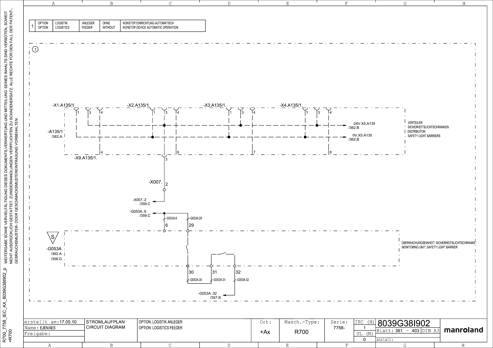

# +Ax — Sheet 361 of 403 — OPTION: LOGISTIK ANLEGER

**OPTION: LOGISTICS FEEDER**

> Part of the manroland **R700** printing press IEC/UL circuit diagrams.
> Drawing class: **Stromlaufplan / Circuit diagram** (DIN A3).
> Document `+Ax` covers the **Central control console** machine section.

## At a glance

| Field | Value |
|---|---|
| Document | `+Ax`  (8039G38I902) |
| Sheet | **361** of 403 |
| Section (DE) | OPTION: LOGISTIK ANLEGER |
| Section (EN) | OPTION: LOGISTICS FEEDER |
| Section type | CIRCUIT — Circuit diagram |
| Machine type | `R700` |
| Series | `7758` |
| Created | 17.05.10 |
| Replaces | — |
| Columns used | A, B, C, D, E, F, G, H |
| Path numbers | — |
| Labels on sheet | 68 |
| Cross-refs out | 8 |
| Cross-refs in | 25 |

**Previous:** [+Ax sheet 360](SHEET_0360.md) · **Next:** [+Ax sheet 362](SHEET_0362.md) · **Document TOC:** [_TOC.md](_TOC.md)  (+Ax) · **Master TOC:** [all sheets](../_MASTER_TOC.md)

## Sheet image (300 DPI, exact vector render)



_Rendered directly from the PDF vector layer at 300 DPI (1-bit), no OCR and no resampling. Use it to confirm anything ambiguous in the text below._

## Cross-references on this sheet

Each entry is a wire leaving this sheet. The printed token is `/sheet.column`; the link resolves to that sheet inside the same document.

| Ref | Target sheet | Col | Path | Destination on target | Target section | From col |
|---|---|---|---|---|---|---|
| `/362.B` | [+Ax sheet 362](SHEET_0362.md) | B | — | — | OPTION: LOGISTIK ANLEGER | F |
| `/362.A` | [+Ax sheet 362](SHEET_0362.md) | A | — | — | OPTION: LOGISTIK ANLEGER | A |
| `/362.B` | [+Ax sheet 362](SHEET_0362.md) | B | — | — | OPTION: LOGISTIK ANLEGER | F |
| `/359.C` | [+Ax sheet 359](SHEET_0359.md) | C | — | X007.:2 | OPTION: LOGISTIK ANLEGER | C |
| `/359.C` | [+Ax sheet 359](SHEET_0359.md) | C | — | G053A.:6 | OPTION: LOGISTIK ANLEGER | B |
| `/362.A` | [+Ax sheet 362](SHEET_0362.md) | A | — | — | OPTION: LOGISTIK ANLEGER | A |
| `/358.G` | [+Ax sheet 358](SHEET_0358.md) | G | — | — | OPTION: LOGISTIK ANLEGER | A |
| `/357.B` | [+Ax sheet 357](SHEET_0357.md) | B | — | G053A.:32 | OPTION: LOGISTIK ANLEGER | D |

### Incoming references (sheets that point here)

Every other sheet that sends a wire to this one. `Back-ref` is the token printed on *that* sheet; `Path` is its line number.

| From sheet | Cols | Back-ref | Path | Refs | What continues there |
|---|---|---|---|---|---|
| [+Ax#206](SHEET_0206.md) | D | `/206.D` | — | 3 | — |
| [+Ax#217](SHEET_0217.md) | C | `/217.C` | — | 3 | — |
| [+Ax#222](SHEET_0222.md) | C | `/222.C` | — | 3 | — |
| [+Ax#226](SHEET_0226.md) | C | `/226.C` | — | 3 | — |
| [+Ax#240](SHEET_0240.md) | C | `/240.C` | — | 5 | — |
| [+Ax#357](SHEET_0357.md) | C | `/357.C` | — | 1 | — |
| [+Ax#358](SHEET_0358.md) | F | `/358.F` | — | 1 | — |
| [+Ax#359](SHEET_0359.md) | C | `/359.C` | — | 2 | — |
| [+Ax#362](SHEET_0362.md) | A, B | `/362.A`, `/362.B` | — | 4 | 0V.X5.A135; 24V.X5.A135 |


## Devices on this sheet

| Tag | Class | Class meaning (IEC) | Col | Sub | Terminal | Sign |
|---|---|---|---|---|---|---|
| `A135/1` | A | Baugruppe / assembly, module, PC board | A | 1 | — | — |
| `X007.` | — | cross-device reference | C | — | — | — |

## Potentials / nets

| Potential | Count | Columns | Attached devices | Terminals |
|---|---|---|---|---|
| `0V` | 1 | F | `A135`, `X5` | — |
| `24V` | 1 | F | `A135`, `X5` | — |


A potential such as `L24+/4` or `M24+` is a named supply/return rail; every place it appears on this sheet is electrically common.

## Wire-end annotations (grouped as printed)

A wire that continues elsewhere is annotated with a small cluster: the destination description, the path/line number `#NN`, and the `/sheet.column` cross reference. Each row below is one such cluster exactly as it is grouped on the drawing.

| Col | Y | Path | Cross-ref | Text on the wire |
|---|---|---|---|---|
| A | 53.0 | — | — | `OPTION OPTION` |
| A | 53.0 | — | — | `LOGISTIK LOGISTICS` |
| B | 53.1 | — | — | `1 NONSTOP EINRICHTUNG AUTOMATISCH NONSTOP DEVICE AUTOMATIC OPERATION` |
| B | 53.1 | — | — | `FEEDER ANLEGER` |
| B | 53.1 | — | — | `OHNE WITHOUT` |
| A | 116.0 | — | — | `1` |
| C | 249.8 | — | — | `X1.A135/1 X2.A135/1. X3.A135/1. X4.A135/1.` |
| B | 268.2 | — | — | `1 3 4` |
| C | 268.2 | — | — | `1 3 4` |
| D | 268.2 | — | — | `1 3 4` |
| F | 268.2 | — | — | `1 3 4` |
| G | 294.0 | — | — | `DISTRIBUTOR: SICHERHEITSLICHTSCHRANKEN VERTEILER:` |
| F | 295.1 | — | — | `24V.X5.A135` |
| F | 305.0 | — | `/362.B` | — |
| A | 313.5 | — | — | `A135/1` |
| F | 323.4 | — | — | `0V.X5.A135` |
| G | 325.9 | — | — | `SAFETY LIGHT BARRIERS` |
| A | 326.6 | — | `/362.A` | — |
| F | 333.3 | — | `/362.B` | — |
| B | 364.6 | — | — | `4` |
| C | 364.6 | — | — | `6` |
| D | 364.6 | — | — | `7` |
| F | 364.6 | — | — | `8` |
| B | 377.3 | — | — | `X9.A135/1.` |
| C | 381.6 | — | — | `3` |
| C | 435.2 | — | — | `X007. 2` |
| C | 479.3 | — | `/359.C` | `X007.:2` |
| B | 507.7 | — | `/359.C` | `G053A.:6` |
| C | 525.0 | — | — | `G053A:6 G053A:29` |
| C | 540.3 | — | — | `6` |
| C | 540.3 | — | — | `29` |
| A | 568.0 | — | — | `S` |
| H | 584.6 | — | — | `ÜBERWACHUNGSEINHEIT: SICHERHEITSLICHTSCHRANKE MONITORING UNIT: SAFETY LIGHT BARRIER` |
| A | 597.0 | — | — | `G053A` |
| A | 610.1 | — | `/362.A`, `/358.G` | — |
| D | 653.7 | — | — | `30 31 32` |
| D | 673.8 | — | — | `G053A:30 G053A:31 G053A:32` |
| D | 706.1 | — | `/357.B` | `G053A.:32` |


## Reconstructed tables

This sheet carries tabular content (pin map / terminal assignment / index). The grid below was rebuilt from the drawing's own rule lines, so each row is exactly one physical row of the table.

### Table 1 — 1 data rows × 5 columns (at x=368.5, y=303.3)

| X007. | 3 2 | 6 |  |  |
|---|---|---|---|---|
|  | `G053A:6 6` |  | `G053A:29 29 30 G053A:30` | `31 G053A:31` |


## Notes and free text on this sheet

| Text | Col | Y (pt) |
|---|---|---|
| `VERTEILER:` | G | 293.99 |
| `SICHERHEITSLICHTSCHRANKEN` | G | 304.65 |
| `DISTRIBUTOR:` | G | 315.26 |
| `SAFETY LIGHT BARRIERS` | G | 325.9 |
| `G053A` | A | 597 |
| `ÜBERWACHUNGSEINHEIT: SICHERHEITSLICHTSCHRANKE` | H | 584.56 |
| `MONITORING UNIT: SAFETY LIGHT BARRIER` | G | 595.2 |
| `G053A.:6` | B | 507.69 |
| `G053A.:32` | D | 706.12 |
| `X007.:2` | B | 479.34 |
| `X1.A135/1` | A | 249.76 |
| `X2.A135/1.` | B | 249.77 |
| `X3.A135/1.` | D | 249.77 |
| `X4.A135/1.` | E | 249.77 |
| `X9.A135/1.` | B | 377.33 |
| `S` | A | 568.02 |
| `G053A:6` | C | 525.05 |
| `G053A:29` | C | 525.05 |
| `G053A:30` | C | 673.87 |
| `G053A:31` | D | 673.83 |
| `G053A:32` | D | 673.86 |
| `OPTION` | A | 53.04 |
| `LOGISTIK` | A | 53.04 |
| `LOGISTICS` | A | 63.67 |
| `ANLEGER` | B | 53.08 |
| `FEEDER` | B | 63.67 |
| `OHNE` | B | 53.06 |
| `WITHOUT` | B | 63.66 |
| `NONSTOP EINRICHTUNG AUTOMATISCH` | C | 53.08 |
| `NONSTOP DEVICE AUTOMATIC OPERATION` | C | 63.7 |

## Complete label inventory (exact text from the drawing)

Every text object inside the drawing area of this sheet, in DIN reading order (column A→H, then top→bottom). This is the authoritative list: if a string is not here it is not printed on this sheet.

| Col | Y | X | Dir | Type | Text |
|---|---|---|---|---|---|
| A | 53.0 | 91.8 | → | text | `OPTION` |
| A | 53.0 | 133.8 | → | text | `LOGISTIK` |
| A | 58.4 | 75.4 | → | number | `1` |
| A | 63.7 | 91.8 | → | text | `OPTION` |
| A | 63.7 | 133.8 | → | text | `LOGISTICS` |
| A | 116.0 | 83.3 | → | number | `1` |
| A | 249.8 | 126.1 | → | text | `X1.A135/1` |
| A | 268.2 | 186.2 | → | number | `1` |
| A | 313.5 | 115.1 | → | device tag | `A135/1` |
| A | 326.6 | 124.7 | → | cross-reference | `/362.A` |
| A | 568.0 | 123.4 | → | text | `S` |
| A | 597.0 | 112.0 | → | text | `G053A` |
| A | 610.1 | 123.3 | → | cross-reference | `/362.A` |
| A | 622.5 | 123.0 | → | cross-reference | `/358.G` |
| B | 53.1 | 198.4 | → | text | `ANLEGER` |
| B | 53.1 | 247.7 | → | text | `OHNE` |
| B | 63.7 | 197.6 | → | text | `FEEDER` |
| B | 63.7 | 248.0 | → | text | `WITHOUT` |
| B | 249.8 | 306.7 | → | text | `X2.A135/1.` |
| B | 268.2 | 215.1 | → | number | `3` |
| B | 268.2 | 243.5 | → | number | `4` |
| B | 364.6 | 243.5 | → | number | `4` |
| B | 377.3 | 179.1 | → | text | `X9.A135/1.` |
| B | 479.3 | 320.3 | → | text | `X007.:2` |
| B | 507.7 | 313.2 | → | text | `G053A.:6` |
| C | 53.1 | 296.8 | → | text | `NONSTOP EINRICHTUNG AUTOMATISCH` |
| C | 63.7 | 296.8 | → | text | `NONSTOP DEVICE AUTOMATIC OPERATION` |
| C | 268.2 | 370.5 | → | number | `1` |
| C | 268.2 | 399.4 | → | number | `3` |
| C | 268.2 | 427.7 | → | number | `4` |
| C | 364.6 | 427.7 | → | number | `6` |
| C | 381.6 | 399.4 | → | number | `3` |
| C | 435.2 | 358.9 | → | device ref | `X007.` |
| C | 441.1 | 399.4 | → | number | `2` |
| C | 489.3 | 337.3 | → | cross-reference | `/359.C` |
| C | 517.6 | 337.3 | → | cross-reference | `/359.C` |
| C | 525.0 | 400.8 | → | text | `G053A:6` |
| C | 525.1 | 457.5 | → | text | `G053A:29` |
| C | 540.3 | 399.4 | → | number | `6` |
| C | 540.3 | 456.1 | → | number | `29` |
| C | 653.7 | 455.8 | → | number | `30` |
| C | 673.9 | 457.5 | → | text | `G053A:30` |
| D | 249.8 | 491.0 | → | text | `X3.A135/1.` |
| D | 268.2 | 554.7 | → | number | `1` |
| D | 268.2 | 583.7 | → | number | `3` |
| D | 268.2 | 612.0 | → | number | `4` |
| D | 364.6 | 612.0 | → | number | `7` |
| D | 653.7 | 512.5 | → | number | `31` |
| D | 653.7 | 569.2 | → | number | `32` |
| D | 673.8 | 514.2 | → | text | `G053A:31` |
| D | 673.9 | 570.9 | → | text | `G053A:32` |
| D | 706.1 | 478.8 | → | text | `G053A.:32` |
| D | 716.0 | 507.7 | → | cross-reference | `/357.B` |
| E | 249.8 | 675.2 | → | text | `X4.A135/1.` |
| E | 268.2 | 739.0 | → | number | `1` |
| F | 268.2 | 767.9 | → | number | `3` |
| F | 268.2 | 796.3 | → | number | `4` |
| F | 295.1 | 851.5 | → | potential | `24V.X5.A135` |
| F | 305.0 | 841.9 | → | cross-reference | `/362.B` |
| F | 323.4 | 851.5 | → | potential | `0V.X5.A135` |
| F | 333.3 | 841.9 | → | cross-reference | `/362.B` |
| F | 364.6 | 796.3 | → | number | `8` |
| G | 294.0 | 985.0 | → | text | `VERTEILER:` |
| G | 304.7 | 984.8 | → | text | `SICHERHEITSLICHTSCHRANKEN` |
| G | 315.3 | 984.2 | → | text | `DISTRIBUTOR:` |
| G | 325.9 | 984.8 | → | text | `SAFETY LIGHT BARRIERS` |
| G | 595.2 | 970.3 | → | text | `MONITORING UNIT: SAFETY LIGHT BARRIER` |
| H | 584.6 | 970.0 | → | text | `ÜBERWACHUNGSEINHEIT: SICHERHEITSLICHTSCHRANKE` |

## Reading-order text block

The same content as a plain block, grouped by DIN column — convenient to paste or to match against a visual description.

```text
=== Column A ===
  53.0   91.8  text         OPTION
  53.0  133.8  text         LOGISTIK
  58.4   75.4  numeric      1
  63.7   91.8  text         OPTION
  63.7  133.8  text         LOGISTICS
 116.0   83.3  numeric      1
 249.8  126.1  text         X1.A135/1
 268.2  186.2  numeric      1
 313.5  115.1  devtag       A135/1
 326.6  124.7  xref         /362.A
 568.0  123.4  text         S
 597.0  112.0  text         G053A
 610.1  123.3  xref         /362.A
 622.5  123.0  xref         /358.G
=== Column B ===
  53.1  198.4  text         ANLEGER
  53.1  247.7  text         OHNE
  63.7  197.6  text         FEEDER
  63.7  248.0  text         WITHOUT
 249.8  306.7  text         X2.A135/1.
 268.2  215.1  numeric      3
 268.2  243.5  numeric      4
 364.6  243.5  numeric      4
 377.3  179.1  text         X9.A135/1.
 479.3  320.3  text         X007.:2
 507.7  313.2  text         G053A.:6
=== Column C ===
  53.1  296.8  text         NONSTOP EINRICHTUNG AUTOMATISCH
  63.7  296.8  text         NONSTOP DEVICE AUTOMATIC OPERATION
 268.2  370.5  numeric      1
 268.2  399.4  numeric      3
 268.2  427.7  numeric      4
 364.6  427.7  numeric      6
 381.6  399.4  numeric      3
 435.2  358.9  devref       X007.
 441.1  399.4  numeric      2
 489.3  337.3  xref         /359.C
 517.6  337.3  xref         /359.C
 525.0  400.8  text         G053A:6
 525.1  457.5  text         G053A:29
 540.3  399.4  numeric      6
 540.3  456.1  numeric      29
 653.7  455.8  numeric      30
 673.9  457.5  text         G053A:30
=== Column D ===
 249.8  491.0  text         X3.A135/1.
 268.2  554.7  numeric      1
 268.2  583.7  numeric      3
 268.2  612.0  numeric      4
 364.6  612.0  numeric      7
 653.7  512.5  numeric      31
 653.7  569.2  numeric      32
 673.8  514.2  text         G053A:31
 673.9  570.9  text         G053A:32
 706.1  478.8  text         G053A.:32
 716.0  507.7  xref         /357.B
=== Column E ===
 249.8  675.2  text         X4.A135/1.
 268.2  739.0  numeric      1
=== Column F ===
 268.2  767.9  numeric      3
 268.2  796.3  numeric      4
 295.1  851.5  net          24V.X5.A135
 305.0  841.9  xref         /362.B
 323.4  851.5  net          0V.X5.A135
 333.3  841.9  xref         /362.B
 364.6  796.3  numeric      8
=== Column G ===
 294.0  985.0  text         VERTEILER:
 304.7  984.8  text         SICHERHEITSLICHTSCHRANKEN
 315.3  984.2  text         DISTRIBUTOR:
 325.9  984.8  text         SAFETY LIGHT BARRIERS
 595.2  970.3  text         MONITORING UNIT: SAFETY LIGHT BARRIER
=== Column H ===
 584.6  970.0  text         ÜBERWACHUNGSEINHEIT: SICHERHEITSLICHTSCHRANKE
```

---
_Generated from the PDF vector text layer; no OCR. Source: `R700_7758_IEC_AX_8039G38I902_p`, sheet 361._
